# StudyBuddy — English Quiz Bank

> Every question has an ID, topic ID, type, difficulty, marks, the correct answer, accepted alternatives (where relevant) and a simple explanation. Answers are hidden until you open them.
> Difficulty: Beginner → Intermediate → Examination Level. Grammar items that appear in **English_Grammar_Mastery.md** are not repeated here.

## Sections

- [Subject–verb agreement](#qz-sva) — 60 questions
- [Tenses](#qz-tense) — 170 questions
- [Verbs and negatives](#qz-verb) — 30 questions
- [Question formation](#qz-qform) — 44 questions
- [Question tags](#qz-qtag) — 35 questions
- [Passive voice](#qz-pass) — 40 questions
- [Articles](#qz-art) — 33 questions
- [Nouns and plurals](#qz-noun) — 30 questions
- [Comparisons](#qz-comp) — 32 questions
- [Gerunds and infinitives](#qz-ger) — 53 questions
- [Prepositions](#qz-prep) — 36 questions
- [Conjunctions](#qz-conj) — 8 questions
- [Modal verbs](#qz-modal) — 2 questions
- [Reported speech](#qz-rep) — 6 questions
- [Conditionals](#qz-cond) — 3 questions
- [Relative clauses](#qz-rel) — 12 questions
- [Word formation](#qz-wf) — 38 questions
- [Punctuation](#qz-punc) — 6 questions
- [Sentence ordering (word order)](#qz-order) — 48 questions
- [Error correction](#qz-err) — 50 questions
- [Irregular verbs](#qz-irr) — 75 questions
- [Vocabulary meanings](#qz-voc) — 50 questions
- [Synonyms](#qz-syn) — 60 questions
- [Antonyms](#qz-ant) — 60 questions
- [Phrasal verbs](#qz-phrv) — 46 questions
- [Spelling](#qz-spell) — 57 questions
- [Commonly confused words](#qz-conf) — 25 questions
- [Dialogue completion](#qz-dial) — 16 questions
- [True or false](#qz-tf) — 20 questions
- [Matching](#qz-match) — 12 questions
- [Picture-based questions](#qz-pic) — 42 questions

---

## Subject–verb agreement

<!-- meta {"id":"ENG-QZ-SVA-0001","topic_id":"ENG-TOP-SVA","type":"fill_blank","difficulty":"Beginner","marks":1} -->
**ENG-QZ-SVA-0001** · Beginner · fill blank · 1 mark

We ___ a song every day. (sing/sings)

Answer and explanation

**Answer:** sing  
**Why:** With *We*, use the base form *sing* (no -s).

<!-- meta {"id":"ENG-QZ-SVA-0002","topic_id":"ENG-TOP-SVA","type":"multiple_choice","difficulty":"Beginner","marks":1} -->
**ENG-QZ-SVA-0002** · Beginner · multiple choice · 1 mark

Ahamed ___ letters every morning.

- A. send
- B. sending
- C. sends
- D. sent

Answer and explanation

**Answer:** C. sends  
**Why:** *Ahamed* is third-person singular, so the verb takes -s/-es: *sends*.

<!-- meta {"id":"ENG-QZ-SVA-0003","topic_id":"ENG-TOP-SVA","type":"fill_blank","difficulty":"Beginner","marks":1} -->
**ENG-QZ-SVA-0003** · Beginner · fill blank · 1 mark

Nimal ___ emails after school. (write/writes)

Answer and explanation

**Answer:** writes  
**Why:** *Nimal* is third-person singular, so the verb takes -s/-es: *writes*.

<!-- meta {"id":"ENG-QZ-SVA-0004","topic_id":"ENG-TOP-SVA","type":"multiple_choice","difficulty":"Beginner","marks":1} -->
**ENG-QZ-SVA-0004** · Beginner · multiple choice · 1 mark

Nimal ___ trees on Sundays.

- A. plants
- B. plant
- C. planting
- D. planted

Answer and explanation

**Answer:** A. plants  
**Why:** *Nimal* is third-person singular, so the verb takes -s/-es: *plants*.

<!-- meta {"id":"ENG-QZ-SVA-0005","topic_id":"ENG-TOP-SVA","type":"fill_blank","difficulty":"Beginner","marks":1} -->
**ENG-QZ-SVA-0005** · Beginner · fill blank · 1 mark

My brother ___ the newspaper every weekend. (read/reads)

Answer and explanation

**Answer:** reads  
**Why:** *My brother* is third-person singular, so the verb takes -s/-es: *reads*.

<!-- meta {"id":"ENG-QZ-SVA-0006","topic_id":"ENG-TOP-SVA","type":"multiple_choice","difficulty":"Beginner","marks":1} -->
**ENG-QZ-SVA-0006** · Beginner · multiple choice · 1 mark

We ___ stories in the evening.

- A. reads
- B. read
- C. reading

Answer and explanation

**Answer:** B. read  
**Why:** With *We*, use the base form *read* (no -s).

<!-- meta {"id":"ENG-QZ-SVA-0007","topic_id":"ENG-TOP-SVA","type":"fill_blank","difficulty":"Beginner","marks":1} -->
**ENG-QZ-SVA-0007** · Beginner · fill blank · 1 mark

Tharushi ___ English every day. (speak/speaks)

Answer and explanation

**Answer:** speaks  
**Why:** *Tharushi* is third-person singular, so the verb takes -s/-es: *speaks*.

<!-- meta {"id":"ENG-QZ-SVA-0008","topic_id":"ENG-TOP-SVA","type":"multiple_choice","difficulty":"Beginner","marks":1} -->
**ENG-QZ-SVA-0008** · Beginner · multiple choice · 1 mark

My sister ___ the garden every morning.

- A. cleaning
- B. cleaned
- C. clean
- D. cleans

Answer and explanation

**Answer:** D. cleans  
**Why:** *My sister* is third-person singular, so the verb takes -s/-es: *cleans*.  
**Common wrong answer:** *cleaning* needs a helping verb (am/is/are).

<!-- meta {"id":"ENG-QZ-SVA-0009","topic_id":"ENG-TOP-SVA","type":"fill_blank","difficulty":"Beginner","marks":1} -->
**ENG-QZ-SVA-0009** · Beginner · fill blank · 1 mark

She ___ the shop after school. (open/opens)

Answer and explanation

**Answer:** opens  
**Why:** *She* is third-person singular, so the verb takes -s/-es: *opens*.

<!-- meta {"id":"ENG-QZ-SVA-0010","topic_id":"ENG-TOP-SVA","type":"multiple_choice","difficulty":"Beginner","marks":1} -->
**ENG-QZ-SVA-0010** · Beginner · multiple choice · 1 mark

They ___ television on Sundays.

- A. watched
- B. watch
- C. watching
- D. watches

Answer and explanation

**Answer:** B. watch  
**Why:** With *They*, use the base form *watch* (no -s).

<!-- meta {"id":"ENG-QZ-SVA-0011","topic_id":"ENG-TOP-SVA","type":"fill_blank","difficulty":"Beginner","marks":1} -->
**ENG-QZ-SVA-0011** · Beginner · fill blank · 1 mark

The students ___ a new bag every weekend. (buy/buys)

Answer and explanation

**Answer:** buy  
**Why:** With *The students*, use the base form *buy* (no -s).

<!-- meta {"id":"ENG-QZ-SVA-0012","topic_id":"ENG-TOP-SVA","type":"multiple_choice","difficulty":"Beginner","marks":1} -->
**ENG-QZ-SVA-0012** · Beginner · multiple choice · 1 mark

She ___ the national anthem in the evening.

- A. sang
- B. sing
- C. sings
- D. singing

Answer and explanation

**Answer:** C. sings  
**Why:** *She* is third-person singular, so the verb takes -s/-es: *sings*.

<!-- meta {"id":"ENG-QZ-SVA-0013","topic_id":"ENG-TOP-SVA","type":"fill_blank","difficulty":"Beginner","marks":1} -->
**ENG-QZ-SVA-0013** · Beginner · fill blank · 1 mark

Ahamed ___ the cat every day. (feed/feeds)

Answer and explanation

**Answer:** feeds  
**Why:** *Ahamed* is third-person singular, so the verb takes -s/-es: *feeds*.

<!-- meta {"id":"ENG-QZ-SVA-0014","topic_id":"ENG-TOP-SVA","type":"multiple_choice","difficulty":"Beginner","marks":1} -->
**ENG-QZ-SVA-0014** · Beginner · multiple choice · 1 mark

Our neighbour ___ maps every morning.

- A. draw
- B. drew
- C. drawing
- D. draws

Answer and explanation

**Answer:** D. draws  
**Why:** *Our neighbour* is third-person singular, so the verb takes -s/-es: *draws*.

<!-- meta {"id":"ENG-QZ-SVA-0015","topic_id":"ENG-TOP-SVA","type":"fill_blank","difficulty":"Beginner","marks":1} -->
**ENG-QZ-SVA-0015** · Beginner · fill blank · 1 mark

Ahamed ___ emails after school. (write/writes)

Answer and explanation

**Answer:** writes  
**Why:** *Ahamed* is third-person singular, so the verb takes -s/-es: *writes*.

<!-- meta {"id":"ENG-QZ-SVA-0016","topic_id":"ENG-TOP-SVA","type":"multiple_choice","difficulty":"Beginner","marks":1} -->
**ENG-QZ-SVA-0016** · Beginner · multiple choice · 1 mark

Our neighbour ___ a letter on Sundays.

- A. writes
- B. writing
- C. wrote
- D. write

Answer and explanation

**Answer:** A. writes  
**Why:** *Our neighbour* is third-person singular, so the verb takes -s/-es: *writes*.  
**Common wrong answer:** *writing* needs a helping verb (am/is/are).

<!-- meta {"id":"ENG-QZ-SVA-0017","topic_id":"ENG-TOP-SVA","type":"fill_blank","difficulty":"Beginner","marks":1} -->
**ENG-QZ-SVA-0017** · Beginner · fill blank · 1 mark

The students ___ the library every weekend. (visit/visits)

Answer and explanation

**Answer:** visit  
**Why:** With *The students*, use the base form *visit* (no -s).

<!-- meta {"id":"ENG-QZ-SVA-0018","topic_id":"ENG-TOP-SVA","type":"multiple_choice","difficulty":"Beginner","marks":1} -->
**ENG-QZ-SVA-0018** · Beginner · multiple choice · 1 mark

Tharushi ___ football in the evening.

- A. playing
- B. plays
- C. play
- D. played

Answer and explanation

**Answer:** B. plays  
**Why:** *Tharushi* is third-person singular, so the verb takes -s/-es: *plays*.  
**Common wrong answer:** *playing* needs a helping verb (am/is/are).

<!-- meta {"id":"ENG-QZ-SVA-0019","topic_id":"ENG-TOP-SVA","type":"fill_blank","difficulty":"Beginner","marks":1} -->
**ENG-QZ-SVA-0019** · Beginner · fill blank · 1 mark

Kavya ___ the door every day. (open/opens)

Answer and explanation

**Answer:** opens  
**Why:** *Kavya* is third-person singular, so the verb takes -s/-es: *opens*.

<!-- meta {"id":"ENG-QZ-SVA-0020","topic_id":"ENG-TOP-SVA","type":"multiple_choice","difficulty":"Beginner","marks":1} -->
**ENG-QZ-SVA-0020** · Beginner · multiple choice · 1 mark

My friends ___ the teacher every morning.

- A. helping
- B. helped
- C. helps
- D. help

Answer and explanation

**Answer:** D. help  
**Why:** With *My friends*, use the base form *help* (no -s).  
**Common wrong answer:** *helping* needs a helping verb (am/is/are).

<!-- meta {"id":"ENG-QZ-SVA-0021","topic_id":"ENG-TOP-SVA","type":"fill_blank","difficulty":"Beginner","marks":1} -->
**ENG-QZ-SVA-0021** · Beginner · fill blank · 1 mark

My friends ___ a song after school. (sing/sings)

Answer and explanation

**Answer:** sing  
**Why:** With *My friends*, use the base form *sing* (no -s).

<!-- meta {"id":"ENG-QZ-SVA-0022","topic_id":"ENG-TOP-SVA","type":"multiple_choice","difficulty":"Beginner","marks":1} -->
**ENG-QZ-SVA-0022** · Beginner · multiple choice · 1 mark

I ___ the door on Sundays.

- A. open
- B. opened
- C. opens
- D. opening

Answer and explanation

**Answer:** A. open  
**Why:** With *I*, use the base form *open* (no -s).

<!-- meta {"id":"ENG-QZ-SVA-0023","topic_id":"ENG-TOP-SVA","type":"fill_blank","difficulty":"Beginner","marks":1} -->
**ENG-QZ-SVA-0023** · Beginner · fill blank · 1 mark

The students ___ the car every weekend. (wash/washes)

Answer and explanation

**Answer:** wash  
**Why:** With *The students*, use the base form *wash* (no -s).

<!-- meta {"id":"ENG-QZ-SVA-0024","topic_id":"ENG-TOP-SVA","type":"multiple_choice","difficulty":"Beginner","marks":1} -->
**ENG-QZ-SVA-0024** · Beginner · multiple choice · 1 mark

Our neighbour ___ the national anthem in the evening.

- A. sang
- B. sing
- C. sings
- D. singing

Answer and explanation

**Answer:** C. sings  
**Why:** *Our neighbour* is third-person singular, so the verb takes -s/-es: *sings*.

<!-- meta {"id":"ENG-QZ-SVA-0025","topic_id":"ENG-TOP-SVA","type":"fill_blank","difficulty":"Beginner","marks":1} -->
**ENG-QZ-SVA-0025** · Beginner · fill blank · 1 mark

Nimal ___ dinner every day. (cook/cooks)

Answer and explanation

**Answer:** cooks  
**Why:** *Nimal* is third-person singular, so the verb takes -s/-es: *cooks*.

<!-- meta {"id":"ENG-QZ-SVA-0026","topic_id":"ENG-TOP-SVA","type":"multiple_choice","difficulty":"Beginner","marks":1} -->
**ENG-QZ-SVA-0026** · Beginner · multiple choice · 1 mark

Ahamed ___ the teacher every morning.

- A. helped
- B. helping
- C. help
- D. helps

Answer and explanation

**Answer:** D. helps  
**Why:** *Ahamed* is third-person singular, so the verb takes -s/-es: *helps*.

<!-- meta {"id":"ENG-QZ-SVA-0027","topic_id":"ENG-TOP-SVA","type":"fill_blank","difficulty":"Beginner","marks":1} -->
**ENG-QZ-SVA-0027** · Beginner · fill blank · 1 mark

Tharushi ___ fruit after school. (eat/eats)

Answer and explanation

**Answer:** eats  
**Why:** *Tharushi* is third-person singular, so the verb takes -s/-es: *eats*.

<!-- meta {"id":"ENG-QZ-SVA-0028","topic_id":"ENG-TOP-SVA","type":"multiple_choice","difficulty":"Beginner","marks":1} -->
**ENG-QZ-SVA-0028** · Beginner · multiple choice · 1 mark

Our neighbour ___ trees on Sundays.

- A. planted
- B. plants
- C. planting
- D. plant

Answer and explanation

**Answer:** B. plants  
**Why:** *Our neighbour* is third-person singular, so the verb takes -s/-es: *plants*.

<!-- meta {"id":"ENG-QZ-SVA-0029","topic_id":"ENG-TOP-SVA","type":"fill_blank","difficulty":"Beginner","marks":1} -->
**ENG-QZ-SVA-0029** · Beginner · fill blank · 1 mark

My friends ___ pictures every weekend. (paint/paints)

Answer and explanation

**Answer:** paint  
**Why:** With *My friends*, use the base form *paint* (no -s).

<!-- meta {"id":"ENG-QZ-SVA-0030","topic_id":"ENG-TOP-SVA","type":"multiple_choice","difficulty":"Beginner","marks":1} -->
**ENG-QZ-SVA-0030** · Beginner · multiple choice · 1 mark

My parents ___ fruit in the evening.

- A. eat
- B. eating
- C. ate
- D. eats

Answer and explanation

**Answer:** A. eat  
**Why:** With *My parents*, use the base form *eat* (no -s).  
**Common wrong answer:** *eating* needs a helping verb (am/is/are).

<!-- meta {"id":"ENG-QZ-SVA-0031","topic_id":"ENG-TOP-SVA","type":"fill_blank","difficulty":"Beginner","marks":1} -->
**ENG-QZ-SVA-0031** · Beginner · fill blank · 1 mark

The students ___ photos every day. (take/takes)

Answer and explanation

**Answer:** take  
**Why:** With *The students*, use the base form *take* (no -s).

<!-- meta {"id":"ENG-QZ-SVA-0032","topic_id":"ENG-TOP-SVA","type":"multiple_choice","difficulty":"Beginner","marks":1} -->
**ENG-QZ-SVA-0032** · Beginner · multiple choice · 1 mark

Ahamed ___ tea every morning.

- A. drink
- B. drinking
- C. drank
- D. drinks

Answer and explanation

**Answer:** D. drinks  
**Why:** *Ahamed* is third-person singular, so the verb takes -s/-es: *drinks*.

<!-- meta {"id":"ENG-QZ-SVA-0033","topic_id":"ENG-TOP-SVA","type":"fill_blank","difficulty":"Beginner","marks":1} -->
**ENG-QZ-SVA-0033** · Beginner · fill blank · 1 mark

My parents ___ paddy after school. (grow/grows)

Answer and explanation

**Answer:** grow  
**Why:** With *My parents*, use the base form *grow* (no -s).

<!-- meta {"id":"ENG-QZ-SVA-0034","topic_id":"ENG-TOP-SVA","type":"multiple_choice","difficulty":"Beginner","marks":1} -->
**ENG-QZ-SVA-0034** · Beginner · multiple choice · 1 mark

We ___ vegetables on Sundays.

- A. selling
- B. sold
- C. sells
- D. sell

Answer and explanation

**Answer:** D. sell  
**Why:** With *We*, use the base form *sell* (no -s).  
**Common wrong answer:** *selling* needs a helping verb (am/is/are).

<!-- meta {"id":"ENG-QZ-SVA-0035","topic_id":"ENG-TOP-SVA","type":"fill_blank","difficulty":"Beginner","marks":1} -->
**ENG-QZ-SVA-0035** · Beginner · fill blank · 1 mark

Kavya ___ science every weekend. (study/studies)

Answer and explanation

**Answer:** studies  
**Why:** *Kavya* is third-person singular, so the verb takes -s/-es: *studies*.

<!-- meta {"id":"ENG-QZ-SVA-0036","topic_id":"ENG-TOP-SVA","type":"multiple_choice","difficulty":"Beginner","marks":1} -->
**ENG-QZ-SVA-0036** · Beginner · multiple choice · 1 mark

We ___ a kite in the evening.

- A. making
- B. made
- C. make
- D. makes

Answer and explanation

**Answer:** C. make  
**Why:** With *We*, use the base form *make* (no -s).  
**Common wrong answer:** *making* needs a helping verb (am/is/are).

<!-- meta {"id":"ENG-QZ-SVA-0037","topic_id":"ENG-TOP-SVA","type":"fill_blank","difficulty":"Beginner","marks":1} -->
**ENG-QZ-SVA-0037** · Beginner · fill blank · 1 mark

My brother ___ a cake every day. (make/makes)

Answer and explanation

**Answer:** makes  
**Why:** *My brother* is third-person singular, so the verb takes -s/-es: *makes*.

<!-- meta {"id":"ENG-QZ-SVA-0038","topic_id":"ENG-TOP-SVA","type":"multiple_choice","difficulty":"Beginner","marks":1} -->
**ENG-QZ-SVA-0038** · Beginner · multiple choice · 1 mark

You ___ the teacher every morning.

- A. helps
- B. helping
- C. help
- D. helped

Answer and explanation

**Answer:** C. help  
**Why:** With *You*, use the base form *help* (no -s).

<!-- meta {"id":"ENG-QZ-SVA-0039","topic_id":"ENG-TOP-SVA","type":"fill_blank","difficulty":"Beginner","marks":1} -->
**ENG-QZ-SVA-0039** · Beginner · fill blank · 1 mark

He ___ stories after school. (read/reads)

Answer and explanation

**Answer:** reads  
**Why:** *He* is third-person singular, so the verb takes -s/-es: *reads*.

<!-- meta {"id":"ENG-QZ-SVA-0040","topic_id":"ENG-TOP-SVA","type":"multiple_choice","difficulty":"Beginner","marks":1} -->
**ENG-QZ-SVA-0040** · Beginner · multiple choice · 1 mark

I ___ trees on Sundays.

- A. plant
- B. planting
- C. plants
- D. planted

Answer and explanation

**Answer:** A. plant  
**Why:** With *I*, use the base form *plant* (no -s).  
**Common wrong answer:** *planting* needs a helping verb (am/is/are).

<!-- meta {"id":"ENG-QZ-SVA-0041","topic_id":"ENG-TOP-SVA","type":"fill_blank","difficulty":"Beginner","marks":1} -->
**ENG-QZ-SVA-0041** · Beginner · fill blank · 1 mark

We ___ pictures every weekend. (paint/paints)

Answer and explanation

**Answer:** paint  
**Why:** With *We*, use the base form *paint* (no -s).

<!-- meta {"id":"ENG-QZ-SVA-0042","topic_id":"ENG-TOP-SVA","type":"multiple_choice","difficulty":"Beginner","marks":1} -->
**ENG-QZ-SVA-0042** · Beginner · multiple choice · 1 mark

He ___ noodles in the evening.

- A. cooks
- B. cooking
- C. cook
- D. cooked

Answer and explanation

**Answer:** A. cooks  
**Why:** *He* is third-person singular, so the verb takes -s/-es: *cooks*.  
**Common wrong answer:** *cooking* needs a helping verb (am/is/are).

<!-- meta {"id":"ENG-QZ-SVA-0043","topic_id":"ENG-TOP-SVA","type":"fill_blank","difficulty":"Beginner","marks":1} -->
**ENG-QZ-SVA-0043** · Beginner · fill blank · 1 mark

My friends ___ rice every day. (eat/eats)

Answer and explanation

**Answer:** eat  
**Why:** With *My friends*, use the base form *eat* (no -s).

<!-- meta {"id":"ENG-QZ-SVA-0044","topic_id":"ENG-TOP-SVA","type":"multiple_choice","difficulty":"Beginner","marks":1} -->
**ENG-QZ-SVA-0044** · Beginner · multiple choice · 1 mark

We ___ rice and curry every morning.

- A. cooking
- B. cooks
- C. cooked
- D. cook

Answer and explanation

**Answer:** D. cook  
**Why:** With *We*, use the base form *cook* (no -s).  
**Common wrong answer:** *cooking* needs a helping verb (am/is/are).

<!-- meta {"id":"ENG-QZ-SVA-0045","topic_id":"ENG-TOP-SVA","type":"fill_blank","difficulty":"Beginner","marks":1} -->
**ENG-QZ-SVA-0045** · Beginner · fill blank · 1 mark

They ___ stories after school. (read/reads)

Answer and explanation

**Answer:** read  
**Why:** With *They*, use the base form *read* (no -s).

<!-- meta {"id":"ENG-QZ-SVA-0046","topic_id":"ENG-TOP-SVA","type":"multiple_choice","difficulty":"Beginner","marks":1} -->
**ENG-QZ-SVA-0046** · Beginner · multiple choice · 1 mark

Ahamed ___ vegetables on Sundays.

- A. buy
- B. buying
- C. bought
- D. buys

Answer and explanation

**Answer:** D. buys  
**Why:** *Ahamed* is third-person singular, so the verb takes -s/-es: *buys*.

<!-- meta {"id":"ENG-QZ-SVA-0047","topic_id":"ENG-TOP-SVA","type":"fill_blank","difficulty":"Beginner","marks":1} -->
**ENG-QZ-SVA-0047** · Beginner · fill blank · 1 mark

She ___ an umbrella every weekend. (bring/brings)

Answer and explanation

**Answer:** brings  
**Why:** *She* is third-person singular, so the verb takes -s/-es: *brings*.

<!-- meta {"id":"ENG-QZ-SVA-0048","topic_id":"ENG-TOP-SVA","type":"multiple_choice","difficulty":"Beginner","marks":1} -->
**ENG-QZ-SVA-0048** · Beginner · multiple choice · 1 mark

Kavya ___ emails in the evening.

- A. write
- B. writes
- C. wrote
- D. writing

Answer and explanation

**Answer:** B. writes  
**Why:** *Kavya* is third-person singular, so the verb takes -s/-es: *writes*.

<!-- meta {"id":"ENG-QZ-SVA-0049","topic_id":"ENG-TOP-SVA","type":"fill_blank","difficulty":"Beginner","marks":1} -->
**ENG-QZ-SVA-0049** · Beginner · fill blank · 1 mark

You ___ the ball every day. (catch/catches)

Answer and explanation

**Answer:** catch  
**Why:** With *You*, use the base form *catch* (no -s).

<!-- meta {"id":"ENG-QZ-SVA-0050","topic_id":"ENG-TOP-SVA","type":"multiple_choice","difficulty":"Beginner","marks":1} -->
**ENG-QZ-SVA-0050** · Beginner · multiple choice · 1 mark

The students ___ water every morning.

- A. carried
- B. carries
- C. carry
- D. carrying

Answer and explanation

**Answer:** C. carry  
**Why:** With *The students*, use the base form *carry* (no -s).

<!-- meta {"id":"ENG-QZ-SVA-0051","topic_id":"ENG-TOP-SVA","type":"fill_blank","difficulty":"Beginner","marks":1} -->
**ENG-QZ-SVA-0051** · Beginner · fill blank · 1 mark

Our neighbour ___ paddy after school. (grow/grows)

Answer and explanation

**Answer:** grows  
**Why:** *Our neighbour* is third-person singular, so the verb takes -s/-es: *grows*.

<!-- meta {"id":"ENG-QZ-SVA-0052","topic_id":"ENG-TOP-SVA","type":"multiple_choice","difficulty":"Beginner","marks":1} -->
**ENG-QZ-SVA-0052** · Beginner · multiple choice · 1 mark

He ___ vegetables on Sundays.

- A. sells
- B. sell
- C. selling
- D. sold

Answer and explanation

**Answer:** A. sells  
**Why:** *He* is third-person singular, so the verb takes -s/-es: *sells*.

<!-- meta {"id":"ENG-QZ-SVA-0053","topic_id":"ENG-TOP-SVA","type":"fill_blank","difficulty":"Beginner","marks":1} -->
**ENG-QZ-SVA-0053** · Beginner · fill blank · 1 mark

They ___ Tamil every weekend. (speak/speaks)

Answer and explanation

**Answer:** speak  
**Why:** With *They*, use the base form *speak* (no -s).

<!-- meta {"id":"ENG-QZ-SVA-0054","topic_id":"ENG-TOP-SVA","type":"multiple_choice","difficulty":"Beginner","marks":1} -->
**ENG-QZ-SVA-0054** · Beginner · multiple choice · 1 mark

I ___ stories in the evening.

- A. read
- B. reading
- C. reads

Answer and explanation

**Answer:** A. read  
**Why:** With *I*, use the base form *read* (no -s).  
**Common wrong answer:** *reading* needs a helping verb (am/is/are).

<!-- meta {"id":"ENG-QZ-SVA-0055","topic_id":"ENG-TOP-SVA","type":"fill_blank","difficulty":"Beginner","marks":1} -->
**ENG-QZ-SVA-0055** · Beginner · fill blank · 1 mark

They ___ a cake every day. (make/makes)

Answer and explanation

**Answer:** make  
**Why:** With *They*, use the base form *make* (no -s).

<!-- meta {"id":"ENG-QZ-SVA-0056","topic_id":"ENG-TOP-SVA","type":"multiple_choice","difficulty":"Beginner","marks":1} -->
**ENG-QZ-SVA-0056** · Beginner · multiple choice · 1 mark

My sister ___ an umbrella every morning.

- A. brings
- B. bringing
- C. brought
- D. bring

Answer and explanation

**Answer:** A. brings  
**Why:** *My sister* is third-person singular, so the verb takes -s/-es: *brings*.  
**Common wrong answer:** *bringing* needs a helping verb (am/is/are).

<!-- meta {"id":"ENG-QZ-SVA-0057","topic_id":"ENG-TOP-SVA","type":"fill_blank","difficulty":"Beginner","marks":1} -->
**ENG-QZ-SVA-0057** · Beginner · fill blank · 1 mark

He ___ the boxes after school. (carry/carries)

Answer and explanation

**Answer:** carries  
**Why:** *He* is third-person singular, so the verb takes -s/-es: *carries*.

<!-- meta {"id":"ENG-QZ-SVA-0058","topic_id":"ENG-TOP-SVA","type":"multiple_choice","difficulty":"Beginner","marks":1} -->
**ENG-QZ-SVA-0058** · Beginner · multiple choice · 1 mark

My sister ___ vegetables on Sundays.

- A. grows
- B. growing
- C. grow
- D. grew

Answer and explanation

**Answer:** A. grows  
**Why:** *My sister* is third-person singular, so the verb takes -s/-es: *grows*.  
**Common wrong answer:** *growing* needs a helping verb (am/is/are).

<!-- meta {"id":"ENG-QZ-SVA-0059","topic_id":"ENG-TOP-SVA","type":"fill_blank","difficulty":"Beginner","marks":1} -->
**ENG-QZ-SVA-0059** · Beginner · fill blank · 1 mark

She ___ fish every weekend. (sell/sells)

Answer and explanation

**Answer:** sells  
**Why:** *She* is third-person singular, so the verb takes -s/-es: *sells*.

<!-- meta {"id":"ENG-QZ-SVA-0060","topic_id":"ENG-TOP-SVA","type":"multiple_choice","difficulty":"Beginner","marks":1} -->
**ENG-QZ-SVA-0060** · Beginner · multiple choice · 1 mark

The students ___ Sinhala in the evening.

- A. speaking
- B. speak
- C. speaks
- D. spoke

Answer and explanation

**Answer:** B. speak  
**Why:** With *The students*, use the base form *speak* (no -s).  
**Common wrong answer:** *speaking* needs a helping verb (am/is/are).

---

## Tenses

<!-- meta {"id":"ENG-QZ-TENSE-0001","topic_id":"ENG-TOP-TENSE","type":"fill_blank","difficulty":"Beginner","marks":1} -->
**ENG-QZ-TENSE-0001** · Beginner · fill blank · 1 mark

We ___ history last night. (study)

Answer and explanation

**Answer:** studied  
**Why:** *Last night* shows a finished past action → past simple *studied*.

<!-- meta {"id":"ENG-QZ-TENSE-0002","topic_id":"ENG-TOP-TENSE","type":"fill_blank","difficulty":"Beginner","marks":1} -->
**ENG-QZ-TENSE-0002** · Beginner · fill blank · 1 mark

Nimal ___ the classroom this morning. (clean)

Answer and explanation

**Answer:** cleaned  
**Why:** *This morning* shows a finished past action → past simple *cleaned*.

<!-- meta {"id":"ENG-QZ-TENSE-0003","topic_id":"ENG-TOP-TENSE","type":"fill_blank","difficulty":"Beginner","marks":1} -->
**ENG-QZ-TENSE-0003** · Beginner · fill blank · 1 mark

She ___ science yesterday. (study)

Answer and explanation

**Answer:** studied  
**Why:** *Yesterday* shows a finished past action → past simple *studied*.

<!-- meta {"id":"ENG-QZ-TENSE-0004","topic_id":"ENG-TOP-TENSE","type":"fill_blank","difficulty":"Beginner","marks":1} -->
**ENG-QZ-TENSE-0004** · Beginner · fill blank · 1 mark

She ___ books last week. (buy)

Answer and explanation

**Answer:** bought  
**Why:** *Last week* shows a finished past action → past simple *bought*.

<!-- meta {"id":"ENG-QZ-TENSE-0005","topic_id":"ENG-TOP-TENSE","type":"fill_blank","difficulty":"Beginner","marks":1} -->
**ENG-QZ-TENSE-0005** · Beginner · fill blank · 1 mark

I ___ the classroom last Sunday. (clean)

Answer and explanation

**Answer:** cleaned  
**Why:** *Last sunday* shows a finished past action → past simple *cleaned*.

<!-- meta {"id":"ENG-QZ-TENSE-0006","topic_id":"ENG-TOP-TENSE","type":"fill_blank","difficulty":"Beginner","marks":1} -->
**ENG-QZ-TENSE-0006** · Beginner · fill blank · 1 mark

Ahamed ___ the guitar two days ago. (play)

Answer and explanation

**Answer:** played  
**Why:** *Two days ago* shows a finished past action → past simple *played*.

<!-- meta {"id":"ENG-QZ-TENSE-0007","topic_id":"ENG-TOP-TENSE","type":"fill_blank","difficulty":"Beginner","marks":1} -->
**ENG-QZ-TENSE-0007** · Beginner · fill blank · 1 mark

My parents ___ a mango tree last night. (plant)

Answer and explanation

**Answer:** planted  
**Why:** *Last night* shows a finished past action → past simple *planted*.

<!-- meta {"id":"ENG-QZ-TENSE-0008","topic_id":"ENG-TOP-TENSE","type":"fill_blank","difficulty":"Beginner","marks":1} -->
**ENG-QZ-TENSE-0008** · Beginner · fill blank · 1 mark

He ___ trees this morning. (plant)

Answer and explanation

**Answer:** planted  
**Why:** *This morning* shows a finished past action → past simple *planted*.

<!-- meta {"id":"ENG-QZ-TENSE-0009","topic_id":"ENG-TOP-TENSE","type":"fill_blank","difficulty":"Beginner","marks":1} -->
**ENG-QZ-TENSE-0009** · Beginner · fill blank · 1 mark

The students ___ tea yesterday. (drink)

Answer and explanation

**Answer:** drank  
**Why:** *Yesterday* shows a finished past action → past simple *drank*.

<!-- meta {"id":"ENG-QZ-TENSE-0010","topic_id":"ENG-TOP-TENSE","type":"fill_blank","difficulty":"Beginner","marks":1} -->
**ENG-QZ-TENSE-0010** · Beginner · fill blank · 1 mark

She ___ the shop last week. (open)

Answer and explanation

**Answer:** opened  
**Why:** *Last week* shows a finished past action → past simple *opened*.

<!-- meta {"id":"ENG-QZ-TENSE-0011","topic_id":"ENG-TOP-TENSE","type":"fill_blank","difficulty":"Beginner","marks":1} -->
**ENG-QZ-TENSE-0011** · Beginner · fill blank · 1 mark

He ___ television last Sunday. (watch)

Answer and explanation

**Answer:** watched  
**Why:** *Last sunday* shows a finished past action → past simple *watched*.

<!-- meta {"id":"ENG-QZ-TENSE-0012","topic_id":"ENG-TOP-TENSE","type":"fill_blank","difficulty":"Beginner","marks":1} -->
**ENG-QZ-TENSE-0012** · Beginner · fill blank · 1 mark

Ahamed ___ fish two days ago. (sell)

Answer and explanation

**Answer:** sold  
**Why:** *Two days ago* shows a finished past action → past simple *sold*.

<!-- meta {"id":"ENG-QZ-TENSE-0013","topic_id":"ENG-TOP-TENSE","type":"fill_blank","difficulty":"Beginner","marks":1} -->
**ENG-QZ-TENSE-0013** · Beginner · fill blank · 1 mark

My sister ___ the museum last night. (visit)

Answer and explanation

**Answer:** visited  
**Why:** *Last night* shows a finished past action → past simple *visited*.

<!-- meta {"id":"ENG-QZ-TENSE-0014","topic_id":"ENG-TOP-TENSE","type":"fill_blank","difficulty":"Beginner","marks":1} -->
**ENG-QZ-TENSE-0014** · Beginner · fill blank · 1 mark

They ___ the ball this morning. (catch)

Answer and explanation

**Answer:** caught  
**Why:** *This morning* shows a finished past action → past simple *caught*.

<!-- meta {"id":"ENG-QZ-TENSE-0015","topic_id":"ENG-TOP-TENSE","type":"fill_blank","difficulty":"Beginner","marks":1} -->
**ENG-QZ-TENSE-0015** · Beginner · fill blank · 1 mark

Kavya ___ flowers yesterday. (grow)

Answer and explanation

**Answer:** grew  
**Why:** *Yesterday* shows a finished past action → past simple *grew*.

<!-- meta {"id":"ENG-QZ-TENSE-0016","topic_id":"ENG-TOP-TENSE","type":"fill_blank","difficulty":"Beginner","marks":1} -->
**ENG-QZ-TENSE-0016** · Beginner · fill blank · 1 mark

My sister ___ the cows last week. (feed)

Answer and explanation

**Answer:** fed  
**Why:** *Last week* shows a finished past action → past simple *fed*.

<!-- meta {"id":"ENG-QZ-TENSE-0017","topic_id":"ENG-TOP-TENSE","type":"fill_blank","difficulty":"Beginner","marks":1} -->
**ENG-QZ-TENSE-0017** · Beginner · fill blank · 1 mark

We ___ the dishes last Sunday. (wash)

Answer and explanation

**Answer:** washed  
**Why:** *Last sunday* shows a finished past action → past simple *washed*.

<!-- meta {"id":"ENG-QZ-TENSE-0018","topic_id":"ENG-TOP-TENSE","type":"fill_blank","difficulty":"Beginner","marks":1} -->
**ENG-QZ-TENSE-0018** · Beginner · fill blank · 1 mark

Ahamed ___ the birds two days ago. (feed)

Answer and explanation

**Answer:** fed  
**Why:** *Two days ago* shows a finished past action → past simple *fed*.

<!-- meta {"id":"ENG-QZ-TENSE-0019","topic_id":"ENG-TOP-TENSE","type":"fill_blank","difficulty":"Beginner","marks":1} -->
**ENG-QZ-TENSE-0019** · Beginner · fill blank · 1 mark

Ahamed ___ a kite last night. (make)

Answer and explanation

**Answer:** made  
**Why:** *Last night* shows a finished past action → past simple *made*.

<!-- meta {"id":"ENG-QZ-TENSE-0020","topic_id":"ENG-TOP-TENSE","type":"fill_blank","difficulty":"Beginner","marks":1} -->
**ENG-QZ-TENSE-0020** · Beginner · fill blank · 1 mark

My sister ___ dinner this morning. (cook)

Answer and explanation

**Answer:** cooked  
**Why:** *This morning* shows a finished past action → past simple *cooked*.

<!-- meta {"id":"ENG-QZ-TENSE-0021","topic_id":"ENG-TOP-TENSE","type":"fill_blank","difficulty":"Beginner","marks":1} -->
**ENG-QZ-TENSE-0021** · Beginner · fill blank · 1 mark

The students ___ flowers yesterday. (grow)

Answer and explanation

**Answer:** grew  
**Why:** *Yesterday* shows a finished past action → past simple *grew*.

<!-- meta {"id":"ENG-QZ-TENSE-0022","topic_id":"ENG-TOP-TENSE","type":"fill_blank","difficulty":"Beginner","marks":1} -->
**ENG-QZ-TENSE-0022** · Beginner · fill blank · 1 mark

My sister ___ a kite last week. (make)

Answer and explanation

**Answer:** made  
**Why:** *Last week* shows a finished past action → past simple *made*.

<!-- meta {"id":"ENG-QZ-TENSE-0023","topic_id":"ENG-TOP-TENSE","type":"fill_blank","difficulty":"Beginner","marks":1} -->
**ENG-QZ-TENSE-0023** · Beginner · fill blank · 1 mark

Ahamed ___ my mother last Sunday. (help)

Answer and explanation

**Answer:** helped  
**Why:** *Last sunday* shows a finished past action → past simple *helped*.

<!-- meta {"id":"ENG-QZ-TENSE-0024","topic_id":"ENG-TOP-TENSE","type":"fill_blank","difficulty":"Beginner","marks":1} -->
**ENG-QZ-TENSE-0024** · Beginner · fill blank · 1 mark

My parents ___ an umbrella two days ago. (bring)

Answer and explanation

**Answer:** brought  
**Why:** *Two days ago* shows a finished past action → past simple *brought*.

<!-- meta {"id":"ENG-QZ-TENSE-0025","topic_id":"ENG-TOP-TENSE","type":"fill_blank","difficulty":"Beginner","marks":1} -->
**ENG-QZ-TENSE-0025** · Beginner · fill blank · 1 mark

Our neighbour ___ poor people last night. (help)

Answer and explanation

**Answer:** helped  
**Why:** *Last night* shows a finished past action → past simple *helped*.

<!-- meta {"id":"ENG-QZ-TENSE-0026","topic_id":"ENG-TOP-TENSE","type":"fill_blank","difficulty":"Beginner","marks":1} -->
**ENG-QZ-TENSE-0026** · Beginner · fill blank · 1 mark

You ___ photos this morning. (take)

Answer and explanation

**Answer:** took  
**Why:** *This morning* shows a finished past action → past simple *took*.

<!-- meta {"id":"ENG-QZ-TENSE-0027","topic_id":"ENG-TOP-TENSE","type":"fill_blank","difficulty":"Beginner","marks":1} -->
**ENG-QZ-TENSE-0027** · Beginner · fill blank · 1 mark

Our neighbour ___ flowers yesterday. (grow)

Answer and explanation

**Answer:** grew  
**Why:** *Yesterday* shows a finished past action → past simple *grew*.

<!-- meta {"id":"ENG-QZ-TENSE-0028","topic_id":"ENG-TOP-TENSE","type":"fill_blank","difficulty":"Beginner","marks":1} -->
**ENG-QZ-TENSE-0028** · Beginner · fill blank · 1 mark

Kavya ___ fruit last week. (eat)

Answer and explanation

**Answer:** ate  
**Why:** *Last week* shows a finished past action → past simple *ate*.

<!-- meta {"id":"ENG-QZ-TENSE-0029","topic_id":"ENG-TOP-TENSE","type":"fill_blank","difficulty":"Beginner","marks":1} -->
**ENG-QZ-TENSE-0029** · Beginner · fill blank · 1 mark

My sister ___ trees last Sunday. (plant)

Answer and explanation

**Answer:** planted  
**Why:** *Last sunday* shows a finished past action → past simple *planted*.

<!-- meta {"id":"ENG-QZ-TENSE-0030","topic_id":"ENG-TOP-TENSE","type":"fill_blank","difficulty":"Beginner","marks":1} -->
**ENG-QZ-TENSE-0030** · Beginner · fill blank · 1 mark

My sister ___ the teacher two days ago. (help)

Answer and explanation

**Answer:** helped  
**Why:** *Two days ago* shows a finished past action → past simple *helped*.

<!-- meta {"id":"ENG-QZ-TENSE-0031","topic_id":"ENG-TOP-TENSE","type":"fill_blank","difficulty":"Beginner","marks":1} -->
**ENG-QZ-TENSE-0031** · Beginner · fill blank · 1 mark

He ___ the teacher at the moment. (help)

Answer and explanation

**Answer:** is helping  
**Why:** *At the moment* → present continuous: is + helping.

<!-- meta {"id":"ENG-QZ-TENSE-0032","topic_id":"ENG-TOP-TENSE","type":"fill_blank","difficulty":"Beginner","marks":1} -->
**ENG-QZ-TENSE-0032** · Beginner · fill blank · 1 mark

He ___ fruit right now. (eat)

Answer and explanation

**Answer:** is eating  
**Why:** *Right now* → present continuous: is + eating.

<!-- meta {"id":"ENG-QZ-TENSE-0033","topic_id":"ENG-TOP-TENSE","type":"fill_blank","difficulty":"Beginner","marks":1} -->
**ENG-QZ-TENSE-0033** · Beginner · fill blank · 1 mark

My parents ___ a song now. (sing)

Answer and explanation

**Answer:** are singing  
**Why:** *Now* → present continuous: are + singing.

<!-- meta {"id":"ENG-QZ-TENSE-0034","topic_id":"ENG-TOP-TENSE","type":"fill_blank","difficulty":"Beginner","marks":1} -->
**ENG-QZ-TENSE-0034** · Beginner · fill blank · 1 mark

My sister ___ the newspaper at the moment. (read)

Answer and explanation

**Answer:** is reading  
**Why:** *At the moment* → present continuous: is + reading.

<!-- meta {"id":"ENG-QZ-TENSE-0035","topic_id":"ENG-TOP-TENSE","type":"fill_blank","difficulty":"Beginner","marks":1} -->
**ENG-QZ-TENSE-0035** · Beginner · fill blank · 1 mark

Nimal ___ the books right now. (bring)

Answer and explanation

**Answer:** is bringing  
**Why:** *Right now* → present continuous: is + bringing.

<!-- meta {"id":"ENG-QZ-TENSE-0036","topic_id":"ENG-TOP-TENSE","type":"fill_blank","difficulty":"Beginner","marks":1} -->
**ENG-QZ-TENSE-0036** · Beginner · fill blank · 1 mark

My friends ___ English now. (study)

Answer and explanation

**Answer:** are studying  
**Why:** *Now* → present continuous: are + studying.

<!-- meta {"id":"ENG-QZ-TENSE-0037","topic_id":"ENG-TOP-TENSE","type":"fill_blank","difficulty":"Beginner","marks":1} -->
**ENG-QZ-TENSE-0037** · Beginner · fill blank · 1 mark

The students ___ the newspaper at the moment. (read)

Answer and explanation

**Answer:** are reading  
**Why:** *At the moment* → present continuous: are + reading.

<!-- meta {"id":"ENG-QZ-TENSE-0038","topic_id":"ENG-TOP-TENSE","type":"fill_blank","difficulty":"Beginner","marks":1} -->
**ENG-QZ-TENSE-0038** · Beginner · fill blank · 1 mark

My brother ___ English right now. (teach)

Answer and explanation

**Answer:** is teaching  
**Why:** *Right now* → present continuous: is + teaching.

<!-- meta {"id":"ENG-QZ-TENSE-0039","topic_id":"ENG-TOP-TENSE","type":"fill_blank","difficulty":"Beginner","marks":1} -->
**ENG-QZ-TENSE-0039** · Beginner · fill blank · 1 mark

Tharushi ___ the cat now. (feed)

Answer and explanation

**Answer:** is feeding  
**Why:** *Now* → present continuous: is + feeding.

<!-- meta {"id":"ENG-QZ-TENSE-0040","topic_id":"ENG-TOP-TENSE","type":"fill_blank","difficulty":"Beginner","marks":1} -->
**ENG-QZ-TENSE-0040** · Beginner · fill blank · 1 mark

Kavya ___ the bus at the moment. (take)

Answer and explanation

**Answer:** is taking  
**Why:** *At the moment* → present continuous: is + taking.

<!-- meta {"id":"ENG-QZ-TENSE-0041","topic_id":"ENG-TOP-TENSE","type":"fill_blank","difficulty":"Beginner","marks":1} -->
**ENG-QZ-TENSE-0041** · Beginner · fill blank · 1 mark

She ___ the news right now. (watch)

Answer and explanation

**Answer:** is watching  
**Why:** *Right now* → present continuous: is + watching.

<!-- meta {"id":"ENG-QZ-TENSE-0042","topic_id":"ENG-TOP-TENSE","type":"fill_blank","difficulty":"Beginner","marks":1} -->
**ENG-QZ-TENSE-0042** · Beginner · fill blank · 1 mark

She ___ the wall now. (paint)

Answer and explanation

**Answer:** is painting  
**Why:** *Now* → present continuous: is + painting.

<!-- meta {"id":"ENG-QZ-TENSE-0043","topic_id":"ENG-TOP-TENSE","type":"fill_blank","difficulty":"Beginner","marks":1} -->
**ENG-QZ-TENSE-0043** · Beginner · fill blank · 1 mark

He ___ an umbrella at the moment. (bring)

Answer and explanation

**Answer:** is bringing  
**Why:** *At the moment* → present continuous: is + bringing.

<!-- meta {"id":"ENG-QZ-TENSE-0044","topic_id":"ENG-TOP-TENSE","type":"fill_blank","difficulty":"Beginner","marks":1} -->
**ENG-QZ-TENSE-0044** · Beginner · fill blank · 1 mark

Tharushi ___ newspapers right now. (sell)

Answer and explanation

**Answer:** is selling  
**Why:** *Right now* → present continuous: is + selling.

<!-- meta {"id":"ENG-QZ-TENSE-0045","topic_id":"ENG-TOP-TENSE","type":"fill_blank","difficulty":"Beginner","marks":1} -->
**ENG-QZ-TENSE-0045** · Beginner · fill blank · 1 mark

My friends ___ the classroom now. (clean)

Answer and explanation

**Answer:** are cleaning  
**Why:** *Now* → present continuous: are + cleaning.

<!-- meta {"id":"ENG-QZ-TENSE-0046","topic_id":"ENG-TOP-TENSE","type":"fill_blank","difficulty":"Beginner","marks":1} -->
**ENG-QZ-TENSE-0046** · Beginner · fill blank · 1 mark

Tharushi ___ the national anthem at the moment. (sing)

Answer and explanation

**Answer:** is singing  
**Why:** *At the moment* → present continuous: is + singing.

<!-- meta {"id":"ENG-QZ-TENSE-0047","topic_id":"ENG-TOP-TENSE","type":"fill_blank","difficulty":"Beginner","marks":1} -->
**ENG-QZ-TENSE-0047** · Beginner · fill blank · 1 mark

He ___ water right now. (drink)

Answer and explanation

**Answer:** is drinking  
**Why:** *Right now* → present continuous: is + drinking.

<!-- meta {"id":"ENG-QZ-TENSE-0048","topic_id":"ENG-TOP-TENSE","type":"fill_blank","difficulty":"Beginner","marks":1} -->
**ENG-QZ-TENSE-0048** · Beginner · fill blank · 1 mark

We ___ the wall now. (paint)

Answer and explanation

**Answer:** are painting  
**Why:** *Now* → present continuous: are + painting.

<!-- meta {"id":"ENG-QZ-TENSE-0049","topic_id":"ENG-TOP-TENSE","type":"fill_blank","difficulty":"Beginner","marks":1} -->
**ENG-QZ-TENSE-0049** · Beginner · fill blank · 1 mark

Ahamed ___ letters at the moment. (send)

Answer and explanation

**Answer:** is sending  
**Why:** *At the moment* → present continuous: is + sending.

<!-- meta {"id":"ENG-QZ-TENSE-0050","topic_id":"ENG-TOP-TENSE","type":"fill_blank","difficulty":"Beginner","marks":1} -->
**ENG-QZ-TENSE-0050** · Beginner · fill blank · 1 mark

I ___ the radio right now. (fix)

Answer and explanation

**Answer:** am fixing  
**Why:** *Right now* → present continuous: am + fixing.

<!-- meta {"id":"ENG-QZ-TENSE-0051","topic_id":"ENG-TOP-TENSE","type":"fill_blank","difficulty":"Beginner","marks":1} -->
**ENG-QZ-TENSE-0051** · Beginner · fill blank · 1 mark

Kavya ___ rice now. (eat)

Answer and explanation

**Answer:** is eating  
**Why:** *Now* → present continuous: is + eating.

<!-- meta {"id":"ENG-QZ-TENSE-0052","topic_id":"ENG-TOP-TENSE","type":"fill_blank","difficulty":"Beginner","marks":1} -->
**ENG-QZ-TENSE-0052** · Beginner · fill blank · 1 mark

Tharushi ___ Tamil at the moment. (speak)

Answer and explanation

**Answer:** is speaking  
**Why:** *At the moment* → present continuous: is + speaking.

<!-- meta {"id":"ENG-QZ-TENSE-0053","topic_id":"ENG-TOP-TENSE","type":"fill_blank","difficulty":"Beginner","marks":1} -->
**ENG-QZ-TENSE-0053** · Beginner · fill blank · 1 mark

My brother ___ history right now. (study)

Answer and explanation

**Answer:** is studying  
**Why:** *Right now* → present continuous: is + studying.

<!-- meta {"id":"ENG-QZ-TENSE-0054","topic_id":"ENG-TOP-TENSE","type":"fill_blank","difficulty":"Beginner","marks":1} -->
**ENG-QZ-TENSE-0054** · Beginner · fill blank · 1 mark

They ___ milk now. (drink)

Answer and explanation

**Answer:** are drinking  
**Why:** *Now* → present continuous: are + drinking.

<!-- meta {"id":"ENG-QZ-TENSE-0055","topic_id":"ENG-TOP-TENSE","type":"fill_blank","difficulty":"Beginner","marks":1} -->
**ENG-QZ-TENSE-0055** · Beginner · fill blank · 1 mark

We ___ Tamil at the moment. (speak)

Answer and explanation

**Answer:** are speaking  
**Why:** *At the moment* → present continuous: are + speaking.

<!-- meta {"id":"ENG-QZ-TENSE-0056","topic_id":"ENG-TOP-TENSE","type":"fill_blank","difficulty":"Beginner","marks":1} -->
**ENG-QZ-TENSE-0056** · Beginner · fill blank · 1 mark

You ___ an umbrella tomorrow. (bring)

Answer and explanation

**Answer:** will bring  
**Also accepted:** are going to bring  
**Why:** *Tomorrow* → future: will + base verb.

<!-- meta {"id":"ENG-QZ-TENSE-0057","topic_id":"ENG-TOP-TENSE","type":"fill_blank","difficulty":"Beginner","marks":1} -->
**ENG-QZ-TENSE-0057** · Beginner · fill blank · 1 mark

My parents ___ the boxes next week. (carry)

Answer and explanation

**Answer:** will carry  
**Also accepted:** are going to carry  
**Why:** *Next week* → future: will + base verb.

<!-- meta {"id":"ENG-QZ-TENSE-0058","topic_id":"ENG-TOP-TENSE","type":"fill_blank","difficulty":"Beginner","marks":1} -->
**ENG-QZ-TENSE-0058** · Beginner · fill blank · 1 mark

Our neighbour ___ vegetables next Sunday. (grow)

Answer and explanation

**Answer:** will grow  
**Also accepted:** is going to grow  
**Why:** *Next sunday* → future: will + base verb.

<!-- meta {"id":"ENG-QZ-TENSE-0059","topic_id":"ENG-TOP-TENSE","type":"fill_blank","difficulty":"Beginner","marks":1} -->
**ENG-QZ-TENSE-0059** · Beginner · fill blank · 1 mark

Our neighbour ___ tea this evening. (drink)

Answer and explanation

**Answer:** will drink  
**Also accepted:** is going to drink  
**Why:** *This evening* → future: will + base verb.

<!-- meta {"id":"ENG-QZ-TENSE-0060","topic_id":"ENG-TOP-TENSE","type":"fill_blank","difficulty":"Beginner","marks":1} -->
**ENG-QZ-TENSE-0060** · Beginner · fill blank · 1 mark

My brother ___ the shop tomorrow. (open)

Answer and explanation

**Answer:** will open  
**Also accepted:** is going to open  
**Why:** *Tomorrow* → future: will + base verb.

<!-- meta {"id":"ENG-QZ-TENSE-0061","topic_id":"ENG-TOP-TENSE","type":"fill_blank","difficulty":"Beginner","marks":1} -->
**ENG-QZ-TENSE-0061** · Beginner · fill blank · 1 mark

We ___ rice next week. (eat)

Answer and explanation

**Answer:** will eat  
**Also accepted:** are going to eat  
**Why:** *Next week* → future: will + base verb.

<!-- meta {"id":"ENG-QZ-TENSE-0062","topic_id":"ENG-TOP-TENSE","type":"fill_blank","difficulty":"Beginner","marks":1} -->
**ENG-QZ-TENSE-0062** · Beginner · fill blank · 1 mark

He ___ the bus next Sunday. (take)

Answer and explanation

**Answer:** will take  
**Also accepted:** is going to take  
**Why:** *Next sunday* → future: will + base verb.

<!-- meta {"id":"ENG-QZ-TENSE-0063","topic_id":"ENG-TOP-TENSE","type":"fill_blank","difficulty":"Beginner","marks":1} -->
**ENG-QZ-TENSE-0063** · Beginner · fill blank · 1 mark

Tharushi ___ a chart this evening. (draw)

Answer and explanation

**Answer:** will draw  
**Also accepted:** is going to draw  
**Why:** *This evening* → future: will + base verb.

<!-- meta {"id":"ENG-QZ-TENSE-0064","topic_id":"ENG-TOP-TENSE","type":"fill_blank","difficulty":"Beginner","marks":1} -->
**ENG-QZ-TENSE-0064** · Beginner · fill blank · 1 mark

The students ___ the dishes tomorrow. (wash)

Answer and explanation

**Answer:** will wash  
**Also accepted:** are going to wash  
**Why:** *Tomorrow* → future: will + base verb.

<!-- meta {"id":"ENG-QZ-TENSE-0065","topic_id":"ENG-TOP-TENSE","type":"fill_blank","difficulty":"Beginner","marks":1} -->
**ENG-QZ-TENSE-0065** · Beginner · fill blank · 1 mark

They ___ an umbrella next week. (bring)

Answer and explanation

**Answer:** will bring  
**Also accepted:** are going to bring  
**Why:** *Next week* → future: will + base verb.

<!-- meta {"id":"ENG-QZ-TENSE-0066","topic_id":"ENG-TOP-TENSE","type":"fill_blank","difficulty":"Beginner","marks":1} -->
**ENG-QZ-TENSE-0066** · Beginner · fill blank · 1 mark

My brother ___ noodles next Sunday. (cook)

Answer and explanation

**Answer:** will cook  
**Also accepted:** is going to cook  
**Why:** *Next sunday* → future: will + base verb.

<!-- meta {"id":"ENG-QZ-TENSE-0067","topic_id":"ENG-TOP-TENSE","type":"fill_blank","difficulty":"Beginner","marks":1} -->
**ENG-QZ-TENSE-0067** · Beginner · fill blank · 1 mark

I ___ the cat this evening. (feed)

Answer and explanation

**Answer:** will feed  
**Also accepted:** am going to feed  
**Why:** *This evening* → future: will + base verb.

<!-- meta {"id":"ENG-QZ-TENSE-0068","topic_id":"ENG-TOP-TENSE","type":"fill_blank","difficulty":"Beginner","marks":1} -->
**ENG-QZ-TENSE-0068** · Beginner · fill blank · 1 mark

My parents ___ children tomorrow. (teach)

Answer and explanation

**Answer:** will teach  
**Also accepted:** are going to teach  
**Why:** *Tomorrow* → future: will + base verb.

<!-- meta {"id":"ENG-QZ-TENSE-0069","topic_id":"ENG-TOP-TENSE","type":"fill_blank","difficulty":"Beginner","marks":1} -->
**ENG-QZ-TENSE-0069** · Beginner · fill blank · 1 mark

They ___ Sinhala next week. (speak)

Answer and explanation

**Answer:** will speak  
**Also accepted:** are going to speak  
**Why:** *Next week* → future: will + base verb.

<!-- meta {"id":"ENG-QZ-TENSE-0070","topic_id":"ENG-TOP-TENSE","type":"fill_blank","difficulty":"Beginner","marks":1} -->
**ENG-QZ-TENSE-0070** · Beginner · fill blank · 1 mark

Nimal ___ the wall next Sunday. (paint)

Answer and explanation

**Answer:** will paint  
**Also accepted:** is going to paint  
**Why:** *Next sunday* → future: will + base verb.

<!-- meta {"id":"ENG-QZ-TENSE-0071","topic_id":"ENG-TOP-TENSE","type":"fill_blank","difficulty":"Beginner","marks":1} -->
**ENG-QZ-TENSE-0071** · Beginner · fill blank · 1 mark

Our neighbour ___ a new bag this evening. (buy)

Answer and explanation

**Answer:** will buy  
**Also accepted:** is going to buy  
**Why:** *This evening* → future: will + base verb.

<!-- meta {"id":"ENG-QZ-TENSE-0072","topic_id":"ENG-TOP-TENSE","type":"fill_blank","difficulty":"Beginner","marks":1} -->
**ENG-QZ-TENSE-0072** · Beginner · fill blank · 1 mark

My sister ___ the train tomorrow. (catch)

Answer and explanation

**Answer:** will catch  
**Also accepted:** is going to catch  
**Why:** *Tomorrow* → future: will + base verb.

<!-- meta {"id":"ENG-QZ-TENSE-0073","topic_id":"ENG-TOP-TENSE","type":"fill_blank","difficulty":"Beginner","marks":1} -->
**ENG-QZ-TENSE-0073** · Beginner · fill blank · 1 mark

My brother ___ a heavy bag next week. (carry)

Answer and explanation

**Answer:** will carry  
**Also accepted:** is going to carry  
**Why:** *Next week* → future: will + base verb.

<!-- meta {"id":"ENG-QZ-TENSE-0074","topic_id":"ENG-TOP-TENSE","type":"fill_blank","difficulty":"Beginner","marks":1} -->
**ENG-QZ-TENSE-0074** · Beginner · fill blank · 1 mark

Our neighbour ___ tea next Sunday. (make)

Answer and explanation

**Answer:** will make  
**Also accepted:** is going to make  
**Why:** *Next sunday* → future: will + base verb.

<!-- meta {"id":"ENG-QZ-TENSE-0075","topic_id":"ENG-TOP-TENSE","type":"fill_blank","difficulty":"Beginner","marks":1} -->
**ENG-QZ-TENSE-0075** · Beginner · fill blank · 1 mark

My friends ___ medicine this evening. (take)

Answer and explanation

**Answer:** will take  
**Also accepted:** are going to take  
**Why:** *This evening* → future: will + base verb.

<!-- meta {"id":"ENG-QZ-TENSE-0076","topic_id":"ENG-TOP-TENSE","type":"multiple_choice","difficulty":"Intermediate","marks":1} -->
**ENG-QZ-TENSE-0076** · Intermediate · multiple choice · 1 mark

My parents ___ letters already. (Choose the correct present perfect form.)

- A. have sent
- B. has sent
- C. are sent
- D. have sending

Answer and explanation

**Answer:** A. have sent  
**Why:** *Already* → present perfect: have + past participle *sent*.

<!-- meta {"id":"ENG-QZ-TENSE-0077","topic_id":"ENG-TOP-TENSE","type":"multiple_choice","difficulty":"Intermediate","marks":1} -->
**ENG-QZ-TENSE-0077** · Intermediate · multiple choice · 1 mark

We ___ clothes already. (Choose the correct present perfect form.)

- A. have washed
- B. are washed
- C. has washed
- D. have washing

Answer and explanation

**Answer:** A. have washed  
**Why:** *Already* → present perfect: have + past participle *washed*.

<!-- meta {"id":"ENG-QZ-TENSE-0078","topic_id":"ENG-TOP-TENSE","type":"multiple_choice","difficulty":"Intermediate","marks":1} -->
**ENG-QZ-TENSE-0078** · Intermediate · multiple choice · 1 mark

My sister ___ vegetables already. (Choose the correct present perfect form.)

- A. is grown
- B. has grew
- C. have grown
- D. has grown

Answer and explanation

**Answer:** D. has grown  
**Why:** *Already* → present perfect: has + past participle *grown*.

<!-- meta {"id":"ENG-QZ-TENSE-0079","topic_id":"ENG-TOP-TENSE","type":"multiple_choice","difficulty":"Intermediate","marks":1} -->
**ENG-QZ-TENSE-0079** · Intermediate · multiple choice · 1 mark

My brother ___ a film already. (Choose the correct present perfect form.)

- A. have watched
- B. has watching
- C. has watched
- D. is watched

Answer and explanation

**Answer:** C. has watched  
**Why:** *Already* → present perfect: has + past participle *watched*.

<!-- meta {"id":"ENG-QZ-TENSE-0080","topic_id":"ENG-TOP-TENSE","type":"multiple_choice","difficulty":"Intermediate","marks":1} -->
**ENG-QZ-TENSE-0080** · Intermediate · multiple choice · 1 mark

She ___ Sinhala already. (Choose the correct present perfect form.)

- A. has spoke
- B. is spoken
- C. have spoken
- D. has spoken

Answer and explanation

**Answer:** D. has spoken  
**Why:** *Already* → present perfect: has + past participle *spoken*.

<!-- meta {"id":"ENG-QZ-TENSE-0081","topic_id":"ENG-TOP-TENSE","type":"multiple_choice","difficulty":"Intermediate","marks":1} -->
**ENG-QZ-TENSE-0081** · Intermediate · multiple choice · 1 mark

Our neighbour ___ dinner already. (Choose the correct present perfect form.)

- A. has cooked
- B. is cooked
- C. has cooking
- D. have cooked

Answer and explanation

**Answer:** A. has cooked  
**Why:** *Already* → present perfect: has + past participle *cooked*.

<!-- meta {"id":"ENG-QZ-TENSE-0082","topic_id":"ENG-TOP-TENSE","type":"multiple_choice","difficulty":"Intermediate","marks":1} -->
**ENG-QZ-TENSE-0082** · Intermediate · multiple choice · 1 mark

My parents ___ Tamil already. (Choose the correct present perfect form.)

- A. has spoken
- B. have spoken
- C. have spoke
- D. are spoken

Answer and explanation

**Answer:** B. have spoken  
**Why:** *Already* → present perfect: have + past participle *spoken*.

<!-- meta {"id":"ENG-QZ-TENSE-0083","topic_id":"ENG-TOP-TENSE","type":"multiple_choice","difficulty":"Intermediate","marks":1} -->
**ENG-QZ-TENSE-0083** · Intermediate · multiple choice · 1 mark

She ___ newspapers already. (Choose the correct present perfect form.)

- A. has sold
- B. has selling
- C. have sold
- D. is sold

Answer and explanation

**Answer:** A. has sold  
**Why:** *Already* → present perfect: has + past participle *sold*.

<!-- meta {"id":"ENG-QZ-TENSE-0084","topic_id":"ENG-TOP-TENSE","type":"multiple_choice","difficulty":"Intermediate","marks":1} -->
**ENG-QZ-TENSE-0084** · Intermediate · multiple choice · 1 mark

You ___ trees already. (Choose the correct present perfect form.)

- A. are planted
- B. has planted
- C. have planted
- D. have planting

Answer and explanation

**Answer:** C. have planted  
**Why:** *Already* → present perfect: have + past participle *planted*.

<!-- meta {"id":"ENG-QZ-TENSE-0085","topic_id":"ENG-TOP-TENSE","type":"multiple_choice","difficulty":"Intermediate","marks":1} -->
**ENG-QZ-TENSE-0085** · Intermediate · multiple choice · 1 mark

Nimal ___ the bus already. (Choose the correct present perfect form.)

- A. has took
- B. have taken
- C. is taken
- D. has taken

Answer and explanation

**Answer:** D. has taken  
**Why:** *Already* → present perfect: has + past participle *taken*.

<!-- meta {"id":"ENG-QZ-TENSE-0086","topic_id":"ENG-TOP-TENSE","type":"multiple_choice","difficulty":"Intermediate","marks":1} -->
**ENG-QZ-TENSE-0086** · Intermediate · multiple choice · 1 mark

We ___ the news already. (Choose the correct present perfect form.)

- A. have watching
- B. are watched
- C. has watched
- D. have watched

Answer and explanation

**Answer:** D. have watched  
**Why:** *Already* → present perfect: have + past participle *watched*.

<!-- meta {"id":"ENG-QZ-TENSE-0087","topic_id":"ENG-TOP-TENSE","type":"multiple_choice","difficulty":"Intermediate","marks":1} -->
**ENG-QZ-TENSE-0087** · Intermediate · multiple choice · 1 mark

My brother ___ vegetables already. (Choose the correct present perfect form.)

- A. has bought
- B. has buying
- C. is bought
- D. have bought

Answer and explanation

**Answer:** A. has bought  
**Why:** *Already* → present perfect: has + past participle *bought*.

<!-- meta {"id":"ENG-QZ-TENSE-0088","topic_id":"ENG-TOP-TENSE","type":"multiple_choice","difficulty":"Intermediate","marks":1} -->
**ENG-QZ-TENSE-0088** · Intermediate · multiple choice · 1 mark

My parents ___ a song already. (Choose the correct present perfect form.)

- A. are sung
- B. have sung
- C. have sang
- D. has sung

Answer and explanation

**Answer:** B. have sung  
**Why:** *Already* → present perfect: have + past participle *sung*.

<!-- meta {"id":"ENG-QZ-TENSE-0089","topic_id":"ENG-TOP-TENSE","type":"multiple_choice","difficulty":"Intermediate","marks":1} -->
**ENG-QZ-TENSE-0089** · Intermediate · multiple choice · 1 mark

I ___ a mango tree already. (Choose the correct present perfect form.)

- A. has planted
- B. have planting
- C. am planted
- D. have planted

Answer and explanation

**Answer:** D. have planted  
**Why:** *Already* → present perfect: have + past participle *planted*.

<!-- meta {"id":"ENG-QZ-TENSE-0090","topic_id":"ENG-TOP-TENSE","type":"multiple_choice","difficulty":"Intermediate","marks":1} -->
**ENG-QZ-TENSE-0090** · Intermediate · multiple choice · 1 mark

He ___ English already. (Choose the correct present perfect form.)

- A. have spoken
- B. has spoken
- C. has spoke
- D. is spoken

Answer and explanation

**Answer:** B. has spoken  
**Why:** *Already* → present perfect: has + past participle *spoken*.

<!-- meta {"id":"ENG-QZ-TENSE-0091","topic_id":"ENG-TOP-TENSE","type":"multiple_choice","difficulty":"Intermediate","marks":1} -->
**ENG-QZ-TENSE-0091** · Intermediate · multiple choice · 1 mark

My sister ___ the library already. (Choose the correct present perfect form.)

- A. is visited
- B. has visited
- C. have visited
- D. has visiting

Answer and explanation

**Answer:** B. has visited  
**Why:** *Already* → present perfect: has + past participle *visited*.

<!-- meta {"id":"ENG-QZ-TENSE-0092","topic_id":"ENG-TOP-TENSE","type":"multiple_choice","difficulty":"Intermediate","marks":1} -->
**ENG-QZ-TENSE-0092** · Intermediate · multiple choice · 1 mark

The students ___ an email already. (Choose the correct present perfect form.)

- A. are sent
- B. have sent
- C. has sent
- D. have sending

Answer and explanation

**Answer:** B. have sent  
**Why:** *Already* → present perfect: have + past participle *sent*.

<!-- meta {"id":"ENG-QZ-TENSE-0093","topic_id":"ENG-TOP-TENSE","type":"multiple_choice","difficulty":"Intermediate","marks":1} -->
**ENG-QZ-TENSE-0093** · Intermediate · multiple choice · 1 mark

They ___ the wall already. (Choose the correct present perfect form.)

- A. have painted
- B. are painted
- C. has painted
- D. have painting

Answer and explanation

**Answer:** A. have painted  
**Why:** *Already* → present perfect: have + past participle *painted*.

<!-- meta {"id":"ENG-QZ-TENSE-0094","topic_id":"ENG-TOP-TENSE","type":"multiple_choice","difficulty":"Intermediate","marks":1} -->
**ENG-QZ-TENSE-0094** · Intermediate · multiple choice · 1 mark

My friends ___ science already. (Choose the correct present perfect form.)

- A. are studied
- B. has studied
- C. have studying
- D. have studied

Answer and explanation

**Answer:** D. have studied  
**Why:** *Already* → present perfect: have + past participle *studied*.

<!-- meta {"id":"ENG-QZ-TENSE-0095","topic_id":"ENG-TOP-TENSE","type":"multiple_choice","difficulty":"Intermediate","marks":1} -->
**ENG-QZ-TENSE-0095** · Intermediate · multiple choice · 1 mark

My parents ___ the train already. (Choose the correct present perfect form.)

- A. have catching
- B. has caught
- C. have caught
- D. are caught

Answer and explanation

**Answer:** C. have caught  
**Why:** *Already* → present perfect: have + past participle *caught*.

<!-- meta {"id":"ENG-QZ-TENSE-0096","topic_id":"ENG-TOP-TENSE","type":"multiple_choice","difficulty":"Intermediate","marks":1} -->
**ENG-QZ-TENSE-0096** · Intermediate · multiple choice · 1 mark

I ___ rice already. (Choose the correct present perfect form.)

- A. am eaten
- B. have eaten
- C. has eaten
- D. have ate

Answer and explanation

**Answer:** B. have eaten  
**Why:** *Already* → present perfect: have + past participle *eaten*.

<!-- meta {"id":"ENG-QZ-TENSE-0097","topic_id":"ENG-TOP-TENSE","type":"multiple_choice","difficulty":"Intermediate","marks":1} -->
**ENG-QZ-TENSE-0097** · Intermediate · multiple choice · 1 mark

My brother ___ the teacher already. (Choose the correct present perfect form.)

- A. has helping
- B. have helped
- C. is helped
- D. has helped

Answer and explanation

**Answer:** D. has helped  
**Why:** *Already* → present perfect: has + past participle *helped*.

<!-- meta {"id":"ENG-QZ-TENSE-0098","topic_id":"ENG-TOP-TENSE","type":"multiple_choice","difficulty":"Intermediate","marks":1} -->
**ENG-QZ-TENSE-0098** · Intermediate · multiple choice · 1 mark

My sister ___ a chart already. (Choose the correct present perfect form.)

- A. has drew
- B. have drawn
- C. has drawn
- D. is drawn

Answer and explanation

**Answer:** C. has drawn  
**Why:** *Already* → present perfect: has + past participle *drawn*.

<!-- meta {"id":"ENG-QZ-TENSE-0099","topic_id":"ENG-TOP-TENSE","type":"multiple_choice","difficulty":"Intermediate","marks":1} -->
**ENG-QZ-TENSE-0099** · Intermediate · multiple choice · 1 mark

My parents ___ television already. (Choose the correct present perfect form.)

- A. are watched
- B. have watching
- C. have watched
- D. has watched

Answer and explanation

**Answer:** C. have watched  
**Why:** *Already* → present perfect: have + past participle *watched*.

<!-- meta {"id":"ENG-QZ-TENSE-0100","topic_id":"ENG-TOP-TENSE","type":"multiple_choice","difficulty":"Intermediate","marks":1} -->
**ENG-QZ-TENSE-0100** · Intermediate · multiple choice · 1 mark

My brother ___ the birds already. (Choose the correct present perfect form.)

- A. is fed
- B. has fed
- C. have fed
- D. has feeding

Answer and explanation

**Answer:** B. has fed  
**Why:** *Already* → present perfect: has + past participle *fed*.

<!-- meta {"id":"ENG-QZ-TENSE-0101","topic_id":"ENG-TOP-TENSE","type":"fill_blank","difficulty":"Intermediate","marks":1} -->
**ENG-QZ-TENSE-0101** · Intermediate · fill blank · 1 mark

At eight o'clock last night, I ___ fish. (catch)

Answer and explanation

**Answer:** was catching  
**Why:** An action in progress at a time in the past → past continuous: was/were + -ing.

<!-- meta {"id":"ENG-QZ-TENSE-0102","topic_id":"ENG-TOP-TENSE","type":"fill_blank","difficulty":"Intermediate","marks":1} -->
**ENG-QZ-TENSE-0102** · Intermediate · fill blank · 1 mark

At eight o'clock last night, my friends ___ a chart. (draw)

Answer and explanation

**Answer:** were drawing  
**Why:** An action in progress at a time in the past → past continuous: was/were + -ing.

<!-- meta {"id":"ENG-QZ-TENSE-0103","topic_id":"ENG-TOP-TENSE","type":"fill_blank","difficulty":"Intermediate","marks":1} -->
**ENG-QZ-TENSE-0103** · Intermediate · fill blank · 1 mark

At eight o'clock last night, Kavya ___ English. (study)

Answer and explanation

**Answer:** was studying  
**Why:** An action in progress at a time in the past → past continuous: was/were + -ing.

<!-- meta {"id":"ENG-QZ-TENSE-0104","topic_id":"ENG-TOP-TENSE","type":"fill_blank","difficulty":"Intermediate","marks":1} -->
**ENG-QZ-TENSE-0104** · Intermediate · fill blank · 1 mark

At eight o'clock last night, my brother ___ maps. (draw)

Answer and explanation

**Answer:** was drawing  
**Why:** An action in progress at a time in the past → past continuous: was/were + -ing.

<!-- meta {"id":"ENG-QZ-TENSE-0105","topic_id":"ENG-TOP-TENSE","type":"fill_blank","difficulty":"Intermediate","marks":1} -->
**ENG-QZ-TENSE-0105** · Intermediate · fill blank · 1 mark

At eight o'clock last night, Kavya ___ noodles. (cook)

Answer and explanation

**Answer:** was cooking  
**Why:** An action in progress at a time in the past → past continuous: was/were + -ing.

<!-- meta {"id":"ENG-QZ-TENSE-0106","topic_id":"ENG-TOP-TENSE","type":"fill_blank","difficulty":"Intermediate","marks":1} -->
**ENG-QZ-TENSE-0106** · Intermediate · fill blank · 1 mark

At eight o'clock last night, Tharushi ___ photos. (take)

Answer and explanation

**Answer:** was taking  
**Why:** An action in progress at a time in the past → past continuous: was/were + -ing.

<!-- meta {"id":"ENG-QZ-TENSE-0107","topic_id":"ENG-TOP-TENSE","type":"fill_blank","difficulty":"Intermediate","marks":1} -->
**ENG-QZ-TENSE-0107** · Intermediate · fill blank · 1 mark

At eight o'clock last night, Ahamed ___ the birds. (feed)

Answer and explanation

**Answer:** was feeding  
**Why:** An action in progress at a time in the past → past continuous: was/were + -ing.

<!-- meta {"id":"ENG-QZ-TENSE-0108","topic_id":"ENG-TOP-TENSE","type":"fill_blank","difficulty":"Intermediate","marks":1} -->
**ENG-QZ-TENSE-0108** · Intermediate · fill blank · 1 mark

At eight o'clock last night, Ahamed ___ the boxes. (carry)

Answer and explanation

**Answer:** was carrying  
**Why:** An action in progress at a time in the past → past continuous: was/were + -ing.

<!-- meta {"id":"ENG-QZ-TENSE-0109","topic_id":"ENG-TOP-TENSE","type":"fill_blank","difficulty":"Intermediate","marks":1} -->
**ENG-QZ-TENSE-0109** · Intermediate · fill blank · 1 mark

At eight o'clock last night, my parents ___ vegetables. (sell)

Answer and explanation

**Answer:** were selling  
**Why:** An action in progress at a time in the past → past continuous: was/were + -ing.

<!-- meta {"id":"ENG-QZ-TENSE-0110","topic_id":"ENG-TOP-TENSE","type":"fill_blank","difficulty":"Intermediate","marks":1} -->
**ENG-QZ-TENSE-0110** · Intermediate · fill blank · 1 mark

At eight o'clock last night, Nimal ___ children. (teach)

Answer and explanation

**Answer:** was teaching  
**Why:** An action in progress at a time in the past → past continuous: was/were + -ing.

<!-- meta {"id":"ENG-QZ-TENSE-0111","topic_id":"ENG-TOP-TENSE","type":"fill_blank","difficulty":"Intermediate","marks":1} -->
**ENG-QZ-TENSE-0111** · Intermediate · fill blank · 1 mark

At eight o'clock last night, she ___ the news. (watch)

Answer and explanation

**Answer:** was watching  
**Why:** An action in progress at a time in the past → past continuous: was/were + -ing.

<!-- meta {"id":"ENG-QZ-TENSE-0112","topic_id":"ENG-TOP-TENSE","type":"fill_blank","difficulty":"Intermediate","marks":1} -->
**ENG-QZ-TENSE-0112** · Intermediate · fill blank · 1 mark

At eight o'clock last night, Ahamed ___ the dishes. (wash)

Answer and explanation

**Answer:** was washing  
**Why:** An action in progress at a time in the past → past continuous: was/were + -ing.

<!-- meta {"id":"ENG-QZ-TENSE-0113","topic_id":"ENG-TOP-TENSE","type":"fill_blank","difficulty":"Intermediate","marks":1} -->
**ENG-QZ-TENSE-0113** · Intermediate · fill blank · 1 mark

At eight o'clock last night, Kavya ___ the bus. (take)

Answer and explanation

**Answer:** was taking  
**Why:** An action in progress at a time in the past → past continuous: was/were + -ing.

<!-- meta {"id":"ENG-QZ-TENSE-0114","topic_id":"ENG-TOP-TENSE","type":"fill_blank","difficulty":"Intermediate","marks":1} -->
**ENG-QZ-TENSE-0114** · Intermediate · fill blank · 1 mark

At eight o'clock last night, my brother ___ an email. (send)

Answer and explanation

**Answer:** was sending  
**Why:** An action in progress at a time in the past → past continuous: was/were + -ing.

<!-- meta {"id":"ENG-QZ-TENSE-0115","topic_id":"ENG-TOP-TENSE","type":"fill_blank","difficulty":"Intermediate","marks":1} -->
**ENG-QZ-TENSE-0115** · Intermediate · fill blank · 1 mark

At eight o'clock last night, Nimal ___ a heavy bag. (carry)

Answer and explanation

**Answer:** was carrying  
**Why:** An action in progress at a time in the past → past continuous: was/were + -ing.

<!-- meta {"id":"ENG-QZ-TENSE-0116","topic_id":"ENG-TOP-TENSE","type":"fill_blank","difficulty":"Intermediate","marks":1} -->
**ENG-QZ-TENSE-0116** · Intermediate · fill blank · 1 mark

At eight o'clock last night, they ___ seeds. (plant)

Answer and explanation

**Answer:** were planting  
**Why:** An action in progress at a time in the past → past continuous: was/were + -ing.

<!-- meta {"id":"ENG-QZ-TENSE-0117","topic_id":"ENG-TOP-TENSE","type":"fill_blank","difficulty":"Intermediate","marks":1} -->
**ENG-QZ-TENSE-0117** · Intermediate · fill blank · 1 mark

At eight o'clock last night, they ___ the cows. (feed)

Answer and explanation

**Answer:** were feeding  
**Why:** An action in progress at a time in the past → past continuous: was/were + -ing.

<!-- meta {"id":"ENG-QZ-TENSE-0118","topic_id":"ENG-TOP-TENSE","type":"fill_blank","difficulty":"Intermediate","marks":1} -->
**ENG-QZ-TENSE-0118** · Intermediate · fill blank · 1 mark

At eight o'clock last night, she ___ the classroom. (clean)

Answer and explanation

**Answer:** was cleaning  
**Why:** An action in progress at a time in the past → past continuous: was/were + -ing.

<!-- meta {"id":"ENG-QZ-TENSE-0119","topic_id":"ENG-TOP-TENSE","type":"fill_blank","difficulty":"Intermediate","marks":1} -->
**ENG-QZ-TENSE-0119** · Intermediate · fill blank · 1 mark

At eight o'clock last night, she ___ the fan. (fix)

Answer and explanation

**Answer:** was fixing  
**Why:** An action in progress at a time in the past → past continuous: was/were + -ing.

<!-- meta {"id":"ENG-QZ-TENSE-0120","topic_id":"ENG-TOP-TENSE","type":"fill_blank","difficulty":"Intermediate","marks":1} -->
**ENG-QZ-TENSE-0120** · Intermediate · fill blank · 1 mark

At eight o'clock last night, Ahamed ___ paddy. (grow)

Answer and explanation

**Answer:** was growing  
**Why:** An action in progress at a time in the past → past continuous: was/were + -ing.

<!-- meta {"id":"ENG-QZ-TENSE-0121","topic_id":"ENG-TOP-TENSE","type":"multiple_choice","difficulty":"Intermediate","marks":1} -->
**ENG-QZ-TENSE-0121** · Intermediate · multiple choice · 1 mark

My friends ___ science every weekend.

- A. study
- B. studied
- C. are studying
- D. will study

Answer and explanation

**Answer:** A. study  
**Why:** *every weekend*: habit → present simple.

<!-- meta {"id":"ENG-QZ-TENSE-0122","topic_id":"ENG-TOP-TENSE","type":"multiple_choice","difficulty":"Intermediate","marks":1} -->
**ENG-QZ-TENSE-0122** · Intermediate · multiple choice · 1 mark

Our neighbour ___ a mango tree this morning.

- A. planted
- B. plants
- C. is planting
- D. will plant

Answer and explanation

**Answer:** A. planted  
**Why:** *this morning*: finished past → past simple.

<!-- meta {"id":"ENG-QZ-TENSE-0123","topic_id":"ENG-TOP-TENSE","type":"multiple_choice","difficulty":"Intermediate","marks":1} -->
**ENG-QZ-TENSE-0123** · Intermediate · multiple choice · 1 mark

Nimal ___ the wall now.

- A. is painting
- B. will paint
- C. paints
- D. painted

Answer and explanation

**Answer:** A. is painting  
**Why:** *now*: happening now → present continuous.

<!-- meta {"id":"ENG-QZ-TENSE-0124","topic_id":"ENG-TOP-TENSE","type":"multiple_choice","difficulty":"Intermediate","marks":1} -->
**ENG-QZ-TENSE-0124** · Intermediate · multiple choice · 1 mark

Tharushi ___ maps this evening.

- A. drew
- B. draws
- C. is drawing
- D. will draw

Answer and explanation

**Answer:** D. will draw  
**Why:** *this evening*: future → will + base verb.

<!-- meta {"id":"ENG-QZ-TENSE-0125","topic_id":"ENG-TOP-TENSE","type":"multiple_choice","difficulty":"Intermediate","marks":1} -->
**ENG-QZ-TENSE-0125** · Intermediate · multiple choice · 1 mark

They ___ a mango tree after school.

- A. are planting
- B. planted
- C. will plant
- D. plant

Answer and explanation

**Answer:** D. plant  
**Why:** *after school*: habit → present simple.

<!-- meta {"id":"ENG-QZ-TENSE-0126","topic_id":"ENG-TOP-TENSE","type":"multiple_choice","difficulty":"Intermediate","marks":1} -->
**ENG-QZ-TENSE-0126** · Intermediate · multiple choice · 1 mark

He ___ a message two days ago.

- A. will send
- B. is sending
- C. sends
- D. sent

Answer and explanation

**Answer:** D. sent  
**Why:** *two days ago*: finished past → past simple.

<!-- meta {"id":"ENG-QZ-TENSE-0127","topic_id":"ENG-TOP-TENSE","type":"multiple_choice","difficulty":"Intermediate","marks":1} -->
**ENG-QZ-TENSE-0127** · Intermediate · multiple choice · 1 mark

My friends ___ rice and curry at the moment.

- A. will cook
- B. cook
- C. cooked
- D. are cooking

Answer and explanation

**Answer:** D. are cooking  
**Why:** *at the moment*: happening now → present continuous.

<!-- meta {"id":"ENG-QZ-TENSE-0128","topic_id":"ENG-TOP-TENSE","type":"multiple_choice","difficulty":"Intermediate","marks":1} -->
**ENG-QZ-TENSE-0128** · Intermediate · multiple choice · 1 mark

We ___ the train this evening.

- A. will catch
- B. catch
- C. are catching
- D. caught

Answer and explanation

**Answer:** A. will catch  
**Why:** *this evening*: future → will + base verb.

<!-- meta {"id":"ENG-QZ-TENSE-0129","topic_id":"ENG-TOP-TENSE","type":"multiple_choice","difficulty":"Intermediate","marks":1} -->
**ENG-QZ-TENSE-0129** · Intermediate · multiple choice · 1 mark

The students ___ mathematics every day.

- A. teach
- B. will teach
- C. taught
- D. are teaching

Answer and explanation

**Answer:** A. teach  
**Why:** *every day*: habit → present simple.

<!-- meta {"id":"ENG-QZ-TENSE-0130","topic_id":"ENG-TOP-TENSE","type":"multiple_choice","difficulty":"Intermediate","marks":1} -->
**ENG-QZ-TENSE-0130** · Intermediate · multiple choice · 1 mark

I ___ a film last week.

- A. watch
- B. watched
- C. am watching
- D. will watch

Answer and explanation

**Answer:** B. watched  
**Why:** *last week*: finished past → past simple.

<!-- meta {"id":"ENG-QZ-TENSE-0131","topic_id":"ENG-TOP-TENSE","type":"multiple_choice","difficulty":"Intermediate","marks":1} -->
**ENG-QZ-TENSE-0131** · Intermediate · multiple choice · 1 mark

She ___ Sinhala right now.

- A. speaks
- B. is speaking
- C. will speak
- D. spoke

Answer and explanation

**Answer:** B. is speaking  
**Why:** *right now*: happening now → present continuous.

<!-- meta {"id":"ENG-QZ-TENSE-0132","topic_id":"ENG-TOP-TENSE","type":"multiple_choice","difficulty":"Intermediate","marks":1} -->
**ENG-QZ-TENSE-0132** · Intermediate · multiple choice · 1 mark

Tharushi ___ the wall this evening.

- A. will paint
- B. paints
- C. painted
- D. is painting

Answer and explanation

**Answer:** A. will paint  
**Why:** *this evening*: future → will + base verb.

<!-- meta {"id":"ENG-QZ-TENSE-0133","topic_id":"ENG-TOP-TENSE","type":"multiple_choice","difficulty":"Intermediate","marks":1} -->
**ENG-QZ-TENSE-0133** · Intermediate · multiple choice · 1 mark

Tharushi ___ a song every weekend.

- A. sang
- B. is singing
- C. will sing
- D. sings

Answer and explanation

**Answer:** D. sings  
**Why:** *every weekend*: habit → present simple.

<!-- meta {"id":"ENG-QZ-TENSE-0134","topic_id":"ENG-TOP-TENSE","type":"multiple_choice","difficulty":"Intermediate","marks":1} -->
**ENG-QZ-TENSE-0134** · Intermediate · multiple choice · 1 mark

Our neighbour ___ the cows this morning.

- A. feeds
- B. will feed
- C. is feeding
- D. fed

Answer and explanation

**Answer:** D. fed  
**Why:** *this morning*: finished past → past simple.

<!-- meta {"id":"ENG-QZ-TENSE-0135","topic_id":"ENG-TOP-TENSE","type":"multiple_choice","difficulty":"Intermediate","marks":1} -->
**ENG-QZ-TENSE-0135** · Intermediate · multiple choice · 1 mark

I ___ the dishes now.

- A. will wash
- B. washed
- C. am washing
- D. wash

Answer and explanation

**Answer:** C. am washing  
**Why:** *now*: happening now → present continuous.

<!-- meta {"id":"ENG-QZ-TENSE-0136","topic_id":"ENG-TOP-TENSE","type":"multiple_choice","difficulty":"Intermediate","marks":1} -->
**ENG-QZ-TENSE-0136** · Intermediate · multiple choice · 1 mark

The students ___ an umbrella this evening.

- A. brought
- B. bring
- C. will bring
- D. are bringing

Answer and explanation

**Answer:** C. will bring  
**Why:** *this evening*: future → will + base verb.

<!-- meta {"id":"ENG-QZ-TENSE-0137","topic_id":"ENG-TOP-TENSE","type":"multiple_choice","difficulty":"Intermediate","marks":1} -->
**ENG-QZ-TENSE-0137** · Intermediate · multiple choice · 1 mark

My parents ___ the house after school.

- A. clean
- B. cleaned
- C. will clean
- D. are cleaning

Answer and explanation

**Answer:** A. clean  
**Why:** *after school*: habit → present simple.

<!-- meta {"id":"ENG-QZ-TENSE-0138","topic_id":"ENG-TOP-TENSE","type":"multiple_choice","difficulty":"Intermediate","marks":1} -->
**ENG-QZ-TENSE-0138** · Intermediate · multiple choice · 1 mark

She ___ rice two days ago.

- A. will eat
- B. is eating
- C. eats
- D. ate

Answer and explanation

**Answer:** D. ate  
**Why:** *two days ago*: finished past → past simple.

<!-- meta {"id":"ENG-QZ-TENSE-0139","topic_id":"ENG-TOP-TENSE","type":"multiple_choice","difficulty":"Intermediate","marks":1} -->
**ENG-QZ-TENSE-0139** · Intermediate · multiple choice · 1 mark

Kavya ___ a song at the moment.

- A. sang
- B. is singing
- C. sings
- D. will sing

Answer and explanation

**Answer:** B. is singing  
**Why:** *at the moment*: happening now → present continuous.

<!-- meta {"id":"ENG-QZ-TENSE-0140","topic_id":"ENG-TOP-TENSE","type":"multiple_choice","difficulty":"Intermediate","marks":1} -->
**ENG-QZ-TENSE-0140** · Intermediate · multiple choice · 1 mark

My brother ___ chess this evening.

- A. will play
- B. plays
- C. played
- D. is playing

Answer and explanation

**Answer:** A. will play  
**Why:** *this evening*: future → will + base verb.

<!-- meta {"id":"ENG-QZ-TENSE-0141","topic_id":"ENG-TOP-TENSE","type":"multiple_choice","difficulty":"Intermediate","marks":1} -->
**ENG-QZ-TENSE-0141** · Intermediate · multiple choice · 1 mark

She ___ television every day.

- A. is watching
- B. watched
- C. will watch
- D. watches

Answer and explanation

**Answer:** D. watches  
**Why:** *every day*: habit → present simple.

<!-- meta {"id":"ENG-QZ-TENSE-0142","topic_id":"ENG-TOP-TENSE","type":"multiple_choice","difficulty":"Intermediate","marks":1} -->
**ENG-QZ-TENSE-0142** · Intermediate · multiple choice · 1 mark

My parents ___ water last week.

- A. carried
- B. carry
- C. are carrying
- D. will carry

Answer and explanation

**Answer:** A. carried  
**Why:** *last week*: finished past → past simple.

<!-- meta {"id":"ENG-QZ-TENSE-0143","topic_id":"ENG-TOP-TENSE","type":"multiple_choice","difficulty":"Intermediate","marks":1} -->
**ENG-QZ-TENSE-0143** · Intermediate · multiple choice · 1 mark

They ___ clothes right now.

- A. washed
- B. wash
- C. are washing
- D. will wash

Answer and explanation

**Answer:** C. are washing  
**Why:** *right now*: happening now → present continuous.

<!-- meta {"id":"ENG-QZ-TENSE-0144","topic_id":"ENG-TOP-TENSE","type":"multiple_choice","difficulty":"Intermediate","marks":1} -->
**ENG-QZ-TENSE-0144** · Intermediate · multiple choice · 1 mark

Tharushi ___ a letter this evening.

- A. writes
- B. wrote
- C. is writing
- D. will write

Answer and explanation

**Answer:** D. will write  
**Why:** *this evening*: future → will + base verb.

<!-- meta {"id":"ENG-QZ-TENSE-0145","topic_id":"ENG-TOP-TENSE","type":"multiple_choice","difficulty":"Intermediate","marks":1} -->
**ENG-QZ-TENSE-0145** · Intermediate · multiple choice · 1 mark

They ___ water every weekend.

- A. are carrying
- B. will carry
- C. carried
- D. carry

Answer and explanation

**Answer:** D. carry  
**Why:** *every weekend*: habit → present simple.

<!-- meta {"id":"ENG-QZ-TENSE-0146","topic_id":"ENG-TOP-TENSE","type":"multiple_choice","difficulty":"Intermediate","marks":1} -->
**ENG-QZ-TENSE-0146** · Intermediate · multiple choice · 1 mark

We ___ books this morning.

- A. are buying
- B. bought
- C. will buy
- D. buy

Answer and explanation

**Answer:** B. bought  
**Why:** *this morning*: finished past → past simple.

<!-- meta {"id":"ENG-QZ-TENSE-0147","topic_id":"ENG-TOP-TENSE","type":"multiple_choice","difficulty":"Intermediate","marks":1} -->
**ENG-QZ-TENSE-0147** · Intermediate · multiple choice · 1 mark

The students ___ the ball now.

- A. caught
- B. catch
- C. are catching
- D. will catch

Answer and explanation

**Answer:** C. are catching  
**Why:** *now*: happening now → present continuous.

<!-- meta {"id":"ENG-QZ-TENSE-0148","topic_id":"ENG-TOP-TENSE","type":"multiple_choice","difficulty":"Intermediate","marks":1} -->
**ENG-QZ-TENSE-0148** · Intermediate · multiple choice · 1 mark

I ___ the bus this evening.

- A. will take
- B. take
- C. took
- D. am taking

Answer and explanation

**Answer:** A. will take  
**Why:** *this evening*: future → will + base verb.

<!-- meta {"id":"ENG-QZ-TENSE-0149","topic_id":"ENG-TOP-TENSE","type":"multiple_choice","difficulty":"Intermediate","marks":1} -->
**ENG-QZ-TENSE-0149** · Intermediate · multiple choice · 1 mark

Our neighbour ___ Sinhala after school.

- A. speaks
- B. will speak
- C. is speaking
- D. spoke

Answer and explanation

**Answer:** A. speaks  
**Why:** *after school*: habit → present simple.

<!-- meta {"id":"ENG-QZ-TENSE-0150","topic_id":"ENG-TOP-TENSE","type":"multiple_choice","difficulty":"Intermediate","marks":1} -->
**ENG-QZ-TENSE-0150** · Intermediate · multiple choice · 1 mark

She ___ a picture two days ago.

- A. drew
- B. will draw
- C. draws
- D. is drawing

Answer and explanation

**Answer:** A. drew  
**Why:** *two days ago*: finished past → past simple.

<!-- meta {"id":"ENG-QZ-TENSE-0151","topic_id":"ENG-TOP-TENSE","type":"multiple_choice","difficulty":"Intermediate","marks":1} -->
**ENG-QZ-TENSE-0151** · Intermediate · multiple choice · 1 mark

You ___ the fan at the moment.

- A. fix
- B. fixed
- C. are fixing
- D. will fix

Answer and explanation

**Answer:** C. are fixing  
**Why:** *at the moment*: happening now → present continuous.

<!-- meta {"id":"ENG-QZ-TENSE-0152","topic_id":"ENG-TOP-TENSE","type":"multiple_choice","difficulty":"Intermediate","marks":1} -->
**ENG-QZ-TENSE-0152** · Intermediate · multiple choice · 1 mark

He ___ newspapers this evening.

- A. will sell
- B. sells
- C. sold
- D. is selling

Answer and explanation

**Answer:** A. will sell  
**Why:** *this evening*: future → will + base verb.

<!-- meta {"id":"ENG-QZ-TENSE-0153","topic_id":"ENG-TOP-TENSE","type":"multiple_choice","difficulty":"Intermediate","marks":1} -->
**ENG-QZ-TENSE-0153** · Intermediate · multiple choice · 1 mark

My sister ___ vegetables every day.

- A. sells
- B. sold
- C. is selling
- D. will sell

Answer and explanation

**Answer:** A. sells  
**Why:** *every day*: habit → present simple.

<!-- meta {"id":"ENG-QZ-TENSE-0154","topic_id":"ENG-TOP-TENSE","type":"multiple_choice","difficulty":"Intermediate","marks":1} -->
**ENG-QZ-TENSE-0154** · Intermediate · multiple choice · 1 mark

I ___ the teacher last week.

- A. helped
- B. am helping
- C. will help
- D. help

Answer and explanation

**Answer:** A. helped  
**Why:** *last week*: finished past → past simple.

<!-- meta {"id":"ENG-QZ-TENSE-0155","topic_id":"ENG-TOP-TENSE","type":"multiple_choice","difficulty":"Intermediate","marks":1} -->
**ENG-QZ-TENSE-0155** · Intermediate · multiple choice · 1 mark

Ahamed ___ an email right now.

- A. sent
- B. will send
- C. sends
- D. is sending

Answer and explanation

**Answer:** D. is sending  
**Why:** *right now*: happening now → present continuous.

<!-- meta {"id":"ENG-QZ-TENSE-0156","topic_id":"ENG-TOP-TENSE","type":"multiple_choice","difficulty":"Intermediate","marks":1} -->
**ENG-QZ-TENSE-0156** · Intermediate · multiple choice · 1 mark

They ___ my grandparents this evening.

- A. are visiting
- B. visited
- C. visit
- D. will visit

Answer and explanation

**Answer:** D. will visit  
**Why:** *this evening*: future → will + base verb.

<!-- meta {"id":"ENG-QZ-TENSE-0157","topic_id":"ENG-TOP-TENSE","type":"multiple_choice","difficulty":"Intermediate","marks":1} -->
**ENG-QZ-TENSE-0157** · Intermediate · multiple choice · 1 mark

He ___ the car every weekend.

- A. is washing
- B. washes
- C. washed
- D. will wash

Answer and explanation

**Answer:** B. washes  
**Why:** *every weekend*: habit → present simple.

<!-- meta {"id":"ENG-QZ-TENSE-0158","topic_id":"ENG-TOP-TENSE","type":"multiple_choice","difficulty":"Intermediate","marks":1} -->
**ENG-QZ-TENSE-0158** · Intermediate · multiple choice · 1 mark

She ___ football this morning.

- A. is playing
- B. plays
- C. played
- D. will play

Answer and explanation

**Answer:** C. played  
**Why:** *this morning*: finished past → past simple.

<!-- meta {"id":"ENG-QZ-TENSE-0159","topic_id":"ENG-TOP-TENSE","type":"multiple_choice","difficulty":"Intermediate","marks":1} -->
**ENG-QZ-TENSE-0159** · Intermediate · multiple choice · 1 mark

My friends ___ lunch now.

- A. will bring
- B. bring
- C. brought
- D. are bringing

Answer and explanation

**Answer:** D. are bringing  
**Why:** *now*: happening now → present continuous.

<!-- meta {"id":"ENG-QZ-TENSE-0160","topic_id":"ENG-TOP-TENSE","type":"multiple_choice","difficulty":"Intermediate","marks":1} -->
**ENG-QZ-TENSE-0160** · Intermediate · multiple choice · 1 mark

Our neighbour ___ science this evening.

- A. studies
- B. will study
- C. is studying
- D. studied

Answer and explanation

**Answer:** B. will study  
**Why:** *this evening*: future → will + base verb.

<!-- meta {"id":"ENG-QZ-TENSE-0161","topic_id":"ENG-TOP-TENSE","type":"multiple_choice","difficulty":"Intermediate","marks":1} -->
**ENG-QZ-TENSE-0161** · Intermediate · multiple choice · 1 mark

My sister ___ medicine after school.

- A. took
- B. takes
- C. will take
- D. is taking

Answer and explanation

**Answer:** B. takes  
**Why:** *after school*: habit → present simple.

<!-- meta {"id":"ENG-QZ-TENSE-0162","topic_id":"ENG-TOP-TENSE","type":"multiple_choice","difficulty":"Intermediate","marks":1} -->
**ENG-QZ-TENSE-0162** · Intermediate · multiple choice · 1 mark

I ___ a letter two days ago.

- A. will write
- B. am writing
- C. wrote
- D. write

Answer and explanation

**Answer:** C. wrote  
**Why:** *two days ago*: finished past → past simple.

<!-- meta {"id":"ENG-QZ-TENSE-0163","topic_id":"ENG-TOP-TENSE","type":"multiple_choice","difficulty":"Intermediate","marks":1} -->
**ENG-QZ-TENSE-0163** · Intermediate · multiple choice · 1 mark

My brother ___ the library at the moment.

- A. will visit
- B. visited
- C. is visiting
- D. visits

Answer and explanation

**Answer:** C. is visiting  
**Why:** *at the moment*: happening now → present continuous.

<!-- meta {"id":"ENG-QZ-TENSE-0164","topic_id":"ENG-TOP-TENSE","type":"multiple_choice","difficulty":"Intermediate","marks":1} -->
**ENG-QZ-TENSE-0164** · Intermediate · multiple choice · 1 mark

My parents ___ the news this evening.

- A. watched
- B. watch
- C. are watching
- D. will watch

Answer and explanation

**Answer:** D. will watch  
**Why:** *this evening*: future → will + base verb.

<!-- meta {"id":"ENG-QZ-TENSE-0165","topic_id":"ENG-TOP-TENSE","type":"multiple_choice","difficulty":"Intermediate","marks":1} -->
**ENG-QZ-TENSE-0165** · Intermediate · multiple choice · 1 mark

She ___ the cat every day.

- A. feeds
- B. is feeding
- C. will feed
- D. fed

Answer and explanation

**Answer:** A. feeds  
**Why:** *every day*: habit → present simple.

<!-- meta {"id":"ENG-QZ-TENSE-0166","topic_id":"ENG-TOP-TENSE","type":"multiple_choice","difficulty":"Intermediate","marks":1} -->
**ENG-QZ-TENSE-0166** · Intermediate · multiple choice · 1 mark

We ___ the birds last week.

- A. will feed
- B. fed
- C. are feeding
- D. feed

Answer and explanation

**Answer:** B. fed  
**Why:** *last week*: finished past → past simple.

<!-- meta {"id":"ENG-QZ-TENSE-0167","topic_id":"ENG-TOP-TENSE","type":"multiple_choice","difficulty":"Intermediate","marks":1} -->
**ENG-QZ-TENSE-0167** · Intermediate · multiple choice · 1 mark

Ahamed ___ the museum right now.

- A. visited
- B. is visiting
- C. will visit
- D. visits

Answer and explanation

**Answer:** B. is visiting  
**Why:** *right now*: happening now → present continuous.

<!-- meta {"id":"ENG-QZ-TENSE-0168","topic_id":"ENG-TOP-TENSE","type":"multiple_choice","difficulty":"Intermediate","marks":1} -->
**ENG-QZ-TENSE-0168** · Intermediate · multiple choice · 1 mark

Nimal ___ a picture this evening.

- A. is drawing
- B. drew
- C. draws
- D. will draw

Answer and explanation

**Answer:** D. will draw  
**Why:** *this evening*: future → will + base verb.

<!-- meta {"id":"ENG-QZ-TENSE-0169","topic_id":"ENG-TOP-TENSE","type":"multiple_choice","difficulty":"Intermediate","marks":1} -->
**ENG-QZ-TENSE-0169** · Intermediate · multiple choice · 1 mark

I ___ an umbrella every weekend.

- A. bring
- B. brought
- C. will bring
- D. am bringing

Answer and explanation

**Answer:** A. bring  
**Why:** *every weekend*: habit → present simple.

<!-- meta {"id":"ENG-QZ-TENSE-0170","topic_id":"ENG-TOP-TENSE","type":"multiple_choice","difficulty":"Intermediate","marks":1} -->
**ENG-QZ-TENSE-0170** · Intermediate · multiple choice · 1 mark

My friends ___ fruit this morning.

- A. will eat
- B. ate
- C. are eating
- D. eat

Answer and explanation

**Answer:** B. ate  
**Why:** *this morning*: finished past → past simple.

---

## Verbs and negatives

<!-- meta {"id":"ENG-QZ-VERB-0001","topic_id":"ENG-TOP-VERB","type":"multiple_choice","difficulty":"Beginner","marks":1} -->
**ENG-QZ-VERB-0001** · Beginner · multiple choice · 1 mark

Kavya ___ watch television on Mondays.

- A. does not
- B. not
- C. is not
- D. do not

Answer and explanation

**Answer:** A. does not  
**Why:** Present simple negative: does not + base verb.

<!-- meta {"id":"ENG-QZ-VERB-0002","topic_id":"ENG-TOP-VERB","type":"multiple_choice","difficulty":"Beginner","marks":1} -->
**ENG-QZ-VERB-0002** · Beginner · multiple choice · 1 mark

We ___ paint pictures on Mondays.

- A. does not
- B. is not
- C. do not
- D. not

Answer and explanation

**Answer:** C. do not  
**Why:** Present simple negative: do not + base verb.

<!-- meta {"id":"ENG-QZ-VERB-0003","topic_id":"ENG-TOP-VERB","type":"multiple_choice","difficulty":"Beginner","marks":1} -->
**ENG-QZ-VERB-0003** · Beginner · multiple choice · 1 mark

Ahamed ___ buy books on Mondays.

- A. do not
- B. not
- C. is not
- D. does not

Answer and explanation

**Answer:** D. does not  
**Why:** Present simple negative: does not + base verb.

<!-- meta {"id":"ENG-QZ-VERB-0004","topic_id":"ENG-TOP-VERB","type":"multiple_choice","difficulty":"Beginner","marks":1} -->
**ENG-QZ-VERB-0004** · Beginner · multiple choice · 1 mark

He ___ grow vegetables on Mondays.

- A. not
- B. does not
- C. do not
- D. is not

Answer and explanation

**Answer:** B. does not  
**Why:** Present simple negative: does not + base verb.

<!-- meta {"id":"ENG-QZ-VERB-0005","topic_id":"ENG-TOP-VERB","type":"multiple_choice","difficulty":"Beginner","marks":1} -->
**ENG-QZ-VERB-0005** · Beginner · multiple choice · 1 mark

My friends ___ carry water on Mondays.

- A. does not
- B. is not
- C. not
- D. do not

Answer and explanation

**Answer:** D. do not  
**Why:** Present simple negative: do not + base verb.

<!-- meta {"id":"ENG-QZ-VERB-0006","topic_id":"ENG-TOP-VERB","type":"multiple_choice","difficulty":"Beginner","marks":1} -->
**ENG-QZ-VERB-0006** · Beginner · multiple choice · 1 mark

My parents ___ help poor people on Mondays.

- A. does not
- B. is not
- C. do not
- D. not

Answer and explanation

**Answer:** C. do not  
**Why:** Present simple negative: do not + base verb.

<!-- meta {"id":"ENG-QZ-VERB-0007","topic_id":"ENG-TOP-VERB","type":"multiple_choice","difficulty":"Beginner","marks":1} -->
**ENG-QZ-VERB-0007** · Beginner · multiple choice · 1 mark

Tharushi ___ draw a picture on Mondays.

- A. does not
- B. not
- C. is not
- D. do not

Answer and explanation

**Answer:** A. does not  
**Why:** Present simple negative: does not + base verb.

<!-- meta {"id":"ENG-QZ-VERB-0008","topic_id":"ENG-TOP-VERB","type":"multiple_choice","difficulty":"Beginner","marks":1} -->
**ENG-QZ-VERB-0008** · Beginner · multiple choice · 1 mark

Kavya ___ wash the car on Mondays.

- A. not
- B. do not
- C. is not
- D. does not

Answer and explanation

**Answer:** D. does not  
**Why:** Present simple negative: does not + base verb.

<!-- meta {"id":"ENG-QZ-VERB-0009","topic_id":"ENG-TOP-VERB","type":"multiple_choice","difficulty":"Beginner","marks":1} -->
**ENG-QZ-VERB-0009** · Beginner · multiple choice · 1 mark

He ___ read stories on Mondays.

- A. is not
- B. does not
- C. do not
- D. not

Answer and explanation

**Answer:** B. does not  
**Why:** Present simple negative: does not + base verb.

<!-- meta {"id":"ENG-QZ-VERB-0010","topic_id":"ENG-TOP-VERB","type":"multiple_choice","difficulty":"Beginner","marks":1} -->
**ENG-QZ-VERB-0010** · Beginner · multiple choice · 1 mark

Our neighbour ___ take photos on Mondays.

- A. do not
- B. not
- C. is not
- D. does not

Answer and explanation

**Answer:** D. does not  
**Why:** Present simple negative: does not + base verb.

<!-- meta {"id":"ENG-QZ-VERB-0011","topic_id":"ENG-TOP-VERB","type":"multiple_choice","difficulty":"Beginner","marks":1} -->
**ENG-QZ-VERB-0011** · Beginner · multiple choice · 1 mark

We ___ make tea on Mondays.

- A. do not
- B. not
- C. does not
- D. is not

Answer and explanation

**Answer:** A. do not  
**Why:** Present simple negative: do not + base verb.

<!-- meta {"id":"ENG-QZ-VERB-0012","topic_id":"ENG-TOP-VERB","type":"multiple_choice","difficulty":"Beginner","marks":1} -->
**ENG-QZ-VERB-0012** · Beginner · multiple choice · 1 mark

Our neighbour ___ write emails on Mondays.

- A. do not
- B. not
- C. is not
- D. does not

Answer and explanation

**Answer:** D. does not  
**Why:** Present simple negative: does not + base verb.

<!-- meta {"id":"ENG-QZ-VERB-0013","topic_id":"ENG-TOP-VERB","type":"multiple_choice","difficulty":"Beginner","marks":1} -->
**ENG-QZ-VERB-0013** · Beginner · multiple choice · 1 mark

My sister ___ eat rice on Mondays.

- A. is not
- B. do not
- C. does not
- D. not

Answer and explanation

**Answer:** C. does not  
**Why:** Present simple negative: does not + base verb.

<!-- meta {"id":"ENG-QZ-VERB-0014","topic_id":"ENG-TOP-VERB","type":"multiple_choice","difficulty":"Beginner","marks":1} -->
**ENG-QZ-VERB-0014** · Beginner · multiple choice · 1 mark

They ___ play football on Mondays.

- A. is not
- B. do not
- C. does not
- D. not

Answer and explanation

**Answer:** B. do not  
**Why:** Present simple negative: do not + base verb.

<!-- meta {"id":"ENG-QZ-VERB-0015","topic_id":"ENG-TOP-VERB","type":"multiple_choice","difficulty":"Beginner","marks":1} -->
**ENG-QZ-VERB-0015** · Beginner · multiple choice · 1 mark

My friends ___ make a kite on Mondays.

- A. not
- B. do not
- C. is not
- D. does not

Answer and explanation

**Answer:** B. do not  
**Why:** Present simple negative: do not + base verb.

<!-- meta {"id":"ENG-QZ-VERB-0016","topic_id":"ENG-TOP-VERB","type":"multiple_choice","difficulty":"Beginner","marks":1} -->
**ENG-QZ-VERB-0016** · Beginner · multiple choice · 1 mark

My sister ___ bring lunch on Mondays.

- A. does not
- B. do not
- C. is not
- D. not

Answer and explanation

**Answer:** A. does not  
**Why:** Present simple negative: does not + base verb.

<!-- meta {"id":"ENG-QZ-VERB-0017","topic_id":"ENG-TOP-VERB","type":"multiple_choice","difficulty":"Beginner","marks":1} -->
**ENG-QZ-VERB-0017** · Beginner · multiple choice · 1 mark

My parents ___ paint pictures on Mondays.

- A. not
- B. does not
- C. is not
- D. do not

Answer and explanation

**Answer:** D. do not  
**Why:** Present simple negative: do not + base verb.

<!-- meta {"id":"ENG-QZ-VERB-0018","topic_id":"ENG-TOP-VERB","type":"multiple_choice","difficulty":"Beginner","marks":1} -->
**ENG-QZ-VERB-0018** · Beginner · multiple choice · 1 mark

Tharushi ___ take medicine on Mondays.

- A. do not
- B. does not
- C. not
- D. is not

Answer and explanation

**Answer:** B. does not  
**Why:** Present simple negative: does not + base verb.

<!-- meta {"id":"ENG-QZ-VERB-0019","topic_id":"ENG-TOP-VERB","type":"multiple_choice","difficulty":"Beginner","marks":1} -->
**ENG-QZ-VERB-0019** · Beginner · multiple choice · 1 mark

My sister ___ write a letter on Mondays.

- A. not
- B. is not
- C. do not
- D. does not

Answer and explanation

**Answer:** D. does not  
**Why:** Present simple negative: does not + base verb.

<!-- meta {"id":"ENG-QZ-VERB-0020","topic_id":"ENG-TOP-VERB","type":"multiple_choice","difficulty":"Beginner","marks":1} -->
**ENG-QZ-VERB-0020** · Beginner · multiple choice · 1 mark

She ___ plant seeds on Mondays.

- A. do not
- B. is not
- C. not
- D. does not

Answer and explanation

**Answer:** D. does not  
**Why:** Present simple negative: does not + base verb.

<!-- meta {"id":"ENG-QZ-VERB-0021","topic_id":"ENG-TOP-VERB","type":"multiple_choice","difficulty":"Beginner","marks":1} -->
**ENG-QZ-VERB-0021** · Beginner · multiple choice · 1 mark

She ___ clean the house on Mondays.

- A. is not
- B. does not
- C. do not
- D. not

Answer and explanation

**Answer:** B. does not  
**Why:** Present simple negative: does not + base verb.

<!-- meta {"id":"ENG-QZ-VERB-0022","topic_id":"ENG-TOP-VERB","type":"multiple_choice","difficulty":"Beginner","marks":1} -->
**ENG-QZ-VERB-0022** · Beginner · multiple choice · 1 mark

Ahamed ___ paint the wall on Mondays.

- A. do not
- B. not
- C. is not
- D. does not

Answer and explanation

**Answer:** D. does not  
**Why:** Present simple negative: does not + base verb.

<!-- meta {"id":"ENG-QZ-VERB-0023","topic_id":"ENG-TOP-VERB","type":"multiple_choice","difficulty":"Beginner","marks":1} -->
**ENG-QZ-VERB-0023** · Beginner · multiple choice · 1 mark

Tharushi ___ send letters on Mondays.

- A. does not
- B. is not
- C. not
- D. do not

Answer and explanation

**Answer:** A. does not  
**Why:** Present simple negative: does not + base verb.

<!-- meta {"id":"ENG-QZ-VERB-0024","topic_id":"ENG-TOP-VERB","type":"multiple_choice","difficulty":"Beginner","marks":1} -->
**ENG-QZ-VERB-0024** · Beginner · multiple choice · 1 mark

Our neighbour ___ wash clothes on Mondays.

- A. is not
- B. does not
- C. do not
- D. not

Answer and explanation

**Answer:** B. does not  
**Why:** Present simple negative: does not + base verb.

<!-- meta {"id":"ENG-QZ-VERB-0025","topic_id":"ENG-TOP-VERB","type":"multiple_choice","difficulty":"Beginner","marks":1} -->
**ENG-QZ-VERB-0025** · Beginner · multiple choice · 1 mark

He ___ cook dinner on Mondays.

- A. not
- B. is not
- C. do not
- D. does not

Answer and explanation

**Answer:** D. does not  
**Why:** Present simple negative: does not + base verb.

<!-- meta {"id":"ENG-QZ-VERB-0026","topic_id":"ENG-TOP-VERB","type":"multiple_choice","difficulty":"Beginner","marks":1} -->
**ENG-QZ-VERB-0026** · Beginner · multiple choice · 1 mark

The students ___ help the teacher on Mondays.

- A. not
- B. does not
- C. do not
- D. is not

Answer and explanation

**Answer:** C. do not  
**Why:** Present simple negative: do not + base verb.

<!-- meta {"id":"ENG-QZ-VERB-0027","topic_id":"ENG-TOP-VERB","type":"multiple_choice","difficulty":"Beginner","marks":1} -->
**ENG-QZ-VERB-0027** · Beginner · multiple choice · 1 mark

Kavya ___ clean the house on Mondays.

- A. do not
- B. not
- C. is not
- D. does not

Answer and explanation

**Answer:** D. does not  
**Why:** Present simple negative: does not + base verb.

<!-- meta {"id":"ENG-QZ-VERB-0028","topic_id":"ENG-TOP-VERB","type":"multiple_choice","difficulty":"Beginner","marks":1} -->
**ENG-QZ-VERB-0028** · Beginner · multiple choice · 1 mark

Kavya ___ cook dinner on Mondays.

- A. is not
- B. do not
- C. not
- D. does not

Answer and explanation

**Answer:** D. does not  
**Why:** Present simple negative: does not + base verb.

<!-- meta {"id":"ENG-QZ-VERB-0029","topic_id":"ENG-TOP-VERB","type":"multiple_choice","difficulty":"Beginner","marks":1} -->
**ENG-QZ-VERB-0029** · Beginner · multiple choice · 1 mark

I ___ write an essay on Mondays.

- A. is not
- B. not
- C. do not
- D. does not

Answer and explanation

**Answer:** C. do not  
**Why:** Present simple negative: do not + base verb.

<!-- meta {"id":"ENG-QZ-VERB-0030","topic_id":"ENG-TOP-VERB","type":"multiple_choice","difficulty":"Beginner","marks":1} -->
**ENG-QZ-VERB-0030** · Beginner · multiple choice · 1 mark

You ___ visit the museum on Mondays.

- A. does not
- B. not
- C. is not
- D. do not

Answer and explanation

**Answer:** D. do not  
**Why:** Present simple negative: do not + base verb.

---

## Question formation

<!-- meta {"id":"ENG-QZ-QFORM-0001","topic_id":"ENG-TOP-QFORM","type":"multiple_choice","difficulty":"Beginner","marks":1} -->
**ENG-QZ-QFORM-0001** · Beginner · multiple choice · 1 mark

___ Ahamed catch the ball yesterday?

- A. Did
- B. Do
- C. Does
- D. Was

Answer and explanation

**Answer:** A. Did  
**Why:** Past simple question: Did + subject + base verb.

<!-- meta {"id":"ENG-QZ-QFORM-0002","topic_id":"ENG-TOP-QFORM","type":"multiple_choice","difficulty":"Beginner","marks":1} -->
**ENG-QZ-QFORM-0002** · Beginner · multiple choice · 1 mark

___ you speak Tamil every day?

- A. Are
- B. Does
- C. Is
- D. Do

Answer and explanation

**Answer:** D. Do  
**Why:** Question in present simple: Do + subject + base verb.

<!-- meta {"id":"ENG-QZ-QFORM-0003","topic_id":"ENG-TOP-QFORM","type":"multiple_choice","difficulty":"Beginner","marks":1} -->
**ENG-QZ-QFORM-0003** · Beginner · multiple choice · 1 mark

___ the students make a kite yesterday?

- A. Was
- B. Do
- C. Did
- D. Does

Answer and explanation

**Answer:** C. Did  
**Why:** Past simple question: Did + subject + base verb.

<!-- meta {"id":"ENG-QZ-QFORM-0004","topic_id":"ENG-TOP-QFORM","type":"multiple_choice","difficulty":"Beginner","marks":1} -->
**ENG-QZ-QFORM-0004** · Beginner · multiple choice · 1 mark

___ my parents catch the ball every day?

- A. Does
- B. Do
- C. Is
- D. Are

Answer and explanation

**Answer:** B. Do  
**Why:** Question in present simple: Do + subject + base verb.

<!-- meta {"id":"ENG-QZ-QFORM-0005","topic_id":"ENG-TOP-QFORM","type":"multiple_choice","difficulty":"Beginner","marks":1} -->
**ENG-QZ-QFORM-0005** · Beginner · multiple choice · 1 mark

___ Nimal bring an umbrella yesterday?

- A. Do
- B. Did
- C. Does
- D. Was

Answer and explanation

**Answer:** B. Did  
**Why:** Past simple question: Did + subject + base verb.

<!-- meta {"id":"ENG-QZ-QFORM-0006","topic_id":"ENG-TOP-QFORM","type":"multiple_choice","difficulty":"Beginner","marks":1} -->
**ENG-QZ-QFORM-0006** · Beginner · multiple choice · 1 mark

___ Ahamed sing the national anthem every day?

- A. Does
- B. Do
- C. Are
- D. Is

Answer and explanation

**Answer:** A. Does  
**Why:** Question in present simple: Does + subject + base verb.

<!-- meta {"id":"ENG-QZ-QFORM-0007","topic_id":"ENG-TOP-QFORM","type":"multiple_choice","difficulty":"Beginner","marks":1} -->
**ENG-QZ-QFORM-0007** · Beginner · multiple choice · 1 mark

___ Ahamed clean the classroom yesterday?

- A. Do
- B. Does
- C. Did
- D. Was

Answer and explanation

**Answer:** C. Did  
**Why:** Past simple question: Did + subject + base verb.

<!-- meta {"id":"ENG-QZ-QFORM-0008","topic_id":"ENG-TOP-QFORM","type":"multiple_choice","difficulty":"Beginner","marks":1} -->
**ENG-QZ-QFORM-0008** · Beginner · multiple choice · 1 mark

___ she cook rice and curry every day?

- A. Do
- B. Does
- C. Are
- D. Is

Answer and explanation

**Answer:** B. Does  
**Why:** Question in present simple: Does + subject + base verb.

<!-- meta {"id":"ENG-QZ-QFORM-0009","topic_id":"ENG-TOP-QFORM","type":"multiple_choice","difficulty":"Beginner","marks":1} -->
**ENG-QZ-QFORM-0009** · Beginner · multiple choice · 1 mark

___ Ahamed study history yesterday?

- A. Does
- B. Do
- C. Did
- D. Was

Answer and explanation

**Answer:** C. Did  
**Why:** Past simple question: Did + subject + base verb.

<!-- meta {"id":"ENG-QZ-QFORM-0010","topic_id":"ENG-TOP-QFORM","type":"multiple_choice","difficulty":"Beginner","marks":1} -->
**ENG-QZ-QFORM-0010** · Beginner · multiple choice · 1 mark

___ our neighbour teach mathematics every day?

- A. Does
- B. Do
- C. Are
- D. Is

Answer and explanation

**Answer:** A. Does  
**Why:** Question in present simple: Does + subject + base verb.

<!-- meta {"id":"ENG-QZ-QFORM-0011","topic_id":"ENG-TOP-QFORM","type":"multiple_choice","difficulty":"Beginner","marks":1} -->
**ENG-QZ-QFORM-0011** · Beginner · multiple choice · 1 mark

___ my sister catch fish yesterday?

- A. Do
- B. Was
- C. Does
- D. Did

Answer and explanation

**Answer:** D. Did  
**Why:** Past simple question: Did + subject + base verb.

<!-- meta {"id":"ENG-QZ-QFORM-0012","topic_id":"ENG-TOP-QFORM","type":"multiple_choice","difficulty":"Beginner","marks":1} -->
**ENG-QZ-QFORM-0012** · Beginner · multiple choice · 1 mark

___ they write emails every day?

- A. Does
- B. Do
- C. Is
- D. Are

Answer and explanation

**Answer:** B. Do  
**Why:** Question in present simple: Do + subject + base verb.

<!-- meta {"id":"ENG-QZ-QFORM-0013","topic_id":"ENG-TOP-QFORM","type":"multiple_choice","difficulty":"Beginner","marks":1} -->
**ENG-QZ-QFORM-0013** · Beginner · multiple choice · 1 mark

___ my parents buy vegetables yesterday?

- A. Do
- B. Did
- C. Does
- D. Was

Answer and explanation

**Answer:** B. Did  
**Why:** Past simple question: Did + subject + base verb.

<!-- meta {"id":"ENG-QZ-QFORM-0014","topic_id":"ENG-TOP-QFORM","type":"multiple_choice","difficulty":"Beginner","marks":1} -->
**ENG-QZ-QFORM-0014** · Beginner · multiple choice · 1 mark

___ the students sell fish every day?

- A. Is
- B. Does
- C. Are
- D. Do

Answer and explanation

**Answer:** D. Do  
**Why:** Question in present simple: Do + subject + base verb.

<!-- meta {"id":"ENG-QZ-QFORM-0015","topic_id":"ENG-TOP-QFORM","type":"multiple_choice","difficulty":"Beginner","marks":1} -->
**ENG-QZ-QFORM-0015** · Beginner · multiple choice · 1 mark

___ Tharushi grow paddy yesterday?

- A. Did
- B. Was
- C. Do
- D. Does

Answer and explanation

**Answer:** A. Did  
**Why:** Past simple question: Did + subject + base verb.

<!-- meta {"id":"ENG-QZ-QFORM-0016","topic_id":"ENG-TOP-QFORM","type":"multiple_choice","difficulty":"Beginner","marks":1} -->
**ENG-QZ-QFORM-0016** · Beginner · multiple choice · 1 mark

___ Ahamed bring lunch every day?

- A. Does
- B. Are
- C. Is
- D. Do

Answer and explanation

**Answer:** A. Does  
**Why:** Question in present simple: Does + subject + base verb.

<!-- meta {"id":"ENG-QZ-QFORM-0017","topic_id":"ENG-TOP-QFORM","type":"multiple_choice","difficulty":"Beginner","marks":1} -->
**ENG-QZ-QFORM-0017** · Beginner · multiple choice · 1 mark

___ we catch fish yesterday?

- A. Did
- B. Does
- C. Do
- D. Was

Answer and explanation

**Answer:** A. Did  
**Why:** Past simple question: Did + subject + base verb.

<!-- meta {"id":"ENG-QZ-QFORM-0018","topic_id":"ENG-TOP-QFORM","type":"multiple_choice","difficulty":"Beginner","marks":1} -->
**ENG-QZ-QFORM-0018** · Beginner · multiple choice · 1 mark

___ he sell newspapers every day?

- A. Is
- B. Does
- C. Are
- D. Do

Answer and explanation

**Answer:** B. Does  
**Why:** Question in present simple: Does + subject + base verb.

<!-- meta {"id":"ENG-QZ-QFORM-0019","topic_id":"ENG-TOP-QFORM","type":"multiple_choice","difficulty":"Beginner","marks":1} -->
**ENG-QZ-QFORM-0019** · Beginner · multiple choice · 1 mark

___ my brother read a book yesterday?

- A. Was
- B. Does
- C. Do
- D. Did

Answer and explanation

**Answer:** D. Did  
**Why:** Past simple question: Did + subject + base verb.

<!-- meta {"id":"ENG-QZ-QFORM-0020","topic_id":"ENG-TOP-QFORM","type":"multiple_choice","difficulty":"Beginner","marks":1} -->
**ENG-QZ-QFORM-0020** · Beginner · multiple choice · 1 mark

___ the students help the teacher every day?

- A. Do
- B. Are
- C. Does
- D. Is

Answer and explanation

**Answer:** A. Do  
**Why:** Question in present simple: Do + subject + base verb.

<!-- meta {"id":"ENG-QZ-QFORM-0021","topic_id":"ENG-TOP-QFORM","type":"multiple_choice","difficulty":"Beginner","marks":1} -->
**ENG-QZ-QFORM-0021** · Beginner · multiple choice · 1 mark

___ Ahamed help poor people yesterday?

- A. Did
- B. Does
- C. Was
- D. Do

Answer and explanation

**Answer:** A. Did  
**Why:** Past simple question: Did + subject + base verb.

<!-- meta {"id":"ENG-QZ-QFORM-0022","topic_id":"ENG-TOP-QFORM","type":"multiple_choice","difficulty":"Beginner","marks":1} -->
**ENG-QZ-QFORM-0022** · Beginner · multiple choice · 1 mark

___ my parents eat rice every day?

- A. Do
- B. Are
- C. Does
- D. Is

Answer and explanation

**Answer:** A. Do  
**Why:** Question in present simple: Do + subject + base verb.

<!-- meta {"id":"ENG-QZ-QFORM-0023","topic_id":"ENG-TOP-QFORM","type":"multiple_choice","difficulty":"Beginner","marks":1} -->
**ENG-QZ-QFORM-0023** · Beginner · multiple choice · 1 mark

___ he read the newspaper yesterday?

- A. Does
- B. Do
- C. Did
- D. Was

Answer and explanation

**Answer:** C. Did  
**Why:** Past simple question: Did + subject + base verb.

<!-- meta {"id":"ENG-QZ-QFORM-0024","topic_id":"ENG-TOP-QFORM","type":"multiple_choice","difficulty":"Beginner","marks":1} -->
**ENG-QZ-QFORM-0024** · Beginner · multiple choice · 1 mark

___ Ahamed visit the museum every day?

- A. Do
- B. Does
- C. Is
- D. Are

Answer and explanation

**Answer:** B. Does  
**Why:** Question in present simple: Does + subject + base verb.

<!-- meta {"id":"ENG-QZ-QFORM-0025","topic_id":"ENG-TOP-QFORM","type":"multiple_choice","difficulty":"Beginner","marks":1} -->
**ENG-QZ-QFORM-0025** · Beginner · multiple choice · 1 mark

___ she visit my grandparents yesterday?

- A. Does
- B. Did
- C. Was
- D. Do

Answer and explanation

**Answer:** B. Did  
**Why:** Past simple question: Did + subject + base verb.

<!-- meta {"id":"ENG-QZ-QFORM-0026","topic_id":"ENG-TOP-QFORM","type":"multiple_choice","difficulty":"Beginner","marks":1} -->
**ENG-QZ-QFORM-0026** · Beginner · multiple choice · 1 mark

___ the students bring an umbrella every day?

- A. Is
- B. Are
- C. Does
- D. Do

Answer and explanation

**Answer:** D. Do  
**Why:** Question in present simple: Do + subject + base verb.

<!-- meta {"id":"ENG-QZ-QFORM-0027","topic_id":"ENG-TOP-QFORM","type":"multiple_choice","difficulty":"Beginner","marks":1} -->
**ENG-QZ-QFORM-0027** · Beginner · multiple choice · 1 mark

___ he carry the boxes yesterday?

- A. Does
- B. Was
- C. Did
- D. Do

Answer and explanation

**Answer:** C. Did  
**Why:** Past simple question: Did + subject + base verb.

<!-- meta {"id":"ENG-QZ-QFORM-0028","topic_id":"ENG-TOP-QFORM","type":"multiple_choice","difficulty":"Beginner","marks":1} -->
**ENG-QZ-QFORM-0028** · Beginner · multiple choice · 1 mark

___ we clean the classroom every day?

- A. Do
- B. Does
- C. Is
- D. Are

Answer and explanation

**Answer:** A. Do  
**Why:** Question in present simple: Do + subject + base verb.

<!-- meta {"id":"ENG-QZ-QFORM-0029","topic_id":"ENG-TOP-QFORM","type":"multiple_choice","difficulty":"Beginner","marks":1} -->
**ENG-QZ-QFORM-0029** · Beginner · multiple choice · 1 mark

___ our neighbour wash the car yesterday?

- A. Was
- B. Does
- C. Do
- D. Did

Answer and explanation

**Answer:** D. Did  
**Why:** Past simple question: Did + subject + base verb.

<!-- meta {"id":"ENG-QZ-QFORM-0030","topic_id":"ENG-TOP-QFORM","type":"multiple_choice","difficulty":"Beginner","marks":1} -->
**ENG-QZ-QFORM-0030** · Beginner · multiple choice · 1 mark

___ they help poor people every day?

- A. Is
- B. Does
- C. Are
- D. Do

Answer and explanation

**Answer:** D. Do  
**Why:** Question in present simple: Do + subject + base verb.

<!-- meta {"id":"ENG-QZ-QFORM-0031","topic_id":"ENG-TOP-QFORM","type":"sentence_transformation","difficulty":"Examination Level","marks":1} -->
**ENG-QZ-QFORM-0031** · Examination Level · sentence transformation · 1 mark

Make a question for the underlined answer. Use *Who*: Kavya wrote this poem.

Answer and explanation

**Answer:** Who wrote this poem?  
**Why:** Wh-word + auxiliary + subject + verb. Check the tense of the answer sentence.

<!-- meta {"id":"ENG-QZ-QFORM-0032","topic_id":"ENG-TOP-QFORM","type":"sentence_transformation","difficulty":"Examination Level","marks":1} -->
**ENG-QZ-QFORM-0032** · Examination Level · sentence transformation · 1 mark

Make a question for the underlined answer. Use *When*: We will leave on Monday.

Answer and explanation

**Answer:** When will you leave?  
**Why:** Wh-word + auxiliary + subject + verb. Check the tense of the answer sentence.

<!-- meta {"id":"ENG-QZ-QFORM-0033","topic_id":"ENG-TOP-QFORM","type":"sentence_transformation","difficulty":"Examination Level","marks":1} -->
**ENG-QZ-QFORM-0033** · Examination Level · sentence transformation · 1 mark

Make a question for the underlined answer. Use *Whose*: That is Nimal's bicycle.

Answer and explanation

**Answer:** Whose bicycle is that?  
**Why:** Wh-word + auxiliary + subject + verb. Check the tense of the answer sentence.

<!-- meta {"id":"ENG-QZ-QFORM-0034","topic_id":"ENG-TOP-QFORM","type":"sentence_transformation","difficulty":"Examination Level","marks":1} -->
**ENG-QZ-QFORM-0034** · Examination Level · sentence transformation · 1 mark

Make a question for the underlined answer. Use *How long*: She has lived here for ten years.

Answer and explanation

**Answer:** How long has she lived here?  
**Why:** Wh-word + auxiliary + subject + verb. Check the tense of the answer sentence.

<!-- meta {"id":"ENG-QZ-QFORM-0035","topic_id":"ENG-TOP-QFORM","type":"sentence_transformation","difficulty":"Examination Level","marks":1} -->
**ENG-QZ-QFORM-0035** · Examination Level · sentence transformation · 1 mark

Make a question for the underlined answer. Use *What*: He is reading a novel.

Answer and explanation

**Answer:** What is he reading?  
**Why:** Wh-word + auxiliary + subject + verb. Check the tense of the answer sentence.

<!-- meta {"id":"ENG-QZ-QFORM-0036","topic_id":"ENG-TOP-QFORM","type":"sentence_transformation","difficulty":"Examination Level","marks":1} -->
**ENG-QZ-QFORM-0036** · Examination Level · sentence transformation · 1 mark

Make a question for the underlined answer. Use *Which*: I prefer the blue shirt.

Answer and explanation

**Answer:** Which shirt do you prefer?  
**Why:** Wh-word + auxiliary + subject + verb. Check the tense of the answer sentence.

<!-- meta {"id":"ENG-QZ-QFORM-0037","topic_id":"ENG-TOP-QFORM","type":"sentence_transformation","difficulty":"Examination Level","marks":1} -->
**ENG-QZ-QFORM-0037** · Examination Level · sentence transformation · 1 mark

Make a question for the underlined answer. Use *Where*: The festival was held in Jaffna.

Answer and explanation

**Answer:** Where was the festival held?  
**Why:** Wh-word + auxiliary + subject + verb. Check the tense of the answer sentence.

<!-- meta {"id":"ENG-QZ-QFORM-0038","topic_id":"ENG-TOP-QFORM","type":"sentence_transformation","difficulty":"Examination Level","marks":1} -->
**ENG-QZ-QFORM-0038** · Examination Level · sentence transformation · 1 mark

Make a question for the underlined answer. Use *Where*: My father works in a bank.

Answer and explanation

**Answer:** Where does your father work?  
**Why:** Wh-word + auxiliary + subject + verb. Check the tense of the answer sentence.

<!-- meta {"id":"ENG-QZ-QFORM-0039","topic_id":"ENG-TOP-QFORM","type":"sentence_transformation","difficulty":"Examination Level","marks":1} -->
**ENG-QZ-QFORM-0039** · Examination Level · sentence transformation · 1 mark

Make a question for the underlined answer. Use *When*: They went to the beach last Sunday.

Answer and explanation

**Answer:** When did they go to the beach?  
**Why:** Wh-word + auxiliary + subject + verb. Check the tense of the answer sentence.

<!-- meta {"id":"ENG-QZ-QFORM-0040","topic_id":"ENG-TOP-QFORM","type":"sentence_transformation","difficulty":"Examination Level","marks":1} -->
**ENG-QZ-QFORM-0040** · Examination Level · sentence transformation · 1 mark

Make a question for the underlined answer. Use *How old*: She is fifteen years old.

Answer and explanation

**Answer:** How old is she?  
**Why:** Wh-word + auxiliary + subject + verb. Check the tense of the answer sentence.

<!-- meta {"id":"ENG-QZ-QFORM-0041","topic_id":"ENG-TOP-QFORM","type":"sentence_transformation","difficulty":"Examination Level","marks":1} -->
**ENG-QZ-QFORM-0041** · Examination Level · sentence transformation · 1 mark

Make a question for the underlined answer. Use *How many*: The school has 800 students.

Answer and explanation

**Answer:** How many students does the school have?  
**Why:** Wh-word + auxiliary + subject + verb. Check the tense of the answer sentence.

<!-- meta {"id":"ENG-QZ-QFORM-0042","topic_id":"ENG-TOP-QFORM","type":"sentence_transformation","difficulty":"Examination Level","marks":1} -->
**ENG-QZ-QFORM-0042** · Examination Level · sentence transformation · 1 mark

Make a question for the underlined answer. Use *Why*: He felt happy because he won.

Answer and explanation

**Answer:** Why did he feel happy?  
**Why:** Wh-word + auxiliary + subject + verb. Check the tense of the answer sentence.

<!-- meta {"id":"ENG-QZ-QFORM-0043","topic_id":"ENG-TOP-QFORM","type":"sentence_transformation","difficulty":"Examination Level","marks":1} -->
**ENG-QZ-QFORM-0043** · Examination Level · sentence transformation · 1 mark

Make a question for the underlined answer. Use *For how long / How long*: Dr. Clarke lived in Sri Lanka for over fifty years.

Answer and explanation

**Answer:** How long did Dr. Clarke live in Sri Lanka?  
**Why:** Wh-word + auxiliary + subject + verb. Check the tense of the answer sentence.

<!-- meta {"id":"ENG-QZ-QFORM-0044","topic_id":"ENG-TOP-QFORM","type":"sentence_transformation","difficulty":"Examination Level","marks":1} -->
**ENG-QZ-QFORM-0044** · Examination Level · sentence transformation · 1 mark

Make a question for the underlined answer. Use *When / What time*: The concert begins at 6 p.m.

Answer and explanation

**Answer:** When does the concert begin?  
**Why:** Wh-word + auxiliary + subject + verb. Check the tense of the answer sentence.

---

## Question tags

<!-- meta {"id":"ENG-QZ-QTAG-0001","topic_id":"ENG-TOP-QTAG","type":"multiple_choice","difficulty":"Intermediate","marks":1} -->
**ENG-QZ-QTAG-0001** · Intermediate · multiple choice · 1 mark

You play cricket, ___?

- A. aren't it
- B. do you
- C. isn't you
- D. don't you

Answer and explanation

**Answer:** D. don't you  
**Why:** Positive statement → negative tag; negative → positive. No auxiliary → do/does/did.

<!-- meta {"id":"ENG-QZ-QTAG-0002","topic_id":"ENG-TOP-QTAG","type":"multiple_choice","difficulty":"Intermediate","marks":1} -->
**ENG-QZ-QTAG-0002** · Intermediate · multiple choice · 1 mark

My brother carried water yesterday, ___?

- A. did he
- B. isn't he
- C. didn't he
- D. isn't it

Answer and explanation

**Answer:** C. didn't he  
**Why:** Positive statement → negative tag; negative → positive. No auxiliary → do/does/did.

<!-- meta {"id":"ENG-QZ-QTAG-0003","topic_id":"ENG-TOP-QTAG","type":"multiple_choice","difficulty":"Intermediate","marks":1} -->
**ENG-QZ-QTAG-0003** · Intermediate · multiple choice · 1 mark

Ahamed didn't paint the fence, ___?

- A. isn't he
- B. didn't he
- C. isn't it
- D. did he

Answer and explanation

**Answer:** D. did he  
**Why:** Positive statement → negative tag; negative → positive. No auxiliary → do/does/did.

<!-- meta {"id":"ENG-QZ-QTAG-0004","topic_id":"ENG-TOP-QTAG","type":"multiple_choice","difficulty":"Intermediate","marks":1} -->
**ENG-QZ-QTAG-0004** · Intermediate · multiple choice · 1 mark

We buy vegetables, ___?

- A. isn't we
- B. aren't it
- C. do we
- D. don't we

Answer and explanation

**Answer:** D. don't we  
**Why:** Positive statement → negative tag; negative → positive. No auxiliary → do/does/did.

<!-- meta {"id":"ENG-QZ-QTAG-0005","topic_id":"ENG-TOP-QTAG","type":"multiple_choice","difficulty":"Intermediate","marks":1} -->
**ENG-QZ-QTAG-0005** · Intermediate · multiple choice · 1 mark

He sang a song yesterday, ___?

- A. did he
- B. isn't he
- C. isn't it
- D. didn't he

Answer and explanation

**Answer:** D. didn't he  
**Why:** Positive statement → negative tag; negative → positive. No auxiliary → do/does/did.

<!-- meta {"id":"ENG-QZ-QTAG-0006","topic_id":"ENG-TOP-QTAG","type":"multiple_choice","difficulty":"Intermediate","marks":1} -->
**ENG-QZ-QTAG-0006** · Intermediate · multiple choice · 1 mark

Nimal didn't sell newspapers, ___?

- A. isn't it
- B. isn't he
- C. did he
- D. didn't he

Answer and explanation

**Answer:** C. did he  
**Why:** Positive statement → negative tag; negative → positive. No auxiliary → do/does/did.

<!-- meta {"id":"ENG-QZ-QTAG-0007","topic_id":"ENG-TOP-QTAG","type":"multiple_choice","difficulty":"Intermediate","marks":1} -->
**ENG-QZ-QTAG-0007** · Intermediate · multiple choice · 1 mark

The students cook dinner, ___?

- A. do they
- B. aren't it
- C. isn't they
- D. don't they

Answer and explanation

**Answer:** D. don't they  
**Why:** Positive statement → negative tag; negative → positive. No auxiliary → do/does/did.

<!-- meta {"id":"ENG-QZ-QTAG-0008","topic_id":"ENG-TOP-QTAG","type":"multiple_choice","difficulty":"Intermediate","marks":1} -->
**ENG-QZ-QTAG-0008** · Intermediate · multiple choice · 1 mark

Tharushi ate bread yesterday, ___?

- A. isn't it
- B. did she
- C. didn't she
- D. isn't she

Answer and explanation

**Answer:** C. didn't she  
**Why:** Positive statement → negative tag; negative → positive. No auxiliary → do/does/did.

<!-- meta {"id":"ENG-QZ-QTAG-0009","topic_id":"ENG-TOP-QTAG","type":"multiple_choice","difficulty":"Intermediate","marks":1} -->
**ENG-QZ-QTAG-0009** · Intermediate · multiple choice · 1 mark

We didn't bring the books, ___?

- A. isn't we
- B. didn't we
- C. did we
- D. aren't it

Answer and explanation

**Answer:** C. did we  
**Why:** Positive statement → negative tag; negative → positive. No auxiliary → do/does/did.

<!-- meta {"id":"ENG-QZ-QTAG-0010","topic_id":"ENG-TOP-QTAG","type":"multiple_choice","difficulty":"Intermediate","marks":1} -->
**ENG-QZ-QTAG-0010** · Intermediate · multiple choice · 1 mark

Ahamed watches television, ___?

- A. isn't he
- B. isn't it
- C. does he
- D. doesn't he

Answer and explanation

**Answer:** D. doesn't he  
**Why:** Positive statement → negative tag; negative → positive. No auxiliary → do/does/did.

<!-- meta {"id":"ENG-QZ-QTAG-0011","topic_id":"ENG-TOP-QTAG","type":"multiple_choice","difficulty":"Intermediate","marks":1} -->
**ENG-QZ-QTAG-0011** · Intermediate · multiple choice · 1 mark

He caught fish yesterday, ___?

- A. did he
- B. isn't he
- C. isn't it
- D. didn't he

Answer and explanation

**Answer:** D. didn't he  
**Why:** Positive statement → negative tag; negative → positive. No auxiliary → do/does/did.

<!-- meta {"id":"ENG-QZ-QTAG-0012","topic_id":"ENG-TOP-QTAG","type":"multiple_choice","difficulty":"Intermediate","marks":1} -->
**ENG-QZ-QTAG-0012** · Intermediate · multiple choice · 1 mark

You didn't make a kite, ___?

- A. did you
- B. didn't you
- C. isn't you
- D. aren't it

Answer and explanation

**Answer:** A. did you  
**Why:** Positive statement → negative tag; negative → positive. No auxiliary → do/does/did.

<!-- meta {"id":"ENG-QZ-QTAG-0013","topic_id":"ENG-TOP-QTAG","type":"multiple_choice","difficulty":"Intermediate","marks":1} -->
**ENG-QZ-QTAG-0013** · Intermediate · multiple choice · 1 mark

They write a letter, ___?

- A. don't they
- B. do they
- C. aren't it
- D. isn't they

Answer and explanation

**Answer:** A. don't they  
**Why:** Positive statement → negative tag; negative → positive. No auxiliary → do/does/did.

<!-- meta {"id":"ENG-QZ-QTAG-0014","topic_id":"ENG-TOP-QTAG","type":"multiple_choice","difficulty":"Intermediate","marks":1} -->
**ENG-QZ-QTAG-0014** · Intermediate · multiple choice · 1 mark

Tharushi opened the windows yesterday, ___?

- A. isn't it
- B. isn't she
- C. didn't she
- D. did she

Answer and explanation

**Answer:** C. didn't she  
**Why:** Positive statement → negative tag; negative → positive. No auxiliary → do/does/did.

<!-- meta {"id":"ENG-QZ-QTAG-0015","topic_id":"ENG-TOP-QTAG","type":"multiple_choice","difficulty":"Intermediate","marks":1} -->
**ENG-QZ-QTAG-0015** · Intermediate · multiple choice · 1 mark

My sister didn't play the guitar, ___?

- A. did she
- B. isn't it
- C. didn't she
- D. isn't she

Answer and explanation

**Answer:** A. did she  
**Why:** Positive statement → negative tag; negative → positive. No auxiliary → do/does/did.

<!-- meta {"id":"ENG-QZ-QTAG-0016","topic_id":"ENG-TOP-QTAG","type":"multiple_choice","difficulty":"Intermediate","marks":1} -->
**ENG-QZ-QTAG-0016** · Intermediate · multiple choice · 1 mark

My brother paints the wall, ___?

- A. doesn't he
- B. isn't it
- C. does he
- D. isn't he

Answer and explanation

**Answer:** A. doesn't he  
**Why:** Positive statement → negative tag; negative → positive. No auxiliary → do/does/did.

<!-- meta {"id":"ENG-QZ-QTAG-0017","topic_id":"ENG-TOP-QTAG","type":"multiple_choice","difficulty":"Intermediate","marks":1} -->
**ENG-QZ-QTAG-0017** · Intermediate · multiple choice · 1 mark

My brother opened the windows yesterday, ___?

- A. isn't he
- B. isn't it
- C. didn't he
- D. did he

Answer and explanation

**Answer:** C. didn't he  
**Why:** Positive statement → negative tag; negative → positive. No auxiliary → do/does/did.

<!-- meta {"id":"ENG-QZ-QTAG-0018","topic_id":"ENG-TOP-QTAG","type":"multiple_choice","difficulty":"Intermediate","marks":1} -->
**ENG-QZ-QTAG-0018** · Intermediate · multiple choice · 1 mark

You didn't eat fruit, ___?

- A. aren't it
- B. didn't you
- C. isn't you
- D. did you

Answer and explanation

**Answer:** D. did you  
**Why:** Positive statement → negative tag; negative → positive. No auxiliary → do/does/did.

<!-- meta {"id":"ENG-QZ-QTAG-0019","topic_id":"ENG-TOP-QTAG","type":"multiple_choice","difficulty":"Intermediate","marks":1} -->
**ENG-QZ-QTAG-0019** · Intermediate · multiple choice · 1 mark

You send a message, ___?

- A. isn't you
- B. don't you
- C. aren't it
- D. do you

Answer and explanation

**Answer:** B. don't you  
**Why:** Positive statement → negative tag; negative → positive. No auxiliary → do/does/did.

<!-- meta {"id":"ENG-QZ-QTAG-0020","topic_id":"ENG-TOP-QTAG","type":"multiple_choice","difficulty":"Intermediate","marks":1} -->
**ENG-QZ-QTAG-0020** · Intermediate · multiple choice · 1 mark

My parents watched a film yesterday, ___?

- A. did they
- B. isn't they
- C. didn't they
- D. aren't it

Answer and explanation

**Answer:** C. didn't they  
**Why:** Positive statement → negative tag; negative → positive. No auxiliary → do/does/did.

<!-- meta {"id":"ENG-QZ-QTAG-0021","topic_id":"ENG-TOP-QTAG","type":"multiple_choice","difficulty":"Intermediate","marks":1} -->
**ENG-QZ-QTAG-0021** · Intermediate · multiple choice · 1 mark

Nimal didn't sing a song, ___?

- A. isn't it
- B. didn't he
- C. did he
- D. isn't he

Answer and explanation

**Answer:** C. did he  
**Why:** Positive statement → negative tag; negative → positive. No auxiliary → do/does/did.

<!-- meta {"id":"ENG-QZ-QTAG-0022","topic_id":"ENG-TOP-QTAG","type":"multiple_choice","difficulty":"Intermediate","marks":1} -->
**ENG-QZ-QTAG-0022** · Intermediate · multiple choice · 1 mark

Tharushi drinks milk, ___?

- A. doesn't she
- B. isn't it
- C. does she
- D. isn't she

Answer and explanation

**Answer:** A. doesn't she  
**Why:** Positive statement → negative tag; negative → positive. No auxiliary → do/does/did.

<!-- meta {"id":"ENG-QZ-QTAG-0023","topic_id":"ENG-TOP-QTAG","type":"multiple_choice","difficulty":"Intermediate","marks":1} -->
**ENG-QZ-QTAG-0023** · Intermediate · multiple choice · 1 mark

Kavya helped the teacher yesterday, ___?

- A. isn't it
- B. did she
- C. didn't she
- D. isn't she

Answer and explanation

**Answer:** C. didn't she  
**Why:** Positive statement → negative tag; negative → positive. No auxiliary → do/does/did.

<!-- meta {"id":"ENG-QZ-QTAG-0024","topic_id":"ENG-TOP-QTAG","type":"multiple_choice","difficulty":"Intermediate","marks":1} -->
**ENG-QZ-QTAG-0024** · Intermediate · multiple choice · 1 mark

My parents didn't help poor people, ___?

- A. aren't it
- B. did they
- C. isn't they
- D. didn't they

Answer and explanation

**Answer:** B. did they  
**Why:** Positive statement → negative tag; negative → positive. No auxiliary → do/does/did.

<!-- meta {"id":"ENG-QZ-QTAG-0025","topic_id":"ENG-TOP-QTAG","type":"multiple_choice","difficulty":"Intermediate","marks":1} -->
**ENG-QZ-QTAG-0025** · Intermediate · multiple choice · 1 mark

You grow vegetables, ___?

- A. do you
- B. don't you
- C. aren't it
- D. isn't you

Answer and explanation

**Answer:** B. don't you  
**Why:** Positive statement → negative tag; negative → positive. No auxiliary → do/does/did.

<!-- meta {"id":"ENG-QZ-QTAG-0026","topic_id":"ENG-TOP-QTAG","type":"multiple_choice","difficulty":"Intermediate","marks":1} -->
**ENG-QZ-QTAG-0026** · Intermediate · multiple choice · 1 mark

You washed the car yesterday, ___?

- A. didn't you
- B. aren't it
- C. isn't you
- D. did you

Answer and explanation

**Answer:** A. didn't you  
**Why:** Positive statement → negative tag; negative → positive. No auxiliary → do/does/did.

<!-- meta {"id":"ENG-QZ-QTAG-0027","topic_id":"ENG-TOP-QTAG","type":"multiple_choice","difficulty":"Intermediate","marks":1} -->
**ENG-QZ-QTAG-0027** · Intermediate · multiple choice · 1 mark

She didn't wash clothes, ___?

- A. didn't she
- B. did she
- C. isn't it
- D. isn't she

Answer and explanation

**Answer:** B. did she  
**Why:** Positive statement → negative tag; negative → positive. No auxiliary → do/does/did.

<!-- meta {"id":"ENG-QZ-QTAG-0028","topic_id":"ENG-TOP-QTAG","type":"multiple_choice","difficulty":"Intermediate","marks":1} -->
**ENG-QZ-QTAG-0028** · Intermediate · multiple choice · 1 mark

My friends make a cake, ___?

- A. don't they
- B. aren't it
- C. isn't they
- D. do they

Answer and explanation

**Answer:** A. don't they  
**Why:** Positive statement → negative tag; negative → positive. No auxiliary → do/does/did.

<!-- meta {"id":"ENG-QZ-QTAG-0029","topic_id":"ENG-TOP-QTAG","type":"multiple_choice","difficulty":"Intermediate","marks":1} -->
**ENG-QZ-QTAG-0029** · Intermediate · multiple choice · 1 mark

My parents sent letters yesterday, ___?

- A. did they
- B. aren't it
- C. didn't they
- D. isn't they

Answer and explanation

**Answer:** C. didn't they  
**Why:** Positive statement → negative tag; negative → positive. No auxiliary → do/does/did.

<!-- meta {"id":"ENG-QZ-QTAG-0030","topic_id":"ENG-TOP-QTAG","type":"multiple_choice","difficulty":"Intermediate","marks":1} -->
**ENG-QZ-QTAG-0030** · Intermediate · multiple choice · 1 mark

My sister didn't visit the museum, ___?

- A. isn't she
- B. did she
- C. didn't she
- D. isn't it

Answer and explanation

**Answer:** B. did she  
**Why:** Positive statement → negative tag; negative → positive. No auxiliary → do/does/did.

<!-- meta {"id":"ENG-QZ-QTAG-0031","topic_id":"ENG-TOP-QTAG","type":"multiple_choice","difficulty":"Intermediate","marks":1} -->
**ENG-QZ-QTAG-0031** · Intermediate · multiple choice · 1 mark

We sell vegetables, ___?

- A. aren't it
- B. do we
- C. don't we
- D. isn't we

Answer and explanation

**Answer:** C. don't we  
**Why:** Positive statement → negative tag; negative → positive. No auxiliary → do/does/did.

<!-- meta {"id":"ENG-QZ-QTAG-0032","topic_id":"ENG-TOP-QTAG","type":"multiple_choice","difficulty":"Intermediate","marks":1} -->
**ENG-QZ-QTAG-0032** · Intermediate · multiple choice · 1 mark

You opened the windows yesterday, ___?

- A. aren't it
- B. did you
- C. isn't you
- D. didn't you

Answer and explanation

**Answer:** D. didn't you  
**Why:** Positive statement → negative tag; negative → positive. No auxiliary → do/does/did.

<!-- meta {"id":"ENG-QZ-QTAG-0033","topic_id":"ENG-TOP-QTAG","type":"multiple_choice","difficulty":"Intermediate","marks":1} -->
**ENG-QZ-QTAG-0033** · Intermediate · multiple choice · 1 mark

My brother didn't teach English, ___?

- A. isn't it
- B. isn't he
- C. didn't he
- D. did he

Answer and explanation

**Answer:** D. did he  
**Why:** Positive statement → negative tag; negative → positive. No auxiliary → do/does/did.

<!-- meta {"id":"ENG-QZ-QTAG-0034","topic_id":"ENG-TOP-QTAG","type":"multiple_choice","difficulty":"Intermediate","marks":1} -->
**ENG-QZ-QTAG-0034** · Intermediate · multiple choice · 1 mark

Nimal reads a book, ___?

- A. isn't he
- B. doesn't he
- C. does he
- D. isn't it

Answer and explanation

**Answer:** B. doesn't he  
**Why:** Positive statement → negative tag; negative → positive. No auxiliary → do/does/did.

<!-- meta {"id":"ENG-QZ-QTAG-0035","topic_id":"ENG-TOP-QTAG","type":"multiple_choice","difficulty":"Intermediate","marks":1} -->
**ENG-QZ-QTAG-0035** · Intermediate · multiple choice · 1 mark

Ahamed opened the windows yesterday, ___?

- A. isn't it
- B. isn't he
- C. didn't he
- D. did he

Answer and explanation

**Answer:** C. didn't he  
**Why:** Positive statement → negative tag; negative → positive. No auxiliary → do/does/did.

---

## Passive voice

<!-- meta {"id":"ENG-QZ-PASS-0001","topic_id":"ENG-TOP-PASS","type":"fill_blank","difficulty":"Intermediate","marks":1} -->
**ENG-QZ-PASS-0001** · Intermediate · fill blank · 1 mark

A book ___ by the teacher yesterday. (read)

Answer and explanation

**Answer:** was read  
**Why:** Passive past: was/were + past participle. *A book* is singular → *was*.

<!-- meta {"id":"ENG-QZ-PASS-0002","topic_id":"ENG-TOP-PASS","type":"fill_blank","difficulty":"Intermediate","marks":1} -->
**ENG-QZ-PASS-0002** · Intermediate · fill blank · 1 mark

The newspaper ___ by the farmers last week. (read)

Answer and explanation

**Answer:** was read  
**Why:** Passive past: was/were + past participle. *The newspaper* is singular → *was*.

<!-- meta {"id":"ENG-QZ-PASS-0003","topic_id":"ENG-TOP-PASS","type":"fill_blank","difficulty":"Intermediate","marks":1} -->
**ENG-QZ-PASS-0003** · Intermediate · fill blank · 1 mark

A letter ___ by Nimal last Sunday. (write)

Answer and explanation

**Answer:** was written  
**Why:** Passive past: was/were + past participle. *A letter* is singular → *was*.

<!-- meta {"id":"ENG-QZ-PASS-0004","topic_id":"ENG-TOP-PASS","type":"fill_blank","difficulty":"Intermediate","marks":1} -->
**ENG-QZ-PASS-0004** · Intermediate · fill blank · 1 mark

An essay ___ by Kavya two days ago. (write)

Answer and explanation

**Answer:** was written  
**Why:** Passive past: was/were + past participle. *An essay* is singular → *was*.

<!-- meta {"id":"ENG-QZ-PASS-0005","topic_id":"ENG-TOP-PASS","type":"fill_blank","difficulty":"Intermediate","marks":1} -->
**ENG-QZ-PASS-0005** · Intermediate · fill blank · 1 mark

Rice ___ by my brother last night. (eat)

Answer and explanation

**Answer:** was eaten  
**Why:** Passive past: was/were + past participle. *Rice* is singular → *was*.

<!-- meta {"id":"ENG-QZ-PASS-0006","topic_id":"ENG-TOP-PASS","type":"fill_blank","difficulty":"Intermediate","marks":1} -->
**ENG-QZ-PASS-0006** · Intermediate · fill blank · 1 mark

Bread ___ by the students this morning. (eat)

Answer and explanation

**Answer:** was eaten  
**Why:** Passive past: was/were + past participle. *Bread* is singular → *was*.

<!-- meta {"id":"ENG-QZ-PASS-0007","topic_id":"ENG-TOP-PASS","type":"fill_blank","difficulty":"Intermediate","marks":1} -->
**ENG-QZ-PASS-0007** · Intermediate · fill blank · 1 mark

Milk ___ by my parents yesterday. (drink)

Answer and explanation

**Answer:** was drunk  
**Why:** Passive past: was/were + past participle. *Milk* is singular → *was*.

<!-- meta {"id":"ENG-QZ-PASS-0008","topic_id":"ENG-TOP-PASS","type":"fill_blank","difficulty":"Intermediate","marks":1} -->
**ENG-QZ-PASS-0008** · Intermediate · fill blank · 1 mark

Tea ___ by our neighbour last week. (drink)

Answer and explanation

**Answer:** was drunk  
**Why:** Passive past: was/were + past participle. *Tea* is singular → *was*.

<!-- meta {"id":"ENG-QZ-PASS-0009","topic_id":"ENG-TOP-PASS","type":"fill_blank","difficulty":"Intermediate","marks":1} -->
**ENG-QZ-PASS-0009** · Intermediate · fill blank · 1 mark

The classroom ___ by the teacher last Sunday. (clean)

Answer and explanation

**Answer:** was cleaned  
**Why:** Passive past: was/were + past participle. *The classroom* is singular → *was*.

<!-- meta {"id":"ENG-QZ-PASS-0010","topic_id":"ENG-TOP-PASS","type":"fill_blank","difficulty":"Intermediate","marks":1} -->
**ENG-QZ-PASS-0010** · Intermediate · fill blank · 1 mark

The garden ___ by the farmers two days ago. (clean)

Answer and explanation

**Answer:** was cleaned  
**Why:** Passive past: was/were + past participle. *The garden* is singular → *was*.

<!-- meta {"id":"ENG-QZ-PASS-0011","topic_id":"ENG-TOP-PASS","type":"fill_blank","difficulty":"Intermediate","marks":1} -->
**ENG-QZ-PASS-0011** · Intermediate · fill blank · 1 mark

My grandparents ___ by Nimal last night. (visit)

Answer and explanation

**Answer:** were visited  
**Why:** Passive past: was/were + past participle. *My grandparents* is plural → *were*.

<!-- meta {"id":"ENG-QZ-PASS-0012","topic_id":"ENG-TOP-PASS","type":"fill_blank","difficulty":"Intermediate","marks":1} -->
**ENG-QZ-PASS-0012** · Intermediate · fill blank · 1 mark

The library ___ by Kavya this morning. (visit)

Answer and explanation

**Answer:** was visited  
**Why:** Passive past: was/were + past participle. *The library* is singular → *was*.

<!-- meta {"id":"ENG-QZ-PASS-0013","topic_id":"ENG-TOP-PASS","type":"fill_blank","difficulty":"Intermediate","marks":1} -->
**ENG-QZ-PASS-0013** · Intermediate · fill blank · 1 mark

My mother ___ by my brother yesterday. (help)

Answer and explanation

**Answer:** was helped  
**Why:** Passive past: was/were + past participle. *My mother* is singular → *was*.

<!-- meta {"id":"ENG-QZ-PASS-0014","topic_id":"ENG-TOP-PASS","type":"fill_blank","difficulty":"Intermediate","marks":1} -->
**ENG-QZ-PASS-0014** · Intermediate · fill blank · 1 mark

The teacher ___ by the students last week. (help)

Answer and explanation

**Answer:** was helped  
**Why:** Passive past: was/were + past participle. *The teacher* is singular → *was*.

<!-- meta {"id":"ENG-QZ-PASS-0015","topic_id":"ENG-TOP-PASS","type":"fill_blank","difficulty":"Intermediate","marks":1} -->
**ENG-QZ-PASS-0015** · Intermediate · fill blank · 1 mark

The dishes ___ by my parents last Sunday. (wash)

Answer and explanation

**Answer:** were washed  
**Why:** Passive past: was/were + past participle. *The dishes* is plural → *were*.

<!-- meta {"id":"ENG-QZ-PASS-0016","topic_id":"ENG-TOP-PASS","type":"fill_blank","difficulty":"Intermediate","marks":1} -->
**ENG-QZ-PASS-0016** · Intermediate · fill blank · 1 mark

The car ___ by our neighbour two days ago. (wash)

Answer and explanation

**Answer:** was washed  
**Why:** Passive past: was/were + past participle. *The car* is singular → *was*.

<!-- meta {"id":"ENG-QZ-PASS-0017","topic_id":"ENG-TOP-PASS","type":"fill_blank","difficulty":"Intermediate","marks":1} -->
**ENG-QZ-PASS-0017** · Intermediate · fill blank · 1 mark

Dinner ___ by the teacher last night. (cook)

Answer and explanation

**Answer:** was cooked  
**Why:** Passive past: was/were + past participle. *Dinner* is singular → *was*.

<!-- meta {"id":"ENG-QZ-PASS-0018","topic_id":"ENG-TOP-PASS","type":"fill_blank","difficulty":"Intermediate","marks":1} -->
**ENG-QZ-PASS-0018** · Intermediate · fill blank · 1 mark

Rice and curry ___ by the farmers this morning. (cook)

Answer and explanation

**Answer:** was cooked  
**Why:** Passive past: was/were + past participle. *Rice and curry* is singular → *was*.

<!-- meta {"id":"ENG-QZ-PASS-0019","topic_id":"ENG-TOP-PASS","type":"fill_blank","difficulty":"Intermediate","marks":1} -->
**ENG-QZ-PASS-0019** · Intermediate · fill blank · 1 mark

Vegetables ___ by Nimal yesterday. (buy)

Answer and explanation

**Answer:** were bought  
**Why:** Passive past: was/were + past participle. *Vegetables* is plural → *were*.

<!-- meta {"id":"ENG-QZ-PASS-0020","topic_id":"ENG-TOP-PASS","type":"fill_blank","difficulty":"Intermediate","marks":1} -->
**ENG-QZ-PASS-0020** · Intermediate · fill blank · 1 mark

A new bag ___ by Kavya last week. (buy)

Answer and explanation

**Answer:** was bought  
**Why:** Passive past: was/were + past participle. *A new bag* is singular → *was*.

<!-- meta {"id":"ENG-QZ-PASS-0021","topic_id":"ENG-TOP-PASS","type":"fill_blank","difficulty":"Intermediate","marks":1} -->
**ENG-QZ-PASS-0021** · Intermediate · fill blank · 1 mark

A cake ___ by my brother last Sunday. (make)

Answer and explanation

**Answer:** was made  
**Why:** Passive past: was/were + past participle. *A cake* is singular → *was*.

<!-- meta {"id":"ENG-QZ-PASS-0022","topic_id":"ENG-TOP-PASS","type":"fill_blank","difficulty":"Intermediate","marks":1} -->
**ENG-QZ-PASS-0022** · Intermediate · fill blank · 1 mark

Tea ___ by the students two days ago. (make)

Answer and explanation

**Answer:** was made  
**Why:** Passive past: was/were + past participle. *Tea* is singular → *was*.

<!-- meta {"id":"ENG-QZ-PASS-0023","topic_id":"ENG-TOP-PASS","type":"fill_blank","difficulty":"Intermediate","marks":1} -->
**ENG-QZ-PASS-0023** · Intermediate · fill blank · 1 mark

Photos ___ by my parents last night. (take)

Answer and explanation

**Answer:** were taken  
**Why:** Passive past: was/were + past participle. *Photos* is plural → *were*.

<!-- meta {"id":"ENG-QZ-PASS-0024","topic_id":"ENG-TOP-PASS","type":"fill_blank","difficulty":"Intermediate","marks":1} -->
**ENG-QZ-PASS-0024** · Intermediate · fill blank · 1 mark

The bus ___ by our neighbour this morning. (take)

Answer and explanation

**Answer:** was taken  
**Why:** Passive past: was/were + past participle. *The bus* is singular → *was*.

<!-- meta {"id":"ENG-QZ-PASS-0025","topic_id":"ENG-TOP-PASS","type":"fill_blank","difficulty":"Intermediate","marks":1} -->
**ENG-QZ-PASS-0025** · Intermediate · fill blank · 1 mark

Mathematics ___ by the teacher yesterday. (teach)

Answer and explanation

**Answer:** was taught  
**Why:** Passive past: was/were + past participle. *Mathematics* is singular → *was*.

<!-- meta {"id":"ENG-QZ-PASS-0026","topic_id":"ENG-TOP-PASS","type":"sentence_transformation","difficulty":"Examination Level","marks":1} -->
**ENG-QZ-PASS-0026** · Examination Level · sentence transformation · 1 mark

Change into the passive: The teacher drinks water every week.

Answer and explanation

**Answer:** Water is drunk by the teacher every week.  
**Why:** Object → subject; is/are + past participle *drunk*; add *by the teacher*.

<!-- meta {"id":"ENG-QZ-PASS-0027","topic_id":"ENG-TOP-PASS","type":"sentence_transformation","difficulty":"Examination Level","marks":1} -->
**ENG-QZ-PASS-0027** · Examination Level · sentence transformation · 1 mark

Change into the passive: The farmers clean the house every week.

Answer and explanation

**Answer:** The house is cleaned by the farmers every week.  
**Why:** Object → subject; is/are + past participle *cleaned*; add *by the farmers*.

<!-- meta {"id":"ENG-QZ-PASS-0028","topic_id":"ENG-TOP-PASS","type":"sentence_transformation","difficulty":"Examination Level","marks":1} -->
**ENG-QZ-PASS-0028** · Examination Level · sentence transformation · 1 mark

Change into the passive: Nimal visits the museum every week.

Answer and explanation

**Answer:** The museum is visited by Nimal every week.  
**Why:** Object → subject; is/are + past participle *visited*; add *by Nimal*.

<!-- meta {"id":"ENG-QZ-PASS-0029","topic_id":"ENG-TOP-PASS","type":"sentence_transformation","difficulty":"Examination Level","marks":1} -->
**ENG-QZ-PASS-0029** · Examination Level · sentence transformation · 1 mark

Change into the passive: Kavya helps poor people every week.

Answer and explanation

**Answer:** Poor people are helped by Kavya every week.  
**Why:** Object → subject; is/are + past participle *helped*; add *by Kavya*.

<!-- meta {"id":"ENG-QZ-PASS-0030","topic_id":"ENG-TOP-PASS","type":"sentence_transformation","difficulty":"Examination Level","marks":1} -->
**ENG-QZ-PASS-0030** · Examination Level · sentence transformation · 1 mark

Change into the passive: My brother washes clothes every week.

Answer and explanation

**Answer:** Clothes are washed by my brother every week.  
**Why:** Object → subject; is/are + past participle *washed*; add *by my brother*.

<!-- meta {"id":"ENG-QZ-PASS-0031","topic_id":"ENG-TOP-PASS","type":"sentence_transformation","difficulty":"Examination Level","marks":1} -->
**ENG-QZ-PASS-0031** · Examination Level · sentence transformation · 1 mark

Change into the passive: The students cook noodles every week.

Answer and explanation

**Answer:** Noodles is cooked by the students every week.  
**Why:** Object → subject; is/are + past participle *cooked*; add *by the students*.

<!-- meta {"id":"ENG-QZ-PASS-0032","topic_id":"ENG-TOP-PASS","type":"sentence_transformation","difficulty":"Examination Level","marks":1} -->
**ENG-QZ-PASS-0032** · Examination Level · sentence transformation · 1 mark

Change into the passive: My parents buy books every week.

Answer and explanation

**Answer:** Books are bought by my parents every week.  
**Why:** Object → subject; is/are + past participle *bought*; add *by my parents*.

<!-- meta {"id":"ENG-QZ-PASS-0033","topic_id":"ENG-TOP-PASS","type":"sentence_transformation","difficulty":"Examination Level","marks":1} -->
**ENG-QZ-PASS-0033** · Examination Level · sentence transformation · 1 mark

Change into the passive: Our neighbour makes a kite every week.

Answer and explanation

**Answer:** A kite is made by our neighbour every week.  
**Why:** Object → subject; is/are + past participle *made*; add *by our neighbour*.

<!-- meta {"id":"ENG-QZ-PASS-0034","topic_id":"ENG-TOP-PASS","type":"sentence_transformation","difficulty":"Examination Level","marks":1} -->
**ENG-QZ-PASS-0034** · Examination Level · sentence transformation · 1 mark

Change into the passive: The teacher takes medicine every week.

Answer and explanation

**Answer:** Medicine is taken by the teacher every week.  
**Why:** Object → subject; is/are + past participle *taken*; add *by the teacher*.

<!-- meta {"id":"ENG-QZ-PASS-0035","topic_id":"ENG-TOP-PASS","type":"sentence_transformation","difficulty":"Examination Level","marks":1} -->
**ENG-QZ-PASS-0035** · Examination Level · sentence transformation · 1 mark

Change into the passive: The farmers teach English every week.

Answer and explanation

**Answer:** English is taught by the farmers every week.  
**Why:** Object → subject; is/are + past participle *taught*; add *by the farmers*.

<!-- meta {"id":"ENG-QZ-PASS-0036","topic_id":"ENG-TOP-PASS","type":"sentence_transformation","difficulty":"Examination Level","marks":1} -->
**ENG-QZ-PASS-0036** · Examination Level · sentence transformation · 1 mark

Change into the passive: Nimal draws a chart every week.

Answer and explanation

**Answer:** A chart is drawn by Nimal every week.  
**Why:** Object → subject; is/are + past participle *drawn*; add *by Nimal*.

<!-- meta {"id":"ENG-QZ-PASS-0037","topic_id":"ENG-TOP-PASS","type":"sentence_transformation","difficulty":"Examination Level","marks":1} -->
**ENG-QZ-PASS-0037** · Examination Level · sentence transformation · 1 mark

Change into the passive: Kavya sings the national anthem every week.

Answer and explanation

**Answer:** The national anthem is sung by Kavya every week.  
**Why:** Object → subject; is/are + past participle *sung*; add *by Kavya*.

<!-- meta {"id":"ENG-QZ-PASS-0038","topic_id":"ENG-TOP-PASS","type":"sentence_transformation","difficulty":"Examination Level","marks":1} -->
**ENG-QZ-PASS-0038** · Examination Level · sentence transformation · 1 mark

Change into the passive: My brother speaks Sinhala every week.

Answer and explanation

**Answer:** Sinhala is spoken by my brother every week.  
**Why:** Object → subject; is/are + past participle *spoken*; add *by my brother*.

<!-- meta {"id":"ENG-QZ-PASS-0039","topic_id":"ENG-TOP-PASS","type":"sentence_transformation","difficulty":"Examination Level","marks":1} -->
**ENG-QZ-PASS-0039** · Examination Level · sentence transformation · 1 mark

Change into the passive: The students grow paddy every week.

Answer and explanation

**Answer:** Paddy is grown by the students every week.  
**Why:** Object → subject; is/are + past participle *grown*; add *by the students*.

<!-- meta {"id":"ENG-QZ-PASS-0040","topic_id":"ENG-TOP-PASS","type":"sentence_transformation","difficulty":"Examination Level","marks":1} -->
**ENG-QZ-PASS-0040** · Examination Level · sentence transformation · 1 mark

Change into the passive: My parents catch the train every week.

Answer and explanation

**Answer:** The train is caught by my parents every week.  
**Why:** Object → subject; is/are + past participle *caught*; add *by my parents*.

---

## Articles

<!-- meta {"id":"ENG-QZ-ART-0001","topic_id":"ENG-TOP-ART","type":"multiple_choice","difficulty":"Beginner","marks":1} -->
**ENG-QZ-ART-0001** · Beginner · multiple choice · 1 mark

Choose the correct article: ___ book

- A. a
- B. an
- C. no article
- D. the

Answer and explanation

**Answer:** A. a  
**Why:** *book* begins with a consonant sound → *a*.

<!-- meta {"id":"ENG-QZ-ART-0002","topic_id":"ENG-TOP-ART","type":"multiple_choice","difficulty":"Beginner","marks":1} -->
**ENG-QZ-ART-0002** · Beginner · multiple choice · 1 mark

Choose the correct article: ___ pen

- A. no article
- B. a
- C. the
- D. an

Answer and explanation

**Answer:** B. a  
**Why:** *pen* begins with a consonant sound → *a*.

<!-- meta {"id":"ENG-QZ-ART-0003","topic_id":"ENG-TOP-ART","type":"multiple_choice","difficulty":"Beginner","marks":1} -->
**ENG-QZ-ART-0003** · Beginner · multiple choice · 1 mark

Choose the correct article: ___ school

- A. the
- B. an
- C. a
- D. no article

Answer and explanation

**Answer:** C. a  
**Why:** *school* begins with a consonant sound → *a*.

<!-- meta {"id":"ENG-QZ-ART-0004","topic_id":"ENG-TOP-ART","type":"multiple_choice","difficulty":"Intermediate","marks":1} -->
**ENG-QZ-ART-0004** · Intermediate · multiple choice · 1 mark

Choose the correct article: ___ old house

- A. no article
- B. the
- C. a
- D. an

Answer and explanation

**Answer:** D. an  
**Why:** The next word, *old*, starts with a vowel sound → *an*.

<!-- meta {"id":"ENG-QZ-ART-0005","topic_id":"ENG-TOP-ART","type":"multiple_choice","difficulty":"Intermediate","marks":1} -->
**ENG-QZ-ART-0005** · Intermediate · multiple choice · 1 mark

Choose the correct article: ___ ugly duckling

- A. no article
- B. the
- C. a
- D. an

Answer and explanation

**Answer:** D. an  
**Why:** *Ugly* starts with a vowel sound → *an*.

<!-- meta {"id":"ENG-QZ-ART-0006","topic_id":"ENG-TOP-ART","type":"multiple_choice","difficulty":"Intermediate","marks":1} -->
**ENG-QZ-ART-0006** · Intermediate · multiple choice · 1 mark

Choose the correct article: ___ interesting story

- A. the
- B. no article
- C. an
- D. a

Answer and explanation

**Answer:** C. an  
**Why:** *Interesting* starts with a vowel sound → *an*.

<!-- meta {"id":"ENG-QZ-ART-0007","topic_id":"ENG-TOP-ART","type":"multiple_choice","difficulty":"Intermediate","marks":1} -->
**ENG-QZ-ART-0007** · Intermediate · multiple choice · 1 mark

Choose the correct article: ___ university

- A. a
- B. the
- C. no article
- D. an

Answer and explanation

**Answer:** A. a  
**Why:** *University* begins with a /ju/ (y) sound → *a*.

<!-- meta {"id":"ENG-QZ-ART-0008","topic_id":"ENG-TOP-ART","type":"multiple_choice","difficulty":"Intermediate","marks":1} -->
**ENG-QZ-ART-0008** · Intermediate · multiple choice · 1 mark

Choose the correct article: ___ uniform

- A. the
- B. a
- C. an
- D. no article

Answer and explanation

**Answer:** B. a  
**Why:** *Uniform* begins with a /ju/ sound → *a*.

<!-- meta {"id":"ENG-QZ-ART-0009","topic_id":"ENG-TOP-ART","type":"multiple_choice","difficulty":"Intermediate","marks":1} -->
**ENG-QZ-ART-0009** · Intermediate · multiple choice · 1 mark

Choose the correct article: ___ European country

- A. the
- B. a
- C. no article
- D. an

Answer and explanation

**Answer:** B. a  
**Why:** *European* begins with a /ju/ sound → *a*.

<!-- meta {"id":"ENG-QZ-ART-0010","topic_id":"ENG-TOP-ART","type":"multiple_choice","difficulty":"Intermediate","marks":1} -->
**ENG-QZ-ART-0010** · Intermediate · multiple choice · 1 mark

Choose the correct article: ___ one-day match

- A. an
- B. the
- C. a
- D. no article

Answer and explanation

**Answer:** C. a  
**Why:** *One* begins with a /w/ sound → *a*.

<!-- meta {"id":"ENG-QZ-ART-0011","topic_id":"ENG-TOP-ART","type":"multiple_choice","difficulty":"Intermediate","marks":1} -->
**ENG-QZ-ART-0011** · Intermediate · multiple choice · 1 mark

Choose the correct article: ___ useful tool

- A. the
- B. no article
- C. a
- D. an

Answer and explanation

**Answer:** C. a  
**Why:** *Useful* begins with a /ju/ sound → *a*.

<!-- meta {"id":"ENG-QZ-ART-0012","topic_id":"ENG-TOP-ART","type":"multiple_choice","difficulty":"Intermediate","marks":1} -->
**ENG-QZ-ART-0012** · Intermediate · multiple choice · 1 mark

Choose the correct article: ___ doctor

- A. the
- B. a
- C. an
- D. no article

Answer and explanation

**Answer:** B. a  
**Why:** *doctor* begins with a consonant sound → *a*.

<!-- meta {"id":"ENG-QZ-ART-0013","topic_id":"ENG-TOP-ART","type":"multiple_choice","difficulty":"Intermediate","marks":1} -->
**ENG-QZ-ART-0013** · Intermediate · multiple choice · 1 mark

Choose the correct article: ___ horse

- A. an
- B. the
- C. no article
- D. a

Answer and explanation

**Answer:** D. a  
**Why:** *horse* begins with a consonant sound → *a*.

<!-- meta {"id":"ENG-QZ-ART-0014","topic_id":"ENG-TOP-ART","type":"multiple_choice","difficulty":"Intermediate","marks":1} -->
**ENG-QZ-ART-0014** · Intermediate · multiple choice · 1 mark

Choose the correct article: ___ house

- A. an
- B. a
- C. no article
- D. the

Answer and explanation

**Answer:** B. a  
**Why:** *house* begins with a consonant sound → *a*.

<!-- meta {"id":"ENG-QZ-ART-0015","topic_id":"ENG-TOP-ART","type":"multiple_choice","difficulty":"Intermediate","marks":1} -->
**ENG-QZ-ART-0015** · Intermediate · multiple choice · 1 mark

Choose the correct article: ___ unit

- A. the
- B. no article
- C. a
- D. an

Answer and explanation

**Answer:** C. a  
**Why:** *Unit* begins with a /ju/ sound → *a*.

<!-- meta {"id":"ENG-QZ-ART-0016","topic_id":"ENG-TOP-ART","type":"multiple_choice","difficulty":"Intermediate","marks":1} -->
**ENG-QZ-ART-0016** · Intermediate · multiple choice · 1 mark

Choose the correct article: ___ teacher

- A. no article
- B. an
- C. the
- D. a

Answer and explanation

**Answer:** D. a  
**Why:** *teacher* begins with a consonant sound → *a*.

<!-- meta {"id":"ENG-QZ-ART-0017","topic_id":"ENG-TOP-ART","type":"multiple_choice","difficulty":"Intermediate","marks":1} -->
**ENG-QZ-ART-0017** · Intermediate · multiple choice · 1 mark

Choose the correct article: ___ big elephant

- A. the
- B. an
- C. no article
- D. a

Answer and explanation

**Answer:** D. a  
**Why:** The article goes with the next word, *big* → *a*.

<!-- meta {"id":"ENG-QZ-ART-0018","topic_id":"ENG-TOP-ART","type":"multiple_choice","difficulty":"Intermediate","marks":1} -->
**ENG-QZ-ART-0018** · Intermediate · multiple choice · 1 mark

Choose the correct article: ___ new idea

- A. a
- B. the
- C. no article
- D. an

Answer and explanation

**Answer:** A. a  
**Why:** The next word, *new*, starts with a consonant sound → *a*.

<!-- meta {"id":"ENG-QZ-ART-0019","topic_id":"ENG-TOP-ART","type":"multiple_choice","difficulty":"Intermediate","marks":1} -->
**ENG-QZ-ART-0019** · Intermediate · multiple choice · 1 mark

___ sun rises in the east.

- A. the
- B. a
- C. The
- D. an

Answer and explanation

**Answer:** C. The  
**Why:** There is only one sun.

<!-- meta {"id":"ENG-QZ-ART-0020","topic_id":"ENG-TOP-ART","type":"multiple_choice","difficulty":"Intermediate","marks":1} -->
**ENG-QZ-ART-0020** · Intermediate · multiple choice · 1 mark

We swam in ___ Indian Ocean.

- A. an
- B. the
- C. no article
- D. a

Answer and explanation

**Answer:** B. the  
**Why:** Oceans take *the*.

<!-- meta {"id":"ENG-QZ-ART-0021","topic_id":"ENG-TOP-ART","type":"multiple_choice","difficulty":"Intermediate","marks":1} -->
**ENG-QZ-ART-0021** · Intermediate · multiple choice · 1 mark

I bought a pen. ___ pen is red.

- A. a
- B. an
- C. the
- D. The

Answer and explanation

**Answer:** D. The  
**Why:** Second mention → *the*.

<!-- meta {"id":"ENG-QZ-ART-0022","topic_id":"ENG-TOP-ART","type":"multiple_choice","difficulty":"Intermediate","marks":1} -->
**ENG-QZ-ART-0022** · Intermediate · multiple choice · 1 mark

___ Mahaweli is the longest river in Sri Lanka.

- A. The
- B. a
- C. the
- D. an

Answer and explanation

**Answer:** A. The  
**Why:** Rivers take *the*.

<!-- meta {"id":"ENG-QZ-ART-0023","topic_id":"ENG-TOP-ART","type":"multiple_choice","difficulty":"Intermediate","marks":1} -->
**ENG-QZ-ART-0023** · Intermediate · multiple choice · 1 mark

She plays ___ violin.

- A. an
- B. a
- C. no article
- D. the

Answer and explanation

**Answer:** D. the  
**Why:** Musical instruments take *the* (play the violin).

<!-- meta {"id":"ENG-QZ-ART-0024","topic_id":"ENG-TOP-ART","type":"multiple_choice","difficulty":"Intermediate","marks":1} -->
**ENG-QZ-ART-0024** · Intermediate · multiple choice · 1 mark

He is ___ best student in the class.

- A. no article
- B. a
- C. an
- D. the

Answer and explanation

**Answer:** D. the  
**Why:** Superlatives take *the*.

<!-- meta {"id":"ENG-QZ-ART-0025","topic_id":"ENG-TOP-ART","type":"multiple_choice","difficulty":"Intermediate","marks":1} -->
**ENG-QZ-ART-0025** · Intermediate · multiple choice · 1 mark

I have breakfast at seven. (no article?)

- A. no article
- B. a
- C. an
- D. the

Answer and explanation

**Answer:** A. no article  
**Why:** Meals usually take no article.

<!-- meta {"id":"ENG-QZ-ART-0026","topic_id":"ENG-TOP-ART","type":"multiple_choice","difficulty":"Intermediate","marks":1} -->
**ENG-QZ-ART-0026** · Intermediate · multiple choice · 1 mark

___ water is important for life.

- A. the
- B. no article
- C. a
- D. an

Answer and explanation

**Answer:** B. no article  
**Why:** General uncountable nouns take no article.

<!-- meta {"id":"ENG-QZ-ART-0027","topic_id":"ENG-TOP-ART","type":"multiple_choice","difficulty":"Intermediate","marks":1} -->
**ENG-QZ-ART-0027** · Intermediate · multiple choice · 1 mark

My uncle lives in ___ Kandy.

- A. a
- B. an
- C. the
- D. no article

Answer and explanation

**Answer:** D. no article  
**Why:** Cities take no article.

<!-- meta {"id":"ENG-QZ-ART-0028","topic_id":"ENG-TOP-ART","type":"multiple_choice","difficulty":"Intermediate","marks":1} -->
**ENG-QZ-ART-0028** · Intermediate · multiple choice · 1 mark

We go to school by ___ bus.

- A. the
- B. a
- C. an
- D. no article

Answer and explanation

**Answer:** D. no article  
**Why:** *by bus* — no article.

<!-- meta {"id":"ENG-QZ-ART-0029","topic_id":"ENG-TOP-ART","type":"multiple_choice","difficulty":"Intermediate","marks":1} -->
**ENG-QZ-ART-0029** · Intermediate · multiple choice · 1 mark

Can you close ___ door, please?

- A. no article
- B. an
- C. a
- D. the

Answer and explanation

**Answer:** D. the  
**Why:** We both know which door.

<!-- meta {"id":"ENG-QZ-ART-0030","topic_id":"ENG-TOP-ART","type":"multiple_choice","difficulty":"Intermediate","marks":1} -->
**ENG-QZ-ART-0030** · Intermediate · multiple choice · 1 mark

___ moon was bright last night.

- A. the
- B. a
- C. an
- D. The

Answer and explanation

**Answer:** D. The  
**Why:** Only one moon.

<!-- meta {"id":"ENG-QZ-ART-0031","topic_id":"ENG-TOP-ART","type":"multiple_choice","difficulty":"Intermediate","marks":1} -->
**ENG-QZ-ART-0031** · Intermediate · multiple choice · 1 mark

She wants to be ___ doctor.

- A. the
- B. no article
- C. a
- D. an

Answer and explanation

**Answer:** C. a  
**Why:** Jobs take *a/an*.

<!-- meta {"id":"ENG-QZ-ART-0032","topic_id":"ENG-TOP-ART","type":"multiple_choice","difficulty":"Intermediate","marks":1} -->
**ENG-QZ-ART-0032** · Intermediate · multiple choice · 1 mark

It was ___ excellent idea.

- A. an
- B. a
- C. no article
- D. the

Answer and explanation

**Answer:** A. an  
**Why:** *Excellent* starts with a vowel sound.

<!-- meta {"id":"ENG-QZ-ART-0033","topic_id":"ENG-TOP-ART","type":"multiple_choice","difficulty":"Intermediate","marks":1} -->
**ENG-QZ-ART-0033** · Intermediate · multiple choice · 1 mark

He is ___ honest man.

- A. an
- B. a
- C. no article
- D. the

Answer and explanation

**Answer:** A. an  
**Why:** Silent h.

---

## Nouns and plurals

<!-- meta {"id":"ENG-QZ-NOUN-0001","topic_id":"ENG-TOP-NOUN","type":"multiple_choice","difficulty":"Beginner","marks":1} -->
**ENG-QZ-NOUN-0001** · Beginner · multiple choice · 1 mark

What is the plural of *toy*?

- A. toys
- B. toyes
- C. toyss

Answer and explanation

**Answer:** A. toys  
**Why:** *toy* → *toys*.

<!-- meta {"id":"ENG-QZ-NOUN-0002","topic_id":"ENG-TOP-NOUN","type":"multiple_choice","difficulty":"Beginner","marks":1} -->
**ENG-QZ-NOUN-0002** · Beginner · multiple choice · 1 mark

What is the plural of *day*?

- A. dayes
- B. dayss
- C. days

Answer and explanation

**Answer:** C. days  
**Why:** *day* → *days*.

<!-- meta {"id":"ENG-QZ-NOUN-0003","topic_id":"ENG-TOP-NOUN","type":"multiple_choice","difficulty":"Beginner","marks":1} -->
**ENG-QZ-NOUN-0003** · Beginner · multiple choice · 1 mark

What is the plural of *key*?

- A. keys
- B. keyss
- C. keyes

Answer and explanation

**Answer:** A. keys  
**Why:** *key* → *keys*.

<!-- meta {"id":"ENG-QZ-NOUN-0004","topic_id":"ENG-TOP-NOUN","type":"multiple_choice","difficulty":"Beginner","marks":1} -->
**ENG-QZ-NOUN-0004** · Beginner · multiple choice · 1 mark

What is the plural of *photo*?

- A. photoes
- B. photos
- C. photoss

Answer and explanation

**Answer:** B. photos  
**Why:** *photo* → *photos*.

<!-- meta {"id":"ENG-QZ-NOUN-0005","topic_id":"ENG-TOP-NOUN","type":"multiple_choice","difficulty":"Intermediate","marks":1} -->
**ENG-QZ-NOUN-0005** · Intermediate · multiple choice · 1 mark

What is the plural of *child*?

- A. children
- B. childes
- C. childs
- D. childrens

Answer and explanation

**Answer:** A. children  
**Why:** *child* → *children*.

<!-- meta {"id":"ENG-QZ-NOUN-0006","topic_id":"ENG-TOP-NOUN","type":"multiple_choice","difficulty":"Intermediate","marks":1} -->
**ENG-QZ-NOUN-0006** · Intermediate · multiple choice · 1 mark

What is the plural of *box*?

- A. boxess
- B. boxes
- C. boxs

Answer and explanation

**Answer:** B. boxes  
**Why:** *box* → *boxes*.

<!-- meta {"id":"ENG-QZ-NOUN-0007","topic_id":"ENG-TOP-NOUN","type":"multiple_choice","difficulty":"Intermediate","marks":1} -->
**ENG-QZ-NOUN-0007** · Intermediate · multiple choice · 1 mark

What is the plural of *baby*?

- A. babys
- B. babiess
- C. babyes
- D. babies

Answer and explanation

**Answer:** D. babies  
**Why:** *baby* → *babies*.

<!-- meta {"id":"ENG-QZ-NOUN-0008","topic_id":"ENG-TOP-NOUN","type":"multiple_choice","difficulty":"Intermediate","marks":1} -->
**ENG-QZ-NOUN-0008** · Intermediate · multiple choice · 1 mark

What is the plural of *knife*?

- A. knifees
- B. knifes
- C. knivess
- D. knives

Answer and explanation

**Answer:** D. knives  
**Why:** *knife* → *knives*.

<!-- meta {"id":"ENG-QZ-NOUN-0009","topic_id":"ENG-TOP-NOUN","type":"multiple_choice","difficulty":"Intermediate","marks":1} -->
**ENG-QZ-NOUN-0009** · Intermediate · multiple choice · 1 mark

What is the plural of *mouse*?

- A. mice
- B. mices
- C. mouses
- D. mousees

Answer and explanation

**Answer:** A. mice  
**Why:** *mouse* → *mice*.

<!-- meta {"id":"ENG-QZ-NOUN-0010","topic_id":"ENG-TOP-NOUN","type":"multiple_choice","difficulty":"Intermediate","marks":1} -->
**ENG-QZ-NOUN-0010** · Intermediate · multiple choice · 1 mark

What is the plural of *tooth*?

- A. teeth
- B. toothes
- C. teeths
- D. tooths

Answer and explanation

**Answer:** A. teeth  
**Why:** *tooth* → *teeth*.

<!-- meta {"id":"ENG-QZ-NOUN-0011","topic_id":"ENG-TOP-NOUN","type":"multiple_choice","difficulty":"Intermediate","marks":1} -->
**ENG-QZ-NOUN-0011** · Intermediate · multiple choice · 1 mark

What is the plural of *potato*?

- A. potatoess
- B. potatoes
- C. potatos

Answer and explanation

**Answer:** B. potatoes  
**Why:** *potato* → *potatoes*.

<!-- meta {"id":"ENG-QZ-NOUN-0012","topic_id":"ENG-TOP-NOUN","type":"multiple_choice","difficulty":"Intermediate","marks":1} -->
**ENG-QZ-NOUN-0012** · Intermediate · multiple choice · 1 mark

What is the plural of *leaf*?

- A. leaves
- B. leafs
- C. leavess
- D. leafes

Answer and explanation

**Answer:** A. leaves  
**Why:** *leaf* → *leaves*.

<!-- meta {"id":"ENG-QZ-NOUN-0013","topic_id":"ENG-TOP-NOUN","type":"multiple_choice","difficulty":"Intermediate","marks":1} -->
**ENG-QZ-NOUN-0013** · Intermediate · multiple choice · 1 mark

What is the plural of *city*?

- A. citys
- B. cityes
- C. cities
- D. citiess

Answer and explanation

**Answer:** C. cities  
**Why:** *city* → *cities*.

<!-- meta {"id":"ENG-QZ-NOUN-0014","topic_id":"ENG-TOP-NOUN","type":"multiple_choice","difficulty":"Intermediate","marks":1} -->
**ENG-QZ-NOUN-0014** · Intermediate · multiple choice · 1 mark

What is the plural of *sheep*?

- A. sheep
- B. sheepes
- C. sheeps

Answer and explanation

**Answer:** A. sheep  
**Why:** *sheep* → *sheep*.

<!-- meta {"id":"ENG-QZ-NOUN-0015","topic_id":"ENG-TOP-NOUN","type":"multiple_choice","difficulty":"Intermediate","marks":1} -->
**ENG-QZ-NOUN-0015** · Intermediate · multiple choice · 1 mark

What is the plural of *man*?

- A. men
- B. manes
- C. mens
- D. mans

Answer and explanation

**Answer:** A. men  
**Why:** *man* → *men*.

<!-- meta {"id":"ENG-QZ-NOUN-0016","topic_id":"ENG-TOP-NOUN","type":"multiple_choice","difficulty":"Intermediate","marks":1} -->
**ENG-QZ-NOUN-0016** · Intermediate · multiple choice · 1 mark

What is the plural of *woman*?

- A. womanes
- B. womans
- C. women
- D. womens

Answer and explanation

**Answer:** C. women  
**Why:** *woman* → *women*.

<!-- meta {"id":"ENG-QZ-NOUN-0017","topic_id":"ENG-TOP-NOUN","type":"multiple_choice","difficulty":"Intermediate","marks":1} -->
**ENG-QZ-NOUN-0017** · Intermediate · multiple choice · 1 mark

What is the plural of *bus*?

- A. buses
- B. busess
- C. buss

Answer and explanation

**Answer:** A. buses  
**Why:** *bus* → *buses*.

<!-- meta {"id":"ENG-QZ-NOUN-0018","topic_id":"ENG-TOP-NOUN","type":"multiple_choice","difficulty":"Intermediate","marks":1} -->
**ENG-QZ-NOUN-0018** · Intermediate · multiple choice · 1 mark

What is the plural of *watch*?

- A. watchs
- B. watchess
- C. watches

Answer and explanation

**Answer:** C. watches  
**Why:** *watch* → *watches*.

<!-- meta {"id":"ENG-QZ-NOUN-0019","topic_id":"ENG-TOP-NOUN","type":"multiple_choice","difficulty":"Intermediate","marks":1} -->
**ENG-QZ-NOUN-0019** · Intermediate · multiple choice · 1 mark

What is the plural of *foot*?

- A. foots
- B. feets
- C. feet
- D. footes

Answer and explanation

**Answer:** C. feet  
**Why:** *foot* → *feet*.

<!-- meta {"id":"ENG-QZ-NOUN-0020","topic_id":"ENG-TOP-NOUN","type":"multiple_choice","difficulty":"Intermediate","marks":1} -->
**ENG-QZ-NOUN-0020** · Intermediate · multiple choice · 1 mark

What is the plural of *tomato*?

- A. tomatoes
- B. tomatos
- C. tomatoess

Answer and explanation

**Answer:** A. tomatoes  
**Why:** *tomato* → *tomatoes*.

<!-- meta {"id":"ENG-QZ-NOUN-0021","topic_id":"ENG-TOP-NOUN","type":"multiple_choice","difficulty":"Intermediate","marks":1} -->
**ENG-QZ-NOUN-0021** · Intermediate · multiple choice · 1 mark

What is the plural of *dish*?

- A. dishess
- B. dishes
- C. dishs

Answer and explanation

**Answer:** B. dishes  
**Why:** *dish* → *dishes*.

<!-- meta {"id":"ENG-QZ-NOUN-0022","topic_id":"ENG-TOP-NOUN","type":"multiple_choice","difficulty":"Intermediate","marks":1} -->
**ENG-QZ-NOUN-0022** · Intermediate · multiple choice · 1 mark

What is the plural of *country*?

- A. countryes
- B. countriess
- C. countrys
- D. countries

Answer and explanation

**Answer:** D. countries  
**Why:** *country* → *countries*.

<!-- meta {"id":"ENG-QZ-NOUN-0023","topic_id":"ENG-TOP-NOUN","type":"multiple_choice","difficulty":"Intermediate","marks":1} -->
**ENG-QZ-NOUN-0023** · Intermediate · multiple choice · 1 mark

What is the plural of *wife*?

- A. wives
- B. wifees
- C. wifes
- D. wivess

Answer and explanation

**Answer:** A. wives  
**Why:** *wife* → *wives*.

<!-- meta {"id":"ENG-QZ-NOUN-0024","topic_id":"ENG-TOP-NOUN","type":"multiple_choice","difficulty":"Intermediate","marks":1} -->
**ENG-QZ-NOUN-0024** · Intermediate · multiple choice · 1 mark

What is the plural of *person*?

- A. peoples
- B. people
- C. persons
- D. persones

Answer and explanation

**Answer:** B. people  
**Why:** *person* → *people*.

<!-- meta {"id":"ENG-QZ-NOUN-0025","topic_id":"ENG-TOP-NOUN","type":"multiple_choice","difficulty":"Intermediate","marks":1} -->
**ENG-QZ-NOUN-0025** · Intermediate · multiple choice · 1 mark

What is the plural of *glass*?

- A. glasss
- B. glasses
- C. glassess

Answer and explanation

**Answer:** B. glasses  
**Why:** *glass* → *glasses*.

<!-- meta {"id":"ENG-QZ-NOUN-0026","topic_id":"ENG-TOP-NOUN","type":"multiple_choice","difficulty":"Intermediate","marks":1} -->
**ENG-QZ-NOUN-0026** · Intermediate · multiple choice · 1 mark

What is the plural of *fish*?

- A. fish
- B. fishs
- C. fishes

Answer and explanation

**Answer:** A. fish  
**Why:** *fish* → *fish*.

<!-- meta {"id":"ENG-QZ-NOUN-0027","topic_id":"ENG-TOP-NOUN","type":"multiple_choice","difficulty":"Intermediate","marks":1} -->
**ENG-QZ-NOUN-0027** · Intermediate · multiple choice · 1 mark

What is the plural of *goose*?

- A. goosees
- B. geese
- C. gooses
- D. geeses

Answer and explanation

**Answer:** B. geese  
**Why:** *goose* → *geese*.

<!-- meta {"id":"ENG-QZ-NOUN-0028","topic_id":"ENG-TOP-NOUN","type":"multiple_choice","difficulty":"Intermediate","marks":1} -->
**ENG-QZ-NOUN-0028** · Intermediate · multiple choice · 1 mark

What is the plural of *story*?

- A. storyes
- B. stories
- C. storys
- D. storiess

Answer and explanation

**Answer:** B. stories  
**Why:** *story* → *stories*.

<!-- meta {"id":"ENG-QZ-NOUN-0029","topic_id":"ENG-TOP-NOUN","type":"multiple_choice","difficulty":"Intermediate","marks":1} -->
**ENG-QZ-NOUN-0029** · Intermediate · multiple choice · 1 mark

What is the plural of *half*?

- A. halfes
- B. halvess
- C. halves
- D. halfs

Answer and explanation

**Answer:** C. halves  
**Why:** *half* → *halves*.

<!-- meta {"id":"ENG-QZ-NOUN-0030","topic_id":"ENG-TOP-NOUN","type":"multiple_choice","difficulty":"Intermediate","marks":1} -->
**ENG-QZ-NOUN-0030** · Intermediate · multiple choice · 1 mark

What is the plural of *church*?

- A. churchess
- B. churchs
- C. churches

Answer and explanation

**Answer:** C. churches  
**Why:** *church* → *churches*.

---

## Comparisons

<!-- meta {"id":"ENG-QZ-COMP-0001","topic_id":"ENG-TOP-COMP","type":"multiple_choice","difficulty":"Beginner","marks":1} -->
**ENG-QZ-COMP-0001** · Beginner · multiple choice · 1 mark

A mouse is ___ than a cat.

- A. more smaller
- B. smaller
- C. small
- D. smallest

Answer and explanation

**Answer:** B. smaller  
**Why:** Two things compared + *than* → comparative *smaller*.  
**Common wrong answer:** *more smaller* is wrong — do not use more/most with -er/-est.

<!-- meta {"id":"ENG-QZ-COMP-0002","topic_id":"ENG-TOP-COMP","type":"multiple_choice","difficulty":"Beginner","marks":1} -->
**ENG-QZ-COMP-0002** · Beginner · multiple choice · 1 mark

Nuwara Eliya is ___ than Colombo.

- A. cold
- B. colder
- C. coldest
- D. more colder

Answer and explanation

**Answer:** B. colder  
**Why:** Two things compared + *than* → comparative *colder*.

<!-- meta {"id":"ENG-QZ-COMP-0003","topic_id":"ENG-TOP-COMP","type":"multiple_choice","difficulty":"Beginner","marks":1} -->
**ENG-QZ-COMP-0003** · Beginner · multiple choice · 1 mark

Our new classroom is ___ than the old one.

- A. cleaner
- B. more cleaner
- C. cleanest
- D. clean

Answer and explanation

**Answer:** A. cleaner  
**Why:** Two things compared + *than* → comparative *cleaner*.  
**Common wrong answer:** *more cleaner* is wrong — do not use more/most with -er/-est.

<!-- meta {"id":"ENG-QZ-COMP-0004","topic_id":"ENG-TOP-COMP","type":"fill_blank","difficulty":"Beginner","marks":1} -->
**ENG-QZ-COMP-0004** · Beginner · fill blank · 1 mark

Write the comparative and superlative of *heavy*.

Answer and explanation

**Answer:** heavier, heaviest  
**Why:** heavy → heavier → heaviest.

<!-- meta {"id":"ENG-QZ-COMP-0005","topic_id":"ENG-TOP-COMP","type":"fill_blank","difficulty":"Beginner","marks":1} -->
**ENG-QZ-COMP-0005** · Beginner · fill blank · 1 mark

Write the comparative and superlative of *long*.

Answer and explanation

**Answer:** longer, longest  
**Why:** long → longer → longest.

<!-- meta {"id":"ENG-QZ-COMP-0006","topic_id":"ENG-TOP-COMP","type":"fill_blank","difficulty":"Beginner","marks":1} -->
**ENG-QZ-COMP-0006** · Beginner · fill blank · 1 mark

Write the comparative and superlative of *clean*.

Answer and explanation

**Answer:** cleaner, cleanest  
**Why:** clean → cleaner → cleanest.

<!-- meta {"id":"ENG-QZ-COMP-0007","topic_id":"ENG-TOP-COMP","type":"fill_blank","difficulty":"Beginner","marks":1} -->
**ENG-QZ-COMP-0007** · Beginner · fill blank · 1 mark

Write the comparative and superlative of *good*.

Answer and explanation

**Answer:** better, best  
**Why:** good → better → best.

<!-- meta {"id":"ENG-QZ-COMP-0008","topic_id":"ENG-TOP-COMP","type":"fill_blank","difficulty":"Beginner","marks":1} -->
**ENG-QZ-COMP-0008** · Beginner · fill blank · 1 mark

Write the comparative and superlative of *bad*.

Answer and explanation

**Answer:** worse, worst  
**Why:** bad → worse → worst.

<!-- meta {"id":"ENG-QZ-COMP-0009","topic_id":"ENG-TOP-COMP","type":"fill_blank","difficulty":"Beginner","marks":1} -->
**ENG-QZ-COMP-0009** · Beginner · fill blank · 1 mark

Write the comparative and superlative of *beautiful*.

Answer and explanation

**Answer:** more beautiful, most beautiful  
**Why:** beautiful → more beautiful → most beautiful.

<!-- meta {"id":"ENG-QZ-COMP-0010","topic_id":"ENG-TOP-COMP","type":"fill_blank","difficulty":"Beginner","marks":1} -->
**ENG-QZ-COMP-0010** · Beginner · fill blank · 1 mark

Write the comparative and superlative of *expensive*.

Answer and explanation

**Answer:** more expensive, most expensive  
**Why:** expensive → more expensive → most expensive.

<!-- meta {"id":"ENG-QZ-COMP-0011","topic_id":"ENG-TOP-COMP","type":"fill_blank","difficulty":"Beginner","marks":1} -->
**ENG-QZ-COMP-0011** · Beginner · fill blank · 1 mark

Write the comparative and superlative of *important*.

Answer and explanation

**Answer:** more important, most important  
**Why:** important → more important → most important.

<!-- meta {"id":"ENG-QZ-COMP-0012","topic_id":"ENG-TOP-COMP","type":"fill_blank","difficulty":"Beginner","marks":1} -->
**ENG-QZ-COMP-0012** · Beginner · fill blank · 1 mark

Write the comparative and superlative of *interesting*.

Answer and explanation

**Answer:** more interesting, most interesting  
**Why:** interesting → more interesting → most interesting.

<!-- meta {"id":"ENG-QZ-COMP-0013","topic_id":"ENG-TOP-COMP","type":"fill_blank","difficulty":"Beginner","marks":1} -->
**ENG-QZ-COMP-0013** · Beginner · fill blank · 1 mark

Write the comparative and superlative of *difficult*.

Answer and explanation

**Answer:** more difficult, most difficult  
**Why:** difficult → more difficult → most difficult.

<!-- meta {"id":"ENG-QZ-COMP-0014","topic_id":"ENG-TOP-COMP","type":"fill_blank","difficulty":"Beginner","marks":1} -->
**ENG-QZ-COMP-0014** · Beginner · fill blank · 1 mark

Write the comparative and superlative of *popular*.

Answer and explanation

**Answer:** more popular, most popular  
**Why:** popular → more popular → most popular.

<!-- meta {"id":"ENG-QZ-COMP-0015","topic_id":"ENG-TOP-COMP","type":"fill_blank","difficulty":"Beginner","marks":1} -->
**ENG-QZ-COMP-0015** · Beginner · fill blank · 1 mark

Write the comparative and superlative of *careful*.

Answer and explanation

**Answer:** more careful, most careful  
**Why:** careful → more careful → most careful.

<!-- meta {"id":"ENG-QZ-COMP-0016","topic_id":"ENG-TOP-COMP","type":"fill_blank","difficulty":"Beginner","marks":1} -->
**ENG-QZ-COMP-0016** · Beginner · fill blank · 1 mark

Write the comparative and superlative of *useful*.

Answer and explanation

**Answer:** more useful, most useful  
**Why:** useful → more useful → most useful.

<!-- meta {"id":"ENG-QZ-COMP-0017","topic_id":"ENG-TOP-COMP","type":"fill_blank","difficulty":"Beginner","marks":1} -->
**ENG-QZ-COMP-0017** · Beginner · fill blank · 1 mark

Write the comparative and superlative of *strong*.

Answer and explanation

**Answer:** stronger, strongest  
**Why:** strong → stronger → strongest.

<!-- meta {"id":"ENG-QZ-COMP-0018","topic_id":"ENG-TOP-COMP","type":"fill_blank","difficulty":"Beginner","marks":1} -->
**ENG-QZ-COMP-0018** · Beginner · fill blank · 1 mark

Write the comparative and superlative of *cheap*.

Answer and explanation

**Answer:** cheaper, cheapest  
**Why:** cheap → cheaper → cheapest.

<!-- meta {"id":"ENG-QZ-COMP-0019","topic_id":"ENG-TOP-COMP","type":"fill_blank","difficulty":"Beginner","marks":1} -->
**ENG-QZ-COMP-0019** · Beginner · fill blank · 1 mark

Write the comparative and superlative of *large*.

Answer and explanation

**Answer:** larger, largest  
**Why:** large → larger → largest.

<!-- meta {"id":"ENG-QZ-COMP-0020","topic_id":"ENG-TOP-COMP","type":"fill_blank","difficulty":"Beginner","marks":1} -->
**ENG-QZ-COMP-0020** · Beginner · fill blank · 1 mark

Write the comparative and superlative of *thin*.

Answer and explanation

**Answer:** thinner, thinnest  
**Why:** thin → thinner → thinnest.

<!-- meta {"id":"ENG-QZ-COMP-0021","topic_id":"ENG-TOP-COMP","type":"fill_blank","difficulty":"Beginner","marks":1} -->
**ENG-QZ-COMP-0021** · Beginner · fill blank · 1 mark

Write the comparative and superlative of *far*.

Answer and explanation

**Answer:** farther, farthest  
**Why:** far → farther → farthest.

<!-- meta {"id":"ENG-QZ-COMP-0022","topic_id":"ENG-TOP-COMP","type":"fill_blank","difficulty":"Beginner","marks":1} -->
**ENG-QZ-COMP-0022** · Beginner · fill blank · 1 mark

Write the comparative and superlative of *high*.

Answer and explanation

**Answer:** higher, highest  
**Why:** high → higher → highest.

<!-- meta {"id":"ENG-QZ-COMP-0023","topic_id":"ENG-TOP-COMP","type":"multiple_choice","difficulty":"Intermediate","marks":1} -->
**ENG-QZ-COMP-0023** · Intermediate · multiple choice · 1 mark

Mount Everest is the ___ mountain in the world.

- A. high
- B. higher
- C. most highest
- D. highest

Answer and explanation

**Answer:** D. highest  
**Why:** *the* + superlative for one out of many → *highest*.

<!-- meta {"id":"ENG-QZ-COMP-0024","topic_id":"ENG-TOP-COMP","type":"multiple_choice","difficulty":"Intermediate","marks":1} -->
**ENG-QZ-COMP-0024** · Intermediate · multiple choice · 1 mark

Rahul is the ___ boy in our class.

- A. tall
- B. tallest
- C. most tallest
- D. taller

Answer and explanation

**Answer:** B. tallest  
**Why:** *the* + superlative for one out of many → *tallest*.

<!-- meta {"id":"ENG-QZ-COMP-0025","topic_id":"ENG-TOP-COMP","type":"multiple_choice","difficulty":"Intermediate","marks":1} -->
**ENG-QZ-COMP-0025** · Intermediate · multiple choice · 1 mark

Cricket is the ___ sport in Sri Lanka.

- A. popularest
- B. most popular
- C. popular
- D. more popular

Answer and explanation

**Answer:** B. most popular  
**Why:** *the* + superlative for one out of many → *most popular*.

<!-- meta {"id":"ENG-QZ-COMP-0026","topic_id":"ENG-TOP-COMP","type":"multiple_choice","difficulty":"Intermediate","marks":1} -->
**ENG-QZ-COMP-0026** · Intermediate · multiple choice · 1 mark

This is the ___ book I have ever read.

- A. most interesting
- B. more interesting
- C. interestingest
- D. interesting

Answer and explanation

**Answer:** A. most interesting  
**Why:** *the* + superlative for one out of many → *most interesting*.

<!-- meta {"id":"ENG-QZ-COMP-0027","topic_id":"ENG-TOP-COMP","type":"multiple_choice","difficulty":"Intermediate","marks":1} -->
**ENG-QZ-COMP-0027** · Intermediate · multiple choice · 1 mark

The blue whale is the ___ animal in the world.

- A. larger
- B. large
- C. most largest
- D. largest

Answer and explanation

**Answer:** D. largest  
**Why:** *the* + superlative for one out of many → *largest*.

<!-- meta {"id":"ENG-QZ-COMP-0028","topic_id":"ENG-TOP-COMP","type":"multiple_choice","difficulty":"Intermediate","marks":1} -->
**ENG-QZ-COMP-0028** · Intermediate · multiple choice · 1 mark

Today is the ___ day of the year.

- A. most hottest
- B. hottest
- C. hotter
- D. hot

Answer and explanation

**Answer:** B. hottest  
**Why:** *the* + superlative for one out of many → *hottest*.  
**Common wrong answer:** *most hottest* is wrong — do not use more/most with -er/-est.

<!-- meta {"id":"ENG-QZ-COMP-0029","topic_id":"ENG-TOP-COMP","type":"multiple_choice","difficulty":"Intermediate","marks":1} -->
**ENG-QZ-COMP-0029** · Intermediate · multiple choice · 1 mark

She is the ___ runner in our school.

- A. fast
- B. fastest
- C. faster
- D. most fastest

Answer and explanation

**Answer:** B. fastest  
**Why:** *the* + superlative for one out of many → *fastest*.

<!-- meta {"id":"ENG-QZ-COMP-0030","topic_id":"ENG-TOP-COMP","type":"multiple_choice","difficulty":"Intermediate","marks":1} -->
**ENG-QZ-COMP-0030** · Intermediate · multiple choice · 1 mark

The Mahaweli is the ___ river in Sri Lanka.

- A. most longest
- B. long
- C. longer
- D. longest

Answer and explanation

**Answer:** D. longest  
**Why:** *the* + superlative for one out of many → *longest*.  
**Common wrong answer:** *most longest* is wrong — do not use more/most with -er/-est.

<!-- meta {"id":"ENG-QZ-COMP-0031","topic_id":"ENG-TOP-COMP","type":"multiple_choice","difficulty":"Intermediate","marks":1} -->
**ENG-QZ-COMP-0031** · Intermediate · multiple choice · 1 mark

This was the ___ test of the term.

- A. difficultest
- B. difficult
- C. most difficult
- D. more difficult

Answer and explanation

**Answer:** C. most difficult  
**Why:** *the* + superlative for one out of many → *most difficult*.

<!-- meta {"id":"ENG-QZ-COMP-0032","topic_id":"ENG-TOP-COMP","type":"multiple_choice","difficulty":"Intermediate","marks":1} -->
**ENG-QZ-COMP-0032** · Intermediate · multiple choice · 1 mark

My grandmother is the ___ person in our family.

- A. older
- B. old
- C. oldest
- D. most oldest

Answer and explanation

**Answer:** C. oldest  
**Why:** *the* + superlative for one out of many → *oldest*.

---

## Gerunds and infinitives

<!-- meta {"id":"ENG-QZ-GER-0001","topic_id":"ENG-TOP-GER","type":"fill_blank","difficulty":"Intermediate","marks":1} -->
**ENG-QZ-GER-0001** · Intermediate · fill blank · 1 mark

I enjoy ___ the cat. (feed)

Answer and explanation

**Answer:** feeding  
**Why:** *enjoy* is followed by the -ing form.

<!-- meta {"id":"ENG-QZ-GER-0002","topic_id":"ENG-TOP-GER","type":"fill_blank","difficulty":"Intermediate","marks":1} -->
**ENG-QZ-GER-0002** · Intermediate · fill blank · 1 mark

She practises ___ the bicycle. (fix)

Answer and explanation

**Answer:** fixing  
**Why:** *practise* is followed by the -ing form.

<!-- meta {"id":"ENG-QZ-GER-0003","topic_id":"ENG-TOP-GER","type":"fill_blank","difficulty":"Intermediate","marks":1} -->
**ENG-QZ-GER-0003** · Intermediate · fill blank · 1 mark

We love ___ a picture. (draw)

Answer and explanation

**Answer:** drawing  
**Why:** *love* is followed by the -ing form.

<!-- meta {"id":"ENG-QZ-GER-0004","topic_id":"ENG-TOP-GER","type":"fill_blank","difficulty":"Intermediate","marks":1} -->
**ENG-QZ-GER-0004** · Intermediate · fill blank · 1 mark

He needs ___ a letter. (write)

Answer and explanation

**Answer:** to write  
**Why:** *needs* is followed by *to* + base verb.

<!-- meta {"id":"ENG-QZ-GER-0005","topic_id":"ENG-TOP-GER","type":"fill_blank","difficulty":"Intermediate","marks":1} -->
**ENG-QZ-GER-0005** · Intermediate · fill blank · 1 mark

They promised ___ the door. (open)

Answer and explanation

**Answer:** to open  
**Why:** *promised* is followed by *to* + base verb.

<!-- meta {"id":"ENG-QZ-GER-0006","topic_id":"ENG-TOP-GER","type":"fill_blank","difficulty":"Intermediate","marks":1} -->
**ENG-QZ-GER-0006** · Intermediate · fill blank · 1 mark

I decided ___ vegetables. (sell)

Answer and explanation

**Answer:** to sell  
**Why:** *decided* is followed by *to* + base verb.

<!-- meta {"id":"ENG-QZ-GER-0007","topic_id":"ENG-TOP-GER","type":"fill_blank","difficulty":"Intermediate","marks":1} -->
**ENG-QZ-GER-0007** · Intermediate · fill blank · 1 mark

She hopes ___ the wall. (paint)

Answer and explanation

**Answer:** to paint  
**Why:** *hopes* is followed by *to* + base verb.

<!-- meta {"id":"ENG-QZ-GER-0008","topic_id":"ENG-TOP-GER","type":"fill_blank","difficulty":"Intermediate","marks":1} -->
**ENG-QZ-GER-0008** · Intermediate · fill blank · 1 mark

We promised ___ the wall. (paint)

Answer and explanation

**Answer:** to paint  
**Why:** *promised* is followed by *to* + base verb.

<!-- meta {"id":"ENG-QZ-GER-0009","topic_id":"ENG-TOP-GER","type":"fill_blank","difficulty":"Intermediate","marks":1} -->
**ENG-QZ-GER-0009** · Intermediate · fill blank · 1 mark

He practises ___ dinner. (cook)

Answer and explanation

**Answer:** cooking  
**Why:** *practise* is followed by the -ing form.

<!-- meta {"id":"ENG-QZ-GER-0010","topic_id":"ENG-TOP-GER","type":"fill_blank","difficulty":"Intermediate","marks":1} -->
**ENG-QZ-GER-0010** · Intermediate · fill blank · 1 mark

They plan ___ cricket. (play)

Answer and explanation

**Answer:** to play  
**Why:** *plan* is followed by *to* + base verb.

<!-- meta {"id":"ENG-QZ-GER-0011","topic_id":"ENG-TOP-GER","type":"fill_blank","difficulty":"Intermediate","marks":1} -->
**ENG-QZ-GER-0011** · Intermediate · fill blank · 1 mark

I enjoy ___ a heavy bag. (carry)

Answer and explanation

**Answer:** carrying  
**Why:** *enjoy* is followed by the -ing form.

<!-- meta {"id":"ENG-QZ-GER-0012","topic_id":"ENG-TOP-GER","type":"fill_blank","difficulty":"Intermediate","marks":1} -->
**ENG-QZ-GER-0012** · Intermediate · fill blank · 1 mark

She enjoys ___ the ball. (catch)

Answer and explanation

**Answer:** catching  
**Why:** *enjoy* is followed by the -ing form.

<!-- meta {"id":"ENG-QZ-GER-0013","topic_id":"ENG-TOP-GER","type":"fill_blank","difficulty":"Intermediate","marks":1} -->
**ENG-QZ-GER-0013** · Intermediate · fill blank · 1 mark

We plan ___ the cat. (feed)

Answer and explanation

**Answer:** to feed  
**Why:** *plan* is followed by *to* + base verb.

<!-- meta {"id":"ENG-QZ-GER-0014","topic_id":"ENG-TOP-GER","type":"fill_blank","difficulty":"Intermediate","marks":1} -->
**ENG-QZ-GER-0014** · Intermediate · fill blank · 1 mark

He enjoys ___ trees. (plant)

Answer and explanation

**Answer:** planting  
**Why:** *enjoy* is followed by the -ing form.

<!-- meta {"id":"ENG-QZ-GER-0015","topic_id":"ENG-TOP-GER","type":"fill_blank","difficulty":"Intermediate","marks":1} -->
**ENG-QZ-GER-0015** · Intermediate · fill blank · 1 mark

They love ___ trees. (plant)

Answer and explanation

**Answer:** planting  
**Why:** *love* is followed by the -ing form.

<!-- meta {"id":"ENG-QZ-GER-0016","topic_id":"ENG-TOP-GER","type":"fill_blank","difficulty":"Intermediate","marks":1} -->
**ENG-QZ-GER-0016** · Intermediate · fill blank · 1 mark

I want ___ a message. (send)

Answer and explanation

**Answer:** to send  
**Why:** *want* is followed by *to* + base verb.

<!-- meta {"id":"ENG-QZ-GER-0017","topic_id":"ENG-TOP-GER","type":"fill_blank","difficulty":"Intermediate","marks":1} -->
**ENG-QZ-GER-0017** · Intermediate · fill blank · 1 mark

She promised ___ a song. (sing)

Answer and explanation

**Answer:** to sing  
**Why:** *promised* is followed by *to* + base verb.

<!-- meta {"id":"ENG-QZ-GER-0018","topic_id":"ENG-TOP-GER","type":"fill_blank","difficulty":"Intermediate","marks":1} -->
**ENG-QZ-GER-0018** · Intermediate · fill blank · 1 mark

We promised ___ a picture. (draw)

Answer and explanation

**Answer:** to draw  
**Why:** *promised* is followed by *to* + base verb.

<!-- meta {"id":"ENG-QZ-GER-0019","topic_id":"ENG-TOP-GER","type":"fill_blank","difficulty":"Intermediate","marks":1} -->
**ENG-QZ-GER-0019** · Intermediate · fill blank · 1 mark

He likes ___ cricket. (play)

Answer and explanation

**Answer:** playing  
**Why:** *like* is followed by the -ing form.

<!-- meta {"id":"ENG-QZ-GER-0020","topic_id":"ENG-TOP-GER","type":"fill_blank","difficulty":"Intermediate","marks":1} -->
**ENG-QZ-GER-0020** · Intermediate · fill blank · 1 mark

They agreed ___ a picture. (draw)

Answer and explanation

**Answer:** to draw  
**Why:** *agreed* is followed by *to* + base verb.

<!-- meta {"id":"ENG-QZ-GER-0021","topic_id":"ENG-TOP-GER","type":"fill_blank","difficulty":"Intermediate","marks":1} -->
**ENG-QZ-GER-0021** · Intermediate · fill blank · 1 mark

I promised ___ lunch. (bring)

Answer and explanation

**Answer:** to bring  
**Why:** *promised* is followed by *to* + base verb.

<!-- meta {"id":"ENG-QZ-GER-0022","topic_id":"ENG-TOP-GER","type":"fill_blank","difficulty":"Intermediate","marks":1} -->
**ENG-QZ-GER-0022** · Intermediate · fill blank · 1 mark

She decided ___ a picture. (draw)

Answer and explanation

**Answer:** to draw  
**Why:** *decided* is followed by *to* + base verb.

<!-- meta {"id":"ENG-QZ-GER-0023","topic_id":"ENG-TOP-GER","type":"fill_blank","difficulty":"Intermediate","marks":1} -->
**ENG-QZ-GER-0023** · Intermediate · fill blank · 1 mark

We love ___ English. (study)

Answer and explanation

**Answer:** studying  
**Why:** *love* is followed by the -ing form.

<!-- meta {"id":"ENG-QZ-GER-0024","topic_id":"ENG-TOP-GER","type":"fill_blank","difficulty":"Intermediate","marks":1} -->
**ENG-QZ-GER-0024** · Intermediate · fill blank · 1 mark

He practises ___ my mother. (help)

Answer and explanation

**Answer:** helping  
**Why:** *practise* is followed by the -ing form.

<!-- meta {"id":"ENG-QZ-GER-0025","topic_id":"ENG-TOP-GER","type":"fill_blank","difficulty":"Intermediate","marks":1} -->
**ENG-QZ-GER-0025** · Intermediate · fill blank · 1 mark

They avoid ___ English. (speak)

Answer and explanation

**Answer:** speaking  
**Why:** *avoid* is followed by the -ing form.

<!-- meta {"id":"ENG-QZ-GER-0026","topic_id":"ENG-TOP-GER","type":"fill_blank","difficulty":"Intermediate","marks":1} -->
**ENG-QZ-GER-0026** · Intermediate · fill blank · 1 mark

I want ___ lunch. (bring)

Answer and explanation

**Answer:** to bring  
**Why:** *want* is followed by *to* + base verb.

<!-- meta {"id":"ENG-QZ-GER-0027","topic_id":"ENG-TOP-GER","type":"fill_blank","difficulty":"Intermediate","marks":1} -->
**ENG-QZ-GER-0027** · Intermediate · fill blank · 1 mark

She likes ___ a heavy bag. (carry)

Answer and explanation

**Answer:** carrying  
**Why:** *like* is followed by the -ing form.

<!-- meta {"id":"ENG-QZ-GER-0028","topic_id":"ENG-TOP-GER","type":"fill_blank","difficulty":"Intermediate","marks":1} -->
**ENG-QZ-GER-0028** · Intermediate · fill blank · 1 mark

We agreed ___ cricket. (play)

Answer and explanation

**Answer:** to play  
**Why:** *agreed* is followed by *to* + base verb.

<!-- meta {"id":"ENG-QZ-GER-0029","topic_id":"ENG-TOP-GER","type":"fill_blank","difficulty":"Intermediate","marks":1} -->
**ENG-QZ-GER-0029** · Intermediate · fill blank · 1 mark

He hates ___ a message. (send)

Answer and explanation

**Answer:** sending  
**Why:** *hate* is followed by the -ing form.

<!-- meta {"id":"ENG-QZ-GER-0030","topic_id":"ENG-TOP-GER","type":"fill_blank","difficulty":"Intermediate","marks":1} -->
**ENG-QZ-GER-0030** · Intermediate · fill blank · 1 mark

They love ___ a letter. (write)

Answer and explanation

**Answer:** writing  
**Why:** *love* is followed by the -ing form.

<!-- meta {"id":"ENG-QZ-GER-0031","topic_id":"ENG-TOP-GER","type":"fill_blank","difficulty":"Intermediate","marks":1} -->
**ENG-QZ-GER-0031** · Intermediate · fill blank · 1 mark

I enjoy ___ the bicycle. (fix)

Answer and explanation

**Answer:** fixing  
**Why:** *enjoy* is followed by the -ing form.

<!-- meta {"id":"ENG-QZ-GER-0032","topic_id":"ENG-TOP-GER","type":"fill_blank","difficulty":"Intermediate","marks":1} -->
**ENG-QZ-GER-0032** · Intermediate · fill blank · 1 mark

She hopes ___ mathematics. (teach)

Answer and explanation

**Answer:** to teach  
**Why:** *hopes* is followed by *to* + base verb.

<!-- meta {"id":"ENG-QZ-GER-0033","topic_id":"ENG-TOP-GER","type":"fill_blank","difficulty":"Intermediate","marks":1} -->
**ENG-QZ-GER-0033** · Intermediate · fill blank · 1 mark

We practise ___ the wall. (paint)

Answer and explanation

**Answer:** painting  
**Why:** *practise* is followed by the -ing form.

<!-- meta {"id":"ENG-QZ-GER-0034","topic_id":"ENG-TOP-GER","type":"fill_blank","difficulty":"Intermediate","marks":1} -->
**ENG-QZ-GER-0034** · Intermediate · fill blank · 1 mark

He agreed ___ the dishes. (wash)

Answer and explanation

**Answer:** to wash  
**Why:** *agreed* is followed by *to* + base verb.

<!-- meta {"id":"ENG-QZ-GER-0035","topic_id":"ENG-TOP-GER","type":"fill_blank","difficulty":"Intermediate","marks":1} -->
**ENG-QZ-GER-0035** · Intermediate · fill blank · 1 mark

They practise ___ English. (speak)

Answer and explanation

**Answer:** speaking  
**Why:** *practise* is followed by the -ing form.

<!-- meta {"id":"ENG-QZ-GER-0036","topic_id":"ENG-TOP-GER","type":"fill_blank","difficulty":"Intermediate","marks":1} -->
**ENG-QZ-GER-0036** · Intermediate · fill blank · 1 mark

I hate ___ a cake. (make)

Answer and explanation

**Answer:** making  
**Why:** *hate* is followed by the -ing form.

<!-- meta {"id":"ENG-QZ-GER-0037","topic_id":"ENG-TOP-GER","type":"fill_blank","difficulty":"Intermediate","marks":1} -->
**ENG-QZ-GER-0037** · Intermediate · fill blank · 1 mark

She loves ___ the dishes. (wash)

Answer and explanation

**Answer:** washing  
**Why:** *love* is followed by the -ing form.

<!-- meta {"id":"ENG-QZ-GER-0038","topic_id":"ENG-TOP-GER","type":"fill_blank","difficulty":"Intermediate","marks":1} -->
**ENG-QZ-GER-0038** · Intermediate · fill blank · 1 mark

We practise ___ a letter. (write)

Answer and explanation

**Answer:** writing  
**Why:** *practise* is followed by the -ing form.

<!-- meta {"id":"ENG-QZ-GER-0039","topic_id":"ENG-TOP-GER","type":"fill_blank","difficulty":"Intermediate","marks":1} -->
**ENG-QZ-GER-0039** · Intermediate · fill blank · 1 mark

He loves ___ the wall. (paint)

Answer and explanation

**Answer:** painting  
**Why:** *love* is followed by the -ing form.

<!-- meta {"id":"ENG-QZ-GER-0040","topic_id":"ENG-TOP-GER","type":"fill_blank","difficulty":"Intermediate","marks":1} -->
**ENG-QZ-GER-0040** · Intermediate · fill blank · 1 mark

They learnt ___ television. (watch)

Answer and explanation

**Answer:** to watch  
**Why:** *learnt* is followed by *to* + base verb.

<!-- meta {"id":"ENG-QZ-GER-0041","topic_id":"ENG-TOP-GER","type":"fill_blank","difficulty":"Intermediate","marks":1} -->
**ENG-QZ-GER-0041** · Intermediate · fill blank · 1 mark

I like ___ lunch. (bring)

Answer and explanation

**Answer:** bringing  
**Why:** *like* is followed by the -ing form.

<!-- meta {"id":"ENG-QZ-GER-0042","topic_id":"ENG-TOP-GER","type":"fill_blank","difficulty":"Intermediate","marks":1} -->
**ENG-QZ-GER-0042** · Intermediate · fill blank · 1 mark

She plans ___ English. (study)

Answer and explanation

**Answer:** to study  
**Why:** *plans* is followed by *to* + base verb.

<!-- meta {"id":"ENG-QZ-GER-0043","topic_id":"ENG-TOP-GER","type":"fill_blank","difficulty":"Intermediate","marks":1} -->
**ENG-QZ-GER-0043** · Intermediate · fill blank · 1 mark

We learnt ___ photos. (take)

Answer and explanation

**Answer:** to take  
**Why:** *learnt* is followed by *to* + base verb.

<!-- meta {"id":"ENG-QZ-GER-0044","topic_id":"ENG-TOP-GER","type":"fill_blank","difficulty":"Intermediate","marks":1} -->
**ENG-QZ-GER-0044** · Intermediate · fill blank · 1 mark

He loves ___ milk. (drink)

Answer and explanation

**Answer:** drinking  
**Why:** *love* is followed by the -ing form.

<!-- meta {"id":"ENG-QZ-GER-0045","topic_id":"ENG-TOP-GER","type":"fill_blank","difficulty":"Intermediate","marks":1} -->
**ENG-QZ-GER-0045** · Intermediate · fill blank · 1 mark

They hate ___ rice. (eat)

Answer and explanation

**Answer:** eating  
**Why:** *hate* is followed by the -ing form.

<!-- meta {"id":"ENG-QZ-GER-0046","topic_id":"ENG-TOP-GER","type":"fill_blank","difficulty":"Examination Level","marks":1} -->
**ENG-QZ-GER-0046** · Examination Level · fill blank · 1 mark

She is good at ___ (draw).

Answer and explanation

**Answer:** drawing  
**Why:** After a preposition (*at*) use -ing.

<!-- meta {"id":"ENG-QZ-GER-0047","topic_id":"ENG-TOP-GER","type":"fill_blank","difficulty":"Examination Level","marks":1} -->
**ENG-QZ-GER-0047** · Examination Level · fill blank · 1 mark

Thank you for ___ (help) me.

Answer and explanation

**Answer:** helping  
**Why:** After *for* use -ing.

<!-- meta {"id":"ENG-QZ-GER-0048","topic_id":"ENG-TOP-GER","type":"fill_blank","difficulty":"Examination Level","marks":1} -->
**ENG-QZ-GER-0048** · Examination Level · fill blank · 1 mark

___ (swim) is good exercise.

Answer and explanation

**Answer:** Swimming  
**Why:** -ing form as the subject.

<!-- meta {"id":"ENG-QZ-GER-0049","topic_id":"ENG-TOP-GER","type":"fill_blank","difficulty":"Examination Level","marks":1} -->
**ENG-QZ-GER-0049** · Examination Level · fill blank · 1 mark

He is interested in ___ (learn) French.

Answer and explanation

**Answer:** learning  
**Why:** After *in* use -ing.

<!-- meta {"id":"ENG-QZ-GER-0050","topic_id":"ENG-TOP-GER","type":"fill_blank","difficulty":"Examination Level","marks":1} -->
**ENG-QZ-GER-0050** · Examination Level · fill blank · 1 mark

I look forward to ___ (meet) you.

Answer and explanation

**Answer:** meeting  
**Why:** *look forward to* + -ing.

<!-- meta {"id":"ENG-QZ-GER-0051","topic_id":"ENG-TOP-GER","type":"fill_blank","difficulty":"Examination Level","marks":1} -->
**ENG-QZ-GER-0051** · Examination Level · fill blank · 1 mark

We would like ___ (visit) Jaffna.

Answer and explanation

**Answer:** to visit  
**Why:** *would like* + to.

<!-- meta {"id":"ENG-QZ-GER-0052","topic_id":"ENG-TOP-GER","type":"fill_blank","difficulty":"Examination Level","marks":1} -->
**ENG-QZ-GER-0052** · Examination Level · fill blank · 1 mark

Don't forget ___ (lock) the door.

Answer and explanation

**Answer:** to lock  
**Why:** *forget to* = not remember to do.

<!-- meta {"id":"ENG-QZ-GER-0053","topic_id":"ENG-TOP-GER","type":"fill_blank","difficulty":"Examination Level","marks":1} -->
**ENG-QZ-GER-0053** · Examination Level · fill blank · 1 mark

She stopped ___ (talk) when the teacher came in.

Answer and explanation

**Answer:** talking  
**Why:** *stop + -ing* = stop the activity.

---

## Prepositions

<!-- meta {"id":"ENG-QZ-PREP-0001","topic_id":"ENG-TOP-PREP","type":"multiple_choice","difficulty":"Beginner","marks":1} -->
**ENG-QZ-PREP-0001** · Beginner · multiple choice · 1 mark

Listen ___ the teacher.

- A. at
- B. on
- C. for
- D. to

Answer and explanation

**Answer:** D. to  
**Why:** *listen to*.

<!-- meta {"id":"ENG-QZ-PREP-0002","topic_id":"ENG-TOP-PREP","type":"multiple_choice","difficulty":"Beginner","marks":1} -->
**ENG-QZ-PREP-0002** · Beginner · multiple choice · 1 mark

We are waiting ___ the bus.

- A. to
- B. at
- C. on
- D. for

Answer and explanation

**Answer:** D. for  
**Why:** *wait for*.

<!-- meta {"id":"ENG-QZ-PREP-0003","topic_id":"ENG-TOP-PREP","type":"multiple_choice","difficulty":"Beginner","marks":1} -->
**ENG-QZ-PREP-0003** · Beginner · multiple choice · 1 mark

We walked ___ the river.

- A. into
- B. along
- C. at
- D. on

Answer and explanation

**Answer:** B. along  
**Why:** Following a line → *along*.

<!-- meta {"id":"ENG-QZ-PREP-0004","topic_id":"ENG-TOP-PREP","type":"multiple_choice","difficulty":"Beginner","marks":1} -->
**ENG-QZ-PREP-0004** · Beginner · multiple choice · 1 mark

The cat jumped ___ the wall.

- A. under
- B. at
- C. over
- D. in

Answer and explanation

**Answer:** C. over  
**Why:** Movement above → *over*.

<!-- meta {"id":"ENG-QZ-PREP-0005","topic_id":"ENG-TOP-PREP","type":"multiple_choice","difficulty":"Beginner","marks":1} -->
**ENG-QZ-PREP-0005** · Beginner · multiple choice · 1 mark

The ball is ___ the bed.

- A. on top
- B. in
- C. at
- D. under

Answer and explanation

**Answer:** D. under  
**Why:** Below → *under*.

<!-- meta {"id":"ENG-QZ-PREP-0006","topic_id":"ENG-TOP-PREP","type":"multiple_choice","difficulty":"Beginner","marks":1} -->
**ENG-QZ-PREP-0006** · Beginner · multiple choice · 1 mark

Our house is ___ the temple and the school.

- A. among
- B. in
- C. between
- D. at

Answer and explanation

**Answer:** C. between  
**Why:** *between* two things.

<!-- meta {"id":"ENG-QZ-PREP-0007","topic_id":"ENG-TOP-PREP","type":"multiple_choice","difficulty":"Beginner","marks":1} -->
**ENG-QZ-PREP-0007** · Beginner · multiple choice · 1 mark

She sat ___ her friends.

- A. among
- B. between
- C. on
- D. at

Answer and explanation

**Answer:** A. among  
**Why:** In a group → *among*.

<!-- meta {"id":"ENG-QZ-PREP-0008","topic_id":"ENG-TOP-PREP","type":"multiple_choice","difficulty":"Beginner","marks":1} -->
**ENG-QZ-PREP-0008** · Beginner · multiple choice · 1 mark

He went ___ the room quietly.

- A. outside
- B. out of
- C. from
- D. off

Answer and explanation

**Answer:** B. out of  
**Why:** Movement outside → *out of*.

<!-- meta {"id":"ENG-QZ-PREP-0009","topic_id":"ENG-TOP-PREP","type":"multiple_choice","difficulty":"Beginner","marks":1} -->
**ENG-QZ-PREP-0009** · Beginner · multiple choice · 1 mark

We stayed at home ___ the holidays.

- A. since
- B. during
- C. for
- D. while

Answer and explanation

**Answer:** B. during  
**Why:** *during* + period/event.

<!-- meta {"id":"ENG-QZ-PREP-0010","topic_id":"ENG-TOP-PREP","type":"multiple_choice","difficulty":"Beginner","marks":1} -->
**ENG-QZ-PREP-0010** · Beginner · multiple choice · 1 mark

I will finish it ___ Monday.

- A. by
- B. in
- C. at
- D. until

Answer and explanation

**Answer:** A. by  
**Why:** *by* = not later than.

<!-- meta {"id":"ENG-QZ-PREP-0011","topic_id":"ENG-TOP-PREP","type":"multiple_choice","difficulty":"Beginner","marks":1} -->
**ENG-QZ-PREP-0011** · Beginner · multiple choice · 1 mark

Thank you ___ the gift.

- A. of
- B. about
- C. to
- D. for

Answer and explanation

**Answer:** D. for  
**Why:** *thank you for*.

<!-- meta {"id":"ENG-QZ-PREP-0012","topic_id":"ENG-TOP-PREP","type":"multiple_choice","difficulty":"Beginner","marks":1} -->
**ENG-QZ-PREP-0012** · Beginner · multiple choice · 1 mark

They travelled ___ train.

- A. in
- B. on
- C. by
- D. with

Answer and explanation

**Answer:** C. by  
**Why:** *by train*.

<!-- meta {"id":"ENG-QZ-PREP-0013","topic_id":"ENG-TOP-PREP","type":"multiple_choice","difficulty":"Beginner","marks":1} -->
**ENG-QZ-PREP-0013** · Beginner · multiple choice · 1 mark

He came ___ foot.

- A. with
- B. on
- C. in
- D. by

Answer and explanation

**Answer:** B. on  
**Why:** *on foot*.

<!-- meta {"id":"ENG-QZ-PREP-0014","topic_id":"ENG-TOP-PREP","type":"multiple_choice","difficulty":"Beginner","marks":1} -->
**ENG-QZ-PREP-0014** · Beginner · multiple choice · 1 mark

The picture is ___ the wall.

- A. on
- B. in
- C. to
- D. at

Answer and explanation

**Answer:** A. on  
**Why:** *on the wall*.

<!-- meta {"id":"ENG-QZ-PREP-0015","topic_id":"ENG-TOP-PREP","type":"multiple_choice","difficulty":"Beginner","marks":1} -->
**ENG-QZ-PREP-0015** · Beginner · multiple choice · 1 mark

I'll meet you ___ the evening.

- A. in
- B. on
- C. by
- D. at

Answer and explanation

**Answer:** A. in  
**Why:** *in the evening*.

<!-- meta {"id":"ENG-QZ-PREP-0016","topic_id":"ENG-TOP-PREP","type":"multiple_choice","difficulty":"Beginner","marks":1} -->
**ENG-QZ-PREP-0016** · Beginner · multiple choice · 1 mark

I'll meet you ___ night.

- A. at
- B. on
- C. in
- D. by

Answer and explanation

**Answer:** A. at  
**Why:** *at night*.

<!-- meta {"id":"ENG-QZ-PREP-0017","topic_id":"ENG-TOP-PREP","type":"multiple_choice","difficulty":"Beginner","marks":1} -->
**ENG-QZ-PREP-0017** · Beginner · multiple choice · 1 mark

This gift is ___ you.

- A. at
- B. for
- C. to
- D. of

Answer and explanation

**Answer:** B. for  
**Why:** *for* = intended for.

<!-- meta {"id":"ENG-QZ-PREP-0018","topic_id":"ENG-TOP-PREP","type":"multiple_choice","difficulty":"Beginner","marks":1} -->
**ENG-QZ-PREP-0018** · Beginner · multiple choice · 1 mark

She divided the cake ___ four pieces.

- A. into
- B. to
- C. at
- D. in

Answer and explanation

**Answer:** A. into  
**Why:** *divide into*.

<!-- meta {"id":"ENG-QZ-PREP-0019","topic_id":"ENG-TOP-PREP","type":"multiple_choice","difficulty":"Beginner","marks":1} -->
**ENG-QZ-PREP-0019** · Beginner · multiple choice · 1 mark

The bridge goes ___ the river.

- A. through
- B. across
- C. into
- D. along

Answer and explanation

**Answer:** B. across  
**Why:** From one side to the other → *across*.

<!-- meta {"id":"ENG-QZ-PREP-0020","topic_id":"ENG-TOP-PREP","type":"multiple_choice","difficulty":"Beginner","marks":1} -->
**ENG-QZ-PREP-0020** · Beginner · multiple choice · 1 mark

The train went ___ the tunnel.

- A. through
- B. across
- C. over
- D. along

Answer and explanation

**Answer:** A. through  
**Why:** Inside from one end to the other → *through*.

<!-- meta {"id":"ENG-QZ-PREP-0021","topic_id":"ENG-TOP-PREP","type":"multiple_choice","difficulty":"Beginner","marks":1} -->
**ENG-QZ-PREP-0021** · Beginner · multiple choice · 1 mark

He took a book ___ the shelf.

- A. off
- B. at
- C. from
- D. of

Answer and explanation

**Answer:** C. from  
**Why:** *from* = origin.

<!-- meta {"id":"ENG-QZ-PREP-0022","topic_id":"ENG-TOP-PREP","type":"multiple_choice","difficulty":"Beginner","marks":1} -->
**ENG-QZ-PREP-0022** · Beginner · multiple choice · 1 mark

Don't laugh ___ others.

- A. at
- B. on
- C. with
- D. to

Answer and explanation

**Answer:** A. at  
**Why:** *laugh at*.

<!-- meta {"id":"ENG-QZ-PREP-0023","topic_id":"ENG-TOP-PREP","type":"multiple_choice","difficulty":"Intermediate","marks":1} -->
**ENG-QZ-PREP-0023** · Intermediate · multiple choice · 1 mark

It depends ___ the weather.

- A. at
- B. on
- C. from
- D. of

Answer and explanation

**Answer:** B. on  
**Why:** *depend on*.

<!-- meta {"id":"ENG-QZ-PREP-0024","topic_id":"ENG-TOP-PREP","type":"multiple_choice","difficulty":"Intermediate","marks":1} -->
**ENG-QZ-PREP-0024** · Intermediate · multiple choice · 1 mark

She is married ___ a doctor.

- A. to
- B. for
- C. by
- D. with

Answer and explanation

**Answer:** A. to  
**Why:** *married to*.

<!-- meta {"id":"ENG-QZ-PREP-0025","topic_id":"ENG-TOP-PREP","type":"multiple_choice","difficulty":"Intermediate","marks":1} -->
**ENG-QZ-PREP-0025** · Intermediate · multiple choice · 1 mark

The train arrived ___ Colombo at noon.

- A. on
- B. at
- C. to
- D. in

Answer and explanation

**Answer:** D. in  
**Why:** *arrive in* a city.

<!-- meta {"id":"ENG-QZ-PREP-0026","topic_id":"ENG-TOP-PREP","type":"multiple_choice","difficulty":"Intermediate","marks":1} -->
**ENG-QZ-PREP-0026** · Intermediate · multiple choice · 1 mark

He arrived ___ the station late.

- A. in
- B. at
- C. to
- D. on

Answer and explanation

**Answer:** B. at  
**Why:** *arrive at* a building/point.

<!-- meta {"id":"ENG-QZ-PREP-0027","topic_id":"ENG-TOP-PREP","type":"multiple_choice","difficulty":"Intermediate","marks":1} -->
**ENG-QZ-PREP-0027** · Intermediate · multiple choice · 1 mark

I have lived here ___ 2015.

- A. from
- B. since
- C. for
- D. in

Answer and explanation

**Answer:** B. since  
**Why:** *since* + point in time.

<!-- meta {"id":"ENG-QZ-PREP-0028","topic_id":"ENG-TOP-PREP","type":"multiple_choice","difficulty":"Intermediate","marks":1} -->
**ENG-QZ-PREP-0028** · Intermediate · multiple choice · 1 mark

I have lived here ___ ten years.

- A. during
- B. for
- C. from
- D. since

Answer and explanation

**Answer:** B. for  
**Why:** *for* + period.

<!-- meta {"id":"ENG-QZ-PREP-0029","topic_id":"ENG-TOP-PREP","type":"multiple_choice","difficulty":"Intermediate","marks":1} -->
**ENG-QZ-PREP-0029** · Intermediate · multiple choice · 1 mark

He apologised ___ being late.

- A. about
- B. for
- C. of
- D. to

Answer and explanation

**Answer:** B. for  
**Why:** *apologise for*.

<!-- meta {"id":"ENG-QZ-PREP-0030","topic_id":"ENG-TOP-PREP","type":"multiple_choice","difficulty":"Intermediate","marks":1} -->
**ENG-QZ-PREP-0030** · Intermediate · multiple choice · 1 mark

She is proud ___ her son.

- A. of
- B. for
- C. about
- D. with

Answer and explanation

**Answer:** A. of  
**Why:** *proud of*.

<!-- meta {"id":"ENG-QZ-PREP-0031","topic_id":"ENG-TOP-PREP","type":"multiple_choice","difficulty":"Intermediate","marks":1} -->
**ENG-QZ-PREP-0031** · Intermediate · multiple choice · 1 mark

We were surprised ___ the news.

- A. on
- B. at
- C. for
- D. with

Answer and explanation

**Answer:** B. at  
**Why:** *surprised at/by*.

<!-- meta {"id":"ENG-QZ-PREP-0032","topic_id":"ENG-TOP-PREP","type":"multiple_choice","difficulty":"Intermediate","marks":1} -->
**ENG-QZ-PREP-0032** · Intermediate · multiple choice · 1 mark

She is similar ___ her mother.

- A. to
- B. with
- C. of
- D. as

Answer and explanation

**Answer:** A. to  
**Why:** *similar to*.

<!-- meta {"id":"ENG-QZ-PREP-0033","topic_id":"ENG-TOP-PREP","type":"multiple_choice","difficulty":"Intermediate","marks":1} -->
**ENG-QZ-PREP-0033** · Intermediate · multiple choice · 1 mark

He is responsible ___ the library.

- A. for
- B. to
- C. with
- D. of

Answer and explanation

**Answer:** A. for  
**Why:** *responsible for*.

<!-- meta {"id":"ENG-QZ-PREP-0034","topic_id":"ENG-TOP-PREP","type":"multiple_choice","difficulty":"Intermediate","marks":1} -->
**ENG-QZ-PREP-0034** · Intermediate · multiple choice · 1 mark

We complained ___ the noise.

- A. about
- B. on
- C. of
- D. for

Answer and explanation

**Answer:** A. about  
**Why:** *complain about*.

<!-- meta {"id":"ENG-QZ-PREP-0035","topic_id":"ENG-TOP-PREP","type":"multiple_choice","difficulty":"Intermediate","marks":1} -->
**ENG-QZ-PREP-0035** · Intermediate · multiple choice · 1 mark

We reached ___ Kandy at noon.

- A. to
- B. no preposition
- C. in
- D. at

Answer and explanation

**Answer:** B. no preposition  
**Why:** *reach* takes no preposition: *reached Kandy*.

<!-- meta {"id":"ENG-QZ-PREP-0036","topic_id":"ENG-TOP-PREP","type":"multiple_choice","difficulty":"Intermediate","marks":1} -->
**ENG-QZ-PREP-0036** · Intermediate · multiple choice · 1 mark

She entered ___ the hall.

- A. in
- B. no preposition
- C. to
- D. into

Answer and explanation

**Answer:** B. no preposition  
**Why:** *enter* takes no preposition.

---

## Conjunctions

<!-- meta {"id":"ENG-QZ-CONJ-0001","topic_id":"ENG-TOP-CONJ","type":"multiple_choice","difficulty":"Intermediate","marks":1} -->
**ENG-QZ-CONJ-0001** · Intermediate · multiple choice · 1 mark

He neither smokes ___ drinks.

- A. nor
- B. but
- C. or
- D. and

Answer and explanation

**Answer:** A. nor  
**Why:** *neither … nor*.

<!-- meta {"id":"ENG-QZ-CONJ-0002","topic_id":"ENG-TOP-CONJ","type":"multiple_choice","difficulty":"Intermediate","marks":1} -->
**ENG-QZ-CONJ-0002** · Intermediate · multiple choice · 1 mark

Take an umbrella ___ it rains.

- A. in case
- B. so
- C. although
- D. unless

Answer and explanation

**Answer:** A. in case  
**Why:** *in case* = because it might happen.

<!-- meta {"id":"ENG-QZ-CONJ-0003","topic_id":"ENG-TOP-CONJ","type":"multiple_choice","difficulty":"Intermediate","marks":1} -->
**ENG-QZ-CONJ-0003** · Intermediate · multiple choice · 1 mark

___ the rain, we played cricket.

- A. Although
- B. However
- C. Despite
- D. Because

Answer and explanation

**Answer:** C. Despite  
**Why:** *Despite* + noun.

<!-- meta {"id":"ENG-QZ-CONJ-0004","topic_id":"ENG-TOP-CONJ","type":"multiple_choice","difficulty":"Intermediate","marks":1} -->
**ENG-QZ-CONJ-0004** · Intermediate · multiple choice · 1 mark

We went home early ___ we were tired.

- A. although
- B. but
- C. so
- D. as

Answer and explanation

**Answer:** D. as  
**Why:** *as* = because.

<!-- meta {"id":"ENG-QZ-CONJ-0005","topic_id":"ENG-TOP-CONJ","type":"multiple_choice","difficulty":"Intermediate","marks":1} -->
**ENG-QZ-CONJ-0005** · Intermediate · multiple choice · 1 mark

He studied hard ___ that he could pass.

- A. so
- B. but
- C. and
- D. because

Answer and explanation

**Answer:** A. so  
**Why:** *so that* = purpose.

<!-- meta {"id":"ENG-QZ-CONJ-0006","topic_id":"ENG-TOP-CONJ","type":"multiple_choice","difficulty":"Intermediate","marks":1} -->
**ENG-QZ-CONJ-0006** · Intermediate · multiple choice · 1 mark

I will call you ___ I reach home.

- A. when
- B. but
- C. unless
- D. because

Answer and explanation

**Answer:** A. when  
**Why:** Time → *when*.

<!-- meta {"id":"ENG-QZ-CONJ-0007","topic_id":"ENG-TOP-CONJ","type":"multiple_choice","difficulty":"Intermediate","marks":1} -->
**ENG-QZ-CONJ-0007** · Intermediate · multiple choice · 1 mark

Not only did he win, ___ he also broke the record.

- A. and
- B. so
- C. or
- D. but

Answer and explanation

**Answer:** D. but  
**Why:** *not only … but also*.

<!-- meta {"id":"ENG-QZ-CONJ-0008","topic_id":"ENG-TOP-CONJ","type":"multiple_choice","difficulty":"Intermediate","marks":1} -->
**ENG-QZ-CONJ-0008** · Intermediate · multiple choice · 1 mark

It was late, ___ we took a taxi.

- A. although
- B. so
- C. because
- D. but

Answer and explanation

**Answer:** B. so  
**Why:** Result → *so*.

---

## Modal verbs

<!-- meta {"id":"ENG-QZ-MODAL-0001","topic_id":"ENG-TOP-MODAL","type":"multiple_choice","difficulty":"Intermediate","marks":1} -->
**ENG-QZ-MODAL-0001** · Intermediate · multiple choice · 1 mark

You ___ see a doctor if the fever continues.

- A. would
- B. should
- C. might
- D. can

Answer and explanation

**Answer:** B. should  
**Why:** Advice → *should*.

<!-- meta {"id":"ENG-QZ-MODAL-0002","topic_id":"ENG-TOP-MODAL","type":"multiple_choice","difficulty":"Intermediate","marks":1} -->
**ENG-QZ-MODAL-0002** · Intermediate · multiple choice · 1 mark

He ___ be at home; his car is outside.

- A. may not
- B. should
- C. can't
- D. must

Answer and explanation

**Answer:** D. must  
**Why:** Logical certainty → *must*.

---

## Reported speech

<!-- meta {"id":"ENG-QZ-REP-0001","topic_id":"ENG-TOP-REP","type":"fill_blank","difficulty":"Examination Level","marks":1} -->
**ENG-QZ-REP-0001** · Examination Level · fill blank · 1 mark

Report: "I have lost my bag," said Kavya.

Answer and explanation

**Answer:** Kavya said that she had lost her bag.  
**Why:** have lost → had lost; my → her.

<!-- meta {"id":"ENG-QZ-REP-0002","topic_id":"ENG-TOP-REP","type":"fill_blank","difficulty":"Examination Level","marks":1} -->
**ENG-QZ-REP-0002** · Examination Level · fill blank · 1 mark

Report: He said, "I am leaving tomorrow."

Answer and explanation

**Answer:** He said that he was leaving the next day.  
**Why:** tomorrow → the next day.

<!-- meta {"id":"ENG-QZ-REP-0003","topic_id":"ENG-TOP-REP","type":"fill_blank","difficulty":"Examination Level","marks":1} -->
**ENG-QZ-REP-0003** · Examination Level · fill blank · 1 mark

Report: She asked, "What time does the bus leave?"

Answer and explanation

**Answer:** She asked what time the bus left.  
**Why:** does leave → left; statement order.

<!-- meta {"id":"ENG-QZ-REP-0004","topic_id":"ENG-TOP-REP","type":"fill_blank","difficulty":"Examination Level","marks":1} -->
**ENG-QZ-REP-0004** · Examination Level · fill blank · 1 mark

Report: They said, "We live here."

Answer and explanation

**Answer:** They said that they lived there.  
**Why:** here → there.

<!-- meta {"id":"ENG-QZ-REP-0005","topic_id":"ENG-TOP-REP","type":"fill_blank","difficulty":"Examination Level","marks":1} -->
**ENG-QZ-REP-0005** · Examination Level · fill blank · 1 mark

Direct speech: She told me that she was tired.

Answer and explanation

**Answer:** She said to me, "I am tired."  
**Why:** Reverse the changes: was → am; she → I.

<!-- meta {"id":"ENG-QZ-REP-0006","topic_id":"ENG-TOP-REP","type":"fill_blank","difficulty":"Examination Level","marks":1} -->
**ENG-QZ-REP-0006** · Examination Level · fill blank · 1 mark

Report: He said, "This is my house."

Answer and explanation

**Answer:** He said that that was his house.  
**Why:** this → that; my → his.

---

## Conditionals

<!-- meta {"id":"ENG-QZ-COND-0001","topic_id":"ENG-TOP-COND","type":"fill_blank","difficulty":"Intermediate","marks":1} -->
**ENG-QZ-COND-0001** · Intermediate · fill blank · 1 mark

Correct: If it will rain, we will cancel the trip.

Answer and explanation

**Answer:** If it rains, we will cancel the trip.  
**Why:** No *will* in the if-clause.

<!-- meta {"id":"ENG-QZ-COND-0002","topic_id":"ENG-TOP-COND","type":"fill_blank","difficulty":"Intermediate","marks":1} -->
**ENG-QZ-COND-0002** · Intermediate · fill blank · 1 mark

Correct: If I would have a car, I would drive.

Answer and explanation

**Answer:** If I had a car, I would drive.  
**Why:** if + past simple in the second conditional.

<!-- meta {"id":"ENG-QZ-COND-0003","topic_id":"ENG-TOP-COND","type":"fill_blank","difficulty":"Intermediate","marks":1} -->
**ENG-QZ-COND-0003** · Intermediate · fill blank · 1 mark

If you mix blue and yellow, you ___ (get) green.

Answer and explanation

**Answer:** get  
**Why:** Zero conditional — a fact.

---

## Relative clauses

<!-- meta {"id":"ENG-QZ-REL-0001","topic_id":"ENG-TOP-REL","type":"multiple_choice","difficulty":"Intermediate","marks":1} -->
**ENG-QZ-REL-0001** · Intermediate · multiple choice · 1 mark

The girl ___ won the prize is my cousin.

- A. who
- B. which
- C. whose
- D. where

Answer and explanation

**Answer:** A. who  
**Why:** People → *who*.

<!-- meta {"id":"ENG-QZ-REL-0002","topic_id":"ENG-TOP-REL","type":"multiple_choice","difficulty":"Intermediate","marks":1} -->
**ENG-QZ-REL-0002** · Intermediate · multiple choice · 1 mark

This is the book ___ I bought yesterday.

- A. who
- B. whose
- C. where
- D. which

Answer and explanation

**Answer:** D. which  
**Why:** Things → *which/that*.

<!-- meta {"id":"ENG-QZ-REL-0003","topic_id":"ENG-TOP-REL","type":"multiple_choice","difficulty":"Intermediate","marks":1} -->
**ENG-QZ-REL-0003** · Intermediate · multiple choice · 1 mark

The man ___ car was stolen called the police.

- A. whose
- B. who
- C. that
- D. which

Answer and explanation

**Answer:** A. whose  
**Why:** Possession → *whose*.

<!-- meta {"id":"ENG-QZ-REL-0004","topic_id":"ENG-TOP-REL","type":"multiple_choice","difficulty":"Intermediate","marks":1} -->
**ENG-QZ-REL-0004** · Intermediate · multiple choice · 1 mark

This is the school ___ my father studied.

- A. where
- B. which
- C. who
- D. whose

Answer and explanation

**Answer:** A. where  
**Why:** Place → *where*.

<!-- meta {"id":"ENG-QZ-REL-0005","topic_id":"ENG-TOP-REL","type":"multiple_choice","difficulty":"Intermediate","marks":1} -->
**ENG-QZ-REL-0005** · Intermediate · multiple choice · 1 mark

I have a friend ___ lives in Jaffna.

- A. which
- B. whose
- C. who
- D. where

Answer and explanation

**Answer:** C. who  
**Why:** People → *who*.

<!-- meta {"id":"ENG-QZ-REL-0006","topic_id":"ENG-TOP-REL","type":"multiple_choice","difficulty":"Intermediate","marks":1} -->
**ENG-QZ-REL-0006** · Intermediate · multiple choice · 1 mark

The phone ___ I lost was new.

- A. whose
- B. that
- C. who
- D. where

Answer and explanation

**Answer:** B. that  
**Why:** Things → *that/which*.

<!-- meta {"id":"ENG-QZ-REL-0007","topic_id":"ENG-TOP-REL","type":"fill_blank","difficulty":"Intermediate","marks":1} -->
**ENG-QZ-REL-0007** · Intermediate · fill blank · 1 mark

Join: I met a doctor. She works in Kandy.

Answer and explanation

**Answer:** I met a doctor who works in Kandy.  
**Why:** Replace *She* with *who*.

<!-- meta {"id":"ENG-QZ-REL-0008","topic_id":"ENG-TOP-REL","type":"fill_blank","difficulty":"Intermediate","marks":1} -->
**ENG-QZ-REL-0008** · Intermediate · fill blank · 1 mark

Join: This is the river. We swam in it.

Answer and explanation

**Answer:** This is the river where we swam. / This is the river which we swam in.  
**Why:** Place → where.

<!-- meta {"id":"ENG-QZ-REL-0009","topic_id":"ENG-TOP-REL","type":"fill_blank","difficulty":"Intermediate","marks":1} -->
**ENG-QZ-REL-0009** · Intermediate · fill blank · 1 mark

Join: I know a boy. His father is a pilot.

Answer and explanation

**Answer:** I know a boy whose father is a pilot.  
**Why:** His → whose.

<!-- meta {"id":"ENG-QZ-REL-0010","topic_id":"ENG-TOP-REL","type":"fill_blank","difficulty":"Intermediate","marks":1} -->
**ENG-QZ-REL-0010** · Intermediate · fill blank · 1 mark

Join: The cake was delicious. My sister made it.

Answer and explanation

**Answer:** The cake which/that my sister made was delicious.  
**Why:** Put the clause after the noun.

<!-- meta {"id":"ENG-QZ-REL-0011","topic_id":"ENG-TOP-REL","type":"fill_blank","difficulty":"Intermediate","marks":1} -->
**ENG-QZ-REL-0011** · Intermediate · fill blank · 1 mark

Correct: The boy who he broke the window ran away.

Answer and explanation

**Answer:** The boy who broke the window ran away.  
**Why:** Do not repeat the subject.

<!-- meta {"id":"ENG-QZ-REL-0012","topic_id":"ENG-TOP-REL","type":"fill_blank","difficulty":"Intermediate","marks":1} -->
**ENG-QZ-REL-0012** · Intermediate · fill blank · 1 mark

Correct: The house where I live in is old.

Answer and explanation

**Answer:** The house where I live is old. / The house which I live in is old.  
**Why:** *where* already includes *in*.

---

## Word formation

<!-- meta {"id":"ENG-QZ-WF-0001","topic_id":"ENG-TOP-WF","type":"fill_blank","difficulty":"Intermediate","marks":1} -->
**ENG-QZ-WF-0001** · Intermediate · fill blank · 1 mark

The team played ___ and won the cup. (success)

Answer and explanation

**Answer:** successfully  
**Why:** Describing *played* → adverb.

<!-- meta {"id":"ENG-QZ-WF-0002","topic_id":"ENG-TOP-WF","type":"fill_blank","difficulty":"Intermediate","marks":1} -->
**ENG-QZ-WF-0002** · Intermediate · fill blank · 1 mark

We need more ___ about the trip. (inform)

Answer and explanation

**Answer:** information  
**Why:** After *more* → noun.

<!-- meta {"id":"ENG-QZ-WF-0003","topic_id":"ENG-TOP-WF","type":"fill_blank","difficulty":"Intermediate","marks":1} -->
**ENG-QZ-WF-0003** · Intermediate · fill blank · 1 mark

The film was very ___. (enjoy)

Answer and explanation

**Answer:** enjoyable  
**Why:** After *very* → adjective.

<!-- meta {"id":"ENG-QZ-WF-0004","topic_id":"ENG-TOP-WF","type":"fill_blank","difficulty":"Intermediate","marks":1} -->
**ENG-QZ-WF-0004** · Intermediate · fill blank · 1 mark

Air ___ is a serious problem. (pollute)

Answer and explanation

**Answer:** pollution  
**Why:** Noun needed.

<!-- meta {"id":"ENG-QZ-WF-0005","topic_id":"ENG-TOP-WF","type":"fill_blank","difficulty":"Intermediate","marks":1} -->
**ENG-QZ-WF-0005** · Intermediate · fill blank · 1 mark

He made a quick ___. (decide)

Answer and explanation

**Answer:** decision  
**Why:** After *a quick* → noun.

<!-- meta {"id":"ENG-QZ-WF-0006","topic_id":"ENG-TOP-WF","type":"fill_blank","difficulty":"Intermediate","marks":1} -->
**ENG-QZ-WF-0006** · Intermediate · fill blank · 1 mark

She is a very ___ girl. (create)

Answer and explanation

**Answer:** creative  
**Why:** Before a noun → adjective.

<!-- meta {"id":"ENG-QZ-WF-0007","topic_id":"ENG-TOP-WF","type":"fill_blank","difficulty":"Intermediate","marks":1} -->
**ENG-QZ-WF-0007** · Intermediate · fill blank · 1 mark

Please drive ___. (care)

Answer and explanation

**Answer:** carefully  
**Why:** Describing *drive* → adverb.

<!-- meta {"id":"ENG-QZ-WF-0008","topic_id":"ENG-TOP-WF","type":"fill_blank","difficulty":"Intermediate","marks":1} -->
**ENG-QZ-WF-0008** · Intermediate · fill blank · 1 mark

The ___ of Sri Lanka depends on tourism and agriculture. (develop)

Answer and explanation

**Answer:** development  
**Why:** After *the* → noun.

<!-- meta {"id":"ENG-QZ-WF-0009","topic_id":"ENG-TOP-WF","type":"fill_blank","difficulty":"Intermediate","marks":1} -->
**ENG-QZ-WF-0009** · Intermediate · fill blank · 1 mark

We must ___ our forests. (protection)

Answer and explanation

**Answer:** protect  
**Why:** After *must* → verb.

<!-- meta {"id":"ENG-QZ-WF-0010","topic_id":"ENG-TOP-WF","type":"fill_blank","difficulty":"Intermediate","marks":1} -->
**ENG-QZ-WF-0010** · Intermediate · fill blank · 1 mark

His answer was ___. (correct) — opposite meaning

Answer and explanation

**Answer:** incorrect  
**Why:** Negative prefix *in-*.

<!-- meta {"id":"ENG-QZ-WF-0011","topic_id":"ENG-TOP-WF","type":"fill_blank","difficulty":"Intermediate","marks":1} -->
**ENG-QZ-WF-0011** · Intermediate · fill blank · 1 mark

It is ___ to cross the railway line. (danger)

Answer and explanation

**Answer:** dangerous  
**Why:** After *is* → adjective.

<!-- meta {"id":"ENG-QZ-WF-0012","topic_id":"ENG-TOP-WF","type":"fill_blank","difficulty":"Intermediate","marks":1} -->
**ENG-QZ-WF-0012** · Intermediate · fill blank · 1 mark

The children were ___ when they saw the clown. (happiness)

Answer and explanation

**Answer:** happy  
**Why:** After *were* → adjective.

<!-- meta {"id":"ENG-QZ-WF-0013","topic_id":"ENG-TOP-WF","type":"fill_blank","difficulty":"Intermediate","marks":1} -->
**ENG-QZ-WF-0013** · Intermediate · fill blank · 1 mark

She answered all the questions ___. (easy)

Answer and explanation

**Answer:** easily  
**Why:** Adverb: easy → easily.

<!-- meta {"id":"ENG-QZ-WF-0014","topic_id":"ENG-TOP-WF","type":"fill_blank","difficulty":"Intermediate","marks":1} -->
**ENG-QZ-WF-0014** · Intermediate · fill blank · 1 mark

There was a ___ of water in the village. (short)

Answer and explanation

**Answer:** shortage  
**Why:** After *a* → noun.

<!-- meta {"id":"ENG-QZ-WF-0015","topic_id":"ENG-TOP-WF","type":"fill_blank","difficulty":"Intermediate","marks":1} -->
**ENG-QZ-WF-0015** · Intermediate · fill blank · 1 mark

He was ___ for the accident. (response)

Answer and explanation

**Answer:** responsible  
**Why:** Adjective needed.

<!-- meta {"id":"ENG-QZ-WF-0016","topic_id":"ENG-TOP-WF","type":"fill_blank","difficulty":"Intermediate","marks":1} -->
**ENG-QZ-WF-0016** · Intermediate · fill blank · 1 mark

The ___ was held in the main hall. (compete)

Answer and explanation

**Answer:** competition  
**Why:** Noun needed.

<!-- meta {"id":"ENG-QZ-WF-0017","topic_id":"ENG-TOP-WF","type":"fill_blank","difficulty":"Intermediate","marks":1} -->
**ENG-QZ-WF-0017** · Intermediate · fill blank · 1 mark

I ___ agree with you. (complete)

Answer and explanation

**Answer:** completely  
**Why:** Adverb before a verb.

<!-- meta {"id":"ENG-QZ-WF-0018","topic_id":"ENG-TOP-WF","type":"fill_blank","difficulty":"Intermediate","marks":1} -->
**ENG-QZ-WF-0018** · Intermediate · fill blank · 1 mark

Many ___ visit Sigiriya every year. (tour)

Answer and explanation

**Answer:** tourists  
**Why:** Plural noun (people).

<!-- meta {"id":"ENG-QZ-WF-0019","topic_id":"ENG-TOP-WF","type":"fill_blank","difficulty":"Intermediate","marks":1} -->
**ENG-QZ-WF-0019** · Intermediate · fill blank · 1 mark

The book was very ___. (use)

Answer and explanation

**Answer:** useful  
**Why:** Adjective with -ful.

<!-- meta {"id":"ENG-QZ-WF-0020","topic_id":"ENG-TOP-WF","type":"fill_blank","difficulty":"Intermediate","marks":1} -->
**ENG-QZ-WF-0020** · Intermediate · fill blank · 1 mark

It is ___ to waste food. (accept) — negative

Answer and explanation

**Answer:** unacceptable  
**Why:** un- + accept + -able.

<!-- meta {"id":"ENG-QZ-WF-0021","topic_id":"ENG-TOP-WF","type":"fill_blank","difficulty":"Intermediate","marks":1} -->
**ENG-QZ-WF-0021** · Intermediate · fill blank · 1 mark

Good ___ is important for students. (behave)

Answer and explanation

**Answer:** behaviour  
**Why:** Noun: behave → behaviour.

<!-- meta {"id":"ENG-QZ-WF-0022","topic_id":"ENG-TOP-WF","type":"fill_blank","difficulty":"Intermediate","marks":1} -->
**ENG-QZ-WF-0022** · Intermediate · fill blank · 1 mark

She showed great ___ during the fire. (brave)

Answer and explanation

**Answer:** bravery  
**Why:** Noun: brave → bravery.

<!-- meta {"id":"ENG-QZ-WF-0023","topic_id":"ENG-TOP-WF","type":"fill_blank","difficulty":"Intermediate","marks":1} -->
**ENG-QZ-WF-0023** · Intermediate · fill blank · 1 mark

We were ___ by the loud noise. (fright)

Answer and explanation

**Answer:** frightened  
**Why:** Feeling → -ed adjective.

<!-- meta {"id":"ENG-QZ-WF-0024","topic_id":"ENG-TOP-WF","type":"fill_blank","difficulty":"Intermediate","marks":1} -->
**ENG-QZ-WF-0024** · Intermediate · fill blank · 1 mark

The lesson was ___. (bore)

Answer and explanation

**Answer:** boring  
**Why:** Cause of feeling → -ing adjective.

<!-- meta {"id":"ENG-QZ-WF-0025","topic_id":"ENG-TOP-WF","type":"word_formation","difficulty":"Intermediate","marks":1} -->
**ENG-QZ-WF-0025** · Intermediate · word formation · 1 mark

Complete the word family: beauty (verb/base) – ___ (noun) – ___ (adjective) – ___ (adverb)

Answer and explanation

**Answer:** beautify – beautiful – beautifully  
**Why:** Use suffixes: -tion/-ment/-ness (noun), -ful/-ive/-ous (adjective), -ly (adverb). '—' means no common form.

<!-- meta {"id":"ENG-QZ-WF-0026","topic_id":"ENG-TOP-WF","type":"word_formation","difficulty":"Intermediate","marks":1} -->
**ENG-QZ-WF-0026** · Intermediate · word formation · 1 mark

Complete the word family: create (verb/base) – ___ (noun) – ___ (adjective) – ___ (adverb)

Answer and explanation

**Answer:** creation – creative – creatively  
**Why:** Use suffixes: -tion/-ment/-ness (noun), -ful/-ive/-ous (adjective), -ly (adverb). '—' means no common form.

<!-- meta {"id":"ENG-QZ-WF-0027","topic_id":"ENG-TOP-WF","type":"word_formation","difficulty":"Intermediate","marks":1} -->
**ENG-QZ-WF-0027** · Intermediate · word formation · 1 mark

Complete the word family: help (verb/base) – ___ (noun) – ___ (adjective) – ___ (adverb)

Answer and explanation

**Answer:** help – helpful – helpfully  
**Why:** Use suffixes: -tion/-ment/-ness (noun), -ful/-ive/-ous (adjective), -ly (adverb). '—' means no common form.

<!-- meta {"id":"ENG-QZ-WF-0028","topic_id":"ENG-TOP-WF","type":"word_formation","difficulty":"Intermediate","marks":1} -->
**ENG-QZ-WF-0028** · Intermediate · word formation · 1 mark

Complete the word family: happy (verb/base) – ___ (noun) – ___ (adjective) – ___ (adverb)

Answer and explanation

**Answer:** happiness – happy – happily  
**Why:** Use suffixes: -tion/-ment/-ness (noun), -ful/-ive/-ous (adjective), -ly (adverb). '—' means no common form.

<!-- meta {"id":"ENG-QZ-WF-0029","topic_id":"ENG-TOP-WF","type":"word_formation","difficulty":"Intermediate","marks":1} -->
**ENG-QZ-WF-0029** · Intermediate · word formation · 1 mark

Complete the word family: health (verb/base) – ___ (noun) – ___ (adjective) – ___ (adverb)

Answer and explanation

**Answer:** heal – healthy – healthily  
**Why:** Use suffixes: -tion/-ment/-ness (noun), -ful/-ive/-ous (adjective), -ly (adverb). '—' means no common form.

<!-- meta {"id":"ENG-QZ-WF-0030","topic_id":"ENG-TOP-WF","type":"word_formation","difficulty":"Intermediate","marks":1} -->
**ENG-QZ-WF-0030** · Intermediate · word formation · 1 mark

Complete the word family: act (verb/base) – ___ (noun) – ___ (adjective) – ___ (adverb)

Answer and explanation

**Answer:** action – active – actively  
**Why:** Use suffixes: -tion/-ment/-ness (noun), -ful/-ive/-ous (adjective), -ly (adverb). '—' means no common form.

<!-- meta {"id":"ENG-QZ-WF-0031","topic_id":"ENG-TOP-WF","type":"word_formation","difficulty":"Intermediate","marks":1} -->
**ENG-QZ-WF-0031** · Intermediate · word formation · 1 mark

Complete the word family: inform (verb/base) – ___ (noun) – ___ (adjective) – ___ (adverb)

Answer and explanation

**Answer:** information – informative – —  
**Why:** Use suffixes: -tion/-ment/-ness (noun), -ful/-ive/-ous (adjective), -ly (adverb). '—' means no common form.

<!-- meta {"id":"ENG-QZ-WF-0032","topic_id":"ENG-TOP-WF","type":"word_formation","difficulty":"Intermediate","marks":1} -->
**ENG-QZ-WF-0032** · Intermediate · word formation · 1 mark

Complete the word family: develop (verb/base) – ___ (noun) – ___ (adjective) – ___ (adverb)

Answer and explanation

**Answer:** development – developed – —  
**Why:** Use suffixes: -tion/-ment/-ness (noun), -ful/-ive/-ous (adjective), -ly (adverb). '—' means no common form.

<!-- meta {"id":"ENG-QZ-WF-0033","topic_id":"ENG-TOP-WF","type":"word_formation","difficulty":"Intermediate","marks":1} -->
**ENG-QZ-WF-0033** · Intermediate · word formation · 1 mark

Complete the word family: enjoy (verb/base) – ___ (noun) – ___ (adjective) – ___ (adverb)

Answer and explanation

**Answer:** enjoyment – enjoyable – enjoyably  
**Why:** Use suffixes: -tion/-ment/-ness (noun), -ful/-ive/-ous (adjective), -ly (adverb). '—' means no common form.

<!-- meta {"id":"ENG-QZ-WF-0034","topic_id":"ENG-TOP-WF","type":"word_formation","difficulty":"Intermediate","marks":1} -->
**ENG-QZ-WF-0034** · Intermediate · word formation · 1 mark

Complete the word family: pollute (verb/base) – ___ (noun) – ___ (adjective) – ___ (adverb)

Answer and explanation

**Answer:** pollution – polluted – —  
**Why:** Use suffixes: -tion/-ment/-ness (noun), -ful/-ive/-ous (adjective), -ly (adverb). '—' means no common form.

<!-- meta {"id":"ENG-QZ-WF-0035","topic_id":"ENG-TOP-WF","type":"word_formation","difficulty":"Intermediate","marks":1} -->
**ENG-QZ-WF-0035** · Intermediate · word formation · 1 mark

Complete the word family: communicate (verb/base) – ___ (noun) – ___ (adjective) – ___ (adverb)

Answer and explanation

**Answer:** communication – communicative – —  
**Why:** Use suffixes: -tion/-ment/-ness (noun), -ful/-ive/-ous (adjective), -ly (adverb). '—' means no common form.

<!-- meta {"id":"ENG-QZ-WF-0036","topic_id":"ENG-TOP-WF","type":"word_formation","difficulty":"Intermediate","marks":1} -->
**ENG-QZ-WF-0036** · Intermediate · word formation · 1 mark

Complete the word family: nature (verb/base) – ___ (noun) – ___ (adjective) – ___ (adverb)

Answer and explanation

**Answer:** — – natural – naturally  
**Why:** Use suffixes: -tion/-ment/-ness (noun), -ful/-ive/-ous (adjective), -ly (adverb). '—' means no common form.

<!-- meta {"id":"ENG-QZ-WF-0037","topic_id":"ENG-TOP-WF","type":"word_formation","difficulty":"Intermediate","marks":1} -->
**ENG-QZ-WF-0037** · Intermediate · word formation · 1 mark

Complete the word family: succeed (verb/base) – ___ (noun) – ___ (adjective) – ___ (adverb)

Answer and explanation

**Answer:** success – successful – successfully  
**Why:** Use suffixes: -tion/-ment/-ness (noun), -ful/-ive/-ous (adjective), -ly (adverb). '—' means no common form.

<!-- meta {"id":"ENG-QZ-WF-0038","topic_id":"ENG-TOP-WF","type":"word_formation","difficulty":"Intermediate","marks":1} -->
**ENG-QZ-WF-0038** · Intermediate · word formation · 1 mark

Complete the word family: organise (verb/base) – ___ (noun) – ___ (adjective) – ___ (adverb)

Answer and explanation

**Answer:** organisation – organised – —  
**Why:** Use suffixes: -tion/-ment/-ness (noun), -ful/-ive/-ous (adjective), -ly (adverb). '—' means no common form.

---

## Punctuation

<!-- meta {"id":"ENG-QZ-PUNC-0001","topic_id":"ENG-TOP-PUNC","type":"fill_blank","difficulty":"Intermediate","marks":1} -->
**ENG-QZ-PUNC-0001** · Intermediate · fill blank · 1 mark

Which is correct? (a) The dog wagged it's tail. (b) The dog wagged its tail.

Answer and explanation

**Answer:** (b)  
**Why:** *its* = possessive.

<!-- meta {"id":"ENG-QZ-PUNC-0002","topic_id":"ENG-TOP-PUNC","type":"fill_blank","difficulty":"Intermediate","marks":1} -->
**ENG-QZ-PUNC-0002** · Intermediate · fill blank · 1 mark

Punctuate: dear sir i am writing to complain about the road

Answer and explanation

**Answer:** Dear Sir,
I am writing to complain about the road.  
**Why:** Comma after the salutation; capitals.

<!-- meta {"id":"ENG-QZ-PUNC-0003","topic_id":"ENG-TOP-PUNC","type":"fill_blank","difficulty":"Intermediate","marks":1} -->
**ENG-QZ-PUNC-0003** · Intermediate · fill blank · 1 mark

Punctuate: although it was late we continued

Answer and explanation

**Answer:** Although it was late, we continued.  
**Why:** Comma after an introductory clause.

<!-- meta {"id":"ENG-QZ-PUNC-0004","topic_id":"ENG-TOP-PUNC","type":"fill_blank","difficulty":"Intermediate","marks":1} -->
**ENG-QZ-PUNC-0004** · Intermediate · fill blank · 1 mark

Punctuate: my favourite subjects are english science and ict

Answer and explanation

**Answer:** My favourite subjects are English, Science and ICT.  
**Why:** Capitals for subjects/languages; commas.

<!-- meta {"id":"ENG-QZ-PUNC-0005","topic_id":"ENG-TOP-PUNC","type":"fill_blank","difficulty":"Intermediate","marks":1} -->
**ENG-QZ-PUNC-0005** · Intermediate · fill blank · 1 mark

Punctuate: mr perera our principal will speak

Answer and explanation

**Answer:** Mr. Perera, our principal, will speak.  
**Why:** Commas around extra information.

<!-- meta {"id":"ENG-QZ-PUNC-0006","topic_id":"ENG-TOP-PUNC","type":"fill_blank","difficulty":"Intermediate","marks":1} -->
**ENG-QZ-PUNC-0006** · Intermediate · fill blank · 1 mark

Punctuate: lets go to the park

Answer and explanation

**Answer:** Let's go to the park.  
**Why:** Apostrophe in *let's*.

---

## Sentence ordering (word order)

<!-- meta {"id":"ENG-QZ-ORDER-0001","topic_id":"ENG-TOP-ZERO","type":"word_ordering","difficulty":"Beginner","marks":1} -->
**ENG-QZ-ORDER-0001** · Beginner · word ordering · 1 mark

Arrange the words: you / the door / open / every day

Answer and explanation

**Answer:** You open the door every day.  
**Why:** Subject + verb + object + time.

<!-- meta {"id":"ENG-QZ-ORDER-0002","topic_id":"ENG-TOP-ZERO","type":"word_ordering","difficulty":"Beginner","marks":1} -->
**ENG-QZ-ORDER-0002** · Beginner · word ordering · 1 mark

Arrange the words: every morning / Ahamed / helps / the teacher

Answer and explanation

**Answer:** Ahamed helps the teacher every morning.  
**Why:** Subject + verb + object + time.

<!-- meta {"id":"ENG-QZ-ORDER-0003","topic_id":"ENG-TOP-ZERO","type":"word_ordering","difficulty":"Beginner","marks":1} -->
**ENG-QZ-ORDER-0003** · Beginner · word ordering · 1 mark

Arrange the words: play / after school / the guitar / The students

Answer and explanation

**Answer:** The students play the guitar after school.  
**Why:** Subject + verb + object + time.

<!-- meta {"id":"ENG-QZ-ORDER-0004","topic_id":"ENG-TOP-ZERO","type":"word_ordering","difficulty":"Beginner","marks":1} -->
**ENG-QZ-ORDER-0004** · Beginner · word ordering · 1 mark

Arrange the words: on Sundays / the ball / I / catch

Answer and explanation

**Answer:** I catch the ball on Sundays.  
**Why:** Subject + verb + object + time.

<!-- meta {"id":"ENG-QZ-ORDER-0005","topic_id":"ENG-TOP-ZERO","type":"word_ordering","difficulty":"Beginner","marks":1} -->
**ENG-QZ-ORDER-0005** · Beginner · word ordering · 1 mark

Arrange the words: Ahamed / every weekend / watches / a film

Answer and explanation

**Answer:** Ahamed watches a film every weekend.  
**Why:** Subject + verb + object + time.

<!-- meta {"id":"ENG-QZ-ORDER-0006","topic_id":"ENG-TOP-ZERO","type":"word_ordering","difficulty":"Beginner","marks":1} -->
**ENG-QZ-ORDER-0006** · Beginner · word ordering · 1 mark

Arrange the words: I / medicine / take / in the evening

Answer and explanation

**Answer:** I take medicine in the evening.  
**Why:** Subject + verb + object + time.

<!-- meta {"id":"ENG-QZ-ORDER-0007","topic_id":"ENG-TOP-ZERO","type":"word_ordering","difficulty":"Beginner","marks":1} -->
**ENG-QZ-ORDER-0007** · Beginner · word ordering · 1 mark

Arrange the words: a letter / every day / He / writes

Answer and explanation

**Answer:** He writes a letter every day.  
**Why:** Subject + verb + object + time.

<!-- meta {"id":"ENG-QZ-ORDER-0008","topic_id":"ENG-TOP-ZERO","type":"word_ordering","difficulty":"Beginner","marks":1} -->
**ENG-QZ-ORDER-0008** · Beginner · word ordering · 1 mark

Arrange the words: cooks / every morning / rice and curry / My sister

Answer and explanation

**Answer:** My sister cooks rice and curry every morning.  
**Why:** Subject + verb + object + time.

<!-- meta {"id":"ENG-QZ-ORDER-0009","topic_id":"ENG-TOP-ZERO","type":"word_ordering","difficulty":"Beginner","marks":1} -->
**ENG-QZ-ORDER-0009** · Beginner · word ordering · 1 mark

Arrange the words: the news / Nimal / after school / watches

Answer and explanation

**Answer:** Nimal watches the news after school.  
**Why:** Subject + verb + object + time.

<!-- meta {"id":"ENG-QZ-ORDER-0010","topic_id":"ENG-TOP-ZERO","type":"word_ordering","difficulty":"Beginner","marks":1} -->
**ENG-QZ-ORDER-0010** · Beginner · word ordering · 1 mark

Arrange the words: our neighbour / a letter / on Sundays / writes

Answer and explanation

**Answer:** Our neighbour writes a letter on Sundays.  
**Why:** Subject + verb + object + time.

<!-- meta {"id":"ENG-QZ-ORDER-0011","topic_id":"ENG-TOP-ZERO","type":"word_ordering","difficulty":"Beginner","marks":1} -->
**ENG-QZ-ORDER-0011** · Beginner · word ordering · 1 mark

Arrange the words: every weekend / a song / They / sing

Answer and explanation

**Answer:** They sing a song every weekend.  
**Why:** Subject + verb + object + time.

<!-- meta {"id":"ENG-QZ-ORDER-0012","topic_id":"ENG-TOP-ZERO","type":"word_ordering","difficulty":"Beginner","marks":1} -->
**ENG-QZ-ORDER-0012** · Beginner · word ordering · 1 mark

Arrange the words: sends / in the evening / My brother / an email

Answer and explanation

**Answer:** My brother sends an email in the evening.  
**Why:** Subject + verb + object + time.

<!-- meta {"id":"ENG-QZ-ORDER-0013","topic_id":"ENG-TOP-ZERO","type":"word_ordering","difficulty":"Beginner","marks":1} -->
**ENG-QZ-ORDER-0013** · Beginner · word ordering · 1 mark

Arrange the words: washes / Tharushi / the dishes / every day

Answer and explanation

**Answer:** Tharushi washes the dishes every day.  
**Why:** Subject + verb + object + time.

<!-- meta {"id":"ENG-QZ-ORDER-0014","topic_id":"ENG-TOP-ZERO","type":"word_ordering","difficulty":"Beginner","marks":1} -->
**ENG-QZ-ORDER-0014** · Beginner · word ordering · 1 mark

Arrange the words: takes / the bus / Our neighbour / every morning

Answer and explanation

**Answer:** Our neighbour takes the bus every morning.  
**Why:** Subject + verb + object + time.

<!-- meta {"id":"ENG-QZ-ORDER-0015","topic_id":"ENG-TOP-ZERO","type":"word_ordering","difficulty":"Beginner","marks":1} -->
**ENG-QZ-ORDER-0015** · Beginner · word ordering · 1 mark

Arrange the words: after school / Our neighbour / the fence / paints

Answer and explanation

**Answer:** Our neighbour paints the fence after school.  
**Why:** Subject + verb + object + time.

<!-- meta {"id":"ENG-QZ-ORDER-0016","topic_id":"ENG-TOP-ZERO","type":"word_ordering","difficulty":"Beginner","marks":1} -->
**ENG-QZ-ORDER-0016** · Beginner · word ordering · 1 mark

Arrange the words: feed / on Sundays / You / the cat

Answer and explanation

**Answer:** You feed the cat on Sundays.  
**Why:** Subject + verb + object + time.

<!-- meta {"id":"ENG-QZ-ORDER-0017","topic_id":"ENG-TOP-ZERO","type":"word_ordering","difficulty":"Beginner","marks":1} -->
**ENG-QZ-ORDER-0017** · Beginner · word ordering · 1 mark

Arrange the words: catch / every weekend / fish / You

Answer and explanation

**Answer:** You catch fish every weekend.  
**Why:** Subject + verb + object + time.

<!-- meta {"id":"ENG-QZ-ORDER-0018","topic_id":"ENG-TOP-ZERO","type":"word_ordering","difficulty":"Beginner","marks":1} -->
**ENG-QZ-ORDER-0018** · Beginner · word ordering · 1 mark

Arrange the words: in the evening / the boxes / carry / You

Answer and explanation

**Answer:** You carry the boxes in the evening.  
**Why:** Subject + verb + object + time.

<!-- meta {"id":"ENG-QZ-ORDER-0019","topic_id":"ENG-TOP-ZERO","type":"word_ordering","difficulty":"Intermediate","marks":1} -->
**ENG-QZ-ORDER-0019** · Intermediate · word ordering · 1 mark

Arrange the words: feeds / Nimal / every day / the cat

Answer and explanation

**Answer:** Nimal feeds the cat every day.  
**Why:** Subject + verb + object + time.

<!-- meta {"id":"ENG-QZ-ORDER-0020","topic_id":"ENG-TOP-ZERO","type":"word_ordering","difficulty":"Intermediate","marks":1} -->
**ENG-QZ-ORDER-0020** · Intermediate · word ordering · 1 mark

Arrange the words: the windows / every morning / opens / Our neighbour

Answer and explanation

**Answer:** Our neighbour opens the windows every morning.  
**Why:** Subject + verb + object + time.

<!-- meta {"id":"ENG-QZ-ORDER-0021","topic_id":"ENG-TOP-ZERO","type":"word_ordering","difficulty":"Intermediate","marks":1} -->
**ENG-QZ-ORDER-0021** · Intermediate · word ordering · 1 mark

Arrange the words: clean / the house / after school / My parents

Answer and explanation

**Answer:** My parents clean the house after school.  
**Why:** Subject + verb + object + time.

<!-- meta {"id":"ENG-QZ-ORDER-0022","topic_id":"ENG-TOP-ZERO","type":"word_ordering","difficulty":"Intermediate","marks":1} -->
**ENG-QZ-ORDER-0022** · Intermediate · word ordering · 1 mark

Arrange the words: on Sundays / Nimal / mathematics / teaches

Answer and explanation

**Answer:** Nimal teaches mathematics on Sundays.  
**Why:** Subject + verb + object + time.

<!-- meta {"id":"ENG-QZ-ORDER-0023","topic_id":"ENG-TOP-ZERO","type":"word_ordering","difficulty":"Intermediate","marks":1} -->
**ENG-QZ-ORDER-0023** · Intermediate · word ordering · 1 mark

Arrange the words: write / I / every weekend / an essay

Answer and explanation

**Answer:** I write an essay every weekend.  
**Why:** Subject + verb + object + time.

<!-- meta {"id":"ENG-QZ-ORDER-0024","topic_id":"ENG-TOP-ZERO","type":"word_ordering","difficulty":"Intermediate","marks":1} -->
**ENG-QZ-ORDER-0024** · Intermediate · word ordering · 1 mark

Arrange the words: in the evening / sings / Nimal / the national anthem

Answer and explanation

**Answer:** Nimal sings the national anthem in the evening.  
**Why:** Subject + verb + object + time.

<!-- meta {"id":"ENG-QZ-ORDER-0025","topic_id":"ENG-TOP-ZERO","type":"word_ordering","difficulty":"Intermediate","marks":1} -->
**ENG-QZ-ORDER-0025** · Intermediate · word ordering · 1 mark

Arrange the words: open / every day / The students / the door

Answer and explanation

**Answer:** The students open the door every day.  
**Why:** Subject + verb + object + time.

<!-- meta {"id":"ENG-QZ-ORDER-0026","topic_id":"ENG-TOP-ZERO","type":"word_ordering","difficulty":"Intermediate","marks":1} -->
**ENG-QZ-ORDER-0026** · Intermediate · word ordering · 1 mark

Arrange the words: sings / every morning / the national anthem / She

Answer and explanation

**Answer:** She sings the national anthem every morning.  
**Why:** Subject + verb + object + time.

<!-- meta {"id":"ENG-QZ-ORDER-0027","topic_id":"ENG-TOP-ZERO","type":"word_ordering","difficulty":"Intermediate","marks":1} -->
**ENG-QZ-ORDER-0027** · Intermediate · word ordering · 1 mark

Arrange the words: the boxes / She / carries / after school

Answer and explanation

**Answer:** She carries the boxes after school.  
**Why:** Subject + verb + object + time.

<!-- meta {"id":"ENG-QZ-ORDER-0028","topic_id":"ENG-TOP-ZERO","type":"word_ordering","difficulty":"Intermediate","marks":1} -->
**ENG-QZ-ORDER-0028** · Intermediate · word ordering · 1 mark

Arrange the words: my friends / my mother / on Sundays / help

Answer and explanation

**Answer:** My friends help my mother on Sundays.  
**Why:** Subject + verb + object + time.

<!-- meta {"id":"ENG-QZ-ORDER-0029","topic_id":"ENG-TOP-ZERO","type":"word_ordering","difficulty":"Intermediate","marks":1} -->
**ENG-QZ-ORDER-0029** · Intermediate · word ordering · 1 mark

Arrange the words: washes / Our neighbour / the car / every weekend

Answer and explanation

**Answer:** Our neighbour washes the car every weekend.  
**Why:** Subject + verb + object + time.

<!-- meta {"id":"ENG-QZ-ORDER-0030","topic_id":"ENG-TOP-ZERO","type":"word_ordering","difficulty":"Intermediate","marks":1} -->
**ENG-QZ-ORDER-0030** · Intermediate · word ordering · 1 mark

Arrange the words: medicine / She / takes / in the evening

Answer and explanation

**Answer:** She takes medicine in the evening.  
**Why:** Subject + verb + object + time.

<!-- meta {"id":"ENG-QZ-ORDER-0031","topic_id":"ENG-TOP-ZERO","type":"word_ordering","difficulty":"Intermediate","marks":1} -->
**ENG-QZ-ORDER-0031** · Intermediate · word ordering · 1 mark

Arrange the words: the cat / feed / every day / The students

Answer and explanation

**Answer:** The students feed the cat every day.  
**Why:** Subject + verb + object + time.

<!-- meta {"id":"ENG-QZ-ORDER-0032","topic_id":"ENG-TOP-ZERO","type":"word_ordering","difficulty":"Intermediate","marks":1} -->
**ENG-QZ-ORDER-0032** · Intermediate · word ordering · 1 mark

Arrange the words: seeds / every morning / plant / They

Answer and explanation

**Answer:** They plant seeds every morning.  
**Why:** Subject + verb + object + time.

<!-- meta {"id":"ENG-QZ-ORDER-0033","topic_id":"ENG-TOP-ZERO","type":"word_ordering","difficulty":"Intermediate","marks":1} -->
**ENG-QZ-ORDER-0033** · Intermediate · word ordering · 1 mark

Arrange the words: teach / My friends / English / after school

Answer and explanation

**Answer:** My friends teach English after school.  
**Why:** Subject + verb + object + time.

<!-- meta {"id":"ENG-QZ-ORDER-0034","topic_id":"ENG-TOP-ZERO","type":"word_ordering","difficulty":"Intermediate","marks":1} -->
**ENG-QZ-ORDER-0034** · Intermediate · word ordering · 1 mark

Arrange the words: the students / on Sundays / help / my mother

Answer and explanation

**Answer:** The students help my mother on Sundays.  
**Why:** Subject + verb + object + time.

<!-- meta {"id":"ENG-QZ-ORDER-0035","topic_id":"ENG-TOP-ZERO","type":"word_ordering","difficulty":"Intermediate","marks":1} -->
**ENG-QZ-ORDER-0035** · Intermediate · word ordering · 1 mark

Arrange the words: the newspaper / every weekend / reads / My sister

Answer and explanation

**Answer:** My sister reads the newspaper every weekend.  
**Why:** Subject + verb + object + time.

<!-- meta {"id":"ENG-QZ-ORDER-0036","topic_id":"ENG-TOP-ZERO","type":"word_ordering","difficulty":"Intermediate","marks":1} -->
**ENG-QZ-ORDER-0036** · Intermediate · word ordering · 1 mark

Arrange the words: in the evening / help / I / poor people

Answer and explanation

**Answer:** I help poor people in the evening.  
**Why:** Subject + verb + object + time.

<!-- meta {"id":"ENG-QZ-ORDER-0037","topic_id":"ENG-TOP-ZERO","type":"word_ordering","difficulty":"Intermediate","marks":1} -->
**ENG-QZ-ORDER-0037** · Intermediate · word ordering · 1 mark

Arrange the words: every day / grows / She / vegetables

Answer and explanation

**Answer:** She grows vegetables every day.  
**Why:** Subject + verb + object + time.

<!-- meta {"id":"ENG-QZ-ORDER-0038","topic_id":"ENG-TOP-ZERO","type":"word_ordering","difficulty":"Intermediate","marks":1} -->
**ENG-QZ-ORDER-0038** · Intermediate · word ordering · 1 mark

Arrange the words: every morning / an essay / write / You

Answer and explanation

**Answer:** You write an essay every morning.  
**Why:** Subject + verb + object + time.

<!-- meta {"id":"ENG-QZ-ORDER-0039","topic_id":"ENG-TOP-ZERO","type":"word_ordering","difficulty":"Intermediate","marks":1} -->
**ENG-QZ-ORDER-0039** · Intermediate · word ordering · 1 mark

Arrange the words: they / English / teach / after school

Answer and explanation

**Answer:** They teach English after school.  
**Why:** Subject + verb + object + time.

<!-- meta {"id":"ENG-QZ-ORDER-0040","topic_id":"ENG-TOP-ZERO","type":"word_ordering","difficulty":"Intermediate","marks":1} -->
**ENG-QZ-ORDER-0040** · Intermediate · word ordering · 1 mark

Arrange the words: on Sundays / My brother / a letter / writes

Answer and explanation

**Answer:** My brother writes a letter on Sundays.  
**Why:** Subject + verb + object + time.

<!-- meta {"id":"ENG-QZ-ORDER-0041","topic_id":"ENG-TOP-ZERO","type":"word_ordering","difficulty":"Intermediate","marks":1} -->
**ENG-QZ-ORDER-0041** · Intermediate · word ordering · 1 mark

Arrange the words: every weekend / buy / They / a new bag

Answer and explanation

**Answer:** They buy a new bag every weekend.  
**Why:** Subject + verb + object + time.

<!-- meta {"id":"ENG-QZ-ORDER-0042","topic_id":"ENG-TOP-ZERO","type":"word_ordering","difficulty":"Intermediate","marks":1} -->
**ENG-QZ-ORDER-0042** · Intermediate · word ordering · 1 mark

Arrange the words: Kavya / stories / in the evening / reads

Answer and explanation

**Answer:** Kavya reads stories in the evening.  
**Why:** Subject + verb + object + time.

<!-- meta {"id":"ENG-QZ-ORDER-0043","topic_id":"ENG-TOP-ZERO","type":"word_ordering","difficulty":"Intermediate","marks":1} -->
**ENG-QZ-ORDER-0043** · Intermediate · word ordering · 1 mark

Arrange the words: you / a picture / every day / draw

Answer and explanation

**Answer:** You draw a picture every day.  
**Why:** Subject + verb + object + time.

<!-- meta {"id":"ENG-QZ-ORDER-0044","topic_id":"ENG-TOP-ZERO","type":"word_ordering","difficulty":"Intermediate","marks":1} -->
**ENG-QZ-ORDER-0044** · Intermediate · word ordering · 1 mark

Arrange the words: send / letters / every morning / You

Answer and explanation

**Answer:** You send letters every morning.  
**Why:** Subject + verb + object + time.

<!-- meta {"id":"ENG-QZ-ORDER-0045","topic_id":"ENG-TOP-ZERO","type":"word_ordering","difficulty":"Intermediate","marks":1} -->
**ENG-QZ-ORDER-0045** · Intermediate · word ordering · 1 mark

Arrange the words: after school / clothes / washes / He

Answer and explanation

**Answer:** He washes clothes after school.  
**Why:** Subject + verb + object + time.

<!-- meta {"id":"ENG-QZ-ORDER-0046","topic_id":"ENG-TOP-ZERO","type":"word_ordering","difficulty":"Intermediate","marks":1} -->
**ENG-QZ-ORDER-0046** · Intermediate · word ordering · 1 mark

Arrange the words: dinner / on Sundays / cook / The students

Answer and explanation

**Answer:** The students cook dinner on Sundays.  
**Why:** Subject + verb + object + time.

<!-- meta {"id":"ENG-QZ-ORDER-0047","topic_id":"ENG-TOP-ZERO","type":"word_ordering","difficulty":"Intermediate","marks":1} -->
**ENG-QZ-ORDER-0047** · Intermediate · word ordering · 1 mark

Arrange the words: every weekend / tea / He / drinks

Answer and explanation

**Answer:** He drinks tea every weekend.  
**Why:** Subject + verb + object + time.

<!-- meta {"id":"ENG-QZ-ORDER-0048","topic_id":"ENG-TOP-ZERO","type":"word_ordering","difficulty":"Intermediate","marks":1} -->
**ENG-QZ-ORDER-0048** · Intermediate · word ordering · 1 mark

Arrange the words: fruit / in the evening / I / eat

Answer and explanation

**Answer:** I eat fruit in the evening.  
**Why:** Subject + verb + object + time.

---

## Error correction

<!-- meta {"id":"ENG-QZ-ERR-0001","topic_id":"ENG-TOP-SVA","type":"sentence_correction","difficulty":"Intermediate","marks":1} -->
**ENG-QZ-ERR-0001** · Intermediate · sentence correction · 1 mark

Correct the sentence: Our neighbour buy vegetables every day.

Answer and explanation

**Answer:** Our neighbour buys vegetables every day.  
**Why:** Third-person singular → *buys*.

<!-- meta {"id":"ENG-QZ-ERR-0002","topic_id":"ENG-TOP-SVA","type":"sentence_correction","difficulty":"Intermediate","marks":1} -->
**ENG-QZ-ERR-0002** · Intermediate · sentence correction · 1 mark

Correct the sentence: Ahamed make tea every day.

Answer and explanation

**Answer:** Ahamed makes tea every day.  
**Why:** Third-person singular → *makes*.

<!-- meta {"id":"ENG-QZ-ERR-0003","topic_id":"ENG-TOP-SVA","type":"sentence_correction","difficulty":"Intermediate","marks":1} -->
**ENG-QZ-ERR-0003** · Intermediate · sentence correction · 1 mark

Correct the sentence: She catch the train every day.

Answer and explanation

**Answer:** She catches the train every day.  
**Why:** Third-person singular → *catches*.

<!-- meta {"id":"ENG-QZ-ERR-0004","topic_id":"ENG-TOP-SVA","type":"sentence_correction","difficulty":"Intermediate","marks":1} -->
**ENG-QZ-ERR-0004** · Intermediate · sentence correction · 1 mark

Correct the sentence: My sister bring lunch every day.

Answer and explanation

**Answer:** My sister brings lunch every day.  
**Why:** Third-person singular → *brings*.

<!-- meta {"id":"ENG-QZ-ERR-0005","topic_id":"ENG-TOP-SVA","type":"sentence_correction","difficulty":"Intermediate","marks":1} -->
**ENG-QZ-ERR-0005** · Intermediate · sentence correction · 1 mark

Correct the sentence: My brother take the bus every day.

Answer and explanation

**Answer:** My brother takes the bus every day.  
**Why:** Third-person singular → *takes*.

<!-- meta {"id":"ENG-QZ-ERR-0006","topic_id":"ENG-TOP-SVA","type":"sentence_correction","difficulty":"Intermediate","marks":1} -->
**ENG-QZ-ERR-0006** · Intermediate · sentence correction · 1 mark

Correct the sentence: He buy books every day.

Answer and explanation

**Answer:** He buys books every day.  
**Why:** Third-person singular → *buys*.

<!-- meta {"id":"ENG-QZ-ERR-0007","topic_id":"ENG-TOP-SVA","type":"sentence_correction","difficulty":"Intermediate","marks":1} -->
**ENG-QZ-ERR-0007** · Intermediate · sentence correction · 1 mark

Correct the sentence: Kavya send a message every day.

Answer and explanation

**Answer:** Kavya sends a message every day.  
**Why:** Third-person singular → *sends*.

<!-- meta {"id":"ENG-QZ-ERR-0008","topic_id":"ENG-TOP-SVA","type":"sentence_correction","difficulty":"Intermediate","marks":1} -->
**ENG-QZ-ERR-0008** · Intermediate · sentence correction · 1 mark

Correct the sentence: My brother paint pictures every day.

Answer and explanation

**Answer:** My brother paints pictures every day.  
**Why:** Third-person singular → *paints*.

<!-- meta {"id":"ENG-QZ-ERR-0009","topic_id":"ENG-TOP-SVA","type":"sentence_correction","difficulty":"Intermediate","marks":1} -->
**ENG-QZ-ERR-0009** · Intermediate · sentence correction · 1 mark

Correct the sentence: She open the shop every day.

Answer and explanation

**Answer:** She opens the shop every day.  
**Why:** Third-person singular → *opens*.

<!-- meta {"id":"ENG-QZ-ERR-0010","topic_id":"ENG-TOP-SVA","type":"sentence_correction","difficulty":"Intermediate","marks":1} -->
**ENG-QZ-ERR-0010** · Intermediate · sentence correction · 1 mark

Correct the sentence: Tharushi carry a heavy bag every day.

Answer and explanation

**Answer:** Tharushi carries a heavy bag every day.  
**Why:** Third-person singular → *carries*.

<!-- meta {"id":"ENG-QZ-ERR-0011","topic_id":"ENG-TOP-SVA","type":"sentence_correction","difficulty":"Intermediate","marks":1} -->
**ENG-QZ-ERR-0011** · Intermediate · sentence correction · 1 mark

Correct the sentence: Our neighbour bring an umbrella every day.

Answer and explanation

**Answer:** Our neighbour brings an umbrella every day.  
**Why:** Third-person singular → *brings*.

<!-- meta {"id":"ENG-QZ-ERR-0012","topic_id":"ENG-TOP-SVA","type":"sentence_correction","difficulty":"Intermediate","marks":1} -->
**ENG-QZ-ERR-0012** · Intermediate · sentence correction · 1 mark

Correct the sentence: My brother feed the cows every day.

Answer and explanation

**Answer:** My brother feeds the cows every day.  
**Why:** Third-person singular → *feeds*.

<!-- meta {"id":"ENG-QZ-ERR-0013","topic_id":"ENG-TOP-SVA","type":"sentence_correction","difficulty":"Intermediate","marks":1} -->
**ENG-QZ-ERR-0013** · Intermediate · sentence correction · 1 mark

Correct the sentence: She bring lunch every day.

Answer and explanation

**Answer:** She brings lunch every day.  
**Why:** Third-person singular → *brings*.

<!-- meta {"id":"ENG-QZ-ERR-0014","topic_id":"ENG-TOP-SVA","type":"sentence_correction","difficulty":"Intermediate","marks":1} -->
**ENG-QZ-ERR-0014** · Intermediate · sentence correction · 1 mark

Correct the sentence: My sister catch fish every day.

Answer and explanation

**Answer:** My sister catches fish every day.  
**Why:** Third-person singular → *catches*.

<!-- meta {"id":"ENG-QZ-ERR-0015","topic_id":"ENG-TOP-SVA","type":"sentence_correction","difficulty":"Intermediate","marks":1} -->
**ENG-QZ-ERR-0015** · Intermediate · sentence correction · 1 mark

Correct the sentence: Ahamed paint the fence every day.

Answer and explanation

**Answer:** Ahamed paints the fence every day.  
**Why:** Third-person singular → *paints*.

<!-- meta {"id":"ENG-QZ-ERR-0016","topic_id":"ENG-TOP-SVA","type":"sentence_correction","difficulty":"Intermediate","marks":1} -->
**ENG-QZ-ERR-0016** · Intermediate · sentence correction · 1 mark

Correct the sentence: Our neighbour open the door every day.

Answer and explanation

**Answer:** Our neighbour opens the door every day.  
**Why:** Third-person singular → *opens*.

<!-- meta {"id":"ENG-QZ-ERR-0017","topic_id":"ENG-TOP-SVA","type":"sentence_correction","difficulty":"Intermediate","marks":1} -->
**ENG-QZ-ERR-0017** · Intermediate · sentence correction · 1 mark

Correct the sentence: My brother fix the fan every day.

Answer and explanation

**Answer:** My brother fixes the fan every day.  
**Why:** Third-person singular → *fixes*.

<!-- meta {"id":"ENG-QZ-ERR-0018","topic_id":"ENG-TOP-SVA","type":"sentence_correction","difficulty":"Intermediate","marks":1} -->
**ENG-QZ-ERR-0018** · Intermediate · sentence correction · 1 mark

Correct the sentence: She write emails every day.

Answer and explanation

**Answer:** She writes emails every day.  
**Why:** Third-person singular → *writes*.

<!-- meta {"id":"ENG-QZ-ERR-0019","topic_id":"ENG-TOP-SVA","type":"sentence_correction","difficulty":"Intermediate","marks":1} -->
**ENG-QZ-ERR-0019** · Intermediate · sentence correction · 1 mark

Correct the sentence: My sister grow vegetables every day.

Answer and explanation

**Answer:** My sister grows vegetables every day.  
**Why:** Third-person singular → *grows*.

<!-- meta {"id":"ENG-QZ-ERR-0020","topic_id":"ENG-TOP-SVA","type":"sentence_correction","difficulty":"Intermediate","marks":1} -->
**ENG-QZ-ERR-0020** · Intermediate · sentence correction · 1 mark

Correct the sentence: My brother make tea every day.

Answer and explanation

**Answer:** My brother makes tea every day.  
**Why:** Third-person singular → *makes*.

<!-- meta {"id":"ENG-QZ-ERR-0021","topic_id":"ENG-TOP-SVA","type":"sentence_correction","difficulty":"Intermediate","marks":1} -->
**ENG-QZ-ERR-0021** · Intermediate · sentence correction · 1 mark

Correct the sentence: She teach English every day.

Answer and explanation

**Answer:** She teaches English every day.  
**Why:** Third-person singular → *teaches*.

<!-- meta {"id":"ENG-QZ-ERR-0022","topic_id":"ENG-TOP-SVA","type":"sentence_correction","difficulty":"Intermediate","marks":1} -->
**ENG-QZ-ERR-0022** · Intermediate · sentence correction · 1 mark

Correct the sentence: Tharushi help my mother every day.

Answer and explanation

**Answer:** Tharushi helps my mother every day.  
**Why:** Third-person singular → *helps*.

<!-- meta {"id":"ENG-QZ-ERR-0023","topic_id":"ENG-TOP-SVA","type":"sentence_correction","difficulty":"Intermediate","marks":1} -->
**ENG-QZ-ERR-0023** · Intermediate · sentence correction · 1 mark

Correct the sentence: He read the newspaper every day.

Answer and explanation

**Answer:** He reads the newspaper every day.  
**Why:** Third-person singular → *reads*.

<!-- meta {"id":"ENG-QZ-ERR-0024","topic_id":"ENG-TOP-SVA","type":"sentence_correction","difficulty":"Intermediate","marks":1} -->
**ENG-QZ-ERR-0024** · Intermediate · sentence correction · 1 mark

Correct the sentence: Kavya bring the books every day.

Answer and explanation

**Answer:** Kavya brings the books every day.  
**Why:** Third-person singular → *brings*.

<!-- meta {"id":"ENG-QZ-ERR-0025","topic_id":"ENG-TOP-SVA","type":"sentence_correction","difficulty":"Intermediate","marks":1} -->
**ENG-QZ-ERR-0025** · Intermediate · sentence correction · 1 mark

Correct the sentence: Tharushi paint the wall every day.

Answer and explanation

**Answer:** Tharushi paints the wall every day.  
**Why:** Third-person singular → *paints*.

<!-- meta {"id":"ENG-QZ-ERR-0026","topic_id":"ENG-TOP-SVA","type":"sentence_correction","difficulty":"Intermediate","marks":1} -->
**ENG-QZ-ERR-0026** · Intermediate · sentence correction · 1 mark

Correct the sentence: My sister buy a new bag every day.

Answer and explanation

**Answer:** My sister buys a new bag every day.  
**Why:** Third-person singular → *buys*.

<!-- meta {"id":"ENG-QZ-ERR-0027","topic_id":"ENG-TOP-SVA","type":"sentence_correction","difficulty":"Intermediate","marks":1} -->
**ENG-QZ-ERR-0027** · Intermediate · sentence correction · 1 mark

Correct the sentence: Ahamed take medicine every day.

Answer and explanation

**Answer:** Ahamed takes medicine every day.  
**Why:** Third-person singular → *takes*.

<!-- meta {"id":"ENG-QZ-ERR-0028","topic_id":"ENG-TOP-SVA","type":"sentence_correction","difficulty":"Intermediate","marks":1} -->
**ENG-QZ-ERR-0028** · Intermediate · sentence correction · 1 mark

Correct the sentence: Tharushi clean the classroom every day.

Answer and explanation

**Answer:** Tharushi cleans the classroom every day.  
**Why:** Third-person singular → *cleans*.

<!-- meta {"id":"ENG-QZ-ERR-0029","topic_id":"ENG-TOP-TENSE","type":"sentence_correction","difficulty":"Intermediate","marks":1} -->
**ENG-QZ-ERR-0029** · Intermediate · sentence correction · 1 mark

Correct the sentence: Yesterday I make tea.

Answer and explanation

**Answer:** Yesterday I made tea.  
**Why:** *Yesterday* → past simple *made*.

<!-- meta {"id":"ENG-QZ-ERR-0030","topic_id":"ENG-TOP-TENSE","type":"sentence_correction","difficulty":"Intermediate","marks":1} -->
**ENG-QZ-ERR-0030** · Intermediate · sentence correction · 1 mark

Correct the sentence: Yesterday Nimal helps poor people.

Answer and explanation

**Answer:** Yesterday Nimal helped poor people.  
**Why:** *Yesterday* → past simple *helped*.

<!-- meta {"id":"ENG-QZ-ERR-0031","topic_id":"ENG-TOP-TENSE","type":"sentence_correction","difficulty":"Intermediate","marks":1} -->
**ENG-QZ-ERR-0031** · Intermediate · sentence correction · 1 mark

Correct the sentence: Yesterday Tharushi eats rice.

Answer and explanation

**Answer:** Yesterday Tharushi ate rice.  
**Why:** *Yesterday* → past simple *ate*.

<!-- meta {"id":"ENG-QZ-ERR-0032","topic_id":"ENG-TOP-TENSE","type":"sentence_correction","difficulty":"Intermediate","marks":1} -->
**ENG-QZ-ERR-0032** · Intermediate · sentence correction · 1 mark

Correct the sentence: Yesterday they drink tea.

Answer and explanation

**Answer:** Yesterday they drank tea.  
**Why:** *Yesterday* → past simple *drank*.

<!-- meta {"id":"ENG-QZ-ERR-0033","topic_id":"ENG-TOP-TENSE","type":"sentence_correction","difficulty":"Intermediate","marks":1} -->
**ENG-QZ-ERR-0033** · Intermediate · sentence correction · 1 mark

Correct the sentence: Yesterday she sells newspapers.

Answer and explanation

**Answer:** Yesterday she sold newspapers.  
**Why:** *Yesterday* → past simple *sold*.

<!-- meta {"id":"ENG-QZ-ERR-0034","topic_id":"ENG-TOP-TENSE","type":"sentence_correction","difficulty":"Intermediate","marks":1} -->
**ENG-QZ-ERR-0034** · Intermediate · sentence correction · 1 mark

Correct the sentence: Yesterday we plant trees.

Answer and explanation

**Answer:** Yesterday we planted trees.  
**Why:** *Yesterday* → past simple *planted*.

<!-- meta {"id":"ENG-QZ-ERR-0035","topic_id":"ENG-TOP-TENSE","type":"sentence_correction","difficulty":"Intermediate","marks":1} -->
**ENG-QZ-ERR-0035** · Intermediate · sentence correction · 1 mark

Correct the sentence: Yesterday they play chess.

Answer and explanation

**Answer:** Yesterday they played chess.  
**Why:** *Yesterday* → past simple *played*.

<!-- meta {"id":"ENG-QZ-ERR-0036","topic_id":"ENG-TOP-TENSE","type":"sentence_correction","difficulty":"Intermediate","marks":1} -->
**ENG-QZ-ERR-0036** · Intermediate · sentence correction · 1 mark

Correct the sentence: Yesterday my brother sends an email.

Answer and explanation

**Answer:** Yesterday my brother sent an email.  
**Why:** *Yesterday* → past simple *sent*.

<!-- meta {"id":"ENG-QZ-ERR-0037","topic_id":"ENG-TOP-TENSE","type":"sentence_correction","difficulty":"Intermediate","marks":1} -->
**ENG-QZ-ERR-0037** · Intermediate · sentence correction · 1 mark

Correct the sentence: Yesterday I fix the bicycle.

Answer and explanation

**Answer:** Yesterday I fixed the bicycle.  
**Why:** *Yesterday* → past simple *fixed*.

<!-- meta {"id":"ENG-QZ-ERR-0038","topic_id":"ENG-TOP-TENSE","type":"sentence_correction","difficulty":"Intermediate","marks":1} -->
**ENG-QZ-ERR-0038** · Intermediate · sentence correction · 1 mark

Correct the sentence: Yesterday we speak Tamil.

Answer and explanation

**Answer:** Yesterday we spoke Tamil.  
**Why:** *Yesterday* → past simple *spoke*.

<!-- meta {"id":"ENG-QZ-ERR-0039","topic_id":"ENG-TOP-TENSE","type":"sentence_correction","difficulty":"Intermediate","marks":1} -->
**ENG-QZ-ERR-0039** · Intermediate · sentence correction · 1 mark

Correct the sentence: Yesterday he draws a picture.

Answer and explanation

**Answer:** Yesterday he drew a picture.  
**Why:** *Yesterday* → past simple *drew*.

<!-- meta {"id":"ENG-QZ-ERR-0040","topic_id":"ENG-TOP-TENSE","type":"sentence_correction","difficulty":"Intermediate","marks":1} -->
**ENG-QZ-ERR-0040** · Intermediate · sentence correction · 1 mark

Correct the sentence: Yesterday the students fix the fan.

Answer and explanation

**Answer:** Yesterday the students fixed the fan.  
**Why:** *Yesterday* → past simple *fixed*.

<!-- meta {"id":"ENG-QZ-ERR-0041","topic_id":"ENG-TOP-TENSE","type":"sentence_correction","difficulty":"Intermediate","marks":1} -->
**ENG-QZ-ERR-0041** · Intermediate · sentence correction · 1 mark

Correct the sentence: Yesterday my friends open the shop.

Answer and explanation

**Answer:** Yesterday my friends opened the shop.  
**Why:** *Yesterday* → past simple *opened*.

<!-- meta {"id":"ENG-QZ-ERR-0042","topic_id":"ENG-TOP-TENSE","type":"sentence_correction","difficulty":"Intermediate","marks":1} -->
**ENG-QZ-ERR-0042** · Intermediate · sentence correction · 1 mark

Correct the sentence: Yesterday Ahamed plants trees.

Answer and explanation

**Answer:** Yesterday Ahamed planted trees.  
**Why:** *Yesterday* → past simple *planted*.

<!-- meta {"id":"ENG-QZ-ERR-0043","topic_id":"ENG-TOP-TENSE","type":"sentence_correction","difficulty":"Intermediate","marks":1} -->
**ENG-QZ-ERR-0043** · Intermediate · sentence correction · 1 mark

Correct the sentence: Yesterday Ahamed makes tea.

Answer and explanation

**Answer:** Yesterday Ahamed made tea.  
**Why:** *Yesterday* → past simple *made*.

<!-- meta {"id":"ENG-QZ-ERR-0044","topic_id":"ENG-TOP-TENSE","type":"sentence_correction","difficulty":"Intermediate","marks":1} -->
**ENG-QZ-ERR-0044** · Intermediate · sentence correction · 1 mark

Correct the sentence: Yesterday I grow paddy.

Answer and explanation

**Answer:** Yesterday I grew paddy.  
**Why:** *Yesterday* → past simple *grew*.

<!-- meta {"id":"ENG-QZ-ERR-0045","topic_id":"ENG-TOP-TENSE","type":"sentence_correction","difficulty":"Intermediate","marks":1} -->
**ENG-QZ-ERR-0045** · Intermediate · sentence correction · 1 mark

Correct the sentence: Yesterday my friends draw a picture.

Answer and explanation

**Answer:** Yesterday my friends drew a picture.  
**Why:** *Yesterday* → past simple *drew*.

<!-- meta {"id":"ENG-QZ-ERR-0046","topic_id":"ENG-TOP-TENSE","type":"sentence_correction","difficulty":"Intermediate","marks":1} -->
**ENG-QZ-ERR-0046** · Intermediate · sentence correction · 1 mark

Correct the sentence: Yesterday he carries water.

Answer and explanation

**Answer:** Yesterday he carried water.  
**Why:** *Yesterday* → past simple *carried*.

<!-- meta {"id":"ENG-QZ-ERR-0047","topic_id":"ENG-TOP-TENSE","type":"sentence_correction","difficulty":"Intermediate","marks":1} -->
**ENG-QZ-ERR-0047** · Intermediate · sentence correction · 1 mark

Correct the sentence: Yesterday they feed the cows.

Answer and explanation

**Answer:** Yesterday they fed the cows.  
**Why:** *Yesterday* → past simple *fed*.

<!-- meta {"id":"ENG-QZ-ERR-0048","topic_id":"ENG-TOP-TENSE","type":"sentence_correction","difficulty":"Intermediate","marks":1} -->
**ENG-QZ-ERR-0048** · Intermediate · sentence correction · 1 mark

Correct the sentence: Yesterday the students visit my grandparents.

Answer and explanation

**Answer:** Yesterday the students visited my grandparents.  
**Why:** *Yesterday* → past simple *visited*.

<!-- meta {"id":"ENG-QZ-ERR-0049","topic_id":"ENG-TOP-TENSE","type":"sentence_correction","difficulty":"Intermediate","marks":1} -->
**ENG-QZ-ERR-0049** · Intermediate · sentence correction · 1 mark

Correct the sentence: Yesterday Nimal paints pictures.

Answer and explanation

**Answer:** Yesterday Nimal painted pictures.  
**Why:** *Yesterday* → past simple *painted*.

<!-- meta {"id":"ENG-QZ-ERR-0050","topic_id":"ENG-TOP-TENSE","type":"sentence_correction","difficulty":"Intermediate","marks":1} -->
**ENG-QZ-ERR-0050** · Intermediate · sentence correction · 1 mark

Correct the sentence: Yesterday they study history.

Answer and explanation

**Answer:** Yesterday they studied history.  
**Why:** *Yesterday* → past simple *studied*.

---

## Irregular verbs

<!-- meta {"id":"ENG-QZ-IRR-0001","topic_id":"ENG-TOP-VERB","type":"multiple_choice","difficulty":"Beginner","marks":1} -->
**ENG-QZ-IRR-0001** · Beginner · multiple choice · 1 mark

Past simple of *become*?

- A. becomeed
- B. became
- C. become

Answer and explanation

**Answer:** B. became  
**Why:** become → became → become

<!-- meta {"id":"ENG-QZ-IRR-0002","topic_id":"ENG-TOP-VERB","type":"multiple_choice","difficulty":"Beginner","marks":1} -->
**ENG-QZ-IRR-0002** · Beginner · multiple choice · 1 mark

Past simple of *bite*?

- A. bit
- B. bite
- C. biteed
- D. bitten

Answer and explanation

**Answer:** A. bit  
**Why:** bite → bit → bitten

<!-- meta {"id":"ENG-QZ-IRR-0003","topic_id":"ENG-TOP-VERB","type":"multiple_choice","difficulty":"Beginner","marks":1} -->
**ENG-QZ-IRR-0003** · Beginner · multiple choice · 1 mark

Past simple of *break*?

- A. break
- B. broken
- C. breaked
- D. broke

Answer and explanation

**Answer:** D. broke  
**Why:** break → broke → broken

<!-- meta {"id":"ENG-QZ-IRR-0004","topic_id":"ENG-TOP-VERB","type":"multiple_choice","difficulty":"Beginner","marks":1} -->
**ENG-QZ-IRR-0004** · Beginner · multiple choice · 1 mark

Past simple of *build*?

- A. build
- B. built
- C. builden
- D. builded

Answer and explanation

**Answer:** B. built  
**Why:** build → built → built

<!-- meta {"id":"ENG-QZ-IRR-0005","topic_id":"ENG-TOP-VERB","type":"multiple_choice","difficulty":"Beginner","marks":1} -->
**ENG-QZ-IRR-0005** · Beginner · multiple choice · 1 mark

Past simple of *catch*?

- A. catch
- B. catchen
- C. catched
- D. caught

Answer and explanation

**Answer:** D. caught  
**Why:** catch → caught → caught

<!-- meta {"id":"ENG-QZ-IRR-0006","topic_id":"ENG-TOP-VERB","type":"multiple_choice","difficulty":"Beginner","marks":1} -->
**ENG-QZ-IRR-0006** · Beginner · multiple choice · 1 mark

Past simple of *come*?

- A. came
- B. come
- C. comeed

Answer and explanation

**Answer:** A. came  
**Why:** come → came → come

<!-- meta {"id":"ENG-QZ-IRR-0007","topic_id":"ENG-TOP-VERB","type":"multiple_choice","difficulty":"Beginner","marks":1} -->
**ENG-QZ-IRR-0007** · Beginner · multiple choice · 1 mark

Past simple of *cut*?

- A. cut
- B. cuten
- C. cuted

Answer and explanation

**Answer:** A. cut  
**Why:** cut → cut → cut

<!-- meta {"id":"ENG-QZ-IRR-0008","topic_id":"ENG-TOP-VERB","type":"multiple_choice","difficulty":"Beginner","marks":1} -->
**ENG-QZ-IRR-0008** · Beginner · multiple choice · 1 mark

Past simple of *draw*?

- A. draw
- B. drew
- C. drawed
- D. drawn

Answer and explanation

**Answer:** B. drew  
**Why:** draw → drew → drawn

<!-- meta {"id":"ENG-QZ-IRR-0009","topic_id":"ENG-TOP-VERB","type":"multiple_choice","difficulty":"Beginner","marks":1} -->
**ENG-QZ-IRR-0009** · Beginner · multiple choice · 1 mark

Past simple of *drive*?

- A. driveed
- B. driven
- C. drive
- D. drove

Answer and explanation

**Answer:** D. drove  
**Why:** drive → drove → driven

<!-- meta {"id":"ENG-QZ-IRR-0010","topic_id":"ENG-TOP-VERB","type":"multiple_choice","difficulty":"Beginner","marks":1} -->
**ENG-QZ-IRR-0010** · Beginner · multiple choice · 1 mark

Past simple of *fall*?

- A. fell
- B. fallen
- C. falled
- D. fall

Answer and explanation

**Answer:** A. fell  
**Why:** fall → fell → fallen

<!-- meta {"id":"ENG-QZ-IRR-0011","topic_id":"ENG-TOP-VERB","type":"multiple_choice","difficulty":"Beginner","marks":1} -->
**ENG-QZ-IRR-0011** · Beginner · multiple choice · 1 mark

Past simple of *feel*?

- A. feelen
- B. felt
- C. feeled
- D. feel

Answer and explanation

**Answer:** B. felt  
**Why:** feel → felt → felt

<!-- meta {"id":"ENG-QZ-IRR-0012","topic_id":"ENG-TOP-VERB","type":"multiple_choice","difficulty":"Beginner","marks":1} -->
**ENG-QZ-IRR-0012** · Beginner · multiple choice · 1 mark

Past simple of *find*?

- A. finden
- B. finded
- C. find
- D. found

Answer and explanation

**Answer:** D. found  
**Why:** find → found → found

<!-- meta {"id":"ENG-QZ-IRR-0013","topic_id":"ENG-TOP-VERB","type":"multiple_choice","difficulty":"Beginner","marks":1} -->
**ENG-QZ-IRR-0013** · Beginner · multiple choice · 1 mark

Past simple of *forget*?

- A. forgeted
- B. forgotten
- C. forget
- D. forgot

Answer and explanation

**Answer:** D. forgot  
**Why:** forget → forgot → forgotten

<!-- meta {"id":"ENG-QZ-IRR-0014","topic_id":"ENG-TOP-VERB","type":"multiple_choice","difficulty":"Beginner","marks":1} -->
**ENG-QZ-IRR-0014** · Beginner · multiple choice · 1 mark

Past simple of *freeze*?

- A. freezeed
- B. frozen
- C. froze
- D. freeze

Answer and explanation

**Answer:** C. froze  
**Why:** freeze → froze → frozen

<!-- meta {"id":"ENG-QZ-IRR-0015","topic_id":"ENG-TOP-VERB","type":"multiple_choice","difficulty":"Beginner","marks":1} -->
**ENG-QZ-IRR-0015** · Beginner · multiple choice · 1 mark

Past simple of *give*?

- A. gave
- B. giveed
- C. given
- D. give

Answer and explanation

**Answer:** A. gave  
**Why:** give → gave → given

<!-- meta {"id":"ENG-QZ-IRR-0016","topic_id":"ENG-TOP-VERB","type":"multiple_choice","difficulty":"Beginner","marks":1} -->
**ENG-QZ-IRR-0016** · Beginner · multiple choice · 1 mark

Past simple of *grow*?

- A. grow
- B. grew
- C. growed
- D. grown

Answer and explanation

**Answer:** B. grew  
**Why:** grow → grew → grown

<!-- meta {"id":"ENG-QZ-IRR-0017","topic_id":"ENG-TOP-VERB","type":"multiple_choice","difficulty":"Beginner","marks":1} -->
**ENG-QZ-IRR-0017** · Beginner · multiple choice · 1 mark

Past simple of *have*?

- A. haveed
- B. had
- C. have
- D. haveen

Answer and explanation

**Answer:** B. had  
**Why:** have → had → had

<!-- meta {"id":"ENG-QZ-IRR-0018","topic_id":"ENG-TOP-VERB","type":"multiple_choice","difficulty":"Beginner","marks":1} -->
**ENG-QZ-IRR-0018** · Beginner · multiple choice · 1 mark

Past simple of *hide*?

- A. hidden
- B. hid
- C. hide
- D. hideed

Answer and explanation

**Answer:** B. hid  
**Why:** hide → hid → hidden

<!-- meta {"id":"ENG-QZ-IRR-0019","topic_id":"ENG-TOP-VERB","type":"multiple_choice","difficulty":"Beginner","marks":1} -->
**ENG-QZ-IRR-0019** · Beginner · multiple choice · 1 mark

Past simple of *hold*?

- A. held
- B. holded
- C. hold
- D. holden

Answer and explanation

**Answer:** A. held  
**Why:** hold → held → held

<!-- meta {"id":"ENG-QZ-IRR-0020","topic_id":"ENG-TOP-VERB","type":"multiple_choice","difficulty":"Beginner","marks":1} -->
**ENG-QZ-IRR-0020** · Beginner · multiple choice · 1 mark

Past simple of *keep*?

- A. keep
- B. kept
- C. keeped
- D. keepen

Answer and explanation

**Answer:** B. kept  
**Why:** keep → kept → kept

<!-- meta {"id":"ENG-QZ-IRR-0021","topic_id":"ENG-TOP-VERB","type":"multiple_choice","difficulty":"Beginner","marks":1} -->
**ENG-QZ-IRR-0021** · Beginner · multiple choice · 1 mark

Past simple of *lead*?

- A. lead
- B. led
- C. leaden
- D. leaded

Answer and explanation

**Answer:** B. led  
**Why:** lead → led → led

<!-- meta {"id":"ENG-QZ-IRR-0022","topic_id":"ENG-TOP-VERB","type":"multiple_choice","difficulty":"Beginner","marks":1} -->
**ENG-QZ-IRR-0022** · Beginner · multiple choice · 1 mark

Past simple of *lend*?

- A. lenden
- B. lend
- C. lent
- D. lended

Answer and explanation

**Answer:** C. lent  
**Why:** lend → lent → lent

<!-- meta {"id":"ENG-QZ-IRR-0023","topic_id":"ENG-TOP-VERB","type":"multiple_choice","difficulty":"Beginner","marks":1} -->
**ENG-QZ-IRR-0023** · Beginner · multiple choice · 1 mark

Past simple of *lie*?

- A. lay
- B. lain
- C. lie
- D. lieed

Answer and explanation

**Answer:** A. lay  
**Why:** lie → lay → lain

<!-- meta {"id":"ENG-QZ-IRR-0024","topic_id":"ENG-TOP-VERB","type":"multiple_choice","difficulty":"Beginner","marks":1} -->
**ENG-QZ-IRR-0024** · Beginner · multiple choice · 1 mark

Past simple of *make*?

- A. makeed
- B. made
- C. make
- D. makeen

Answer and explanation

**Answer:** B. made  
**Why:** make → made → made

<!-- meta {"id":"ENG-QZ-IRR-0025","topic_id":"ENG-TOP-VERB","type":"multiple_choice","difficulty":"Beginner","marks":1} -->
**ENG-QZ-IRR-0025** · Beginner · multiple choice · 1 mark

Past simple of *meet*?

- A. met
- B. meeten
- C. meet
- D. meeted

Answer and explanation

**Answer:** A. met  
**Why:** meet → met → met

<!-- meta {"id":"ENG-QZ-IRR-0026","topic_id":"ENG-TOP-VERB","type":"multiple_choice","difficulty":"Beginner","marks":1} -->
**ENG-QZ-IRR-0026** · Beginner · multiple choice · 1 mark

Past simple of *put*?

- A. put
- B. puted
- C. puten

Answer and explanation

**Answer:** A. put  
**Why:** put → put → put

<!-- meta {"id":"ENG-QZ-IRR-0027","topic_id":"ENG-TOP-VERB","type":"multiple_choice","difficulty":"Intermediate","marks":1} -->
**ENG-QZ-IRR-0027** · Intermediate · multiple choice · 1 mark

Past participle of *become*?

- A. became
- B. become
- C. becomeed
- D. becomeing

Answer and explanation

**Answer:** B. become  
**Why:** become → became → become

<!-- meta {"id":"ENG-QZ-IRR-0028","topic_id":"ENG-TOP-VERB","type":"multiple_choice","difficulty":"Intermediate","marks":1} -->
**ENG-QZ-IRR-0028** · Intermediate · multiple choice · 1 mark

Past simple of *begin*?

- A. begin
- B. begined
- C. begun
- D. began

Answer and explanation

**Answer:** D. began  
**Why:** begin → began → begun

<!-- meta {"id":"ENG-QZ-IRR-0029","topic_id":"ENG-TOP-VERB","type":"multiple_choice","difficulty":"Intermediate","marks":1} -->
**ENG-QZ-IRR-0029** · Intermediate · multiple choice · 1 mark

Past participle of *begin*?

- A. begun
- B. begined
- C. begining
- D. began

Answer and explanation

**Answer:** A. begun  
**Why:** begin → began → begun

<!-- meta {"id":"ENG-QZ-IRR-0030","topic_id":"ENG-TOP-VERB","type":"multiple_choice","difficulty":"Intermediate","marks":1} -->
**ENG-QZ-IRR-0030** · Intermediate · multiple choice · 1 mark

Past participle of *bite*?

- A. bitten
- B. biteed
- C. bit
- D. biteing

Answer and explanation

**Answer:** A. bitten  
**Why:** bite → bit → bitten

<!-- meta {"id":"ENG-QZ-IRR-0031","topic_id":"ENG-TOP-VERB","type":"multiple_choice","difficulty":"Intermediate","marks":1} -->
**ENG-QZ-IRR-0031** · Intermediate · multiple choice · 1 mark

Past simple of *blow*?

- A. blown
- B. blow
- C. blowed
- D. blew

Answer and explanation

**Answer:** D. blew  
**Why:** blow → blew → blown

<!-- meta {"id":"ENG-QZ-IRR-0032","topic_id":"ENG-TOP-VERB","type":"multiple_choice","difficulty":"Intermediate","marks":1} -->
**ENG-QZ-IRR-0032** · Intermediate · multiple choice · 1 mark

Past participle of *blow*?

- A. blowing
- B. blowed
- C. blew
- D. blown

Answer and explanation

**Answer:** D. blown  
**Why:** blow → blew → blown

<!-- meta {"id":"ENG-QZ-IRR-0033","topic_id":"ENG-TOP-VERB","type":"multiple_choice","difficulty":"Intermediate","marks":1} -->
**ENG-QZ-IRR-0033** · Intermediate · multiple choice · 1 mark

Past participle of *break*?

- A. breaked
- B. broken
- C. breaking
- D. broke

Answer and explanation

**Answer:** B. broken  
**Why:** break → broke → broken

<!-- meta {"id":"ENG-QZ-IRR-0034","topic_id":"ENG-TOP-VERB","type":"multiple_choice","difficulty":"Intermediate","marks":1} -->
**ENG-QZ-IRR-0034** · Intermediate · multiple choice · 1 mark

Past simple of *bring*?

- A. bringed
- B. brought
- C. bringen
- D. bring

Answer and explanation

**Answer:** B. brought  
**Why:** bring → brought → brought

<!-- meta {"id":"ENG-QZ-IRR-0035","topic_id":"ENG-TOP-VERB","type":"multiple_choice","difficulty":"Intermediate","marks":1} -->
**ENG-QZ-IRR-0035** · Intermediate · multiple choice · 1 mark

Past simple of *buy*?

- A. buy
- B. buyed
- C. bought
- D. buyen

Answer and explanation

**Answer:** C. bought  
**Why:** buy → bought → bought

<!-- meta {"id":"ENG-QZ-IRR-0036","topic_id":"ENG-TOP-VERB","type":"multiple_choice","difficulty":"Intermediate","marks":1} -->
**ENG-QZ-IRR-0036** · Intermediate · multiple choice · 1 mark

Past simple of *choose*?

- A. chosen
- B. chose
- C. chooseed
- D. choose

Answer and explanation

**Answer:** B. chose  
**Why:** choose → chose → chosen

<!-- meta {"id":"ENG-QZ-IRR-0037","topic_id":"ENG-TOP-VERB","type":"multiple_choice","difficulty":"Intermediate","marks":1} -->
**ENG-QZ-IRR-0037** · Intermediate · multiple choice · 1 mark

Past participle of *choose*?

- A. chosen
- B. chooseing
- C. chooseed
- D. chose

Answer and explanation

**Answer:** A. chosen  
**Why:** choose → chose → chosen

<!-- meta {"id":"ENG-QZ-IRR-0038","topic_id":"ENG-TOP-VERB","type":"multiple_choice","difficulty":"Intermediate","marks":1} -->
**ENG-QZ-IRR-0038** · Intermediate · multiple choice · 1 mark

Past participle of *come*?

- A. come
- B. comeing
- C. came
- D. comeed

Answer and explanation

**Answer:** A. come  
**Why:** come → came → come

<!-- meta {"id":"ENG-QZ-IRR-0039","topic_id":"ENG-TOP-VERB","type":"multiple_choice","difficulty":"Intermediate","marks":1} -->
**ENG-QZ-IRR-0039** · Intermediate · multiple choice · 1 mark

Past simple of *cost*?

- A. costen
- B. costed
- C. cost

Answer and explanation

**Answer:** C. cost  
**Why:** cost → cost → cost

<!-- meta {"id":"ENG-QZ-IRR-0040","topic_id":"ENG-TOP-VERB","type":"multiple_choice","difficulty":"Intermediate","marks":1} -->
**ENG-QZ-IRR-0040** · Intermediate · multiple choice · 1 mark

Past simple of *do*?

- A. done
- B. did
- C. do
- D. doed

Answer and explanation

**Answer:** B. did  
**Why:** do → did → done

<!-- meta {"id":"ENG-QZ-IRR-0041","topic_id":"ENG-TOP-VERB","type":"multiple_choice","difficulty":"Intermediate","marks":1} -->
**ENG-QZ-IRR-0041** · Intermediate · multiple choice · 1 mark

Past participle of *do*?

- A. did
- B. done
- C. doed
- D. doing

Answer and explanation

**Answer:** B. done  
**Why:** do → did → done

<!-- meta {"id":"ENG-QZ-IRR-0042","topic_id":"ENG-TOP-VERB","type":"multiple_choice","difficulty":"Intermediate","marks":1} -->
**ENG-QZ-IRR-0042** · Intermediate · multiple choice · 1 mark

Past participle of *draw*?

- A. drew
- B. drawed
- C. drawn
- D. drawing

Answer and explanation

**Answer:** C. drawn  
**Why:** draw → drew → drawn

<!-- meta {"id":"ENG-QZ-IRR-0043","topic_id":"ENG-TOP-VERB","type":"multiple_choice","difficulty":"Intermediate","marks":1} -->
**ENG-QZ-IRR-0043** · Intermediate · multiple choice · 1 mark

Past simple of *drink*?

- A. drinked
- B. drank
- C. drunk
- D. drink

Answer and explanation

**Answer:** B. drank  
**Why:** drink → drank → drunk

<!-- meta {"id":"ENG-QZ-IRR-0044","topic_id":"ENG-TOP-VERB","type":"multiple_choice","difficulty":"Intermediate","marks":1} -->
**ENG-QZ-IRR-0044** · Intermediate · multiple choice · 1 mark

Past participle of *drink*?

- A. drinked
- B. drinking
- C. drank
- D. drunk

Answer and explanation

**Answer:** D. drunk  
**Why:** drink → drank → drunk

<!-- meta {"id":"ENG-QZ-IRR-0045","topic_id":"ENG-TOP-VERB","type":"multiple_choice","difficulty":"Intermediate","marks":1} -->
**ENG-QZ-IRR-0045** · Intermediate · multiple choice · 1 mark

Past participle of *drive*?

- A. driveing
- B. driveed
- C. driven
- D. drove

Answer and explanation

**Answer:** C. driven  
**Why:** drive → drove → driven

<!-- meta {"id":"ENG-QZ-IRR-0046","topic_id":"ENG-TOP-VERB","type":"multiple_choice","difficulty":"Intermediate","marks":1} -->
**ENG-QZ-IRR-0046** · Intermediate · multiple choice · 1 mark

Past simple of *eat*?

- A. eated
- B. ate
- C. eaten
- D. eat

Answer and explanation

**Answer:** B. ate  
**Why:** eat → ate → eaten

<!-- meta {"id":"ENG-QZ-IRR-0047","topic_id":"ENG-TOP-VERB","type":"multiple_choice","difficulty":"Intermediate","marks":1} -->
**ENG-QZ-IRR-0047** · Intermediate · multiple choice · 1 mark

Past participle of *eat*?

- A. eated
- B. eating
- C. eaten
- D. ate

Answer and explanation

**Answer:** C. eaten  
**Why:** eat → ate → eaten

<!-- meta {"id":"ENG-QZ-IRR-0048","topic_id":"ENG-TOP-VERB","type":"multiple_choice","difficulty":"Intermediate","marks":1} -->
**ENG-QZ-IRR-0048** · Intermediate · multiple choice · 1 mark

Past participle of *fall*?

- A. falled
- B. falling
- C. fallen
- D. fell

Answer and explanation

**Answer:** C. fallen  
**Why:** fall → fell → fallen

<!-- meta {"id":"ENG-QZ-IRR-0049","topic_id":"ENG-TOP-VERB","type":"multiple_choice","difficulty":"Intermediate","marks":1} -->
**ENG-QZ-IRR-0049** · Intermediate · multiple choice · 1 mark

Past simple of *feed*?

- A. feeden
- B. feeded
- C. fed
- D. feed

Answer and explanation

**Answer:** C. fed  
**Why:** feed → fed → fed

<!-- meta {"id":"ENG-QZ-IRR-0050","topic_id":"ENG-TOP-VERB","type":"multiple_choice","difficulty":"Intermediate","marks":1} -->
**ENG-QZ-IRR-0050** · Intermediate · multiple choice · 1 mark

Past simple of *fight*?

- A. fight
- B. fought
- C. fighted
- D. fighten

Answer and explanation

**Answer:** B. fought  
**Why:** fight → fought → fought

<!-- meta {"id":"ENG-QZ-IRR-0051","topic_id":"ENG-TOP-VERB","type":"multiple_choice","difficulty":"Intermediate","marks":1} -->
**ENG-QZ-IRR-0051** · Intermediate · multiple choice · 1 mark

Past simple of *fly*?

- A. flown
- B. flyed
- C. fly
- D. flew

Answer and explanation

**Answer:** D. flew  
**Why:** fly → flew → flown

<!-- meta {"id":"ENG-QZ-IRR-0052","topic_id":"ENG-TOP-VERB","type":"multiple_choice","difficulty":"Intermediate","marks":1} -->
**ENG-QZ-IRR-0052** · Intermediate · multiple choice · 1 mark

Past participle of *fly*?

- A. flown
- B. flew
- C. flyed
- D. flying

Answer and explanation

**Answer:** A. flown  
**Why:** fly → flew → flown

<!-- meta {"id":"ENG-QZ-IRR-0053","topic_id":"ENG-TOP-VERB","type":"multiple_choice","difficulty":"Intermediate","marks":1} -->
**ENG-QZ-IRR-0053** · Intermediate · multiple choice · 1 mark

Past participle of *forget*?

- A. forgeted
- B. forgotten
- C. forgot
- D. forgeting

Answer and explanation

**Answer:** B. forgotten  
**Why:** forget → forgot → forgotten

<!-- meta {"id":"ENG-QZ-IRR-0054","topic_id":"ENG-TOP-VERB","type":"multiple_choice","difficulty":"Intermediate","marks":1} -->
**ENG-QZ-IRR-0054** · Intermediate · multiple choice · 1 mark

Past simple of *forgive*?

- A. forgave
- B. forgive
- C. forgiveed
- D. forgiven

Answer and explanation

**Answer:** A. forgave  
**Why:** forgive → forgave → forgiven

<!-- meta {"id":"ENG-QZ-IRR-0055","topic_id":"ENG-TOP-VERB","type":"multiple_choice","difficulty":"Intermediate","marks":1} -->
**ENG-QZ-IRR-0055** · Intermediate · multiple choice · 1 mark

Past participle of *forgive*?

- A. forgiveed
- B. forgiveing
- C. forgiven
- D. forgave

Answer and explanation

**Answer:** C. forgiven  
**Why:** forgive → forgave → forgiven

<!-- meta {"id":"ENG-QZ-IRR-0056","topic_id":"ENG-TOP-VERB","type":"multiple_choice","difficulty":"Intermediate","marks":1} -->
**ENG-QZ-IRR-0056** · Intermediate · multiple choice · 1 mark

Past participle of *freeze*?

- A. frozen
- B. freezeing
- C. froze
- D. freezeed

Answer and explanation

**Answer:** A. frozen  
**Why:** freeze → froze → frozen

<!-- meta {"id":"ENG-QZ-IRR-0057","topic_id":"ENG-TOP-VERB","type":"multiple_choice","difficulty":"Intermediate","marks":1} -->
**ENG-QZ-IRR-0057** · Intermediate · multiple choice · 1 mark

Past simple of *get*?

- A. geted
- B. got
- C. get
- D. geten

Answer and explanation

**Answer:** B. got  
**Why:** get → got → got

<!-- meta {"id":"ENG-QZ-IRR-0058","topic_id":"ENG-TOP-VERB","type":"multiple_choice","difficulty":"Intermediate","marks":1} -->
**ENG-QZ-IRR-0058** · Intermediate · multiple choice · 1 mark

Past participle of *give*?

- A. giveing
- B. giveed
- C. given
- D. gave

Answer and explanation

**Answer:** C. given  
**Why:** give → gave → given

<!-- meta {"id":"ENG-QZ-IRR-0059","topic_id":"ENG-TOP-VERB","type":"multiple_choice","difficulty":"Intermediate","marks":1} -->
**ENG-QZ-IRR-0059** · Intermediate · multiple choice · 1 mark

Past simple of *go*?

- A. gone
- B. went
- C. go
- D. goed

Answer and explanation

**Answer:** B. went  
**Why:** go → went → gone

<!-- meta {"id":"ENG-QZ-IRR-0060","topic_id":"ENG-TOP-VERB","type":"multiple_choice","difficulty":"Intermediate","marks":1} -->
**ENG-QZ-IRR-0060** · Intermediate · multiple choice · 1 mark

Past participle of *go*?

- A. goed
- B. going
- C. went
- D. gone

Answer and explanation

**Answer:** D. gone  
**Why:** go → went → gone

<!-- meta {"id":"ENG-QZ-IRR-0061","topic_id":"ENG-TOP-VERB","type":"multiple_choice","difficulty":"Intermediate","marks":1} -->
**ENG-QZ-IRR-0061** · Intermediate · multiple choice · 1 mark

Past participle of *grow*?

- A. growing
- B. grew
- C. growed
- D. grown

Answer and explanation

**Answer:** D. grown  
**Why:** grow → grew → grown

<!-- meta {"id":"ENG-QZ-IRR-0062","topic_id":"ENG-TOP-VERB","type":"multiple_choice","difficulty":"Intermediate","marks":1} -->
**ENG-QZ-IRR-0062** · Intermediate · multiple choice · 1 mark

Past simple of *hang*?

- A. hang
- B. hung
- C. hangen
- D. hanged

Answer and explanation

**Answer:** B. hung  
**Why:** hang → hung → hung

<!-- meta {"id":"ENG-QZ-IRR-0063","topic_id":"ENG-TOP-VERB","type":"multiple_choice","difficulty":"Intermediate","marks":1} -->
**ENG-QZ-IRR-0063** · Intermediate · multiple choice · 1 mark

Past simple of *hear*?

- A. heared
- B. heard
- C. hearen
- D. hear

Answer and explanation

**Answer:** B. heard  
**Why:** hear → heard → heard

<!-- meta {"id":"ENG-QZ-IRR-0064","topic_id":"ENG-TOP-VERB","type":"multiple_choice","difficulty":"Intermediate","marks":1} -->
**ENG-QZ-IRR-0064** · Intermediate · multiple choice · 1 mark

Past participle of *hide*?

- A. hid
- B. hideing
- C. hidden
- D. hideed

Answer and explanation

**Answer:** C. hidden  
**Why:** hide → hid → hidden

<!-- meta {"id":"ENG-QZ-IRR-0065","topic_id":"ENG-TOP-VERB","type":"multiple_choice","difficulty":"Intermediate","marks":1} -->
**ENG-QZ-IRR-0065** · Intermediate · multiple choice · 1 mark

Past simple of *hit*?

- A. hit
- B. hited
- C. hiten

Answer and explanation

**Answer:** A. hit  
**Why:** hit → hit → hit

<!-- meta {"id":"ENG-QZ-IRR-0066","topic_id":"ENG-TOP-VERB","type":"multiple_choice","difficulty":"Intermediate","marks":1} -->
**ENG-QZ-IRR-0066** · Intermediate · multiple choice · 1 mark

Past simple of *hurt*?

- A. hurt
- B. hurted
- C. hurten

Answer and explanation

**Answer:** A. hurt  
**Why:** hurt → hurt → hurt

<!-- meta {"id":"ENG-QZ-IRR-0067","topic_id":"ENG-TOP-VERB","type":"multiple_choice","difficulty":"Intermediate","marks":1} -->
**ENG-QZ-IRR-0067** · Intermediate · multiple choice · 1 mark

Past simple of *know*?

- A. known
- B. knowed
- C. knew
- D. know

Answer and explanation

**Answer:** C. knew  
**Why:** know → knew → known

<!-- meta {"id":"ENG-QZ-IRR-0068","topic_id":"ENG-TOP-VERB","type":"multiple_choice","difficulty":"Intermediate","marks":1} -->
**ENG-QZ-IRR-0068** · Intermediate · multiple choice · 1 mark

Past participle of *know*?

- A. knowed
- B. knew
- C. known
- D. knowing

Answer and explanation

**Answer:** C. known  
**Why:** know → knew → known

<!-- meta {"id":"ENG-QZ-IRR-0069","topic_id":"ENG-TOP-VERB","type":"multiple_choice","difficulty":"Intermediate","marks":1} -->
**ENG-QZ-IRR-0069** · Intermediate · multiple choice · 1 mark

Past simple of *leave*?

- A. left
- B. leaveen
- C. leave
- D. leaveed

Answer and explanation

**Answer:** A. left  
**Why:** leave → left → left

<!-- meta {"id":"ENG-QZ-IRR-0070","topic_id":"ENG-TOP-VERB","type":"multiple_choice","difficulty":"Intermediate","marks":1} -->
**ENG-QZ-IRR-0070** · Intermediate · multiple choice · 1 mark

Past simple of *let*?

- A. leted
- B. let
- C. leten

Answer and explanation

**Answer:** B. let  
**Why:** let → let → let

<!-- meta {"id":"ENG-QZ-IRR-0071","topic_id":"ENG-TOP-VERB","type":"multiple_choice","difficulty":"Intermediate","marks":1} -->
**ENG-QZ-IRR-0071** · Intermediate · multiple choice · 1 mark

Past participle of *lie*?

- A. lieed
- B. lain
- C. lay
- D. lieing

Answer and explanation

**Answer:** B. lain  
**Why:** lie → lay → lain

<!-- meta {"id":"ENG-QZ-IRR-0072","topic_id":"ENG-TOP-VERB","type":"multiple_choice","difficulty":"Intermediate","marks":1} -->
**ENG-QZ-IRR-0072** · Intermediate · multiple choice · 1 mark

Past simple of *lose*?

- A. loseed
- B. lose
- C. loseen
- D. lost

Answer and explanation

**Answer:** D. lost  
**Why:** lose → lost → lost

<!-- meta {"id":"ENG-QZ-IRR-0073","topic_id":"ENG-TOP-VERB","type":"multiple_choice","difficulty":"Intermediate","marks":1} -->
**ENG-QZ-IRR-0073** · Intermediate · multiple choice · 1 mark

Past simple of *mean*?

- A. mean
- B. meant
- C. meaned
- D. meanen

Answer and explanation

**Answer:** B. meant  
**Why:** mean → meant → meant

<!-- meta {"id":"ENG-QZ-IRR-0074","topic_id":"ENG-TOP-VERB","type":"multiple_choice","difficulty":"Intermediate","marks":1} -->
**ENG-QZ-IRR-0074** · Intermediate · multiple choice · 1 mark

Past simple of *pay*?

- A. payed
- B. pay
- C. paid
- D. payen

Answer and explanation

**Answer:** C. paid  
**Why:** pay → paid → paid

<!-- meta {"id":"ENG-QZ-IRR-0075","topic_id":"ENG-TOP-VERB","type":"multiple_choice","difficulty":"Intermediate","marks":1} -->
**ENG-QZ-IRR-0075** · Intermediate · multiple choice · 1 mark

Past simple of *read*?

- A. readen
- B. readed
- C. read

Answer and explanation

**Answer:** C. read  
**Why:** read → read → read

---

## Vocabulary meanings

<!-- meta {"id":"ENG-QZ-VOC-0001","topic_id":"ENG-TOP-VOC","type":"multiple_choice","difficulty":"Beginner","marks":1} -->
**ENG-QZ-VOC-0001** · Beginner · multiple choice · 1 mark

What does *classroom* mean?

- A. a list of times for lessons or buses
- B. a room where students learn
- C. to give someone hope and support
- D. following rules and controlling behaviour

Answer and explanation

**Answer:** B. a room where students learn  
**Why:** Our classroom is on the first floor. (Tamil: வகுப்பறை)

<!-- meta {"id":"ENG-QZ-VOC-0002","topic_id":"ENG-TOP-VOC","type":"multiple_choice","difficulty":"Beginner","marks":1} -->
**ENG-QZ-VOC-0002** · Beginner · multiple choice · 1 mark

What does *timetable* mean?

- A. a list of times for lessons or buses
- B. to give someone hope and support
- C. something done successfully
- D. always on time

Answer and explanation

**Answer:** A. a list of times for lessons or buses  
**Why:** Check the timetable before you pack your bag. (Tamil: நேர அட்டவணை)

<!-- meta {"id":"ENG-QZ-VOC-0003","topic_id":"ENG-TOP-VOC","type":"multiple_choice","difficulty":"Beginner","marks":1} -->
**ENG-QZ-VOC-0003** · Beginner · multiple choice · 1 mark

What does *subject* mean?

- A. an area of study such as science
- B. school work done at home
- C. an official paper showing an achievement
- D. a meeting of the whole school

Answer and explanation

**Answer:** A. an area of study such as science  
**Why:** My favourite subject is history. (Tamil: பாடம்)

<!-- meta {"id":"ENG-QZ-VOC-0004","topic_id":"ENG-TOP-VOC","type":"multiple_choice","difficulty":"Beginner","marks":1} -->
**ENG-QZ-VOC-0004** · Beginner · multiple choice · 1 mark

What does *principal* mean?

- A. a formal test
- B. the head of a school
- C. special clothes worn by all members
- D. to give someone hope and support

Answer and explanation

**Answer:** B. the head of a school  
**Why:** The principal spoke at the assembly. (Tamil: அதிபர்)

<!-- meta {"id":"ENG-QZ-VOC-0005","topic_id":"ENG-TOP-VOC","type":"multiple_choice","difficulty":"Beginner","marks":1} -->
**ENG-QZ-VOC-0005** · Beginner · multiple choice · 1 mark

What does *library* mean?

- A. a meeting of the whole school
- B. to succeed in doing something
- C. an area of study such as science
- D. a place with books to read or borrow

Answer and explanation

**Answer:** D. a place with books to read or borrow  
**Why:** I borrow two books from the library every week. (Tamil: நூலகம்)

<!-- meta {"id":"ENG-QZ-VOC-0006","topic_id":"ENG-TOP-VOC","type":"multiple_choice","difficulty":"Beginner","marks":1} -->
**ENG-QZ-VOC-0006** · Beginner · multiple choice · 1 mark

What does *examination* mean?

- A. a formal test
- B. a talk to teach a group
- C. an ability to do something well
- D. a place with books to read or borrow

Answer and explanation

**Answer:** A. a formal test  
**Why:** The examination starts at 8.30 a.m. (Tamil: பரீட்சை)

<!-- meta {"id":"ENG-QZ-VOC-0007","topic_id":"ENG-TOP-VOC","type":"multiple_choice","difficulty":"Beginner","marks":1} -->
**ENG-QZ-VOC-0007** · Beginner · multiple choice · 1 mark

What does *absent* mean?

- A. to go to and be present at
- B. school work done at home
- C. a room where students learn
- D. not present

Answer and explanation

**Answer:** D. not present  
**Why:** Nimal was absent yesterday because he was ill. (Tamil: வரவில்லாத)

<!-- meta {"id":"ENG-QZ-VOC-0008","topic_id":"ENG-TOP-VOC","type":"multiple_choice","difficulty":"Beginner","marks":1} -->
**ENG-QZ-VOC-0008** · Beginner · multiple choice · 1 mark

What does *uniform* mean?

- A. an event where people try to win
- B. an area of study such as science
- C. special clothes worn by all members
- D. money given to a student to study

Answer and explanation

**Answer:** C. special clothes worn by all members  
**Why:** Students must wear a clean uniform. (Tamil: சீருடை)

<!-- meta {"id":"ENG-QZ-VOC-0009","topic_id":"ENG-TOP-VOC","type":"multiple_choice","difficulty":"Beginner","marks":1} -->
**ENG-QZ-VOC-0009** · Beginner · multiple choice · 1 mark

What does *homework* mean?

- A. to succeed in doing something
- B. to go to and be present at
- C. school work done at home
- D. a room where students learn

Answer and explanation

**Answer:** C. school work done at home  
**Why:** I do my homework after lunch. (Tamil: வீட்டுப்பாடம்)

<!-- meta {"id":"ENG-QZ-VOC-0010","topic_id":"ENG-TOP-VOC","type":"multiple_choice","difficulty":"Beginner","marks":1} -->
**ENG-QZ-VOC-0010** · Beginner · multiple choice · 1 mark

What does *project* mean?

- A. to study again before a test
- B. a planned piece of work
- C. a formal test
- D. a talk to teach a group

Answer and explanation

**Answer:** B. a planned piece of work  
**Why:** Our group did a project on recycling. (Tamil: செயற்திட்டம்)

<!-- meta {"id":"ENG-QZ-VOC-0011","topic_id":"ENG-TOP-VOC","type":"multiple_choice","difficulty":"Beginner","marks":1} -->
**ENG-QZ-VOC-0011** · Beginner · multiple choice · 1 mark

What does *term* mean?

- A. one part of the school year
- B. an event where people try to win
- C. always on time
- D. not present

Answer and explanation

**Answer:** A. one part of the school year  
**Why:** The second term ends in August. (Tamil: தவணை)

<!-- meta {"id":"ENG-QZ-VOC-0012","topic_id":"ENG-TOP-VOC","type":"multiple_choice","difficulty":"Beginner","marks":1} -->
**ENG-QZ-VOC-0012** · Beginner · multiple choice · 1 mark

What does *parents* mean?

- A. mother and father
- B. a member of your family
- C. to look after or be worried about
- D. to give part of something to others

Answer and explanation

**Answer:** A. mother and father  
**Why:** My parents work very hard. (Tamil: பெற்றோர்)

<!-- meta {"id":"ENG-QZ-VOC-0013","topic_id":"ENG-TOP-VOC","type":"multiple_choice","difficulty":"Beginner","marks":1} -->
**ENG-QZ-VOC-0013** · Beginner · multiple choice · 1 mark

What does *grandparents* mean?

- A. to look after or be worried about
- B. always supporting a person
- C. parents of your parents
- D. all the people living in one house

Answer and explanation

**Answer:** C. parents of your parents  
**Why:** I visit my grandparents during the holidays. (Tamil: தாத்தா பாட்டி)

<!-- meta {"id":"ENG-QZ-VOC-0014","topic_id":"ENG-TOP-VOC","type":"multiple_choice","difficulty":"Beginner","marks":1} -->
**ENG-QZ-VOC-0014** · Beginner · multiple choice · 1 mark

What does *cousin* mean?

- A. to look after or be worried about
- B. child of your uncle or aunt
- C. to do something special for an event
- D. parents of your parents

Answer and explanation

**Answer:** B. child of your uncle or aunt  
**Why:** My cousin lives in Batticaloa. (Tamil: மைத்துனர் / ஒன்றுவிட்ட சகோதரர்)

<!-- meta {"id":"ENG-QZ-VOC-0015","topic_id":"ENG-TOP-VOC","type":"multiple_choice","difficulty":"Beginner","marks":1} -->
**ENG-QZ-VOC-0015** · Beginner · multiple choice · 1 mark

What does *neighbour* mean?

- A. to help someone
- B. a person who lives near you
- C. child of your uncle or aunt
- D. to give part of something to others

Answer and explanation

**Answer:** B. a person who lives near you  
**Why:** Our neighbour helped us during the flood. (Tamil: அயலவர்)

<!-- meta {"id":"ENG-QZ-VOC-0016","topic_id":"ENG-TOP-VOC","type":"multiple_choice","difficulty":"Beginner","marks":1} -->
**ENG-QZ-VOC-0016** · Beginner · multiple choice · 1 mark

What does *friendship* mean?

- A. a member of your family
- B. to admire and treat someone well
- C. a relationship between friends
- D. always supporting a person

Answer and explanation

**Answer:** C. a relationship between friends  
**Why:** True friendship lasts for life. (Tamil: நட்பு)

<!-- meta {"id":"ENG-QZ-VOC-0017","topic_id":"ENG-TOP-VOC","type":"multiple_choice","difficulty":"Beginner","marks":1} -->
**ENG-QZ-VOC-0017** · Beginner · multiple choice · 1 mark

What does *care* mean?

- A. child of your uncle or aunt
- B. to look after or be worried about
- C. older (in a family)
- D. a member of your family

Answer and explanation

**Answer:** B. to look after or be worried about  
**Why:** She cares for her sick mother. (Tamil: அக்கறை கொள்)

<!-- meta {"id":"ENG-QZ-VOC-0018","topic_id":"ENG-TOP-VOC","type":"multiple_choice","difficulty":"Beginner","marks":1} -->
**ENG-QZ-VOC-0018** · Beginner · multiple choice · 1 mark

What does *share* mean?

- A. to help someone
- B. an angry argument
- C. to give part of something to others
- D. to believe someone is honest

Answer and explanation

**Answer:** C. to give part of something to others  
**Why:** Good friends share their problems. (Tamil: பகிர்)

<!-- meta {"id":"ENG-QZ-VOC-0019","topic_id":"ENG-TOP-VOC","type":"multiple_choice","difficulty":"Beginner","marks":1} -->
**ENG-QZ-VOC-0019** · Beginner · multiple choice · 1 mark

What does *celebrate* mean?

- A. to believe someone is honest
- B. to help someone
- C. to do something special for an event
- D. a member of your family

Answer and explanation

**Answer:** C. to do something special for an event  
**Why:** We celebrate Thai Pongal with our family. (Tamil: கொண்டாடு)

<!-- meta {"id":"ENG-QZ-VOC-0020","topic_id":"ENG-TOP-VOC","type":"multiple_choice","difficulty":"Beginner","marks":1} -->
**ENG-QZ-VOC-0020** · Beginner · multiple choice · 1 mark

What does *elder* mean?

- A. to give part of something to others
- B. to admire and treat someone well
- C. older (in a family)
- D. a relationship between friends

Answer and explanation

**Answer:** C. older (in a family)  
**Why:** My elder sister is a nurse. (Tamil: மூத்த)

<!-- meta {"id":"ENG-QZ-VOC-0021","topic_id":"ENG-TOP-VOC","type":"multiple_choice","difficulty":"Beginner","marks":1} -->
**ENG-QZ-VOC-0021** · Beginner · multiple choice · 1 mark

What does *wake up* mean?

- A. to relax or sleep
- B. to stop sleeping
- C. to come back
- D. not always

Answer and explanation

**Answer:** B. to stop sleeping  
**Why:** I wake up at 5.30 a.m. (Tamil: விழித்தெழு)

<!-- meta {"id":"ENG-QZ-VOC-0022","topic_id":"ENG-TOP-VOC","type":"multiple_choice","difficulty":"Beginner","marks":1} -->
**ENG-QZ-VOC-0022** · Beginner · multiple choice · 1 mark

What does *brush* mean?

- A. to relax or sleep
- B. to clean with a brush
- C. neat and in order
- D. to go away from a place

Answer and explanation

**Answer:** B. to clean with a brush  
**Why:** Brush your teeth twice a day. (Tamil: துலக்கு)

<!-- meta {"id":"ENG-QZ-VOC-0023","topic_id":"ENG-TOP-VOC","type":"multiple_choice","difficulty":"Beginner","marks":1} -->
**ENG-QZ-VOC-0023** · Beginner · multiple choice · 1 mark

What does *breakfast* mean?

- A. not always
- B. a small regular job at home
- C. something you do regularly
- D. the first meal of the day

Answer and explanation

**Answer:** D. the first meal of the day  
**Why:** We have hoppers for breakfast. (Tamil: காலை உணவு)

<!-- meta {"id":"ENG-QZ-VOC-0024","topic_id":"ENG-TOP-VOC","type":"multiple_choice","difficulty":"Beginner","marks":1} -->
**ENG-QZ-VOC-0024** · Beginner · multiple choice · 1 mark

What does *prepare* mean?

- A. to make ready
- B. neat and in order
- C. in most situations
- D. to stop sleeping

Answer and explanation

**Answer:** A. to make ready  
**Why:** My mother prepares lunch for us. (Tamil: தயார் செய்)

<!-- meta {"id":"ENG-QZ-VOC-0025","topic_id":"ENG-TOP-VOC","type":"multiple_choice","difficulty":"Beginner","marks":1} -->
**ENG-QZ-VOC-0025** · Beginner · multiple choice · 1 mark

What does *leave* mean?

- A. to stop sleeping
- B. to go away from a place
- C. neat and in order
- D. in most situations

Answer and explanation

**Answer:** B. to go away from a place  
**Why:** We leave home at 7 a.m. (Tamil: புறப்படு)

<!-- meta {"id":"ENG-QZ-VOC-0026","topic_id":"ENG-TOP-VOC","type":"multiple_choice","difficulty":"Beginner","marks":1} -->
**ENG-QZ-VOC-0026** · Beginner · multiple choice · 1 mark

What does *return* mean?

- A. to come back
- B. a small regular job at home
- C. to make ready
- D. the first meal of the day

Answer and explanation

**Answer:** A. to come back  
**Why:** Father returns from work at six. (Tamil: திரும்பு)

<!-- meta {"id":"ENG-QZ-VOC-0027","topic_id":"ENG-TOP-VOC","type":"multiple_choice","difficulty":"Intermediate","marks":1} -->
**ENG-QZ-VOC-0027** · Intermediate · multiple choice · 1 mark

What does *assembly* mean?

- A. something done successfully
- B. a meeting of the whole school
- C. money given to a student to study
- D. one part of the school year

Answer and explanation

**Answer:** B. a meeting of the whole school  
**Why:** We sing the national anthem at the morning assembly. (Tamil: ஒன்றுகூடல்)

<!-- meta {"id":"ENG-QZ-VOC-0028","topic_id":"ENG-TOP-VOC","type":"multiple_choice","difficulty":"Intermediate","marks":1} -->
**ENG-QZ-VOC-0028** · Intermediate · multiple choice · 1 mark

What does *laboratory* mean?

- A. school work done at home
- B. an ability to do something well
- C. not present
- D. a room for science experiments

Answer and explanation

**Answer:** D. a room for science experiments  
**Why:** We tested the leaf in the laboratory. (Tamil: ஆய்வுகூடம்)

<!-- meta {"id":"ENG-QZ-VOC-0029","topic_id":"ENG-TOP-VOC","type":"multiple_choice","difficulty":"Intermediate","marks":1} -->
**ENG-QZ-VOC-0029** · Intermediate · multiple choice · 1 mark

What does *revise* mean?

- A. a place with books to read or borrow
- B. to study again before a test
- C. an event where people try to win
- D. what you know

Answer and explanation

**Answer:** B. to study again before a test  
**Why:** I revise my notes every evening. (Tamil: மீட்டல் செய்)

<!-- meta {"id":"ENG-QZ-VOC-0030","topic_id":"ENG-TOP-VOC","type":"multiple_choice","difficulty":"Intermediate","marks":1} -->
**ENG-QZ-VOC-0030** · Intermediate · multiple choice · 1 mark

What does *knowledge* mean?

- A. what you know
- B. to go to and be present at
- C. not present
- D. a planned piece of work

Answer and explanation

**Answer:** A. what you know  
**Why:** Reading increases our knowledge. (Tamil: அறிவு)

<!-- meta {"id":"ENG-QZ-VOC-0031","topic_id":"ENG-TOP-VOC","type":"multiple_choice","difficulty":"Intermediate","marks":1} -->
**ENG-QZ-VOC-0031** · Intermediate · multiple choice · 1 mark

What does *skill* mean?

- A. an ability to do something well
- B. to go to and be present at
- C. to give someone hope and support
- D. an event where people try to win

Answer and explanation

**Answer:** A. an ability to do something well  
**Why:** Typing is a useful skill. (Tamil: திறன்)

<!-- meta {"id":"ENG-QZ-VOC-0032","topic_id":"ENG-TOP-VOC","type":"multiple_choice","difficulty":"Intermediate","marks":1} -->
**ENG-QZ-VOC-0032** · Intermediate · multiple choice · 1 mark

What does *achieve* mean?

- A. something done successfully
- B. to succeed in doing something
- C. what you know
- D. not present

Answer and explanation

**Answer:** B. to succeed in doing something  
**Why:** She achieved nine A passes. (Tamil: அடை)

<!-- meta {"id":"ENG-QZ-VOC-0033","topic_id":"ENG-TOP-VOC","type":"multiple_choice","difficulty":"Intermediate","marks":1} -->
**ENG-QZ-VOC-0033** · Intermediate · multiple choice · 1 mark

What does *achievement* mean?

- A. a room for science experiments
- B. an area of study such as science
- C. something done successfully
- D. a talk to teach a group

Answer and explanation

**Answer:** C. something done successfully  
**Why:** Winning the quiz was a great achievement. (Tamil: சாதனை)

<!-- meta {"id":"ENG-QZ-VOC-0034","topic_id":"ENG-TOP-VOC","type":"multiple_choice","difficulty":"Intermediate","marks":1} -->
**ENG-QZ-VOC-0034** · Intermediate · multiple choice · 1 mark

What does *attend* mean?

- A. school work done at home
- B. to go to and be present at
- C. something done successfully
- D. following rules and controlling behaviour

Answer and explanation

**Answer:** B. to go to and be present at  
**Why:** All students must attend the meeting. (Tamil: சமுகமளி)

<!-- meta {"id":"ENG-QZ-VOC-0035","topic_id":"ENG-TOP-VOC","type":"multiple_choice","difficulty":"Intermediate","marks":1} -->
**ENG-QZ-VOC-0035** · Intermediate · multiple choice · 1 mark

What does *discipline* mean?

- A. the head of a school
- B. something done successfully
- C. following rules and controlling behaviour
- D. an event where people try to win

Answer and explanation

**Answer:** C. following rules and controlling behaviour  
**Why:** Discipline is important in school life. (Tamil: ஒழுக்கம்)

<!-- meta {"id":"ENG-QZ-VOC-0036","topic_id":"ENG-TOP-VOC","type":"multiple_choice","difficulty":"Intermediate","marks":1} -->
**ENG-QZ-VOC-0036** · Intermediate · multiple choice · 1 mark

What does *prefect* mean?

- A. a room for science experiments
- B. a talk to teach a group
- C. a senior student with duties
- D. school work done at home

Answer and explanation

**Answer:** C. a senior student with duties  
**Why:** The prefects helped to organise the sports meet. (Tamil: மாணவத் தலைவர்)

<!-- meta {"id":"ENG-QZ-VOC-0037","topic_id":"ENG-TOP-VOC","type":"multiple_choice","difficulty":"Intermediate","marks":1} -->
**ENG-QZ-VOC-0037** · Intermediate · multiple choice · 1 mark

What does *competition* mean?

- A. an event where people try to win
- B. a planned piece of work
- C. a senior student with duties
- D. school work done at home

Answer and explanation

**Answer:** A. an event where people try to win  
**Why:** Kavya won the essay competition. (Tamil: போட்டி)

<!-- meta {"id":"ENG-QZ-VOC-0038","topic_id":"ENG-TOP-VOC","type":"multiple_choice","difficulty":"Intermediate","marks":1} -->
**ENG-QZ-VOC-0038** · Intermediate · multiple choice · 1 mark

What does *certificate* mean?

- A. something done successfully
- B. an area of study such as science
- C. a meeting of the whole school
- D. an official paper showing an achievement

Answer and explanation

**Answer:** D. an official paper showing an achievement  
**Why:** Every participant received a certificate. (Tamil: சான்றிதழ்)

<!-- meta {"id":"ENG-QZ-VOC-0039","topic_id":"ENG-TOP-VOC","type":"multiple_choice","difficulty":"Intermediate","marks":1} -->
**ENG-QZ-VOC-0039** · Intermediate · multiple choice · 1 mark

What does *lecture* mean?

- A. a talk to teach a group
- B. to give someone hope and support
- C. a list of times for lessons or buses
- D. a place with books to read or borrow

Answer and explanation

**Answer:** A. a talk to teach a group  
**Why:** The doctor gave a lecture on dengue. (Tamil: விரிவுரை)

<!-- meta {"id":"ENG-QZ-VOC-0040","topic_id":"ENG-TOP-VOC","type":"multiple_choice","difficulty":"Intermediate","marks":1} -->
**ENG-QZ-VOC-0040** · Intermediate · multiple choice · 1 mark

What does *encourage* mean?

- A. following rules and controlling behaviour
- B. to give someone hope and support
- C. to study again before a test
- D. a senior student with duties

Answer and explanation

**Answer:** B. to give someone hope and support  
**Why:** Our teachers encourage us to read. (Tamil: ஊக்குவி)

<!-- meta {"id":"ENG-QZ-VOC-0041","topic_id":"ENG-TOP-VOC","type":"multiple_choice","difficulty":"Intermediate","marks":1} -->
**ENG-QZ-VOC-0041** · Intermediate · multiple choice · 1 mark

What does *relative* mean?

- A. to believe someone is honest
- B. mother and father
- C. a member of your family
- D. to do something special for an event

Answer and explanation

**Answer:** C. a member of your family  
**Why:** Many relatives came for the wedding. (Tamil: உறவினர்)

<!-- meta {"id":"ENG-QZ-VOC-0042","topic_id":"ENG-TOP-VOC","type":"multiple_choice","difficulty":"Intermediate","marks":1} -->
**ENG-QZ-VOC-0042** · Intermediate · multiple choice · 1 mark

What does *trust* mean?

- A. mother and father
- B. to believe someone is honest
- C. a member of your family
- D. happy to give

Answer and explanation

**Answer:** B. to believe someone is honest  
**Why:** I trust my best friend. (Tamil: நம்பு)

<!-- meta {"id":"ENG-QZ-VOC-0043","topic_id":"ENG-TOP-VOC","type":"multiple_choice","difficulty":"Intermediate","marks":1} -->
**ENG-QZ-VOC-0043** · Intermediate · multiple choice · 1 mark

What does *respect* mean?

- A. a person who lives near you
- B. to admire and treat someone well
- C. older (in a family)
- D. to do something special for an event

Answer and explanation

**Answer:** B. to admire and treat someone well  
**Why:** We should respect our elders. (Tamil: மதி)

<!-- meta {"id":"ENG-QZ-VOC-0044","topic_id":"ENG-TOP-VOC","type":"multiple_choice","difficulty":"Intermediate","marks":1} -->
**ENG-QZ-VOC-0044** · Intermediate · multiple choice · 1 mark

What does *support* mean?

- A. to admire and treat someone well
- B. a member of your family
- C. to help someone
- D. all the people living in one house

Answer and explanation

**Answer:** C. to help someone  
**Why:** My family supports my dream. (Tamil: ஆதரி)

<!-- meta {"id":"ENG-QZ-VOC-0045","topic_id":"ENG-TOP-VOC","type":"multiple_choice","difficulty":"Intermediate","marks":1} -->
**ENG-QZ-VOC-0045** · Intermediate · multiple choice · 1 mark

What does *quarrel* mean?

- A. to help someone
- B. to give part of something to others
- C. to admire and treat someone well
- D. an angry argument

Answer and explanation

**Answer:** D. an angry argument  
**Why:** The brothers had a quarrel about the TV. (Tamil: சண்டை)

<!-- meta {"id":"ENG-QZ-VOC-0046","topic_id":"ENG-TOP-VOC","type":"multiple_choice","difficulty":"Intermediate","marks":1} -->
**ENG-QZ-VOC-0046** · Intermediate · multiple choice · 1 mark

What does *generous* mean?

- A. all the people living in one house
- B. a member of your family
- C. always supporting a person
- D. happy to give

Answer and explanation

**Answer:** D. happy to give  
**Why:** My uncle is very generous. (Tamil: தாராள மனமுடைய)

<!-- meta {"id":"ENG-QZ-VOC-0047","topic_id":"ENG-TOP-VOC","type":"multiple_choice","difficulty":"Examination Level","marks":1} -->
**ENG-QZ-VOC-0047** · Examination Level · multiple choice · 1 mark

What does *scholarship* mean?

- A. a list of times for lessons or buses
- B. something done successfully
- C. money given to a student to study
- D. a senior student with duties

Answer and explanation

**Answer:** C. money given to a student to study  
**Why:** He won a scholarship to study engineering. (Tamil: புலமைப்பரிசில்)

<!-- meta {"id":"ENG-QZ-VOC-0048","topic_id":"ENG-TOP-VOC","type":"multiple_choice","difficulty":"Examination Level","marks":1} -->
**ENG-QZ-VOC-0048** · Examination Level · multiple choice · 1 mark

What does *punctual* mean?

- A. special clothes worn by all members
- B. a talk to teach a group
- C. a formal test
- D. always on time

Answer and explanation

**Answer:** D. always on time  
**Why:** A good student is punctual. (Tamil: நேரம் தவறாத)

<!-- meta {"id":"ENG-QZ-VOC-0049","topic_id":"ENG-TOP-VOC","type":"multiple_choice","difficulty":"Examination Level","marks":1} -->
**ENG-QZ-VOC-0049** · Examination Level · multiple choice · 1 mark

What does *loyal* mean?

- A. to look after or be worried about
- B. child of your uncle or aunt
- C. always supporting a person
- D. older (in a family)

Answer and explanation

**Answer:** C. always supporting a person  
**Why:** A loyal friend never lets you down. (Tamil: விசுவாசமான)

<!-- meta {"id":"ENG-QZ-VOC-0050","topic_id":"ENG-TOP-VOC","type":"multiple_choice","difficulty":"Examination Level","marks":1} -->
**ENG-QZ-VOC-0050** · Examination Level · multiple choice · 1 mark

What does *household* mean?

- A. to look after or be worried about
- B. all the people living in one house
- C. to give part of something to others
- D. to do something special for an event

Answer and explanation

**Answer:** B. all the people living in one house  
**Why:** Every household should save water. (Tamil: குடும்பம்/வீட்டார்)

---

## Synonyms

<!-- meta {"id":"ENG-QZ-SYN-0001","topic_id":"ENG-TOP-VOC","type":"multiple_choice","difficulty":"Beginner","marks":1} -->
**ENG-QZ-SYN-0001** · Beginner · multiple choice · 1 mark

Choose the word closest in meaning to *big*.

- A. cross
- B. large
- C. tasty
- D. afraid

Answer and explanation

**Answer:** B. large  
**Why:** *big* ≈ *large*. We live in a large house.

<!-- meta {"id":"ENG-QZ-SYN-0002","topic_id":"ENG-TOP-VOC","type":"multiple_choice","difficulty":"Beginner","marks":1} -->
**ENG-QZ-SYN-0002** · Beginner · multiple choice · 1 mark

Choose the word closest in meaning to *small*.

- A. discuss
- B. wealthy
- C. little
- D. complete

Answer and explanation

**Answer:** C. little  
**Why:** *small* ≈ *little*. A little bird sat on the wall.

<!-- meta {"id":"ENG-QZ-SYN-0003","topic_id":"ENG-TOP-VOC","type":"multiple_choice","difficulty":"Beginner","marks":1} -->
**ENG-QZ-SYN-0003** · Beginner · multiple choice · 1 mark

Choose the word closest in meaning to *happy*.

- A. glad
- B. thought
- C. exhausted
- D. sick

Answer and explanation

**Answer:** A. glad  
**Why:** *happy* ≈ *glad*. I am glad to see you.

<!-- meta {"id":"ENG-QZ-SYN-0004","topic_id":"ENG-TOP-VOC","type":"multiple_choice","difficulty":"Beginner","marks":1} -->
**ENG-QZ-SYN-0004** · Beginner · multiple choice · 1 mark

Choose the word closest in meaning to *sad*.

- A. choose
- B. unhappy
- C. huge
- D. harm

Answer and explanation

**Answer:** B. unhappy  
**Why:** *sad* ≈ *unhappy*. She looked unhappy.

<!-- meta {"id":"ENG-QZ-SYN-0005","topic_id":"ENG-TOP-VOC","type":"multiple_choice","difficulty":"Beginner","marks":1} -->
**ENG-QZ-SYN-0005** · Beginner · multiple choice · 1 mark

Choose the word closest in meaning to *begin*.

- A. unusual
- B. leap
- C. permit
- D. start

Answer and explanation

**Answer:** D. start  
**Why:** *begin* ≈ *start*. The class starts at eight.

<!-- meta {"id":"ENG-QZ-SYN-0006","topic_id":"ENG-TOP-VOC","type":"multiple_choice","difficulty":"Beginner","marks":1} -->
**ENG-QZ-SYN-0006** · Beginner · multiple choice · 1 mark

Choose the word closest in meaning to *end*.

- A. finish
- B. cross
- C. close
- D. afraid

Answer and explanation

**Answer:** A. finish  
**Why:** *end* ≈ *finish*. Finish your work.

<!-- meta {"id":"ENG-QZ-SYN-0007","topic_id":"ENG-TOP-VOC","type":"multiple_choice","difficulty":"Beginner","marks":1} -->
**ENG-QZ-SYN-0007** · Beginner · multiple choice · 1 mark

Choose the word closest in meaning to *fast*.

- A. unusual
- B. complete
- C. quick
- D. large

Answer and explanation

**Answer:** C. quick  
**Why:** *fast* ≈ *quick*. He gave a quick answer.

<!-- meta {"id":"ENG-QZ-SYN-0008","topic_id":"ENG-TOP-VOC","type":"multiple_choice","difficulty":"Beginner","marks":1} -->
**ENG-QZ-SYN-0008** · Beginner · multiple choice · 1 mark

Choose the word closest in meaning to *angry*.

- A. aim
- B. thought
- C. cross
- D. unhappy

Answer and explanation

**Answer:** C. cross  
**Why:** *angry* ≈ *cross*. Mother was cross with us.

<!-- meta {"id":"ENG-QZ-SYN-0009","topic_id":"ENG-TOP-VOC","type":"multiple_choice","difficulty":"Beginner","marks":1} -->
**ENG-QZ-SYN-0009** · Beginner · multiple choice · 1 mark

Choose the word closest in meaning to *help*.

- A. assist
- B. thought
- C. guard
- D. damp

Answer and explanation

**Answer:** A. assist  
**Why:** *help* ≈ *assist*. Volunteers assisted the doctors.

<!-- meta {"id":"ENG-QZ-SYN-0010","topic_id":"ENG-TOP-VOC","type":"multiple_choice","difficulty":"Beginner","marks":1} -->
**ENG-QZ-SYN-0010** · Beginner · multiple choice · 1 mark

Choose the word closest in meaning to *buy*.

- A. hard
- B. tasty
- C. purchase
- D. large

Answer and explanation

**Answer:** C. purchase  
**Why:** *buy* ≈ *purchase*. You can purchase tickets online.

<!-- meta {"id":"ENG-QZ-SYN-0011","topic_id":"ENG-TOP-VOC","type":"multiple_choice","difficulty":"Beginner","marks":1} -->
**ENG-QZ-SYN-0011** · Beginner · multiple choice · 1 mark

Choose the word closest in meaning to *answer*.

- A. hard
- B. reply
- C. see
- D. answer

Answer and explanation

**Answer:** B. reply  
**Why:** *answer* ≈ *reply*. Please reply soon.

<!-- meta {"id":"ENG-QZ-SYN-0012","topic_id":"ENG-TOP-VOC","type":"multiple_choice","difficulty":"Beginner","marks":1} -->
**ENG-QZ-SYN-0012** · Beginner · multiple choice · 1 mark

Choose the word closest in meaning to *big*.

- A. damp
- B. popular
- C. purchase
- D. huge

Answer and explanation

**Answer:** D. huge  
**Why:** *big* ≈ *huge*. The elephant is huge.

<!-- meta {"id":"ENG-QZ-SYN-0013","topic_id":"ENG-TOP-VOC","type":"multiple_choice","difficulty":"Beginner","marks":1} -->
**ENG-QZ-SYN-0013** · Beginner · multiple choice · 1 mark

Choose the word closest in meaning to *important*.

- A. journey
- B. essential
- C. fix
- D. afraid

Answer and explanation

**Answer:** B. essential  
**Why:** *important* ≈ *essential*. Water is essential for life.

<!-- meta {"id":"ENG-QZ-SYN-0014","topic_id":"ENG-TOP-VOC","type":"multiple_choice","difficulty":"Beginner","marks":1} -->
**ENG-QZ-SYN-0014** · Beginner · multiple choice · 1 mark

Choose the word closest in meaning to *clever*.

- A. talk
- B. close
- C. quick
- D. intelligent

Answer and explanation

**Answer:** D. intelligent  
**Why:** *clever* ≈ *intelligent*. She is an intelligent student.

<!-- meta {"id":"ENG-QZ-SYN-0015","topic_id":"ENG-TOP-VOC","type":"multiple_choice","difficulty":"Beginner","marks":1} -->
**ENG-QZ-SYN-0015** · Beginner · multiple choice · 1 mark

Choose the word closest in meaning to *rich*.

- A. fix
- B. incorrect
- C. purchase
- D. wealthy

Answer and explanation

**Answer:** D. wealthy  
**Why:** *rich* ≈ *wealthy*. He comes from a wealthy family.

<!-- meta {"id":"ENG-QZ-SYN-0016","topic_id":"ENG-TOP-VOC","type":"multiple_choice","difficulty":"Beginner","marks":1} -->
**ENG-QZ-SYN-0016** · Beginner · multiple choice · 1 mark

Choose the word closest in meaning to *enough*.

- A. sufficient
- B. neat
- C. reply
- D. incorrect

Answer and explanation

**Answer:** A. sufficient  
**Why:** *enough* ≈ *sufficient*. We have sufficient food.

<!-- meta {"id":"ENG-QZ-SYN-0017","topic_id":"ENG-TOP-VOC","type":"multiple_choice","difficulty":"Beginner","marks":1} -->
**ENG-QZ-SYN-0017** · Beginner · multiple choice · 1 mark

Choose the word closest in meaning to *near*.

- A. close
- B. friendly
- C. huge
- D. sick

Answer and explanation

**Answer:** A. close  
**Why:** *near* ≈ *close*. The shop is close to my house.

<!-- meta {"id":"ENG-QZ-SYN-0018","topic_id":"ENG-TOP-VOC","type":"multiple_choice","difficulty":"Beginner","marks":1} -->
**ENG-QZ-SYN-0018** · Beginner · multiple choice · 1 mark

Choose the word closest in meaning to *difficult*.

- A. hard
- B. answer
- C. afraid
- D. rush

Answer and explanation

**Answer:** A. hard  
**Why:** *difficult* ≈ *hard*. The test was hard.

<!-- meta {"id":"ENG-QZ-SYN-0019","topic_id":"ENG-TOP-VOC","type":"multiple_choice","difficulty":"Beginner","marks":1} -->
**ENG-QZ-SYN-0019** · Beginner · multiple choice · 1 mark

Choose the word closest in meaning to *easy*.

- A. huge
- B. well-known
- C. wealthy
- D. simple

Answer and explanation

**Answer:** D. simple  
**Why:** *easy* ≈ *simple*. The question was simple.

<!-- meta {"id":"ENG-QZ-SYN-0020","topic_id":"ENG-TOP-VOC","type":"multiple_choice","difficulty":"Beginner","marks":1} -->
**ENG-QZ-SYN-0020** · Beginner · multiple choice · 1 mark

Choose the word closest in meaning to *look*.

- A. see
- B. popular
- C. intelligent
- D. answer

Answer and explanation

**Answer:** A. see  
**Why:** *look* ≈ *see*. Can you see the moon?

<!-- meta {"id":"ENG-QZ-SYN-0021","topic_id":"ENG-TOP-VOC","type":"multiple_choice","difficulty":"Beginner","marks":1} -->
**ENG-QZ-SYN-0021** · Beginner · multiple choice · 1 mark

Choose the word closest in meaning to *speak*.

- A. permit
- B. talk
- C. guard
- D. afraid

Answer and explanation

**Answer:** B. talk  
**Why:** *speak* ≈ *talk*. We talked for an hour.

<!-- meta {"id":"ENG-QZ-SYN-0022","topic_id":"ENG-TOP-VOC","type":"multiple_choice","difficulty":"Beginner","marks":1} -->
**ENG-QZ-SYN-0022** · Beginner · multiple choice · 1 mark

Choose the word closest in meaning to *shut*.

- A. yell
- B. close
- C. tasty
- D. journey

Answer and explanation

**Answer:** B. close  
**Why:** *shut* ≈ *close*. Close the door.

<!-- meta {"id":"ENG-QZ-SYN-0023","topic_id":"ENG-TOP-VOC","type":"multiple_choice","difficulty":"Beginner","marks":1} -->
**ENG-QZ-SYN-0023** · Beginner · multiple choice · 1 mark

Choose the word closest in meaning to *choose*.

- A. discuss
- B. select
- C. ancient
- D. rich

Answer and explanation

**Answer:** B. select  
**Why:** *choose* ≈ *select*. Select the correct answer.

<!-- meta {"id":"ENG-QZ-SYN-0024","topic_id":"ENG-TOP-VOC","type":"multiple_choice","difficulty":"Beginner","marks":1} -->
**ENG-QZ-SYN-0024** · Beginner · multiple choice · 1 mark

Choose the word closest in meaning to *enough*.

- A. afraid
- B. adequate
- C. exhausted
- D. sick

Answer and explanation

**Answer:** B. adequate  
**Why:** *enough* ≈ *adequate*. The hall has adequate seats.

<!-- meta {"id":"ENG-QZ-SYN-0025","topic_id":"ENG-TOP-VOC","type":"multiple_choice","difficulty":"Beginner","marks":1} -->
**ENG-QZ-SYN-0025** · Beginner · multiple choice · 1 mark

Choose the word closest in meaning to *ill*.

- A. talk
- B. see
- C. sick
- D. close

Answer and explanation

**Answer:** C. sick  
**Why:** *ill* ≈ *sick*. He was sick yesterday.

<!-- meta {"id":"ENG-QZ-SYN-0026","topic_id":"ENG-TOP-VOC","type":"multiple_choice","difficulty":"Beginner","marks":1} -->
**ENG-QZ-SYN-0026** · Beginner · multiple choice · 1 mark

Choose the word closest in meaning to *tidy*.

- A. neat
- B. quick
- C. fix
- D. harm

Answer and explanation

**Answer:** A. neat  
**Why:** *tidy* ≈ *neat*. Her handwriting is neat.

<!-- meta {"id":"ENG-QZ-SYN-0027","topic_id":"ENG-TOP-VOC","type":"multiple_choice","difficulty":"Beginner","marks":1} -->
**ENG-QZ-SYN-0027** · Beginner · multiple choice · 1 mark

Choose the word closest in meaning to *quiet*.

- A. yell
- B. silent
- C. aim
- D. permit

Answer and explanation

**Answer:** B. silent  
**Why:** *quiet* ≈ *silent*. The library is silent.

<!-- meta {"id":"ENG-QZ-SYN-0028","topic_id":"ENG-TOP-VOC","type":"multiple_choice","difficulty":"Beginner","marks":1} -->
**ENG-QZ-SYN-0028** · Beginner · multiple choice · 1 mark

Choose the word closest in meaning to *brave*.

- A. little
- B. purchase
- C. assist
- D. courageous

Answer and explanation

**Answer:** D. courageous  
**Why:** *brave* ≈ *courageous*. The courageous fireman saved the child.

<!-- meta {"id":"ENG-QZ-SYN-0029","topic_id":"ENG-TOP-VOC","type":"multiple_choice","difficulty":"Beginner","marks":1} -->
**ENG-QZ-SYN-0029** · Beginner · multiple choice · 1 mark

Choose the word closest in meaning to *famous*.

- A. display
- B. well-known
- C. discuss
- D. guard

Answer and explanation

**Answer:** B. well-known  
**Why:** *famous* ≈ *well-known*. He is a well-known singer.

<!-- meta {"id":"ENG-QZ-SYN-0030","topic_id":"ENG-TOP-VOC","type":"multiple_choice","difficulty":"Beginner","marks":1} -->
**ENG-QZ-SYN-0030** · Beginner · multiple choice · 1 mark

Choose the word closest in meaning to *gift*.

- A. present
- B. cross
- C. finish
- D. tasty

Answer and explanation

**Answer:** A. present  
**Why:** *gift* ≈ *present*. Thank you for the present.

<!-- meta {"id":"ENG-QZ-SYN-0031","topic_id":"ENG-TOP-VOC","type":"multiple_choice","difficulty":"Beginner","marks":1} -->
**ENG-QZ-SYN-0031** · Beginner · multiple choice · 1 mark

Choose the word closest in meaning to *mistake*.

- A. error
- B. adequate
- C. leap
- D. yell

Answer and explanation

**Answer:** A. error  
**Why:** *mistake* ≈ *error*. There is an error in this sentence.

<!-- meta {"id":"ENG-QZ-SYN-0032","topic_id":"ENG-TOP-VOC","type":"multiple_choice","difficulty":"Beginner","marks":1} -->
**ENG-QZ-SYN-0032** · Beginner · multiple choice · 1 mark

Choose the word closest in meaning to *job*.

- A. neat
- B. sufficient
- C. yell
- D. occupation

Answer and explanation

**Answer:** D. occupation  
**Why:** *job* ≈ *occupation*. What is your father's occupation?

<!-- meta {"id":"ENG-QZ-SYN-0033","topic_id":"ENG-TOP-VOC","type":"multiple_choice","difficulty":"Beginner","marks":1} -->
**ENG-QZ-SYN-0033** · Beginner · multiple choice · 1 mark

Choose the word closest in meaning to *trip*.

- A. hard
- B. journey
- C. aim
- D. fix

Answer and explanation

**Answer:** B. journey  
**Why:** *trip* ≈ *journey*. The journey was long.

<!-- meta {"id":"ENG-QZ-SYN-0034","topic_id":"ENG-TOP-VOC","type":"multiple_choice","difficulty":"Beginner","marks":1} -->
**ENG-QZ-SYN-0034** · Beginner · multiple choice · 1 mark

Choose the word closest in meaning to *kind*.

- A. talk
- B. intelligent
- C. friendly
- D. reply

Answer and explanation

**Answer:** C. friendly  
**Why:** *kind* ≈ *friendly*. The villagers were friendly.

<!-- meta {"id":"ENG-QZ-SYN-0035","topic_id":"ENG-TOP-VOC","type":"multiple_choice","difficulty":"Beginner","marks":1} -->
**ENG-QZ-SYN-0035** · Beginner · multiple choice · 1 mark

Choose the word closest in meaning to *rubbish*.

- A. waste
- B. yell
- C. essential
- D. unhappy

Answer and explanation

**Answer:** A. waste  
**Why:** *rubbish* ≈ *waste*. Put the waste in the bin.

<!-- meta {"id":"ENG-QZ-SYN-0036","topic_id":"ENG-TOP-VOC","type":"multiple_choice","difficulty":"Beginner","marks":1} -->
**ENG-QZ-SYN-0036** · Beginner · multiple choice · 1 mark

Choose the word closest in meaning to *shout*.

- A. assist
- B. simple
- C. intelligent
- D. yell

Answer and explanation

**Answer:** D. yell  
**Why:** *shout* ≈ *yell*. Don't yell in the classroom.

<!-- meta {"id":"ENG-QZ-SYN-0037","topic_id":"ENG-TOP-VOC","type":"multiple_choice","difficulty":"Beginner","marks":1} -->
**ENG-QZ-SYN-0037** · Beginner · multiple choice · 1 mark

Choose the word closest in meaning to *jump*.

- A. select
- B. leap
- C. exhausted
- D. assist

Answer and explanation

**Answer:** B. leap  
**Why:** *jump* ≈ *leap*. The cat leapt onto the wall.

<!-- meta {"id":"ENG-QZ-SYN-0038","topic_id":"ENG-TOP-VOC","type":"multiple_choice","difficulty":"Beginner","marks":1} -->
**ENG-QZ-SYN-0038** · Beginner · multiple choice · 1 mark

Choose the word closest in meaning to *hurry*.

- A. fix
- B. adequate
- C. afraid
- D. rush

Answer and explanation

**Answer:** D. rush  
**Why:** *hurry* ≈ *rush*. Don't rush; walk carefully.

<!-- meta {"id":"ENG-QZ-SYN-0039","topic_id":"ENG-TOP-VOC","type":"multiple_choice","difficulty":"Beginner","marks":1} -->
**ENG-QZ-SYN-0039** · Beginner · multiple choice · 1 mark

Choose the word closest in meaning to *repair*.

- A. simple
- B. choose
- C. rich
- D. fix

Answer and explanation

**Answer:** D. fix  
**Why:** *repair* ≈ *fix*. Can you fix my bicycle?

<!-- meta {"id":"ENG-QZ-SYN-0040","topic_id":"ENG-TOP-VOC","type":"multiple_choice","difficulty":"Beginner","marks":1} -->
**ENG-QZ-SYN-0040** · Beginner · multiple choice · 1 mark

Choose the word closest in meaning to *wealthy*.

- A. courageous
- B. aim
- C. rich
- D. close

Answer and explanation

**Answer:** C. rich  
**Why:** *wealthy* ≈ *rich*. The wealthy man built a school.

<!-- meta {"id":"ENG-QZ-SYN-0041","topic_id":"ENG-TOP-VOC","type":"multiple_choice","difficulty":"Beginner","marks":1} -->
**ENG-QZ-SYN-0041** · Beginner · multiple choice · 1 mark

Choose the word closest in meaning to *strange*.

- A. present
- B. unusual
- C. ancient
- D. select

Answer and explanation

**Answer:** B. unusual  
**Why:** *strange* ≈ *unusual*. We heard an unusual noise.

<!-- meta {"id":"ENG-QZ-SYN-0042","topic_id":"ENG-TOP-VOC","type":"multiple_choice","difficulty":"Beginner","marks":1} -->
**ENG-QZ-SYN-0042** · Beginner · multiple choice · 1 mark

Choose the word closest in meaning to *wrong*.

- A. adequate
- B. incorrect
- C. quick
- D. ancient

Answer and explanation

**Answer:** B. incorrect  
**Why:** *wrong* ≈ *incorrect*. Your answer is incorrect.

<!-- meta {"id":"ENG-QZ-SYN-0043","topic_id":"ENG-TOP-VOC","type":"multiple_choice","difficulty":"Beginner","marks":1} -->
**ENG-QZ-SYN-0043** · Beginner · multiple choice · 1 mark

Choose the word closest in meaning to *allow*.

- A. neat
- B. unhappy
- C. present
- D. permit

Answer and explanation

**Answer:** D. permit  
**Why:** *allow* ≈ *permit*. Mobile phones are not permitted.

<!-- meta {"id":"ENG-QZ-SYN-0044","topic_id":"ENG-TOP-VOC","type":"multiple_choice","difficulty":"Beginner","marks":1} -->
**ENG-QZ-SYN-0044** · Beginner · multiple choice · 1 mark

Choose the word closest in meaning to *show*.

- A. display
- B. complete
- C. harm
- D. choose

Answer and explanation

**Answer:** A. display  
**Why:** *show* ≈ *display*. The shop displays new clothes.

<!-- meta {"id":"ENG-QZ-SYN-0045","topic_id":"ENG-TOP-VOC","type":"multiple_choice","difficulty":"Beginner","marks":1} -->
**ENG-QZ-SYN-0045** · Beginner · multiple choice · 1 mark

Choose the word closest in meaning to *pick*.

- A. benefit
- B. popular
- C. choose
- D. damp

Answer and explanation

**Answer:** C. choose  
**Why:** *pick* ≈ *choose*. Pick a card.

<!-- meta {"id":"ENG-QZ-SYN-0046","topic_id":"ENG-TOP-VOC","type":"multiple_choice","difficulty":"Beginner","marks":1} -->
**ENG-QZ-SYN-0046** · Beginner · multiple choice · 1 mark

Choose the word closest in meaning to *tired*.

- A. neat
- B. well-known
- C. ancient
- D. exhausted

Answer and explanation

**Answer:** D. exhausted  
**Why:** *tired* ≈ *exhausted*. After the race, he was exhausted.

<!-- meta {"id":"ENG-QZ-SYN-0047","topic_id":"ENG-TOP-VOC","type":"multiple_choice","difficulty":"Beginner","marks":1} -->
**ENG-QZ-SYN-0047** · Beginner · multiple choice · 1 mark

Choose the word closest in meaning to *scared*.

- A. wealthy
- B. hard
- C. afraid
- D. discuss

Answer and explanation

**Answer:** C. afraid  
**Why:** *scared* ≈ *afraid*. She is afraid of snakes.

<!-- meta {"id":"ENG-QZ-SYN-0048","topic_id":"ENG-TOP-VOC","type":"multiple_choice","difficulty":"Beginner","marks":1} -->
**ENG-QZ-SYN-0048** · Beginner · multiple choice · 1 mark

Choose the word closest in meaning to *delicious*.

- A. unhappy
- B. glad
- C. tasty
- D. yell

Answer and explanation

**Answer:** C. tasty  
**Why:** *delicious* ≈ *tasty*. The food was tasty.

<!-- meta {"id":"ENG-QZ-SYN-0049","topic_id":"ENG-TOP-VOC","type":"multiple_choice","difficulty":"Beginner","marks":1} -->
**ENG-QZ-SYN-0049** · Beginner · multiple choice · 1 mark

Choose the word closest in meaning to *wet*.

- A. error
- B. glad
- C. damp
- D. complete

Answer and explanation

**Answer:** C. damp  
**Why:** *wet* ≈ *damp*. The towel is damp.

<!-- meta {"id":"ENG-QZ-SYN-0050","topic_id":"ENG-TOP-VOC","type":"multiple_choice","difficulty":"Beginner","marks":1} -->
**ENG-QZ-SYN-0050** · Beginner · multiple choice · 1 mark

Choose the word closest in meaning to *finish*.

- A. error
- B. complete
- C. yell
- D. waste

Answer and explanation

**Answer:** B. complete  
**Why:** *finish* ≈ *complete*. Complete the sentences.

<!-- meta {"id":"ENG-QZ-SYN-0051","topic_id":"ENG-TOP-VOC","type":"multiple_choice","difficulty":"Beginner","marks":1} -->
**ENG-QZ-SYN-0051** · Beginner · multiple choice · 1 mark

Choose the word closest in meaning to *protect*.

- A. neat
- B. journey
- C. guard
- D. sufficient

Answer and explanation

**Answer:** C. guard  
**Why:** *protect* ≈ *guard*. Soldiers guard the border.

<!-- meta {"id":"ENG-QZ-SYN-0052","topic_id":"ENG-TOP-VOC","type":"multiple_choice","difficulty":"Beginner","marks":1} -->
**ENG-QZ-SYN-0052** · Beginner · multiple choice · 1 mark

Choose the word closest in meaning to *advantage*.

- A. benefit
- B. purchase
- C. wealthy
- D. little

Answer and explanation

**Answer:** A. benefit  
**Why:** *advantage* ≈ *benefit*. Exercise has many benefits.

<!-- meta {"id":"ENG-QZ-SYN-0053","topic_id":"ENG-TOP-VOC","type":"multiple_choice","difficulty":"Beginner","marks":1} -->
**ENG-QZ-SYN-0053** · Beginner · multiple choice · 1 mark

Choose the word closest in meaning to *problem*.

- A. difficulty
- B. simple
- C. see
- D. essential

Answer and explanation

**Answer:** A. difficulty  
**Why:** *problem* ≈ *difficulty*. He had difficulty reading.

<!-- meta {"id":"ENG-QZ-SYN-0054","topic_id":"ENG-TOP-VOC","type":"multiple_choice","difficulty":"Beginner","marks":1} -->
**ENG-QZ-SYN-0054** · Beginner · multiple choice · 1 mark

Choose the word closest in meaning to *goal*.

- A. aim
- B. talk
- C. assist
- D. incorrect

Answer and explanation

**Answer:** A. aim  
**Why:** *goal* ≈ *aim*. Our aim is to win.

<!-- meta {"id":"ENG-QZ-SYN-0055","topic_id":"ENG-TOP-VOC","type":"multiple_choice","difficulty":"Beginner","marks":1} -->
**ENG-QZ-SYN-0055** · Beginner · multiple choice · 1 mark

Choose the word closest in meaning to *idea*.

- A. sick
- B. wealthy
- C. thought
- D. friendly

Answer and explanation

**Answer:** C. thought  
**Why:** *idea* ≈ *thought*. That is a good thought.

<!-- meta {"id":"ENG-QZ-SYN-0056","topic_id":"ENG-TOP-VOC","type":"multiple_choice","difficulty":"Beginner","marks":1} -->
**ENG-QZ-SYN-0056** · Beginner · multiple choice · 1 mark

Choose the word closest in meaning to *old*.

- A. ancient
- B. intelligent
- C. rush
- D. close

Answer and explanation

**Answer:** A. ancient  
**Why:** *old* ≈ *ancient*. Anuradhapura is an ancient city.

<!-- meta {"id":"ENG-QZ-SYN-0057","topic_id":"ENG-TOP-VOC","type":"multiple_choice","difficulty":"Beginner","marks":1} -->
**ENG-QZ-SYN-0057** · Beginner · multiple choice · 1 mark

Choose the word closest in meaning to *damage*.

- A. harm
- B. fix
- C. present
- D. friendly

Answer and explanation

**Answer:** A. harm  
**Why:** *damage* ≈ *harm*. Smoking harms your health.

<!-- meta {"id":"ENG-QZ-SYN-0058","topic_id":"ENG-TOP-VOC","type":"multiple_choice","difficulty":"Beginner","marks":1} -->
**ENG-QZ-SYN-0058** · Beginner · multiple choice · 1 mark

Choose the word closest in meaning to *talk*.

- A. quick
- B. discuss
- C. rich
- D. wealthy

Answer and explanation

**Answer:** B. discuss  
**Why:** *talk* ≈ *discuss*. Let's discuss the plan.

<!-- meta {"id":"ENG-QZ-SYN-0059","topic_id":"ENG-TOP-VOC","type":"multiple_choice","difficulty":"Beginner","marks":1} -->
**ENG-QZ-SYN-0059** · Beginner · multiple choice · 1 mark

Choose the word closest in meaning to *famous*.

- A. huge
- B. popular
- C. fix
- D. purchase

Answer and explanation

**Answer:** B. popular  
**Why:** *famous* ≈ *popular*. Cricket is popular in Sri Lanka.

<!-- meta {"id":"ENG-QZ-SYN-0060","topic_id":"ENG-TOP-VOC","type":"multiple_choice","difficulty":"Beginner","marks":1} -->
**ENG-QZ-SYN-0060** · Beginner · multiple choice · 1 mark

Choose the word closest in meaning to *respond*.

- A. answer
- B. well-known
- C. aim
- D. see

Answer and explanation

**Answer:** A. answer  
**Why:** *respond* ≈ *answer*. Respond to all questions.

---

## Antonyms

<!-- meta {"id":"ENG-QZ-ANT-0001","topic_id":"ENG-TOP-VOC","type":"multiple_choice","difficulty":"Beginner","marks":1} -->
**ENG-QZ-ANT-0001** · Beginner · multiple choice · 1 mark

Choose the opposite of *hot*.

- A. shallow
- B. lose
- C. lazy
- D. cold

Answer and explanation

**Answer:** D. cold  
**Why:** *hot* ↔ *cold*.

<!-- meta {"id":"ENG-QZ-ANT-0002","topic_id":"ENG-TOP-VOC","type":"multiple_choice","difficulty":"Beginner","marks":1} -->
**ENG-QZ-ANT-0002** · Beginner · multiple choice · 1 mark

Choose the opposite of *tall*.

- A. dangerous
- B. dirty
- C. lazy
- D. short

Answer and explanation

**Answer:** D. short  
**Why:** *tall* ↔ *short*.

<!-- meta {"id":"ENG-QZ-ANT-0003","topic_id":"ENG-TOP-VOC","type":"multiple_choice","difficulty":"Beginner","marks":1} -->
**ENG-QZ-ANT-0003** · Beginner · multiple choice · 1 mark

Choose the opposite of *rich*.

- A. shallow
- B. late
- C. poor
- D. empty

Answer and explanation

**Answer:** C. poor  
**Why:** *rich* ↔ *poor*.

<!-- meta {"id":"ENG-QZ-ANT-0004","topic_id":"ENG-TOP-VOC","type":"multiple_choice","difficulty":"Beginner","marks":1} -->
**ENG-QZ-ANT-0004** · Beginner · multiple choice · 1 mark

Choose the opposite of *happy*.

- A. stale
- B. unkind
- C. useless
- D. sad

Answer and explanation

**Answer:** D. sad  
**Why:** *happy* ↔ *sad*.

<!-- meta {"id":"ENG-QZ-ANT-0005","topic_id":"ENG-TOP-VOC","type":"multiple_choice","difficulty":"Beginner","marks":1} -->
**ENG-QZ-ANT-0005** · Beginner · multiple choice · 1 mark

Choose the opposite of *early*.

- A. outside
- B. rough
- C. late
- D. impatient

Answer and explanation

**Answer:** C. late  
**Why:** *early* ↔ *late*.

<!-- meta {"id":"ENG-QZ-ANT-0006","topic_id":"ENG-TOP-VOC","type":"multiple_choice","difficulty":"Beginner","marks":1} -->
**ENG-QZ-ANT-0006** · Beginner · multiple choice · 1 mark

Choose the opposite of *cheap*.

- A. lazy
- B. narrow
- C. empty
- D. expensive

Answer and explanation

**Answer:** D. expensive  
**Why:** *cheap* ↔ *expensive*.

<!-- meta {"id":"ENG-QZ-ANT-0007","topic_id":"ENG-TOP-VOC","type":"multiple_choice","difficulty":"Beginner","marks":1} -->
**ENG-QZ-ANT-0007** · Beginner · multiple choice · 1 mark

Choose the opposite of *strong*.

- A. dishonest
- B. careless
- C. weak
- D. blunt

Answer and explanation

**Answer:** C. weak  
**Why:** *strong* ↔ *weak*.

<!-- meta {"id":"ENG-QZ-ANT-0008","topic_id":"ENG-TOP-VOC","type":"multiple_choice","difficulty":"Beginner","marks":1} -->
**ENG-QZ-ANT-0008** · Beginner · multiple choice · 1 mark

Choose the opposite of *clean*.

- A. dirty
- B. exclude
- C. poor
- D. sad

Answer and explanation

**Answer:** A. dirty  
**Why:** *clean* ↔ *dirty*.

<!-- meta {"id":"ENG-QZ-ANT-0009","topic_id":"ENG-TOP-VOC","type":"multiple_choice","difficulty":"Beginner","marks":1} -->
**ENG-QZ-ANT-0009** · Beginner · multiple choice · 1 mark

Choose the opposite of *heavy*.

- A. unkind
- B. poor
- C. light
- D. cowardly

Answer and explanation

**Answer:** C. light  
**Why:** *heavy* ↔ *light*.

<!-- meta {"id":"ENG-QZ-ANT-0010","topic_id":"ENG-TOP-VOC","type":"multiple_choice","difficulty":"Beginner","marks":1} -->
**ENG-QZ-ANT-0010** · Beginner · multiple choice · 1 mark

Choose the opposite of *ancient*.

- A. modern
- B. cowardly
- C. exclude
- D. minor

Answer and explanation

**Answer:** A. modern  
**Why:** *ancient* ↔ *modern*.

<!-- meta {"id":"ENG-QZ-ANT-0011","topic_id":"ENG-TOP-VOC","type":"multiple_choice","difficulty":"Beginner","marks":1} -->
**ENG-QZ-ANT-0011** · Beginner · multiple choice · 1 mark

Choose the opposite of *arrive*.

- A. impossible
- B. past
- C. empty
- D. leave

Answer and explanation

**Answer:** D. leave  
**Why:** *arrive* ↔ *leave*.

<!-- meta {"id":"ENG-QZ-ANT-0012","topic_id":"ENG-TOP-VOC","type":"multiple_choice","difficulty":"Beginner","marks":1} -->
**ENG-QZ-ANT-0012** · Beginner · multiple choice · 1 mark

Choose the opposite of *accept*.

- A. dishonest
- B. short
- C. modern
- D. refuse

Answer and explanation

**Answer:** D. refuse  
**Why:** *accept* ↔ *refuse*.

<!-- meta {"id":"ENG-QZ-ANT-0013","topic_id":"ENG-TOP-VOC","type":"multiple_choice","difficulty":"Beginner","marks":1} -->
**ENG-QZ-ANT-0013** · Beginner · multiple choice · 1 mark

Choose the opposite of *increase*.

- A. decrease
- B. enemy
- C. answer
- D. defeat

Answer and explanation

**Answer:** A. decrease  
**Why:** *increase* ↔ *decrease*.

<!-- meta {"id":"ENG-QZ-ANT-0014","topic_id":"ENG-TOP-VOC","type":"multiple_choice","difficulty":"Beginner","marks":1} -->
**ENG-QZ-ANT-0014** · Beginner · multiple choice · 1 mark

Choose the opposite of *victory*.

- A. disappear
- B. defeat
- C. light
- D. sell

Answer and explanation

**Answer:** B. defeat  
**Why:** *victory* ↔ *defeat*.

<!-- meta {"id":"ENG-QZ-ANT-0015","topic_id":"ENG-TOP-VOC","type":"multiple_choice","difficulty":"Beginner","marks":1} -->
**ENG-QZ-ANT-0015** · Beginner · multiple choice · 1 mark

Choose the opposite of *borrow*.

- A. dishonest
- B. lend
- C. quiet
- D. loss

Answer and explanation

**Answer:** B. lend  
**Why:** *borrow* ↔ *lend*.

<!-- meta {"id":"ENG-QZ-ANT-0016","topic_id":"ENG-TOP-VOC","type":"multiple_choice","difficulty":"Beginner","marks":1} -->
**ENG-QZ-ANT-0016** · Beginner · multiple choice · 1 mark

Choose the opposite of *honest*.

- A. dishonest
- B. defeat
- C. temporary
- D. forget

Answer and explanation

**Answer:** A. dishonest  
**Why:** *honest* ↔ *dishonest*.

<!-- meta {"id":"ENG-QZ-ANT-0017","topic_id":"ENG-TOP-VOC","type":"multiple_choice","difficulty":"Beginner","marks":1} -->
**ENG-QZ-ANT-0017** · Beginner · multiple choice · 1 mark

Choose the opposite of *possible*.

- A. shallow
- B. rare
- C. impossible
- D. loss

Answer and explanation

**Answer:** C. impossible  
**Why:** *possible* ↔ *impossible*.

<!-- meta {"id":"ENG-QZ-ANT-0018","topic_id":"ENG-TOP-VOC","type":"multiple_choice","difficulty":"Beginner","marks":1} -->
**ENG-QZ-ANT-0018** · Beginner · multiple choice · 1 mark

Choose the opposite of *polite*.

- A. lend
- B. rude
- C. weak
- D. departure

Answer and explanation

**Answer:** B. rude  
**Why:** *polite* ↔ *rude*.

<!-- meta {"id":"ENG-QZ-ANT-0019","topic_id":"ENG-TOP-VOC","type":"multiple_choice","difficulty":"Beginner","marks":1} -->
**ENG-QZ-ANT-0019** · Beginner · multiple choice · 1 mark

Choose the opposite of *careful*.

- A. temporary
- B. modern
- C. refuse
- D. careless

Answer and explanation

**Answer:** D. careless  
**Why:** *careful* ↔ *careless*.

<!-- meta {"id":"ENG-QZ-ANT-0020","topic_id":"ENG-TOP-VOC","type":"multiple_choice","difficulty":"Beginner","marks":1} -->
**ENG-QZ-ANT-0020** · Beginner · multiple choice · 1 mark

Choose the opposite of *friend*.

- A. answer
- B. free
- C. narrow
- D. enemy

Answer and explanation

**Answer:** D. enemy  
**Why:** *friend* ↔ *enemy*.

<!-- meta {"id":"ENG-QZ-ANT-0021","topic_id":"ENG-TOP-VOC","type":"multiple_choice","difficulty":"Beginner","marks":1} -->
**ENG-QZ-ANT-0021** · Beginner · multiple choice · 1 mark

Choose the opposite of *question*.

- A. answer
- B. failure
- C. dishonest
- D. selfish

Answer and explanation

**Answer:** A. answer  
**Why:** *question* ↔ *answer*.

<!-- meta {"id":"ENG-QZ-ANT-0022","topic_id":"ENG-TOP-VOC","type":"multiple_choice","difficulty":"Beginner","marks":1} -->
**ENG-QZ-ANT-0022** · Beginner · multiple choice · 1 mark

Choose the opposite of *buy*.

- A. disagree
- B. rough
- C. sell
- D. export

Answer and explanation

**Answer:** C. sell  
**Why:** *buy* ↔ *sell*.

<!-- meta {"id":"ENG-QZ-ANT-0023","topic_id":"ENG-TOP-VOC","type":"multiple_choice","difficulty":"Beginner","marks":1} -->
**ENG-QZ-ANT-0023** · Beginner · multiple choice · 1 mark

Choose the opposite of *remember*.

- A. answer
- B. forget
- C. cold
- D. decrease

Answer and explanation

**Answer:** B. forget  
**Why:** *remember* ↔ *forget*.

<!-- meta {"id":"ENG-QZ-ANT-0024","topic_id":"ENG-TOP-VOC","type":"multiple_choice","difficulty":"Beginner","marks":1} -->
**ENG-QZ-ANT-0024** · Beginner · multiple choice · 1 mark

Choose the opposite of *win*.

- A. rude
- B. lose
- C. cowardly
- D. cold

Answer and explanation

**Answer:** B. lose  
**Why:** *win* ↔ *lose*.

<!-- meta {"id":"ENG-QZ-ANT-0025","topic_id":"ENG-TOP-VOC","type":"multiple_choice","difficulty":"Beginner","marks":1} -->
**ENG-QZ-ANT-0025** · Beginner · multiple choice · 1 mark

Choose the opposite of *safe*.

- A. dangerous
- B. loss
- C. failure
- D. poor

Answer and explanation

**Answer:** A. dangerous  
**Why:** *safe* ↔ *dangerous*.

<!-- meta {"id":"ENG-QZ-ANT-0026","topic_id":"ENG-TOP-VOC","type":"multiple_choice","difficulty":"Beginner","marks":1} -->
**ENG-QZ-ANT-0026** · Beginner · multiple choice · 1 mark

Choose the opposite of *noisy*.

- A. defeat
- B. departure
- C. selfish
- D. quiet

Answer and explanation

**Answer:** D. quiet  
**Why:** *noisy* ↔ *quiet*.

<!-- meta {"id":"ENG-QZ-ANT-0027","topic_id":"ENG-TOP-VOC","type":"multiple_choice","difficulty":"Beginner","marks":1} -->
**ENG-QZ-ANT-0027** · Beginner · multiple choice · 1 mark

Choose the opposite of *full*.

- A. enemy
- B. answer
- C. empty
- D. cold

Answer and explanation

**Answer:** C. empty  
**Why:** *full* ↔ *empty*.

<!-- meta {"id":"ENG-QZ-ANT-0028","topic_id":"ENG-TOP-VOC","type":"multiple_choice","difficulty":"Beginner","marks":1} -->
**ENG-QZ-ANT-0028** · Beginner · multiple choice · 1 mark

Choose the opposite of *open*.

- A. below
- B. empty
- C. close
- D. unhealthy

Answer and explanation

**Answer:** C. close  
**Why:** *open* ↔ *close*.

<!-- meta {"id":"ENG-QZ-ANT-0029","topic_id":"ENG-TOP-VOC","type":"multiple_choice","difficulty":"Beginner","marks":1} -->
**ENG-QZ-ANT-0029** · Beginner · multiple choice · 1 mark

Choose the opposite of *push*.

- A. spend
- B. late
- C. pull
- D. loss

Answer and explanation

**Answer:** C. pull  
**Why:** *push* ↔ *pull*.

<!-- meta {"id":"ENG-QZ-ANT-0030","topic_id":"ENG-TOP-VOC","type":"multiple_choice","difficulty":"Beginner","marks":1} -->
**ENG-QZ-ANT-0030** · Beginner · multiple choice · 1 mark

Choose the opposite of *wide*.

- A. modern
- B. narrow
- C. poor
- D. blunt

Answer and explanation

**Answer:** B. narrow  
**Why:** *wide* ↔ *narrow*.

<!-- meta {"id":"ENG-QZ-ANT-0031","topic_id":"ENG-TOP-VOC","type":"multiple_choice","difficulty":"Beginner","marks":1} -->
**ENG-QZ-ANT-0031** · Beginner · multiple choice · 1 mark

Choose the opposite of *deep*.

- A. leave
- B. shallow
- C. careless
- D. exclude

Answer and explanation

**Answer:** B. shallow  
**Why:** *deep* ↔ *shallow*.

<!-- meta {"id":"ENG-QZ-ANT-0032","topic_id":"ENG-TOP-VOC","type":"multiple_choice","difficulty":"Beginner","marks":1} -->
**ENG-QZ-ANT-0032** · Beginner · multiple choice · 1 mark

Choose the opposite of *brave*.

- A. cowardly
- B. short
- C. minimum
- D. lose

Answer and explanation

**Answer:** A. cowardly  
**Why:** *brave* ↔ *cowardly*.

<!-- meta {"id":"ENG-QZ-ANT-0033","topic_id":"ENG-TOP-VOC","type":"multiple_choice","difficulty":"Beginner","marks":1} -->
**ENG-QZ-ANT-0033** · Beginner · multiple choice · 1 mark

Choose the opposite of *success*.

- A. selfish
- B. expensive
- C. close
- D. failure

Answer and explanation

**Answer:** D. failure  
**Why:** *success* ↔ *failure*.

<!-- meta {"id":"ENG-QZ-ANT-0034","topic_id":"ENG-TOP-VOC","type":"multiple_choice","difficulty":"Beginner","marks":1} -->
**ENG-QZ-ANT-0034** · Beginner · multiple choice · 1 mark

Choose the opposite of *future*.

- A. minor
- B. free
- C. past
- D. weak

Answer and explanation

**Answer:** C. past  
**Why:** *future* ↔ *past*.

<!-- meta {"id":"ENG-QZ-ANT-0035","topic_id":"ENG-TOP-VOC","type":"multiple_choice","difficulty":"Beginner","marks":1} -->
**ENG-QZ-ANT-0035** · Beginner · multiple choice · 1 mark

Choose the opposite of *profit*.

- A. light
- B. rough
- C. cold
- D. loss

Answer and explanation

**Answer:** D. loss  
**Why:** *profit* ↔ *loss*.

<!-- meta {"id":"ENG-QZ-ANT-0036","topic_id":"ENG-TOP-VOC","type":"multiple_choice","difficulty":"Beginner","marks":1} -->
**ENG-QZ-ANT-0036** · Beginner · multiple choice · 1 mark

Choose the opposite of *major*.

- A. lose
- B. minor
- C. lend
- D. blunt

Answer and explanation

**Answer:** B. minor  
**Why:** *major* ↔ *minor*.

<!-- meta {"id":"ENG-QZ-ANT-0037","topic_id":"ENG-TOP-VOC","type":"multiple_choice","difficulty":"Beginner","marks":1} -->
**ENG-QZ-ANT-0037** · Beginner · multiple choice · 1 mark

Choose the opposite of *include*.

- A. outside
- B. exclude
- C. short
- D. disagree

Answer and explanation

**Answer:** B. exclude  
**Why:** *include* ↔ *exclude*.

<!-- meta {"id":"ENG-QZ-ANT-0038","topic_id":"ENG-TOP-VOC","type":"multiple_choice","difficulty":"Beginner","marks":1} -->
**ENG-QZ-ANT-0038** · Beginner · multiple choice · 1 mark

Choose the opposite of *import*.

- A. impossible
- B. weak
- C. export
- D. minimum

Answer and explanation

**Answer:** C. export  
**Why:** *import* ↔ *export*.

<!-- meta {"id":"ENG-QZ-ANT-0039","topic_id":"ENG-TOP-VOC","type":"multiple_choice","difficulty":"Beginner","marks":1} -->
**ENG-QZ-ANT-0039** · Beginner · multiple choice · 1 mark

Choose the opposite of *permanent*.

- A. sad
- B. temporary
- C. expensive
- D. disappear

Answer and explanation

**Answer:** B. temporary  
**Why:** *permanent* ↔ *temporary*.

<!-- meta {"id":"ENG-QZ-ANT-0040","topic_id":"ENG-TOP-VOC","type":"multiple_choice","difficulty":"Beginner","marks":1} -->
**ENG-QZ-ANT-0040** · Beginner · multiple choice · 1 mark

Choose the opposite of *common*.

- A. failure
- B. rare
- C. enemy
- D. spend

Answer and explanation

**Answer:** B. rare  
**Why:** *common* ↔ *rare*.

<!-- meta {"id":"ENG-QZ-ANT-0041","topic_id":"ENG-TOP-VOC","type":"multiple_choice","difficulty":"Beginner","marks":1} -->
**ENG-QZ-ANT-0041** · Beginner · multiple choice · 1 mark

Choose the opposite of *arrival*.

- A. exclude
- B. departure
- C. refuse
- D. short

Answer and explanation

**Answer:** B. departure  
**Why:** *arrival* ↔ *departure*.

<!-- meta {"id":"ENG-QZ-ANT-0042","topic_id":"ENG-TOP-VOC","type":"multiple_choice","difficulty":"Beginner","marks":1} -->
**ENG-QZ-ANT-0042** · Beginner · multiple choice · 1 mark

Choose the opposite of *agree*.

- A. enemy
- B. disagree
- C. below
- D. failure

Answer and explanation

**Answer:** B. disagree  
**Why:** *agree* ↔ *disagree*.

<!-- meta {"id":"ENG-QZ-ANT-0043","topic_id":"ENG-TOP-VOC","type":"multiple_choice","difficulty":"Beginner","marks":1} -->
**ENG-QZ-ANT-0043** · Beginner · multiple choice · 1 mark

Choose the opposite of *appear*.

- A. rare
- B. outside
- C. disappear
- D. rough

Answer and explanation

**Answer:** C. disappear  
**Why:** *appear* ↔ *disappear*.

<!-- meta {"id":"ENG-QZ-ANT-0044","topic_id":"ENG-TOP-VOC","type":"multiple_choice","difficulty":"Beginner","marks":1} -->
**ENG-QZ-ANT-0044** · Beginner · multiple choice · 1 mark

Choose the opposite of *like*.

- A. dislike
- B. selfish
- C. lazy
- D. impossible

Answer and explanation

**Answer:** A. dislike  
**Why:** *like* ↔ *dislike*.

<!-- meta {"id":"ENG-QZ-ANT-0045","topic_id":"ENG-TOP-VOC","type":"multiple_choice","difficulty":"Beginner","marks":1} -->
**ENG-QZ-ANT-0045** · Beginner · multiple choice · 1 mark

Choose the opposite of *useful*.

- A. light
- B. late
- C. useless
- D. blunt

Answer and explanation

**Answer:** C. useless  
**Why:** *useful* ↔ *useless*.

<!-- meta {"id":"ENG-QZ-ANT-0046","topic_id":"ENG-TOP-VOC","type":"multiple_choice","difficulty":"Beginner","marks":1} -->
**ENG-QZ-ANT-0046** · Beginner · multiple choice · 1 mark

Choose the opposite of *healthy*.

- A. loss
- B. unhealthy
- C. invisible
- D. minimum

Answer and explanation

**Answer:** B. unhealthy  
**Why:** *healthy* ↔ *unhealthy*.

<!-- meta {"id":"ENG-QZ-ANT-0047","topic_id":"ENG-TOP-VOC","type":"multiple_choice","difficulty":"Beginner","marks":1} -->
**ENG-QZ-ANT-0047** · Beginner · multiple choice · 1 mark

Choose the opposite of *legal*.

- A. lose
- B. pull
- C. late
- D. illegal

Answer and explanation

**Answer:** D. illegal  
**Why:** *legal* ↔ *illegal*.

<!-- meta {"id":"ENG-QZ-ANT-0048","topic_id":"ENG-TOP-VOC","type":"multiple_choice","difficulty":"Beginner","marks":1} -->
**ENG-QZ-ANT-0048** · Beginner · multiple choice · 1 mark

Choose the opposite of *visible*.

- A. blunt
- B. invisible
- C. leave
- D. impatient

Answer and explanation

**Answer:** B. invisible  
**Why:** *visible* ↔ *invisible*.

<!-- meta {"id":"ENG-QZ-ANT-0049","topic_id":"ENG-TOP-VOC","type":"multiple_choice","difficulty":"Beginner","marks":1} -->
**ENG-QZ-ANT-0049** · Beginner · multiple choice · 1 mark

Choose the opposite of *patient*.

- A. rude
- B. impatient
- C. decrease
- D. dislike

Answer and explanation

**Answer:** B. impatient  
**Why:** *patient* ↔ *impatient*.

<!-- meta {"id":"ENG-QZ-ANT-0050","topic_id":"ENG-TOP-VOC","type":"multiple_choice","difficulty":"Beginner","marks":1} -->
**ENG-QZ-ANT-0050** · Beginner · multiple choice · 1 mark

Choose the opposite of *kind*.

- A. unkind
- B. refuse
- C. cold
- D. decrease

Answer and explanation

**Answer:** A. unkind  
**Why:** *kind* ↔ *unkind*.

<!-- meta {"id":"ENG-QZ-ANT-0051","topic_id":"ENG-TOP-VOC","type":"multiple_choice","difficulty":"Beginner","marks":1} -->
**ENG-QZ-ANT-0051** · Beginner · multiple choice · 1 mark

Choose the opposite of *maximum*.

- A. dirty
- B. expensive
- C. minimum
- D. quiet

Answer and explanation

**Answer:** C. minimum  
**Why:** *maximum* ↔ *minimum*.

<!-- meta {"id":"ENG-QZ-ANT-0052","topic_id":"ENG-TOP-VOC","type":"multiple_choice","difficulty":"Beginner","marks":1} -->
**ENG-QZ-ANT-0052** · Beginner · multiple choice · 1 mark

Choose the opposite of *inside*.

- A. refuse
- B. sell
- C. outside
- D. shallow

Answer and explanation

**Answer:** C. outside  
**Why:** *inside* ↔ *outside*.

<!-- meta {"id":"ENG-QZ-ANT-0053","topic_id":"ENG-TOP-VOC","type":"multiple_choice","difficulty":"Beginner","marks":1} -->
**ENG-QZ-ANT-0053** · Beginner · multiple choice · 1 mark

Choose the opposite of *above*.

- A. below
- B. defeat
- C. weak
- D. dislike

Answer and explanation

**Answer:** A. below  
**Why:** *above* ↔ *below*.

<!-- meta {"id":"ENG-QZ-ANT-0054","topic_id":"ENG-TOP-VOC","type":"multiple_choice","difficulty":"Beginner","marks":1} -->
**ENG-QZ-ANT-0054** · Beginner · multiple choice · 1 mark

Choose the opposite of *generous*.

- A. selfish
- B. lend
- C. lose
- D. rough

Answer and explanation

**Answer:** A. selfish  
**Why:** *generous* ↔ *selfish*.

<!-- meta {"id":"ENG-QZ-ANT-0055","topic_id":"ENG-TOP-VOC","type":"multiple_choice","difficulty":"Beginner","marks":1} -->
**ENG-QZ-ANT-0055** · Beginner · multiple choice · 1 mark

Choose the opposite of *busy*.

- A. free
- B. poor
- C. selfish
- D. lazy

Answer and explanation

**Answer:** A. free  
**Why:** *busy* ↔ *free*.

<!-- meta {"id":"ENG-QZ-ANT-0056","topic_id":"ENG-TOP-VOC","type":"multiple_choice","difficulty":"Beginner","marks":1} -->
**ENG-QZ-ANT-0056** · Beginner · multiple choice · 1 mark

Choose the opposite of *hard-working*.

- A. lazy
- B. quiet
- C. sad
- D. lend

Answer and explanation

**Answer:** A. lazy  
**Why:** *hard-working* ↔ *lazy*.

<!-- meta {"id":"ENG-QZ-ANT-0057","topic_id":"ENG-TOP-VOC","type":"multiple_choice","difficulty":"Beginner","marks":1} -->
**ENG-QZ-ANT-0057** · Beginner · multiple choice · 1 mark

Choose the opposite of *fresh*.

- A. unkind
- B. illegal
- C. dirty
- D. stale

Answer and explanation

**Answer:** D. stale  
**Why:** *fresh* ↔ *stale*.

<!-- meta {"id":"ENG-QZ-ANT-0058","topic_id":"ENG-TOP-VOC","type":"multiple_choice","difficulty":"Beginner","marks":1} -->
**ENG-QZ-ANT-0058** · Beginner · multiple choice · 1 mark

Choose the opposite of *sharp*.

- A. narrow
- B. blunt
- C. invisible
- D. enemy

Answer and explanation

**Answer:** B. blunt  
**Why:** *sharp* ↔ *blunt*.

<!-- meta {"id":"ENG-QZ-ANT-0059","topic_id":"ENG-TOP-VOC","type":"multiple_choice","difficulty":"Beginner","marks":1} -->
**ENG-QZ-ANT-0059** · Beginner · multiple choice · 1 mark

Choose the opposite of *smooth*.

- A. rough
- B. quiet
- C. invisible
- D. weak

Answer and explanation

**Answer:** A. rough  
**Why:** *smooth* ↔ *rough*.

<!-- meta {"id":"ENG-QZ-ANT-0060","topic_id":"ENG-TOP-VOC","type":"multiple_choice","difficulty":"Beginner","marks":1} -->
**ENG-QZ-ANT-0060** · Beginner · multiple choice · 1 mark

Choose the opposite of *save*.

- A. pull
- B. spend
- C. narrow
- D. late

Answer and explanation

**Answer:** B. spend  
**Why:** *save* ↔ *spend*.

---

## Phrasal verbs

<!-- meta {"id":"ENG-QZ-PHRV-0001","topic_id":"ENG-TOP-PHRV","type":"multiple_choice","difficulty":"Intermediate","marks":1} -->
**ENG-QZ-PHRV-0001** · Intermediate · multiple choice · 1 mark

What does *look after* mean?

- A. stop doing
- B. reduce; fell
- C. discard
- D. take care of

Answer and explanation

**Answer:** D. take care of  
**Why:** She looks after her younger brother.

<!-- meta {"id":"ENG-QZ-PHRV-0002","topic_id":"ENG-TOP-PHRV","type":"multiple_choice","difficulty":"Intermediate","marks":1} -->
**ENG-QZ-PHRV-0002** · Intermediate · multiple choice · 1 mark

What does *look for* mean?

- A. try to find
- B. remove (clothes); leave the ground
- C. continue
- D. stop working

Answer and explanation

**Answer:** A. try to find  
**Why:** I am looking for my keys.

<!-- meta {"id":"ENG-QZ-PHRV-0003","topic_id":"ENG-TOP-PHRV","type":"multiple_choice","difficulty":"Intermediate","marks":1} -->
**ENG-QZ-PHRV-0003** · Intermediate · multiple choice · 1 mark

What does *look forward to* mean?

- A. wait happily for
- B. have no more
- C. become relaxed
- D. participate

Answer and explanation

**Answer:** A. wait happily for  
**Why:** I look forward to hearing from you.

<!-- meta {"id":"ENG-QZ-PHRV-0004","topic_id":"ENG-TOP-PHRV","type":"multiple_choice","difficulty":"Intermediate","marks":1} -->
**ENG-QZ-PHRV-0004** · Intermediate · multiple choice · 1 mark

What does *give up* mean?

- A. stop doing
- B. represent
- C. stop working
- D. start/establish

Answer and explanation

**Answer:** A. stop doing  
**Why:** He gave up smoking.

<!-- meta {"id":"ENG-QZ-PHRV-0005","topic_id":"ENG-TOP-PHRV","type":"multiple_choice","difficulty":"Intermediate","marks":1} -->
**ENG-QZ-PHRV-0005** · Intermediate · multiple choice · 1 mark

What does *put off* mean?

- A. lift; collect
- B. become relaxed
- C. postpone
- D. have a good relationship

Answer and explanation

**Answer:** C. postpone  
**Why:** The match was put off because of rain.

<!-- meta {"id":"ENG-QZ-PHRV-0006","topic_id":"ENG-TOP-PHRV","type":"multiple_choice","difficulty":"Intermediate","marks":1} -->
**ENG-QZ-PHRV-0006** · Intermediate · multiple choice · 1 mark

What does *turn on* mean?

- A. start a machine
- B. become relaxed
- C. stop a fire
- D. get out of bed

Answer and explanation

**Answer:** A. start a machine  
**Why:** Turn on the fan.

<!-- meta {"id":"ENG-QZ-PHRV-0007","topic_id":"ENG-TOP-PHRV","type":"multiple_choice","difficulty":"Intermediate","marks":1} -->
**ENG-QZ-PHRV-0007** · Intermediate · multiple choice · 1 mark

What does *turn off* mean?

- A. rely on
- B. continue; happen
- C. stop a machine
- D. wait

Answer and explanation

**Answer:** C. stop a machine  
**Why:** Turn off the lights when you leave.

<!-- meta {"id":"ENG-QZ-PHRV-0008","topic_id":"ENG-TOP-PHRV","type":"multiple_choice","difficulty":"Intermediate","marks":1} -->
**ENG-QZ-PHRV-0008** · Intermediate · multiple choice · 1 mark

What does *find out* mean?

- A. wait
- B. discover
- C. look after
- D. get out of bed

Answer and explanation

**Answer:** B. discover  
**Why:** Find out the bus times.

<!-- meta {"id":"ENG-QZ-PHRV-0009","topic_id":"ENG-TOP-PHRV","type":"multiple_choice","difficulty":"Intermediate","marks":1} -->
**ENG-QZ-PHRV-0009** · Intermediate · multiple choice · 1 mark

What does *get up* mean?

- A. wear
- B. test clothes
- C. wait happily for
- D. get out of bed

Answer and explanation

**Answer:** D. get out of bed  
**Why:** I get up at six.

<!-- meta {"id":"ENG-QZ-PHRV-0010","topic_id":"ENG-TOP-PHRV","type":"multiple_choice","difficulty":"Intermediate","marks":1} -->
**ENG-QZ-PHRV-0010** · Intermediate · multiple choice · 1 mark

What does *set up* mean?

- A. start a machine
- B. find by chance
- C. submit
- D. start/establish

Answer and explanation

**Answer:** D. start/establish  
**Why:** They set up a reading club.

<!-- meta {"id":"ENG-QZ-PHRV-0011","topic_id":"ENG-TOP-PHRV","type":"multiple_choice","difficulty":"Intermediate","marks":1} -->
**ENG-QZ-PHRV-0011** · Intermediate · multiple choice · 1 mark

What does *carry on* mean?

- A. stop sleeping
- B. stop doing
- C. rely on
- D. continue

Answer and explanation

**Answer:** D. continue  
**Why:** Carry on with your work.

<!-- meta {"id":"ENG-QZ-PHRV-0012","topic_id":"ENG-TOP-PHRV","type":"multiple_choice","difficulty":"Intermediate","marks":1} -->
**ENG-QZ-PHRV-0012** · Intermediate · multiple choice · 1 mark

What does *come across* mean?

- A. find by chance
- B. try to impress
- C. start/establish
- D. cancel

Answer and explanation

**Answer:** A. find by chance  
**Why:** I came across an old photo.

<!-- meta {"id":"ENG-QZ-PHRV-0013","topic_id":"ENG-TOP-PHRV","type":"multiple_choice","difficulty":"Intermediate","marks":1} -->
**ENG-QZ-PHRV-0013** · Intermediate · multiple choice · 1 mark

What does *run out of* mean?

- A. stop a machine
- B. have no more
- C. experience; examine
- D. look after

Answer and explanation

**Answer:** B. have no more  
**Why:** We ran out of milk.

<!-- meta {"id":"ENG-QZ-PHRV-0014","topic_id":"ENG-TOP-PHRV","type":"multiple_choice","difficulty":"Intermediate","marks":1} -->
**ENG-QZ-PHRV-0014** · Intermediate · multiple choice · 1 mark

What does *take off* mean?

- A. stop a fire
- B. experience; examine
- C. remove (clothes); leave the ground
- D. lift; collect

Answer and explanation

**Answer:** C. remove (clothes); leave the ground  
**Why:** The plane took off on time.

<!-- meta {"id":"ENG-QZ-PHRV-0015","topic_id":"ENG-TOP-PHRV","type":"multiple_choice","difficulty":"Intermediate","marks":1} -->
**ENG-QZ-PHRV-0015** · Intermediate · multiple choice · 1 mark

What does *put on* mean?

- A. return
- B. make clean
- C. remove (clothes); leave the ground
- D. wear

Answer and explanation

**Answer:** D. wear  
**Why:** Put on your raincoat.

<!-- meta {"id":"ENG-QZ-PHRV-0016","topic_id":"ENG-TOP-PHRV","type":"multiple_choice","difficulty":"Intermediate","marks":1} -->
**ENG-QZ-PHRV-0016** · Intermediate · multiple choice · 1 mark

What does *pick up* mean?

- A. escape
- B. lift; collect
- C. wait happily for
- D. start a journey

Answer and explanation

**Answer:** B. lift; collect  
**Why:** Father picked me up from school.

<!-- meta {"id":"ENG-QZ-PHRV-0017","topic_id":"ENG-TOP-PHRV","type":"multiple_choice","difficulty":"Intermediate","marks":1} -->
**ENG-QZ-PHRV-0017** · Intermediate · multiple choice · 1 mark

What does *fill in* mean?

- A. complete a form
- B. discover
- C. raise a child
- D. stop working

Answer and explanation

**Answer:** A. complete a form  
**Why:** Fill in the application form.

<!-- meta {"id":"ENG-QZ-PHRV-0018","topic_id":"ENG-TOP-PHRV","type":"multiple_choice","difficulty":"Intermediate","marks":1} -->
**ENG-QZ-PHRV-0018** · Intermediate · multiple choice · 1 mark

What does *call off* mean?

- A. discard
- B. cancel
- C. start/establish
- D. stop doing

Answer and explanation

**Answer:** B. cancel  
**Why:** The trip was called off.

<!-- meta {"id":"ENG-QZ-PHRV-0019","topic_id":"ENG-TOP-PHRV","type":"multiple_choice","difficulty":"Intermediate","marks":1} -->
**ENG-QZ-PHRV-0019** · Intermediate · multiple choice · 1 mark

What does *get on* mean?

- A. complete a form
- B. discard
- C. enter a bus/train
- D. register at a hotel/airport

Answer and explanation

**Answer:** C. enter a bus/train  
**Why:** We got on the bus at Pettah.

<!-- meta {"id":"ENG-QZ-PHRV-0020","topic_id":"ENG-TOP-PHRV","type":"multiple_choice","difficulty":"Intermediate","marks":1} -->
**ENG-QZ-PHRV-0020** · Intermediate · multiple choice · 1 mark

What does *get off* mean?

- A. leave a bus/train
- B. stop a machine
- C. stop sleeping
- D. stop a fire

Answer and explanation

**Answer:** A. leave a bus/train  
**Why:** Get off at the next stop.

<!-- meta {"id":"ENG-QZ-PHRV-0021","topic_id":"ENG-TOP-PHRV","type":"multiple_choice","difficulty":"Intermediate","marks":1} -->
**ENG-QZ-PHRV-0021** · Intermediate · multiple choice · 1 mark

What does *go on* mean?

- A. experience; examine
- B. complete a form
- C. continue; happen
- D. postpone

Answer and explanation

**Answer:** C. continue; happen  
**Why:** What is going on?

<!-- meta {"id":"ENG-QZ-PHRV-0022","topic_id":"ENG-TOP-PHRV","type":"multiple_choice","difficulty":"Intermediate","marks":1} -->
**ENG-QZ-PHRV-0022** · Intermediate · multiple choice · 1 mark

What does *break down* mean?

- A. continue
- B. become an adult
- C. become relaxed
- D. stop working

Answer and explanation

**Answer:** D. stop working  
**Why:** Our van broke down.

<!-- meta {"id":"ENG-QZ-PHRV-0023","topic_id":"ENG-TOP-PHRV","type":"multiple_choice","difficulty":"Intermediate","marks":1} -->
**ENG-QZ-PHRV-0023** · Intermediate · multiple choice · 1 mark

What does *bring up* mean?

- A. start a machine
- B. raise a child
- C. get out of bed
- D. wear

Answer and explanation

**Answer:** B. raise a child  
**Why:** She was brought up by her aunt.

<!-- meta {"id":"ENG-QZ-PHRV-0024","topic_id":"ENG-TOP-PHRV","type":"multiple_choice","difficulty":"Intermediate","marks":1} -->
**ENG-QZ-PHRV-0024** · Intermediate · multiple choice · 1 mark

What does *grow up* mean?

- A. become relaxed
- B. stop a machine
- C. become an adult
- D. represent

Answer and explanation

**Answer:** C. become an adult  
**Why:** I grew up in Trincomalee.

<!-- meta {"id":"ENG-QZ-PHRV-0025","topic_id":"ENG-TOP-PHRV","type":"multiple_choice","difficulty":"Intermediate","marks":1} -->
**ENG-QZ-PHRV-0025** · Intermediate · multiple choice · 1 mark

What does *take care of* mean?

- A. take care of
- B. look after
- C. return
- D. leave a bus/train

Answer and explanation

**Answer:** B. look after  
**Why:** Take care of your health.

<!-- meta {"id":"ENG-QZ-PHRV-0026","topic_id":"ENG-TOP-PHRV","type":"multiple_choice","difficulty":"Intermediate","marks":1} -->
**ENG-QZ-PHRV-0026** · Intermediate · multiple choice · 1 mark

What does *hand in* mean?

- A. test clothes
- B. submit
- C. try to impress
- D. remove (clothes); leave the ground

Answer and explanation

**Answer:** B. submit  
**Why:** Hand in your homework on Monday.

<!-- meta {"id":"ENG-QZ-PHRV-0027","topic_id":"ENG-TOP-PHRV","type":"multiple_choice","difficulty":"Intermediate","marks":1} -->
**ENG-QZ-PHRV-0027** · Intermediate · multiple choice · 1 mark

What does *hold on* mean?

- A. represent
- B. continue; happen
- C. wait
- D. find by chance

Answer and explanation

**Answer:** C. wait  
**Why:** Hold on, please.

<!-- meta {"id":"ENG-QZ-PHRV-0028","topic_id":"ENG-TOP-PHRV","type":"multiple_choice","difficulty":"Intermediate","marks":1} -->
**ENG-QZ-PHRV-0028** · Intermediate · multiple choice · 1 mark

What does *cut down* mean?

- A. complete a form
- B. start a machine
- C. register at a hotel/airport
- D. reduce; fell

Answer and explanation

**Answer:** D. reduce; fell  
**Why:** Don't cut down trees.

<!-- meta {"id":"ENG-QZ-PHRV-0029","topic_id":"ENG-TOP-PHRV","type":"multiple_choice","difficulty":"Intermediate","marks":1} -->
**ENG-QZ-PHRV-0029** · Intermediate · multiple choice · 1 mark

What does *throw away* mean?

- A. try to find
- B. experience; examine
- C. discard
- D. continue; happen

Answer and explanation

**Answer:** C. discard  
**Why:** Don't throw away plastic on the road.

<!-- meta {"id":"ENG-QZ-PHRV-0030","topic_id":"ENG-TOP-PHRV","type":"multiple_choice","difficulty":"Intermediate","marks":1} -->
**ENG-QZ-PHRV-0030** · Intermediate · multiple choice · 1 mark

What does *clean up* mean?

- A. enter a bus/train
- B. make clean
- C. start/establish
- D. discard

Answer and explanation

**Answer:** B. make clean  
**Why:** We cleaned up the beach.

<!-- meta {"id":"ENG-QZ-PHRV-0031","topic_id":"ENG-TOP-PHRV","type":"multiple_choice","difficulty":"Intermediate","marks":1} -->
**ENG-QZ-PHRV-0031** · Intermediate · multiple choice · 1 mark

What does *go through* mean?

- A. cancel
- B. stop a machine
- C. remove (clothes); leave the ground
- D. experience; examine

Answer and explanation

**Answer:** D. experience; examine  
**Why:** He went through many difficulties.

<!-- meta {"id":"ENG-QZ-PHRV-0032","topic_id":"ENG-TOP-PHRV","type":"multiple_choice","difficulty":"Intermediate","marks":1} -->
**ENG-QZ-PHRV-0032** · Intermediate · multiple choice · 1 mark

What does *look up* mean?

- A. complete a form
- B. wear
- C. try to impress
- D. search for a word

Answer and explanation

**Answer:** D. search for a word  
**Why:** Look up the word in a dictionary.

<!-- meta {"id":"ENG-QZ-PHRV-0033","topic_id":"ENG-TOP-PHRV","type":"multiple_choice","difficulty":"Intermediate","marks":1} -->
**ENG-QZ-PHRV-0033** · Intermediate · multiple choice · 1 mark

What does *take part in* mean?

- A. participate
- B. wait
- C. remove (clothes); leave the ground
- D. postpone

Answer and explanation

**Answer:** A. participate  
**Why:** All students took part in the sports meet.

<!-- meta {"id":"ENG-QZ-PHRV-0034","topic_id":"ENG-TOP-PHRV","type":"multiple_choice","difficulty":"Intermediate","marks":1} -->
**ENG-QZ-PHRV-0034** · Intermediate · multiple choice · 1 mark

What does *depend on* mean?

- A. register at a hotel/airport
- B. rely on
- C. invent a story
- D. stop doing

Answer and explanation

**Answer:** B. rely on  
**Why:** Plants depend on sunlight.

<!-- meta {"id":"ENG-QZ-PHRV-0035","topic_id":"ENG-TOP-PHRV","type":"multiple_choice","difficulty":"Intermediate","marks":1} -->
**ENG-QZ-PHRV-0035** · Intermediate · multiple choice · 1 mark

What does *get along with* mean?

- A. start a journey
- B. stop sleeping
- C. wait
- D. have a good relationship

Answer and explanation

**Answer:** D. have a good relationship  
**Why:** I get along with my classmates.

<!-- meta {"id":"ENG-QZ-PHRV-0036","topic_id":"ENG-TOP-PHRV","type":"multiple_choice","difficulty":"Intermediate","marks":1} -->
**ENG-QZ-PHRV-0036** · Intermediate · multiple choice · 1 mark

What does *make up* mean?

- A. invent a story
- B. remove (clothes); leave the ground
- C. search for a word
- D. experience; examine

Answer and explanation

**Answer:** A. invent a story  
**Why:** He made up an excuse.

<!-- meta {"id":"ENG-QZ-PHRV-0037","topic_id":"ENG-TOP-PHRV","type":"multiple_choice","difficulty":"Intermediate","marks":1} -->
**ENG-QZ-PHRV-0037** · Intermediate · multiple choice · 1 mark

What does *show off* mean?

- A. submit
- B. try to impress
- C. register at a hotel/airport
- D. stop a machine

Answer and explanation

**Answer:** B. try to impress  
**Why:** Don't show off your new phone.

<!-- meta {"id":"ENG-QZ-PHRV-0038","topic_id":"ENG-TOP-PHRV","type":"multiple_choice","difficulty":"Intermediate","marks":1} -->
**ENG-QZ-PHRV-0038** · Intermediate · multiple choice · 1 mark

What does *set off* mean?

- A. stop a machine
- B. discover
- C. leave a bus/train
- D. start a journey

Answer and explanation

**Answer:** D. start a journey  
**Why:** We set off early in the morning.

<!-- meta {"id":"ENG-QZ-PHRV-0039","topic_id":"ENG-TOP-PHRV","type":"multiple_choice","difficulty":"Intermediate","marks":1} -->
**ENG-QZ-PHRV-0039** · Intermediate · multiple choice · 1 mark

What does *stand for* mean?

- A. register at a hotel/airport
- B. search for a word
- C. remove (clothes); leave the ground
- D. represent

Answer and explanation

**Answer:** D. represent  
**Why:** SLC stands for Sri Lanka Cricket.

<!-- meta {"id":"ENG-QZ-PHRV-0040","topic_id":"ENG-TOP-PHRV","type":"multiple_choice","difficulty":"Intermediate","marks":1} -->
**ENG-QZ-PHRV-0040** · Intermediate · multiple choice · 1 mark

What does *come back* mean?

- A. return
- B. find by chance
- C. make clean
- D. participate

Answer and explanation

**Answer:** A. return  
**Why:** Come back soon.

<!-- meta {"id":"ENG-QZ-PHRV-0041","topic_id":"ENG-TOP-PHRV","type":"multiple_choice","difficulty":"Intermediate","marks":1} -->
**ENG-QZ-PHRV-0041** · Intermediate · multiple choice · 1 mark

What does *run away* mean?

- A. have no more
- B. return
- C. leave a bus/train
- D. escape

Answer and explanation

**Answer:** D. escape  
**Why:** The thief ran away.

<!-- meta {"id":"ENG-QZ-PHRV-0042","topic_id":"ENG-TOP-PHRV","type":"multiple_choice","difficulty":"Intermediate","marks":1} -->
**ENG-QZ-PHRV-0042** · Intermediate · multiple choice · 1 mark

What does *put out* mean?

- A. reduce; fell
- B. stop a fire
- C. start/establish
- D. become relaxed

Answer and explanation

**Answer:** B. stop a fire  
**Why:** The firemen put out the fire.

<!-- meta {"id":"ENG-QZ-PHRV-0043","topic_id":"ENG-TOP-PHRV","type":"multiple_choice","difficulty":"Intermediate","marks":1} -->
**ENG-QZ-PHRV-0043** · Intermediate · multiple choice · 1 mark

What does *try on* mean?

- A. start/establish
- B. stop a machine
- C. test clothes
- D. start a machine

Answer and explanation

**Answer:** C. test clothes  
**Why:** Try on the shoes before buying.

<!-- meta {"id":"ENG-QZ-PHRV-0044","topic_id":"ENG-TOP-PHRV","type":"multiple_choice","difficulty":"Intermediate","marks":1} -->
**ENG-QZ-PHRV-0044** · Intermediate · multiple choice · 1 mark

What does *wake up* mean?

- A. have no more
- B. take care of
- C. stop sleeping
- D. stop a machine

Answer and explanation

**Answer:** C. stop sleeping  
**Why:** Wake up! It's seven o'clock.

<!-- meta {"id":"ENG-QZ-PHRV-0045","topic_id":"ENG-TOP-PHRV","type":"multiple_choice","difficulty":"Intermediate","marks":1} -->
**ENG-QZ-PHRV-0045** · Intermediate · multiple choice · 1 mark

What does *calm down* mean?

- A. postpone
- B. test clothes
- C. remove (clothes); leave the ground
- D. become relaxed

Answer and explanation

**Answer:** D. become relaxed  
**Why:** Calm down and listen.

<!-- meta {"id":"ENG-QZ-PHRV-0046","topic_id":"ENG-TOP-PHRV","type":"multiple_choice","difficulty":"Intermediate","marks":1} -->
**ENG-QZ-PHRV-0046** · Intermediate · multiple choice · 1 mark

What does *check in* mean?

- A. start a machine
- B. become an adult
- C. represent
- D. register at a hotel/airport

Answer and explanation

**Answer:** D. register at a hotel/airport  
**Why:** We checked in at the hotel.

---

## Spelling

<!-- meta {"id":"ENG-QZ-SPELL-0001","topic_id":"ENG-TOP-SPELL","type":"multiple_choice","difficulty":"Intermediate","marks":1} -->
**ENG-QZ-SPELL-0001** · Intermediate · multiple choice · 1 mark

Choose the correctly spelt word.

- A. acommodation
- B. accommodation
- C. accmmodation
- D. accomodation

Answer and explanation

**Answer:** B. accommodation  
**Why:** Correct spelling: *accommodation*.

<!-- meta {"id":"ENG-QZ-SPELL-0002","topic_id":"ENG-TOP-SPELL","type":"multiple_choice","difficulty":"Intermediate","marks":1} -->
**ENG-QZ-SPELL-0002** · Intermediate · multiple choice · 1 mark

Choose the correctly spelt word.

- A. addres
- B. addrass
- C. address
- D. adress

Answer and explanation

**Answer:** C. address  
**Why:** Correct spelling: *address*.

<!-- meta {"id":"ENG-QZ-SPELL-0003","topic_id":"ENG-TOP-SPELL","type":"multiple_choice","difficulty":"Intermediate","marks":1} -->
**ENG-QZ-SPELL-0003** · Intermediate · multiple choice · 1 mark

Choose the correctly spelt word.

- A. beautiful
- B. bautiful
- C. beauttiful
- D. baautiful

Answer and explanation

**Answer:** A. beautiful  
**Why:** Correct spelling: *beautiful*.

<!-- meta {"id":"ENG-QZ-SPELL-0004","topic_id":"ENG-TOP-SPELL","type":"multiple_choice","difficulty":"Intermediate","marks":1} -->
**ENG-QZ-SPELL-0004** · Intermediate · multiple choice · 1 mark

Choose the correctly spelt word.

- A. begining
- B. baginning
- C. beginning
- D. bginning

Answer and explanation

**Answer:** C. beginning  
**Why:** Correct spelling: *beginning*.

<!-- meta {"id":"ENG-QZ-SPELL-0005","topic_id":"ENG-TOP-SPELL","type":"multiple_choice","difficulty":"Intermediate","marks":1} -->
**ENG-QZ-SPELL-0005** · Intermediate · multiple choice · 1 mark

Choose the correctly spelt word.

- A. balieve
- B. blieve
- C. beleive
- D. believe

Answer and explanation

**Answer:** D. believe  
**Why:** Correct spelling: *believe*.

<!-- meta {"id":"ENG-QZ-SPELL-0006","topic_id":"ENG-TOP-SPELL","type":"multiple_choice","difficulty":"Intermediate","marks":1} -->
**ENG-QZ-SPELL-0006** · Intermediate · multiple choice · 1 mark

Choose the correctly spelt word.

- A. businass
- B. busines
- C. bsiness
- D. business

Answer and explanation

**Answer:** D. business  
**Why:** Correct spelling: *business*.

<!-- meta {"id":"ENG-QZ-SPELL-0007","topic_id":"ENG-TOP-SPELL","type":"multiple_choice","difficulty":"Intermediate","marks":1} -->
**ENG-QZ-SPELL-0007** · Intermediate · multiple choice · 1 mark

Choose the correctly spelt word.

- A. calendar
- B. calandar
- C. clendar
- D. calender

Answer and explanation

**Answer:** A. calendar  
**Why:** Correct spelling: *calendar*.

<!-- meta {"id":"ENG-QZ-SPELL-0008","topic_id":"ENG-TOP-SPELL","type":"multiple_choice","difficulty":"Intermediate","marks":1} -->
**ENG-QZ-SPELL-0008** · Intermediate · multiple choice · 1 mark

Choose the correctly spelt word.

- A. coleague
- B. colleague
- C. clleague
- D. collaague

Answer and explanation

**Answer:** B. colleague  
**Why:** Correct spelling: *colleague*.

<!-- meta {"id":"ENG-QZ-SPELL-0009","topic_id":"ENG-TOP-SPELL","type":"multiple_choice","difficulty":"Intermediate","marks":1} -->
**ENG-QZ-SPELL-0009** · Intermediate · multiple choice · 1 mark

Choose the correctly spelt word.

- A. commitee
- B. comittee
- C. committee
- D. committe

Answer and explanation

**Answer:** C. committee  
**Why:** Correct spelling: *committee*.

<!-- meta {"id":"ENG-QZ-SPELL-0010","topic_id":"ENG-TOP-SPELL","type":"multiple_choice","difficulty":"Intermediate","marks":1} -->
**ENG-QZ-SPELL-0010** · Intermediate · multiple choice · 1 mark

Choose the correctly spelt word.

- A. deffinitely
- B. dafinitely
- C. definitely
- D. dfinitely

Answer and explanation

**Answer:** C. definitely  
**Why:** Correct spelling: *definitely*.

<!-- meta {"id":"ENG-QZ-SPELL-0011","topic_id":"ENG-TOP-SPELL","type":"multiple_choice","difficulty":"Intermediate","marks":1} -->
**ENG-QZ-SPELL-0011** · Intermediate · multiple choice · 1 mark

Choose the correctly spelt word.

- A. diffarent
- B. different
- C. diferent
- D. differant

Answer and explanation

**Answer:** B. different  
**Why:** Correct spelling: *different*.

<!-- meta {"id":"ENG-QZ-SPELL-0012","topic_id":"ENG-TOP-SPELL","type":"multiple_choice","difficulty":"Intermediate","marks":1} -->
**ENG-QZ-SPELL-0012** · Intermediate · multiple choice · 1 mark

Choose the correctly spelt word.

- A. disappear
- B. disapear
- C. disappaar
- D. disappeer

Answer and explanation

**Answer:** A. disappear  
**Why:** Correct spelling: *disappear*.

<!-- meta {"id":"ENG-QZ-SPELL-0013","topic_id":"ENG-TOP-SPELL","type":"multiple_choice","difficulty":"Intermediate","marks":1} -->
**ENG-QZ-SPELL-0013** · Intermediate · multiple choice · 1 mark

Choose the correctly spelt word.

- A. ambarrass
- B. embarass
- C. embarrass
- D. embarras

Answer and explanation

**Answer:** C. embarrass  
**Why:** Correct spelling: *embarrass*.

<!-- meta {"id":"ENG-QZ-SPELL-0014","topic_id":"ENG-TOP-SPELL","type":"multiple_choice","difficulty":"Intermediate","marks":1} -->
**ENG-QZ-SPELL-0014** · Intermediate · multiple choice · 1 mark

Choose the correctly spelt word.

- A. envronment
- B. anvironment
- C. environmant
- D. environment

Answer and explanation

**Answer:** D. environment  
**Why:** Correct spelling: *environment*.

<!-- meta {"id":"ENG-QZ-SPELL-0015","topic_id":"ENG-TOP-SPELL","type":"multiple_choice","difficulty":"Intermediate","marks":1} -->
**ENG-QZ-SPELL-0015** · Intermediate · multiple choice · 1 mark

Choose the correctly spelt word.

- A. exagerate
- B. exggerate
- C. axaggerate
- D. exaggerate

Answer and explanation

**Answer:** D. exaggerate  
**Why:** Correct spelling: *exaggerate*.

<!-- meta {"id":"ENG-QZ-SPELL-0016","topic_id":"ENG-TOP-SPELL","type":"multiple_choice","difficulty":"Intermediate","marks":1} -->
**ENG-QZ-SPELL-0016** · Intermediate · multiple choice · 1 mark

Choose the correctly spelt word.

- A. excellant
- B. excellent
- C. axcellent
- D. excelent

Answer and explanation

**Answer:** B. excellent  
**Why:** Correct spelling: *excellent*.

<!-- meta {"id":"ENG-QZ-SPELL-0017","topic_id":"ENG-TOP-SPELL","type":"multiple_choice","difficulty":"Intermediate","marks":1} -->
**ENG-QZ-SPELL-0017** · Intermediate · multiple choice · 1 mark

Choose the correctly spelt word.

- A. Fbruary
- B. Februery
- C. February
- D. Fabruary

Answer and explanation

**Answer:** C. February  
**Why:** Correct spelling: *February*.

<!-- meta {"id":"ENG-QZ-SPELL-0018","topic_id":"ENG-TOP-SPELL","type":"multiple_choice","difficulty":"Intermediate","marks":1} -->
**ENG-QZ-SPELL-0018** · Intermediate · multiple choice · 1 mark

Choose the correctly spelt word.

- A. freign
- B. foreign
- C. foraign
- D. foriegn

Answer and explanation

**Answer:** B. foreign  
**Why:** Correct spelling: *foreign*.

<!-- meta {"id":"ENG-QZ-SPELL-0019","topic_id":"ENG-TOP-SPELL","type":"multiple_choice","difficulty":"Intermediate","marks":1} -->
**ENG-QZ-SPELL-0019** · Intermediate · multiple choice · 1 mark

Choose the correctly spelt word.

- A. frend
- B. friend
- C. freind
- D. friand

Answer and explanation

**Answer:** B. friend  
**Why:** Correct spelling: *friend*.

<!-- meta {"id":"ENG-QZ-SPELL-0020","topic_id":"ENG-TOP-SPELL","type":"multiple_choice","difficulty":"Intermediate","marks":1} -->
**ENG-QZ-SPELL-0020** · Intermediate · multiple choice · 1 mark

Choose the correctly spelt word.

- A. gvernment
- B. governmant
- C. govarnment
- D. government

Answer and explanation

**Answer:** D. government  
**Why:** Correct spelling: *government*.

<!-- meta {"id":"ENG-QZ-SPELL-0021","topic_id":"ENG-TOP-SPELL","type":"multiple_choice","difficulty":"Intermediate","marks":1} -->
**ENG-QZ-SPELL-0021** · Intermediate · multiple choice · 1 mark

Choose the correctly spelt word.

- A. grammar
- B. grammer
- C. grmmar
- D. gramar

Answer and explanation

**Answer:** A. grammar  
**Why:** Correct spelling: *grammar*.

<!-- meta {"id":"ENG-QZ-SPELL-0022","topic_id":"ENG-TOP-SPELL","type":"multiple_choice","difficulty":"Intermediate","marks":1} -->
**ENG-QZ-SPELL-0022** · Intermediate · multiple choice · 1 mark

Choose the correctly spelt word.

- A. guerantee
- B. guarantae
- C. guarantee
- D. guarante

Answer and explanation

**Answer:** C. guarantee  
**Why:** Correct spelling: *guarantee*.

<!-- meta {"id":"ENG-QZ-SPELL-0023","topic_id":"ENG-TOP-SPELL","type":"multiple_choice","difficulty":"Intermediate","marks":1} -->
**ENG-QZ-SPELL-0023** · Intermediate · multiple choice · 1 mark

Choose the correctly spelt word.

- A. immdiately
- B. imediately
- C. immadiately
- D. immediately

Answer and explanation

**Answer:** D. immediately  
**Why:** Correct spelling: *immediately*.

<!-- meta {"id":"ENG-QZ-SPELL-0024","topic_id":"ENG-TOP-SPELL","type":"multiple_choice","difficulty":"Intermediate","marks":1} -->
**ENG-QZ-SPELL-0024** · Intermediate · multiple choice · 1 mark

Choose the correctly spelt word.

- A. indpendent
- B. indapendent
- C. independant
- D. independent

Answer and explanation

**Answer:** D. independent  
**Why:** Correct spelling: *independent*.

<!-- meta {"id":"ENG-QZ-SPELL-0025","topic_id":"ENG-TOP-SPELL","type":"multiple_choice","difficulty":"Intermediate","marks":1} -->
**ENG-QZ-SPELL-0025** · Intermediate · multiple choice · 1 mark

Choose the correctly spelt word.

- A. interesting
- B. innteresting
- C. intresting
- D. intaresting

Answer and explanation

**Answer:** A. interesting  
**Why:** Correct spelling: *interesting*.

<!-- meta {"id":"ENG-QZ-SPELL-0026","topic_id":"ENG-TOP-SPELL","type":"multiple_choice","difficulty":"Intermediate","marks":1} -->
**ENG-QZ-SPELL-0026** · Intermediate · multiple choice · 1 mark

Choose the correctly spelt word.

- A. knnowledge
- B. knowledge
- C. knwledge
- D. knowladge

Answer and explanation

**Answer:** B. knowledge  
**Why:** Correct spelling: *knowledge*.

<!-- meta {"id":"ENG-QZ-SPELL-0027","topic_id":"ENG-TOP-SPELL","type":"multiple_choice","difficulty":"Intermediate","marks":1} -->
**ENG-QZ-SPELL-0027** · Intermediate · multiple choice · 1 mark

Choose the correctly spelt word.

- A. lbrary
- B. library
- C. librery
- D. libbrary

Answer and explanation

**Answer:** B. library  
**Why:** Correct spelling: *library*.

<!-- meta {"id":"ENG-QZ-SPELL-0028","topic_id":"ENG-TOP-SPELL","type":"multiple_choice","difficulty":"Intermediate","marks":1} -->
**ENG-QZ-SPELL-0028** · Intermediate · multiple choice · 1 mark

Choose the correctly spelt word.

- A. medicine
- B. mdicine
- C. madicine
- D. meddicine

Answer and explanation

**Answer:** A. medicine  
**Why:** Correct spelling: *medicine*.

<!-- meta {"id":"ENG-QZ-SPELL-0029","topic_id":"ENG-TOP-SPELL","type":"multiple_choice","difficulty":"Intermediate","marks":1} -->
**ENG-QZ-SPELL-0029** · Intermediate · multiple choice · 1 mark

Choose the correctly spelt word.

- A. necessery
- B. nacessary
- C. necesary
- D. necessary

Answer and explanation

**Answer:** D. necessary  
**Why:** Correct spelling: *necessary*.

<!-- meta {"id":"ENG-QZ-SPELL-0030","topic_id":"ENG-TOP-SPELL","type":"multiple_choice","difficulty":"Intermediate","marks":1} -->
**ENG-QZ-SPELL-0030** · Intermediate · multiple choice · 1 mark

Choose the correctly spelt word.

- A. neighbour
- B. neighbor
- C. nieghbour
- D. naighbour

Answer and explanation

**Answer:** A. neighbour  
**Why:** Correct spelling: *neighbour*.

<!-- meta {"id":"ENG-QZ-SPELL-0031","topic_id":"ENG-TOP-SPELL","type":"multiple_choice","difficulty":"Intermediate","marks":1} -->
**ENG-QZ-SPELL-0031** · Intermediate · multiple choice · 1 mark

Choose the correctly spelt word.

- A. occsion
- B. ocasion
- C. occassion
- D. occasion

Answer and explanation

**Answer:** D. occasion  
**Why:** Correct spelling: *occasion*.

<!-- meta {"id":"ENG-QZ-SPELL-0032","topic_id":"ENG-TOP-SPELL","type":"multiple_choice","difficulty":"Intermediate","marks":1} -->
**ENG-QZ-SPELL-0032** · Intermediate · multiple choice · 1 mark

Choose the correctly spelt word.

- A. occured
- B. ocurred
- C. occurrad
- D. occurred

Answer and explanation

**Answer:** D. occurred  
**Why:** Correct spelling: *occurred*.

<!-- meta {"id":"ENG-QZ-SPELL-0033","topic_id":"ENG-TOP-SPELL","type":"multiple_choice","difficulty":"Intermediate","marks":1} -->
**ENG-QZ-SPELL-0033** · Intermediate · multiple choice · 1 mark

Choose the correctly spelt word.

- A. paralel
- B. parallel
- C. perallel
- D. parallal

Answer and explanation

**Answer:** B. parallel  
**Why:** Correct spelling: *parallel*.

<!-- meta {"id":"ENG-QZ-SPELL-0034","topic_id":"ENG-TOP-SPELL","type":"multiple_choice","difficulty":"Intermediate","marks":1} -->
**ENG-QZ-SPELL-0034** · Intermediate · multiple choice · 1 mark

Choose the correctly spelt word.

- A. possession
- B. posession
- C. possassion
- D. possesion

Answer and explanation

**Answer:** A. possession  
**Why:** Correct spelling: *possession*.

<!-- meta {"id":"ENG-QZ-SPELL-0035","topic_id":"ENG-TOP-SPELL","type":"multiple_choice","difficulty":"Intermediate","marks":1} -->
**ENG-QZ-SPELL-0035** · Intermediate · multiple choice · 1 mark

Choose the correctly spelt word.

- A. receive
- B. rceive
- C. recieve
- D. raceive

Answer and explanation

**Answer:** A. receive  
**Why:** Correct spelling: *receive*.

<!-- meta {"id":"ENG-QZ-SPELL-0036","topic_id":"ENG-TOP-SPELL","type":"multiple_choice","difficulty":"Intermediate","marks":1} -->
**ENG-QZ-SPELL-0036** · Intermediate · multiple choice · 1 mark

Choose the correctly spelt word.

- A. recomend
- B. recommend
- C. rcommend
- D. racommend

Answer and explanation

**Answer:** B. recommend  
**Why:** Correct spelling: *recommend*.

<!-- meta {"id":"ENG-QZ-SPELL-0037","topic_id":"ENG-TOP-SPELL","type":"multiple_choice","difficulty":"Intermediate","marks":1} -->
**ENG-QZ-SPELL-0037** · Intermediate · multiple choice · 1 mark

Choose the correctly spelt word.

- A. rastaurant
- B. resstaurant
- C. rstaurant
- D. restaurant

Answer and explanation

**Answer:** D. restaurant  
**Why:** Correct spelling: *restaurant*.

<!-- meta {"id":"ENG-QZ-SPELL-0038","topic_id":"ENG-TOP-SPELL","type":"multiple_choice","difficulty":"Intermediate","marks":1} -->
**ENG-QZ-SPELL-0038** · Intermediate · multiple choice · 1 mark

Choose the correctly spelt word.

- A. schdule
- B. scchedule
- C. schedule
- D. schadule

Answer and explanation

**Answer:** C. schedule  
**Why:** Correct spelling: *schedule*.

<!-- meta {"id":"ENG-QZ-SPELL-0039","topic_id":"ENG-TOP-SPELL","type":"multiple_choice","difficulty":"Intermediate","marks":1} -->
**ENG-QZ-SPELL-0039** · Intermediate · multiple choice · 1 mark

Choose the correctly spelt word.

- A. seperate
- B. sparate
- C. saparate
- D. separate

Answer and explanation

**Answer:** D. separate  
**Why:** Correct spelling: *separate*.

<!-- meta {"id":"ENG-QZ-SPELL-0040","topic_id":"ENG-TOP-SPELL","type":"multiple_choice","difficulty":"Intermediate","marks":1} -->
**ENG-QZ-SPELL-0040** · Intermediate · multiple choice · 1 mark

Choose the correctly spelt word.

- A. succassful
- B. succesful
- C. sucessful
- D. successful

Answer and explanation

**Answer:** D. successful  
**Why:** Correct spelling: *successful*.

<!-- meta {"id":"ENG-QZ-SPELL-0041","topic_id":"ENG-TOP-SPELL","type":"multiple_choice","difficulty":"Intermediate","marks":1} -->
**ENG-QZ-SPELL-0041** · Intermediate · multiple choice · 1 mark

Choose the correctly spelt word.

- A. srprise
- B. surrprise
- C. surprise
- D. surprisa

Answer and explanation

**Answer:** C. surprise  
**Why:** Correct spelling: *surprise*.

<!-- meta {"id":"ENG-QZ-SPELL-0042","topic_id":"ENG-TOP-SPELL","type":"multiple_choice","difficulty":"Intermediate","marks":1} -->
**ENG-QZ-SPELL-0042** · Intermediate · multiple choice · 1 mark

Choose the correctly spelt word.

- A. tomorow
- B. tommorrow
- C. tmorrow
- D. tomorrow

Answer and explanation

**Answer:** D. tomorrow  
**Why:** Correct spelling: *tomorrow*.

<!-- meta {"id":"ENG-QZ-SPELL-0043","topic_id":"ENG-TOP-SPELL","type":"multiple_choice","difficulty":"Intermediate","marks":1} -->
**ENG-QZ-SPELL-0043** · Intermediate · multiple choice · 1 mark

Choose the correctly spelt word.

- A. truyl
- B. truly
- C. trly
- D. trruly

Answer and explanation

**Answer:** B. truly  
**Why:** Correct spelling: *truly*.

<!-- meta {"id":"ENG-QZ-SPELL-0044","topic_id":"ENG-TOP-SPELL","type":"multiple_choice","difficulty":"Intermediate","marks":1} -->
**ENG-QZ-SPELL-0044** · Intermediate · multiple choice · 1 mark

Choose the correctly spelt word.

- A. untl
- B. untli
- C. until
- D. unntil

Answer and explanation

**Answer:** C. until  
**Why:** Correct spelling: *until*.

<!-- meta {"id":"ENG-QZ-SPELL-0045","topic_id":"ENG-TOP-SPELL","type":"multiple_choice","difficulty":"Intermediate","marks":1} -->
**ENG-QZ-SPELL-0045** · Intermediate · multiple choice · 1 mark

Choose the correctly spelt word.

- A. vagetable
- B. vgetable
- C. veggetable
- D. vegetable

Answer and explanation

**Answer:** D. vegetable  
**Why:** Correct spelling: *vegetable*.

<!-- meta {"id":"ENG-QZ-SPELL-0046","topic_id":"ENG-TOP-SPELL","type":"multiple_choice","difficulty":"Intermediate","marks":1} -->
**ENG-QZ-SPELL-0046** · Intermediate · multiple choice · 1 mark

Choose the correctly spelt word.

- A. Weddnesday
- B. Wednesday
- C. Wadnesday
- D. Wdnesday

Answer and explanation

**Answer:** B. Wednesday  
**Why:** Correct spelling: *Wednesday*.

<!-- meta {"id":"ENG-QZ-SPELL-0047","topic_id":"ENG-TOP-SPELL","type":"multiple_choice","difficulty":"Intermediate","marks":1} -->
**ENG-QZ-SPELL-0047** · Intermediate · multiple choice · 1 mark

Choose the correctly spelt word.

- A. whch
- B. whhich
- C. whihc
- D. which

Answer and explanation

**Answer:** D. which  
**Why:** Correct spelling: *which*.

<!-- meta {"id":"ENG-QZ-SPELL-0048","topic_id":"ENG-TOP-SPELL","type":"multiple_choice","difficulty":"Intermediate","marks":1} -->
**ENG-QZ-SPELL-0048** · Intermediate · multiple choice · 1 mark

Choose the correctly spelt word.

- A. wrriting
- B. writign
- C. writing
- D. wrting

Answer and explanation

**Answer:** C. writing  
**Why:** Correct spelling: *writing*.

<!-- meta {"id":"ENG-QZ-SPELL-0049","topic_id":"ENG-TOP-SPELL","type":"multiple_choice","difficulty":"Intermediate","marks":1} -->
**ENG-QZ-SPELL-0049** · Intermediate · multiple choice · 1 mark

Choose the correctly spelt word.

- A. color
- B. collour
- C. colour
- D. clour

Answer and explanation

**Answer:** C. colour  
**Why:** Correct spelling: *colour*.

<!-- meta {"id":"ENG-QZ-SPELL-0050","topic_id":"ENG-TOP-SPELL","type":"multiple_choice","difficulty":"Intermediate","marks":1} -->
**ENG-QZ-SPELL-0050** · Intermediate · multiple choice · 1 mark

Choose the correctly spelt word.

- A. favorite
- B. favourita
- C. fvourite
- D. favourite

Answer and explanation

**Answer:** D. favourite  
**Why:** Correct spelling: *favourite*.

<!-- meta {"id":"ENG-QZ-SPELL-0051","topic_id":"ENG-TOP-SPELL","type":"multiple_choice","difficulty":"Intermediate","marks":1} -->
**ENG-QZ-SPELL-0051** · Intermediate · multiple choice · 1 mark

Choose the correctly spelt word.

- A. trvelling
- B. travelling
- C. traveling
- D. travalling

Answer and explanation

**Answer:** B. travelling  
**Why:** Correct spelling: *travelling*.

<!-- meta {"id":"ENG-QZ-SPELL-0052","topic_id":"ENG-TOP-SPELL","type":"multiple_choice","difficulty":"Intermediate","marks":1} -->
**ENG-QZ-SPELL-0052** · Intermediate · multiple choice · 1 mark

Choose the correctly spelt word.

- A. centre
- B. cenntre
- C. cntre
- D. cantre

Answer and explanation

**Answer:** A. centre  
**Why:** Correct spelling: *centre*.

<!-- meta {"id":"ENG-QZ-SPELL-0053","topic_id":"ENG-TOP-SPELL","type":"multiple_choice","difficulty":"Intermediate","marks":1} -->
**ENG-QZ-SPELL-0053** · Intermediate · multiple choice · 1 mark

Choose the correctly spelt word.

- A. programma
- B. programe
- C. programme
- D. prgramme

Answer and explanation

**Answer:** C. programme  
**Why:** Correct spelling: *programme*.

<!-- meta {"id":"ENG-QZ-SPELL-0054","topic_id":"ENG-TOP-SPELL","type":"multiple_choice","difficulty":"Intermediate","marks":1} -->
**ENG-QZ-SPELL-0054** · Intermediate · multiple choice · 1 mark

Choose the correctly spelt word.

- A. practise
- B. prctise
- C. prractise
- D. practisa

Answer and explanation

**Answer:** A. practise  
**Why:** Correct spelling: *practise*.

<!-- meta {"id":"ENG-QZ-SPELL-0055","topic_id":"ENG-TOP-SPELL","type":"multiple_choice","difficulty":"Intermediate","marks":1} -->
**ENG-QZ-SPELL-0055** · Intermediate · multiple choice · 1 mark

Choose the correctly spelt word.

- A. orgnise
- B. organise
- C. organisa
- D. orrganise

Answer and explanation

**Answer:** B. organise  
**Why:** Correct spelling: *organise*.

<!-- meta {"id":"ENG-QZ-SPELL-0056","topic_id":"ENG-TOP-SPELL","type":"multiple_choice","difficulty":"Intermediate","marks":1} -->
**ENG-QZ-SPELL-0056** · Intermediate · multiple choice · 1 mark

Choose the correctly spelt word.

- A. behavior
- B. behaviour
- C. bahaviour
- D. bhaviour

Answer and explanation

**Answer:** B. behaviour  
**Why:** Correct spelling: *behaviour*.

<!-- meta {"id":"ENG-QZ-SPELL-0057","topic_id":"ENG-TOP-SPELL","type":"multiple_choice","difficulty":"Intermediate","marks":1} -->
**ENG-QZ-SPELL-0057** · Intermediate · multiple choice · 1 mark

Choose the correctly spelt word.

- A. jewelery
- B. jawellery
- C. jwellery
- D. jewellery

Answer and explanation

**Answer:** D. jewellery  
**Why:** Correct spelling: *jewellery*.

---

## Commonly confused words

<!-- meta {"id":"ENG-QZ-CONF-0001","topic_id":"ENG-TOP-CONF","type":"fill_blank","difficulty":"Intermediate","marks":1} -->
**ENG-QZ-CONF-0001** · Intermediate · fill blank · 1 mark

Can I ___ your pen? (borrow/lend)

Answer and explanation

**Answer:** borrow  
**Why:** *borrow* = take for a short time.

<!-- meta {"id":"ENG-QZ-CONF-0002","topic_id":"ENG-TOP-CONF","type":"fill_blank","difficulty":"Intermediate","marks":1} -->
**ENG-QZ-CONF-0002** · Intermediate · fill blank · 1 mark

Please ___ me your pen. (borrow/lend)

Answer and explanation

**Answer:** lend  
**Why:** *lend* = give for a short time.

<!-- meta {"id":"ENG-QZ-CONF-0003","topic_id":"ENG-TOP-CONF","type":"fill_blank","difficulty":"Intermediate","marks":1} -->
**ENG-QZ-CONF-0003** · Intermediate · fill blank · 1 mark

Thank you for your ___. (advice/advise)

Answer and explanation

**Answer:** advice  
**Why:** Noun → advice.

<!-- meta {"id":"ENG-QZ-CONF-0004","topic_id":"ENG-TOP-CONF","type":"fill_blank","difficulty":"Intermediate","marks":1} -->
**ENG-QZ-CONF-0004** · Intermediate · fill blank · 1 mark

I ___ you to rest. (advice/advise)

Answer and explanation

**Answer:** advise  
**Why:** Verb → advise.

<!-- meta {"id":"ENG-QZ-CONF-0005","topic_id":"ENG-TOP-CONF","type":"fill_blank","difficulty":"Intermediate","marks":1} -->
**ENG-QZ-CONF-0005** · Intermediate · fill blank · 1 mark

___ going to rain. (Its/It's)

Answer and explanation

**Answer:** It's  
**Why:** It's = it is.

<!-- meta {"id":"ENG-QZ-CONF-0006","topic_id":"ENG-TOP-CONF","type":"fill_blank","difficulty":"Intermediate","marks":1} -->
**ENG-QZ-CONF-0006** · Intermediate · fill blank · 1 mark

The bird built ___ nest. (its/it's)

Answer and explanation

**Answer:** its  
**Why:** Possessive *its*.

<!-- meta {"id":"ENG-QZ-CONF-0007","topic_id":"ENG-TOP-CONF","type":"fill_blank","difficulty":"Intermediate","marks":1} -->
**ENG-QZ-CONF-0007** · Intermediate · fill blank · 1 mark

___ house is over ___. (Their/There)

Answer and explanation

**Answer:** Their, there  
**Why:** their = belonging to them; there = place.

<!-- meta {"id":"ENG-QZ-CONF-0008","topic_id":"ENG-TOP-CONF","type":"fill_blank","difficulty":"Intermediate","marks":1} -->
**ENG-QZ-CONF-0008** · Intermediate · fill blank · 1 mark

He is taller ___ me. (then/than)

Answer and explanation

**Answer:** than  
**Why:** Comparison → than.

<!-- meta {"id":"ENG-QZ-CONF-0009","topic_id":"ENG-TOP-CONF","type":"fill_blank","difficulty":"Intermediate","marks":1} -->
**ENG-QZ-CONF-0009** · Intermediate · fill blank · 1 mark

We ate, ___ we left. (then/than)

Answer and explanation

**Answer:** then  
**Why:** Next → then.

<!-- meta {"id":"ENG-QZ-CONF-0010","topic_id":"ENG-TOP-CONF","type":"fill_blank","difficulty":"Intermediate","marks":1} -->
**ENG-QZ-CONF-0010** · Intermediate · fill blank · 1 mark

Please be ___ in the library. (quiet/quite)

Answer and explanation

**Answer:** quiet  
**Why:** quiet = silent.

<!-- meta {"id":"ENG-QZ-CONF-0011","topic_id":"ENG-TOP-CONF","type":"fill_blank","difficulty":"Intermediate","marks":1} -->
**ENG-QZ-CONF-0011** · Intermediate · fill blank · 1 mark

It is ___ hot today. (quiet/quite)

Answer and explanation

**Answer:** quite  
**Why:** quite = fairly.

<!-- meta {"id":"ENG-QZ-CONF-0012","topic_id":"ENG-TOP-CONF","type":"fill_blank","difficulty":"Intermediate","marks":1} -->
**ENG-QZ-CONF-0012** · Intermediate · fill blank · 1 mark

Don't ___ your keys. (lose/loose)

Answer and explanation

**Answer:** lose  
**Why:** lose = not have.

<!-- meta {"id":"ENG-QZ-CONF-0013","topic_id":"ENG-TOP-CONF","type":"fill_blank","difficulty":"Intermediate","marks":1} -->
**ENG-QZ-CONF-0013** · Intermediate · fill blank · 1 mark

This shirt is too ___. (lose/loose)

Answer and explanation

**Answer:** loose  
**Why:** loose = not tight.

<!-- meta {"id":"ENG-QZ-CONF-0014","topic_id":"ENG-TOP-CONF","type":"fill_blank","difficulty":"Intermediate","marks":1} -->
**ENG-QZ-CONF-0014** · Intermediate · fill blank · 1 mark

The ___ spoke at the assembly. (principal/principle)

Answer and explanation

**Answer:** principal  
**Why:** Head of school.

<!-- meta {"id":"ENG-QZ-CONF-0015","topic_id":"ENG-TOP-CONF","type":"fill_blank","difficulty":"Intermediate","marks":1} -->
**ENG-QZ-CONF-0015** · Intermediate · fill blank · 1 mark

I ___ the invitation. (accept/except)

Answer and explanation

**Answer:** accept  
**Why:** accept = receive/agree.

<!-- meta {"id":"ENG-QZ-CONF-0016","topic_id":"ENG-TOP-CONF","type":"fill_blank","difficulty":"Intermediate","marks":1} -->
**ENG-QZ-CONF-0016** · Intermediate · fill blank · 1 mark

Everyone came ___ Ravi. (accept/except)

Answer and explanation

**Answer:** except  
**Why:** except = not including.

<!-- meta {"id":"ENG-QZ-CONF-0017","topic_id":"ENG-TOP-CONF","type":"fill_blank","difficulty":"Intermediate","marks":1} -->
**ENG-QZ-CONF-0017** · Intermediate · fill blank · 1 mark

I don't know ___ he will come. (weather/whether)

Answer and explanation

**Answer:** whether  
**Why:** whether = if.

<!-- meta {"id":"ENG-QZ-CONF-0018","topic_id":"ENG-TOP-CONF","type":"fill_blank","difficulty":"Intermediate","marks":1} -->
**ENG-QZ-CONF-0018** · Intermediate · fill blank · 1 mark

She ___ me a story. (said/told)

Answer and explanation

**Answer:** told  
**Why:** tell + person.

<!-- meta {"id":"ENG-QZ-CONF-0019","topic_id":"ENG-TOP-CONF","type":"fill_blank","difficulty":"Intermediate","marks":1} -->
**ENG-QZ-CONF-0019** · Intermediate · fill blank · 1 mark

He ___ that he was busy. (said/told)

Answer and explanation

**Answer:** said  
**Why:** say + that-clause.

<!-- meta {"id":"ENG-QZ-CONF-0020","topic_id":"ENG-TOP-CONF","type":"fill_blank","difficulty":"Intermediate","marks":1} -->
**ENG-QZ-CONF-0020** · Intermediate · fill blank · 1 mark

I ___ my homework every day. (make/do)

Answer and explanation

**Answer:** do  
**Why:** do homework.

<!-- meta {"id":"ENG-QZ-CONF-0021","topic_id":"ENG-TOP-CONF","type":"fill_blank","difficulty":"Intermediate","marks":1} -->
**ENG-QZ-CONF-0021** · Intermediate · fill blank · 1 mark

Don't ___ a noise. (make/do)

Answer and explanation

**Answer:** make  
**Why:** make a noise.

<!-- meta {"id":"ENG-QZ-CONF-0022","topic_id":"ENG-TOP-CONF","type":"fill_blank","difficulty":"Intermediate","marks":1} -->
**ENG-QZ-CONF-0022** · Intermediate · fill blank · 1 mark

Smoking ___ your health. (affects/effects)

Answer and explanation

**Answer:** affects  
**Why:** Verb → affects.

<!-- meta {"id":"ENG-QZ-CONF-0023","topic_id":"ENG-TOP-CONF","type":"fill_blank","difficulty":"Intermediate","marks":1} -->
**ENG-QZ-CONF-0023** · Intermediate · fill blank · 1 mark

We buy ___ from the bookshop. (stationary/stationery)

Answer and explanation

**Answer:** stationery  
**Why:** Paper, pens etc.

<!-- meta {"id":"ENG-QZ-CONF-0024","topic_id":"ENG-TOP-CONF","type":"fill_blank","difficulty":"Intermediate","marks":1} -->
**ENG-QZ-CONF-0024** · Intermediate · fill blank · 1 mark

Press the ___ to stop the bicycle. (brake/break)

Answer and explanation

**Answer:** brake  
**Why:** brake = stop a vehicle.

<!-- meta {"id":"ENG-QZ-CONF-0025","topic_id":"ENG-TOP-CONF","type":"fill_blank","difficulty":"Intermediate","marks":1} -->
**ENG-QZ-CONF-0025** · Intermediate · fill blank · 1 mark

The bus ___ is Rs. 60. (fair/fare)

Answer and explanation

**Answer:** fare  
**Why:** Ticket price.

---

## Dialogue completion

<!-- meta {"id":"ENG-QZ-DIAL-0001","topic_id":"ENG-TOP-DIAL","type":"multiple_choice","difficulty":"Beginner","marks":1} -->
**ENG-QZ-DIAL-0001** · Beginner · multiple choice · 1 mark

Complete the dialogue:  
A: Would you like some tea?  
B: ___

- A. Yes, I like.
- B. Yes, I would like.
- C. Yes, please.
- D. Yes, give.

Answer and explanation

**Answer:** C. Yes, please.  
**Why:** Polite acceptance.

<!-- meta {"id":"ENG-QZ-DIAL-0002","topic_id":"ENG-TOP-DIAL","type":"multiple_choice","difficulty":"Beginner","marks":1} -->
**ENG-QZ-DIAL-0002** · Beginner · multiple choice · 1 mark

Complete the dialogue:  
A: Thank you for your help.  
B: ___

- A. Welcome you.
- B. Thank you too.
- C. You're welcome.
- D. No thanks.

Answer and explanation

**Answer:** C. You're welcome.  
**Why:** Reply to thanks.

<!-- meta {"id":"ENG-QZ-DIAL-0003","topic_id":"ENG-TOP-DIAL","type":"multiple_choice","difficulty":"Beginner","marks":1} -->
**ENG-QZ-DIAL-0003** · Beginner · multiple choice · 1 mark

Complete the dialogue:  
A: I'm sorry I'm late.  
B: ___

- A. Sorry too.
- B. Yes, you are.
- C. That's all right.
- D. Good.

Answer and explanation

**Answer:** C. That's all right.  
**Why:** Accepting an apology.

<!-- meta {"id":"ENG-QZ-DIAL-0004","topic_id":"ENG-TOP-DIAL","type":"multiple_choice","difficulty":"Beginner","marks":1} -->
**ENG-QZ-DIAL-0004** · Beginner · multiple choice · 1 mark

Complete the dialogue:  
A: ___  
B: I'm fine, thank you.

- A. Who are you?
- B. Where are you?
- C. How are you?
- D. How old are you?

Answer and explanation

**Answer:** C. How are you?  
**Why:** Asking about health.

<!-- meta {"id":"ENG-QZ-DIAL-0005","topic_id":"ENG-TOP-DIAL","type":"multiple_choice","difficulty":"Beginner","marks":1} -->
**ENG-QZ-DIAL-0005** · Beginner · multiple choice · 1 mark

Complete the dialogue:  
A: Can you help me carry this box?  
B: ___

- A. Of course not, I will.
- B. Of course.
- C. No, I can.
- D. Yes, I help.

Answer and explanation

**Answer:** B. Of course.  
**Why:** Agreeing to help.

<!-- meta {"id":"ENG-QZ-DIAL-0006","topic_id":"ENG-TOP-DIAL","type":"multiple_choice","difficulty":"Beginner","marks":1} -->
**ENG-QZ-DIAL-0006** · Beginner · multiple choice · 1 mark

Complete the dialogue:  
A: ___  
B: It's half past seven.

- A. What is the time it?
- B. How time is it?
- C. What time is it?
- D. When is it?

Answer and explanation

**Answer:** C. What time is it?  
**Why:** Asking the time.

<!-- meta {"id":"ENG-QZ-DIAL-0007","topic_id":"ENG-TOP-DIAL","type":"multiple_choice","difficulty":"Beginner","marks":1} -->
**ENG-QZ-DIAL-0007** · Beginner · multiple choice · 1 mark

Complete the dialogue:  
A: Happy birthday, Nimal!  
B: ___

- A. You're welcome!
- B. Thank you!
- C. Same to you!
- D. Congratulations!

Answer and explanation

**Answer:** B. Thank you!  
**Why:** Reply to wishes.

<!-- meta {"id":"ENG-QZ-DIAL-0008","topic_id":"ENG-TOP-DIAL","type":"multiple_choice","difficulty":"Beginner","marks":1} -->
**ENG-QZ-DIAL-0008** · Beginner · multiple choice · 1 mark

Complete the dialogue:  
A: I passed my exam!  
B: ___

- A. Never mind.
- B. Congratulations!
- C. Sorry to hear that.
- D. Get well soon.

Answer and explanation

**Answer:** B. Congratulations!  
**Why:** Congratulating.

<!-- meta {"id":"ENG-QZ-DIAL-0009","topic_id":"ENG-TOP-DIAL","type":"multiple_choice","difficulty":"Intermediate","marks":1} -->
**ENG-QZ-DIAL-0009** · Intermediate · multiple choice · 1 mark

Complete the dialogue:  
A: My grandmother is ill.  
B: ___

- A. That's great!
- B. I'm sorry to hear that.
- C. Congratulations!
- D. Well done!

Answer and explanation

**Answer:** B. I'm sorry to hear that.  
**Why:** Showing sympathy.

<!-- meta {"id":"ENG-QZ-DIAL-0010","topic_id":"ENG-TOP-DIAL","type":"multiple_choice","difficulty":"Intermediate","marks":1} -->
**ENG-QZ-DIAL-0010** · Intermediate · multiple choice · 1 mark

Complete the dialogue:  
A: ___  
B: Go straight and turn left at the clock tower.

- A. What is the post office?
- B. Where is your house now?
- C. How can I get to the post office?
- D. Who is at the post office?

Answer and explanation

**Answer:** C. How can I get to the post office?  
**Why:** Asking for directions.

<!-- meta {"id":"ENG-QZ-DIAL-0011","topic_id":"ENG-TOP-DIAL","type":"multiple_choice","difficulty":"Intermediate","marks":1} -->
**ENG-QZ-DIAL-0011** · Intermediate · multiple choice · 1 mark

Complete the dialogue:  
A: May I come in, sir?  
B: ___

- A. Yes, come in.
- B. Come out.
- C. No, come.
- D. Yes, you may not.

Answer and explanation

**Answer:** A. Yes, come in.  
**Why:** Giving permission.

<!-- meta {"id":"ENG-QZ-DIAL-0012","topic_id":"ENG-TOP-DIAL","type":"multiple_choice","difficulty":"Intermediate","marks":1} -->
**ENG-QZ-DIAL-0012** · Intermediate · multiple choice · 1 mark

Complete the dialogue:  
A: Shall we play cricket?  
B: ___

- A. Yes, we shall not.
- B. That's a good idea!
- C. Good morning.
- D. No, I like.

Answer and explanation

**Answer:** B. That's a good idea!  
**Why:** Agreeing to a suggestion.

<!-- meta {"id":"ENG-QZ-DIAL-0013","topic_id":"ENG-TOP-DIAL","type":"multiple_choice","difficulty":"Intermediate","marks":1} -->
**ENG-QZ-DIAL-0013** · Intermediate · multiple choice · 1 mark

Complete the dialogue:  
A: Excuse me, is this seat free?  
B: ___

- A. No, sit.
- B. Yes, it is not.
- C. Excuse me.
- D. Yes, please sit down.

Answer and explanation

**Answer:** D. Yes, please sit down.  
**Why:** Polite reply.

<!-- meta {"id":"ENG-QZ-DIAL-0014","topic_id":"ENG-TOP-DIAL","type":"multiple_choice","difficulty":"Intermediate","marks":1} -->
**ENG-QZ-DIAL-0014** · Intermediate · multiple choice · 1 mark

Complete the dialogue:  
A: I don't feel well.  
B: ___

- A. You're welcome.
- B. You should see a doctor.
- C. Congratulations.
- D. You must play.

Answer and explanation

**Answer:** B. You should see a doctor.  
**Why:** Giving advice.

<!-- meta {"id":"ENG-QZ-DIAL-0015","topic_id":"ENG-TOP-DIAL","type":"multiple_choice","difficulty":"Intermediate","marks":1} -->
**ENG-QZ-DIAL-0015** · Intermediate · multiple choice · 1 mark

Complete the dialogue:  
A: Could you lend me your dictionary?  
B: ___

- A. No, here you are.
- B. Yes, lend.
- C. Sure, borrow me.
- D. Sure, here you are.

Answer and explanation

**Answer:** D. Sure, here you are.  
**Why:** Lending.

<!-- meta {"id":"ENG-QZ-DIAL-0016","topic_id":"ENG-TOP-DIAL","type":"multiple_choice","difficulty":"Intermediate","marks":1} -->
**ENG-QZ-DIAL-0016** · Intermediate · multiple choice · 1 mark

Complete the dialogue:  
A: Nice to meet you.  
B: ___

- A. Thank you meet.
- B. Fine, thanks.
- C. Nice to meet you too.
- D. Me too meet.

Answer and explanation

**Answer:** C. Nice to meet you too.  
**Why:** Reply to introduction.

---

## True or false

<!-- meta {"id":"ENG-QZ-TF-0001","topic_id":"ENG-TOP-POS","type":"true_false","difficulty":"Beginner","marks":1} -->
**ENG-QZ-TF-0001** · Beginner · true false · 1 mark

True or false: *Information* is a countable noun.

- A. True
- B. False

Answer and explanation

**Answer:** B. False  
**Why:** It is uncountable.

<!-- meta {"id":"ENG-QZ-TF-0002","topic_id":"ENG-TOP-VERB","type":"true_false","difficulty":"Beginner","marks":1} -->
**ENG-QZ-TF-0002** · Beginner · true false · 1 mark

True or false: We say *an hour*.

- A. True
- B. False

Answer and explanation

**Answer:** A. True  
**Why:** Silent h → an.

<!-- meta {"id":"ENG-QZ-TF-0003","topic_id":"ENG-TOP-VERB","type":"true_false","difficulty":"Beginner","marks":1} -->
**ENG-QZ-TF-0003** · Beginner · true false · 1 mark

True or false: After *does*, we use the base verb.

- A. True
- B. False

Answer and explanation

**Answer:** A. True  
**Why:** Does he play?

<!-- meta {"id":"ENG-QZ-TF-0004","topic_id":"ENG-TOP-VERB","type":"true_false","difficulty":"Beginner","marks":1} -->
**ENG-QZ-TF-0004** · Beginner · true false · 1 mark

True or false: *Good* is an adverb.

- A. True
- B. False

Answer and explanation

**Answer:** B. False  
**Why:** *Good* is an adjective; the adverb is *well*.

<!-- meta {"id":"ENG-QZ-TF-0005","topic_id":"ENG-TOP-VERB","type":"true_false","difficulty":"Beginner","marks":1} -->
**ENG-QZ-TF-0005** · Beginner · true false · 1 mark

True or false: The passive uses be + past participle.

- A. True
- B. False

Answer and explanation

**Answer:** A. True  
**Why:** Rice is grown.

<!-- meta {"id":"ENG-QZ-TF-0006","topic_id":"ENG-TOP-VERB","type":"true_false","difficulty":"Beginner","marks":1} -->
**ENG-QZ-TF-0006** · Beginner · true false · 1 mark

True or false: We use *since* with a period of time like *two years*.

- A. True
- B. False

Answer and explanation

**Answer:** B. False  
**Why:** *for* + period; *since* + point in time.

<!-- meta {"id":"ENG-QZ-TF-0007","topic_id":"ENG-TOP-WRIT","type":"true_false","difficulty":"Beginner","marks":1} -->
**ENG-QZ-TF-0007** · Beginner · true false · 1 mark

True or false: Pie charts have an X-axis.

- A. True
- B. False

Answer and explanation

**Answer:** B. False  
**Why:** Pie charts have no axes.

<!-- meta {"id":"ENG-QZ-TF-0008","topic_id":"ENG-TOP-VERB","type":"true_false","difficulty":"Beginner","marks":1} -->
**ENG-QZ-TF-0008** · Beginner · true false · 1 mark

True or false: *Although* and *but* can be used together in one sentence.

- A. True
- B. False

Answer and explanation

**Answer:** B. False  
**Why:** Use only one.

<!-- meta {"id":"ENG-QZ-TF-0009","topic_id":"ENG-TOP-VERB","type":"true_false","difficulty":"Beginner","marks":1} -->
**ENG-QZ-TF-0009** · Beginner · true false · 1 mark

True or false: Modal verbs take -s with he/she.

- A. True
- B. False

Answer and explanation

**Answer:** B. False  
**Why:** He can, not he cans.

<!-- meta {"id":"ENG-QZ-TF-0010","topic_id":"ENG-TOP-VERB","type":"true_false","difficulty":"Beginner","marks":1} -->
**ENG-QZ-TF-0010** · Beginner · true false · 1 mark

True or false: Days and months begin with capital letters.

- A. True
- B. False

Answer and explanation

**Answer:** A. True  
**Why:** Monday, May.

<!-- meta {"id":"ENG-QZ-TF-0011","topic_id":"ENG-TOP-VERB","type":"true_false","difficulty":"Beginner","marks":1} -->
**ENG-QZ-TF-0011** · Beginner · true false · 1 mark

True or false: *Children* is the plural of *child*.

- A. True
- B. False

Answer and explanation

**Answer:** A. True  
**Why:** Irregular plural.

<!-- meta {"id":"ENG-QZ-TF-0012","topic_id":"ENG-TOP-WRIT","type":"true_false","difficulty":"Beginner","marks":1} -->
**ENG-QZ-TF-0012** · Beginner · true false · 1 mark

True or false: *Yours faithfully* is used in letters to friends.

- A. True
- B. False

Answer and explanation

**Answer:** B. False  
**Why:** It is for formal letters to Sir/Madam.

<!-- meta {"id":"ENG-QZ-TF-0013","topic_id":"ENG-TOP-WRIT","type":"true_false","difficulty":"Beginner","marks":1} -->
**ENG-QZ-TF-0013** · Beginner · true false · 1 mark

True or false: A notice usually has a heading.

- A. True
- B. False

Answer and explanation

**Answer:** A. True  
**Why:** NOTICE + title.

<!-- meta {"id":"ENG-QZ-TF-0014","topic_id":"ENG-TOP-VERB","type":"true_false","difficulty":"Beginner","marks":1} -->
**ENG-QZ-TF-0014** · Beginner · true false · 1 mark

True or false: The comparative of *bad* is *badder*.

- A. True
- B. False

Answer and explanation

**Answer:** B. False  
**Why:** worse.

<!-- meta {"id":"ENG-QZ-TF-0015","topic_id":"ENG-TOP-VERB","type":"true_false","difficulty":"Beginner","marks":1} -->
**ENG-QZ-TF-0015** · Beginner · true false · 1 mark

True or false: We use the present continuous for actions happening now.

- A. True
- B. False

Answer and explanation

**Answer:** A. True  
**Why:** She is reading now.

<!-- meta {"id":"ENG-QZ-TF-0016","topic_id":"ENG-TOP-VERB","type":"true_false","difficulty":"Beginner","marks":1} -->
**ENG-QZ-TF-0016** · Beginner · true false · 1 mark

True or false: *Its* means *it is*.

- A. True
- B. False

Answer and explanation

**Answer:** B. False  
**Why:** *It's* means it is.

<!-- meta {"id":"ENG-QZ-TF-0017","topic_id":"ENG-TOP-WRIT","type":"true_false","difficulty":"Beginner","marks":1} -->
**ENG-QZ-TF-0017** · Beginner · true false · 1 mark

True or false: A paragraph should have one main idea.

- A. True
- B. False

Answer and explanation

**Answer:** A. True  
**Why:** Topic sentence.

<!-- meta {"id":"ENG-QZ-TF-0018","topic_id":"ENG-TOP-VERB","type":"true_false","difficulty":"Beginner","marks":1} -->
**ENG-QZ-TF-0018** · Beginner · true false · 1 mark

True or false: In reported speech, *will* usually becomes *would*.

- A. True
- B. False

Answer and explanation

**Answer:** A. True  
**Why:** He said he would come.

<!-- meta {"id":"ENG-QZ-TF-0019","topic_id":"ENG-TOP-VERB","type":"true_false","difficulty":"Beginner","marks":1} -->
**ENG-QZ-TF-0019** · Beginner · true false · 1 mark

True or false: *Furniture* has a plural *furnitures*.

- A. True
- B. False

Answer and explanation

**Answer:** B. False  
**Why:** Uncountable.

<!-- meta {"id":"ENG-QZ-TF-0020","topic_id":"ENG-TOP-POS","type":"true_false","difficulty":"Beginner","marks":1} -->
**ENG-QZ-TF-0020** · Beginner · true false · 1 mark

True or false: Question tags use pronouns, not names.

- A. True
- B. False

Answer and explanation

**Answer:** A. True  
**Why:** Nimal is here, isn't he?

---

## Matching

<!-- meta {"id":"ENG-QZ-MATCH-0001","topic_id":"ENG-TOP-VOC","type":"matching","difficulty":"Beginner","marks":5} -->
**ENG-QZ-MATCH-0001** · Beginner · matching · 5 marks

Match the words with their meanings.  
1. classroom  
2. timetable  
3. subject  
4. principal  
5. assembly  
(a) an area of study such as science  
(b) a list of times for lessons or buses  
(c) a room where students learn  
(d) a meeting of the whole school  
(e) the head of a school

Answer and explanation

**Answer:** 1–c, 2–b, 3–a, 4–e, 5–d  
**Why:** Read each meaning and find the word that fits.

<!-- meta {"id":"ENG-QZ-MATCH-0002","topic_id":"ENG-TOP-VOC","type":"matching","difficulty":"Beginner","marks":5} -->
**ENG-QZ-MATCH-0002** · Beginner · matching · 5 marks

Match the words with their meanings.  
1. competition  
2. certificate  
3. scholarship  
4. lecture  
5. encourage  
(a) an event where people try to win  
(b) an official paper showing an achievement  
(c) a talk to teach a group  
(d) money given to a student to study  
(e) to give someone hope and support

Answer and explanation

**Answer:** 1–a, 2–b, 3–d, 4–c, 5–e  
**Why:** Read each meaning and find the word that fits.

<!-- meta {"id":"ENG-QZ-MATCH-0003","topic_id":"ENG-TOP-VOC","type":"matching","difficulty":"Beginner","marks":5} -->
**ENG-QZ-MATCH-0003** · Beginner · matching · 5 marks

Match the words with their meanings.  
1. celebrate  
2. generous  
3. elder  
4. household  
5. wake up  
(a) all the people living in one house  
(b) older (in a family)  
(c) happy to give  
(d) to do something special for an event  
(e) to stop sleeping

Answer and explanation

**Answer:** 1–d, 2–c, 3–b, 4–a, 5–e  
**Why:** Read each meaning and find the word that fits.

<!-- meta {"id":"ENG-QZ-MATCH-0004","topic_id":"ENG-TOP-VOC","type":"matching","difficulty":"Beginner","marks":5} -->
**ENG-QZ-MATCH-0004** · Beginner · matching · 5 marks

Match the words with their meanings.  
1. player  
2. coach  
3. tournament  
4. score  
5. champion  
(a) the winner of a competition  
(b) to get a point or goal  
(c) a series of games to find a winner  
(d) a person who plays a game  
(e) a person who trains players

Answer and explanation

**Answer:** 1–d, 2–e, 3–c, 4–b, 5–a  
**Why:** Read each meaning and find the word that fits.

<!-- meta {"id":"ENG-QZ-MATCH-0005","topic_id":"ENG-TOP-VOC","type":"matching","difficulty":"Beginner","marks":5} -->
**ENG-QZ-MATCH-0005** · Beginner · matching · 5 marks

Match the words with their meanings.  
1. nutrition  
2. balanced diet  
3. hygiene  
4. mosquito  
5. prevent  
(a) to stop something happening  
(b) healthy food the body needs  
(c) a small insect that bites  
(d) keeping yourself clean to stay healthy  
(e) food with the right mix of nutrients

Answer and explanation

**Answer:** 1–b, 2–e, 3–d, 4–c, 5–a  
**Why:** Read each meaning and find the word that fits.

<!-- meta {"id":"ENG-QZ-MATCH-0006","topic_id":"ENG-TOP-VOC","type":"matching","difficulty":"Beginner","marks":5} -->
**ENG-QZ-MATCH-0006** · Beginner · matching · 5 marks

Match the words with their meanings.  
1. journey  
2. trip  
3. tourist  
4. destination  
5. passenger  
(a) a person visiting a place for pleasure  
(b) a short journey for pleasure  
(c) a person travelling in a vehicle  
(d) travel from one place to another  
(e) the place you are going to

Answer and explanation

**Answer:** 1–d, 2–b, 3–a, 4–e, 5–c  
**Why:** Read each meaning and find the word that fits.

<!-- meta {"id":"ENG-QZ-MATCH-0007","topic_id":"ENG-TOP-VOC","type":"matching","difficulty":"Beginner","marks":5} -->
**ENG-QZ-MATCH-0007** · Beginner · matching · 5 marks

Match the words with their meanings.  
1. download  
2. password  
3. screen  
4. communicate  
5. invention  
(a) a secret word to open an account  
(b) to copy from the internet to a device  
(c) to share information  
(d) the flat surface showing pictures  
(e) something created for the first time

Answer and explanation

**Answer:** 1–b, 2–a, 3–d, 4–c, 5–e  
**Why:** Read each meaning and find the word that fits.

<!-- meta {"id":"ENG-QZ-MATCH-0008","topic_id":"ENG-TOP-VOC","type":"matching","difficulty":"Beginner","marks":5} -->
**ENG-QZ-MATCH-0008** · Beginner · matching · 5 marks

Match the words with their meanings.  
1. natural  
2. disaster  
3. earthquake  
4. landslide  
5. career  
(a) earth and rocks falling down a hill  
(b) a sudden event causing great damage  
(c) made by nature  
(d) a sudden shaking of the ground  
(e) the job you do for a long time

Answer and explanation

**Answer:** 1–c, 2–b, 3–d, 4–a, 5–e  
**Why:** Read each meaning and find the word that fits.

<!-- meta {"id":"ENG-QZ-MATCH-0009","topic_id":"ENG-TOP-VOC","type":"matching","difficulty":"Beginner","marks":5} -->
**ENG-QZ-MATCH-0009** · Beginner · matching · 5 marks

Match the words with their meanings.  
1. custom  
2. religious  
3. ceremony  
4. dancer  
5. heritage  
(a) a formal event  
(b) connected with religion  
(c) valuable things from the past  
(d) a usual way of doing something  
(e) a person who dances

Answer and explanation

**Answer:** 1–d, 2–b, 3–a, 4–e, 5–c  
**Why:** Read each meaning and find the word that fits.

<!-- meta {"id":"ENG-QZ-MATCH-0010","topic_id":"ENG-TOP-VOC","type":"matching","difficulty":"Beginner","marks":5} -->
**ENG-QZ-MATCH-0010** · Beginner · matching · 5 marks

Match the words with their meanings.  
1. describe  
2. compare  
3. increase  
4. decrease  
5. borrow  
(a) to say what something is like  
(b) to take and give back later  
(c) to look at how things are similar or different  
(d) to become smaller  
(e) to become bigger

Answer and explanation

**Answer:** 1–a, 2–c, 3–e, 4–d, 5–b  
**Why:** Read each meaning and find the word that fits.

<!-- meta {"id":"ENG-QZ-MATCH-0011","topic_id":"ENG-TOP-VOC","type":"matching","difficulty":"Beginner","marks":5} -->
**ENG-QZ-MATCH-0011** · Beginner · matching · 5 marks

Match the words with their meanings.  
1. cheap  
2. expensive  
3. discount  
4. receipt  
5. bargain  
(a) to discuss a lower price  
(b) low in price  
(c) high in price  
(d) a reduction in price  
(e) a paper showing you paid

Answer and explanation

**Answer:** 1–b, 2–c, 3–d, 4–e, 5–a  
**Why:** Read each meaning and find the word that fits.

<!-- meta {"id":"ENG-QZ-MATCH-0012","topic_id":"ENG-TOP-VOC","type":"matching","difficulty":"Beginner","marks":5} -->
**ENG-QZ-MATCH-0012** · Beginner · matching · 5 marks

Match the words with their meanings.  
1. important  
2. difficult  
3. famous  
4. modern  
5. ancient  
(a) known by many people  
(b) new; of the present time  
(c) very old  
(d) not easy  
(e) having great value

Answer and explanation

**Answer:** 1–e, 2–d, 3–a, 4–b, 5–c  
**Why:** Read each meaning and find the word that fits.

---

## Picture-based questions

<!-- meta {"id":"ENG-QZ-PIC-0001","topic_id":"ENG-TOP-PIC","type":"picture_matching","difficulty":"Beginner","marks":1,"asset_id":"ENG-IMG-PM01"} -->
**ENG-QZ-PIC-0001** · Beginner · picture matching · 1 mark

Look at the pictures (ENG-IMG-PM01). Which picture matches this sentence? *We go to school by this vehicle with many seats.*

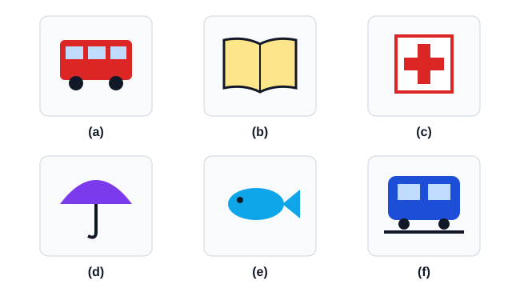

Answer and explanation

**Answer:** (a) bus  
**Why:** Picture (a) shows a bus.

<!-- meta {"id":"ENG-QZ-PIC-0002","topic_id":"ENG-TOP-PIC","type":"picture_matching","difficulty":"Beginner","marks":1,"asset_id":"ENG-IMG-PM01"} -->
**ENG-QZ-PIC-0002** · Beginner · picture matching · 1 mark

Look at the pictures (ENG-IMG-PM01). Which picture matches this sentence? *You read this.*

Answer and explanation

**Answer:** (b) book  
**Why:** Picture (b) shows a book.

<!-- meta {"id":"ENG-QZ-PIC-0003","topic_id":"ENG-TOP-PIC","type":"picture_matching","difficulty":"Beginner","marks":1,"asset_id":"ENG-IMG-PM01"} -->
**ENG-QZ-PIC-0003** · Beginner · picture matching · 1 mark

Look at the pictures (ENG-IMG-PM01). Which picture matches this sentence? *Sick people go here to see a doctor.*

Answer and explanation

**Answer:** (c) hospital  
**Why:** Picture (c) shows a hospital.

<!-- meta {"id":"ENG-QZ-PIC-0004","topic_id":"ENG-TOP-PIC","type":"picture_matching","difficulty":"Beginner","marks":1,"asset_id":"ENG-IMG-PM01"} -->
**ENG-QZ-PIC-0004** · Beginner · picture matching · 1 mark

Look at the pictures (ENG-IMG-PM01). Which picture matches this sentence? *You open this when it rains.*

Answer and explanation

**Answer:** (d) umbrella  
**Why:** Picture (d) shows a umbrella.

<!-- meta {"id":"ENG-QZ-PIC-0005","topic_id":"ENG-TOP-PIC","type":"picture_matching","difficulty":"Beginner","marks":1,"asset_id":"ENG-IMG-PM01"} -->
**ENG-QZ-PIC-0005** · Beginner · picture matching · 1 mark

Look at the pictures (ENG-IMG-PM01). Which picture matches this sentence? *It lives in water and swims.*

Answer and explanation

**Answer:** (e) fish  
**Why:** Picture (e) shows a fish.

<!-- meta {"id":"ENG-QZ-PIC-0006","topic_id":"ENG-TOP-PIC","type":"picture_matching","difficulty":"Beginner","marks":1,"asset_id":"ENG-IMG-PM01"} -->
**ENG-QZ-PIC-0006** · Beginner · picture matching · 1 mark

Look at the pictures (ENG-IMG-PM01). Which picture matches this sentence? *It runs on rails and stops at stations.*

Answer and explanation

**Answer:** (f) train  
**Why:** Picture (f) shows a train.

<!-- meta {"id":"ENG-QZ-PIC-0007","topic_id":"ENG-TOP-PIC","type":"picture_matching","difficulty":"Beginner","marks":1,"asset_id":"ENG-IMG-PM02"} -->
**ENG-QZ-PIC-0007** · Beginner · picture matching · 1 mark

Look at the pictures (ENG-IMG-PM02). Which picture matches this sentence? *Players kick it in a game.*

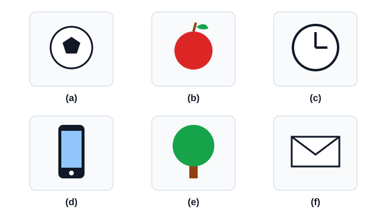

Answer and explanation

**Answer:** (a) football  
**Why:** Picture (a) shows a football.

<!-- meta {"id":"ENG-QZ-PIC-0008","topic_id":"ENG-TOP-PIC","type":"picture_matching","difficulty":"Beginner","marks":1,"asset_id":"ENG-IMG-PM02"} -->
**ENG-QZ-PIC-0008** · Beginner · picture matching · 1 mark

Look at the pictures (ENG-IMG-PM02). Which picture matches this sentence? *It is a round red fruit.*

Answer and explanation

**Answer:** (b) apple  
**Why:** Picture (b) shows a apple.

<!-- meta {"id":"ENG-QZ-PIC-0009","topic_id":"ENG-TOP-PIC","type":"picture_matching","difficulty":"Beginner","marks":1,"asset_id":"ENG-IMG-PM02"} -->
**ENG-QZ-PIC-0009** · Beginner · picture matching · 1 mark

Look at the pictures (ENG-IMG-PM02). Which picture matches this sentence? *It shows the time.*

Answer and explanation

**Answer:** (c) clock  
**Why:** Picture (c) shows a clock.

<!-- meta {"id":"ENG-QZ-PIC-0010","topic_id":"ENG-TOP-PIC","type":"picture_matching","difficulty":"Beginner","marks":1,"asset_id":"ENG-IMG-PM02"} -->
**ENG-QZ-PIC-0010** · Beginner · picture matching · 1 mark

Look at the pictures (ENG-IMG-PM02). Which picture matches this sentence? *You use it to call people.*

Answer and explanation

**Answer:** (d) phone  
**Why:** Picture (d) shows a phone.

<!-- meta {"id":"ENG-QZ-PIC-0011","topic_id":"ENG-TOP-PIC","type":"picture_matching","difficulty":"Beginner","marks":1,"asset_id":"ENG-IMG-PM02"} -->
**ENG-QZ-PIC-0011** · Beginner · picture matching · 1 mark

Look at the pictures (ENG-IMG-PM02). Which picture matches this sentence? *It has a trunk, branches and leaves.*

Answer and explanation

**Answer:** (e) tree  
**Why:** Picture (e) shows a tree.

<!-- meta {"id":"ENG-QZ-PIC-0012","topic_id":"ENG-TOP-PIC","type":"picture_matching","difficulty":"Beginner","marks":1,"asset_id":"ENG-IMG-PM02"} -->
**ENG-QZ-PIC-0012** · Beginner · picture matching · 1 mark

Look at the pictures (ENG-IMG-PM02). Which picture matches this sentence? *You put it in an envelope and post it.*

Answer and explanation

**Answer:** (f) letter  
**Why:** Picture (f) shows a letter.

<!-- meta {"id":"ENG-QZ-PIC-0013","topic_id":"ENG-TOP-PIC","type":"multiple_choice","difficulty":"Beginner","marks":1,"asset_id":"ENG-IMG-0001"} -->
**ENG-QZ-PIC-0013** · Beginner · multiple choice · 1 mark

Look at the picture (ENG-IMG-0001: A playground after school). In which part of the picture can you see this: *Two boys are playing football*?

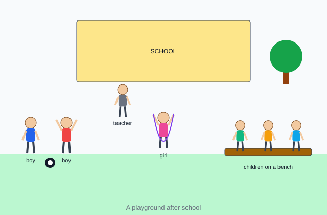

- A. In the middle
- B. On the left
- C. In the background
- D. On the right

Answer and explanation

**Answer:** B. On the left  
**Why:** On the left, two boys are playing football.

<!-- meta {"id":"ENG-QZ-PIC-0014","topic_id":"ENG-TOP-PIC","type":"multiple_choice","difficulty":"Beginner","marks":1,"asset_id":"ENG-IMG-0001"} -->
**ENG-QZ-PIC-0014** · Beginner · multiple choice · 1 mark

Look at the picture (ENG-IMG-0001: A playground after school). In which part of the picture can you see this: *A girl is skipping*?

- A. In the background
- B. On the right
- C. In the middle
- D. On the left

Answer and explanation

**Answer:** C. In the middle  
**Why:** In the middle, a girl is skipping.

<!-- meta {"id":"ENG-QZ-PIC-0015","topic_id":"ENG-TOP-PIC","type":"multiple_choice","difficulty":"Beginner","marks":1,"asset_id":"ENG-IMG-0001"} -->
**ENG-QZ-PIC-0015** · Beginner · multiple choice · 1 mark

Look at the picture (ENG-IMG-0001: A playground after school). In which part of the picture can you see this: *Three children are sitting on a bench and eating*?

- A. In the middle
- B. On the left
- C. In the background
- D. On the right

Answer and explanation

**Answer:** D. On the right  
**Why:** On the right, three children are sitting on a bench and eating.

<!-- meta {"id":"ENG-QZ-PIC-0016","topic_id":"ENG-TOP-PIC","type":"multiple_choice","difficulty":"Beginner","marks":1,"asset_id":"ENG-IMG-0002"} -->
**ENG-QZ-PIC-0016** · Beginner · multiple choice · 1 mark

Look at the picture (ENG-IMG-0002: At the vegetable market). In which part of the picture can you see this: *A vendor is selling vegetables at a stall*?

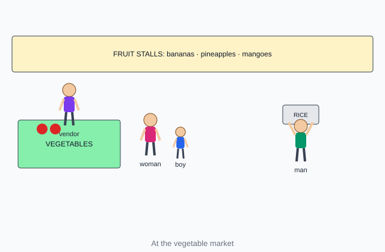

- A. On the right
- B. In front of the stall
- C. On the left
- D. In the middle

Answer and explanation

**Answer:** C. On the left  
**Why:** On the left, a vendor is selling vegetables at a stall.

<!-- meta {"id":"ENG-QZ-PIC-0017","topic_id":"ENG-TOP-PIC","type":"multiple_choice","difficulty":"Beginner","marks":1,"asset_id":"ENG-IMG-0002"} -->
**ENG-QZ-PIC-0017** · Beginner · multiple choice · 1 mark

Look at the picture (ENG-IMG-0002: At the vegetable market). In which part of the picture can you see this: *A woman is buying tomatoes*?

- A. On the right
- B. In front of the stall
- C. On the left
- D. In the middle

Answer and explanation

**Answer:** B. In front of the stall  
**Why:** In front of the stall, a woman is buying tomatoes.

<!-- meta {"id":"ENG-QZ-PIC-0018","topic_id":"ENG-TOP-PIC","type":"multiple_choice","difficulty":"Beginner","marks":1,"asset_id":"ENG-IMG-0002"} -->
**ENG-QZ-PIC-0018** · Beginner · multiple choice · 1 mark

Look at the picture (ENG-IMG-0002: At the vegetable market). In which part of the picture can you see this: *A man is carrying a bag of rice on his shoulder*?

- A. On the right
- B. In front of the stall
- C. On the left
- D. In the middle

Answer and explanation

**Answer:** A. On the right  
**Why:** On the right, a man is carrying a bag of rice on his shoulder.

<!-- meta {"id":"ENG-QZ-PIC-0019","topic_id":"ENG-TOP-PIC","type":"multiple_choice","difficulty":"Beginner","marks":1,"asset_id":"ENG-IMG-0003"} -->
**ENG-QZ-PIC-0019** · Beginner · multiple choice · 1 mark

Look at the picture (ENG-IMG-0003: At the bus stand). In which part of the picture can you see this: *A red bus is waiting at the bus stand*?

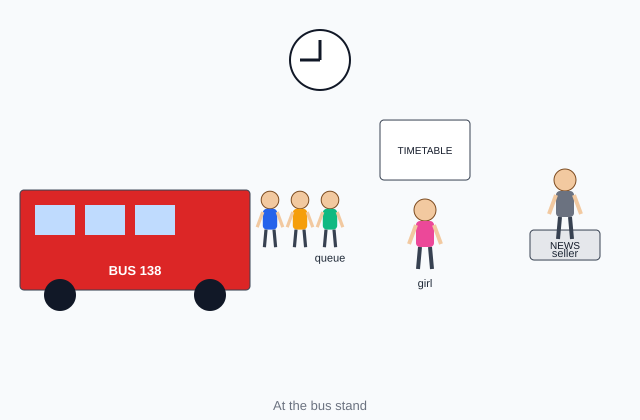

- A. On the left
- B. In the middle
- C. On the right
- D. Near the bus

Answer and explanation

**Answer:** A. On the left  
**Why:** On the left, a red bus is waiting at the bus stand.

<!-- meta {"id":"ENG-QZ-PIC-0020","topic_id":"ENG-TOP-PIC","type":"multiple_choice","difficulty":"Beginner","marks":1,"asset_id":"ENG-IMG-0003"} -->
**ENG-QZ-PIC-0020** · Beginner · multiple choice · 1 mark

Look at the picture (ENG-IMG-0003: At the bus stand). In which part of the picture can you see this: *Passengers are standing in a queue*?

- A. On the right
- B. In the middle
- C. On the left
- D. Near the bus

Answer and explanation

**Answer:** D. Near the bus  
**Why:** Near the bus, passengers are standing in a queue.

<!-- meta {"id":"ENG-QZ-PIC-0021","topic_id":"ENG-TOP-PIC","type":"multiple_choice","difficulty":"Beginner","marks":1,"asset_id":"ENG-IMG-0003"} -->
**ENG-QZ-PIC-0021** · Beginner · multiple choice · 1 mark

Look at the picture (ENG-IMG-0003: At the bus stand). In which part of the picture can you see this: *A man is selling newspapers*?

- A. In the middle
- B. On the left
- C. Near the bus
- D. On the right

Answer and explanation

**Answer:** D. On the right  
**Why:** On the right, a man is selling newspapers.

<!-- meta {"id":"ENG-QZ-PIC-0022","topic_id":"ENG-TOP-PIC","type":"multiple_choice","difficulty":"Beginner","marks":1,"asset_id":"ENG-IMG-0004"} -->
**ENG-QZ-PIC-0022** · Beginner · multiple choice · 1 mark

Look at the picture (ENG-IMG-0004: A family at dinner). In which part of the picture can you see this: *A family is having dinner at a table*?

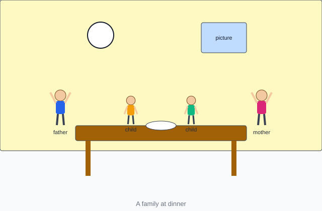

- A. On the left
- B. On the right
- C. In the middle
- D. At the table

Answer and explanation

**Answer:** C. In the middle  
**Why:** In the middle, a family is having dinner at a table.

<!-- meta {"id":"ENG-QZ-PIC-0023","topic_id":"ENG-TOP-PIC","type":"multiple_choice","difficulty":"Beginner","marks":1,"asset_id":"ENG-IMG-0004"} -->
**ENG-QZ-PIC-0023** · Beginner · multiple choice · 1 mark

Look at the picture (ENG-IMG-0004: A family at dinner). In which part of the picture can you see this: *The father is serving rice*?

- A. On the left
- B. On the right
- C. At the table
- D. In the middle

Answer and explanation

**Answer:** A. On the left  
**Why:** On the left, the father is serving rice.

<!-- meta {"id":"ENG-QZ-PIC-0024","topic_id":"ENG-TOP-PIC","type":"multiple_choice","difficulty":"Beginner","marks":1,"asset_id":"ENG-IMG-0004"} -->
**ENG-QZ-PIC-0024** · Beginner · multiple choice · 1 mark

Look at the picture (ENG-IMG-0004: A family at dinner). In which part of the picture can you see this: *The mother is pouring water into a glass*?

- A. In the middle
- B. On the left
- C. At the table
- D. On the right

Answer and explanation

**Answer:** D. On the right  
**Why:** On the right, the mother is pouring water into a glass.

<!-- meta {"id":"ENG-QZ-PIC-0025","topic_id":"ENG-TOP-PIC","type":"multiple_choice","difficulty":"Beginner","marks":1,"asset_id":"ENG-IMG-0005"} -->
**ENG-QZ-PIC-0025** · Beginner · multiple choice · 1 mark

Look at the picture (ENG-IMG-0005: At the railway station). In which part of the picture can you see this: *A train is arriving at the platform*?

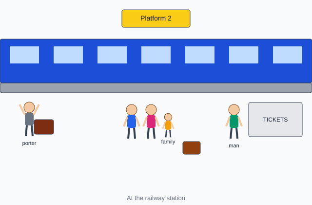

- A. In the background
- B. On the right
- C. In the middle
- D. On the left

Answer and explanation

**Answer:** A. In the background  
**Why:** In the background, a train is arriving at the platform.

<!-- meta {"id":"ENG-QZ-PIC-0026","topic_id":"ENG-TOP-PIC","type":"multiple_choice","difficulty":"Beginner","marks":1,"asset_id":"ENG-IMG-0005"} -->
**ENG-QZ-PIC-0026** · Beginner · multiple choice · 1 mark

Look at the picture (ENG-IMG-0005: At the railway station). In which part of the picture can you see this: *A porter is carrying a suitcase*?

- A. In the middle
- B. On the left
- C. In the background
- D. On the right

Answer and explanation

**Answer:** B. On the left  
**Why:** On the left, a porter is carrying a suitcase.

<!-- meta {"id":"ENG-QZ-PIC-0027","topic_id":"ENG-TOP-PIC","type":"multiple_choice","difficulty":"Beginner","marks":1,"asset_id":"ENG-IMG-0005"} -->
**ENG-QZ-PIC-0027** · Beginner · multiple choice · 1 mark

Look at the picture (ENG-IMG-0005: At the railway station). In which part of the picture can you see this: *A family is waiting with their luggage*?

- A. In the middle
- B. On the right
- C. In the background
- D. On the left

Answer and explanation

**Answer:** A. In the middle  
**Why:** In the middle, a family is waiting with their luggage.

<!-- meta {"id":"ENG-QZ-PIC-0028","topic_id":"ENG-TOP-PIC","type":"multiple_choice","difficulty":"Beginner","marks":1,"asset_id":"ENG-IMG-0006"} -->
**ENG-QZ-PIC-0028** · Beginner · multiple choice · 1 mark

Look at the picture (ENG-IMG-0006: At the hospital). In which part of the picture can you see this: *A doctor is examining a patient*?

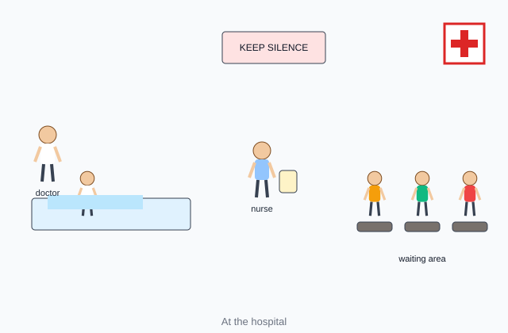

- A. On the left
- B. On the bed
- C. In the middle
- D. On the right

Answer and explanation

**Answer:** A. On the left  
**Why:** On the left, a doctor is examining a patient.

<!-- meta {"id":"ENG-QZ-PIC-0029","topic_id":"ENG-TOP-PIC","type":"multiple_choice","difficulty":"Beginner","marks":1,"asset_id":"ENG-IMG-0006"} -->
**ENG-QZ-PIC-0029** · Beginner · multiple choice · 1 mark

Look at the picture (ENG-IMG-0006: At the hospital). In which part of the picture can you see this: *The patient is lying down*?

- A. In the middle
- B. On the bed
- C. On the right
- D. On the left

Answer and explanation

**Answer:** B. On the bed  
**Why:** On the bed, the patient is lying down.

<!-- meta {"id":"ENG-QZ-PIC-0030","topic_id":"ENG-TOP-PIC","type":"multiple_choice","difficulty":"Beginner","marks":1,"asset_id":"ENG-IMG-0006"} -->
**ENG-QZ-PIC-0030** · Beginner · multiple choice · 1 mark

Look at the picture (ENG-IMG-0006: At the hospital). In which part of the picture can you see this: *A nurse is writing on a file*?

- A. In the middle
- B. On the left
- C. On the right
- D. On the bed

Answer and explanation

**Answer:** A. In the middle  
**Why:** In the middle, a nurse is writing on a file.

<!-- meta {"id":"ENG-QZ-PIC-0031","topic_id":"ENG-TOP-PIC","type":"multiple_choice","difficulty":"Beginner","marks":1,"asset_id":"ENG-IMG-0007"} -->
**ENG-QZ-PIC-0031** · Beginner · multiple choice · 1 mark

Look at the picture (ENG-IMG-0007: A school sports meet). In which part of the picture can you see this: *Three athletes are running a race*?

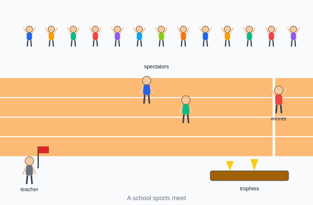

- A. In the background
- B. On the left
- C. In the middle
- D. On the right

Answer and explanation

**Answer:** C. In the middle  
**Why:** In the middle, three athletes are running a race.

<!-- meta {"id":"ENG-QZ-PIC-0032","topic_id":"ENG-TOP-PIC","type":"multiple_choice","difficulty":"Beginner","marks":1,"asset_id":"ENG-IMG-0007"} -->
**ENG-QZ-PIC-0032** · Beginner · multiple choice · 1 mark

Look at the picture (ENG-IMG-0007: A school sports meet). In which part of the picture can you see this: *A boy is crossing the finishing line*?

- A. On the right
- B. In the middle
- C. In the background
- D. On the left

Answer and explanation

**Answer:** A. On the right  
**Why:** On the right, a boy is crossing the finishing line.

<!-- meta {"id":"ENG-QZ-PIC-0033","topic_id":"ENG-TOP-PIC","type":"multiple_choice","difficulty":"Beginner","marks":1,"asset_id":"ENG-IMG-0007"} -->
**ENG-QZ-PIC-0033** · Beginner · multiple choice · 1 mark

Look at the picture (ENG-IMG-0007: A school sports meet). In which part of the picture can you see this: *A teacher is holding a flag*?

- A. In the middle
- B. On the right
- C. On the left
- D. In the background

Answer and explanation

**Answer:** C. On the left  
**Why:** On the left, a teacher is holding a flag.

<!-- meta {"id":"ENG-QZ-PIC-0034","topic_id":"ENG-TOP-PIC","type":"multiple_choice","difficulty":"Beginner","marks":1,"asset_id":"ENG-IMG-0008"} -->
**ENG-QZ-PIC-0034** · Beginner · multiple choice · 1 mark

Look at the picture (ENG-IMG-0008: A park on Sunday). In which part of the picture can you see this: *An old man is reading a newspaper on a bench*?

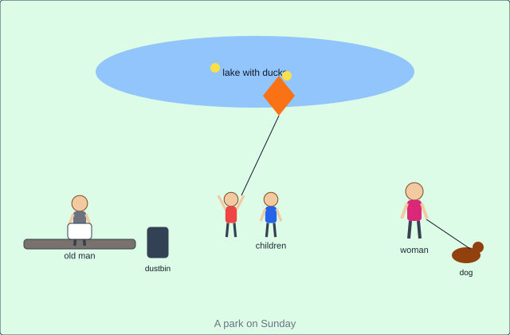

- A. In the middle
- B. On the right
- C. In the background
- D. On the left

Answer and explanation

**Answer:** D. On the left  
**Why:** On the left, an old man is reading a newspaper on a bench.

<!-- meta {"id":"ENG-QZ-PIC-0035","topic_id":"ENG-TOP-PIC","type":"multiple_choice","difficulty":"Beginner","marks":1,"asset_id":"ENG-IMG-0008"} -->
**ENG-QZ-PIC-0035** · Beginner · multiple choice · 1 mark

Look at the picture (ENG-IMG-0008: A park on Sunday). In which part of the picture can you see this: *Two children are flying a kite*?

- A. In the middle
- B. In the background
- C. On the right
- D. On the left

Answer and explanation

**Answer:** A. In the middle  
**Why:** In the middle, two children are flying a kite.

<!-- meta {"id":"ENG-QZ-PIC-0036","topic_id":"ENG-TOP-PIC","type":"multiple_choice","difficulty":"Beginner","marks":1,"asset_id":"ENG-IMG-0008"} -->
**ENG-QZ-PIC-0036** · Beginner · multiple choice · 1 mark

Look at the picture (ENG-IMG-0008: A park on Sunday). In which part of the picture can you see this: *A woman is walking her dog*?

- A. In the background
- B. In the middle
- C. On the right
- D. On the left

Answer and explanation

**Answer:** C. On the right  
**Why:** On the right, a woman is walking her dog.

<!-- meta {"id":"ENG-QZ-PIC-0037","topic_id":"ENG-TOP-PIC","type":"multiple_choice","difficulty":"Beginner","marks":1,"asset_id":"ENG-IMG-0009"} -->
**ENG-QZ-PIC-0037** · Beginner · multiple choice · 1 mark

Look at the picture (ENG-IMG-0009: A classroom lesson). In which part of the picture can you see this: *The teacher is writing on the board*?

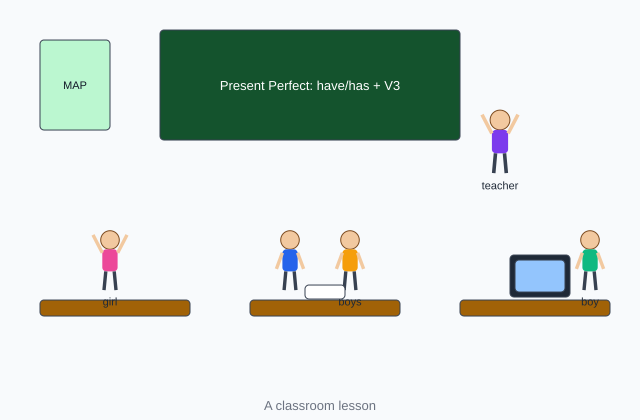

- A. On the right
- B. In front of the class
- C. On the left
- D. In the middle

Answer and explanation

**Answer:** B. In front of the class  
**Why:** In front of the class, the teacher is writing on the board.

<!-- meta {"id":"ENG-QZ-PIC-0038","topic_id":"ENG-TOP-PIC","type":"multiple_choice","difficulty":"Beginner","marks":1,"asset_id":"ENG-IMG-0009"} -->
**ENG-QZ-PIC-0038** · Beginner · multiple choice · 1 mark

Look at the picture (ENG-IMG-0009: A classroom lesson). In which part of the picture can you see this: *A girl is raising her hand*?

- A. In the middle
- B. On the left
- C. In front of the class
- D. On the right

Answer and explanation

**Answer:** B. On the left  
**Why:** On the left, a girl is raising her hand.

<!-- meta {"id":"ENG-QZ-PIC-0039","topic_id":"ENG-TOP-PIC","type":"multiple_choice","difficulty":"Beginner","marks":1,"asset_id":"ENG-IMG-0009"} -->
**ENG-QZ-PIC-0039** · Beginner · multiple choice · 1 mark

Look at the picture (ENG-IMG-0009: A classroom lesson). In which part of the picture can you see this: *Two boys are reading a book together*?

- A. On the right
- B. In the middle
- C. In front of the class
- D. On the left

Answer and explanation

**Answer:** B. In the middle  
**Why:** In the middle, two boys are reading a book together.

<!-- meta {"id":"ENG-QZ-PIC-0040","topic_id":"ENG-TOP-PIC","type":"multiple_choice","difficulty":"Beginner","marks":1,"asset_id":"ENG-IMG-0010"} -->
**ENG-QZ-PIC-0040** · Beginner · multiple choice · 1 mark

Look at the picture (ENG-IMG-0010: A beach clean-up). In which part of the picture can you see this: *Volunteers are collecting plastic bottles*?

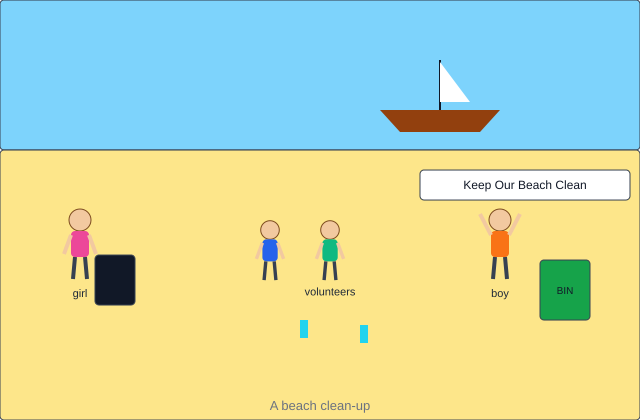

- A. On the left
- B. In the middle
- C. In the background
- D. On the right

Answer and explanation

**Answer:** B. In the middle  
**Why:** In the middle, volunteers are collecting plastic bottles.

<!-- meta {"id":"ENG-QZ-PIC-0041","topic_id":"ENG-TOP-PIC","type":"multiple_choice","difficulty":"Beginner","marks":1,"asset_id":"ENG-IMG-0010"} -->
**ENG-QZ-PIC-0041** · Beginner · multiple choice · 1 mark

Look at the picture (ENG-IMG-0010: A beach clean-up). In which part of the picture can you see this: *A girl is holding a large bag of rubbish*?

- A. On the right
- B. In the background
- C. In the middle
- D. On the left

Answer and explanation

**Answer:** D. On the left  
**Why:** On the left, a girl is holding a large bag of rubbish.

<!-- meta {"id":"ENG-QZ-PIC-0042","topic_id":"ENG-TOP-PIC","type":"multiple_choice","difficulty":"Beginner","marks":1,"asset_id":"ENG-IMG-0010"} -->
**ENG-QZ-PIC-0042** · Beginner · multiple choice · 1 mark

Look at the picture (ENG-IMG-0010: A beach clean-up). In which part of the picture can you see this: *A boy is putting waste into a bin*?

- A. On the right
- B. In the middle
- C. In the background
- D. On the left

Answer and explanation

**Answer:** A. On the right  
**Why:** On the right, a boy is putting waste into a bin.

---

## Limitations

- Some generated drill sentences combine a subject, verb and time phrase automatically; they are grammatical but a few may sound unusual.
- Open-ended items (word ordering, transformations) accept other correct word orders where the meaning is the same — the website should not use exact text matching for these.
