# StudyBuddy — English Reading Mastery

> Original reading practice from very short texts to examination-style passages. Every answer explains **where** the information is and **how** to find it.

<!-- meta {"id":"ENG-DIAG-07","type":"diagnostic","weakness":"Cannot understand reading passages","recommend_topics":["ENG-TOP-READ"]} -->
**ENG-DIAG-07 — Cannot understand reading passages?** Try these five. If you get fewer than 4 right, study: `ENG-TOP-READ` (Reading comprehension techniques).

1. Read: *Ravi lives in Galle. He goes to school by train.* How does Ravi go to school?
2. In the same text, who does *He* refer to?
3. Read: *The shop opens at 9 a.m. and closes at 6 p.m.* When does it close?
4. What does *skim* mean in reading?
5. What should you do first: read the questions or the passage?

Answers

1. By train.
2. Ravi.
3. At 6 p.m.
4. Read quickly for the main idea.
5. Read the questions first (to know what to look for).

## Reading techniques

1. **Read the questions first** — know what you are looking for.
2. **Underline key words** in the question (names, numbers, dates, *why/when/where*).
3. **Skim** — read quickly for the main idea (title, first and last sentences).
4. **Scan** — move your eyes quickly to find a specific word or number.
5. **Guess meaning from context** — look at the words before and after.
6. **Answer briefly** — do not copy long chunks. The 2017 examiners' report says copying chunks earns no marks when one specific answer is expected, and short correct answers can get full marks.

## Understanding examination instructions

| Instruction | What you do | Tamil | Example |
|---|---|---|---|
| **Complete** | fill in the missing parts | பூரணப்படுத்து | Complete the sentence: *Kamal lives in ___.* |
| **Fill in the blanks** | write the missing words in the spaces | இடைவெளிகளை நிரப்பு | *She ___ (go) to school.* |
| **Match** | join items that go together | பொருத்து | — |
| **Underline** | draw a line under | அடிக்கோடிடு | — |
| **Circle** | draw a circle round | வட்டமிடு | — |
| **Tick (✓)** | put a ✓ mark | சரி அடையாளமிடு | — |
| **Choose / Select** | pick one answer | தெரிவு செய் | — |
| **State whether true or false** | write T or F | சரியா பிழையா எனக் கூறு | — |
| **Rewrite** | write again in a new way | மீண்டும் எழுது | — |
| **Rearrange** | put in the correct order | ஒழுங்குபடுத்து | — |
| **Describe** | say what something is like | விவரி | — |
| **Explain** | give reasons and details | விளக்கு | — |
| **Compare** | show similarities and differences | ஒப்பிடு | — |
| **Write a paragraph** | write one group of sentences on one idea | ஒரு பந்தி எழுது | — |
| **Use about … words** | write close to that number of words | ஏறத்தாழ … சொற்கள் பயன்படுத்து | — |
| **Read the passage** | read the text carefully | பகுதியை வாசி | — |
| **Answer the questions** | write answers to the questions | வினாக்களுக்கு விடையளி | — |
| **Give reasons** | say why | காரணங்கள் கூறு | — |
| **Find words which mean** | find words with the same meaning | ஒத்த கருத்துள்ள சொற்களைக் கண்டுபிடி | — |
| **Refer to** | be about / point to | குறிப்பிடு | — |
| **Copy** | write exactly as given | பிரதி செய் | — |
| **Identify** | find and name | இனங்காண் | — |
| **Include** | put in | உள்ளடக்கு | — |
| **Mention** | write briefly about | குறிப்பிடு | — |

---

## Beginner reading sets

---

### ENG-RDG-0001 — Meet Kamal

<!-- meta {"id":"ENG-RDG-0001","topic_id":"ENG-TOP-READ","level":"Beginner","text_type":"short paragraph","skill":"Finding information","asset_id":null} -->

> Kamal is a student in Grade 10. He lives in Kandy with his parents and his sister. He goes to school by bus. His favourite subject is English. After school, he plays cricket with his friends. He has a dog at home. His favourite food is rice and curry.

1. Where does Kamal live?
2. How does Kamal go to school?
3. What is Kamal's favourite subject?
4. What does Kamal do after school?
5. True or false: Kamal has a dog at home.

Answers and explanations

1. **In Kandy. / He lives in Kandy.**  
   *Where:* Sentence 2 — find the key word *live*. *How:* Scan for the key word from the question. Write only the needed words — leave out extra information.
2. **By bus.**  
   *Where:* Sentence 3 — key words *go to school*. *How:* Scan for the key word from the question. Write only the needed words — leave out extra information.
3. **English.**  
   *Where:* Sentence 4 — key words *favourite subject*. *How:* Scan for the key word from the question. Write only the needed words — leave out extra information.
4. **He plays cricket with his friends.**  
   *Where:* Sentence 5 — key words *after school*. *How:* Scan for the key word from the question. Write only the needed words — leave out extra information.
5. **True**  
   *Where:* Sentence 6 says exactly this. *How:* Compare the statement with the text word by word.

---

### ENG-RDG-0002 — Meet Nila

<!-- meta {"id":"ENG-RDG-0002","topic_id":"ENG-TOP-READ","level":"Beginner","text_type":"short paragraph","skill":"Finding information","asset_id":null} -->

> Nila is a student in Grade 10. She lives in Jaffna with her grandparents. She goes to school by bicycle. Her favourite subject is Science. After school, she reads story books. She has a cat at home. Her favourite food is pittu.

1. Where does Nila live?
2. How does Nila go to school?
3. What is Nila's favourite subject?
4. What does Nila do after school?
5. True or false: Nila has a cat at home.

Answers and explanations

1. **In Jaffna. / She lives in Jaffna.**  
   *Where:* Sentence 2 — find the key word *live*. *How:* Scan for the key word from the question. Write only the needed words — leave out extra information.
2. **By bicycle.**  
   *Where:* Sentence 3 — key words *go to school*. *How:* Scan for the key word from the question. Write only the needed words — leave out extra information.
3. **Science.**  
   *Where:* Sentence 4 — key words *favourite subject*. *How:* Scan for the key word from the question. Write only the needed words — leave out extra information.
4. **She reads story books.**  
   *Where:* Sentence 5 — key words *after school*. *How:* Scan for the key word from the question. Write only the needed words — leave out extra information.
5. **True**  
   *Where:* Sentence 6 says exactly this. *How:* Compare the statement with the text word by word.

---

### ENG-RDG-0003 — Meet Ahamed

<!-- meta {"id":"ENG-RDG-0003","topic_id":"ENG-TOP-READ","level":"Beginner","text_type":"short paragraph","skill":"Finding information","asset_id":null} -->

> Ahamed is a student in Grade 10. He lives in Batticaloa with his mother and two brothers. He goes to school by van. His favourite subject is Mathematics. After school, he helps his father in the shop. He has a parrot at home. His favourite food is string hoppers.

1. Where does Ahamed live?
2. How does Ahamed go to school?
3. What is Ahamed's favourite subject?
4. What does Ahamed do after school?
5. True or false: Ahamed has a parrot at home.

Answers and explanations

1. **In Batticaloa. / He lives in Batticaloa.**  
   *Where:* Sentence 2 — find the key word *live*. *How:* Scan for the key word from the question. Write only the needed words — leave out extra information.
2. **By van.**  
   *Where:* Sentence 3 — key words *go to school*. *How:* Scan for the key word from the question. Write only the needed words — leave out extra information.
3. **Mathematics.**  
   *Where:* Sentence 4 — key words *favourite subject*. *How:* Scan for the key word from the question. Write only the needed words — leave out extra information.
4. **He helps his father in the shop.**  
   *Where:* Sentence 5 — key words *after school*. *How:* Scan for the key word from the question. Write only the needed words — leave out extra information.
5. **True**  
   *Where:* Sentence 6 says exactly this. *How:* Compare the statement with the text word by word.

---

### ENG-RDG-0004 — Meet Tharushi

<!-- meta {"id":"ENG-RDG-0004","topic_id":"ENG-TOP-READ","level":"Beginner","text_type":"short paragraph","skill":"Finding information","asset_id":null} -->

> Tharushi is a student in Grade 10. She lives in Galle with her parents. She goes to school by train. Her favourite subject is History. After school, she practises the violin. She has a rabbit at home. Her favourite food is hoppers.

1. Where does Tharushi live?
2. How does Tharushi go to school?
3. What is Tharushi's favourite subject?
4. What does Tharushi do after school?
5. True or false: Tharushi has a rabbit at home.

Answers and explanations

1. **In Galle. / She lives in Galle.**  
   *Where:* Sentence 2 — find the key word *live*. *How:* Scan for the key word from the question. Write only the needed words — leave out extra information.
2. **By train.**  
   *Where:* Sentence 3 — key words *go to school*. *How:* Scan for the key word from the question. Write only the needed words — leave out extra information.
3. **History.**  
   *Where:* Sentence 4 — key words *favourite subject*. *How:* Scan for the key word from the question. Write only the needed words — leave out extra information.
4. **She practises the violin.**  
   *Where:* Sentence 5 — key words *after school*. *How:* Scan for the key word from the question. Write only the needed words — leave out extra information.
5. **True**  
   *Where:* Sentence 6 says exactly this. *How:* Compare the statement with the text word by word.

---

### ENG-RDG-0005 — Meet Ravi

<!-- meta {"id":"ENG-RDG-0005","topic_id":"ENG-TOP-READ","level":"Beginner","text_type":"short paragraph","skill":"Finding information","asset_id":null} -->

> Ravi is a student in Grade 10. He lives in Trincomalee with his uncle and aunt. He goes to school by bus. His favourite subject is ICT. After school, he swims in the sea. He has a goat at home. His favourite food is dosai.

1. Where does Ravi live?
2. How does Ravi go to school?
3. What is Ravi's favourite subject?
4. What does Ravi do after school?
5. True or false: Ravi has a goat at home.

Answers and explanations

1. **In Trincomalee. / He lives in Trincomalee.**  
   *Where:* Sentence 2 — find the key word *live*. *How:* Scan for the key word from the question. Write only the needed words — leave out extra information.
2. **By bus.**  
   *Where:* Sentence 3 — key words *go to school*. *How:* Scan for the key word from the question. Write only the needed words — leave out extra information.
3. **ICT.**  
   *Where:* Sentence 4 — key words *favourite subject*. *How:* Scan for the key word from the question. Write only the needed words — leave out extra information.
4. **He swims in the sea.**  
   *Where:* Sentence 5 — key words *after school*. *How:* Scan for the key word from the question. Write only the needed words — leave out extra information.
5. **True**  
   *Where:* Sentence 6 says exactly this. *How:* Compare the statement with the text word by word.

---

### ENG-RDG-0006 — Meet Fathima

<!-- meta {"id":"ENG-RDG-0006","topic_id":"ENG-TOP-READ","level":"Beginner","text_type":"short paragraph","skill":"Finding information","asset_id":null} -->

> Fathima is a student in Grade 10. She lives in Puttalam with her mother and her baby brother. She goes to school by three-wheeler. Her favourite subject is Tamil. After school, she draws pictures. She has two hens at home. Her favourite food is roti.

1. Where does Fathima live?
2. How does Fathima go to school?
3. What is Fathima's favourite subject?
4. What does Fathima do after school?
5. True or false: Fathima has two hens at home.

Answers and explanations

1. **In Puttalam. / She lives in Puttalam.**  
   *Where:* Sentence 2 — find the key word *live*. *How:* Scan for the key word from the question. Write only the needed words — leave out extra information.
2. **By three-wheeler.**  
   *Where:* Sentence 3 — key words *go to school*. *How:* Scan for the key word from the question. Write only the needed words — leave out extra information.
3. **Tamil.**  
   *Where:* Sentence 4 — key words *favourite subject*. *How:* Scan for the key word from the question. Write only the needed words — leave out extra information.
4. **She draws pictures.**  
   *Where:* Sentence 5 — key words *after school*. *How:* Scan for the key word from the question. Write only the needed words — leave out extra information.
5. **True**  
   *Where:* Sentence 6 says exactly this. *How:* Compare the statement with the text word by word.

---

### ENG-RDG-0007 — Meet Sanjay

<!-- meta {"id":"ENG-RDG-0007","topic_id":"ENG-TOP-READ","level":"Beginner","text_type":"short paragraph","skill":"Finding information","asset_id":null} -->

> Sanjay is a student in Grade 10. He lives in Nuwara Eliya with his parents and grandmother. He goes to school on foot. His favourite subject is Art. After school, he grows vegetables in the garden. He has a cat at home. His favourite food is noodles.

1. Where does Sanjay live?
2. How does Sanjay go to school?
3. What is Sanjay's favourite subject?
4. What does Sanjay do after school?
5. True or false: Sanjay has a cat at home.

Answers and explanations

1. **In Nuwara Eliya. / He lives in Nuwara Eliya.**  
   *Where:* Sentence 2 — find the key word *live*. *How:* Scan for the key word from the question. Write only the needed words — leave out extra information.
2. **On foot.**  
   *Where:* Sentence 3 — key words *go to school*. *How:* Scan for the key word from the question. Write only the needed words — leave out extra information.
3. **Art.**  
   *Where:* Sentence 4 — key words *favourite subject*. *How:* Scan for the key word from the question. Write only the needed words — leave out extra information.
4. **He grows vegetables in the garden.**  
   *Where:* Sentence 5 — key words *after school*. *How:* Scan for the key word from the question. Write only the needed words — leave out extra information.
5. **True**  
   *Where:* Sentence 6 says exactly this. *How:* Compare the statement with the text word by word.

---

### ENG-RDG-0008 — Meet Malini

<!-- meta {"id":"ENG-RDG-0008","topic_id":"ENG-TOP-READ","level":"Beginner","text_type":"short paragraph","skill":"Finding information","asset_id":null} -->

> Malini is a student in Grade 10. She lives in Kurunegala with her father and her elder sister. She goes to school by bus. Her favourite subject is Geography. After school, she plays netball. She has a puppy at home. Her favourite food is kiribath.

1. Where does Malini live?
2. How does Malini go to school?
3. What is Malini's favourite subject?
4. What does Malini do after school?
5. True or false: Malini has a puppy at home.

Answers and explanations

1. **In Kurunegala. / She lives in Kurunegala.**  
   *Where:* Sentence 2 — find the key word *live*. *How:* Scan for the key word from the question. Write only the needed words — leave out extra information.
2. **By bus.**  
   *Where:* Sentence 3 — key words *go to school*. *How:* Scan for the key word from the question. Write only the needed words — leave out extra information.
3. **Geography.**  
   *Where:* Sentence 4 — key words *favourite subject*. *How:* Scan for the key word from the question. Write only the needed words — leave out extra information.
4. **She plays netball.**  
   *Where:* Sentence 5 — key words *after school*. *How:* Scan for the key word from the question. Write only the needed words — leave out extra information.
5. **True**  
   *Where:* Sentence 6 says exactly this. *How:* Compare the statement with the text word by word.

---

### ENG-RDG-0009 — Meet Arjun

<!-- meta {"id":"ENG-RDG-0009","topic_id":"ENG-TOP-READ","level":"Beginner","text_type":"short paragraph","skill":"Finding information","asset_id":null} -->

> Arjun is a student in Grade 10. He lives in Vavuniya with his parents. He goes to school by bicycle. His favourite subject is Science. After school, he plays chess with his brother. He has a fish at home. His favourite food is idiyappam.

1. Where does Arjun live?
2. How does Arjun go to school?
3. What is Arjun's favourite subject?
4. What does Arjun do after school?
5. True or false: Arjun has a fish at home.

Answers and explanations

1. **In Vavuniya. / He lives in Vavuniya.**  
   *Where:* Sentence 2 — find the key word *live*. *How:* Scan for the key word from the question. Write only the needed words — leave out extra information.
2. **By bicycle.**  
   *Where:* Sentence 3 — key words *go to school*. *How:* Scan for the key word from the question. Write only the needed words — leave out extra information.
3. **Science.**  
   *Where:* Sentence 4 — key words *favourite subject*. *How:* Scan for the key word from the question. Write only the needed words — leave out extra information.
4. **He plays chess with his brother.**  
   *Where:* Sentence 5 — key words *after school*. *How:* Scan for the key word from the question. Write only the needed words — leave out extra information.
5. **True**  
   *Where:* Sentence 6 says exactly this. *How:* Compare the statement with the text word by word.

---

### ENG-RDG-0010 — Meet Ishara

<!-- meta {"id":"ENG-RDG-0010","topic_id":"ENG-TOP-READ","level":"Beginner","text_type":"short paragraph","skill":"Finding information","asset_id":null} -->

> Ishara is a student in Grade 10. She lives in Matara with her family. She goes to school by school van. Her favourite subject is English. After school, she learns dancing. She has a parrot at home. Her favourite food is fried rice.

1. Where does Ishara live?
2. How does Ishara go to school?
3. What is Ishara's favourite subject?
4. What does Ishara do after school?
5. True or false: Ishara has a parrot at home.

Answers and explanations

1. **In Matara. / She lives in Matara.**  
   *Where:* Sentence 2 — find the key word *live*. *How:* Scan for the key word from the question. Write only the needed words — leave out extra information.
2. **By school van.**  
   *Where:* Sentence 3 — key words *go to school*. *How:* Scan for the key word from the question. Write only the needed words — leave out extra information.
3. **English.**  
   *Where:* Sentence 4 — key words *favourite subject*. *How:* Scan for the key word from the question. Write only the needed words — leave out extra information.
4. **She learns dancing.**  
   *Where:* Sentence 5 — key words *after school*. *How:* Scan for the key word from the question. Write only the needed words — leave out extra information.
5. **True**  
   *Where:* Sentence 6 says exactly this. *How:* Compare the statement with the text word by word.

---

### ENG-RDG-0011 — Meet Dinesh

<!-- meta {"id":"ENG-RDG-0011","topic_id":"ENG-TOP-READ","level":"Beginner","text_type":"short paragraph","skill":"Finding information","asset_id":null} -->

> Dinesh is a student in Grade 10. He lives in Hatton with his grandparents. He goes to school on foot. His favourite subject is Mathematics. After school, he flies kites. He has a dog at home. His favourite food is bread.

1. Where does Dinesh live?
2. How does Dinesh go to school?
3. What is Dinesh's favourite subject?
4. What does Dinesh do after school?
5. True or false: Dinesh has a dog at home.

Answers and explanations

1. **In Hatton. / He lives in Hatton.**  
   *Where:* Sentence 2 — find the key word *live*. *How:* Scan for the key word from the question. Write only the needed words — leave out extra information.
2. **On foot.**  
   *Where:* Sentence 3 — key words *go to school*. *How:* Scan for the key word from the question. Write only the needed words — leave out extra information.
3. **Mathematics.**  
   *Where:* Sentence 4 — key words *favourite subject*. *How:* Scan for the key word from the question. Write only the needed words — leave out extra information.
4. **He flies kites.**  
   *Where:* Sentence 5 — key words *after school*. *How:* Scan for the key word from the question. Write only the needed words — leave out extra information.
5. **True**  
   *Where:* Sentence 6 says exactly this. *How:* Compare the statement with the text word by word.

---

### ENG-RDG-0012 — Meet Ayesha

<!-- meta {"id":"ENG-RDG-0012","topic_id":"ENG-TOP-READ","level":"Beginner","text_type":"short paragraph","skill":"Finding information","asset_id":null} -->

> Ayesha is a student in Grade 10. She lives in Kalmunai with her parents and three sisters. She goes to school by bus. Her favourite subject is Health. After school, she sings songs. She has a cat at home. Her favourite food is rice and fish.

1. Where does Ayesha live?
2. How does Ayesha go to school?
3. What is Ayesha's favourite subject?
4. What does Ayesha do after school?
5. True or false: Ayesha has a cat at home.

Answers and explanations

1. **In Kalmunai. / She lives in Kalmunai.**  
   *Where:* Sentence 2 — find the key word *live*. *How:* Scan for the key word from the question. Write only the needed words — leave out extra information.
2. **By bus.**  
   *Where:* Sentence 3 — key words *go to school*. *How:* Scan for the key word from the question. Write only the needed words — leave out extra information.
3. **Health.**  
   *Where:* Sentence 4 — key words *favourite subject*. *How:* Scan for the key word from the question. Write only the needed words — leave out extra information.
4. **She sings songs.**  
   *Where:* Sentence 5 — key words *after school*. *How:* Scan for the key word from the question. Write only the needed words — leave out extra information.
5. **True**  
   *Where:* Sentence 6 says exactly this. *How:* Compare the statement with the text word by word.

---

### ENG-RDG-0013 — Meet Kevin

<!-- meta {"id":"ENG-RDG-0013","topic_id":"ENG-TOP-READ","level":"Beginner","text_type":"short paragraph","skill":"Finding information","asset_id":null} -->

> Kevin is a student in Grade 10. He lives in Negombo with his mother. He goes to school by train. His favourite subject is Music. After school, he plays the guitar. He has a dog at home. His favourite food is seafood.

1. Where does Kevin live?
2. How does Kevin go to school?
3. What is Kevin's favourite subject?
4. What does Kevin do after school?
5. True or false: Kevin has a dog at home.

Answers and explanations

1. **In Negombo. / He lives in Negombo.**  
   *Where:* Sentence 2 — find the key word *live*. *How:* Scan for the key word from the question. Write only the needed words — leave out extra information.
2. **By train.**  
   *Where:* Sentence 3 — key words *go to school*. *How:* Scan for the key word from the question. Write only the needed words — leave out extra information.
3. **Music.**  
   *Where:* Sentence 4 — key words *favourite subject*. *How:* Scan for the key word from the question. Write only the needed words — leave out extra information.
4. **He plays the guitar.**  
   *Where:* Sentence 5 — key words *after school*. *How:* Scan for the key word from the question. Write only the needed words — leave out extra information.
5. **True**  
   *Where:* Sentence 6 says exactly this. *How:* Compare the statement with the text word by word.

---

### ENG-RDG-0014 — Meet Priya

<!-- meta {"id":"ENG-RDG-0014","topic_id":"ENG-TOP-READ","level":"Beginner","text_type":"short paragraph","skill":"Finding information","asset_id":null} -->

> Priya is a student in Grade 10. She lives in Badulla with her aunt. She goes to school by bus. Her favourite subject is History. After school, she writes poems. She has a rabbit at home. Her favourite food is rice and dhal.

1. Where does Priya live?
2. How does Priya go to school?
3. What is Priya's favourite subject?
4. What does Priya do after school?
5. True or false: Priya has a rabbit at home.

Answers and explanations

1. **In Badulla. / She lives in Badulla.**  
   *Where:* Sentence 2 — find the key word *live*. *How:* Scan for the key word from the question. Write only the needed words — leave out extra information.
2. **By bus.**  
   *Where:* Sentence 3 — key words *go to school*. *How:* Scan for the key word from the question. Write only the needed words — leave out extra information.
3. **History.**  
   *Where:* Sentence 4 — key words *favourite subject*. *How:* Scan for the key word from the question. Write only the needed words — leave out extra information.
4. **She writes poems.**  
   *Where:* Sentence 5 — key words *after school*. *How:* Scan for the key word from the question. Write only the needed words — leave out extra information.
5. **True**  
   *Where:* Sentence 6 says exactly this. *How:* Compare the statement with the text word by word.

---

### ENG-RDG-0015 — Saman's Sunday

<!-- meta {"id":"ENG-RDG-0015","topic_id":"ENG-TOP-READ","level":"Beginner","text_type":"short story","skill":"Finding information","asset_id":null} -->

> On Sunday, Saman wakes up at seven o'clock. He helps his father to wash the car. Then they go to the market. They buy fish, vegetables and fruit. In the afternoon, Saman visits his grandmother. She tells him old stories. In the evening, he finishes his homework.

1. What time does Saman wake up on Sunday?
2. Who does Saman help?
3. Name two things they buy at the market.
4. What does his grandmother do?
5. When does Saman do his homework?

Answers and explanations

1. **At seven o'clock.**  
   *Where:* Sentence 1. *How:* Scan for the key word from the question. Write only the needed words — leave out extra information.
2. **His father.**  
   *Where:* Sentence 2. *How:* Scan for the key word from the question. Write only the needed words — leave out extra information.
3. **Any two: fish, vegetables, fruit.**  
   *Where:* Sentence 4 lists them. *How:* Scan for the key word from the question. Write only the needed words — leave out extra information.
4. **She tells him old stories.**  
   *Where:* Sentence 6 — *She* refers to his grandmother. *How:* Scan for the key word from the question. Write only the needed words — leave out extra information.
5. **In the evening.**  
   *Where:* Last sentence. *How:* Scan for the key word from the question. Write only the needed words — leave out extra information.

---

### ENG-RDG-0016 — A rainy day

<!-- meta {"id":"ENG-RDG-0016","topic_id":"ENG-TOP-READ","level":"Beginner","text_type":"short story","skill":"Finding information","asset_id":null} -->

> It was a rainy day. Rani could not go out to play. She stayed at home with her little brother. They made paper boats and put them in the water near the gate. The boats floated away. In the evening, the rain stopped and the sun came out. Rani and her brother saw a rainbow.

1. Why couldn't Rani go out?
2. Who was with Rani?
3. What did they make?
4. What did they see in the evening?
5. True or false: The rain never stopped.

Answers and explanations

1. **Because it was raining.**  
   *Where:* Sentences 1–2. *How:* Scan for the key word from the question. Write only the needed words — leave out extra information.
2. **Her little brother.**  
   *Where:* Sentence 3. *How:* Scan for the key word from the question. Write only the needed words — leave out extra information.
3. **Paper boats.**  
   *Where:* Sentence 4. *How:* Scan for the key word from the question. Write only the needed words — leave out extra information.
4. **A rainbow.**  
   *Where:* Last sentence. *How:* Scan for the key word from the question. Write only the needed words — leave out extra information.
5. **False — the rain stopped in the evening.**  
   *Where:* Sentence 6. *How:* Compare the statement with the text word by word.

---

### ENG-RDG-0017 — Our school garden

<!-- meta {"id":"ENG-RDG-0017","topic_id":"ENG-TOP-READ","level":"Beginner","text_type":"short story","skill":"Finding information","asset_id":null} -->

> Our school has a small garden. Students of Grade 9 look after it. They grow beans, chillies and tomatoes. Every morning, two students water the plants. Last month, they sold vegetables to the teachers. They used the money to buy new tools.

1. Who looks after the garden?
2. Name the vegetables they grow.
3. How many students water the plants every morning?
4. Who bought the vegetables?
5. What did they buy with the money?

Answers and explanations

1. **Students of Grade 9.**  
   *Where:* Sentence 2. *How:* Scan for the key word from the question. Write only the needed words — leave out extra information.
2. **Beans, chillies and tomatoes.**  
   *Where:* Sentence 3. *How:* Scan for the key word from the question. Write only the needed words — leave out extra information.
3. **Two.**  
   *Where:* Sentence 4. *How:* Scan for the key word from the question. Write only the needed words — leave out extra information.
4. **The teachers.**  
   *Where:* Sentence 5. *How:* Scan for the key word from the question. Write only the needed words — leave out extra information.
5. **New tools.**  
   *Where:* Last sentence. *How:* Scan for the key word from the question. Write only the needed words — leave out extra information.

---

### ENG-RDG-0018 — A visit to the zoo

<!-- meta {"id":"ENG-RDG-0018","topic_id":"ENG-TOP-READ","level":"Beginner","text_type":"short story","skill":"Finding information","asset_id":null} -->

> Last Saturday, Nimal went to the Dehiwala Zoo with his class. They saw elephants, monkeys and colourful birds. Nimal liked the sea lions the most. The sea lions played with a ball. At noon, the students ate their lunch under a big tree. They returned to school at four o'clock.

1. When did Nimal go to the zoo?
2. Which animal did Nimal like the most?
3. What did the sea lions play with?
4. Where did the students eat lunch?
5. What time did they return?

Answers and explanations

1. **Last Saturday.**  
   *Where:* Sentence 1. *How:* Scan for the key word from the question. Write only the needed words — leave out extra information.
2. **The sea lions.**  
   *Where:* Sentence 3. *How:* Scan for the key word from the question. Write only the needed words — leave out extra information.
3. **A ball.**  
   *Where:* Sentence 4. *How:* Scan for the key word from the question. Write only the needed words — leave out extra information.
4. **Under a big tree.**  
   *Where:* Sentence 5. *How:* Scan for the key word from the question. Write only the needed words — leave out extra information.
5. **At four o'clock.**  
   *Where:* Last sentence. *How:* Scan for the key word from the question. Write only the needed words — leave out extra information.

---

### ENG-RDG-0019 — My grandmother

<!-- meta {"id":"ENG-RDG-0019","topic_id":"ENG-TOP-READ","level":"Beginner","text_type":"short story","skill":"Finding information","asset_id":null} -->

> My grandmother is seventy years old. She lives with us. She wakes up very early and prays. She cooks delicious food for the family. In the evening, she tells us stories about her village. We love her very much.

1. How old is the grandmother?
2. Who does she live with?
3. What does she do early in the morning?
4. What are her stories about?
5. True or false: The grandmother cooks for the family.

Answers and explanations

1. **Seventy years old.**  
   *Where:* Sentence 1. *How:* Scan for the key word from the question. Write only the needed words — leave out extra information.
2. **With the writer's family. / With us.**  
   *Where:* Sentence 2. *How:* Scan for the key word from the question. Write only the needed words — leave out extra information.
3. **She prays.**  
   *Where:* Sentence 3. *How:* Scan for the key word from the question. Write only the needed words — leave out extra information.
4. **Her village.**  
   *Where:* Sentence 5. *How:* Scan for the key word from the question. Write only the needed words — leave out extra information.
5. **True.**  
   *Where:* Sentence 4. *How:* Compare the statement with the text word by word.

---

### ENG-RDG-0020 — The lost puppy

<!-- meta {"id":"ENG-RDG-0020","topic_id":"ENG-TOP-READ","level":"Beginner","text_type":"short story","skill":"Finding information","asset_id":null} -->

> One morning, Lakmal found a small puppy near the bus stop. It was hungry and cold. Lakmal took it home and gave it some milk. Then he made a notice and put it on the wall. Two days later, a girl came to his house. The puppy was hers. She thanked Lakmal.

1. Where did Lakmal find the puppy?
2. How was the puppy?
3. What did Lakmal give it?
4. Why did the girl come?
5. What does *hers* mean here?

Answers and explanations

1. **Near the bus stop.**  
   *Where:* Sentence 1. *How:* Scan for the key word from the question. Write only the needed words — leave out extra information.
2. **Hungry and cold.**  
   *Where:* Sentence 2. *How:* Scan for the key word from the question. Write only the needed words — leave out extra information.
3. **Some milk.**  
   *Where:* Sentence 3. *How:* Scan for the key word from the question. Write only the needed words — leave out extra information.
4. **The puppy was hers / to get her puppy.**  
   *Where:* Sentences 5–6. *How:* Scan for the key word from the question. Write only the needed words — leave out extra information.
5. **It belonged to the girl.**  
   *Where:* Pronoun reference — *hers* = the girl's. *How:* Look back to the nearest noun or idea that fits.

---

### ENG-RDG-0021 — At the library

<!-- meta {"id":"ENG-RDG-0021","topic_id":"ENG-TOP-READ","level":"Beginner","text_type":"dialogue","skill":"Reading dialogues","asset_id":null} -->

> Librarian: Good morning. Can I help you?  
> Ravi: Yes, please. I want to borrow a book about birds.  
> Librarian: The science books are on the second shelf near the window.  
> Ravi: Thank you. How long can I keep it?  
> Librarian: For two weeks. Please return it by the 20th.  
> Ravi: All right. Thank you very much.

1. What kind of book does Ravi want?
2. Where are the science books?
3. How long can he keep the book?
4. By when must he return it?

Answers and explanations

1. **A book about birds.**  
   *Where:* Line 2. *How:* Scan for the key word from the question. Write only the needed words — leave out extra information.
2. **On the second shelf near the window.**  
   *Where:* Line 3. *How:* Scan for the key word from the question. Write only the needed words — leave out extra information.
3. **Two weeks.**  
   *Where:* Line 5. *How:* Scan for the key word from the question. Write only the needed words — leave out extra information.
4. **By the 20th.**  
   *Where:* Line 5. *How:* Scan for the key word from the question. Write only the needed words — leave out extra information.

---

### ENG-RDG-0022 — Buying a ticket

<!-- meta {"id":"ENG-RDG-0022","topic_id":"ENG-TOP-READ","level":"Beginner","text_type":"dialogue","skill":"Reading dialogues","asset_id":null} -->

> Passenger: Excuse me, when does the next train to Jaffna leave?  
> Clerk: At 1.15 p.m. from platform 3.  
> Passenger: How much is a second-class ticket?  
> Clerk: Rs. 780.  
> Passenger: Here you are. Is there a dining car?  
> Clerk: No, but you can buy snacks at Vavuniya.

1. Where is the passenger going?
2. Which platform?
3. How much is the ticket?
4. True or false: The train has a dining car.

Answers and explanations

1. **To Jaffna.**  
   *Where:* Line 1. *How:* Scan for the key word from the question. Write only the needed words — leave out extra information.
2. **Platform 3.**  
   *Where:* Line 2. *How:* Scan for the key word from the question. Write only the needed words — leave out extra information.
3. **Rs. 780.**  
   *Where:* Line 4. *How:* Scan for the key word from the question. Write only the needed words — leave out extra information.
4. **False.**  
   *Where:* Last line. *How:* Compare the statement with the text word by word.

---

### ENG-RDG-0023 — At the doctor's

<!-- meta {"id":"ENG-RDG-0023","topic_id":"ENG-TOP-READ","level":"Beginner","text_type":"dialogue","skill":"Reading dialogues","asset_id":null} -->

> Doctor: What's the matter?  
> Nisha: I have a sore throat and a slight fever.  
> Doctor: When did it start?  
> Nisha: Yesterday evening.  
> Doctor: Take this medicine three times a day after meals, and drink plenty of warm water.  
> Nisha: Should I go to school tomorrow?  
> Doctor: No, rest at home for two days.

1. What are Nisha's symptoms?
2. When did it start?
3. How often should she take the medicine?
4. Will Nisha go to school tomorrow?

Answers and explanations

1. **A sore throat and a slight fever.**  
   *Where:* Line 2. *How:* Scan for the key word from the question. Write only the needed words — leave out extra information.
2. **Yesterday evening.**  
   *Where:* Line 4. *How:* Scan for the key word from the question. Write only the needed words — leave out extra information.
3. **Three times a day after meals.**  
   *Where:* Line 5. *How:* Scan for the key word from the question. Write only the needed words — leave out extra information.
4. **No — she must rest for two days.**  
   *Where:* Last line. *How:* Scan for the key word from the question. Write only the needed words — leave out extra information.

---

### ENG-RDG-0024 — Asking the way

<!-- meta {"id":"ENG-RDG-0024","topic_id":"ENG-TOP-READ","level":"Beginner","text_type":"dialogue","skill":"Reading dialogues","asset_id":null} -->

> Tourist: Excuse me, how can I get to the post office?  
> Student: Go straight along this road and turn left at the clock tower.  
> Tourist: Is it far?  
> Student: No, it's about five minutes' walk. It's opposite the bank.  
> Tourist: Thank you so much.  
> Student: You're welcome.

1. Where does the tourist want to go?
2. Where should the tourist turn left?
3. How far is it?
4. What is opposite the post office?

Answers and explanations

1. **To the post office.**  
   *Where:* Line 1. *How:* Scan for the key word from the question. Write only the needed words — leave out extra information.
2. **At the clock tower.**  
   *Where:* Line 2. *How:* Scan for the key word from the question. Write only the needed words — leave out extra information.
3. **About five minutes' walk.**  
   *Where:* Line 4. *How:* Scan for the key word from the question. Write only the needed words — leave out extra information.
4. **The bank.**  
   *Where:* Line 4. *How:* Scan for the key word from the question. Write only the needed words — leave out extra information.

---

### ENG-RDG-0025 — Message for Dad

<!-- meta {"id":"ENG-RDG-0025","topic_id":"ENG-TOP-READ","level":"Beginner","text_type":"message / invitation","skill":"Reading messages","asset_id":null} -->

> Dad,  
> Uncle Sena phoned at 3 p.m. He will come to see you tomorrow at 10 a.m. to discuss the land. Please call him back on 077 456 7890 before 8 p.m. today.  
> Nimmi

1. Who phoned?
2. When will he come?
3. Why is he coming?
4. What should Dad do before 8 p.m.?

Answers and explanations

1. **Uncle Sena.**  
   *Where:* Line 1. *How:* Scan for the key word from the question. Write only the needed words — leave out extra information.
2. **Tomorrow at 10 a.m.**  
   *Where:* Line 1. *How:* Scan for the key word from the question. Write only the needed words — leave out extra information.
3. **To discuss the land.**  
   *Where:* Line 1. *How:* Scan for the key word from the question. Write only the needed words — leave out extra information.
4. **Call Uncle Sena back.**  
   *Where:* Line 2. *How:* Scan for the key word from the question. Write only the needed words — leave out extra information.

---

### ENG-RDG-0026 — Invitation card

<!-- meta {"id":"ENG-RDG-0026","topic_id":"ENG-TOP-READ","level":"Beginner","text_type":"message / invitation","skill":"Reading messages","asset_id":null} -->

> Mr. and Mrs. Silva  
> request the pleasure of your company  
> at the wedding of their daughter Nadeesha  
> with Mr. Kasun Fernando  
> on Sunday, 15 December at 10.30 a.m.  
> at Hotel Lake View, Kurunegala.  
> RSVP: 071 333 4444

1. Whose wedding is it?
2. Who is inviting?
3. Where is the wedding?
4. What does RSVP ask guests to do?

Answers and explanations

1. **Nadeesha's (and Kasun Fernando's).**  
   *Where:* Lines 3–4. *How:* Scan for the key word from the question. Write only the needed words — leave out extra information.
2. **Mr. and Mrs. Silva.**  
   *Where:* Line 1. *How:* Scan for the key word from the question. Write only the needed words — leave out extra information.
3. **At Hotel Lake View, Kurunegala.**  
   *Where:* Line 6. *How:* Scan for the key word from the question. Write only the needed words — leave out extra information.
4. **Reply to say if they will come.**  
   *Where:* Vocabulary. *How:* Find a word with the same meaning in that part of the text.

---

### ENG-RDG-0027 — Meet Hasini

<!-- meta {"id":"ENG-RDG-0027","topic_id":"ENG-TOP-READ","level":"Beginner","text_type":"short paragraph","skill":"Finding information","asset_id":null} -->

> Hasini is a student in Grade 11. She lives in Anuradhapura with her parents. She goes to school by bus. Her favourite subject is Science. After school, she plays badminton. She has a dog at home.

1. Where does Hasini live?
2. How does Hasini go to school?
3. What does Hasini do after school?
4. Is Hasini in Grade 10?

Answers and explanations

1. **In Anuradhapura.**  
   *Where:* Sentence 2. *How:* Scan for the key word from the question. Write only the needed words — leave out extra information.
2. **By bus.**  
   *Where:* Sentence 3. *How:* Scan for the key word from the question. Write only the needed words — leave out extra information.
3. **She plays badminton.**  
   *Where:* Sentence 5. *How:* Scan for the key word from the question. Write only the needed words — leave out extra information.
4. **No, in Grade 11.**  
   *Where:* Sentence 1. *How:* Compare the statement with the text word by word.

---

### ENG-RDG-0028 — Meet Mohamed

<!-- meta {"id":"ENG-RDG-0028","topic_id":"ENG-TOP-READ","level":"Beginner","text_type":"short paragraph","skill":"Finding information","asset_id":null} -->

> Mohamed is a student in Grade 11. He lives in Kattankudy with his family. He goes to school by bicycle. His favourite subject is ICT. After school, he reads the newspaper. He has a cat at home.

1. Where does Mohamed live?
2. How does Mohamed go to school?
3. What does Mohamed do after school?
4. Is Mohamed in Grade 10?

Answers and explanations

1. **In Kattankudy.**  
   *Where:* Sentence 2. *How:* Scan for the key word from the question. Write only the needed words — leave out extra information.
2. **By bicycle.**  
   *Where:* Sentence 3. *How:* Scan for the key word from the question. Write only the needed words — leave out extra information.
3. **He reads the newspaper.**  
   *Where:* Sentence 5. *How:* Scan for the key word from the question. Write only the needed words — leave out extra information.
4. **No, in Grade 11.**  
   *Where:* Sentence 1. *How:* Compare the statement with the text word by word.

---

### ENG-RDG-0029 — Meet Lahiru

<!-- meta {"id":"ENG-RDG-0029","topic_id":"ENG-TOP-READ","level":"Beginner","text_type":"short paragraph","skill":"Finding information","asset_id":null} -->

> Lahiru is a student in Grade 11. He lives in Ratnapura with his mother and grandfather. He goes to school by bus. His favourite subject is History. After school, he helps his grandfather in the paddy field. He has a cow at home.

1. Where does Lahiru live?
2. How does Lahiru go to school?
3. What does Lahiru do after school?
4. Is Lahiru in Grade 10?

Answers and explanations

1. **In Ratnapura.**  
   *Where:* Sentence 2. *How:* Scan for the key word from the question. Write only the needed words — leave out extra information.
2. **By bus.**  
   *Where:* Sentence 3. *How:* Scan for the key word from the question. Write only the needed words — leave out extra information.
3. **He helps his grandfather in the paddy field.**  
   *Where:* Sentence 5. *How:* Scan for the key word from the question. Write only the needed words — leave out extra information.
4. **No, in Grade 11.**  
   *Where:* Sentence 1. *How:* Compare the statement with the text word by word.

---

### ENG-RDG-0030 — Meet Shalini

<!-- meta {"id":"ENG-RDG-0030","topic_id":"ENG-TOP-READ","level":"Beginner","text_type":"short paragraph","skill":"Finding information","asset_id":null} -->

> Shalini is a student in Grade 11. She lives in Mannar with her parents and brother. She goes to school by van. Her favourite subject is Tamil. After school, she cooks with her mother. She has a cat at home.

1. Where does Shalini live?
2. How does Shalini go to school?
3. What does Shalini do after school?
4. Is Shalini in Grade 10?

Answers and explanations

1. **In Mannar.**  
   *Where:* Sentence 2. *How:* Scan for the key word from the question. Write only the needed words — leave out extra information.
2. **By van.**  
   *Where:* Sentence 3. *How:* Scan for the key word from the question. Write only the needed words — leave out extra information.
3. **She cooks with her mother.**  
   *Where:* Sentence 5. *How:* Scan for the key word from the question. Write only the needed words — leave out extra information.
4. **No, in Grade 11.**  
   *Where:* Sentence 1. *How:* Compare the statement with the text word by word.

---

### ENG-RDG-0031 — Meet Nuwan

<!-- meta {"id":"ENG-RDG-0031","topic_id":"ENG-TOP-READ","level":"Beginner","text_type":"short paragraph","skill":"Finding information","asset_id":null} -->

> Nuwan is a student in Grade 11. He lives in Polonnaruwa with his parents. He goes to school on foot. His favourite subject is Agriculture. After school, he feeds the chickens. He has a dog at home.

1. Where does Nuwan live?
2. How does Nuwan go to school?
3. What does Nuwan do after school?
4. Is Nuwan in Grade 10?

Answers and explanations

1. **In Polonnaruwa.**  
   *Where:* Sentence 2. *How:* Scan for the key word from the question. Write only the needed words — leave out extra information.
2. **On foot.**  
   *Where:* Sentence 3. *How:* Scan for the key word from the question. Write only the needed words — leave out extra information.
3. **He feeds the chickens.**  
   *Where:* Sentence 5. *How:* Scan for the key word from the question. Write only the needed words — leave out extra information.
4. **No, in Grade 11.**  
   *Where:* Sentence 1. *How:* Compare the statement with the text word by word.

---

### ENG-RDG-0032 — Meet Rukshana

<!-- meta {"id":"ENG-RDG-0032","topic_id":"ENG-TOP-READ","level":"Beginner","text_type":"short paragraph","skill":"Finding information","asset_id":null} -->

> Rukshana is a student in Grade 11. She lives in Akkaraipattu with her grandparents. She goes to school by bus. Her favourite subject is English. After school, she plays carrom. She has a parrot at home.

1. Where does Rukshana live?
2. How does Rukshana go to school?
3. What does Rukshana do after school?
4. Is Rukshana in Grade 10?

Answers and explanations

1. **In Akkaraipattu.**  
   *Where:* Sentence 2. *How:* Scan for the key word from the question. Write only the needed words — leave out extra information.
2. **By bus.**  
   *Where:* Sentence 3. *How:* Scan for the key word from the question. Write only the needed words — leave out extra information.
3. **She plays carrom.**  
   *Where:* Sentence 5. *How:* Scan for the key word from the question. Write only the needed words — leave out extra information.
4. **No, in Grade 11.**  
   *Where:* Sentence 1. *How:* Compare the statement with the text word by word.

---

### ENG-RDG-0033 — A playground after school

<!-- meta {"id":"ENG-RDG-0033","topic_id":"ENG-TOP-READ","level":"Beginner","text_type":"picture","skill":"Reading pictures","asset_id":"ENG-IMG-0001"} -->

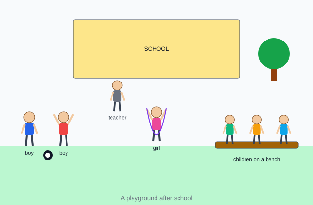

1. True or false: On the left, two boys are playing football.
2. True or false: In the middle, a girl is skipping.
3. True or false: On the right, three children are sitting on a bench and eating.
4. True or false: Near the building, there is a school building and a big tree.
5. Where is the scene?

Answers and explanations

1. **True.**  
   *Where:* Look on the left of the picture. *How:* Compare the statement with the text word by word.
2. **True.**  
   *Where:* Look in the middle of the picture. *How:* Compare the statement with the text word by word.
3. **True.**  
   *Where:* Look on the right of the picture. *How:* Compare the statement with the text word by word.
4. **False — near the building, a teacher is watching the children.**  
   *Where:* Check the position words carefully. *How:* Compare the statement with the text word by word.
5. **A school playground.**  
   *Where:* Look at the whole picture and the title. *How:* Scan for the key word from the question. Write only the needed words — leave out extra information.

---

### ENG-RDG-0034 — At the vegetable market

<!-- meta {"id":"ENG-RDG-0034","topic_id":"ENG-TOP-READ","level":"Beginner","text_type":"picture","skill":"Reading pictures","asset_id":"ENG-IMG-0002"} -->

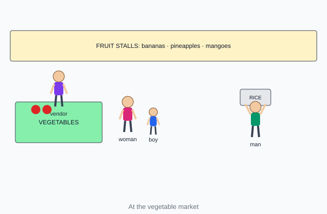

1. True or false: On the left, a vendor is selling vegetables at a stall.
2. True or false: In front of the stall, a woman is buying tomatoes.
3. True or false: On the right, a man is carrying a bag of rice on his shoulder.
4. True or false: In the background, a boy is holding his mother's hand.
5. Where is the scene?

Answers and explanations

1. **True.**  
   *Where:* Look on the left of the picture. *How:* Compare the statement with the text word by word.
2. **True.**  
   *Where:* Look in front of the stall of the picture. *How:* Compare the statement with the text word by word.
3. **True.**  
   *Where:* Look on the right of the picture. *How:* Compare the statement with the text word by word.
4. **False — in the background, there are fruit stalls with bananas and pineapples.**  
   *Where:* Check the position words carefully. *How:* Compare the statement with the text word by word.
5. **A busy market.**  
   *Where:* Look at the whole picture and the title. *How:* Scan for the key word from the question. Write only the needed words — leave out extra information.

---

### ENG-RDG-0035 — At the bus stand

<!-- meta {"id":"ENG-RDG-0035","topic_id":"ENG-TOP-READ","level":"Beginner","text_type":"picture","skill":"Reading pictures","asset_id":"ENG-IMG-0003"} -->

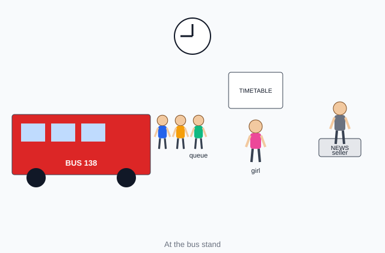

1. True or false: On the left, a red bus is waiting at the bus stand.
2. True or false: Near the bus, passengers are standing in a queue.
3. True or false: On the right, a man is selling newspapers.
4. True or false: In the background, a girl is reading the timetable.
5. Where is the scene?

Answers and explanations

1. **True.**  
   *Where:* Look on the left of the picture. *How:* Compare the statement with the text word by word.
2. **True.**  
   *Where:* Look near the bus of the picture. *How:* Compare the statement with the text word by word.
3. **True.**  
   *Where:* Look on the right of the picture. *How:* Compare the statement with the text word by word.
4. **False — in the background, there is a clock that shows eight o'clock.**  
   *Where:* Check the position words carefully. *How:* Compare the statement with the text word by word.
5. **A bus stand in town.**  
   *Where:* Look at the whole picture and the title. *How:* Scan for the key word from the question. Write only the needed words — leave out extra information.

---

### ENG-RDG-0036 — A family at dinner

<!-- meta {"id":"ENG-RDG-0036","topic_id":"ENG-TOP-READ","level":"Beginner","text_type":"picture","skill":"Reading pictures","asset_id":"ENG-IMG-0004"} -->

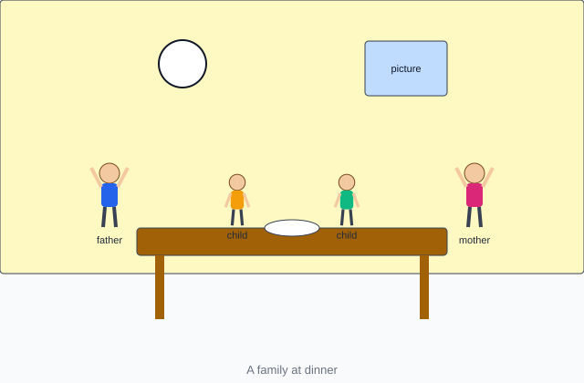

1. True or false: In the middle, a family is having dinner at a table.
2. True or false: On the left, the father is serving rice.
3. True or false: On the right, the mother is pouring water into a glass.
4. True or false: On the wall, two children are eating.
5. Where is the scene?

Answers and explanations

1. **True.**  
   *Where:* Look in the middle of the picture. *How:* Compare the statement with the text word by word.
2. **True.**  
   *Where:* Look on the left of the picture. *How:* Compare the statement with the text word by word.
3. **True.**  
   *Where:* Look on the right of the picture. *How:* Compare the statement with the text word by word.
4. **False — on the wall, there is a clock and a picture.**  
   *Where:* Check the position words carefully. *How:* Compare the statement with the text word by word.
5. **A dining room at home.**  
   *Where:* Look at the whole picture and the title. *How:* Scan for the key word from the question. Write only the needed words — leave out extra information.

---

### ENG-RDG-0037 — At the railway station

<!-- meta {"id":"ENG-RDG-0037","topic_id":"ENG-TOP-READ","level":"Beginner","text_type":"picture","skill":"Reading pictures","asset_id":"ENG-IMG-0005"} -->

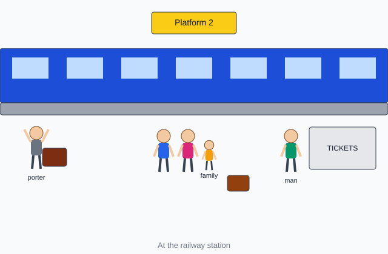

1. True or false: In the background, a train is arriving at the platform.
2. True or false: On the left, a porter is carrying a suitcase.
3. True or false: In the middle, a family is waiting with their luggage.
4. True or false: Above the platform, a man is buying a ticket at the counter.
5. Where is the scene?

Answers and explanations

1. **True.**  
   *Where:* Look in the background of the picture. *How:* Compare the statement with the text word by word.
2. **True.**  
   *Where:* Look on the left of the picture. *How:* Compare the statement with the text word by word.
3. **True.**  
   *Where:* Look in the middle of the picture. *How:* Compare the statement with the text word by word.
4. **False — above the platform, there is a sign that says 'Platform 2'.**  
   *Where:* Check the position words carefully. *How:* Compare the statement with the text word by word.
5. **A railway station platform.**  
   *Where:* Look at the whole picture and the title. *How:* Scan for the key word from the question. Write only the needed words — leave out extra information.

---

### ENG-RDG-0038 — At the hospital

<!-- meta {"id":"ENG-RDG-0038","topic_id":"ENG-TOP-READ","level":"Beginner","text_type":"picture","skill":"Reading pictures","asset_id":"ENG-IMG-0006"} -->

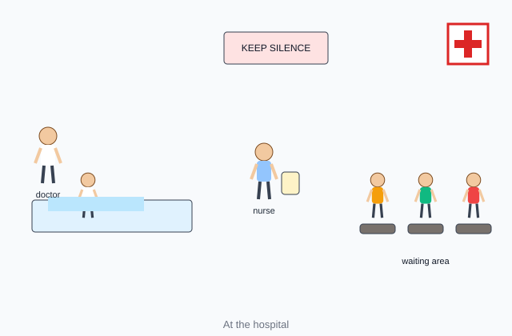

1. True or false: On the left, a doctor is examining a patient.
2. True or false: On the bed, the patient is lying down.
3. True or false: In the middle, a nurse is writing on a file.
4. True or false: On the wall, three people are sitting on chairs and waiting.
5. Where is the scene?

Answers and explanations

1. **True.**  
   *Where:* Look on the left of the picture. *How:* Compare the statement with the text word by word.
2. **True.**  
   *Where:* Look on the bed of the picture. *How:* Compare the statement with the text word by word.
3. **True.**  
   *Where:* Look in the middle of the picture. *How:* Compare the statement with the text word by word.
4. **False — on the wall, there is a notice that says 'Keep Silence'.**  
   *Where:* Check the position words carefully. *How:* Compare the statement with the text word by word.
5. **A hospital ward / waiting area.**  
   *Where:* Look at the whole picture and the title. *How:* Scan for the key word from the question. Write only the needed words — leave out extra information.

---

### ENG-RDG-0039 — A school sports meet

<!-- meta {"id":"ENG-RDG-0039","topic_id":"ENG-TOP-READ","level":"Beginner","text_type":"picture","skill":"Reading pictures","asset_id":"ENG-IMG-0007"} -->

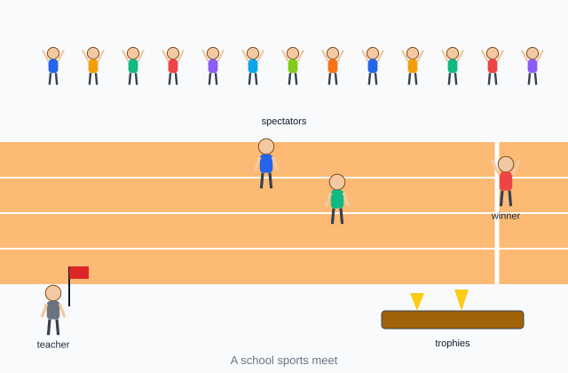

1. True or false: In the middle, three athletes are running a race.
2. True or false: On the right, a boy is crossing the finishing line.
3. True or false: On the left, a teacher is holding a flag.
4. True or false: Near the track, spectators are clapping and cheering.
5. Where is the scene?

Answers and explanations

1. **True.**  
   *Where:* Look in the middle of the picture. *How:* Compare the statement with the text word by word.
2. **True.**  
   *Where:* Look on the right of the picture. *How:* Compare the statement with the text word by word.
3. **True.**  
   *Where:* Look on the left of the picture. *How:* Compare the statement with the text word by word.
4. **False — near the track, there is a table with trophies.**  
   *Where:* Check the position words carefully. *How:* Compare the statement with the text word by word.
5. **A school sports ground.**  
   *Where:* Look at the whole picture and the title. *How:* Scan for the key word from the question. Write only the needed words — leave out extra information.

---

### ENG-RDG-0040 — A park on Sunday

<!-- meta {"id":"ENG-RDG-0040","topic_id":"ENG-TOP-READ","level":"Beginner","text_type":"picture","skill":"Reading pictures","asset_id":"ENG-IMG-0008"} -->

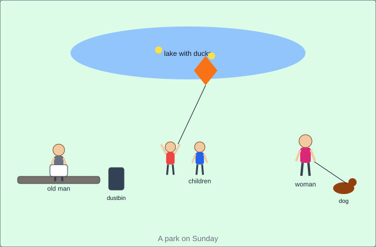

1. True or false: On the left, an old man is reading a newspaper on a bench.
2. True or false: In the middle, two children are flying a kite.
3. True or false: On the right, a woman is walking her dog.
4. True or false: Next to the bench, there is a small lake with ducks.
5. Where is the scene?

Answers and explanations

1. **True.**  
   *Where:* Look on the left of the picture. *How:* Compare the statement with the text word by word.
2. **True.**  
   *Where:* Look in the middle of the picture. *How:* Compare the statement with the text word by word.
3. **True.**  
   *Where:* Look on the right of the picture. *How:* Compare the statement with the text word by word.
4. **False — next to the bench, there is a dustbin.**  
   *Where:* Check the position words carefully. *How:* Compare the statement with the text word by word.
5. **A public park.**  
   *Where:* Look at the whole picture and the title. *How:* Scan for the key word from the question. Write only the needed words — leave out extra information.

---

### ENG-RDG-0041 — A classroom lesson

<!-- meta {"id":"ENG-RDG-0041","topic_id":"ENG-TOP-READ","level":"Beginner","text_type":"picture","skill":"Reading pictures","asset_id":"ENG-IMG-0009"} -->

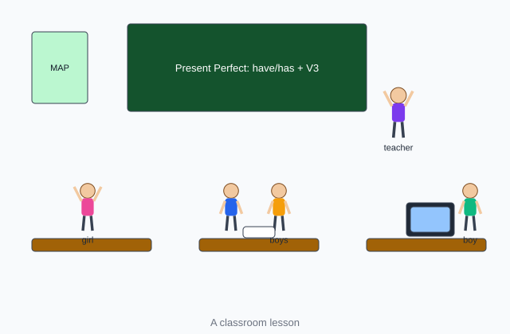

1. True or false: In front of the class, the teacher is writing on the board.
2. True or false: On the left, a girl is raising her hand.
3. True or false: In the middle, two boys are reading a book together.
4. True or false: On the wall, a boy is using a computer.
5. Where is the scene?

Answers and explanations

1. **True.**  
   *Where:* Look in front of the class of the picture. *How:* Compare the statement with the text word by word.
2. **True.**  
   *Where:* Look on the left of the picture. *How:* Compare the statement with the text word by word.
3. **True.**  
   *Where:* Look in the middle of the picture. *How:* Compare the statement with the text word by word.
4. **False — on the wall, there is a map of Sri Lanka.**  
   *Where:* Check the position words carefully. *How:* Compare the statement with the text word by word.
5. **A classroom.**  
   *Where:* Look at the whole picture and the title. *How:* Scan for the key word from the question. Write only the needed words — leave out extra information.

---

### ENG-RDG-0042 — A beach clean-up

<!-- meta {"id":"ENG-RDG-0042","topic_id":"ENG-TOP-READ","level":"Beginner","text_type":"picture","skill":"Reading pictures","asset_id":"ENG-IMG-0010"} -->

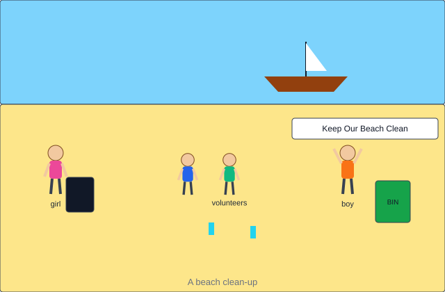

1. True or false: In the middle, volunteers are collecting plastic bottles.
2. True or false: On the left, a girl is holding a large bag of rubbish.
3. True or false: On the right, a boy is putting waste into a bin.
4. True or false: Near the bin, there is the sea and a fishing boat.
5. Where is the scene?

Answers and explanations

1. **True.**  
   *Where:* Look in the middle of the picture. *How:* Compare the statement with the text word by word.
2. **True.**  
   *Where:* Look on the left of the picture. *How:* Compare the statement with the text word by word.
3. **True.**  
   *Where:* Look on the right of the picture. *How:* Compare the statement with the text word by word.
4. **False — near the bin, there is a banner that says 'Keep Our Beach Clean'.**  
   *Where:* Check the position words carefully. *How:* Compare the statement with the text word by word.
5. **A beach.**  
   *Where:* Look at the whole picture and the title. *How:* Scan for the key word from the question. Write only the needed words — leave out extra information.

---

## Intermediate reading sets

---

### ENG-RDG-0043 — Blood Donation Camp

<!-- meta {"id":"ENG-RDG-0043","topic_id":"ENG-TOP-READ","level":"Intermediate","text_type":"notice","skill":"Reading notices","asset_id":"ENG-IMG-R01"} -->

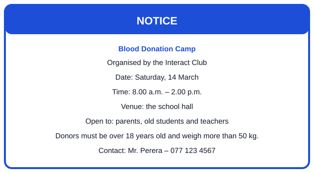

1. What is the notice about?
2. Who organised the event?
3. When will it be held?
4. Where will it be held?
5. Who can take part / attend?
6. Whom should you contact for more details?

Answers and explanations

1. **A blood donation camp.**  
   *Where:* The heading under 'NOTICE'. *How:* Ask: why did the writer write this?
2. **the Interact Club.**  
   *Where:* Second line. *How:* Scan for the key word from the question. Write only the needed words — leave out extra information.
3. **Saturday, 14 March.**  
   *Where:* 'Date' line. *How:* Scan for the key word from the question. Write only the needed words — leave out extra information.
4. **At/In the school hall.**  
   *Where:* 'Venue' line. *How:* Scan for the key word from the question. Write only the needed words — leave out extra information.
5. **Parents, old students and teachers.**  
   *Where:* 'Open to' line. *How:* Scan for the key word from the question. Write only the needed words — leave out extra information.
6. **Mr. Perera – 077 123 4567.**  
   *Where:* 'Contact' line. *How:* Scan for the key word from the question. Write only the needed words — leave out extra information.

---

### ENG-RDG-0044 — Inter-house Debate

<!-- meta {"id":"ENG-RDG-0044","topic_id":"ENG-TOP-READ","level":"Intermediate","text_type":"notice","skill":"Reading notices","asset_id":"ENG-IMG-R02"} -->

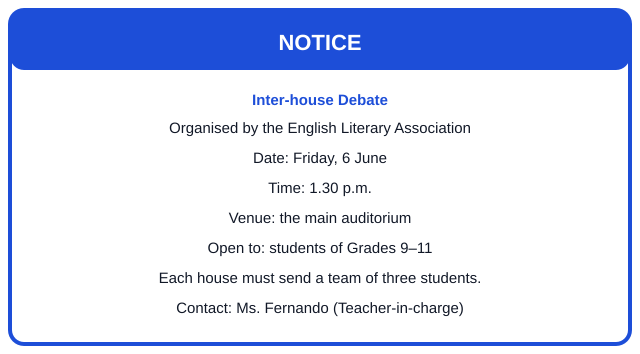

1. What is the notice about?
2. Who organised the event?
3. When will it be held?
4. Where will it be held?
5. Who can take part / attend?
6. Whom should you contact for more details?

Answers and explanations

1. **An inter-house debate.**  
   *Where:* The heading under 'NOTICE'. *How:* Ask: why did the writer write this?
2. **the English Literary Association.**  
   *Where:* Second line. *How:* Scan for the key word from the question. Write only the needed words — leave out extra information.
3. **Friday, 6 June.**  
   *Where:* 'Date' line. *How:* Scan for the key word from the question. Write only the needed words — leave out extra information.
4. **At/In the main auditorium.**  
   *Where:* 'Venue' line. *How:* Scan for the key word from the question. Write only the needed words — leave out extra information.
5. **Students of grades 9–11.**  
   *Where:* 'Open to' line. *How:* Scan for the key word from the question. Write only the needed words — leave out extra information.
6. **Ms. Fernando (Teacher-in-charge).**  
   *Where:* 'Contact' line. *How:* Scan for the key word from the question. Write only the needed words — leave out extra information.

---

### ENG-RDG-0045 — Beach Clean-up

<!-- meta {"id":"ENG-RDG-0045","topic_id":"ENG-TOP-READ","level":"Intermediate","text_type":"notice","skill":"Reading notices","asset_id":"ENG-IMG-R03"} -->

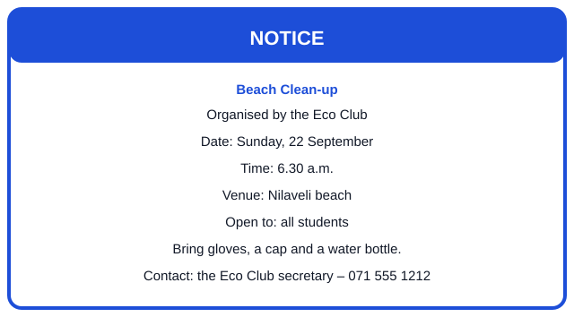

1. What is the notice about?
2. Who organised the event?
3. When will it be held?
4. Where will it be held?
5. Who can take part / attend?
6. Whom should you contact for more details?

Answers and explanations

1. **A beach clean-up.**  
   *Where:* The heading under 'NOTICE'. *How:* Ask: why did the writer write this?
2. **the Eco Club.**  
   *Where:* Second line. *How:* Scan for the key word from the question. Write only the needed words — leave out extra information.
3. **Sunday, 22 September.**  
   *Where:* 'Date' line. *How:* Scan for the key word from the question. Write only the needed words — leave out extra information.
4. **At/In Nilaveli beach.**  
   *Where:* 'Venue' line. *How:* Scan for the key word from the question. Write only the needed words — leave out extra information.
5. **All students.**  
   *Where:* 'Open to' line. *How:* Scan for the key word from the question. Write only the needed words — leave out extra information.
6. **the Eco Club secretary – 071 555 1212.**  
   *Where:* 'Contact' line. *How:* Scan for the key word from the question. Write only the needed words — leave out extra information.

---

### ENG-RDG-0046 — Science Exhibition

<!-- meta {"id":"ENG-RDG-0046","topic_id":"ENG-TOP-READ","level":"Intermediate","text_type":"notice","skill":"Reading notices","asset_id":"ENG-IMG-R04"} -->

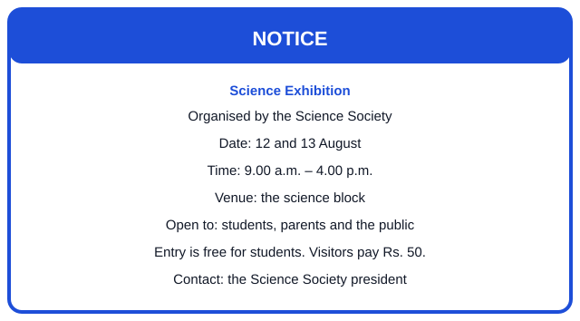

1. What is the notice about?
2. Who organised the event?
3. When will it be held?
4. Where will it be held?
5. Who can take part / attend?
6. Whom should you contact for more details?

Answers and explanations

1. **A science exhibition.**  
   *Where:* The heading under 'NOTICE'. *How:* Ask: why did the writer write this?
2. **the Science Society.**  
   *Where:* Second line. *How:* Scan for the key word from the question. Write only the needed words — leave out extra information.
3. **12 and 13 August.**  
   *Where:* 'Date' line. *How:* Scan for the key word from the question. Write only the needed words — leave out extra information.
4. **At/In the science block.**  
   *Where:* 'Venue' line. *How:* Scan for the key word from the question. Write only the needed words — leave out extra information.
5. **Students, parents and the public.**  
   *Where:* 'Open to' line. *How:* Scan for the key word from the question. Write only the needed words — leave out extra information.
6. **the Science Society president.**  
   *Where:* 'Contact' line. *How:* Scan for the key word from the question. Write only the needed words — leave out extra information.

---

### ENG-RDG-0047 — Art Competition

<!-- meta {"id":"ENG-RDG-0047","topic_id":"ENG-TOP-READ","level":"Intermediate","text_type":"notice","skill":"Reading notices","asset_id":"ENG-IMG-R05"} -->

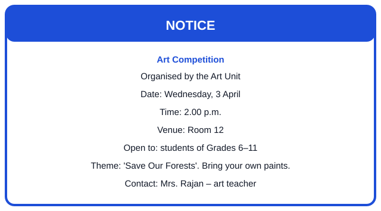

1. What is the notice about?
2. Who organised the event?
3. When will it be held?
4. Where will it be held?
5. Who can take part / attend?
6. Whom should you contact for more details?

Answers and explanations

1. **An art competition.**  
   *Where:* The heading under 'NOTICE'. *How:* Ask: why did the writer write this?
2. **the Art Unit.**  
   *Where:* Second line. *How:* Scan for the key word from the question. Write only the needed words — leave out extra information.
3. **Wednesday, 3 April.**  
   *Where:* 'Date' line. *How:* Scan for the key word from the question. Write only the needed words — leave out extra information.
4. **At/In Room 12.**  
   *Where:* 'Venue' line. *How:* Scan for the key word from the question. Write only the needed words — leave out extra information.
5. **Students of grades 6–11.**  
   *Where:* 'Open to' line. *How:* Scan for the key word from the question. Write only the needed words — leave out extra information.
6. **Mrs. Rajan – art teacher.**  
   *Where:* 'Contact' line. *How:* Scan for the key word from the question. Write only the needed words — leave out extra information.

---

### ENG-RDG-0048 — Free Eye Clinic

<!-- meta {"id":"ENG-RDG-0048","topic_id":"ENG-TOP-READ","level":"Intermediate","text_type":"notice","skill":"Reading notices","asset_id":"ENG-IMG-R06"} -->

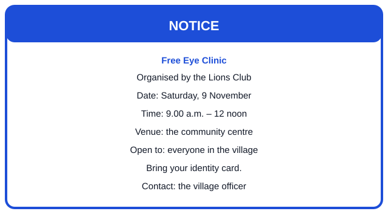

1. What is the notice about?
2. Who organised the event?
3. When will it be held?
4. Where will it be held?
5. Who can take part / attend?
6. Whom should you contact for more details?

Answers and explanations

1. **A free eye clinic.**  
   *Where:* The heading under 'NOTICE'. *How:* Ask: why did the writer write this?
2. **the Lions Club.**  
   *Where:* Second line. *How:* Scan for the key word from the question. Write only the needed words — leave out extra information.
3. **Saturday, 9 November.**  
   *Where:* 'Date' line. *How:* Scan for the key word from the question. Write only the needed words — leave out extra information.
4. **At/In the community centre.**  
   *Where:* 'Venue' line. *How:* Scan for the key word from the question. Write only the needed words — leave out extra information.
5. **Everyone in the village.**  
   *Where:* 'Open to' line. *How:* Scan for the key word from the question. Write only the needed words — leave out extra information.
6. **the village officer.**  
   *Where:* 'Contact' line. *How:* Scan for the key word from the question. Write only the needed words — leave out extra information.

---

### ENG-RDG-0049 — Book Fair

<!-- meta {"id":"ENG-RDG-0049","topic_id":"ENG-TOP-READ","level":"Intermediate","text_type":"notice","skill":"Reading notices","asset_id":"ENG-IMG-R07"} -->

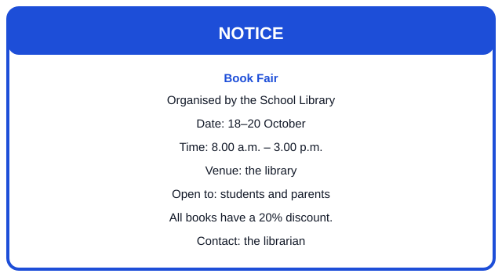

1. What is the notice about?
2. Who organised the event?
3. When will it be held?
4. Where will it be held?
5. Who can take part / attend?
6. Whom should you contact for more details?

Answers and explanations

1. **A book fair.**  
   *Where:* The heading under 'NOTICE'. *How:* Ask: why did the writer write this?
2. **the School Library.**  
   *Where:* Second line. *How:* Scan for the key word from the question. Write only the needed words — leave out extra information.
3. **18–20 October.**  
   *Where:* 'Date' line. *How:* Scan for the key word from the question. Write only the needed words — leave out extra information.
4. **At/In the library.**  
   *Where:* 'Venue' line. *How:* Scan for the key word from the question. Write only the needed words — leave out extra information.
5. **Students and parents.**  
   *Where:* 'Open to' line. *How:* Scan for the key word from the question. Write only the needed words — leave out extra information.
6. **the librarian.**  
   *Where:* 'Contact' line. *How:* Scan for the key word from the question. Write only the needed words — leave out extra information.

---

### ENG-RDG-0050 — Tree-Planting Day

<!-- meta {"id":"ENG-RDG-0050","topic_id":"ENG-TOP-READ","level":"Intermediate","text_type":"notice","skill":"Reading notices","asset_id":"ENG-IMG-R08"} -->

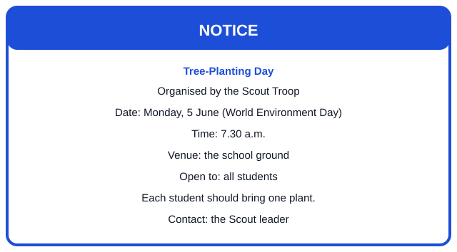

1. What is the notice about?
2. Who organised the event?
3. When will it be held?
4. Where will it be held?
5. Who can take part / attend?
6. Whom should you contact for more details?

Answers and explanations

1. **A tree-planting day.**  
   *Where:* The heading under 'NOTICE'. *How:* Ask: why did the writer write this?
2. **the Scout Troop.**  
   *Where:* Second line. *How:* Scan for the key word from the question. Write only the needed words — leave out extra information.
3. **Monday, 5 June (World Environment Day).**  
   *Where:* 'Date' line. *How:* Scan for the key word from the question. Write only the needed words — leave out extra information.
4. **At/In the school ground.**  
   *Where:* 'Venue' line. *How:* Scan for the key word from the question. Write only the needed words — leave out extra information.
5. **All students.**  
   *Where:* 'Open to' line. *How:* Scan for the key word from the question. Write only the needed words — leave out extra information.
6. **the Scout leader.**  
   *Where:* 'Contact' line. *How:* Scan for the key word from the question. Write only the needed words — leave out extra information.

---

### ENG-RDG-0051 — Sunrise Tuition Classes

<!-- meta {"id":"ENG-RDG-0051","topic_id":"ENG-TOP-READ","level":"Intermediate","text_type":"advertisement","skill":"Reading advertisements","asset_id":"ENG-IMG-A01"} -->

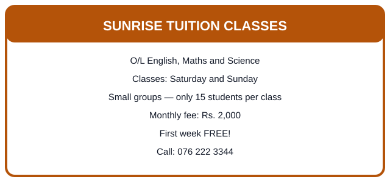

1. What is advertised?
2. How much does it cost?
3. What do customers get free?
4. When is it available?

Answers and explanations

1. **Tuition classes.**  
   *Where:* The heading tells you. *How:* Ask: why did the writer write this?
2. **Rs. 2,000.**  
   *Where:* Find the number with *Rs.* *How:* Scan for the key word from the question. Write only the needed words — leave out extra information.
3. **The first week.**  
   *Where:* Scan for the word *free* / *FREE*. *How:* Scan for the key word from the question. Write only the needed words — leave out extra information.
4. **Saturday and sunday.**  
   *Where:* Find days or times. *How:* Scan for the key word from the question. Write only the needed words — leave out extra information.

---

### ENG-RDG-0052 — Green Leaf Restaurant

<!-- meta {"id":"ENG-RDG-0052","topic_id":"ENG-TOP-READ","level":"Intermediate","text_type":"advertisement","skill":"Reading advertisements","asset_id":"ENG-IMG-A02"} -->

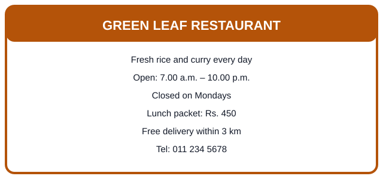

1. What is advertised?
2. How much does it cost?
3. What do customers get free?
4. When is it available?

Answers and explanations

1. **A restaurant.**  
   *Where:* The heading tells you. *How:* Ask: why did the writer write this?
2. **Rs. 450.**  
   *Where:* Find the number with *Rs.* *How:* Scan for the key word from the question. Write only the needed words — leave out extra information.
3. **Delivery within 3 km.**  
   *Where:* Scan for the word *free* / *FREE*. *How:* Scan for the key word from the question. Write only the needed words — leave out extra information.
4. **Every day except monday.**  
   *Where:* Find days or times. *How:* Scan for the key word from the question. Write only the needed words — leave out extra information.

---

### ENG-RDG-0053 — Cycle World

<!-- meta {"id":"ENG-RDG-0053","topic_id":"ENG-TOP-READ","level":"Intermediate","text_type":"advertisement","skill":"Reading advertisements","asset_id":"ENG-IMG-A03"} -->

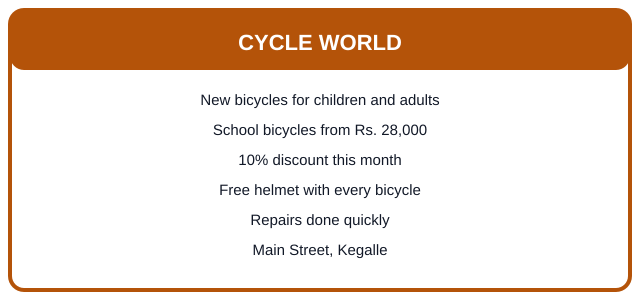

1. What is advertised?
2. How much does it cost?
3. What do customers get free?
4. When is it available?

Answers and explanations

1. **Bicycles.**  
   *Where:* The heading tells you. *How:* Ask: why did the writer write this?
2. **Rs. 28,000.**  
   *Where:* Find the number with *Rs.* *How:* Scan for the key word from the question. Write only the needed words — leave out extra information.
3. **A helmet.**  
   *Where:* Scan for the word *free* / *FREE*. *How:* Scan for the key word from the question. Write only the needed words — leave out extra information.
4. **This month.**  
   *Where:* Find days or times. *How:* Scan for the key word from the question. Write only the needed words — leave out extra information.

---

### ENG-RDG-0054 — Computer Course For Beginners

<!-- meta {"id":"ENG-RDG-0054","topic_id":"ENG-TOP-READ","level":"Intermediate","text_type":"advertisement","skill":"Reading advertisements","asset_id":"ENG-IMG-A04"} -->

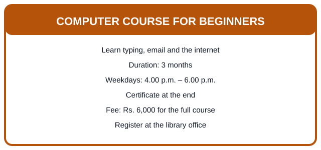

1. What is advertised?
2. How much does it cost?
3. What do customers get free?
4. When is it available?

Answers and explanations

1. **A computer course.**  
   *Where:* The heading tells you. *How:* Ask: why did the writer write this?
2. **Rs. 6,000.**  
   *Where:* Find the number with *Rs.* *How:* Scan for the key word from the question. Write only the needed words — leave out extra information.
3. **A certificate.**  
   *Where:* Scan for the word *free* / *FREE*. *How:* Scan for the key word from the question. Write only the needed words — leave out extra information.
4. **Weekdays.**  
   *Where:* Find days or times. *How:* Scan for the key word from the question. Write only the needed words — leave out extra information.

---

### ENG-RDG-0055 — Email 1

<!-- meta {"id":"ENG-RDG-0055","topic_id":"ENG-TOP-READ","level":"Intermediate","text_type":"email","skill":"Reading emails","asset_id":null} -->

> From: kavya@mail.lk  
> To: rina@mail.lk  
> Subject: Science project  
>   
> Hi Rina,  
> Our science project is due next Friday. Can you come to my house on Wednesday at 4 p.m.? Please bring the photos of the plants. My mother will make some snacks for us.  
> See you,  
> Kavya

1. Who wrote the email?
2. When is the project due?
3. What should Rina bring?
4. Who will make snacks?

Answers and explanations

1. **Kavya.**  
   *Where:* 'From' line / signature. *How:* Scan for the key word from the question. Write only the needed words — leave out extra information.
2. **Next Friday.**  
   *Where:* Line 1 of the message. *How:* Scan for the key word from the question. Write only the needed words — leave out extra information.
3. **The photos of the plants.**  
   *Where:* Sentence 3. *How:* Scan for the key word from the question. Write only the needed words — leave out extra information.
4. **Kavya's mother.**  
   *Where:* Sentence 4 — *My* = Kavya's. *How:* Look back to the nearest noun or idea that fits.

---

### ENG-RDG-0056 — Email 2

<!-- meta {"id":"ENG-RDG-0056","topic_id":"ENG-TOP-READ","level":"Intermediate","text_type":"email","skill":"Reading emails","asset_id":null} -->

> From: principal@school.lk  
> To: All parents  
> Subject: Parents' meeting  
>   
> Dear Parents,  
> A meeting will be held on Saturday, 12 July at 9 a.m. in the school hall. We will discuss the new school timetable and the sports meet. Please attend without fail.  
> Principal

1. Who sent the email?
2. Where will the meeting be held?
3. What will they discuss? (two things)
4. What does *without fail* mean?

Answers and explanations

1. **The principal.**  
   *Where:* 'From' line. *How:* Scan for the key word from the question. Write only the needed words — leave out extra information.
2. **In the school hall.**  
   *Where:* Sentence 1. *How:* Scan for the key word from the question. Write only the needed words — leave out extra information.
3. **The new school timetable and the sports meet.**  
   *Where:* Sentence 2. *How:* Scan for the key word from the question. Write only the needed words — leave out extra information.
4. **Definitely / you must come.**  
   *Where:* Vocabulary in context. *How:* Find a word with the same meaning in that part of the text.

---

### ENG-RDG-0057 — Email 3

<!-- meta {"id":"ENG-RDG-0057","topic_id":"ENG-TOP-READ","level":"Intermediate","text_type":"email","skill":"Reading emails","asset_id":null} -->

> From: ravi.uncle@mail.lk  
> To: arun@mail.lk  
> Subject: Congratulations!  
>   
> Dear Arun,  
> I heard that you won first place in the speech competition. Well done! I am very proud of you. I am sending you a small gift — a dictionary. I hope it will help you.  
> Love,  
> Uncle Ravi

1. Why did Uncle Ravi write?
2. What did Arun win?
3. What is the gift?
4. What does *it* refer to in the last sentence?

Answers and explanations

1. **To congratulate Arun.**  
   *Where:* Subject line and sentence 1. *How:* Ask: why did the writer write this?
2. **First place in the speech competition.**  
   *Where:* Sentence 1. *How:* Scan for the key word from the question. Write only the needed words — leave out extra information.
3. **A dictionary.**  
   *Where:* Sentence 4. *How:* Scan for the key word from the question. Write only the needed words — leave out extra information.
4. **The dictionary / the gift.**  
   *Where:* Look back to the noun before. *How:* Look back to the nearest noun or idea that fits.

---

### ENG-RDG-0058 — Bus timetable: Colombo to Kandy

<!-- meta {"id":"ENG-RDG-0058","topic_id":"ENG-TOP-READ","level":"Intermediate","text_type":"timetable","skill":"Reading tables","asset_id":null} -->

> | Bus | Leaves Colombo | Arrives Kandy | Fare |  
> |---|---|---|---|  
> | Normal 1 | 6.00 a.m. | 9.30 a.m. | Rs. 250 |  
> | Express | 7.15 a.m. | 9.45 a.m. | Rs. 450 |  
> | Normal 2 | 8.00 a.m. | 11.30 a.m. | Rs. 250 |  
> | Luxury | 10.00 a.m. | 12.30 p.m. | Rs. 600 |

1. Which bus is the most expensive?
2. How long does the Express take?
3. Which bus arrives first?
4. If you must reach Kandy before 10 a.m. and pay the least, which bus?
5. True or false: Two buses cost Rs. 250.

Answers and explanations

1. **The Luxury bus (Rs. 600).**  
   *Where:* Compare the Fare column. *How:* Scan for the key word from the question. Write only the needed words — leave out extra information.
2. **Two and a half hours (2 hours 30 minutes).**  
   *Where:* 9.45 − 7.15. *How:* Scan for the key word from the question. Write only the needed words — leave out extra information.
3. **Normal 1 (9.30 a.m.).**  
   *Where:* Arrives column. *How:* Scan for the key word from the question. Write only the needed words — leave out extra information.
4. **Normal 1.**  
   *Where:* Normal 1 arrives 9.30 and costs Rs. 250. *How:* The answer is not written directly — use clues in the text.
5. **True.**  
   *Where:* Normal 1 and Normal 2. *How:* Compare the statement with the text word by word.

---

### ENG-RDG-0059 — The king coconut

<!-- meta {"id":"ENG-RDG-0059","topic_id":"ENG-TOP-READ","level":"Intermediate","text_type":"informational passage","skill":"Vocabulary in context","asset_id":null} -->

> The king coconut, or *thambili*, grows in many parts of Sri Lanka. Its orange colour makes it easy to recognise. People drink its water when they are thirsty or tired, because it is fresh and full of minerals. It is also cheap. Doctors often advise patients with fever to drink it. After drinking, some people eat the soft white flesh inside. Nothing is wasted, because the shell can be used as fuel.

1. Why is the king coconut easy to recognise?
2. Give two reasons why people drink it.
3. Who often advise patients to drink it?
4. What does *its* in sentence 2 refer to?
5. Find a word that means 'used to make fire'.

Answers and explanations

1. **Because of its orange colour.**  
   *Where:* Sentence 2. *How:* Scan for the key word from the question. Write only the needed words — leave out extra information.
2. **It is fresh / full of minerals / cheap (any two).**  
   *Where:* Sentences 3–4. *How:* Scan for the key word from the question. Write only the needed words — leave out extra information.
3. **Doctors.**  
   *Where:* Sentence 5. *How:* Scan for the key word from the question. Write only the needed words — leave out extra information.
4. **The king coconut.**  
   *Where:* Pronoun reference. *How:* Look back to the nearest noun or idea that fits.
5. **fuel**  
   *Where:* Last sentence. *How:* Find a word with the same meaning in that part of the text.

---

### ENG-RDG-0060 — Dengue fever

<!-- meta {"id":"ENG-RDG-0060","topic_id":"ENG-TOP-READ","level":"Intermediate","text_type":"informational passage","skill":"Vocabulary in context","asset_id":null} -->

> Dengue is a disease spread by mosquitoes. These mosquitoes breed in clean water that collects in tyres, coconut shells and plastic containers. The symptoms include high fever, headache and pain in the joints. There is no special medicine, so prevention is very important. We should clean our surroundings every week and cover water tanks. If someone has a fever for more than two days, they should see a doctor immediately.

1. How does dengue spread?
2. Where do the mosquitoes breed? (two places)
3. Why is prevention very important?
4. What should we do every week?
5. Find a word that means 'at once'.

Answers and explanations

1. **Through (the bites of) mosquitoes.**  
   *Where:* Sentence 1. *How:* Scan for the key word from the question. Write only the needed words — leave out extra information.
2. **Any two: tyres, coconut shells, plastic containers.**  
   *Where:* Sentence 2. *How:* Scan for the key word from the question. Write only the needed words — leave out extra information.
3. **Because there is no special medicine.**  
   *Where:* Sentence 4 — *so* shows result. *How:* Scan for the key word from the question. Write only the needed words — leave out extra information.
4. **Clean our surroundings.**  
   *Where:* Sentence 5. *How:* Scan for the key word from the question. Write only the needed words — leave out extra information.
5. **immediately**  
   *Where:* Last sentence. *How:* Find a word with the same meaning in that part of the text.

---

### ENG-RDG-0061 — Saving water at home

<!-- meta {"id":"ENG-RDG-0061","topic_id":"ENG-TOP-READ","level":"Intermediate","text_type":"informational passage","skill":"Vocabulary in context","asset_id":null} -->

> Water is precious, but many families waste it without knowing. A dripping tap can waste more than ten litres a day. Simple habits can help. Turn off the tap while you brush your teeth. Use a bucket instead of a hose to wash the car. Water the garden in the evening, when less water evaporates. These small steps protect our future.

1. What is the main idea of the passage?
2. How much water can a dripping tap waste?
3. What should you use to wash the car?
4. Why should you water the garden in the evening?
5. Find a word that means 'very valuable'.

Answers and explanations

1. **Simple habits can help us save water at home.**  
   *Where:* Sentences 3 and 7 sum up the text. *How:* Think about the whole text, especially the first and last sentences.
2. **More than ten litres a day.**  
   *Where:* Sentence 2. *How:* Scan for the key word from the question. Write only the needed words — leave out extra information.
3. **A bucket.**  
   *Where:* Sentence 5. *How:* Scan for the key word from the question. Write only the needed words — leave out extra information.
4. **Because less water evaporates then.**  
   *Where:* Sentence 6. *How:* Scan for the key word from the question. Write only the needed words — leave out extra information.
5. **precious**  
   *Where:* Sentence 1. *How:* Find a word with the same meaning in that part of the text.

---

### ENG-RDG-0062 — Planning a party

<!-- meta {"id":"ENG-RDG-0062","topic_id":"ENG-TOP-READ","level":"Intermediate","text_type":"dialogue","skill":"Reading dialogues","asset_id":null} -->

> Amal: Mum's birthday is on Friday. Let's surprise her.  
> Sithara: Good idea! I can bake a chocolate cake.  
> Amal: I'll buy some balloons and a card.  
> Sithara: What about Dad?  
> Amal: He will take Mum to the temple in the evening, so we can decorate the house.

1. Whose birthday is it?
2. What will Sithara do?
3. What will Amal buy?
4. Why will Dad take Mum to the temple?

Answers and explanations

1. **Their mother's.**  
   *Where:* Line 1. *How:* Scan for the key word from the question. Write only the needed words — leave out extra information.
2. **Bake a chocolate cake.**  
   *Where:* Line 2. *How:* Scan for the key word from the question. Write only the needed words — leave out extra information.
3. **Balloons and a card.**  
   *Where:* Line 3. *How:* Scan for the key word from the question. Write only the needed words — leave out extra information.
4. **So that the children can decorate the house.**  
   *Where:* Last line — *so* = purpose. *How:* The answer is not written directly — use clues in the text.

---

### ENG-RDG-0063 — A phone call

<!-- meta {"id":"ENG-RDG-0063","topic_id":"ENG-TOP-READ","level":"Intermediate","text_type":"dialogue","skill":"Reading dialogues","asset_id":null} -->

> Kumar: Hello, is that Sunil?  
> Sunil: Yes, speaking.  
> Kumar: This is Kumar. Are you coming for cricket practice today?  
> Sunil: Sorry, I can't. I have to visit my aunt in hospital.  
> Kumar: Oh, I'm sorry to hear that. Practice is again on Thursday.  
> Sunil: Then I'll come on Thursday. Thanks.

1. Who called whom?
2. Why can't Sunil come?
3. When is the next practice?
4. What does *I'm sorry to hear that* show?

Answers and explanations

1. **Kumar called Sunil.**  
   *Where:* Lines 1–3. *How:* Scan for the key word from the question. Write only the needed words — leave out extra information.
2. **He has to visit his aunt in hospital.**  
   *Where:* Line 4. *How:* Scan for the key word from the question. Write only the needed words — leave out extra information.
3. **On Thursday.**  
   *Where:* Line 5. *How:* Scan for the key word from the question. Write only the needed words — leave out extra information.
4. **Sympathy.**  
   *Where:* Language function. *How:* Scan for the key word from the question.

---

### ENG-RDG-0064 — Students turn waste into a garden

<!-- meta {"id":"ENG-RDG-0064","topic_id":"ENG-TOP-READ","level":"Intermediate","text_type":"newspaper-style article","skill":"Reading news articles","asset_id":null} -->

> BATTICALOA — Students of a local school have turned an empty piece of land behind their classrooms into a vegetable garden. The project started in January, when the Environmental Society collected plastic bottles, old tyres and broken buckets from the town.  
>   
> The students cleaned the containers, filled them with soil and planted tomatoes, chillies and spinach. They water the plants before school every morning. 'We wanted to show that waste can be useful,' said Kumaran, the president of the society.  
>   
> The vegetables are now used in the school canteen. The principal says the project has also reduced the amount of rubbish in the school.

1. Where is the garden?
2. What did the students use as containers?
3. When do they water the plants?
4. Who is Kumaran?
5. What does *They* refer to in paragraph 2, sentence 2?
6. Give two results of the project.

Answers and explanations

1. **Behind the classrooms (of a school in Batticaloa).**  
   *Where:* Paragraph 1, sentence 1. *How:* Scan for the key word from the question. Write only the needed words — leave out extra information.
2. **Plastic bottles, old tyres and broken buckets.**  
   *Where:* Paragraph 1, sentence 2. *How:* Scan for the key word from the question. Write only the needed words — leave out extra information.
3. **Before school every morning.**  
   *Where:* Paragraph 2, sentence 2. *How:* Scan for the key word from the question. Write only the needed words — leave out extra information.
4. **The president of the Environmental Society.**  
   *Where:* Paragraph 2, last sentence. *How:* Scan for the key word from the question. Write only the needed words — leave out extra information.
5. **The students.**  
   *Where:* Pronoun reference. *How:* Look back to the nearest noun or idea that fits.
6. **Vegetables for the canteen; less rubbish in the school.**  
   *Where:* Paragraph 3. *How:* Scan for the key word from the question. Write only the needed words — leave out extra information.

---

### ENG-RDG-0065 — How to wash your hands properly

<!-- meta {"id":"ENG-RDG-0065","topic_id":"ENG-TOP-READ","level":"Intermediate","text_type":"instructions","skill":"Reading instructions","asset_id":null} -->

> 1. Wet your hands with clean, running water.  
> 2. Apply soap and rub your palms together.  
> 3. Rub the backs of your hands and between your fingers.  
> 4. Clean under your nails.  
> 5. Keep rubbing for at least 20 seconds.  
> 6. Rinse your hands well under running water.  
> 7. Dry them with a clean towel or let them air-dry.

1. What should you do first?
2. How long should you rub your hands?
3. Which step tells you to clean your nails?
4. Give two ways to dry your hands.
5. True or false: You should use still water in a basin.

Answers and explanations

1. **Wet your hands with clean, running water.**  
   *Where:* Step 1. *How:* Scan for the key word from the question. Write only the needed words — leave out extra information.
2. **For at least 20 seconds.**  
   *Where:* Step 5. *How:* Scan for the key word from the question. Write only the needed words — leave out extra information.
3. **Step 4.**  
   *Where:* Scan for the word *nails*. *How:* Scan for the key word from the question. Write only the needed words — leave out extra information.
4. **With a clean towel or by letting them air-dry.**  
   *Where:* Step 7. *How:* Scan for the key word from the question. Write only the needed words — leave out extra information.
5. **False — use running water.**  
   *Where:* Steps 1 and 6. *How:* Compare the statement with the text word by word.

---

### ENG-RDG-0066 — Poster: Save Electricity

<!-- meta {"id":"ENG-RDG-0066","topic_id":"ENG-TOP-READ","level":"Intermediate","text_type":"poster","skill":"Reading posters","asset_id":null} -->

> SAVE ELECTRICITY — SAVE MONEY — SAVE OUR PLANET  
> • Switch off lights and fans when you leave a room.  
> • Use LED bulbs — they use up to 80% less power.  
> • Unplug phone chargers after use.  
> • Iron all your clothes at one time.  
> • Open the windows and use natural light during the day.  
> Organised by: Energy Club, Ananda Vidyalaya

1. Who made this poster?
2. Why should we use LED bulbs?
3. What should you do with chargers after use?
4. Give the three things we save, according to the heading.
5. What is the purpose of the poster?

Answers and explanations

1. **The Energy Club of Ananda Vidyalaya.**  
   *Where:* Last line. *How:* Scan for the key word from the question. Write only the needed words — leave out extra information.
2. **They use up to 80% less power.**  
   *Where:* Point 2. *How:* Scan for the key word from the question. Write only the needed words — leave out extra information.
3. **Unplug them.**  
   *Where:* Point 3. *How:* Scan for the key word from the question. Write only the needed words — leave out extra information.
4. **Electricity, money and our planet.**  
   *Where:* Heading. *How:* Scan for the key word from the question. Write only the needed words — leave out extra information.
5. **To encourage people to save electricity.**  
   *Where:* Purpose of a text — look at the heading and the instructions. *How:* Ask: why did the writer write this?

---

### ENG-RDG-0067 — Captions from a school magazine

<!-- meta {"id":"ENG-RDG-0067","topic_id":"ENG-TOP-READ","level":"Intermediate","text_type":"photo captions","skill":"Reading captions","asset_id":null} -->

> Photo 1: Grade 11 students planting mangrove saplings at Negombo lagoon on World Environment Day.  
> Photo 2: Our under-17 netball team with the zonal championship trophy, 12 August.  
> Photo 3: Mr. A. Rahman, our retiring music teacher, receives a gift from the Head Prefect.  
> Photo 4: Visitors at the Science Day exhibition try the solar cooker built by Grade 10 students.

1. Where were the saplings planted?
2. What did the netball team win?
3. Which photo shows a farewell?
4. Who built the solar cooker?
5. What does *retiring* mean?

Answers and explanations

1. **At Negombo lagoon.**  
   *Where:* Caption 1. *How:* Scan for the key word from the question. Write only the needed words — leave out extra information.
2. **The zonal championship (trophy).**  
   *Where:* Caption 2. *How:* Scan for the key word from the question. Write only the needed words — leave out extra information.
3. **Photo 3.**  
   *Where:* *retiring* + *receives a gift* → farewell. *How:* The answer is not written directly — use clues in the text.
4. **Grade 10 students.**  
   *Where:* Caption 4. *How:* Scan for the key word from the question. Write only the needed words — leave out extra information.
5. **Stopping work because of age / leaving the job.**  
   *Where:* Vocabulary in context. *How:* Find a word with the same meaning in that part of the text.

---

### ENG-RDG-0068 — Email: Change of practice time

<!-- meta {"id":"ENG-RDG-0068","topic_id":"ENG-TOP-READ","level":"Intermediate","text_type":"email","skill":"Reading emails","asset_id":null} -->

> From: coach.sports@school.lk  
> To: Under-15 cricket squad  
> Subject: Practice moved to Thursday  
>   
> Dear players,  
> Because the playground will be used for the inter-school athletics meet on Wednesday, this week's practice will be held on Thursday from 3.00 p.m. to 5.30 p.m. Please bring your own water bottles and wear white kits. Parents who wish to watch are welcome.  
> Players who cannot attend must inform me by Tuesday evening.  
> Coach Perera

1. Why has practice been moved?
2. When is the new practice?
3. What should the players bring?
4. What must absent players do?
5. True or false: Parents are not allowed to watch.

Answers and explanations

1. **Because the playground will be used for the athletics meet on Wednesday.**  
   *Where:* Sentence 1 (*Because ...*). *How:* Scan for the key word from the question. Write only the needed words — leave out extra information.
2. **On Thursday from 3.00 p.m. to 5.30 p.m.**  
   *Where:* Sentence 1. *How:* Scan for the key word from the question. Write only the needed words — leave out extra information.
3. **Their own water bottles.**  
   *Where:* Sentence 2. *How:* Scan for the key word from the question. Write only the needed words — leave out extra information.
4. **Inform the coach by Tuesday evening.**  
   *Where:* Last sentence. *How:* Scan for the key word from the question. Write only the needed words — leave out extra information.
5. **False — they are welcome.**  
   *Where:* Sentence 3. *How:* Compare the statement with the text word by word.

---

### ENG-RDG-0069 — The Sri Lankan elephant

<!-- meta {"id":"ENG-RDG-0069","topic_id":"ENG-TOP-READ","level":"Intermediate","text_type":"informational passage","skill":"Reading informational texts","asset_id":null} -->

> The Sri Lankan elephant is the largest of the Asian elephants. An adult male can weigh up to 5,500 kilograms. Only a small number of males have tusks; most have short teeth called tushes.  
>   
> Elephants live in herds led by an older female. They eat grass, leaves, fruits and bark, and they need about 150 kilograms of food every day. Because forests are being cleared, elephants sometimes enter villages in search of food. This causes conflicts between humans and elephants.  
>   
> To protect both people and animals, the government has built electric fences and created national parks such as Minneriya, Udawalawe and Wasgamuwa.

1. How heavy can an adult male be?
2. Who leads a herd?
3. Why do elephants enter villages?
4. Name two national parks mentioned.
5. What does *This* refer to in paragraph 2 ('This causes conflicts')?
6. Find a word meaning 'groups of animals'.

Answers and explanations

1. **Up to 5,500 kilograms.**  
   *Where:* Paragraph 1. *How:* Scan for the key word from the question. Write only the needed words — leave out extra information.
2. **An older female.**  
   *Where:* Paragraph 2. *How:* Scan for the key word from the question. Write only the needed words — leave out extra information.
3. **Because forests are being cleared and they look for food.**  
   *Where:* Paragraph 2. *How:* Scan for the key word from the question. Write only the needed words — leave out extra information.
4. **Any two: Minneriya, Udawalawe, Wasgamuwa.** (also: Minneriya and Udawalawe; Udawalawe and Wasgamuwa)  
   *Where:* Paragraph 3. *How:* Scan for the key word from the question. Write only the needed words — leave out extra information.
5. **Elephants entering villages.**  
   *Where:* Pronoun reference — the idea in the previous sentence. *How:* Look back to the nearest noun or idea that fits.
6. **herds**  
   *Where:* Paragraph 2. *How:* Find a word with the same meaning in that part of the text.

---

## Examination Level reading sets

---

### ENG-RDG-0070 — The girl who saved the library

<!-- meta {"id":"ENG-RDG-0070","topic_id":"ENG-TOP-READ","level":"Examination Level","text_type":"examination-style passage","skill":"Examination reading","asset_id":null} -->

> When the old library in Meena's village was damaged by floods, many people thought it would close forever. The roof was leaking, and hundreds of books were wet. The village council said it had no money for repairs.  
>   
> Meena, a Grade 11 student, did not give up. She asked her classmates to help her dry the books in the sun. Every weekend, they carried the books to the temple ground and turned the pages carefully. Meanwhile, Meena wrote letters to companies in the nearby town, asking for help.  
>   
> After two months, a hardware shop donated roofing sheets, and a group of parents offered to repair the roof free of charge. The students also organised a small fair and collected Rs. 35,000 to buy new shelves.  
>   
> Today, the library is busier than ever. It has a reading corner for children and a computer donated by a former student. The librarian says that Meena taught the village an important lesson: when people work together, even a small group can make a big difference.

1. Why did people think the library would close?  
   (a) Because it was too old  
   (b) Because it was damaged and there was no money for repairs  
   (c) Because nobody read books  
   (d) Because Meena closed it
2. What did Meena and her classmates do every weekend?
3. Who repaired the roof?
4. How did the students get money for new shelves?
5. True or false: The computer was bought by the village council.
6. What does *it* refer to in paragraph 1, sentence 3 ('it had no money')?
7. Find a word in paragraph 3 that means 'gave as a gift'.
8. What is the main lesson of the passage?

Answers and explanations

1. **(b) Because it was damaged and there was no money for repairs**  
   *Where:* Paragraph 1. *How:* Scan for the key word from the question. Write only the needed words — leave out extra information.
2. **They carried the books to the temple ground and dried them in the sun.**  
   *Where:* Paragraph 2, sentence 3. *How:* Scan for the key word from the question. Write only the needed words — leave out extra information.
3. **A group of parents (free of charge).**  
   *Where:* Paragraph 3. *How:* Scan for the key word from the question. Write only the needed words — leave out extra information.
4. **They organised a small fair.**  
   *Where:* Paragraph 3. *How:* Scan for the key word from the question. Write only the needed words — leave out extra information.
5. **False — it was donated by a former student.**  
   *Where:* Paragraph 4. *How:* Compare the statement with the text word by word.
6. **The village council.**  
   *Where:* Pronoun reference — nearest suitable noun. *How:* Look back to the nearest noun or idea that fits.
7. **donated**  
   *Where:* Paragraph 3. *How:* Find a word with the same meaning in that part of the text.
8. **When people work together, even a small group can make a big difference.**  
   *Where:* Last sentence. *How:* Think about the whole text, especially the first and last sentences.

---

### ENG-RDG-0071 — Mobile phones in the classroom

<!-- meta {"id":"ENG-RDG-0071","topic_id":"ENG-TOP-READ","level":"Examination Level","text_type":"examination-style passage","skill":"Examination reading","asset_id":null} -->

> Should students be allowed to bring mobile phones to school? This question is discussed in many countries. Some parents want their children to carry phones for safety, especially when they travel long distances. They believe a phone helps them contact their children quickly in an emergency.  
>   
> Teachers, however, have different opinions. Many say that phones distract students. A message or a game can take a student's attention away from the lesson in seconds. Some students also use phones to copy answers during tests.  
>   
> On the other hand, phones can be useful learning tools. Students can look up words in a dictionary app, watch short educational videos or take photos of notes on the board. A few schools now allow phones only during certain lessons, under the teacher's supervision.  
>   
> Perhaps the best solution is to set clear rules. If phones are switched off during lessons and kept in a box near the teacher's desk, students can still carry them for safety without disturbing the class.

1. Why do some parents want their children to carry phones?
2. Give two reasons why teachers do not like phones in class.
3. Name two ways phones can help learning.
4. What does the writer suggest as the best solution?
5. Find a word in paragraph 2 that means 'take attention away'.
6. What is the purpose of this text?  
   (a) To advertise phones  
   (b) To tell a story  
   (c) To discuss both sides and suggest a solution  
   (d) To give instructions for using a phone
7. True or false: All schools now allow phones in every lesson.

Answers and explanations

1. **For safety / to contact them quickly in an emergency.**  
   *Where:* Paragraph 1. *How:* Scan for the key word from the question. Write only the needed words — leave out extra information.
2. **They distract students; some students copy answers during tests.**  
   *Where:* Paragraph 2. *How:* Scan for the key word from the question. Write only the needed words — leave out extra information.
3. **Any two: dictionary app, educational videos, photos of notes.**  
   *Where:* Paragraph 3. *How:* Scan for the key word from the question. Write only the needed words — leave out extra information.
4. **Set clear rules: phones switched off during lessons and kept in a box near the teacher's desk.**  
   *Where:* Paragraph 4. *How:* Think about the whole text, especially the first and last sentences.
5. **distract**  
   *Where:* Paragraph 2. *How:* Find a word with the same meaning in that part of the text.
6. **(c) To discuss both sides and suggest a solution**  
   *Where:* Look at the opening question and the final paragraph. *How:* Ask: why did the writer write this?
7. **False — only a few schools allow them during certain lessons.**  
   *Where:* Paragraph 3. *How:* Compare the statement with the text word by word.

---

### ENG-RDG-0072 — A journey on the hill-country train

<!-- meta {"id":"ENG-RDG-0072","topic_id":"ENG-TOP-READ","level":"Examination Level","text_type":"examination-style passage","skill":"Examination reading","asset_id":null} -->

> Many tourists say that the train journey from Kandy to Ella is one of the most beautiful in the world. The train climbs slowly through tea estates, waterfalls and misty mountains. The journey takes about seven hours, but few passengers feel bored.  
>   
> The railway line was built more than a hundred years ago to carry tea to the port of Colombo. Workers cut tunnels through rock and built bridges across deep valleys. The most famous of these is the Nine Arch Bridge near Ella, which has no steel in its structure.  
>   
> Today, the train carries both local people and visitors. Villagers use it to travel to markets and hospitals, while tourists hang out of the doors to take photographs. Railway officials warn that this is dangerous and ask passengers to stay inside.  
>   
> Because the journey is so popular, tickets for the observation carriage are often sold out weeks in advance. Travellers are advised to book early.

1. How long does the journey from Kandy to Ella take?
2. Why was the railway line built?
3. What is special about the Nine Arch Bridge?
4. Why do railway officials warn passengers?
5. Find a word in paragraph 1 that means 'covered with light fog'.
6. True or false: Only tourists use the train.
7. What advice is given to travellers?

Answers and explanations

1. **About seven hours.**  
   *Where:* Paragraph 1. *How:* Scan for the key word from the question. Write only the needed words — leave out extra information.
2. **To carry tea to the port of Colombo.**  
   *Where:* Paragraph 2. *How:* Scan for the key word from the question. Write only the needed words — leave out extra information.
3. **It has no steel in its structure.**  
   *Where:* Paragraph 2. *How:* Scan for the key word from the question. Write only the needed words — leave out extra information.
4. **Because hanging out of the doors is dangerous.**  
   *Where:* Paragraph 3 — *this* refers to hanging out of the doors. *How:* Look back to the nearest noun or idea that fits.
5. **misty**  
   *Where:* Paragraph 1. *How:* Find a word with the same meaning in that part of the text.
6. **False — villagers also use it.**  
   *Where:* Paragraph 3. *How:* Compare the statement with the text word by word.
7. **Book (tickets) early.**  
   *Where:* Last sentence. *How:* Scan for the key word from the question. Write only the needed words — leave out extra information.

---

### ENG-RDG-0073 — Plastic in our oceans

<!-- meta {"id":"ENG-RDG-0073","topic_id":"ENG-TOP-READ","level":"Examination Level","text_type":"examination-style passage","skill":"Examination reading","asset_id":null} -->

> Every year, millions of tonnes of plastic enter the world's oceans. Much of it comes from rivers that carry rubbish from towns and cities. Plastic does not rot. Instead, it slowly breaks into tiny pieces called microplastics, which can stay in the water for hundreds of years.  
>   
> Sea animals suffer the most. Turtles often mistake plastic bags for jellyfish and eat them. Seabirds feed bottle caps to their chicks. Fish swallow microplastics, and when people eat these fish, the plastic may enter the human body too.  
>   
> Sri Lanka, as an island, is directly affected. After the monsoon, beaches in the west and south are often covered with plastic waste washed in by the sea. Volunteer groups organise regular clean-ups, but they say that cleaning is not enough.  
>   
> The real solution, they argue, is to use less plastic in the first place. Carrying cloth bags, refusing plastic straws and recycling bottles are small actions that everyone can take.

1. Where does much of the ocean plastic come from?
2. What are microplastics?
3. Why do turtles eat plastic bags?
4. How can plastic enter the human body?
5. What does *they* refer to in paragraph 3 ('they say')?
6. According to the volunteers, what is the real solution?
7. Find a word in paragraph 1 that means 'decay'.
8. List two small actions everyone can take.

Answers and explanations

1. **From rivers that carry rubbish from towns and cities.**  
   *Where:* Paragraph 1. *How:* Scan for the key word from the question. Write only the needed words — leave out extra information.
2. **Tiny pieces of plastic.**  
   *Where:* Paragraph 1. *How:* Scan for the key word from the question. Write only the needed words — leave out extra information.
3. **They mistake them for jellyfish.**  
   *Where:* Paragraph 2. *How:* Scan for the key word from the question. Write only the needed words — leave out extra information.
4. **When people eat fish that have swallowed microplastics.**  
   *Where:* Paragraph 2. *How:* The answer is not written directly — use clues in the text.
5. **Volunteer groups.**  
   *Where:* Pronoun reference. *How:* Look back to the nearest noun or idea that fits.
6. **To use less plastic in the first place.**  
   *Where:* Paragraph 4. *How:* Think about the whole text, especially the first and last sentences.
7. **rot**  
   *Where:* Paragraph 1. *How:* Find a word with the same meaning in that part of the text.
8. **Any two: carry cloth bags, refuse plastic straws, recycle bottles.**  
   *Where:* Last sentence. *How:* Scan for the key word from the question. Write only the needed words — leave out extra information.

---

### ENG-RDG-0074 — The young inventor

<!-- meta {"id":"ENG-RDG-0074","topic_id":"ENG-TOP-READ","level":"Examination Level","text_type":"examination-style passage","skill":"Examination reading","asset_id":null} -->

> Thilina was only fourteen when he noticed that his grandmother found it hard to see the steps at night. She had fallen twice, and the family was worried. Thilina decided to solve the problem.  
>   
> Using an old torch, a small solar panel and a sensor from a broken toy, he built a light that switched on automatically when someone walked near the steps. During the day, the solar panel charged the battery, so the light cost nothing to run.  
>   
> His science teacher encouraged him to enter the invention in a national competition. Thilina was nervous because the other competitors were older and had better equipment. However, the judges were impressed by his simple, low-cost design and awarded him second place.  
>   
> Today, Thilina's lights are used in several homes for elderly people in his district. He says, "You don't need expensive tools to be an inventor. You only need to notice a problem and try to fix it."

1. Why did Thilina decide to build the light?
2. Name the three things he used.
3. Why did the light cost nothing to run?
4. Why was Thilina nervous?
5. Find a word in paragraph 2 that means 'by itself, without a person'.
6. True or false: Thilina won first place.
7. What message does Thilina give?

Answers and explanations

1. **Because his grandmother could not see the steps at night and had fallen twice.**  
   *Where:* Paragraph 1. *How:* Scan for the key word from the question. Write only the needed words — leave out extra information.
2. **An old torch, a small solar panel and a sensor from a broken toy.**  
   *Where:* Paragraph 2. *How:* Scan for the key word from the question. Write only the needed words — leave out extra information.
3. **Because the solar panel charged the battery during the day.**  
   *Where:* Paragraph 2. *How:* Scan for the key word from the question. Write only the needed words — leave out extra information.
4. **The other competitors were older and had better equipment.**  
   *Where:* Paragraph 3. *How:* Scan for the key word from the question. Write only the needed words — leave out extra information.
5. **automatically**  
   *Where:* Paragraph 2. *How:* Find a word with the same meaning in that part of the text.
6. **False — he won second place.**  
   *Where:* Paragraph 3. *How:* Compare the statement with the text word by word.
7. **You don't need expensive tools; notice a problem and try to fix it.**  
   *Where:* Last paragraph. *How:* Think about the whole text, especially the first and last sentences.

---

### ENG-RDG-0075 — Healthy snacks at school

<!-- meta {"id":"ENG-RDG-0075","topic_id":"ENG-TOP-READ","level":"Examination Level","text_type":"examination-style passage","skill":"Examination reading","asset_id":null} -->

> Last year, the canteen at Kandy Central College sold mostly fried food and sugary drinks. The school's health club conducted a survey and found that more than half of the students skipped breakfast and bought snacks instead.  
>   
> The club presented the results to the principal. Together with the canteen owner, they introduced a new menu. Fried items were reduced to two days a week, and fresh fruit, boiled chickpeas and herbal porridge were added. To encourage students, the prices of healthy items were kept lower than those of fried food.  
>   
> At first, some students complained. However, after a month, sales of fruit had doubled. Teachers noticed that students seemed more active in the morning lessons.  
>   
> The health club now plans to start a vegetable garden so that the canteen can use fresh produce from the school itself.

1. What problem did the survey find?
2. Name two healthy items added to the menu.
3. How did they encourage students to buy healthy food?
4. What happened to fruit sales after a month?
5. What does *they* refer to in paragraph 2, sentence 2?
6. What is the club's next plan?

Answers and explanations

1. **More than half of the students skipped breakfast and bought snacks instead.**  
   *Where:* Paragraph 1. *How:* Scan for the key word from the question. Write only the needed words — leave out extra information.
2. **Any two: fresh fruit, boiled chickpeas, herbal porridge.**  
   *Where:* Paragraph 2. *How:* Scan for the key word from the question. Write only the needed words — leave out extra information.
3. **Healthy items were cheaper than fried food.**  
   *Where:* Paragraph 2. *How:* Scan for the key word from the question. Write only the needed words — leave out extra information.
4. **They doubled.**  
   *Where:* Paragraph 3. *How:* Scan for the key word from the question. Write only the needed words — leave out extra information.
5. **The health club, the principal and the canteen owner.**  
   *Where:* Read the sentence before. *How:* Look back to the nearest noun or idea that fits.
6. **To start a vegetable garden.**  
   *Where:* Last paragraph. *How:* Scan for the key word from the question. Write only the needed words — leave out extra information.

---

### ENG-RDG-0076 — A letter from a pen friend

<!-- meta {"id":"ENG-RDG-0076","topic_id":"ENG-TOP-READ","level":"Examination Level","text_type":"examination-style passage","skill":"Examination reading","asset_id":null} -->

> Dear Sachini,  
>   
> Thank you for your last letter and the beautiful photos of Sigiriya. I showed them to my class, and everyone wants to visit Sri Lanka now!  
>   
> Life in Chennai is very busy these days. Our school examinations start next month, so I study every evening. On weekends, I help my father at his bookshop. Last Sunday, a famous writer came to the shop to sign her new book. I got her autograph and I was so excited.  
>   
> My family is planning a trip to Sri Lanka in December. We hope to visit Kandy and Nuwara Eliya. Could you tell me what clothes I should bring? I have heard that it is cold in the hills.  
>   
> Please write soon and tell me about your school concert.  
>   
> Your friend,  
> Divya

1. Who wrote the letter and where does she live?
2. What did Divya do with Sachini's photos?
3. Why does Divya study every evening?
4. What happened at the bookshop last Sunday?
5. What does Divya ask Sachini?
6. What is the purpose of this text?  
   (a) To complain  
   (b) To share news and ask for advice  
   (c) To advertise a bookshop  
   (d) To invite Sachini to India

Answers and explanations

1. **Divya; she lives in Chennai.**  
   *Where:* Signature and paragraph 2. *How:* Scan for the key word from the question. Write only the needed words — leave out extra information.
2. **She showed them to her class.**  
   *Where:* Paragraph 1. *How:* Scan for the key word from the question. Write only the needed words — leave out extra information.
3. **Because her school examinations start next month.**  
   *Where:* Paragraph 2. *How:* Scan for the key word from the question. Write only the needed words — leave out extra information.
4. **A famous writer came to sign her new book.**  
   *Where:* Paragraph 2. *How:* Scan for the key word from the question. Write only the needed words — leave out extra information.
5. **What clothes she should bring (for the trip).**  
   *Where:* Paragraph 3. *How:* Scan for the key word from the question. Write only the needed words — leave out extra information.
6. **(b) To share news and ask for advice**  
   *Where:* Format and content. *How:* Ask: why did the writer write this?

---

### ENG-RDG-0077 — How to make a paper bag

<!-- meta {"id":"ENG-RDG-0077","topic_id":"ENG-TOP-READ","level":"Examination Level","text_type":"examination-style passage","skill":"Examination reading","asset_id":null} -->

> Paper bags are a good alternative to plastic bags. You can make one easily at home with old newspapers.  
>   
> First, take two sheets of newspaper and glue them together to make the paper stronger. Next, fold the paper in half and glue the two open sides to make a tube. Then, fold the bottom up about five centimetres and press it flat. Open the bottom and fold the corners into triangles. Glue the flaps down to close the base. After that, open the bag carefully and push out the sides. Finally, make two holes at the top and tie a piece of string to make handles.  
>   
> Let the glue dry for an hour before you use the bag. A newspaper bag can carry about two kilograms of vegetables.

1. Why should you glue two sheets together?
2. What do you do after making the tube?
3. How do you make the handles?
4. How long should the glue dry?
5. What is the purpose of the text?
6. Put in order: (a) glue the flaps (b) glue two sheets (c) make holes for handles

Answers and explanations

1. **To make the paper stronger.**  
   *Where:* Step 1. *How:* Scan for the key word from the question. Write only the needed words — leave out extra information.
2. **Fold the bottom up about five centimetres and press it flat.**  
   *Where:* Step 3 — *Then*. *How:* Scan for the key word from the question. Write only the needed words — leave out extra information.
3. **Make two holes at the top and tie a piece of string.**  
   *Where:* Final step. *How:* Scan for the key word from the question. Write only the needed words — leave out extra information.
4. **For an hour.**  
   *Where:* Last paragraph. *How:* Scan for the key word from the question. Write only the needed words — leave out extra information.
5. **To give instructions for making a paper bag.**  
   *Where:* Sequence words: first, next, then, finally. *How:* Ask: why did the writer write this?
6. **b, a, c**  
   *Where:* Follow the sequence words. *How:* Scan for the key word from the question.

---

### ENG-RDG-0078 — Sri Lanka's leopards

<!-- meta {"id":"ENG-RDG-0078","topic_id":"ENG-TOP-READ","level":"Examination Level","text_type":"examination-style passage","skill":"Examination reading","asset_id":null} -->

> The Sri Lankan leopard is the largest wild cat on the island and is found nowhere else in the world. Yala National Park has one of the highest densities of leopards anywhere, which makes it a popular place for wildlife photographers.  
>   
> Leopards usually hunt at night. They feed on deer, wild boar and monkeys, and they often drag their prey up into trees to keep it away from other animals. Each leopard lives in its own territory and marks it with scratches on tree trunks.  
>   
> Although leopards are protected by law, their numbers are threatened. Forests are being cleared for farming and roads, and some leopards are killed in snares set for other animals. Conservation groups are working with villagers to reduce conflict and protect the remaining forests.

1. Why is the Sri Lankan leopard special?
2. Why is Yala popular with photographers?
3. Why do leopards drag prey into trees?
4. Give two threats to leopards.
5. Find a word in paragraph 3 that means 'in danger'.
6. What does *it* refer to in 'marks it with scratches'?

Answers and explanations

1. **It is found nowhere else in the world (and it is the island's largest wild cat).**  
   *Where:* Paragraph 1. *How:* Scan for the key word from the question. Write only the needed words — leave out extra information.
2. **It has one of the highest densities of leopards.**  
   *Where:* Paragraph 1. *How:* Scan for the key word from the question. Write only the needed words — leave out extra information.
3. **To keep it away from other animals.**  
   *Where:* Paragraph 2. *How:* Scan for the key word from the question. Write only the needed words — leave out extra information.
4. **Forests cleared for farming and roads; snares.**  
   *Where:* Paragraph 3. *How:* Scan for the key word from the question. Write only the needed words — leave out extra information.
5. **threatened**  
   *Where:* Paragraph 3. *How:* Find a word with the same meaning in that part of the text.
6. **Its territory.**  
   *Where:* Pronoun reference. *How:* Look back to the nearest noun or idea that fits.

---

### ENG-RDG-0079 — The value of reading

<!-- meta {"id":"ENG-RDG-0079","topic_id":"ENG-TOP-READ","level":"Examination Level","text_type":"examination-style passage","skill":"Examination reading","asset_id":null} -->

> In an age of screens, many teenagers say they have no time to read books. Yet research shows that students who read regularly develop a wider vocabulary and write more clearly. Reading also improves concentration, because a story requires us to follow ideas for a long time.  
>   
> Reading is not only useful for exams. It allows us to travel to other places and times without leaving our room. A novel about a fisherman's life in Mannar or a biography of a scientist can teach us about people very different from ourselves.  
>   
> To build the habit, teachers suggest starting small: ten minutes a day before bed. Joining a library or a reading club can help, too. The important thing is to choose books you enjoy, not books you think you should read.

1. Give two benefits of reading mentioned in paragraph 1.
2. Why does reading improve concentration?
3. What does 'travel to other places and times' mean here?
4. What do teachers suggest for building the habit?
5. True or false: The writer says you should read only difficult books.
6. Suggest a suitable title.

Answers and explanations

1. **Wider vocabulary, clearer writing, better concentration (any two).**  
   *Where:* Paragraph 1. *How:* Scan for the key word from the question. Write only the needed words — leave out extra information.
2. **Because a story requires us to follow ideas for a long time.**  
   *Where:* Paragraph 1. *How:* Scan for the key word from the question. Write only the needed words — leave out extra information.
3. **Learn about / imagine other places and times through books.**  
   *Where:* Figurative meaning in context. *How:* The answer is not written directly — use clues in the text.
4. **Start with ten minutes a day before bed; join a library or reading club.**  
   *Where:* Paragraph 3. *How:* Scan for the key word from the question. Write only the needed words — leave out extra information.
5. **False — choose books you enjoy.**  
   *Where:* Last sentence. *How:* Compare the statement with the text word by word.
6. **e.g. Why We Should Read / The Benefits of Reading**  
   *Where:* Main idea of the whole text. *How:* Think about the whole text, especially the first and last sentences.

---

### ENG-RDG-0080 — Matching headings: A school trip

<!-- meta {"id":"ENG-RDG-0080","topic_id":"ENG-TOP-READ","level":"Examination Level","text_type":"matching headings","skill":"Identifying main ideas","asset_id":null} -->

> **Paragraph 1.** We left school at 6 a.m. in two buses. Everyone was excited and sang songs on the way.  
>   
> **Paragraph 2.** At Sigiriya, we climbed the rock. The guide told us about King Kashyapa and the frescoes.  
>   
> **Paragraph 3.** On the way back, our bus had a flat tyre. We waited for an hour while the driver fixed it.  
>   
> **Paragraph 4.** We reached school at 9 p.m. Tired but happy, we thanked our teachers.  
>   
> **Headings:** (a) A problem on the road · (b) Learning history at the rock · (c) Lunch at a hotel · (d) The journey begins · (e) A rainy morning · (f) Home again

1. Choose the best heading for paragraph 1.
2. Choose the best heading for paragraph 2.
3. Choose the best heading for paragraph 3.
4. Choose the best heading for paragraph 4.

Answers and explanations

1. **(d) The journey begins**  
   *Where:* Find the key idea of the paragraph and match it. *How:* Scan for the key word from the question.
2. **(b) Learning history at the rock**  
   *Where:* Find the key idea of the paragraph and match it. *How:* Scan for the key word from the question.
3. **(a) A problem on the road**  
   *Where:* Find the key idea of the paragraph and match it. *How:* Scan for the key word from the question.
4. **(f) Home again**  
   *Where:* Find the key idea of the paragraph and match it. *How:* Scan for the key word from the question.

---

### ENG-RDG-0081 — Matching headings: Keeping fit

<!-- meta {"id":"ENG-RDG-0081","topic_id":"ENG-TOP-READ","level":"Examination Level","text_type":"matching headings","skill":"Identifying main ideas","asset_id":null} -->

> **Paragraph 1.** Walking for thirty minutes a day keeps the heart strong.  
>   
> **Paragraph 2.** Fruit, vegetables and water give the body energy without extra fat.  
>   
> **Paragraph 3.** Teenagers need eight to nine hours of sleep to stay alert.  
>   
> **Paragraph 4.** Talking to friends and doing hobbies reduce stress.  
>   
> **Headings:** (a) Healthy eating · (b) Mental well-being · (c) Enough rest · (d) Watching sports · (e) Expensive gyms · (f) Daily exercise

1. Choose the best heading for paragraph 1.
2. Choose the best heading for paragraph 2.
3. Choose the best heading for paragraph 3.
4. Choose the best heading for paragraph 4.

Answers and explanations

1. **(f) Daily exercise**  
   *Where:* Find the key idea of the paragraph and match it. *How:* Scan for the key word from the question.
2. **(a) Healthy eating**  
   *Where:* Find the key idea of the paragraph and match it. *How:* Scan for the key word from the question.
3. **(c) Enough rest**  
   *Where:* Find the key idea of the paragraph and match it. *How:* Scan for the key word from the question.
4. **(b) Mental well-being**  
   *Where:* Find the key idea of the paragraph and match it. *How:* Scan for the key word from the question.

---

### ENG-RDG-0082 — A grandmother's garden

<!-- meta {"id":"ENG-RDG-0082","topic_id":"ENG-TOP-READ","level":"Examination Level","text_type":"examination-style passage","skill":"Examination reading","asset_id":null} -->

> Every school holiday, Arun visited his grandmother in Kilinochchi. She lived alone in a small house surrounded by a large garden. Arun was always amazed that a woman of seventy-five could look after so many plants without any help.  
>   
> One morning, he woke up early and found her already in the garden, pulling out weeds. 'Why do you work so hard, Appamma?' he asked. She smiled and handed him a basket. 'Pick the ripe beans,' she said. 'Then you will understand.'  
>   
> Arun picked beans for an hour. His back ached and his hands were dirty, but when he saw the full basket, he felt proud. That afternoon, his grandmother cooked the beans with coconut milk. It was the most delicious curry he had ever eaten.  
>   
> Before he returned to Jaffna, his grandmother gave him a small bag of bean seeds. 'Plant them at home,' she said. 'Food tastes better when you grow it yourself.' Arun now has his own small garden, and he thinks of his grandmother every time he picks a vegetable.

1. Where did Arun's grandmother live?  
   (a) In Jaffna  
   (b) In Kilinochchi  
   (c) In Colombo  
   (d) In Kandy
2. What surprised Arun about his grandmother?
3. What was she doing when Arun woke up?
4. True or false: Arun enjoyed picking beans from the start.
5. What does *It* refer to in paragraph 3 ('It was the most delicious curry')?
6. Find a word in paragraph 1 that means 'very surprised'.
7. What lesson did the grandmother want to teach?
8. Choose the best title: (a) A holiday in Jaffna (b) Lessons from a garden (c) How to cook beans (d) A lazy boy

Answers and explanations

1. **(b) In Kilinochchi**  
   *Where:* Paragraph 1, sentence 1. *How:* Scan for the key word from the question. Write only the needed words — leave out extra information.
2. **That she looked after so many plants alone at seventy-five.**  
   *Where:* Paragraph 1, last sentence. *How:* Scan for the key word from the question. Write only the needed words — leave out extra information.
3. **Pulling out weeds in the garden.**  
   *Where:* Paragraph 2, sentence 1. *How:* Scan for the key word from the question. Write only the needed words — leave out extra information.
4. **False — his back ached, but he felt proud at the end.**  
   *Where:* Paragraph 3. *How:* Compare the statement with the text word by word.
5. **The bean curry (cooked with coconut milk).**  
   *Where:* Pronoun reference. *How:* Look back to the nearest noun or idea that fits.
6. **amazed**  
   *Where:* Paragraph 1. *How:* Find a word with the same meaning in that part of the text.
7. **Food tastes better when you grow it yourself / the value of hard work.** (also: The value of hard work)  
   *Where:* Last paragraph. *How:* Think about the whole text, especially the first and last sentences.
8. **(b) Lessons from a garden**  
   *Where:* The whole story is about what Arun learnt in the garden. *How:* Think about the whole text, especially the first and last sentences.

---

### ENG-RDG-0083 — Why sleep matters

<!-- meta {"id":"ENG-RDG-0083","topic_id":"ENG-TOP-READ","level":"Examination Level","text_type":"examination-style passage","skill":"Examination reading","asset_id":null} -->

> Many teenagers believe that sleeping less gives them more time to study. However, scientists say the opposite is true. Teenagers need eight to ten hours of sleep every night. During sleep, the brain organises what we learnt during the day and stores it in our memory.  
>   
> Students who do not get enough sleep find it difficult to concentrate. They may feel irritable and make careless mistakes. Lack of sleep can also weaken the body's defence against illness.  
>   
> One common cause of poor sleep is the use of mobile phones late at night. The bright light from the screen tells the brain that it is still daytime. Experts recommend switching off screens at least one hour before bedtime and keeping a regular sleeping time, even at weekends.  
>   
> Good sleep is not a waste of time. It is one of the best study habits a student can develop.

1. How many hours of sleep do teenagers need?
2. What does the brain do during sleep?
3. Give two effects of not getting enough sleep.
4. Why is phone light a problem at night?
5. Find a word in paragraph 2 that means 'easily annoyed'.
6. True or false: Experts say we can sleep late at weekends.
7. What is the writer's purpose?  
   (a) To sell mobile phones  
   (b) To explain why good sleep helps students  
   (c) To describe a dream  
   (d) To complain about teachers

Answers and explanations

1. **Eight to ten hours every night.**  
   *Where:* Paragraph 1, sentence 3. *How:* Scan for the key word from the question. Write only the needed words — leave out extra information.
2. **It organises what we learnt and stores it in our memory.**  
   *Where:* Paragraph 1, last sentence. *How:* Scan for the key word from the question. Write only the needed words — leave out extra information.
3. **Any two: difficulty concentrating, feeling irritable, careless mistakes, weaker defence against illness.**  
   *Where:* Paragraph 2. *How:* Scan for the key word from the question. Write only the needed words — leave out extra information.
4. **It tells the brain that it is still daytime.**  
   *Where:* Paragraph 3, sentence 2. *How:* Scan for the key word from the question. Write only the needed words — leave out extra information.
5. **irritable**  
   *Where:* Paragraph 2. *How:* Find a word with the same meaning in that part of the text.
6. **False — keep a regular sleeping time even at weekends.**  
   *Where:* Paragraph 3, last sentence. *How:* Compare the statement with the text word by word.
7. **(b) To explain why good sleep helps students**  
   *Where:* Purpose — the last paragraph gives the writer's message. *How:* Ask: why did the writer write this?

---

### ENG-RDG-0084 — Complete the table: Three islands

<!-- meta {"id":"ENG-RDG-0084","topic_id":"ENG-TOP-READ","level":"Examination Level","text_type":"information transfer (Test 5 type)","skill":"Transferring information","asset_id":null} -->

> Delft is a small island off the coast of Jaffna. It is about 50 square kilometres in size and is famous for its wild ponies. Visitors reach it by ferry from Kurikadduwan.  
>   
> Pigeon Island, near Nilaveli, is a national park. It is known for its coral reefs and blacktip reef sharks. Boats take visitors there from Nilaveli beach.  
>   
> Mannar Island is connected to the mainland by a bridge and a causeway. It is famous for its baobab tree and for the birds that visit during the migration season.

1. Delft — famous for:
2. Delft — how to get there:
3. Pigeon Island — famous for:
4. Pigeon Island — how to get there:
5. Mannar Island — how it is connected:
6. Mannar Island — famous for:

Answers and explanations

1. **wild ponies**  
   *Where:* Paragraph 1. *How:* Find the paragraph about that item and copy only the exact detail. Write only the needed words — leave out extra information.
2. **by ferry from Kurikadduwan**  
   *Where:* Paragraph 1. *How:* Find the paragraph about that item and copy only the exact detail. Write only the needed words — leave out extra information.
3. **coral reefs and blacktip reef sharks**  
   *Where:* Paragraph 2. *How:* Find the paragraph about that item and copy only the exact detail. Write only the needed words — leave out extra information.
4. **by boat from Nilaveli beach**  
   *Where:* Paragraph 2. *How:* Find the paragraph about that item and copy only the exact detail. Write only the needed words — leave out extra information.
5. **by a bridge and a causeway**  
   *Where:* Paragraph 3. *How:* Find the paragraph about that item and copy only the exact detail. Write only the needed words — leave out extra information.
6. **the baobab tree and migrating birds**  
   *Where:* Paragraph 3. *How:* Find the paragraph about that item and copy only the exact detail. Write only the needed words — leave out extra information.

---

### ENG-RDG-0085 — Match the students to the clubs

<!-- meta {"id":"ENG-RDG-0085","topic_id":"ENG-TOP-READ","level":"Examination Level","text_type":"matching (Test 13 type)","skill":"Matching","asset_id":null} -->

> CLUBS  
> A. Drama Club — acting in plays and organising the annual concert.  
> B. Astronomy Club — observing the night sky with a telescope.  
> C. Scouts — camping, hiking and first-aid training.  
> D. Media Unit — taking photos and writing for the school website.  
> E. Chess Club — weekly matches and inter-school tournaments.  
>   
> STUDENTS  
> 1. Dilan loves sleeping in tents and learning how to help injured people.  
> 2. Sara wants to become a journalist and is good with a camera.  
> 3. Afrin enjoys games that need careful thinking and planning.  
> 4. Kevin often stays awake to watch the stars and planets.  
> 5. Nethmi dreams of performing on stage.

1. 1. Dilan
2. 2. Sara
3. 3. Afrin
4. 4. Kevin
5. 5. Nethmi

Answers and explanations

1. **C**  
   *Where:* camping + first aid → Scouts. *How:* Underline the key idea and find the option with the same meaning (not just the same word).
2. **D**  
   *Where:* journalist + camera → Media Unit. *How:* Underline the key idea and find the option with the same meaning (not just the same word).
3. **E**  
   *Where:* careful thinking and planning → chess. *How:* Underline the key idea and find the option with the same meaning (not just the same word).
4. **B**  
   *Where:* stars and planets → Astronomy. *How:* Underline the key idea and find the option with the same meaning (not just the same word).
5. **A**  
   *Where:* performing on stage → Drama. *How:* Underline the key idea and find the option with the same meaning (not just the same word).

---

### ENG-RDG-0086 — Complete the passage: My first day at a new school

<!-- meta {"id":"ENG-RDG-0086","topic_id":"ENG-TOP-READ","level":"Examination Level","text_type":"banked cloze (Test 11 type)","skill":"Banked cloze","asset_id":null} -->

> Choose words from the box. There are two extra words.  
> BOX: nervous, smiled, classroom, introduced, lunch, friendly, joined, quickly, afraid  
>   
> I was very (1) ___ on my first day at my new school. When I entered the (2) ___, everyone looked at me. The teacher (3) ___ me to the class. A girl near the window (4) ___ at me and asked me to sit next to her. At (5) ___ time, she shared her food with me. The students were very (6) ___, and I made many friends (7) ___.

1. (1)
2. (2)
3. (3)
4. (4)
5. (5)
6. (6)
7. (7)
8. Extra words not used

Answers and explanations

1. **nervous**  
   *Where:* Feeling on a first day. *How:* Check meaning and word class (noun/verb/adjective) for the gap; cross out used words.
2. **classroom**  
   *Where:* A place you enter. *How:* Check meaning and word class (noun/verb/adjective) for the gap; cross out used words.
3. **introduced**  
   *Where:* The teacher ___ me to the class. *How:* Check meaning and word class (noun/verb/adjective) for the gap; cross out used words.
4. **smiled**  
   *Where:* ___ at me. *How:* Check meaning and word class (noun/verb/adjective) for the gap; cross out used words.
5. **lunch**  
   *Where:* ___ time; shared food. *How:* Check meaning and word class (noun/verb/adjective) for the gap; cross out used words.
6. **friendly**  
   *Where:* Adjective after *very*. *How:* Check meaning and word class (noun/verb/adjective) for the gap; cross out used words.
7. **quickly**  
   *Where:* Adverb — how she made friends. *How:* Check meaning and word class (noun/verb/adjective) for the gap; cross out used words.
8. **afraid, joined**  
   *Where:* Check each word. *How:* Check meaning and word class (noun/verb/adjective) for the gap; cross out used words.

---

### ENG-RDG-0087 — The fishermen of Mirissa

<!-- meta {"id":"ENG-RDG-0087","topic_id":"ENG-TOP-READ","level":"Examination Level","text_type":"examination-style passage","skill":"Examination reading","asset_id":null} -->

> Long before sunrise, the beach at Mirissa is busy. Fishermen push their colourful boats into the waves and set out to sea. They use nets, lines and sometimes traditional stilt-fishing, which is famous along the southern coast.  
>   
> Fishing is not an easy job. The sea can be dangerous during the monsoon, and the price of fuel has increased. Some fishermen now take tourists on whale-watching trips to earn extra money. Mirissa has become one of the best places in the world to see blue whales between November and April.  
>   
> However, too many boats can disturb the whales. Guides now follow rules: boats must stay at least 100 metres away and must not chase the animals. In this way, the village protects both its income and its sea life.

1. When do the fishermen go out to sea?
2. Give two problems fishermen face.
3. How do some fishermen earn extra money?
4. When is the best time to see blue whales?
5. What rule must boats follow?
6. Find a word in paragraph 3 that means 'to disturb or follow quickly'.
7. True or false: Stilt-fishing is famous on the northern coast.

Answers and explanations

1. **Long before sunrise.**  
   *Where:* Paragraph 1, sentence 1. *How:* Scan for the key word from the question. Write only the needed words — leave out extra information.
2. **The dangerous sea during the monsoon; the increased price of fuel.**  
   *Where:* Paragraph 2. *How:* Scan for the key word from the question. Write only the needed words — leave out extra information.
3. **By taking tourists on whale-watching trips.**  
   *Where:* Paragraph 2. *How:* Scan for the key word from the question. Write only the needed words — leave out extra information.
4. **Between November and April.**  
   *Where:* Paragraph 2, last sentence. *How:* Scan for the key word from the question. Write only the needed words — leave out extra information.
5. **Stay at least 100 metres away and not chase the whales.**  
   *Where:* Paragraph 3. *How:* Scan for the key word from the question. Write only the needed words — leave out extra information.
6. **chase**  
   *Where:* Paragraph 3 — *chase* = run after. *How:* Find a word with the same meaning in that part of the text.
7. **False — on the southern coast.**  
   *Where:* Paragraph 1. *How:* Compare the statement with the text word by word.

---

### ENG-RDG-0088 — An inventor from Kegalle

<!-- meta {"id":"ENG-RDG-0088","topic_id":"ENG-TOP-READ","level":"Examination Level","text_type":"examination-style passage","skill":"Examination reading","asset_id":null} -->

> When Nadeesha was fourteen, her grandfather fell and hurt his leg because the path to their toilet was dark at night. Nadeesha decided to solve the problem. Using an old solar panel, a battery from a broken toy and a motion sensor, she built a small lamp that switched on automatically when someone walked past.  
>   
> Her science teacher encouraged her to enter the invention in a national competition. At first she was shy and did not want to present it to the judges. 'I am only a village girl,' she said. Her teacher replied, 'Good ideas can come from anywhere.'  
>   
> Nadeesha won the first prize in the junior category. Today, a local company produces her lamp, and it is used in many homes. She hopes to study engineering and design machines that make life easier for elderly people.

1. Why did Nadeesha build the lamp?
2. Name two things she used.
3. How did the lamp switch on?
4. Why did she not want to present it at first?
5. What does *it* refer to in paragraph 3 ('it is used in many homes')?
6. Find a word that means 'old people'.
7. What does the teacher's reply show?
8. What does Nadeesha want to study?

Answers and explanations

1. **Because her grandfather fell on a dark path at night.**  
   *Where:* Paragraph 1. *How:* Scan for the key word from the question. Write only the needed words — leave out extra information.
2. **Any two: an old solar panel, a toy battery, a motion sensor.**  
   *Where:* Paragraph 1. *How:* Scan for the key word from the question. Write only the needed words — leave out extra information.
3. **Automatically when someone walked past.**  
   *Where:* Paragraph 1. *How:* Scan for the key word from the question. Write only the needed words — leave out extra information.
4. **She was shy and thought she was only a village girl.**  
   *Where:* Paragraph 2. *How:* Scan for the key word from the question. Write only the needed words — leave out extra information.
5. **Her lamp.**  
   *Where:* Pronoun reference. *How:* Look back to the nearest noun or idea that fits.
6. **elderly**  
   *Where:* Paragraph 3. *How:* Find a word with the same meaning in that part of the text.
7. **That anyone can have good ideas / he believed in her.**  
   *Where:* Inference from paragraph 2. *How:* The answer is not written directly — use clues in the text.
8. **Engineering.**  
   *Where:* Last sentence. *How:* Scan for the key word from the question. Write only the needed words — leave out extra information.

---

### ENG-RDG-0089 — Matching headings: A healthy school canteen

<!-- meta {"id":"ENG-RDG-0089","topic_id":"ENG-TOP-READ","level":"Examination Level","text_type":"matching headings","skill":"Matching headings","asset_id":null} -->

> HEADINGS: A. Rules for sellers  B. Why change was needed  C. Students' reactions  D. Future plans  E. A history of the school  
>   
> Paragraph 1: Last year, a survey showed that 60% of our students bought sweets and fried snacks every day. Several students were overweight.  
> Paragraph 2: The new canteen policy bans fizzy drinks and limits fried food to two days a week. Sellers must display prices and use clean containers.  
> Paragraph 3: At first, some students complained, but most now enjoy the fruit cups and green gram.  
> Paragraph 4: Next term, the Health Club plans to start a small vegetable garden to supply the canteen.

1. Paragraph 1
2. Paragraph 2
3. Paragraph 3
4. Paragraph 4
5. Which heading is extra?

Answers and explanations

1. **B**  
   *Where:* The survey explains why change was needed. *How:* Underline the key idea and find the option with the same meaning (not just the same word).
2. **A**  
   *Where:* Bans, limits and seller rules. *How:* Underline the key idea and find the option with the same meaning (not just the same word).
3. **C**  
   *Where:* complained / enjoy → reactions. *How:* Underline the key idea and find the option with the same meaning (not just the same word).
4. **D**  
   *Where:* Next term → future plans. *How:* Underline the key idea and find the option with the same meaning (not just the same word).
5. **E**  
   *Where:* No paragraph is about the history of the school. *How:* Underline the key idea and find the option with the same meaning (not just the same word).

---

## Limitations

- All passages, notices and pictures are StudyBuddy originals; they are not taken from past papers or textbooks.
- Exam-format sets (information transfer, matching, banked cloze, matching headings) copy only the task *format* of official tests, not their texts.
