# StudyBuddy — English Writing Mastery

> The most practical part of StudyBuddy English. Learn to write **independently**: build sentences → build paragraphs → use templates → adapt them to the question → check your work.
> **Official requirements (2020 marking scheme):** Test 6 notice ≈ 40–50 words (Content 2, Language 3) · Test 8 paragraph ≈ 50–60 words (C 2, L 3) · Test 14 letter/chart ≈ 100 words (C 3, L 3, Organisation 2, Mechanics 2) · Test 16 ≈ 200 words (C 5, L 5, O 2, M 3). If content is 0, the answer gets 0; if language is 0, content cannot get full marks.
> Practice tasks that are not past-paper questions use the **StudyBuddy assessment rubric (adapted, not official)**. Open-ended answers must not be marked by exact text matching; any correct, relevant wording is accepted.

<!-- meta {"id":"ENG-DIAG-08","type":"diagnostic","weakness":"Cannot write a complete paragraph","recommend_topics":["ENG-TOP-PARA","ENG-TOP-WRIT"]} -->
**ENG-DIAG-08 — Cannot write a complete paragraph?** Try these five. If you get fewer than 4 right, study: `ENG-TOP-PARA` (Paragraph writing), `ENG-TOP-WRIT` (Introduction to writing skills).

1. What is a topic sentence?
2. How many main ideas should one paragraph have?
3. Order: (a) I love it. (b) My village is green. (c) It has a lake.
4. Give a linking word that adds an idea.
5. Write a concluding sentence about your pet.

<details><summary>Answers</summary>

1. The first sentence that tells the main idea.
2. One.
3. b, c, a
4. also / and / in addition
5. Any suitable ending, e.g. *I love my pet very much.*

</details>

<!-- meta {"id":"ENG-DIAG-09","type":"diagnostic","weakness":"Cannot describe charts","recommend_topics":["ENG-TOP-CHART","ENG-TOP-PIE","ENG-TOP-LINE"]} -->
**ENG-DIAG-09 — Cannot describe charts?** Try these five. If you get fewer than 4 right, study: `ENG-TOP-CHART` (Bar charts), `ENG-TOP-PIE` (Pie charts), `ENG-TOP-LINE` (Line graphs and tables).

1. Does a pie chart have an X-axis?
2. Complete: The above bar chart ___ the favourite fruits of students.
3. Cricket 40, football 30: which is more popular?
4. Which word for the smallest value: highest / lowest?
5. Should you write your own opinions in a chart description?

<details><summary>Answers</summary>

1. No.
2. shows
3. Cricket.
4. lowest
5. No — describe only what the chart shows.

</details>

---

## Section A — Sentence Builder

| Pattern | Examples |
|---|---|
| Subject + Verb | I study. · He runs. · She reads. |
| S + V + Object | I study English. · He plays cricket. · She reads books. |
| S + V + O + Place | I study English at home. · He plays cricket in the playground. · She reads books in the library. |
| S + V + O + Time | I study English every morning. · He plays cricket after school. |
| S + V + O + Reason | I study English because it is important. · He plays cricket because he enjoys it. |

### Watch sentences grow

*I play.* → *I play cricket.* → *I play cricket with my friends.* → *I play cricket with my friends after school because it makes me happy.*

*She reads.* → *She reads books.* → *She reads books in the library.* → *She reads books in the library every afternoon because she loves stories.*

*We help.* → *We help our parents.* → *We help our parents at home.* → *We help our parents at home every weekend because they work very hard.*

*He runs.* → *He runs fast.* → *He runs fast on the school ground.* → *He runs fast on the school ground every morning because he wants to win the race.*

*They study.* → *They study English.* → *They study English at a tuition class.* → *They study English at a tuition class on Saturdays because they want to pass the exam.*

*My father works.* → *My father works in a bank.* → *My father works in a bank in Colombo.* → *My father works in a bank in Colombo from Monday to Friday.*

*The baby cries.* → *The baby cries loudly.* → *The baby cries loudly at night.* → *The baby cries loudly at night when she is hungry.*

*I drink.* → *I drink milk.* → *I drink a glass of milk.* → *I drink a glass of milk every morning because it keeps me healthy.*

*Birds sing.* → *Birds sing sweetly.* → *Birds sing sweetly in the trees.* → *Birds sing sweetly in the trees early in the morning.*

*We visited.* → *We visited Galle.* → *We visited Galle Fort with our class.* → *We visited Galle Fort with our class last month and learnt about its history.*

*My sister cooks.* → *My sister cooks rice.* → *My sister cooks rice and curry.* → *My sister cooks rice and curry for the family on Sundays.*

*The farmer grows.* → *The farmer grows paddy.* → *The farmer grows paddy in his field.* → *The farmer grows paddy in his field during the rainy season.*

*I wrote.* → *I wrote a letter.* → *I wrote a letter to my grandmother.* → *I wrote a letter to my grandmother last night to thank her for the gift.*

*Kavya dances.* → *Kavya dances beautifully.* → *Kavya dances beautifully on the stage.* → *Kavya dances beautifully on the stage at every school concert.*

*The children swim.* → *The children swim in the sea.* → *The children swim in the sea at Nilaveli.* → *The children swim in the sea at Nilaveli during the holidays.*

### Sentence-building activities

<!-- meta {"id":"ENG-WRT-SB-0001","topic_id":"ENG-TOP-ZERO","category":"sb","difficulty":"Beginner","question_type":"arrange_words","answer_type":"exact"} -->
**ENG-WRT-SB-0001** Arrange the words: you / the door / open / every day

<details><summary>Answer</summary>

You open the door every day.

</details>

<!-- meta {"id":"ENG-WRT-SB-0002","topic_id":"ENG-TOP-ZERO","category":"sb","difficulty":"Beginner","question_type":"arrange_words","answer_type":"exact"} -->
**ENG-WRT-SB-0002** Arrange the words: every morning / Ahamed / helps / the teacher

<details><summary>Answer</summary>

Ahamed helps the teacher every morning.

</details>

<!-- meta {"id":"ENG-WRT-SB-0003","topic_id":"ENG-TOP-ZERO","category":"sb","difficulty":"Beginner","question_type":"arrange_words","answer_type":"exact"} -->
**ENG-WRT-SB-0003** Arrange the words: play / after school / the guitar / The students

<details><summary>Answer</summary>

The students play the guitar after school.

</details>

<!-- meta {"id":"ENG-WRT-SB-0004","topic_id":"ENG-TOP-ZERO","category":"sb","difficulty":"Beginner","question_type":"arrange_words","answer_type":"exact"} -->
**ENG-WRT-SB-0004** Arrange the words: on Sundays / the ball / I / catch

<details><summary>Answer</summary>

I catch the ball on Sundays.

</details>

<!-- meta {"id":"ENG-WRT-SB-0005","topic_id":"ENG-TOP-ZERO","category":"sb","difficulty":"Beginner","question_type":"arrange_words","answer_type":"exact"} -->
**ENG-WRT-SB-0005** Arrange the words: Ahamed / every weekend / watches / a film

<details><summary>Answer</summary>

Ahamed watches a film every weekend.

</details>

<!-- meta {"id":"ENG-WRT-SB-0006","topic_id":"ENG-TOP-ZERO","category":"sb","difficulty":"Beginner","question_type":"arrange_words","answer_type":"exact"} -->
**ENG-WRT-SB-0006** Arrange the words: I / medicine / take / in the evening

<details><summary>Answer</summary>

I take medicine in the evening.

</details>

<!-- meta {"id":"ENG-WRT-SB-0007","topic_id":"ENG-TOP-ZERO","category":"sb","difficulty":"Beginner","question_type":"arrange_words","answer_type":"exact"} -->
**ENG-WRT-SB-0007** Arrange the words: a letter / every day / He / writes

<details><summary>Answer</summary>

He writes a letter every day.

</details>

<!-- meta {"id":"ENG-WRT-SB-0008","topic_id":"ENG-TOP-ZERO","category":"sb","difficulty":"Beginner","question_type":"arrange_words","answer_type":"exact"} -->
**ENG-WRT-SB-0008** Arrange the words: cooks / every morning / rice and curry / My sister

<details><summary>Answer</summary>

My sister cooks rice and curry every morning.

</details>

<!-- meta {"id":"ENG-WRT-SB-0009","topic_id":"ENG-TOP-ZERO","category":"sb","difficulty":"Beginner","question_type":"arrange_words","answer_type":"exact"} -->
**ENG-WRT-SB-0009** Arrange the words: the news / Nimal / after school / watches

<details><summary>Answer</summary>

Nimal watches the news after school.

</details>

<!-- meta {"id":"ENG-WRT-SB-0010","topic_id":"ENG-TOP-ZERO","category":"sb","difficulty":"Beginner","question_type":"arrange_words","answer_type":"exact"} -->
**ENG-WRT-SB-0010** Arrange the words: our neighbour / a letter / on Sundays / writes

<details><summary>Answer</summary>

Our neighbour writes a letter on Sundays.

</details>

<!-- meta {"id":"ENG-WRT-SB-0011","topic_id":"ENG-TOP-ZERO","category":"sb","difficulty":"Beginner","question_type":"arrange_words","answer_type":"exact"} -->
**ENG-WRT-SB-0011** Arrange the words: every weekend / a song / They / sing

<details><summary>Answer</summary>

They sing a song every weekend.

</details>

<!-- meta {"id":"ENG-WRT-SB-0012","topic_id":"ENG-TOP-ZERO","category":"sb","difficulty":"Beginner","question_type":"arrange_words","answer_type":"exact"} -->
**ENG-WRT-SB-0012** Arrange the words: sends / in the evening / My brother / an email

<details><summary>Answer</summary>

My brother sends an email in the evening.

</details>

<!-- meta {"id":"ENG-WRT-SB-0013","topic_id":"ENG-TOP-ZERO","category":"sb","difficulty":"Beginner","question_type":"arrange_words","answer_type":"exact"} -->
**ENG-WRT-SB-0013** Arrange the words: washes / Tharushi / the dishes / every day

<details><summary>Answer</summary>

Tharushi washes the dishes every day.

</details>

<!-- meta {"id":"ENG-WRT-SB-0014","topic_id":"ENG-TOP-ZERO","category":"sb","difficulty":"Beginner","question_type":"arrange_words","answer_type":"exact"} -->
**ENG-WRT-SB-0014** Arrange the words: takes / the bus / Our neighbour / every morning

<details><summary>Answer</summary>

Our neighbour takes the bus every morning.

</details>

<!-- meta {"id":"ENG-WRT-SB-0015","topic_id":"ENG-TOP-ZERO","category":"sb","difficulty":"Beginner","question_type":"arrange_words","answer_type":"exact"} -->
**ENG-WRT-SB-0015** Arrange the words: after school / Our neighbour / the fence / paints

<details><summary>Answer</summary>

Our neighbour paints the fence after school.

</details>

<!-- meta {"id":"ENG-WRT-SB-0016","topic_id":"ENG-TOP-ZERO","category":"sb","difficulty":"Beginner","question_type":"arrange_words","answer_type":"exact"} -->
**ENG-WRT-SB-0016** Arrange the words: feed / on Sundays / You / the cat

<details><summary>Answer</summary>

You feed the cat on Sundays.

</details>

<!-- meta {"id":"ENG-WRT-SB-0017","topic_id":"ENG-TOP-ZERO","category":"sb","difficulty":"Beginner","question_type":"arrange_words","answer_type":"exact"} -->
**ENG-WRT-SB-0017** Arrange the words: catch / every weekend / fish / You

<details><summary>Answer</summary>

You catch fish every weekend.

</details>

<!-- meta {"id":"ENG-WRT-SB-0018","topic_id":"ENG-TOP-ZERO","category":"sb","difficulty":"Beginner","question_type":"arrange_words","answer_type":"exact"} -->
**ENG-WRT-SB-0018** Arrange the words: in the evening / the boxes / carry / You

<details><summary>Answer</summary>

You carry the boxes in the evening.

</details>

<!-- meta {"id":"ENG-WRT-SB-0019","topic_id":"ENG-TOP-ZERO","category":"sb","difficulty":"Beginner","question_type":"arrange_words","answer_type":"exact"} -->
**ENG-WRT-SB-0019** Arrange the words: feeds / Nimal / every day / the cat

<details><summary>Answer</summary>

Nimal feeds the cat every day.

</details>

<!-- meta {"id":"ENG-WRT-SB-0020","topic_id":"ENG-TOP-ZERO","category":"sb","difficulty":"Beginner","question_type":"arrange_words","answer_type":"exact"} -->
**ENG-WRT-SB-0020** Arrange the words: the windows / every morning / opens / Our neighbour

<details><summary>Answer</summary>

Our neighbour opens the windows every morning.

</details>

<!-- meta {"id":"ENG-WRT-SB-0021","topic_id":"ENG-TOP-ZERO","category":"sb","difficulty":"Beginner","question_type":"expand_sentence","answer_type":"open_ended"} -->
**ENG-WRT-SB-0021** Start: *My grandmother plays cricket.* Add (a) a place, (b) a time and (c) a reason.

<details><summary>Model answer</summary>

e.g. *My grandmother plays cricket at home every evening because …* — any correct place, time and reason.

</details>

<!-- meta {"id":"ENG-WRT-SB-0022","topic_id":"ENG-TOP-ZERO","category":"sb","difficulty":"Beginner","question_type":"expand_sentence","answer_type":"open_ended"} -->
**ENG-WRT-SB-0022** Start: *The students watch television.* Add (a) a place, (b) a time and (c) a reason.

<details><summary>Model answer</summary>

e.g. *The students watch television at home every evening because …* — any correct place, time and reason.

</details>

<!-- meta {"id":"ENG-WRT-SB-0023","topic_id":"ENG-TOP-ZERO","category":"sb","difficulty":"Beginner","question_type":"expand_sentence","answer_type":"open_ended"} -->
**ENG-WRT-SB-0023** Start: *Our teacher studies English.* Add (a) a place, (b) a time and (c) a reason.

<details><summary>Model answer</summary>

e.g. *Our teacher studies English at home every evening because …* — any correct place, time and reason.

</details>

<!-- meta {"id":"ENG-WRT-SB-0024","topic_id":"ENG-TOP-ZERO","category":"sb","difficulty":"Beginner","question_type":"expand_sentence","answer_type":"open_ended"} -->
**ENG-WRT-SB-0024** Start: *My little brother reads a book.* Add (a) a place, (b) a time and (c) a reason.

<details><summary>Model answer</summary>

e.g. *My little brother reads a book at home every evening because …* — any correct place, time and reason.

</details>

<!-- meta {"id":"ENG-WRT-SB-0025","topic_id":"ENG-TOP-ZERO","category":"sb","difficulty":"Beginner","question_type":"expand_sentence","answer_type":"open_ended"} -->
**ENG-WRT-SB-0025** Start: *The farmers write a letter.* Add (a) a place, (b) a time and (c) a reason.

<details><summary>Model answer</summary>

e.g. *The farmers write a letter at home every evening because …* — any correct place, time and reason.

</details>

<!-- meta {"id":"ENG-WRT-SB-0026","topic_id":"ENG-TOP-ZERO","category":"sb","difficulty":"Beginner","question_type":"expand_sentence","answer_type":"open_ended"} -->
**ENG-WRT-SB-0026** Start: *I eat rice.* Add (a) a place, (b) a time and (c) a reason.

<details><summary>Model answer</summary>

e.g. *I eat rice at home every evening because …* — any correct place, time and reason.

</details>

<!-- meta {"id":"ENG-WRT-SB-0027","topic_id":"ENG-TOP-ZERO","category":"sb","difficulty":"Beginner","question_type":"expand_sentence","answer_type":"open_ended"} -->
**ENG-WRT-SB-0027** Start: *My grandmother drinks milk.* Add (a) a place, (b) a time and (c) a reason.

<details><summary>Model answer</summary>

e.g. *My grandmother drinks milk at home every evening because …* — any correct place, time and reason.

</details>

<!-- meta {"id":"ENG-WRT-SB-0028","topic_id":"ENG-TOP-ZERO","category":"sb","difficulty":"Beginner","question_type":"expand_sentence","answer_type":"open_ended"} -->
**ENG-WRT-SB-0028** Start: *The students clean the classroom.* Add (a) a place, (b) a time and (c) a reason.

<details><summary>Model answer</summary>

e.g. *The students clean the classroom at home every evening because …* — any correct place, time and reason.

</details>

<!-- meta {"id":"ENG-WRT-SB-0029","topic_id":"ENG-TOP-ZERO","category":"sb","difficulty":"Beginner","question_type":"expand_sentence","answer_type":"open_ended"} -->
**ENG-WRT-SB-0029** Start: *Our teacher visits my grandparents.* Add (a) a place, (b) a time and (c) a reason.

<details><summary>Model answer</summary>

e.g. *Our teacher visits my grandparents at home every evening because …* — any correct place, time and reason.

</details>

<!-- meta {"id":"ENG-WRT-SB-0030","topic_id":"ENG-TOP-ZERO","category":"sb","difficulty":"Beginner","question_type":"expand_sentence","answer_type":"open_ended"} -->
**ENG-WRT-SB-0030** Start: *My little brother helps my mother.* Add (a) a place, (b) a time and (c) a reason.

<details><summary>Model answer</summary>

e.g. *My little brother helps my mother at home every evening because …* — any correct place, time and reason.

</details>

<!-- meta {"id":"ENG-WRT-SB-0031","topic_id":"ENG-TOP-ZERO","category":"sb","difficulty":"Beginner","question_type":"expand_sentence","answer_type":"open_ended"} -->
**ENG-WRT-SB-0031** Start: *The farmers wash the dishes.* Add (a) a place, (b) a time and (c) a reason.

<details><summary>Model answer</summary>

e.g. *The farmers wash the dishes at home every evening because …* — any correct place, time and reason.

</details>

<!-- meta {"id":"ENG-WRT-SB-0032","topic_id":"ENG-TOP-ZERO","category":"sb","difficulty":"Beginner","question_type":"expand_sentence","answer_type":"open_ended"} -->
**ENG-WRT-SB-0032** Start: *I cook dinner.* Add (a) a place, (b) a time and (c) a reason.

<details><summary>Model answer</summary>

e.g. *I cook dinner at home every evening because …* — any correct place, time and reason.

</details>

<!-- meta {"id":"ENG-WRT-SB-0033","topic_id":"ENG-TOP-CONJ","category":"sb","difficulty":"Intermediate","question_type":"combine_sentences","answer_type":"open_ended"} -->
**ENG-WRT-SB-0033** Combine with *but*: I like cricket. My brother likes football.

<details><summary>Answer</summary>

I like cricket, but my brother likes football.

</details>

<!-- meta {"id":"ENG-WRT-SB-0034","topic_id":"ENG-TOP-CONJ","category":"sb","difficulty":"Intermediate","question_type":"combine_sentences","answer_type":"open_ended"} -->
**ENG-WRT-SB-0034** Combine with *although*: I was tired. I completed my homework.

<details><summary>Answer</summary>

Although I was tired, I completed my homework.

</details>

<!-- meta {"id":"ENG-WRT-SB-0035","topic_id":"ENG-TOP-CONJ","category":"sb","difficulty":"Intermediate","question_type":"combine_sentences","answer_type":"open_ended"} -->
**ENG-WRT-SB-0035** Combine with *so*: It was raining. We stayed at home.

<details><summary>Answer</summary>

It was raining, so we stayed at home.

</details>

<!-- meta {"id":"ENG-WRT-SB-0036","topic_id":"ENG-TOP-CONJ","category":"sb","difficulty":"Intermediate","question_type":"combine_sentences","answer_type":"open_ended"} -->
**ENG-WRT-SB-0036** Combine with *because*: She was absent. She was sick.

<details><summary>Answer</summary>

She was absent because she was sick.

</details>

<!-- meta {"id":"ENG-WRT-SB-0037","topic_id":"ENG-TOP-CONJ","category":"sb","difficulty":"Intermediate","question_type":"combine_sentences","answer_type":"open_ended"} -->
**ENG-WRT-SB-0037** Combine with *after*: He finished his work. He went out to play.

<details><summary>Answer</summary>

After he finished his work, he went out to play.

</details>

<!-- meta {"id":"ENG-WRT-SB-0038","topic_id":"ENG-TOP-CONJ","category":"sb","difficulty":"Intermediate","question_type":"combine_sentences","answer_type":"open_ended"} -->
**ENG-WRT-SB-0038** Combine with *who*: I met a girl. She speaks three languages.

<details><summary>Answer</summary>

I met a girl who speaks three languages.

</details>

<!-- meta {"id":"ENG-WRT-SB-0039","topic_id":"ENG-TOP-CONJ","category":"sb","difficulty":"Intermediate","question_type":"combine_sentences","answer_type":"open_ended"} -->
**ENG-WRT-SB-0039** Combine with *which*: This is the bag. I bought it yesterday.

<details><summary>Answer</summary>

This is the bag which I bought yesterday.

</details>

<!-- meta {"id":"ENG-WRT-SB-0040","topic_id":"ENG-TOP-CONJ","category":"sb","difficulty":"Intermediate","question_type":"combine_sentences","answer_type":"open_ended"} -->
**ENG-WRT-SB-0040** Combine with *and*: We visited Ella. We visited Nuwara Eliya.

<details><summary>Answer</summary>

We visited Ella and Nuwara Eliya.

</details>

<!-- meta {"id":"ENG-WRT-SB-0041","topic_id":"ENG-TOP-CONJ","category":"sb","difficulty":"Intermediate","question_type":"combine_sentences","answer_type":"open_ended"} -->
**ENG-WRT-SB-0041** Combine with *if*: Study hard. You will pass.

<details><summary>Answer</summary>

If you study hard, you will pass.

</details>

<!-- meta {"id":"ENG-WRT-SB-0042","topic_id":"ENG-TOP-CONJ","category":"sb","difficulty":"Intermediate","question_type":"combine_sentences","answer_type":"open_ended"} -->
**ENG-WRT-SB-0042** Combine with *however*: The bus was late. We reached school on time.

<details><summary>Answer</summary>

The bus was late. However, we reached school on time.

</details>

<!-- meta {"id":"ENG-WRT-SB-0043","topic_id":"ENG-TOP-CONJ","category":"sb","difficulty":"Intermediate","question_type":"combine_sentences","answer_type":"open_ended"} -->
**ENG-WRT-SB-0043** Combine with *while*: I was walking home. It started to rain.

<details><summary>Answer</summary>

While I was walking home, it started to rain.

</details>

<!-- meta {"id":"ENG-WRT-SB-0044","topic_id":"ENG-TOP-CONJ","category":"sb","difficulty":"Intermediate","question_type":"combine_sentences","answer_type":"open_ended"} -->
**ENG-WRT-SB-0044** Combine with *but*: He is poor. He is honest.

<details><summary>Answer</summary>

He is poor, but he is honest.

</details>

<!-- meta {"id":"ENG-WRT-SB-0045","topic_id":"ENG-TOP-CONJ","category":"sb","difficulty":"Intermediate","question_type":"combine_sentences","answer_type":"open_ended"} -->
**ENG-WRT-SB-0045** Combine with *so*: The water was dirty. We did not swim.

<details><summary>Answer</summary>

The water was dirty, so we did not swim.

</details>

<!-- meta {"id":"ENG-WRT-SB-0046","topic_id":"ENG-TOP-CONJ","category":"sb","difficulty":"Intermediate","question_type":"combine_sentences","answer_type":"open_ended"} -->
**ENG-WRT-SB-0046** Combine with *before*: Wash your hands. You eat.

<details><summary>Answer</summary>

Wash your hands before you eat.

</details>

<!-- meta {"id":"ENG-WRT-SB-0047","topic_id":"ENG-TOP-CONJ","category":"sb","difficulty":"Intermediate","question_type":"combine_sentences","answer_type":"open_ended"} -->
**ENG-WRT-SB-0047** Combine with *where*: This is the village. My grandmother lives there.

<details><summary>Answer</summary>

This is the village where my grandmother lives.

</details>

<!-- meta {"id":"ENG-WRT-SB-0048","topic_id":"ENG-TOP-CONJ","category":"sb","difficulty":"Intermediate","question_type":"combine_sentences","answer_type":"open_ended"} -->
**ENG-WRT-SB-0048** Combine with *because*: Exercise is important. It keeps us healthy.

<details><summary>Answer</summary>

Exercise is important because it keeps us healthy.

</details>

<!-- meta {"id":"ENG-WRT-SB-0049","topic_id":"ENG-TOP-CONJ","category":"sb","difficulty":"Intermediate","question_type":"combine_sentences","answer_type":"open_ended"} -->
**ENG-WRT-SB-0049** Combine with *although*: He ran fast. He missed the bus.

<details><summary>Answer</summary>

Although he ran fast, he missed the bus.

</details>

<!-- meta {"id":"ENG-WRT-SB-0050","topic_id":"ENG-TOP-CONJ","category":"sb","difficulty":"Intermediate","question_type":"combine_sentences","answer_type":"open_ended"} -->
**ENG-WRT-SB-0050** Combine with *whose*: I know a man. His son is a pilot.

<details><summary>Answer</summary>

I know a man whose son is a pilot.

</details>

<!-- meta {"id":"ENG-WRT-SB-0051","topic_id":"ENG-TOP-CONJ","category":"sb","difficulty":"Intermediate","question_type":"combine_sentences","answer_type":"open_ended"} -->
**ENG-WRT-SB-0051** Combine with *unless*: You hurry. You will be late.

<details><summary>Answer</summary>

Unless you hurry, you will be late.

</details>

<!-- meta {"id":"ENG-WRT-SB-0052","topic_id":"ENG-TOP-CONJ","category":"sb","difficulty":"Intermediate","question_type":"combine_sentences","answer_type":"open_ended"} -->
**ENG-WRT-SB-0052** Combine with *therefore*: Plastic harms animals. We should reduce it.

<details><summary>Answer</summary>

Plastic harms animals. Therefore, we should reduce it.

</details>

<!-- meta {"id":"ENG-WRT-COR-0053","topic_id":"ENG-TOP-ERR","category":"cor","difficulty":"Beginner","question_type":"correct_sentence","answer_type":"open_ended"} -->
**ENG-WRT-COR-0053** Correct the sentence: *My mother go to market every Sunday. She buy vegetables and fruits.*

<details><summary>Correction</summary>

My mother goes to the market every Sunday. She buys vegetables and fruits.  
go → goes (third-person singular); market → the market (a known, specific place); buy → buys (third-person singular)

</details>

<!-- meta {"id":"ENG-WRT-COR-0054","topic_id":"ENG-TOP-ERR","category":"cor","difficulty":"Beginner","question_type":"correct_sentence","answer_type":"open_ended"} -->
**ENG-WRT-COR-0054** Correct the sentence: *Yesterday I go to Kandy with my family and we see the temple.*

<details><summary>Correction</summary>

Yesterday I went to Kandy with my family and we saw the temple.  
go → went (past); see → saw (past)

</details>

<!-- meta {"id":"ENG-WRT-COR-0055","topic_id":"ENG-TOP-ERR","category":"cor","difficulty":"Beginner","question_type":"correct_sentence","answer_type":"open_ended"} -->
**ENG-WRT-COR-0055** Correct the sentence: *There is many students in the hall.*

<details><summary>Correction</summary>

There are many students in the hall.  
is → are (plural)

</details>

<!-- meta {"id":"ENG-WRT-COR-0056","topic_id":"ENG-TOP-ERR","category":"cor","difficulty":"Beginner","question_type":"correct_sentence","answer_type":"open_ended"} -->
**ENG-WRT-COR-0056** Correct the sentence: *I am agree with your idea.*

<details><summary>Correction</summary>

I agree with your idea.  
Remove *am*: *agree* is a main verb.

</details>

<!-- meta {"id":"ENG-WRT-COR-0057","topic_id":"ENG-TOP-ERR","category":"cor","difficulty":"Beginner","question_type":"correct_sentence","answer_type":"open_ended"} -->
**ENG-WRT-COR-0057** Correct the sentence: *She is more taller than her brother.*

<details><summary>Correction</summary>

She is taller than her brother.  
Remove *more*.

</details>

<!-- meta {"id":"ENG-WRT-COR-0058","topic_id":"ENG-TOP-ERR","category":"cor","difficulty":"Beginner","question_type":"correct_sentence","answer_type":"open_ended"} -->
**ENG-WRT-COR-0058** Correct the sentence: *He did not came to school yesterday.*

<details><summary>Correction</summary>

He did not come to school yesterday.  
did not + base verb

</details>

<!-- meta {"id":"ENG-WRT-COR-0059","topic_id":"ENG-TOP-ERR","category":"cor","difficulty":"Beginner","question_type":"correct_sentence","answer_type":"open_ended"} -->
**ENG-WRT-COR-0059** Correct the sentence: *I like play cricket.*

<details><summary>Correction</summary>

I like playing cricket.  
like + -ing (or *to play*)

</details>

<!-- meta {"id":"ENG-WRT-COR-0060","topic_id":"ENG-TOP-ERR","category":"cor","difficulty":"Beginner","question_type":"correct_sentence","answer_type":"open_ended"} -->
**ENG-WRT-COR-0060** Correct the sentence: *When I reach the station the train already left.*

<details><summary>Correction</summary>

When I reached the station, the train had already left.  
reach → reached; had already left (past perfect)

</details>

<!-- meta {"id":"ENG-WRT-COR-0061","topic_id":"ENG-TOP-ERR","category":"cor","difficulty":"Beginner","question_type":"correct_sentence","answer_type":"open_ended"} -->
**ENG-WRT-COR-0061** Correct the sentence: *Everyone have their own talents.*

<details><summary>Correction</summary>

Everyone has his or her own talents. / Everyone has their own talents.  
everyone + has

</details>

<!-- meta {"id":"ENG-WRT-COR-0062","topic_id":"ENG-TOP-ERR","category":"cor","difficulty":"Beginner","question_type":"correct_sentence","answer_type":"open_ended"} -->
**ENG-WRT-COR-0062** Correct the sentence: *I am studying in grade 10 since two years.*

<details><summary>Correction</summary>

I have been studying in Grade 10 for … / I have been at this school for two years.  
since + point in time; for + period; present perfect

</details>

<!-- meta {"id":"ENG-WRT-COR-0063","topic_id":"ENG-TOP-ERR","category":"cor","difficulty":"Beginner","question_type":"correct_sentence","answer_type":"open_ended"} -->
**ENG-WRT-COR-0063** Correct the sentence: *Students must to wear uniform.*

<details><summary>Correction</summary>

Students must wear the school uniform.  
No *to* after *must*; the school uniform

</details>

<!-- meta {"id":"ENG-WRT-COR-0064","topic_id":"ENG-TOP-ERR","category":"cor","difficulty":"Beginner","question_type":"correct_sentence","answer_type":"open_ended"} -->
**ENG-WRT-COR-0064** Correct the sentence: *He gave me a good advices.*

<details><summary>Correction</summary>

He gave me some good advice.  
advice is uncountable

</details>

<!-- meta {"id":"ENG-WRT-COR-0065","topic_id":"ENG-TOP-ERR","category":"cor","difficulty":"Beginner","question_type":"correct_sentence","answer_type":"open_ended"} -->
**ENG-WRT-COR-0065** Correct the sentence: *I want to became a doctor.*

<details><summary>Correction</summary>

I want to become a doctor.  
to + base verb

</details>

<!-- meta {"id":"ENG-WRT-COR-0066","topic_id":"ENG-TOP-ERR","category":"cor","difficulty":"Beginner","question_type":"correct_sentence","answer_type":"open_ended"} -->
**ENG-WRT-COR-0066** Correct the sentence: *The informations are given below.*

<details><summary>Correction</summary>

The information is given below.  
information is uncountable

</details>

<!-- meta {"id":"ENG-WRT-COR-0067","topic_id":"ENG-TOP-ERR","category":"cor","difficulty":"Beginner","question_type":"correct_sentence","answer_type":"open_ended"} -->
**ENG-WRT-COR-0067** Correct the sentence: *She has went to Colombo last week.*

<details><summary>Correction</summary>

She went to Colombo last week.  
Finished time (last week) → past simple

</details>

<!-- meta {"id":"ENG-WRT-COR-0068","topic_id":"ENG-TOP-ERR","category":"cor","difficulty":"Beginner","question_type":"correct_sentence","answer_type":"open_ended"} -->
**ENG-WRT-COR-0068** Correct the sentence: *Although it was raining but we played.*

<details><summary>Correction</summary>

Although it was raining, we played.  
Do not use *although* and *but* together

</details>

<!-- meta {"id":"ENG-WRT-COR-0069","topic_id":"ENG-TOP-ERR","category":"cor","difficulty":"Beginner","question_type":"correct_sentence","answer_type":"open_ended"} -->
**ENG-WRT-COR-0069** Correct the sentence: *The childrens are playing in the garden.*

<details><summary>Correction</summary>

The children are playing in the garden.  
*children* is already plural

</details>

<!-- meta {"id":"ENG-WRT-COR-0070","topic_id":"ENG-TOP-ERR","category":"cor","difficulty":"Beginner","question_type":"correct_sentence","answer_type":"open_ended"} -->
**ENG-WRT-COR-0070** Correct the sentence: *I have a bicycle red.*

<details><summary>Correction</summary>

I have a red bicycle.  
Adjective before the noun

</details>

<!-- meta {"id":"ENG-WRT-COR-0071","topic_id":"ENG-TOP-ERR","category":"cor","difficulty":"Beginner","question_type":"correct_sentence","answer_type":"open_ended"} -->
**ENG-WRT-COR-0071** Correct the sentence: *He is good in English.*

<details><summary>Correction</summary>

He is good at English.  
good at

</details>

---

## Section B — Paragraph Builder

A paragraph = **introduction (topic sentence) → main idea → supporting details / reasons / examples → conclusion**.

### Topic: My school

Step 1: My school is in Kandy.
Step 2: It has many classrooms and a big playground.
Step 3: The teachers are kind and helpful.
Step 4: I like going to school because I can learn and meet my friends.
Step 5: I am proud of my school.

**Completed paragraph:**

> My school is in Kandy. It has many classrooms and a big playground. The teachers are kind and helpful. I like going to school because I can learn and meet my friends. I am proud of my school.

<!-- meta {"id":"ENG-WRT-PARA-0072","topic_id":"ENG-TOP-PARA","category":"para","difficulty":"Beginner","question_type":"guided_writing","answer_type":"open_ended","word_count":"about 50–60 words","marks":5,"criteria":"Content 2 + Language 3"} -->
**ENG-WRT-PARA-0072** Guided: write a five-sentence paragraph about *your school* using the same five steps.

<details><summary>Model answer</summary>

Use: topic sentence → information → another idea → opinion → conclusion. Any correct, relevant sentences are accepted.

</details>

### Topic: My best friend

Step 1: My best friend is Nadeesha.
Step 2: She lives near my house and we go to school together.
Step 3: She is kind and always helps me with Mathematics.
Step 4: We like reading the same books.
Step 5: I am lucky to have a friend like her.

**Completed paragraph:**

> My best friend is Nadeesha. She lives near my house and we go to school together. She is kind and always helps me with Mathematics. We like reading the same books. I am lucky to have a friend like her.

<!-- meta {"id":"ENG-WRT-PARA-0073","topic_id":"ENG-TOP-PARA","category":"para","difficulty":"Beginner","question_type":"guided_writing","answer_type":"open_ended","word_count":"about 50–60 words","marks":5,"criteria":"Content 2 + Language 3"} -->
**ENG-WRT-PARA-0073** Guided: write a five-sentence paragraph about *your best friend* using the same five steps.

<details><summary>Model answer</summary>

Use: topic sentence → information → another idea → opinion → conclusion. Any correct, relevant sentences are accepted.

</details>

### Topic: A healthy breakfast

Step 1: Breakfast is the most important meal of the day.
Step 2: It gives us energy for the morning.
Step 3: A healthy breakfast can include hoppers, green gram or fruit.
Step 4: Students who eat breakfast can concentrate better in class.
Step 5: Therefore, we should never skip breakfast.

**Completed paragraph:**

> Breakfast is the most important meal of the day. It gives us energy for the morning. A healthy breakfast can include hoppers, green gram or fruit. Students who eat breakfast can concentrate better in class. Therefore, we should never skip breakfast.

<!-- meta {"id":"ENG-WRT-PARA-0074","topic_id":"ENG-TOP-PARA","category":"para","difficulty":"Beginner","question_type":"guided_writing","answer_type":"open_ended","word_count":"about 50–60 words","marks":5,"criteria":"Content 2 + Language 3"} -->
**ENG-WRT-PARA-0074** Guided: write a five-sentence paragraph about *A healthy breakfast* using the same five steps.

<details><summary>Model answer</summary>

Use: topic sentence → information → another idea → opinion → conclusion. Any correct, relevant sentences are accepted.

</details>

### Topic: My village

Step 1: I live in a small village near Batticaloa.
Step 2: There are many paddy fields and coconut trees.
Step 3: Most people are farmers or fishermen.
Step 4: In the evening, the children play near the lagoon.
Step 5: I love the peaceful life in my village.

**Completed paragraph:**

> I live in a small village near Batticaloa. There are many paddy fields and coconut trees. Most people are farmers or fishermen. In the evening, the children play near the lagoon. I love the peaceful life in my village.

<!-- meta {"id":"ENG-WRT-PARA-0075","topic_id":"ENG-TOP-PARA","category":"para","difficulty":"Beginner","question_type":"guided_writing","answer_type":"open_ended","word_count":"about 50–60 words","marks":5,"criteria":"Content 2 + Language 3"} -->
**ENG-WRT-PARA-0075** Guided: write a five-sentence paragraph about *your village* using the same five steps.

<details><summary>Model answer</summary>

Use: topic sentence → information → another idea → opinion → conclusion. Any correct, relevant sentences are accepted.

</details>

### Topic: Using a mobile phone wisely

Step 1: Mobile phones are useful in our daily life.
Step 2: We can call our parents and find information quickly.
Step 3: However, using a phone for too long can harm our eyes and waste time.
Step 4: We should use phones only when necessary.
Step 5: If we use them wisely, they can help us learn.

**Completed paragraph:**

> Mobile phones are useful in our daily life. We can call our parents and find information quickly. However, using a phone for too long can harm our eyes and waste time. We should use phones only when necessary. If we use them wisely, they can help us learn.

<!-- meta {"id":"ENG-WRT-PARA-0076","topic_id":"ENG-TOP-PARA","category":"para","difficulty":"Beginner","question_type":"guided_writing","answer_type":"open_ended","word_count":"about 50–60 words","marks":5,"criteria":"Content 2 + Language 3"} -->
**ENG-WRT-PARA-0076** Guided: write a five-sentence paragraph about *Using a mobile phone wisely* using the same five steps.

<details><summary>Model answer</summary>

Use: topic sentence → information → another idea → opinion → conclusion. Any correct, relevant sentences are accepted.

</details>

### Topic: Keeping our classroom clean

Step 1: A clean classroom is important for learning.
Step 2: Every day, two students sweep the floor and clean the board.
Step 3: We put waste paper into the bin.
Step 4: A clean room keeps us healthy and happy.
Step 5: Let us all help to keep our classroom clean.

**Completed paragraph:**

> A clean classroom is important for learning. Every day, two students sweep the floor and clean the board. We put waste paper into the bin. A clean room keeps us healthy and happy. Let us all help to keep our classroom clean.

<!-- meta {"id":"ENG-WRT-PARA-0077","topic_id":"ENG-TOP-PARA","category":"para","difficulty":"Beginner","question_type":"guided_writing","answer_type":"open_ended","word_count":"about 50–60 words","marks":5,"criteria":"Content 2 + Language 3"} -->
**ENG-WRT-PARA-0077** Guided: write a five-sentence paragraph about *Keeping our classroom clean* using the same five steps.

<details><summary>Model answer</summary>

Use: topic sentence → information → another idea → opinion → conclusion. Any correct, relevant sentences are accepted.

</details>

### Topic: My favourite game

Step 1: My favourite game is volleyball.
Step 2: I play it with my friends every evening.
Step 3: It makes me strong and active.
Step 4: It also teaches me teamwork.
Step 5: I hope to play for my school team one day.

**Completed paragraph:**

> My favourite game is volleyball. I play it with my friends every evening. It makes me strong and active. It also teaches me teamwork. I hope to play for my school team one day.

<!-- meta {"id":"ENG-WRT-PARA-0078","topic_id":"ENG-TOP-PARA","category":"para","difficulty":"Beginner","question_type":"guided_writing","answer_type":"open_ended","word_count":"about 50–60 words","marks":5,"criteria":"Content 2 + Language 3"} -->
**ENG-WRT-PARA-0078** Guided: write a five-sentence paragraph about *your favourite game* using the same five steps.

<details><summary>Model answer</summary>

Use: topic sentence → information → another idea → opinion → conclusion. Any correct, relevant sentences are accepted.

</details>

### Topic: Helping at home

Step 1: I help my parents at home every day.
Step 2: In the morning, I make my bed and feed the hens.
Step 3: After school, I wash the dishes and water the plants.
Step 4: Helping at home makes me responsible.
Step 5: My parents are happy when I help them.

**Completed paragraph:**

> I help my parents at home every day. In the morning, I make my bed and feed the hens. After school, I wash the dishes and water the plants. Helping at home makes me responsible. My parents are happy when I help them.

<!-- meta {"id":"ENG-WRT-PARA-0079","topic_id":"ENG-TOP-PARA","category":"para","difficulty":"Beginner","question_type":"guided_writing","answer_type":"open_ended","word_count":"about 50–60 words","marks":5,"criteria":"Content 2 + Language 3"} -->
**ENG-WRT-PARA-0079** Guided: write a five-sentence paragraph about *Helping at home* using the same five steps.

<details><summary>Model answer</summary>

Use: topic sentence → information → another idea → opinion → conclusion. Any correct, relevant sentences are accepted.

</details>

---

## Section C — Standard writing templates

Each format follows the same 10 steps: format → fill-in template → exam-style question → information needed → inserting it → completed answer → guided practice → independent practice → common mistakes → marking guidance.

---

### ENG-TPL-PIC-0001 — Picture description

<!-- meta {"id":"ENG-TPL-PIC-0001","topic_id":"ENG-TOP-PIC","type":"writing_template","exam_test":"Paper I, Test 8","word_count":"about 50–60 words","marks":5,"criteria":"Content 2, Language 3","asset_id":"ENG-IMG-0001"} -->

*Used in: Paper I, Test 8 · about 50–60 words · 5 marks (Content 2, Language 3)*

**1. Standard format**

- Sentence 1: say what the picture shows (place / event).
- Sentences 2–5: describe people and actions using position words.
- Sentence 6: describe the background or objects.
- Final sentence: general feeling or opinion.

**2. Fill-in-the-blank template**

```text
This picture shows ______ (place/event). On the left, ______ is/are ______ing. In the middle, ______. On the right, ______. In the background, there is/are ______. It seems to be a ______ (busy/happy/sunny) day.
```

**3. Examination-style question**

Describe the picture of the school playground (ENG-IMG-0001) in about 50–60 words.

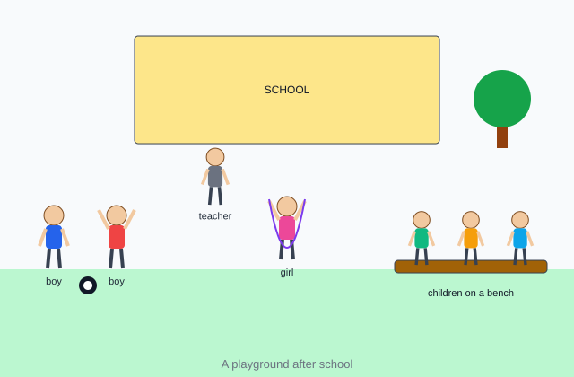

**4. Information needed from the question**

- **place:** a school playground after school
- **left:** two boys are playing football
- **middle:** a girl is skipping
- **right:** three children are sitting on a bench
- **background:** a school building, a big tree, a teacher watching

**5. Inserting the information into the template** — put each item from step 4 into the matching blank, then add linking words so the sentences flow.

**6. Completed answer**

> This picture shows a school playground after school. On the left, two boys are playing football. In the middle, a girl is skipping happily. On the right, three children are sitting on a bench and eating. In the background, there is a school building and a big tree. A teacher is watching the children. It seems to be a happy afternoon.

*Word count: 61*

**7. Guided practice**

<!-- meta {"id":"ENG-WRT-TPL-0080","topic_id":"ENG-TOP-PIC","category":"tpl","difficulty":"Intermediate","question_type":"guided_writing","answer_type":"open_ended","template_id":"ENG-TPL-PIC-0001"} -->
**ENG-WRT-TPL-0080** Complete the guided answer:

```text
This picture shows a busy ______. On the left, a vendor is ______ vegetables. In front of the stall, a woman is ______ tomatoes. On the right, a man ______ a bag of rice. In the background, there are ______ stalls. (Use ENG-IMG-0002)
```

<details><summary>Suggested answers</summary>

market; selling; buying; is carrying; fruit

</details>

**8. Independent practice**

<!-- meta {"id":"ENG-WRT-TPL-0081","topic_id":"ENG-TOP-PIC","category":"tpl","difficulty":"Examination Level","question_type":"independent_writing","answer_type":"open_ended","template_id":"ENG-TPL-PIC-0001","word_count":"about 50–60 words","marks":5} -->
**ENG-WRT-TPL-0081** Describe the picture at the railway station (ENG-IMG-0005) in about 50–60 words.

**9. Common mistakes**

- Using the past tense (*A boy played*) — use the present continuous (*A boy is playing*).
- Listing objects without actions.
- Writing about things that are not in the picture.

**10. Marking guidance**

- Content 2, Language 3 (official criteria for Paper I, Test 8).
- Content: every point from the question is included and correct.
- Language: correct, connected sentences; simple correct English is fully acceptable.
- Organisation/format: correct format and logical order.
- Mechanics: spelling, punctuation, capital letters, neat handwriting.

---

### ENG-TPL-NOT-0001 — Notice

<!-- meta {"id":"ENG-TPL-NOT-0001","topic_id":"ENG-TOP-NOTICE","type":"writing_template","exam_test":"Paper I, Test 6","word_count":"about 40–50 words","marks":5,"criteria":"Content 2, Language 3","asset_id":null} -->

*Used in: Paper I, Test 6 · about 40–50 words · 5 marks (Content 2, Language 3)*

**1. Standard format**

- NOTICE (heading)
- Name of organiser / organisation
- Title of the event
- What, when (date, day, time), where
- Who should attend / what to bring
- Contact details
- Name and position of writer, date of notice

**2. Fill-in-the-blank template**

```text
NOTICE
[Organisation]
[TITLE]
The ______ will be held on ______ (date) at ______ (time) in/at ______ (venue).
All ______ are requested to ______.
Participants should bring ______.
For further information, please contact ______.
[Name], [Position]   [Date]
```

**3. Examination-style question**

You are the secretary of the Environmental Society. Write a notice to inform students about a tree-planting programme. (about 40–50 words)

**4. Information needed from the question**

- **organiser:** Environmental Society
- **event:** tree-planting programme
- **date/time:** e.g. Monday, 5 June, 7.30 a.m.
- **place:** school ground
- **request:** all students; bring one plant
- **contact:** the secretary

**5. Inserting the information into the template** — put each item from step 4 into the matching blank, then add linking words so the sentences flow.

**6. Completed answer**

> NOTICE  
> Environmental Society — St. Joseph's College  
> TREE-PLANTING PROGRAMME  
> A tree-planting programme will be held on Monday, 5 June at 7.30 a.m. on the school ground. All students are invited to take part. Each student should bring one plant. For further information, please contact the secretary.  
> K. Nirosh, Secretary   1 June 2026

*Word count: 53*

**7. Guided practice**

<!-- meta {"id":"ENG-WRT-TPL-0082","topic_id":"ENG-TOP-NOTICE","category":"tpl","difficulty":"Intermediate","question_type":"guided_writing","answer_type":"open_ended","template_id":"ENG-TPL-NOT-0001"} -->
**ENG-WRT-TPL-0082** Complete the guided answer:

```text
NOTICE
Sports Club
CRICKET TRIALS
Cricket trials for the under-15 team ______ held on ______ at 2.00 p.m. on the school ground. All interested students ______ requested to bring their ______. For further details, please contact ______.
```

<details><summary>Suggested answers</summary>

will be; (any date, e.g. Friday, 10 March); are; sports kit / white uniform; the teacher-in-charge / club secretary

</details>

**8. Independent practice**

<!-- meta {"id":"ENG-WRT-TPL-0083","topic_id":"ENG-TOP-NOTICE","category":"tpl","difficulty":"Examination Level","question_type":"independent_writing","answer_type":"open_ended","template_id":"ENG-TPL-NOT-0001","word_count":"about 40–50 words","marks":5} -->
**ENG-WRT-TPL-0083** Write a notice about a book donation campaign organised by your school library. (about 40–50 words)

**9. Common mistakes**

- Missing date, time or venue.
- Writing a letter instead of a notice (no 'Dear …').
- No heading 'NOTICE'.

**10. Marking guidance**

- Content 2, Language 3 (official criteria for Paper I, Test 6).
- Content: every point from the question is included and correct.
- Language: correct, connected sentences; simple correct English is fully acceptable.
- Organisation/format: correct format and logical order.
- Mechanics: spelling, punctuation, capital letters, neat handwriting.

---

### ENG-TPL-MSG-0001 — Message

<!-- meta {"id":"ENG-TPL-MSG-0001","topic_id":"ENG-TOP-NOTICE","type":"writing_template","exam_test":"Paper I, Test 6","word_count":"about 40–50 words","marks":5,"criteria":"Content 2, Language 3","asset_id":null} -->

*Used in: Paper I, Test 6 · about 40–50 words · 5 marks (Content 2, Language 3)*

**1. Standard format**

- Name of the receiver
- Who called / what happened
- The important information (time, place, request)
- What the receiver should do
- Your name (and time)

**2. Fill-in-the-blank template**

```text
[Name],
______ called/came at ______. He/She said that ______. Please ______ before ______.
[Your name]   [time]
```

**3. Examination-style question**

Your father's friend Mr. Fernando phoned when your father was out. Write a message to your father. (about 40 words)

**4. Information needed from the question**

- **receiver:** Father
- **caller:** Mr. Fernando
- **information:** meeting moved to Friday 4 p.m.
- **action:** call him back

**5. Inserting the information into the template** — put each item from step 4 into the matching blank, then add linking words so the sentences flow.

**6. Completed answer**

> Dad,  
> Mr. Fernando phoned at 11 a.m. He said that the society meeting has been moved to Friday at 4 p.m. at the community hall. Please call him back on 077 123 4567 before this evening.  
> Anjali   11.15 a.m.

*Word count: 43*

**7. Guided practice**

<!-- meta {"id":"ENG-WRT-TPL-0084","topic_id":"ENG-TOP-NOTICE","category":"tpl","difficulty":"Intermediate","question_type":"guided_writing","answer_type":"open_ended","template_id":"ENG-TPL-MSG-0001"} -->
**ENG-WRT-TPL-0084** Complete the guided answer:

```text
Amma,
Aunt Rani ______ at 2 p.m. She ______ that she will visit us on Sunday. Please ______ her before Saturday.
Suresh
```

<details><summary>Suggested answers</summary>

called / phoned; said; call

</details>

**8. Independent practice**

<!-- meta {"id":"ENG-WRT-TPL-0085","topic_id":"ENG-TOP-NOTICE","category":"tpl","difficulty":"Examination Level","question_type":"independent_writing","answer_type":"open_ended","template_id":"ENG-TPL-MSG-0001","word_count":"about 40–50 words","marks":5} -->
**ENG-WRT-TPL-0085** Write a message to your sister telling her that her tuition class tomorrow has been cancelled. (about 40 words)

**9. Common mistakes**

- Forgetting who the message is for.
- Leaving out the action needed.
- Writing very long sentences.

**10. Marking guidance**

- Content 2, Language 3 (official criteria for Paper I, Test 6).
- Content: every point from the question is included and correct.
- Language: correct, connected sentences; simple correct English is fully acceptable.
- Organisation/format: correct format and logical order.
- Mechanics: spelling, punctuation, capital letters, neat handwriting.

---

### ENG-TPL-INV-0001 — Invitation

<!-- meta {"id":"ENG-TPL-INV-0001","topic_id":"ENG-TOP-NOTICE","type":"writing_template","exam_test":"Paper I, Test 6","word_count":"about 40–50 words","marks":5,"criteria":"Content 2, Language 3","asset_id":null} -->

*Used in: Paper I, Test 6 · about 40–50 words · 5 marks (Content 2, Language 3)*

**1. Standard format**

- Who is inviting
- The event and its purpose
- Date, time, place
- Special information (dress, bring something)
- RSVP / contact

**2. Fill-in-the-blank template**

```text
[Name / Organisation] invites you to ______ on ______ at ______ at ______.
[Extra detail.]
Please reply to ______ before ______.
```

**3. Examination-style question**

Write an invitation to your classmates for your birthday party. (about 40–50 words)

**4. Information needed from the question**

- **host:** you
- **event:** birthday party
- **when:** Saturday 20 July, 4 p.m.
- **where:** home address
- **reply:** phone number

**5. Inserting the information into the template** — put each item from step 4 into the matching blank, then add linking words so the sentences flow.

**6. Completed answer**

> Dear friends,  
> You are warmly invited to my 16th birthday party on Saturday, 20 July at 4.00 p.m. at my house, No. 24, Lake Road, Kandy. There will be games, music and a small dinner. Please let me know if you can come by Thursday.  
> Ruwan (071 234 5678)

*Word count: 51*

**7. Guided practice**

<!-- meta {"id":"ENG-WRT-TPL-0086","topic_id":"ENG-TOP-NOTICE","category":"tpl","difficulty":"Intermediate","question_type":"guided_writing","answer_type":"open_ended","template_id":"ENG-TPL-INV-0001"} -->
**ENG-WRT-TPL-0086** Complete the guided answer:

```text
The Grade 11 students invite ______ to the farewell party for our English teacher on ______ at ______ in the ______. Please ______ by Monday.
```

<details><summary>Suggested answers</summary>

all teachers / you; (date); (time); school hall; reply / confirm

</details>

**8. Independent practice**

<!-- meta {"id":"ENG-WRT-TPL-0087","topic_id":"ENG-TOP-NOTICE","category":"tpl","difficulty":"Examination Level","question_type":"independent_writing","answer_type":"open_ended","template_id":"ENG-TPL-INV-0001","word_count":"about 40–50 words","marks":5} -->
**ENG-WRT-TPL-0087** Write an invitation for a prize-giving ceremony from the principal to parents. (about 40–50 words)

**9. Common mistakes**

- No date or time.
- Forgetting how to reply.

**10. Marking guidance**

- Content 2, Language 3 (official criteria for Paper I, Test 6).
- Content: every point from the question is included and correct.
- Language: correct, connected sentences; simple correct English is fully acceptable.
- Organisation/format: correct format and logical order.
- Mechanics: spelling, punctuation, capital letters, neat handwriting.

---

### ENG-TPL-ANN-0001 — Announcement

<!-- meta {"id":"ENG-TPL-ANN-0001","topic_id":"ENG-TOP-NOTICE","type":"writing_template","exam_test":"Paper I, Test 6","word_count":"about 40–50 words","marks":5,"criteria":"Content 2, Language 3","asset_id":null} -->

*Used in: Paper I, Test 6 · about 40–50 words · 5 marks (Content 2, Language 3)*

**1. Standard format**

- Attention line (Attention, please / Dear students)
- The news
- Details (when/where)
- Request
- Thank you

**2. Fill-in-the-blank template**

```text
Attention, please. ______ will ______ on ______ at ______. All ______ are requested to ______. Thank you.
```

**3. Examination-style question**

Write an announcement to be read at the school assembly about the change of the sports meet date. (about 40–50 words)

**4. Information needed from the question**

- **news:** sports meet postponed
- **reason:** heavy rain
- **new date:** e.g. 15 March
- **request:** inform parents

**5. Inserting the information into the template** — put each item from step 4 into the matching blank, then add linking words so the sentences flow.

**6. Completed answer**

> Attention, please. Because of the heavy rain, the annual sports meet will not be held this Saturday. It has been postponed to Saturday, 15 March. The programme and the time will not change. All students are requested to inform their parents. Thank you.

*Word count: 43*

**7. Guided practice**

<!-- meta {"id":"ENG-WRT-TPL-0088","topic_id":"ENG-TOP-NOTICE","category":"tpl","difficulty":"Intermediate","question_type":"guided_writing","answer_type":"open_ended","template_id":"ENG-TPL-ANN-0001"} -->
**ENG-WRT-TPL-0088** Complete the guided answer:

```text
Attention, please. The school library ______ closed tomorrow because of ______. Students who borrowed books ______ return them on ______. Thank you.
```

<details><summary>Suggested answers</summary>

will be; (a reason, e.g. stock-taking); should / are requested to; (a day)

</details>

**8. Independent practice**

<!-- meta {"id":"ENG-WRT-TPL-0089","topic_id":"ENG-TOP-NOTICE","category":"tpl","difficulty":"Examination Level","question_type":"independent_writing","answer_type":"open_ended","template_id":"ENG-TPL-ANN-0001","word_count":"about 40–50 words","marks":5} -->
**ENG-WRT-TPL-0089** Write an announcement about a lost wallet found in the canteen. (about 40 words)

**9. Common mistakes**

- No time or date.
- Using notice format with signature.

**10. Marking guidance**

- Content 2, Language 3 (official criteria for Paper I, Test 6).
- Content: every point from the question is included and correct.
- Language: correct, connected sentences; simple correct English is fully acceptable.
- Organisation/format: correct format and logical order.
- Mechanics: spelling, punctuation, capital letters, neat handwriting.

---

### ENG-TPL-PARA-0001 — Short paragraph

<!-- meta {"id":"ENG-TPL-PARA-0001","topic_id":"ENG-TOP-PARA","type":"writing_template","exam_test":"Paper I, Test 8","word_count":"about 50–60 words","marks":5,"criteria":"Content 2, Language 3","asset_id":null} -->

*Used in: Paper I, Test 8 · about 50–60 words · 5 marks (Content 2, Language 3)*

**1. Standard format**

- Topic sentence (main idea)
- 2–3 supporting sentences (reasons, examples)
- Concluding sentence

**2. Fill-in-the-blank template**

```text
______ is ______ (main idea). Firstly, ______. Also, ______. For example, ______. Therefore, ______.
```

**3. Examination-style question**

Write a paragraph about your favourite festival. (about 50–60 words)

**4. Information needed from the question**

- **main idea:** Thai Pongal is my favourite festival
- **support 1:** we thank the sun and farmers
- **support 2:** we cook pongal and visit relatives
- **conclusion:** it brings the family together

**5. Inserting the information into the template** — put each item from step 4 into the matching blank, then add linking words so the sentences flow.

**6. Completed answer**

> Thai Pongal is my favourite festival. We celebrate it in January to thank the sun and the farmers for the harvest. On that day, we wake up early, decorate the front of our house with kolam and cook sweet pongal. Then we visit our relatives and share food. I love Thai Pongal because it brings my family together.

*Word count: 58*

**7. Guided practice**

<!-- meta {"id":"ENG-WRT-TPL-0090","topic_id":"ENG-TOP-PARA","category":"tpl","difficulty":"Intermediate","question_type":"guided_writing","answer_type":"open_ended","template_id":"ENG-TPL-PARA-0001"} -->
**ENG-WRT-TPL-0090** Complete the guided answer:

```text
My favourite place is ______. It is located in ______. I like it because ______. Also, ______. I hope to visit it again ______.
```

<details><summary>Suggested answers</summary>

(open — any suitable place and reasons)

</details>

**8. Independent practice**

<!-- meta {"id":"ENG-WRT-TPL-0091","topic_id":"ENG-TOP-PARA","category":"tpl","difficulty":"Examination Level","question_type":"independent_writing","answer_type":"open_ended","template_id":"ENG-TPL-PARA-0001","word_count":"about 50–60 words","marks":5} -->
**ENG-WRT-TPL-0091** Write a paragraph about the importance of trees. (about 50–60 words)

**9. Common mistakes**

- No topic sentence.
- Sentences about different topics.
- No conclusion.

**10. Marking guidance**

- Content 2, Language 3 (official criteria for Paper I, Test 8).
- Content: every point from the question is included and correct.
- Language: correct, connected sentences; simple correct English is fully acceptable.
- Organisation/format: correct format and logical order.
- Mechanics: spelling, punctuation, capital letters, neat handwriting.

---

### ENG-TPL-INF-0001 — Informal letter

<!-- meta {"id":"ENG-TPL-INF-0001","topic_id":"ENG-TOP-LETTER","type":"writing_template","exam_test":"Paper II, Test 14","word_count":"about 100 words","marks":10,"criteria":"Content 3, Language 3, Format & organisation 2, Mechanics 2","asset_id":null} -->

*Used in: Paper II, Test 14 · about 100 words · 10 marks (Content 3, Language 3, Format & organisation 2, Mechanics 2)*

**1. Standard format**

- Your address (top right)
- Date
- Dear [first name],
- Opening: greeting and purpose
- Body: the information required by the question (one paragraph per point)
- Closing: I hope to hear from you soon.
- Yours lovingly / With love / Your friend,
- Your name

**2. Fill-in-the-blank template**

```text
[Your address]
[Date]

Dear ______,

How are you? I hope you are doing well. I am writing this letter to ______.

[Point 1 from the question.] [Point 2.] [Point 3.]

I hope to hear from you soon.

Yours lovingly,
[Name]
```

**3. Examination-style question**

Write a letter to your friend describing a school trip you went on. Mention where you went, what you saw and how you felt. (about 100 words)

**4. Information needed from the question**

- **receiver:** a friend (first name)
- **point 1:** where — Sigiriya and Dambulla
- **point 2:** what you saw — the rock, frescoes, cave temple
- **point 3:** how you felt — tired but happy

**5. Inserting the information into the template** — put each item from step 4 into the matching blank, then add linking words so the sentences flow.

**6. Completed answer**

> 12, Temple Road,  
> Matale.  
> 10 March 2026  
>   
> Dear Shanthi,  
>   
> How are you? I hope you are doing well. I am writing this letter to tell you about our school trip last week.  
>   
> We went to Sigiriya and Dambulla with our teachers. At Sigiriya, we climbed the rock and saw the beautiful frescoes. Our guide told us many interesting stories about King Kashyapa. Later, we visited the cave temple in Dambulla.  
>   
> It was a long day and I was very tired, but I was really happy. I wish you had come with us.  
>   
> I hope to hear from you soon.  
>   
> Yours lovingly,  
> Nimmi

*Word count: 102*

**7. Guided practice**

<!-- meta {"id":"ENG-WRT-TPL-0092","topic_id":"ENG-TOP-LETTER","category":"tpl","difficulty":"Intermediate","question_type":"guided_writing","answer_type":"open_ended","template_id":"ENG-TPL-INF-0001"} -->
**ENG-WRT-TPL-0092** Complete the guided answer:

```text
Dear ______,
Thank you for your letter. I am very happy to hear that ______. I am writing to tell you about ______. Last Sunday, we ______. ...
I hope to hear from you soon.
Yours lovingly,
______
```

<details><summary>Suggested answers</summary>

(open; follow the format)

</details>

**8. Independent practice**

<!-- meta {"id":"ENG-WRT-TPL-0093","topic_id":"ENG-TOP-LETTER","category":"tpl","difficulty":"Examination Level","question_type":"independent_writing","answer_type":"open_ended","template_id":"ENG-TPL-INF-0001","word_count":"about 100 words","marks":10} -->
**ENG-WRT-TPL-0093** Write a letter to your cousin inviting him/her to spend the holidays at your home. (about 100 words)

**9. Common mistakes**

- Using 'Yours faithfully' in a letter to a friend.
- Missing the address or date.
- Not covering all the points in the question.

**10. Marking guidance**

- Content 3, Language 3, Format & organisation 2, Mechanics 2 (official criteria for Paper II, Test 14).
- Content: every point from the question is included and correct.
- Language: correct, connected sentences; simple correct English is fully acceptable.
- Organisation/format: correct format and logical order.
- Mechanics: spelling, punctuation, capital letters, neat handwriting.

---

### ENG-TPL-FOR-0001 — Formal letter

<!-- meta {"id":"ENG-TPL-FOR-0001","topic_id":"ENG-TOP-LETTER","type":"writing_template","exam_test":"Paper II, Test 14","word_count":"about 100 words","marks":10,"criteria":"Content 3, Language 3, Format & organisation 2, Mechanics 2","asset_id":null} -->

*Used in: Paper II, Test 14 · about 100 words · 10 marks (Content 3, Language 3, Format & organisation 2, Mechanics 2)*

**1. Standard format**

- Your address
- Date
- Receiver's title and address
- Dear Sir/Madam,
- Subject line (underlined/bold)
- Paragraph 1: purpose (I am writing to …)
- Paragraph 2: details / reasons
- Paragraph 3: request and thanks
- Yours faithfully, (if you used Sir/Madam) / Yours sincerely, (if you used the person's name)
- Signature and name

**2. Fill-in-the-blank template**

```text
[Your address]
[Date]

[Title]
[Receiver's address]

Dear Sir/Madam,

**[Subject]**

I am writing to ______.

[Explain the situation / give details.]

I would be grateful if you could ______. Thank you for your consideration.

Yours faithfully,
[Signature]
[Name]
```

**3. Examination-style question**

Write a letter to the Chairman of the Pradeshiya Sabha complaining about the garbage dumped near your school. (about 100 words)

**4. Information needed from the question**

- **receiver:** The Chairman, Pradeshiya Sabha
- **purpose:** complain about garbage
- **details:** where; problems: smell, flies, dogs, dengue
- **request:** remove garbage and put a bin / notice

**5. Inserting the information into the template** — put each item from step 4 into the matching blank, then add linking words so the sentences flow.

**6. Completed answer**

> Students' Union,  
> Vidyaloka College,  
> Kegalle.  
> 5 May 2026  
>   
> The Chairman,  
> Pradeshiya Sabha,  
> Kegalle.  
>   
> Dear Sir,  
>   
> **Garbage dumped near our school**  
>   
> I am writing on behalf of the students of Vidyaloka College to complain about the garbage that is dumped near our school gate.  
>   
> Every day, people throw plastic bags and food waste there. The bad smell enters our classrooms, and stray dogs scatter the rubbish on the road. We are also worried about dengue mosquitoes breeding in the water that collects in the waste.  
>   
> I would be grateful if you could remove the garbage and put up a 'No Dumping' notice. Thank you for your consideration.  
>   
> Yours faithfully,  
> K. Rajan  
> President, Students' Union

*Word count: 113*

**7. Guided practice**

<!-- meta {"id":"ENG-WRT-TPL-0094","topic_id":"ENG-TOP-LETTER","category":"tpl","difficulty":"Intermediate","question_type":"guided_writing","answer_type":"open_ended","template_id":"ENG-TPL-FOR-0001"} -->
**ENG-WRT-TPL-0094** Complete the guided answer:

```text
[address]
[date]
The Principal,
______
Dear Sir/Madam,
**Request for leave**
I am writing to request ______ from ______ to ______ because ______. I will ______. I would be grateful if you could grant me leave.
Yours faithfully,
______
```

<details><summary>Suggested answers</summary>

leave / three days' leave; (date); (date); (reason, e.g. I have to attend my sister's wedding); catch up on the lessons

</details>

**8. Independent practice**

<!-- meta {"id":"ENG-WRT-TPL-0095","topic_id":"ENG-TOP-LETTER","category":"tpl","difficulty":"Examination Level","question_type":"independent_writing","answer_type":"open_ended","template_id":"ENG-TPL-FOR-0001","word_count":"about 100 words","marks":10} -->
**ENG-WRT-TPL-0095** Write a letter to the editor of a newspaper about the need for a pedestrian crossing near your school. (about 100 words)

**9. Common mistakes**

- Using 'Dear friend' or 'Yours lovingly'.
- No subject line.
- Rude language in complaints — stay polite.

**10. Marking guidance**

- Content 3, Language 3, Format & organisation 2, Mechanics 2 (official criteria for Paper II, Test 14).
- Content: every point from the question is included and correct.
- Language: correct, connected sentences; simple correct English is fully acceptable.
- Organisation/format: correct format and logical order.
- Mechanics: spelling, punctuation, capital letters, neat handwriting.

---

### ENG-TPL-EML-0001 — Email

<!-- meta {"id":"ENG-TPL-EML-0001","topic_id":"ENG-TOP-LETTER","type":"writing_template","exam_test":"Paper II, Test 14","word_count":"about 100 words","marks":10,"criteria":"Content 3, Language 3, Format & organisation 2, Mechanics 2","asset_id":null} -->

*Used in: Paper II, Test 14 · about 100 words · 10 marks (Content 3, Language 3, Format & organisation 2, Mechanics 2)*

**1. Standard format**

- To / Subject
- Greeting (Dear …/Hi …)
- Purpose
- Details
- Closing line
- Name

**2. Fill-in-the-blank template**

```text
To: ______
Subject: ______

Dear ______,

I am writing to ______. [details] Please ______.

Best regards,
[Name]
```

**3. Examination-style question**

Write an email to your English teacher asking for extra practice papers before the exam. (about 80–100 words)

**4. Information needed from the question**

- **to:** teacher
- **purpose:** ask for practice papers
- **details:** weak in letter writing; exam in two months
- **closing:** thanks

**5. Inserting the information into the template** — put each item from step 4 into the matching blank, then add linking words so the sentences flow.

**6. Completed answer**

> To: mrs.fernando@school.lk  
> Subject: Request for practice papers  
>   
> Dear Mrs. Fernando,  
>   
> I am writing to ask if you could give me some extra practice papers before the O/L examination. I find letter writing and chart descriptions difficult, and I would like to practise them more at home.  
>   
> The examination is in two months, so I can do one paper every weekend and show you my answers on Monday.  
>   
> Thank you for your help.  
>   
> Best regards,  
> Arun Kumar (11B)

*Word count: 81*

**7. Guided practice**

<!-- meta {"id":"ENG-WRT-TPL-0096","topic_id":"ENG-TOP-LETTER","category":"tpl","difficulty":"Intermediate","question_type":"guided_writing","answer_type":"open_ended","template_id":"ENG-TPL-EML-0001"} -->
**ENG-WRT-TPL-0096** Complete the guided answer:

```text
To: ______
Subject: Thank you
Dear ______,
Thank you for ______. It was ______. I ______.
Best wishes,
______
```

<details><summary>Suggested answers</summary>

(open)

</details>

**8. Independent practice**

<!-- meta {"id":"ENG-WRT-TPL-0097","topic_id":"ENG-TOP-LETTER","category":"tpl","difficulty":"Examination Level","question_type":"independent_writing","answer_type":"open_ended","template_id":"ENG-TPL-EML-0001","word_count":"about 100 words","marks":10} -->
**ENG-WRT-TPL-0097** Write an email to a bookshop asking whether a dictionary is available and its price. (about 80 words)

**9. Common mistakes**

- No subject line.
- Using SMS language (u, pls).

**10. Marking guidance**

- Content 3, Language 3, Format & organisation 2, Mechanics 2 (official criteria for Paper II, Test 14).
- Content: every point from the question is included and correct.
- Language: correct, connected sentences; simple correct English is fully acceptable.
- Organisation/format: correct format and logical order.
- Mechanics: spelling, punctuation, capital letters, neat handwriting.

---

### ENG-TPL-BAR-0001 — Bar chart description

<!-- meta {"id":"ENG-TPL-BAR-0001","topic_id":"ENG-TOP-CHART","type":"writing_template","exam_test":"Paper II, Test 14","word_count":"about 100 words","marks":10,"criteria":"Content 3, Language 3, Format & organisation 2, Mechanics 2","asset_id":"ENG-CHT-0001"} -->

*Used in: Paper II, Test 14 · about 100 words · 10 marks (Content 3, Language 3, Format & organisation 2, Mechanics 2)*

**1. Standard format**

- Paragraph 1 – Introduction: what the chart shows; what each axis represents.
- Paragraph 2 – Main description: highest, middle values, lowest, comparisons (use the exact numbers).
- Paragraph 3 – Overall conclusion: the main finding in one or two sentences.

**2. Fill-in-the-blank template**

```text
The above bar chart shows ______. The X-axis represents ______, while the Y-axis represents ______.

______ is the most popular ______, with ______ ______ choosing it. ______ is preferred by ______. ______ is the least popular, with only ______. More students prefer ______ than ______.

Overall, ______ is the most popular ______, while ______ is the least popular.
```

**3. Examination-style question**

The bar chart (ENG-CHT-0001) shows the favourite sports of a group of students. Describe it in about 100 words.

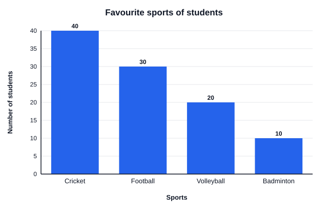
*Chart data: `assets/chart_data/ENG-CHT-0001.json`*

**4. Information needed from the question**

- **title:** favourite sports of students
- **X-axis:** sports
- **Y-axis:** number of students
- **highest:** cricket 40
- **middle:** football 30, volleyball 20
- **lowest:** badminton 10

**5. Inserting the information into the template** — put each item from step 4 into the matching blank, then add linking words so the sentences flow.

**6. Completed answer**

> The bar chart shows the favourite sports of students. The X-axis represents the sports, while the Y-axis represents the number of students.  
>   
> Cricket is the most popular sport, with 40 students choosing it. Football is preferred by 30 students. Volleyball is preferred by 20 students. Badminton is the least popular sport, with only 10 students. Cricket is chosen by 10 more students than football.  
>   
> Overall, cricket is the most popular, while badminton is the least popular among the students.

*Word count: 79*

**7. Guided practice**

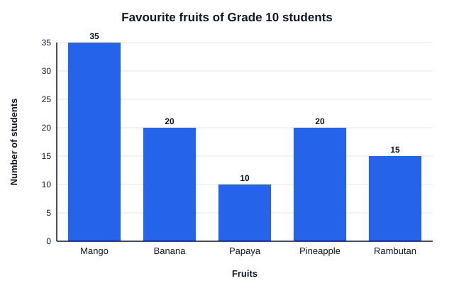

<!-- meta {"id":"ENG-WRT-TPL-0098","topic_id":"ENG-TOP-CHART","category":"tpl","difficulty":"Intermediate","question_type":"guided_writing","answer_type":"open_ended","template_id":"ENG-TPL-BAR-0001","asset_id":"ENG-CHT-0002"} -->
**ENG-WRT-TPL-0098** Finish this description of ENG-CHT-0002:

> The bar chart shows the favourite fruits of Grade 10 students. The X-axis represents the fruits, while the Y-axis represents the number of students. Mango is the most popular fruit, with 35 students choosing it. An equal number of students (20) prefer banana and pineapple. … (complete the rest)

<details><summary>Model answer</summary>

The bar chart shows the favourite fruits of Grade 10 students. The X-axis represents the fruits, while the Y-axis represents the number of students.

Mango is the most popular fruit, with 35 students choosing it. An equal number of students (20) prefer banana and pineapple. Rambutan is preferred by 15 students. Papaya is the least popular fruit, with only 10 students. Mango is chosen by 15 more students than banana and pineapple.

Overall, mango is the most popular, while papaya is the least popular among the students.

</details>

**8. Independent practice**

<!-- meta {"id":"ENG-WRT-TPL-0099","topic_id":"ENG-TOP-CHART","category":"tpl","difficulty":"Examination Level","question_type":"independent_writing","answer_type":"open_ended","template_id":"ENG-TPL-BAR-0001","word_count":"about 100 words","marks":10} -->
**ENG-WRT-TPL-0099** Describe the bar chart ENG-CHT-0002 (favourite fruits) in about 100 words.

**9. Common mistakes**

- Describing the colours of the bars.
- Wrong numbers.
- Writing opinions or reasons that are not in the chart (e.g. 'because cricket is fun').

**10. Marking guidance**

- Content 3, Language 3, Format & organisation 2, Mechanics 2 (official criteria for Paper II, Test 14).
- Content: every point from the question is included and correct.
- Language: correct, connected sentences; simple correct English is fully acceptable.
- Organisation/format: correct format and logical order.
- Mechanics: spelling, punctuation, capital letters, neat handwriting.

---

### ENG-TPL-PIE-0001 — Pie chart description

<!-- meta {"id":"ENG-TPL-PIE-0001","topic_id":"ENG-TOP-PIE","type":"writing_template","exam_test":"Paper II, Test 14","word_count":"about 100 words","marks":10,"criteria":"Content 3, Language 3, Format & organisation 2, Mechanics 2","asset_id":"ENG-CHT-0017"} -->

*Used in: Paper II, Test 14 · about 100 words · 10 marks (Content 3, Language 3, Format & organisation 2, Mechanics 2)*

**1. Standard format**

- Paragraph 1 – Introduction: what the pie chart shows (no X/Y axis).
- Paragraph 2 – Largest share, other shares, smallest share; equal shares.
- Paragraph 3 – Overall conclusion.

**2. Fill-in-the-blank template**

```text
The above pie chart shows ______. It presents the percentage of ______ in ______ categories.

The largest proportion belongs to ______, which accounts for ______%. ______ represents ______%. The smallest proportion belongs to ______, with only ______%.

Overall, ______ represents the largest proportion, while ______ represents the smallest proportion.
```

**3. Examination-style question**

Describe the pie chart ENG-CHT-0017 (how a family spends its monthly income) in about 100 words.

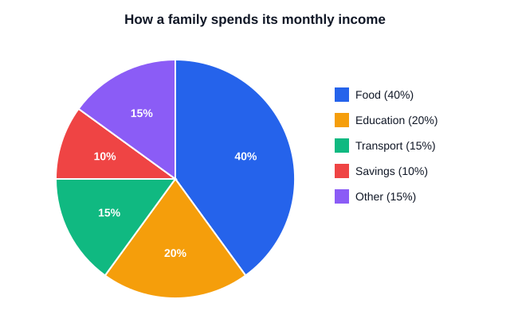
*Chart data: `assets/chart_data/ENG-CHT-0017.json`*

**4. Information needed from the question**

- **title:** monthly income spending
- **largest:** food 40%
- **others:** education 20%, transport 15%, other 15%
- **smallest:** savings 10%

**5. Inserting the information into the template** — put each item from step 4 into the matching blank, then add linking words so the sentences flow.

**6. Completed answer**

> The pie chart shows how a family spends its monthly income. It presents the percentage of the monthly income in 5 categories.  
>   
> The largest proportion belongs to Food, which accounts for 40%. Education represents 20%, which is one fifth. Both Transport and Other have the same percentage, 15% each. The smallest proportion belongs to Savings, with only 10%.  
>   
> Overall, Food represents the largest proportion, while Savings represents the smallest proportion.

*Word count: 70*

**7. Guided practice**

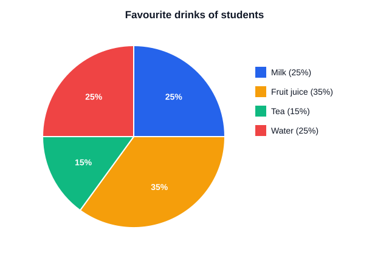

<!-- meta {"id":"ENG-WRT-TPL-0100","topic_id":"ENG-TOP-PIE","category":"tpl","difficulty":"Intermediate","question_type":"guided_writing","answer_type":"open_ended","template_id":"ENG-TPL-PIE-0001","asset_id":"ENG-CHT-0018"} -->
**ENG-WRT-TPL-0100** Finish this description of ENG-CHT-0018:

> The pie chart shows the favourite drinks of students. It presents the percentage of the students in 4 categories. The largest proportion belongs to Fruit juice, which accounts for 35%. Both Milk and Water have the same percentage, 25% each. … (complete the rest)

<details><summary>Model answer</summary>

The pie chart shows the favourite drinks of students. It presents the percentage of the students in 4 categories.

The largest proportion belongs to Fruit juice, which accounts for 35%. Both Milk and Water have the same percentage, 25% each. The smallest proportion belongs to Tea, with only 15%.

Overall, Fruit juice represents the largest proportion, while Tea represents the smallest proportion.

</details>

**8. Independent practice**

<!-- meta {"id":"ENG-WRT-TPL-0101","topic_id":"ENG-TOP-PIE","category":"tpl","difficulty":"Examination Level","question_type":"independent_writing","answer_type":"open_ended","template_id":"ENG-TPL-PIE-0001","word_count":"about 100 words","marks":10} -->
**ENG-WRT-TPL-0101** Describe the pie chart ENG-CHT-0019 (waste collected in a school) in about 100 words.

**9. Common mistakes**

- Mentioning X-axis/Y-axis.
- Percentages that do not add up.
- Saying 'more students' for a money chart.

**10. Marking guidance**

- Content 3, Language 3, Format & organisation 2, Mechanics 2 (official criteria for Paper II, Test 14).
- Content: every point from the question is included and correct.
- Language: correct, connected sentences; simple correct English is fully acceptable.
- Organisation/format: correct format and logical order.
- Mechanics: spelling, punctuation, capital letters, neat handwriting.

---

### ENG-TPL-LINE-0001 — Line graph description

<!-- meta {"id":"ENG-TPL-LINE-0001","topic_id":"ENG-TOP-LINE","type":"writing_template","exam_test":"Paper II, Test 14","word_count":"about 100 words","marks":10,"criteria":"Content 3, Language 3, Format & organisation 2, Mechanics 2","asset_id":"ENG-CHT-0025"} -->

*Used in: Paper II, Test 14 · about 100 words · 10 marks (Content 3, Language 3, Format & organisation 2, Mechanics 2)*

**1. Standard format**

- Paragraph 1 – What the graph shows; axes.
- Paragraph 2 – Start and end values; rise/fall; highest and lowest points; biggest change.
- Paragraph 3 – Overall trend.

**2. Fill-in-the-blank template**

```text
The above line graph shows ______. The horizontal axis shows ______ and the vertical axis shows ______.

The ______ increased/decreased from ______ in ______ to ______ in ______. The highest value was recorded in ______. There was a sudden/gradual ______ between ______ and ______.

Overall, the ______ increased/decreased during the period.
```

**3. Examination-style question**

Describe the line graph ENG-CHT-0025 (number of students in a school, 2019–2024) in about 100 words.

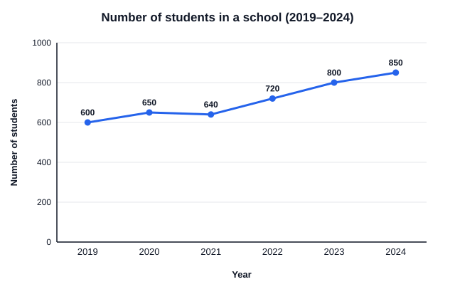
*Chart data: `assets/chart_data/ENG-CHT-0025.json`*

**4. Information needed from the question**

- **start:** 600 in 2019
- **end:** 850 in 2024
- **dip:** 640 in 2021
- **trend:** increase

**5. Inserting the information into the template** — put each item from step 4 into the matching blank, then add linking words so the sentences flow.

**6. Completed answer**

> The line graph shows the number of students in a school (2019–2024). The horizontal axis shows the year and the vertical axis shows the number of students.  
>   
> The number of students increased from 600 students in 2019 to 850 students in 2024. The highest value was recorded in 2024 (850 students), and the lowest in 2019 (600 students). The biggest changes were between 2021 and 2022, when it rose by 80 students and between 2022 and 2023, when it rose by 80 students.  
>   
> Overall, the number of students increased during the period.

*Word count: 93*

**7. Guided practice**

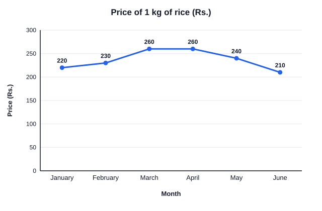

<!-- meta {"id":"ENG-WRT-TPL-0102","topic_id":"ENG-TOP-LINE","category":"tpl","difficulty":"Intermediate","question_type":"guided_writing","answer_type":"open_ended","template_id":"ENG-TPL-LINE-0001","asset_id":"ENG-CHT-0026"} -->
**ENG-WRT-TPL-0102** Finish this description of ENG-CHT-0026:

> The line graph shows the price of 1 kg of rice (Rs.). The horizontal axis shows the month and the vertical axis shows the price (Rs.). The price of rice decreased from Rs. 220 in January to Rs. 210 in June. The highest value was recorded in March and April (Rs. 260), and the lowest in June (Rs. 210). … (complete the rest)

<details><summary>Model answer</summary>

The line graph shows the price of 1 kg of rice (Rs.). The horizontal axis shows the month and the vertical axis shows the price (Rs.).

The price of rice decreased from Rs. 220 in January to Rs. 210 in June. The highest value was recorded in March and April (Rs. 260), and the lowest in June (Rs. 210). It remained unchanged between March and April. The biggest changes were between February and March, when it rose by Rs. 30 and between May and June, when it fell by Rs. 30.

Overall, the price of rice rose to a peak of Rs. 260 in March and April and then fell.

</details>

**8. Independent practice**

<!-- meta {"id":"ENG-WRT-TPL-0103","topic_id":"ENG-TOP-LINE","category":"tpl","difficulty":"Examination Level","question_type":"independent_writing","answer_type":"open_ended","template_id":"ENG-TPL-LINE-0001","word_count":"about 100 words","marks":10} -->
**ENG-WRT-TPL-0103** Describe the line graph ENG-CHT-0029 (dengue cases) in about 100 words.

**9. Common mistakes**

- Using present tense for past years (use the past tense: increased, fell).
- Not mentioning the start and end values.

**10. Marking guidance**

- Content 3, Language 3, Format & organisation 2, Mechanics 2 (official criteria for Paper II, Test 14).
- Content: every point from the question is included and correct.
- Language: correct, connected sentences; simple correct English is fully acceptable.
- Organisation/format: correct format and logical order.
- Mechanics: spelling, punctuation, capital letters, neat handwriting.

---

### ENG-TPL-TAB-0001 — Table description

<!-- meta {"id":"ENG-TPL-TAB-0001","topic_id":"ENG-TOP-LINE","type":"writing_template","exam_test":"Paper II, Test 14","word_count":"about 100 words","marks":10,"criteria":"Content 3, Language 3, Format & organisation 2, Mechanics 2","asset_id":"ENG-CHT-0032"} -->

*Used in: Paper II, Test 14 · about 100 words · 10 marks (Content 3, Language 3, Format & organisation 2, Mechanics 2)*

**1. Standard format**

- Paragraph 1 – What the table shows (rows and columns).
- Paragraph 2 – Highest and lowest in each column; comparisons.
- Paragraph 3 – Overall finding.

**2. Fill-in-the-blank template**

```text
The above table provides information about ______. It compares ______ under ______.

In the ______ column, the highest value is ______ (______) and the lowest is ______ (______). Compared with ______, ______ has a higher value.

Overall, ______.
```

**3. Examination-style question**

Describe the table ENG-CHT-0032 (results of the inter-house sports meet) in about 100 words.

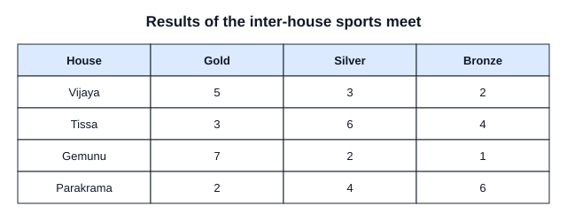
*Chart data: `assets/chart_data/ENG-CHT-0032.json`*

**4. Information needed from the question**

- **rows:** four houses
- **columns:** gold, silver, bronze
- **most gold:** Gemunu 7
- **highest total:** Tissa 13

**5. Inserting the information into the template** — put each item from step 4 into the matching blank, then add linking words so the sentences flow.

**6. Completed answer**

> The table provides information about the results of the inter-house sports meet. It compares 4 houses under 3 headings: Gold, Silver and Bronze.  
>   
> In the 'Gold' column, the highest value is 7 (Gemunu) and the lowest is 2 (Parakrama). In the 'Silver' column, the highest value is 6 (Tissa) and the lowest is 2 (Gemunu). In the 'Bronze' column, the highest value is 6 (Parakrama) and the lowest is 1 (Gemunu).  
>   
> Overall, Tissa has the highest total (13).

*Word count: 78*

**7. Guided practice**

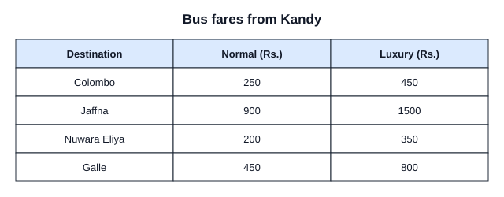

<!-- meta {"id":"ENG-WRT-TPL-0104","topic_id":"ENG-TOP-LINE","category":"tpl","difficulty":"Intermediate","question_type":"guided_writing","answer_type":"open_ended","template_id":"ENG-TPL-TAB-0001","asset_id":"ENG-CHT-0033"} -->
**ENG-WRT-TPL-0104** Finish this description of ENG-CHT-0033:

> The table provides information about the bus fares from Kandy. It compares 4 destinations under 2 headings: Normal (Rs.) and Luxury (Rs.). In the 'Normal (Rs.)' column, the highest value is 900 (Jaffna) and the lowest is 200 (Nuwara Eliya). In the 'Luxury (Rs.)' column, the highest value is 1500 (Jaffna) and the lowest is 350 (Nuwara Eliya). … (complete the rest)

<details><summary>Model answer</summary>

The table provides information about the bus fares from Kandy. It compares 4 destinations under 2 headings: Normal (Rs.) and Luxury (Rs.).

In the 'Normal (Rs.)' column, the highest value is 900 (Jaffna) and the lowest is 200 (Nuwara Eliya). In the 'Luxury (Rs.)' column, the highest value is 1500 (Jaffna) and the lowest is 350 (Nuwara Eliya).

Overall, Jaffna has the highest values, while Nuwara Eliya has the lowest values in the 'Normal (Rs.)' column.

</details>

**8. Independent practice**

<!-- meta {"id":"ENG-WRT-TPL-0105","topic_id":"ENG-TOP-LINE","category":"tpl","difficulty":"Examination Level","question_type":"independent_writing","answer_type":"open_ended","template_id":"ENG-TPL-TAB-0001","word_count":"about 100 words","marks":10} -->
**ENG-WRT-TPL-0105** Describe the table ENG-CHT-0035 (library visits by grade) in about 100 words.

**9. Common mistakes**

- Copying the whole table in sentences without comparisons.

**10. Marking guidance**

- Content 3, Language 3, Format & organisation 2, Mechanics 2 (official criteria for Paper II, Test 14).
- Content: every point from the question is included and correct.
- Language: correct, connected sentences; simple correct English is fully acceptable.
- Organisation/format: correct format and logical order.
- Mechanics: spelling, punctuation, capital letters, neat handwriting.

---

### ENG-TPL-ESS-0001 — Essay

<!-- meta {"id":"ENG-TPL-ESS-0001","topic_id":"ENG-TOP-ESSAY","type":"writing_template","exam_test":"Paper II, Test 16","word_count":"about 200 words","marks":15,"criteria":"Content 5, Language 5, Format & organisation 2, Mechanics 3","asset_id":null} -->

*Used in: Paper II, Test 16 · about 200 words · 15 marks (Content 5, Language 5, Format & organisation 2, Mechanics 3)*

**1. Standard format**

- Title
- Introduction (2–3 sentences): introduce the topic
- Body paragraphs (2–3): one main idea each, with reasons and examples
- Conclusion (2 sentences): summary / message

**2. Fill-in-the-blank template**

```text
[Title]

______ is very important in our lives. [Background sentence.]

Firstly, ______. For example, ______.

In addition, ______. This is because ______.

However / Also, ______.

In conclusion, ______. Therefore, we should ______.
```

**3. Examination-style question**

Write an essay on 'The importance of sports'. Use about 200 words.

**4. Information needed from the question**

- topic and purpose
- audience (who will read or listen)
- the points listed in the question
- the word count

**5. Inserting the information into the template** — put each item from step 4 into the matching blank, then add linking words so the sentences flow.

**6. Completed answer**

> Sports play an important role in our lives. Many students enjoy playing games such as cricket, netball and athletics after school.  
>   
> Firstly, sports keep us healthy. Playing sports regularly keeps our bodies healthy and active. In addition, sports make us strong. Running, swimming and jumping make our muscles and bones strong. Another important point is that sports reduce stress. After a long day of studying, a game of volleyball helps us relax and forget our worries. For example, a student who plays football every evening rarely feels tired in class.  
>   
> Moreover, sports teach teamwork. In team games such as cricket and football, we learn to work together and help each other. Also, sports help us make friends. We meet students from other classes and schools, and we make new friends. Finally, sports teach discipline. Players must follow rules, respect the referee and come to practice on time. Many famous Sri Lankan players started their careers in school teams.  
>   
> In conclusion, sports are good for both the body and the mind. Therefore, every student should take part in at least one sport.

*Word count: 181*

**7. Guided practice**

<!-- meta {"id":"ENG-WRT-TPL-0106","topic_id":"ENG-TOP-ESSAY","category":"tpl","difficulty":"Intermediate","question_type":"guided_writing","answer_type":"open_ended","template_id":"ENG-TPL-ESS-0001"} -->
**ENG-WRT-TPL-0106** Use the template above and the idea bank of any topic in **English_Essay_Bank.md** (essay section) to write the first two paragraphs.

<details><summary>Model answer</summary>

Compare with the model answers in the Essay Bank.

</details>

**8. Independent practice**

<!-- meta {"id":"ENG-WRT-TPL-0107","topic_id":"ENG-TOP-ESSAY","category":"tpl","difficulty":"Examination Level","question_type":"independent_writing","answer_type":"open_ended","template_id":"ENG-TPL-ESS-0001","word_count":"about 200 words","marks":15} -->
**ENG-WRT-TPL-0107** Write an essay on 'The importance of sports'. (about 200 words)

**9. Common mistakes**

- Writing one long paragraph.
- Memorised essay that does not answer the question.

**10. Marking guidance**

- Content 5, Language 5, Format & organisation 2, Mechanics 3 (official criteria for Paper II, Test 16).
- Content: every point from the question is included and correct.
- Language: correct, connected sentences; simple correct English is fully acceptable.
- Organisation/format: correct format and logical order.
- Mechanics: spelling, punctuation, capital letters, neat handwriting.

---

### ENG-TPL-ART-0001 — Article

<!-- meta {"id":"ENG-TPL-ART-0001","topic_id":"ENG-TOP-ARTICLE","type":"writing_template","exam_test":"Paper II, Test 16","word_count":"about 200 words","marks":15,"criteria":"Content 5, Language 5, Format & organisation 2, Mechanics 3","asset_id":null} -->

*Used in: Paper II, Test 16 · about 200 words · 15 marks (Content 5, Language 5, Format & organisation 2, Mechanics 3)*

**1. Standard format**

- Title (catchy)
- by [name]
- Introduction: hook (question/fact)
- Body: 2–3 paragraphs with ideas
- Conclusion: call to action

**2. Fill-in-the-blank template**

```text
[Title]
by ______

Have you ever thought about ______? [fact]

[Idea 1 + example.]

[Idea 2 + example.]

It is time for us to ______.
```

**3. Examination-style question**

Write an article on 'Saving water at school'. Use about 200 words.

**4. Information needed from the question**

- topic and purpose
- audience (who will read or listen)
- the points listed in the question
- the word count

**5. Inserting the information into the template** — put each item from step 4 into the matching blank, then add linking words so the sentences flow.

**6. Completed answer**

> Have you ever noticed how much water is wasted in our school? A dripping tap may look small, but it wastes a lot of water.  
>   
> Firstly, water is wasted at school. Every day, taps are left open and water flows into the drains. In addition, it costs money. The school pays a large water bill every month. Another important point is that droughts are coming. Climate change is making droughts more common in our area. For example, one leaking tap can waste more than ten litres a day.  
>   
> Moreover, students can close taps and report leaking pipes to the office. Also, we can collect rainwater. Rainwater from the roof can be stored for the school garden. Finally, let's start a campaign. The environmental society can put up posters near every tap. A school in Jaffna reduced its water bill by half after a campaign.  
>   
> In conclusion, it is time for every student to act. Let us save water today so that there is enough for tomorrow.

*Word count: 166*

**7. Guided practice**

<!-- meta {"id":"ENG-WRT-TPL-0108","topic_id":"ENG-TOP-ARTICLE","category":"tpl","difficulty":"Intermediate","question_type":"guided_writing","answer_type":"open_ended","template_id":"ENG-TPL-ART-0001"} -->
**ENG-WRT-TPL-0108** Use the template above and the idea bank of any topic in **English_Essay_Bank.md** (article section) to write the first two paragraphs.

<details><summary>Model answer</summary>

Compare with the model answers in the Essay Bank.

</details>

**8. Independent practice**

<!-- meta {"id":"ENG-WRT-TPL-0109","topic_id":"ENG-TOP-ARTICLE","category":"tpl","difficulty":"Examination Level","question_type":"independent_writing","answer_type":"open_ended","template_id":"ENG-TPL-ART-0001","word_count":"about 200 words","marks":15} -->
**ENG-WRT-TPL-0109** Write an article for your school magazine on 'Saving water'. (about 200 words)

**9. Common mistakes**

- No title or writer's name.
- Writing a letter format.

**10. Marking guidance**

- Content 5, Language 5, Format & organisation 2, Mechanics 3 (official criteria for Paper II, Test 16).
- Content: every point from the question is included and correct.
- Language: correct, connected sentences; simple correct English is fully acceptable.
- Organisation/format: correct format and logical order.
- Mechanics: spelling, punctuation, capital letters, neat handwriting.

---

### ENG-TPL-SPE-0001 — Speech

<!-- meta {"id":"ENG-TPL-SPE-0001","topic_id":"ENG-TOP-SPEECH","type":"writing_template","exam_test":"Paper II, Test 16","word_count":"about 200 words","marks":15,"criteria":"Content 5, Language 5, Format & organisation 2, Mechanics 3","asset_id":null} -->

*Used in: Paper II, Test 16 · about 200 words · 15 marks (Content 5, Language 5, Format & organisation 2, Mechanics 3)*

**1. Standard format**

- Greeting the audience
- Introducing yourself and the topic
- Main points (2–3)
- Suggestions / call to action
- Thanking the audience

**2. Fill-in-the-blank template**

```text
Good morning, respected principal, teachers and my dear friends.
I am ______ of Grade ______. Today, I am going to speak about ______.

[Point 1.] [Point 2.] [Point 3.]

So, friends, let us ______.
Thank you for listening.
```

**3. Examination-style question**

Write a speech on 'Road safety'. Use about 200 words.

**4. Information needed from the question**

- topic and purpose
- audience (who will read or listen)
- the points listed in the question
- the word count

**5. Inserting the information into the template** — put each item from step 4 into the matching blank, then add linking words so the sentences flow.

**6. Completed answer**

> Good morning, respected principal, teachers and dear friends. Today, I am going to speak about road safety.  
>   
> Firstly, accidents are common. Road accidents kill or injure many people in Sri Lanka every day. In addition, students are at risk. Many students walk or cycle on busy roads every day. Next, use crossings. Always cross at the pedestrian crossing and look right and left. For example, last month a student from our town was injured while crossing near the bus stop.  
>   
> Moreover, behave safely. Do not play or run on the road. If you ride a bicycle, wear a helmet and follow the rules. Finally, be role models. Let us show younger students how to use the road safely. Remember: it is better to be late than never to arrive.  
>   
> So, friends, let us follow road rules every day and keep ourselves and others safe. Thank you.

*Word count: 146*

**7. Guided practice**

<!-- meta {"id":"ENG-WRT-TPL-0110","topic_id":"ENG-TOP-SPEECH","category":"tpl","difficulty":"Intermediate","question_type":"guided_writing","answer_type":"open_ended","template_id":"ENG-TPL-SPE-0001"} -->
**ENG-WRT-TPL-0110** Use the template above and the idea bank of any topic in **English_Essay_Bank.md** (speech section) to write the first two paragraphs.

<details><summary>Model answer</summary>

Compare with the model answers in the Essay Bank.

</details>

**8. Independent practice**

<!-- meta {"id":"ENG-WRT-TPL-0111","topic_id":"ENG-TOP-SPEECH","category":"tpl","difficulty":"Examination Level","question_type":"independent_writing","answer_type":"open_ended","template_id":"ENG-TPL-SPE-0001","word_count":"about 200 words","marks":15} -->
**ENG-WRT-TPL-0111** Write a speech for the school assembly on 'Road safety'. (about 200 words)

**9. Common mistakes**

- No greeting or thank-you.
- Writing like an essay without addressing the audience.

**10. Marking guidance**

- Content 5, Language 5, Format & organisation 2, Mechanics 3 (official criteria for Paper II, Test 16).
- Content: every point from the question is included and correct.
- Language: correct, connected sentences; simple correct English is fully acceptable.
- Organisation/format: correct format and logical order.
- Mechanics: spelling, punctuation, capital letters, neat handwriting.

---

### ENG-TPL-STO-0001 — Story

<!-- meta {"id":"ENG-TPL-STO-0001","topic_id":"ENG-TOP-STORY","type":"writing_template","exam_test":"Paper II, Test 16","word_count":"about 200 words","marks":15,"criteria":"Content 5, Language 5, Format & organisation 2, Mechanics 3","asset_id":null} -->

*Used in: Paper II, Test 16 · about 200 words · 15 marks (Content 5, Language 5, Format & organisation 2, Mechanics 3)*

**1. Standard format**

- Title
- Beginning: characters and setting (when, where)
- Main event / problem
- What happened next (sequence words)
- Resolution / ending
- Moral or feeling (optional)

**2. Fill-in-the-blank template**

```text
[Title]

One day, ______ (who) was ______ (where). [Setting.]

Suddenly, ______. [Problem.]

After a few minutes, ______. Then, ______.

Finally, ______. From that day onwards, ______.
```

**3. Examination-style question**

Write a story on 'A day I will never forget'. Use about 200 words.

**4. Information needed from the question**

- topic and purpose
- audience (who will read or listen)
- the points listed in the question
- the word count

**5. Inserting the information into the template** — put each item from step 4 into the matching blank, then add linking words so the sentences flow.

**6. Completed answer**

> It was the day of our school trip to Yala National Park. We started early. We left school at four o'clock in the morning in a big bus. We saw a leopard. Suddenly, our jeep driver stopped and pointed at a tree.  
>   
> The ranger told us to stay silent so that we would not frighten the animals. A leopard was resting on a branch, and everyone held their breath. On the way back, our jeep got stuck in the mud near a lake. We got help. Finally, another jeep pulled us out, and we reached the bus safely. We were tired and muddy, but we could not stop talking about the leopard.  
>   
> From that day onwards, I have loved wildlife. It was a day I will never forget.

*Word count: 128*

**7. Guided practice**

<!-- meta {"id":"ENG-WRT-TPL-0112","topic_id":"ENG-TOP-STORY","category":"tpl","difficulty":"Intermediate","question_type":"guided_writing","answer_type":"open_ended","template_id":"ENG-TPL-STO-0001"} -->
**ENG-WRT-TPL-0112** Use the template above and the idea bank of any topic in **English_Essay_Bank.md** (story section) to write the first two paragraphs.

<details><summary>Model answer</summary>

Compare with the model answers in the Essay Bank.

</details>

**8. Independent practice**

<!-- meta {"id":"ENG-WRT-TPL-0113","topic_id":"ENG-TOP-STORY","category":"tpl","difficulty":"Examination Level","question_type":"independent_writing","answer_type":"open_ended","template_id":"ENG-TPL-STO-0001","word_count":"about 200 words","marks":15} -->
**ENG-WRT-TPL-0113** Write a story beginning with: 'It was the last bus of the day…' (about 200 words)

**9. Common mistakes**

- Changing tense from past to present.
- No clear ending.

**10. Marking guidance**

- Content 5, Language 5, Format & organisation 2, Mechanics 3 (official criteria for Paper II, Test 16).
- Content: every point from the question is included and correct.
- Language: correct, connected sentences; simple correct English is fully acceptable.
- Organisation/format: correct format and logical order.
- Mechanics: spelling, punctuation, capital letters, neat handwriting.

---

## Section D — Picture Description Mastery

**Reusable patterns:** There is a ___. · There are ___. · A boy is ___ing. · Some children are ___ing. · On the left, there is ___. · On the right, there are ___. · In the background, we can see ___. · Next to the ___, there is ___.

**Progressive example:** A boy is playing. → A boy is playing football. → A boy is playing football in the playground. → A boy is playing football with his friends in the playground.

### ENG-IMG-0001 — A playground after school


<!-- meta {"id":"ENG-WRT-PIC-0114","topic_id":"ENG-TOP-PIC","category":"pic","difficulty":"Beginner","question_type":"fill_blank","answer_type":"open_ended","asset_id":"ENG-IMG-0001"} -->
**ENG-WRT-PIC-0114** Complete: On the left, two boys are ______ football. In the middle, a girl is ______. On the right, three children are ______ on a bench and eating.

<details><summary>Answer</summary>

On the left, two boys are playing football. In the middle, a girl is skipping. On the right, three children are sitting on a bench and eating.

</details>

<!-- meta {"id":"ENG-WRT-PIC-0115","topic_id":"ENG-TOP-PIC","category":"pic","difficulty":"Intermediate","question_type":"independent_writing","answer_type":"open_ended","asset_id":"ENG-IMG-0001","word_count":"about 50–60 words","marks":5,"criteria":"StudyBuddy assessment rubric (adapted, not official): Content 2 + Language 3"} -->
**ENG-WRT-PIC-0115** Describe the picture in about 50–60 words.

<details><summary>Model answer</summary>

This picture shows a school playground. On the left, two boys are playing football. In the middle, a girl is skipping. On the right, three children are sitting on a bench and eating. In the background, there is a school building and a big tree. Near the building, a teacher is watching the children. Everyone looks busy.  
*Word count: 57. Other correct details are accepted.*

</details>

### ENG-IMG-0002 — At the vegetable market

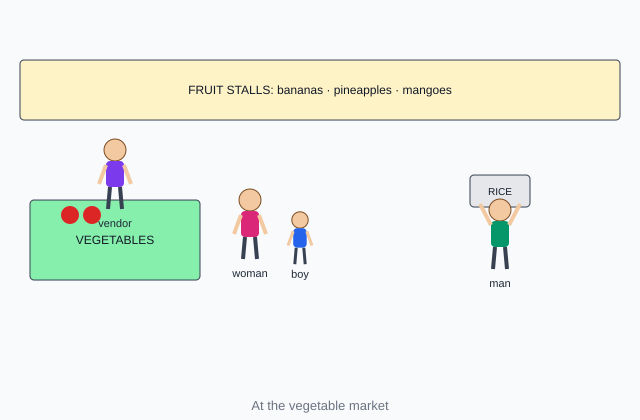

<!-- meta {"id":"ENG-WRT-PIC-0116","topic_id":"ENG-TOP-PIC","category":"pic","difficulty":"Beginner","question_type":"fill_blank","answer_type":"open_ended","asset_id":"ENG-IMG-0002"} -->
**ENG-WRT-PIC-0116** Complete: On the left, a vendor is ______ vegetables at a stall. In front of the stall, a woman is ______ tomatoes. On the right, a man is ______ a bag of rice on his shoulder.

<details><summary>Answer</summary>

On the left, a vendor is selling vegetables at a stall. In front of the stall, a woman is buying tomatoes. On the right, a man is carrying a bag of rice on his shoulder.

</details>

<!-- meta {"id":"ENG-WRT-PIC-0117","topic_id":"ENG-TOP-PIC","category":"pic","difficulty":"Intermediate","question_type":"independent_writing","answer_type":"open_ended","asset_id":"ENG-IMG-0002","word_count":"about 50–60 words","marks":5,"criteria":"StudyBuddy assessment rubric (adapted, not official): Content 2 + Language 3"} -->
**ENG-WRT-PIC-0117** Describe the picture in about 50–60 words.

<details><summary>Model answer</summary>

This picture shows a busy market. On the left, a vendor is selling vegetables at a stall. In front of the stall, a woman is buying tomatoes. On the right, a man is carrying a bag of rice on his shoulder. In the middle, a boy is holding his mother's hand. In the background, there are fruit stalls with bananas and pineapples. Everyone looks busy.  
*Word count: 65. Other correct details are accepted.*

</details>

### ENG-IMG-0003 — At the bus stand

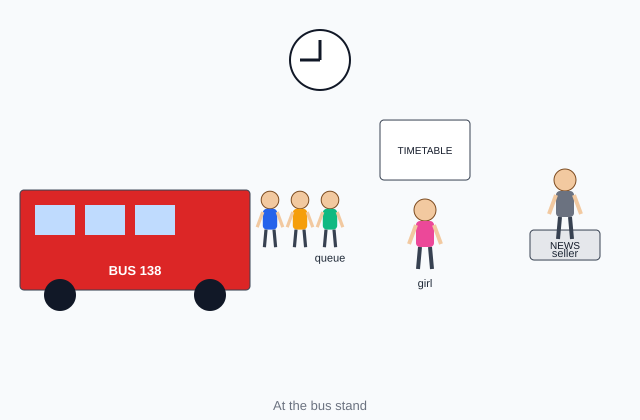

<!-- meta {"id":"ENG-WRT-PIC-0118","topic_id":"ENG-TOP-PIC","category":"pic","difficulty":"Beginner","question_type":"fill_blank","answer_type":"open_ended","asset_id":"ENG-IMG-0003"} -->
**ENG-WRT-PIC-0118** Complete: On the left, a red bus is ______ at the bus stand. Near the bus, passengers are ______ in a queue. On the right, a man is ______ newspapers.

<details><summary>Answer</summary>

On the left, a red bus is waiting at the bus stand. Near the bus, passengers are standing in a queue. On the right, a man is selling newspapers.

</details>

<!-- meta {"id":"ENG-WRT-PIC-0119","topic_id":"ENG-TOP-PIC","category":"pic","difficulty":"Intermediate","question_type":"independent_writing","answer_type":"open_ended","asset_id":"ENG-IMG-0003","word_count":"about 50–60 words","marks":5,"criteria":"StudyBuddy assessment rubric (adapted, not official): Content 2 + Language 3"} -->
**ENG-WRT-PIC-0119** Describe the picture in about 50–60 words.

<details><summary>Model answer</summary>

This picture shows a bus stand in town. On the left, a red bus is waiting at the bus stand. Near the bus, passengers are standing in a queue. On the right, a man is selling newspapers. In the middle, a girl is reading the timetable. In the background, there is a clock that shows eight o'clock. Everyone looks busy.  
*Word count: 60. Other correct details are accepted.*

</details>

### ENG-IMG-0004 — A family at dinner

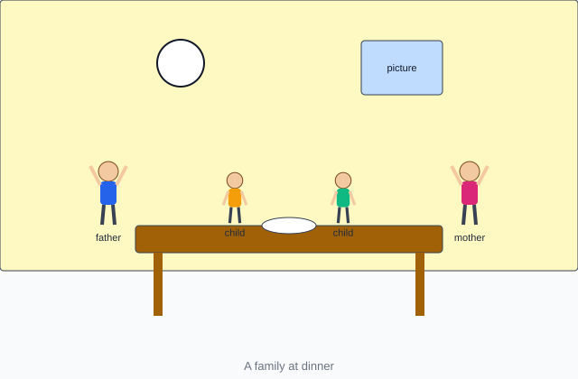

<!-- meta {"id":"ENG-WRT-PIC-0120","topic_id":"ENG-TOP-PIC","category":"pic","difficulty":"Beginner","question_type":"fill_blank","answer_type":"open_ended","asset_id":"ENG-IMG-0004"} -->
**ENG-WRT-PIC-0120** Complete: In the middle, a family is ______ dinner at a table. On the left, the father is ______ rice. On the right, the mother is ______ water into a glass.

<details><summary>Answer</summary>

In the middle, a family is having dinner at a table. On the left, the father is serving rice. On the right, the mother is pouring water into a glass.

</details>

<!-- meta {"id":"ENG-WRT-PIC-0121","topic_id":"ENG-TOP-PIC","category":"pic","difficulty":"Intermediate","question_type":"independent_writing","answer_type":"open_ended","asset_id":"ENG-IMG-0004","word_count":"about 50–60 words","marks":5,"criteria":"StudyBuddy assessment rubric (adapted, not official): Content 2 + Language 3"} -->
**ENG-WRT-PIC-0121** Describe the picture in about 50–60 words.

<details><summary>Model answer</summary>

This picture shows a dining room at home. In the middle, a family is having dinner at a table. On the left, the father is serving rice. On the right, the mother is pouring water into a glass. At the table, two children are eating. On the wall, there is a clock and a picture. Everyone looks busy.  
*Word count: 58. Other correct details are accepted.*

</details>

### ENG-IMG-0005 — At the railway station

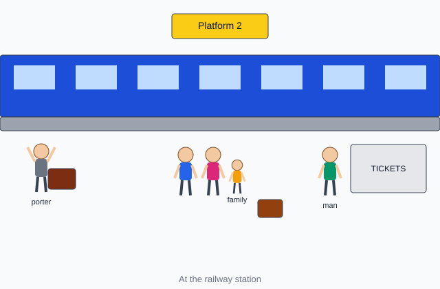

<!-- meta {"id":"ENG-WRT-PIC-0122","topic_id":"ENG-TOP-PIC","category":"pic","difficulty":"Beginner","question_type":"fill_blank","answer_type":"open_ended","asset_id":"ENG-IMG-0005"} -->
**ENG-WRT-PIC-0122** Complete: In the background, a train is ______ at the platform. On the left, a porter is ______ a suitcase. In the middle, a family is ______ with their luggage.

<details><summary>Answer</summary>

In the background, a train is arriving at the platform. On the left, a porter is carrying a suitcase. In the middle, a family is waiting with their luggage.

</details>

<!-- meta {"id":"ENG-WRT-PIC-0123","topic_id":"ENG-TOP-PIC","category":"pic","difficulty":"Intermediate","question_type":"independent_writing","answer_type":"open_ended","asset_id":"ENG-IMG-0005","word_count":"about 50–60 words","marks":5,"criteria":"StudyBuddy assessment rubric (adapted, not official): Content 2 + Language 3"} -->
**ENG-WRT-PIC-0123** Describe the picture in about 50–60 words.

<details><summary>Model answer</summary>

This picture shows a railway station platform. In the background, a train is arriving at the platform. On the left, a porter is carrying a suitcase. In the middle, a family is waiting with their luggage. On the right, a man is buying a ticket at the counter. Above the platform, there is a sign that says 'Platform 2'. Everyone looks busy.  
*Word count: 62. Other correct details are accepted.*

</details>

### ENG-IMG-0006 — At the hospital

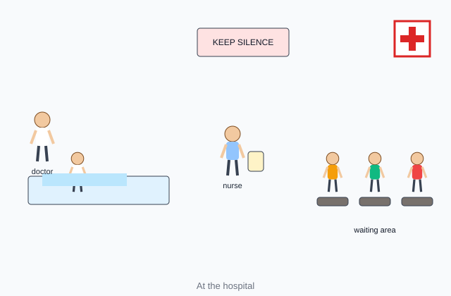

<!-- meta {"id":"ENG-WRT-PIC-0124","topic_id":"ENG-TOP-PIC","category":"pic","difficulty":"Beginner","question_type":"fill_blank","answer_type":"open_ended","asset_id":"ENG-IMG-0006"} -->
**ENG-WRT-PIC-0124** Complete: On the left, a doctor is ______ a patient. On the bed, the patient is ______ down. In the middle, a nurse is ______ on a file.

<details><summary>Answer</summary>

On the left, a doctor is examining a patient. On the bed, the patient is lying down. In the middle, a nurse is writing on a file.

</details>

<!-- meta {"id":"ENG-WRT-PIC-0125","topic_id":"ENG-TOP-PIC","category":"pic","difficulty":"Intermediate","question_type":"independent_writing","answer_type":"open_ended","asset_id":"ENG-IMG-0006","word_count":"about 50–60 words","marks":5,"criteria":"StudyBuddy assessment rubric (adapted, not official): Content 2 + Language 3"} -->
**ENG-WRT-PIC-0125** Describe the picture in about 50–60 words.

<details><summary>Model answer</summary>

This picture shows a hospital ward / waiting area. On the left, a doctor is examining a patient. On the bed, the patient is lying down. In the middle, a nurse is writing on a file. On the right, three people are sitting on chairs and waiting. On the wall, there is a notice that says 'Keep Silence'. Everyone looks busy.  
*Word count: 60. Other correct details are accepted.*

</details>

### ENG-IMG-0007 — A school sports meet

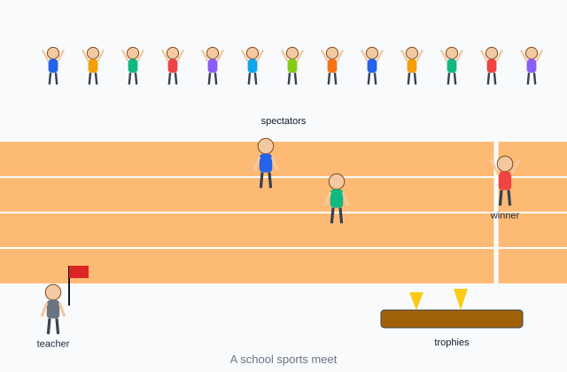

<!-- meta {"id":"ENG-WRT-PIC-0126","topic_id":"ENG-TOP-PIC","category":"pic","difficulty":"Beginner","question_type":"fill_blank","answer_type":"open_ended","asset_id":"ENG-IMG-0007"} -->
**ENG-WRT-PIC-0126** Complete: In the middle, three athletes are ______ a race. On the right, a boy is ______ the finishing line. On the left, a teacher is ______ a flag.

<details><summary>Answer</summary>

In the middle, three athletes are running a race. On the right, a boy is crossing the finishing line. On the left, a teacher is holding a flag.

</details>

<!-- meta {"id":"ENG-WRT-PIC-0127","topic_id":"ENG-TOP-PIC","category":"pic","difficulty":"Intermediate","question_type":"independent_writing","answer_type":"open_ended","asset_id":"ENG-IMG-0007","word_count":"about 50–60 words","marks":5,"criteria":"StudyBuddy assessment rubric (adapted, not official): Content 2 + Language 3"} -->
**ENG-WRT-PIC-0127** Describe the picture in about 50–60 words.

<details><summary>Model answer</summary>

This picture shows a school sports ground. In the middle, three athletes are running a race. On the right, a boy is crossing the finishing line. On the left, a teacher is holding a flag. In the background, spectators are clapping and cheering. Near the track, there is a table with trophies. Everyone looks busy.  
*Word count: 55. Other correct details are accepted.*

</details>

### ENG-IMG-0008 — A park on Sunday

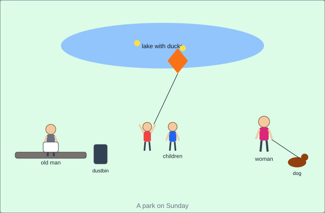

<!-- meta {"id":"ENG-WRT-PIC-0128","topic_id":"ENG-TOP-PIC","category":"pic","difficulty":"Beginner","question_type":"fill_blank","answer_type":"open_ended","asset_id":"ENG-IMG-0008"} -->
**ENG-WRT-PIC-0128** Complete: On the left, an old man is ______ a newspaper on a bench. In the middle, two children are ______ a kite. On the right, a woman is ______ her dog.

<details><summary>Answer</summary>

On the left, an old man is reading a newspaper on a bench. In the middle, two children are flying a kite. On the right, a woman is walking her dog.

</details>

<!-- meta {"id":"ENG-WRT-PIC-0129","topic_id":"ENG-TOP-PIC","category":"pic","difficulty":"Intermediate","question_type":"independent_writing","answer_type":"open_ended","asset_id":"ENG-IMG-0008","word_count":"about 50–60 words","marks":5,"criteria":"StudyBuddy assessment rubric (adapted, not official): Content 2 + Language 3"} -->
**ENG-WRT-PIC-0129** Describe the picture in about 50–60 words.

<details><summary>Model answer</summary>

This picture shows a public park. On the left, an old man is reading a newspaper on a bench. In the middle, two children are flying a kite. On the right, a woman is walking her dog. In the background, there is a small lake with ducks. Next to the bench, there is a dustbin. Everyone looks busy.  
*Word count: 58. Other correct details are accepted.*

</details>

### ENG-IMG-0009 — A classroom lesson

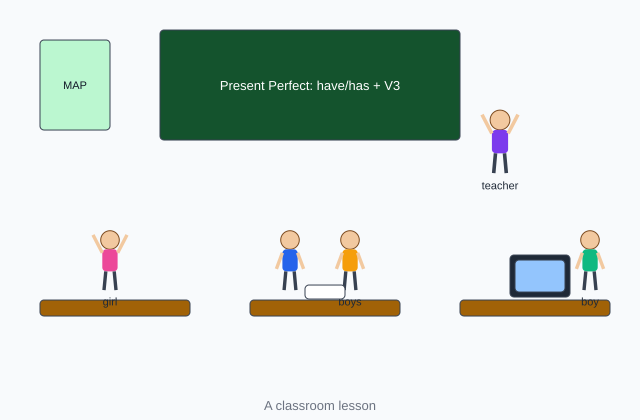

<!-- meta {"id":"ENG-WRT-PIC-0130","topic_id":"ENG-TOP-PIC","category":"pic","difficulty":"Beginner","question_type":"fill_blank","answer_type":"open_ended","asset_id":"ENG-IMG-0009"} -->
**ENG-WRT-PIC-0130** Complete: In front of the class, the teacher is ______ on the board. On the left, a girl is ______ her hand. In the middle, two boys are ______ a book together.

<details><summary>Answer</summary>

In front of the class, the teacher is writing on the board. On the left, a girl is raising her hand. In the middle, two boys are reading a book together.

</details>

<!-- meta {"id":"ENG-WRT-PIC-0131","topic_id":"ENG-TOP-PIC","category":"pic","difficulty":"Intermediate","question_type":"independent_writing","answer_type":"open_ended","asset_id":"ENG-IMG-0009","word_count":"about 50–60 words","marks":5,"criteria":"StudyBuddy assessment rubric (adapted, not official): Content 2 + Language 3"} -->
**ENG-WRT-PIC-0131** Describe the picture in about 50–60 words.

<details><summary>Model answer</summary>

This picture shows a classroom. In front of the class, the teacher is writing on the board. On the left, a girl is raising her hand. In the middle, two boys are reading a book together. On the right, a boy is using a computer. On the wall, there is a map of Sri Lanka. Everyone looks busy.  
*Word count: 58. Other correct details are accepted.*

</details>

### ENG-IMG-0010 — A beach clean-up

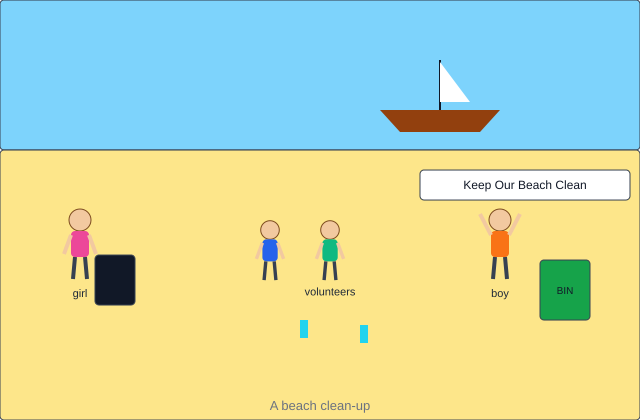

<!-- meta {"id":"ENG-WRT-PIC-0132","topic_id":"ENG-TOP-PIC","category":"pic","difficulty":"Beginner","question_type":"fill_blank","answer_type":"open_ended","asset_id":"ENG-IMG-0010"} -->
**ENG-WRT-PIC-0132** Complete: In the middle, volunteers are ______ plastic bottles. On the left, a girl is ______ a large bag of rubbish. On the right, a boy is ______ waste into a bin.

<details><summary>Answer</summary>

In the middle, volunteers are collecting plastic bottles. On the left, a girl is holding a large bag of rubbish. On the right, a boy is putting waste into a bin.

</details>

<!-- meta {"id":"ENG-WRT-PIC-0133","topic_id":"ENG-TOP-PIC","category":"pic","difficulty":"Intermediate","question_type":"independent_writing","answer_type":"open_ended","asset_id":"ENG-IMG-0010","word_count":"about 50–60 words","marks":5,"criteria":"StudyBuddy assessment rubric (adapted, not official): Content 2 + Language 3"} -->
**ENG-WRT-PIC-0133** Describe the picture in about 50–60 words.

<details><summary>Model answer</summary>

This picture shows a beach. In the middle, volunteers are collecting plastic bottles. On the left, a girl is holding a large bag of rubbish. On the right, a boy is putting waste into a bin. In the background, there is the sea and a fishing boat. Near the bin, there is a banner that says 'Keep Our Beach Clean'. Everyone looks busy.  
*Word count: 63. Other correct details are accepted.*

</details>

**Common mistakes:** describing things that are not in the picture; mixing tenses (use the present continuous for actions: *is playing*); forgetting *there is/there are* agreement.

---

## Section E — Notices, messages and invitations

**Notice template:** NOTICE → [Title] → The ___ will be held on ___ at ___ (time) at ___ (place). → All ___ are requested to ___. → For further information, please contact ___. → [Name/position]

**Useful expressions:** *will be held on* (event) · *from 8 a.m. to 12 noon* (time) · *at the school hall* (place) · *All students are invited to …* · *Please bring …* · *For further details, contact …*

<!-- meta {"id":"ENG-WRT-NOT-0134","topic_id":"ENG-TOP-NOTICE","category":"not","difficulty":"Intermediate","question_type":"independent_writing","answer_type":"open_ended","word_count":"about 40–50 words","marks":5,"criteria":"Content 2 + Language 3 (2020 Test 6)"} -->
**ENG-WRT-NOT-0134** Write a notice: *A charity walk organised by the Interact Club*. (about 40–50 words)

<details><summary>Model answer</summary>

```text
NOTICE
Interact Club — Hindu College
CHARITY WALK
A charity walk will be held on Sunday, 8 September at 6.30 a.m. from the school gate to the town hall. The money collected will be given to the children's ward of the hospital. All students and parents are invited. Registration fee: Rs. 100.
Contact: Club Secretary
```
*Word count: 56*

</details>

<!-- meta {"id":"ENG-WRT-NOT-0135","topic_id":"ENG-TOP-NOTICE","category":"not","difficulty":"Intermediate","question_type":"independent_writing","answer_type":"open_ended","word_count":"about 40–50 words","marks":5,"criteria":"Content 2 + Language 3 (2020 Test 6)"} -->
**ENG-WRT-NOT-0135** Write a notice: *An English Day concert*. (about 40–50 words)

<details><summary>Model answer</summary>

```text
NOTICE
English Literary Association
ENGLISH DAY CONCERT
The English Day concert will be held on Friday, 15 August at 2.00 p.m. in the main hall. Students who wish to sing, act or recite poems should register with their class teacher before 5 August.
Secretary, ELA
```
*Word count: 47*

</details>

<!-- meta {"id":"ENG-WRT-NOT-0136","topic_id":"ENG-TOP-NOTICE","category":"not","difficulty":"Intermediate","question_type":"independent_writing","answer_type":"open_ended","word_count":"about 40–50 words","marks":5,"criteria":"Content 2 + Language 3 (2020 Test 6)"} -->
**ENG-WRT-NOT-0136** Write a notice: *Lost and found*. (about 40–50 words)

<details><summary>Model answer</summary>

```text
NOTICE
FOUND — A BLUE WATER BOTTLE
A blue water bottle with the name 'S. K.' was found near the science lab on Monday, 3 March. The owner can collect it from the school office during the interval.
Office Clerk
```
*Word count: 40*

</details>

<!-- meta {"id":"ENG-WRT-NOT-0137","topic_id":"ENG-TOP-NOTICE","category":"not","difficulty":"Intermediate","question_type":"independent_writing","answer_type":"open_ended","word_count":"about 40–50 words","marks":5,"criteria":"Content 2 + Language 3 (2020 Test 6)"} -->
**ENG-WRT-NOT-0137** Write a notice: *A first-aid workshop*. (about 40–50 words)

<details><summary>Model answer</summary>

```text
NOTICE
St. John Ambulance Brigade — School Unit
FIRST-AID WORKSHOP
A free first-aid workshop will be held on Saturday, 19 October from 9.00 a.m. to 12 noon in Room 10. Grade 10 and 11 students may attend. Bring a notebook and a pen.
Contact: Unit Leader
```
*Word count: 47*

</details>

<!-- meta {"id":"ENG-WRT-NOT-0138","topic_id":"ENG-TOP-NOTICE","category":"not","difficulty":"Intermediate","question_type":"independent_writing","answer_type":"open_ended","word_count":"about 40–50 words","marks":5,"criteria":"Content 2 + Language 3 (2020 Test 6)"} -->
**ENG-WRT-NOT-0138** Write a notice: *Water supply interruption (community)*. (about 40–50 words)

<details><summary>Model answer</summary>

```text
NOTICE
National Water Supply & Drainage Board
WATER CUT
The water supply to Main Street and Temple Road will be interrupted on Tuesday, 21 May from 8.00 a.m. to 6.00 p.m. because of repairs. Residents are requested to store enough water.
Area Engineer
```
*Word count: 46*

</details>

<!-- meta {"id":"ENG-WRT-NOT-0139","topic_id":"ENG-TOP-NOTICE","category":"not","difficulty":"Intermediate","question_type":"independent_writing","answer_type":"open_ended","word_count":"about 40–50 words","marks":5,"criteria":"Content 2 + Language 3 (2020 Test 6)"} -->
**ENG-WRT-NOT-0139** Write a notice: *A school library week*. (about 40–50 words)

<details><summary>Model answer</summary>

```text
NOTICE
School Library
LIBRARY WEEK — 'READ MORE, KNOW MORE'
Library Week will be held from 7 to 11 October. There will be a book fair, a quiz and a story-writing competition. All students are invited to take part.
Librarian
```
*Word count: 39*

</details>

---

## Section F — Letter Writing Mastery

### Informal letter format

```text
[Your address]
[Date]

Dear ______,

How are you? I hope you are doing well. I am writing this letter to ______.

[Information required by the question]
[Supporting sentences]

I hope to hear from you soon.

Yours lovingly, / With love, / Your loving friend,
[Name]
```

### Formal letter format

```text
[Sender's address]
[Date]

[Recipient's title and address]

Dear Sir/Madam,

[Subject]

I am writing to ______.
[Explain the situation]
[Information or request required by the question]
I would be grateful if you could ______.
Thank you for your consideration.

Yours faithfully,
[Name]
```

**Salutations and endings:** *Dear Sir/Madam* → *Yours faithfully* · *Dear Mr Perera* (name known) → *Yours sincerely* · *Dear Nimal / Dear Aunty* → *Yours lovingly / With love / Your loving friend*.

### Reusable letter sentence bank

- I am writing to invite you to ______.
- I am writing to request ______.
- I would like to inform you that ______.
- I am very happy to hear that ______.
- Thank you for your help.
- I would be grateful if you could ______.
- I hope you will consider my request.
- I look forward to hearing from you.
- I am sorry to hear that ______.
- Please let me know ______.
- I am writing on behalf of ______.
- I wish to complain about ______.

### Invitation letter (informal)

**Worked example question:** Invite your friend to your village for the Avurudu / Thai Pongal holidays. Mention the date, activities and how to come. (about 100 words)

**Points to include:** date of visit; activities; how to travel

**Model answer:**

> Dear Kasun,  
>   
> How are you? I hope you and your family are well. I am writing to invite you to spend the Thai Pongal holidays with us in our village.  
>   
> Please come on 13 January and stay for three days. On Pongal day, we will cook pongal, visit the temple and play traditional games with the village children. We can also swim in the river near our paddy field.  
>   
> You can take the morning bus from Jaffna to Point Pedro. I will meet you at the bus stand.  
>   
> I hope you can come.  
>   
> Yours lovingly,  
> Prakash

*Word count (body): 96*

<!-- meta {"id":"ENG-WRT-LET-0140","topic_id":"ENG-TOP-LETTER","category":"let","difficulty":"Intermediate","question_type":"guided_writing","answer_type":"open_ended","word_count":"about 100 words","marks":10} -->
**ENG-WRT-LET-0140** Guided: rewrite the model above for a different person and situation. Keep the blanks' structure:

```text
Dear Kasun,

How are you? I hope you and your family are well. ______ spend the Thai Pongal holidays with us in our village.

Please come on 13 January and stay for three days. On Pongal day, we will cook pongal, visit the temple and play traditional games with the village children. We can also swim in the river near our paddy field.

You can take the morning bus from Jaffna to Point Pedro. I will meet you at the bus stand.

I hope you can come.

Yours lovingly,
Prakash
```

<details><summary>Model answer</summary>

Any suitable answer that follows the format and includes all points.

</details>

<!-- meta {"id":"ENG-WRT-LET-0141","topic_id":"ENG-TOP-LETTER","category":"let","difficulty":"Examination Level","question_type":"independent_writing","answer_type":"open_ended","word_count":"about 100 words","marks":10,"criteria":"Content 3 + Language 3 + Format & organisation 2 + Mechanics 2 (2020 Test 14)","required_format":"informal"} -->
**ENG-WRT-LET-0141** Invite your cousin to your school's annual prize-giving. Give the date, time and why you want him/her to come. (about 100 words)

*Common mistakes:* wrong salutation/ending for a informal letter; missing date or address; forgetting one of the points. *Marking:* C 3 · L 3 · O 2 · M 2.

### Request letter (formal)

**Worked example question:** Write a letter to the principal requesting permission to start a chess club. (about 100 words)

**Points to include:** purpose; benefits; what you need

**Model answer:**

> Dear Sir,  
>   
> **Request to start a chess club**  
>   
> I am writing on behalf of a group of Grade 10 students to request permission to start a chess club in our school.  
>   
> Chess improves concentration and problem-solving skills. More than thirty students are interested, and Mr. Nazeer has agreed to be the teacher-in-charge. We would like to meet in Room 8 every Wednesday after school.  
>   
> I would be grateful if you could grant us permission and provide three chess sets. Thank you for your consideration.  
>   
> Yours faithfully,  
> M. Ifham  
> Grade 10A

*Word count (body): 90*

<!-- meta {"id":"ENG-WRT-LET-0142","topic_id":"ENG-TOP-LETTER","category":"let","difficulty":"Intermediate","question_type":"guided_writing","answer_type":"open_ended","word_count":"about 100 words","marks":10} -->
**ENG-WRT-LET-0142** Guided: rewrite the model above for a different person and situation. Keep the blanks' structure:

```text
Dear Sir,

**Request to start a chess club**

______ a group of Grade 10 students to request permission to start a chess club in our school.

Chess improves concentration and problem-solving skills. More than thirty students are interested, and Mr. Nazeer has agreed to be the teacher-in-charge. We would like to meet in Room 8 every Wednesday after school.

______ grant us permission and provide three chess sets. Thank you for your consideration.

Yours faithfully,
M. Ifham
Grade 10A
```

<details><summary>Model answer</summary>

Any suitable answer that follows the format and includes all points.

</details>

<!-- meta {"id":"ENG-WRT-LET-0143","topic_id":"ENG-TOP-LETTER","category":"let","difficulty":"Examination Level","question_type":"independent_writing","answer_type":"open_ended","word_count":"about 100 words","marks":10,"criteria":"Content 3 + Language 3 + Format & organisation 2 + Mechanics 2 (2020 Test 14)","required_format":"formal"} -->
**ENG-WRT-LET-0143** Write to your principal requesting permission to start a Wildlife Club. (about 100 words)

*Common mistakes:* wrong salutation/ending for a formal letter; missing date or address; forgetting one of the points. *Marking:* C 3 · L 3 · O 2 · M 2.

### Complaint letter (formal)

**Worked example question:** Write a letter to the manager of a shop complaining about a faulty calculator you bought. (about 100 words)

**Points to include:** what you bought and when; the problem; what you want

**Model answer:**

> Dear Sir/Madam,  
>   
> **Faulty calculator**  
>   
> I am writing to complain about a scientific calculator that I bought from your shop on 2 May. The receipt number is 4521.  
>   
> After two days, the screen stopped working properly. Some numbers do not appear, and the calculator switches off by itself. I have changed the battery, but the problem continues.  
>   
> As I need it for my examination, I would be grateful if you could replace it or refund my money as soon as possible. Thank you.  
>   
> Yours faithfully,  
> N. Shalini

*Word count (body): 87*

<!-- meta {"id":"ENG-WRT-LET-0144","topic_id":"ENG-TOP-LETTER","category":"let","difficulty":"Intermediate","question_type":"guided_writing","answer_type":"open_ended","word_count":"about 100 words","marks":10} -->
**ENG-WRT-LET-0144** Guided: rewrite the model above for a different person and situation. Keep the blanks' structure:

```text
Dear Sir/Madam,

**Faulty calculator**

I am writing to complain about a scientific calculator that I bought from your shop on 2 May. The receipt number is 4521.

After two days, the screen stopped working properly. Some numbers do not appear, and the calculator switches off by itself. I have changed the battery, but the problem continues.

As I need it for my examination, ______ replace it or refund my money as soon as possible. Thank you.

Yours faithfully,
N. Shalini
```

<details><summary>Model answer</summary>

Any suitable answer that follows the format and includes all points.

</details>

<!-- meta {"id":"ENG-WRT-LET-0145","topic_id":"ENG-TOP-LETTER","category":"let","difficulty":"Examination Level","question_type":"independent_writing","answer_type":"open_ended","word_count":"about 100 words","marks":10,"criteria":"Content 3 + Language 3 + Format & organisation 2 + Mechanics 2 (2020 Test 14)","required_format":"formal"} -->
**ENG-WRT-LET-0145** Write to the Municipal Council complaining that garbage is not collected on your road. (about 100 words)

*Common mistakes:* wrong salutation/ending for a formal letter; missing date or address; forgetting one of the points. *Marking:* C 3 · L 3 · O 2 · M 2.

### Permission letter (formal)

**Worked example question:** Write a letter to your class teacher asking permission to leave school early on Friday. (about 80–100 words)

**Points to include:** reason; time; who will collect you

**Model answer:**

> Dear Madam,  
>   
> **Permission to leave early**  
>   
> I am writing to ask permission to leave school at 11.00 a.m. on Friday, 14 June.  
>   
> My grandmother is having an eye operation at the Kandy General Hospital, and my parents have asked me to go with them. My father will come to the school office to collect me.  
>   
> I will copy the notes of the missed lessons from my friends. Thank you for your understanding.  
>   
> Yours faithfully,  
> R. Kavindu  
> Grade 11B

*Word count (body): 80*

<!-- meta {"id":"ENG-WRT-LET-0146","topic_id":"ENG-TOP-LETTER","category":"let","difficulty":"Intermediate","question_type":"guided_writing","answer_type":"open_ended","word_count":"about 100 words","marks":10} -->
**ENG-WRT-LET-0146** Guided: rewrite the model above for a different person and situation. Keep the blanks' structure:

```text
Dear Madam,

**Permission to leave early**

I am writing to ask permission to leave school at 11.00 a.m. on Friday, 14 June.

My grandmother is having an eye operation at the Kandy General Hospital, and my parents have asked me to go with them. My father will come to the school office to collect me.

I will copy the notes of the missed lessons from my friends. Thank you for your understanding.

Yours faithfully,
R. Kavindu
Grade 11B
```

<details><summary>Model answer</summary>

Any suitable answer that follows the format and includes all points.

</details>

<!-- meta {"id":"ENG-WRT-LET-0147","topic_id":"ENG-TOP-LETTER","category":"let","difficulty":"Examination Level","question_type":"independent_writing","answer_type":"open_ended","word_count":"about 100 words","marks":10,"criteria":"Content 3 + Language 3 + Format & organisation 2 + Mechanics 2 (2020 Test 14)","required_format":"formal"} -->
**ENG-WRT-LET-0147** Write to the principal asking permission to use the school hall for a farewell party. (about 100 words)

*Common mistakes:* wrong salutation/ending for a formal letter; missing date or address; forgetting one of the points. *Marking:* C 3 · L 3 · O 2 · M 2.

### Thank-you letter (informal)

**Worked example question:** Write a letter to your aunt thanking her for a birthday present. (about 100 words)

**Points to include:** the present; why you like it; how you will use it

**Model answer:**

> Dear Aunt Mala,  
>   
> Thank you very much for the lovely present you sent for my birthday. I was so happy when I opened the parcel and found a set of story books.  
>   
> I have already finished reading two of them. My favourite is the story about the young sailor. The books are helping me improve my English, and I read one chapter every night before I sleep.  
>   
> I hope you will visit us during the holidays.  
>   
> With love,  
> Nethmi

*Word count (body): 79*

<!-- meta {"id":"ENG-WRT-LET-0148","topic_id":"ENG-TOP-LETTER","category":"let","difficulty":"Intermediate","question_type":"guided_writing","answer_type":"open_ended","word_count":"about 100 words","marks":10} -->
**ENG-WRT-LET-0148** Guided: rewrite the model above for a different person and situation. Keep the blanks' structure:

```text
Dear Aunt Mala,

Thank you very much for the lovely present you sent for my birthday. I was so happy when I opened the parcel and found a set of story books.

I have already finished reading two of them. My favourite is the story about the young sailor. The books are helping me improve my English, and I read one chapter every night before I sleep.

I hope you will visit us during the holidays.

With love,
Nethmi
```

<details><summary>Model answer</summary>

Any suitable answer that follows the format and includes all points.

</details>

<!-- meta {"id":"ENG-WRT-LET-0149","topic_id":"ENG-TOP-LETTER","category":"let","difficulty":"Examination Level","question_type":"independent_writing","answer_type":"open_ended","word_count":"about 100 words","marks":10,"criteria":"Content 3 + Language 3 + Format & organisation 2 + Mechanics 2 (2020 Test 14)","required_format":"informal"} -->
**ENG-WRT-LET-0149** Thank your uncle for the dictionary he sent you for your birthday. (about 100 words)

*Common mistakes:* wrong salutation/ending for a informal letter; missing date or address; forgetting one of the points. *Marking:* C 3 · L 3 · O 2 · M 2.

### Advice letter (informal)

**Worked example question:** Your friend is worried about the O/L examination. Write a letter giving advice. (about 100 words)

**Points to include:** understand the worry; two pieces of advice; encouragement

**Model answer:**

> Dear Rizwan,  
>   
> Thank you for your letter. I understand that you are worried about the O/L examination, but please don't panic.  
>   
> Firstly, make a timetable and study a little every day instead of studying all night. Secondly, practise past papers, because they show you the types of questions. Also, sleep well and eat healthy food, as a tired mind cannot remember much.  
>   
> I know you are hard-working, so I am sure you will do well. Good luck!  
>   
> Your friend,  
> Dilan

*Word count (body): 81*

<!-- meta {"id":"ENG-WRT-LET-0150","topic_id":"ENG-TOP-LETTER","category":"let","difficulty":"Intermediate","question_type":"guided_writing","answer_type":"open_ended","word_count":"about 100 words","marks":10} -->
**ENG-WRT-LET-0150** Guided: rewrite the model above for a different person and situation. Keep the blanks' structure:

```text
Dear Rizwan,

Thank you for your letter. I understand that you are worried about the O/L examination, but please don't panic.

Firstly, make a timetable and study a little every day instead of studying all night. Secondly, practise past papers, because they show you the types of questions. Also, sleep well and eat healthy food, as a tired mind cannot remember much.

I know you are hard-working, so I am sure you will do well. Good luck!

Your friend,
Dilan
```

<details><summary>Model answer</summary>

Any suitable answer that follows the format and includes all points.

</details>

<!-- meta {"id":"ENG-WRT-LET-0151","topic_id":"ENG-TOP-LETTER","category":"let","difficulty":"Examination Level","question_type":"independent_writing","answer_type":"open_ended","word_count":"about 100 words","marks":10,"criteria":"Content 3 + Language 3 + Format & organisation 2 + Mechanics 2 (2020 Test 14)","required_format":"informal"} -->
**ENG-WRT-LET-0151** Your friend is spending too much time on mobile games. Write a letter giving advice. (about 100 words)

*Common mistakes:* wrong salutation/ending for a informal letter; missing date or address; forgetting one of the points. *Marking:* C 3 · L 3 · O 2 · M 2.

### Information request letter (formal)

**Worked example question:** Write a letter to a computer institute asking for information about a short course. (about 100 words)

**Points to include:** which course; information needed (fee, time, certificate); how to reply

**Model answer:**

> Dear Sir/Madam,  
>   
> **Information about the basic computer course**  
>   
> I saw your advertisement in the newspaper, and I am writing to request more information about your three-month basic computer course.  
>   
> Could you please tell me the course fee, the days and times of the classes, and whether a certificate is given at the end? I would also like to know if there is a discount for school students.  
>   
> I would be grateful if you could reply to the address above. Thank you.  
>   
> Yours faithfully,  
> S. Mathivathani

*Word count (body): 86*

<!-- meta {"id":"ENG-WRT-LET-0152","topic_id":"ENG-TOP-LETTER","category":"let","difficulty":"Intermediate","question_type":"guided_writing","answer_type":"open_ended","word_count":"about 100 words","marks":10} -->
**ENG-WRT-LET-0152** Guided: rewrite the model above for a different person and situation. Keep the blanks' structure:

```text
Dear Sir/Madam,

**Information about the basic computer course**

I saw your advertisement in the newspaper, and ______ more information about your three-month basic computer course.

Could you please tell me the course fee, the days and times of the classes, and whether a certificate is given at the end? I would also like to know if there is a discount for school students.

______ reply to the address above. Thank you.

Yours faithfully,
S. Mathivathani
```

<details><summary>Model answer</summary>

Any suitable answer that follows the format and includes all points.

</details>

<!-- meta {"id":"ENG-WRT-LET-0153","topic_id":"ENG-TOP-LETTER","category":"let","difficulty":"Examination Level","question_type":"independent_writing","answer_type":"open_ended","word_count":"about 100 words","marks":10,"criteria":"Content 3 + Language 3 + Format & organisation 2 + Mechanics 2 (2020 Test 14)","required_format":"formal"} -->
**ENG-WRT-LET-0153** Write to a computer institute asking for details of a short course for O/L students. (about 100 words)

*Common mistakes:* wrong salutation/ending for a formal letter; missing date or address; forgetting one of the points. *Marking:* C 3 · L 3 · O 2 · M 2.

### Letter to a friend (news) (informal)

**Worked example question:** Write a letter to your pen friend about your new school. (about 100 words)

**Points to include:** where and when you moved; what the school is like; new friends/activities

**Model answer:**

> Dear Anna,  
>   
> How are you? I am sorry I did not write earlier. I have some big news — I have moved to a new school in Colombo.  
>   
> My new school is much bigger than my old one. It has a swimming pool, a modern library and a science lab with computers. The teachers are kind, and I have already made two good friends, Dilki and Hiba. I have also joined the debating team.  
>   
> I miss my old friends, but I am enjoying my new life. Please write and tell me about your news.  
>   
> Your friend,  
> Yashodha

*Word count (body): 96*

<!-- meta {"id":"ENG-WRT-LET-0154","topic_id":"ENG-TOP-LETTER","category":"let","difficulty":"Intermediate","question_type":"guided_writing","answer_type":"open_ended","word_count":"about 100 words","marks":10} -->
**ENG-WRT-LET-0154** Guided: rewrite the model above for a different person and situation. Keep the blanks' structure:

```text
Dear Anna,

How are you? I am sorry I did not write earlier. I have some big news — I have moved to a new school in Colombo.

My new school is much bigger than my old one. It has a swimming pool, a modern library and a science lab with computers. The teachers are kind, and I have already made two good friends, Dilki and Hiba. I have also joined the debating team.

I miss my old friends, but I am enjoying my new life. Please write and tell me about your news.

Your friend,
Yashodha
```

<details><summary>Model answer</summary>

Any suitable answer that follows the format and includes all points.

</details>

<!-- meta {"id":"ENG-WRT-LET-0155","topic_id":"ENG-TOP-LETTER","category":"let","difficulty":"Examination Level","question_type":"independent_writing","answer_type":"open_ended","word_count":"about 100 words","marks":10,"criteria":"Content 3 + Language 3 + Format & organisation 2 + Mechanics 2 (2020 Test 14)","required_format":"informal"} -->
**ENG-WRT-LET-0155** Write to a friend about a new member of your family (a baby brother or sister). (about 100 words)

*Common mistakes:* wrong salutation/ending for a informal letter; missing date or address; forgetting one of the points. *Marking:* C 3 · L 3 · O 2 · M 2.

### Letter to school authorities (formal)

**Worked example question:** Write a letter to the principal about the poor condition of the school toilets. (about 100 words)

**Points to include:** the problem; effects on students; suggestions

**Model answer:**

> Dear Madam,  
>   
> **Condition of the students' toilets**  
>   
> I am writing on behalf of the prefects' guild to bring to your attention the poor condition of the students' toilets near the playground.  
>   
> Two taps are broken, there is no soap, and the doors cannot be locked. Many students, especially girls, avoid using them, and some feel ill by the end of the day.  
>   
> We suggest that the taps and locks be repaired, and that the cleaning staff check the toilets twice a day. The prefects are ready to help with a cleanliness campaign.  
>   
> Thank you for your consideration.  
>   
> Yours faithfully,  
> H. Fernando  
> Head Prefect

*Word count (body): 103*

<!-- meta {"id":"ENG-WRT-LET-0156","topic_id":"ENG-TOP-LETTER","category":"let","difficulty":"Intermediate","question_type":"guided_writing","answer_type":"open_ended","word_count":"about 100 words","marks":10} -->
**ENG-WRT-LET-0156** Guided: rewrite the model above for a different person and situation. Keep the blanks' structure:

```text
Dear Madam,

**Condition of the students' toilets**

______ the prefects' guild to bring to your attention the poor condition of the students' toilets near the playground.

Two taps are broken, there is no soap, and the doors cannot be locked. Many students, especially girls, avoid using them, and some feel ill by the end of the day.

We suggest that the taps and locks be repaired, and that the cleaning staff check the toilets twice a day. The prefects are ready to help with a cleanliness campaign.

Thank you for your consideration.

Yours faithfully,
H. Fernando
Head Prefect
```

<details><summary>Model answer</summary>

Any suitable answer that follows the format and includes all points.

</details>

<!-- meta {"id":"ENG-WRT-LET-0157","topic_id":"ENG-TOP-LETTER","category":"let","difficulty":"Examination Level","question_type":"independent_writing","answer_type":"open_ended","word_count":"about 100 words","marks":10,"criteria":"Content 3 + Language 3 + Format & organisation 2 + Mechanics 2 (2020 Test 14)","required_format":"formal"} -->
**ENG-WRT-LET-0157** Write to the sectional head asking for extra English classes for your class. (about 100 words)

*Common mistakes:* wrong salutation/ending for a formal letter; missing date or address; forgetting one of the points. *Marking:* C 3 · L 3 · O 2 · M 2.

### Letter to an organisation (formal)

**Worked example question:** Write a letter to the Regional Director of Health asking for a dengue awareness programme in your village. (about 100 words)

**Points to include:** the situation; the request; arrangements you can make

**Model answer:**

> Dear Sir,  
>   
> **Request for a dengue awareness programme**  
>   
> I am writing on behalf of the Youth Club of Puthukudiyiruppu to request a dengue awareness programme in our village.  
>   
> During the last two months, more than fifteen people in our area have been affected by dengue. Many families do not know how to prevent mosquitoes from breeding.  
>   
> We can provide the community hall and invite about two hundred villagers. We would be grateful if a health officer could visit us on a weekend in July. Thank you for your consideration.  
>   
> Yours faithfully,  
> T. Sivakumar  
> Secretary, Youth Club

*Word count (body): 96*

<!-- meta {"id":"ENG-WRT-LET-0158","topic_id":"ENG-TOP-LETTER","category":"let","difficulty":"Intermediate","question_type":"guided_writing","answer_type":"open_ended","word_count":"about 100 words","marks":10} -->
**ENG-WRT-LET-0158** Guided: rewrite the model above for a different person and situation. Keep the blanks' structure:

```text
Dear Sir,

**Request for a dengue awareness programme**

______ the Youth Club of Puthukudiyiruppu to request a dengue awareness programme in our village.

During the last two months, more than fifteen people in our area have been affected by dengue. Many families do not know how to prevent mosquitoes from breeding.

We can provide the community hall and invite about two hundred villagers. We would be grateful if a health officer could visit us on a weekend in July. Thank you for your consideration.

Yours faithfully,
T. Sivakumar
Secretary, Youth Club
```

<details><summary>Model answer</summary>

Any suitable answer that follows the format and includes all points.

</details>

<!-- meta {"id":"ENG-WRT-LET-0159","topic_id":"ENG-TOP-LETTER","category":"let","difficulty":"Examination Level","question_type":"independent_writing","answer_type":"open_ended","word_count":"about 100 words","marks":10,"criteria":"Content 3 + Language 3 + Format & organisation 2 + Mechanics 2 (2020 Test 14)","required_format":"formal"} -->
**ENG-WRT-LET-0159** Write to the Wildlife Department asking for a speaker for your school's Environment Day. (about 100 words)

*Common mistakes:* wrong salutation/ending for a formal letter; missing date or address; forgetting one of the points. *Marking:* C 3 · L 3 · O 2 · M 2.

---

## Section G — Bar Chart Description Mastery

**Three-paragraph format:** (1) *The above bar chart shows … The X-axis represents …, while the Y-axis represents …* (2) highest → middle → lowest values with comparisons (*more … than*, *fewer … than*, *the same number*, *the difference between … is …*) (3) *Overall, … is the most popular …, while … is the least popular.*

**Practice progression:** Stage 1 identify values → Stage 2 highest and lowest → Stage 3 comparison sentences → Stage 4 complete a paragraph → Stage 5 complete the template → Stage 6 describe a new chart → Stage 7 compare with the model.

### ENG-CHT-0001 — Favourite sports of students


*Renderable data: `assets/chart_data/ENG-CHT-0001.json`*

<!-- meta {"id":"ENG-WRT-CHT-0160","topic_id":"ENG-TOP-CHART","category":"cht","difficulty":"Beginner","question_type":"identify_values","answer_type":"open_ended","asset_id":"ENG-CHT-0001"} -->
**ENG-WRT-CHT-0160** Stage 1–2: read the chart. Write the value for each category and name the highest and lowest.

<details><summary>Answer</summary>

Cricket: 40; Football: 30; Volleyball: 20; Badminton: 10 — highest: Cricket; lowest: Badminton.

</details>

<!-- meta {"id":"ENG-WRT-CHT-0161","topic_id":"ENG-TOP-CHART","category":"cht","difficulty":"Intermediate","question_type":"guided_writing","answer_type":"open_ended","asset_id":"ENG-CHT-0001","template_id":"ENG-TPL-BAR-0001"} -->
**ENG-WRT-CHT-0161** Stage 3–5: complete the first paragraph and two comparison sentences for ENG-CHT-0001.

<details><summary>Model</summary>

The bar chart shows the favourite sports of students. The X-axis represents the sports, while the Y-axis represents the number of students.  
Cricket is the most popular sport, with 40 students choosing it. Football is preferred by 30 students.

</details>

<!-- meta {"id":"ENG-WRT-CHT-0162","topic_id":"ENG-TOP-CHART","category":"cht","difficulty":"Examination Level","question_type":"independent_writing","answer_type":"open_ended","asset_id":"ENG-CHT-0001","template_id":"ENG-TPL-BAR-0001","word_count":"about 100 words","marks":10,"criteria":"Content 3 + Language 3 + Format & organisation 2 + Mechanics 2 (2020 Test 14 criteria)","required_content":["Cricket","Football","Volleyball","Badminton"]} -->
**ENG-WRT-CHT-0162** Stage 6–7: describe ENG-CHT-0001 in about 100 words, then compare with the model.

<details><summary>Model answer</summary>

> The bar chart shows the favourite sports of students. The X-axis represents the sports, while the Y-axis represents the number of students.  
> Cricket is the most popular sport, with 40 students choosing it. Football is preferred by 30 students. Volleyball is preferred by 20 students. Badminton is the least popular sport, with only 10 students. Cricket is chosen by 10 more students than football.  
> Overall, cricket is the most popular, while badminton is the least popular among the students.  
*Word count: 79. Every number and comparison in this model is computed from the chart data.*

</details>

### ENG-CHT-0002 — Favourite fruits of Grade 10 students


*Renderable data: `assets/chart_data/ENG-CHT-0002.json`*

<!-- meta {"id":"ENG-WRT-CHT-0163","topic_id":"ENG-TOP-CHART","category":"cht","difficulty":"Beginner","question_type":"identify_values","answer_type":"open_ended","asset_id":"ENG-CHT-0002"} -->
**ENG-WRT-CHT-0163** Stage 1–2: read the chart. Write the value for each category and name the highest and lowest.

<details><summary>Answer</summary>

Mango: 35; Banana: 20; Papaya: 10; Pineapple: 20; Rambutan: 15 — highest: Mango; lowest: Papaya.

</details>

<!-- meta {"id":"ENG-WRT-CHT-0164","topic_id":"ENG-TOP-CHART","category":"cht","difficulty":"Intermediate","question_type":"guided_writing","answer_type":"open_ended","asset_id":"ENG-CHT-0002","template_id":"ENG-TPL-BAR-0001"} -->
**ENG-WRT-CHT-0164** Stage 3–5: complete the first paragraph and two comparison sentences for ENG-CHT-0002.

<details><summary>Model</summary>

The bar chart shows the favourite fruits of Grade 10 students. The X-axis represents the fruits, while the Y-axis represents the number of students.  
Mango is the most popular fruit, with 35 students choosing it. An equal number of students (20) prefer banana and pineapple.

</details>

<!-- meta {"id":"ENG-WRT-CHT-0165","topic_id":"ENG-TOP-CHART","category":"cht","difficulty":"Examination Level","question_type":"independent_writing","answer_type":"open_ended","asset_id":"ENG-CHT-0002","template_id":"ENG-TPL-BAR-0001","word_count":"about 100 words","marks":10,"criteria":"Content 3 + Language 3 + Format & organisation 2 + Mechanics 2 (2020 Test 14 criteria)","required_content":["Mango","Banana","Papaya","Pineapple","Rambutan"]} -->
**ENG-WRT-CHT-0165** Stage 6–7: describe ENG-CHT-0002 in about 100 words, then compare with the model.

<details><summary>Model answer</summary>

> The bar chart shows the favourite fruits of Grade 10 students. The X-axis represents the fruits, while the Y-axis represents the number of students.  
> Mango is the most popular fruit, with 35 students choosing it. An equal number of students (20) prefer banana and pineapple. Rambutan is preferred by 15 students. Papaya is the least popular fruit, with only 10 students. Mango is chosen by 15 more students than banana and pineapple.  
> Overall, mango is the most popular, while papaya is the least popular among the students.  
*Word count: 87. Every number and comparison in this model is computed from the chart data.*

</details>

### ENG-CHT-0003 — How students travel to school

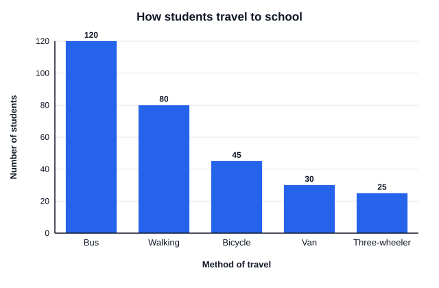

*Renderable data: `assets/chart_data/ENG-CHT-0003.json`*

<!-- meta {"id":"ENG-WRT-CHT-0166","topic_id":"ENG-TOP-CHART","category":"cht","difficulty":"Beginner","question_type":"identify_values","answer_type":"open_ended","asset_id":"ENG-CHT-0003"} -->
**ENG-WRT-CHT-0166** Stage 1–2: read the chart. Write the value for each category and name the highest and lowest.

<details><summary>Answer</summary>

Bus: 120; Walking: 80; Bicycle: 45; Van: 30; Three-wheeler: 25 — highest: Bus; lowest: Three-wheeler.

</details>

<!-- meta {"id":"ENG-WRT-CHT-0167","topic_id":"ENG-TOP-CHART","category":"cht","difficulty":"Intermediate","question_type":"guided_writing","answer_type":"open_ended","asset_id":"ENG-CHT-0003","template_id":"ENG-TPL-BAR-0001"} -->
**ENG-WRT-CHT-0167** Stage 3–5: complete the first paragraph and two comparison sentences for ENG-CHT-0003.

<details><summary>Model</summary>

The bar chart shows how students travel to school. The X-axis represents the method of travel, while the Y-axis represents the number of students.  
Bus is the most popular method of travel, with 120 students choosing it. Walking is preferred by 80 students.

</details>

<!-- meta {"id":"ENG-WRT-CHT-0168","topic_id":"ENG-TOP-CHART","category":"cht","difficulty":"Examination Level","question_type":"independent_writing","answer_type":"open_ended","asset_id":"ENG-CHT-0003","template_id":"ENG-TPL-BAR-0001","word_count":"about 100 words","marks":10,"criteria":"Content 3 + Language 3 + Format & organisation 2 + Mechanics 2 (2020 Test 14 criteria)","required_content":["Bus","Walking","Bicycle","Van","Three-wheeler"]} -->
**ENG-WRT-CHT-0168** Stage 6–7: describe ENG-CHT-0003 in about 100 words, then compare with the model.

<details><summary>Model answer</summary>

> The bar chart shows how students travel to school. The X-axis represents the method of travel, while the Y-axis represents the number of students.  
> Bus is the most popular method of travel, with 120 students choosing it. Walking is preferred by 80 students. Bicycle is preferred by 45 students. Van is preferred by 30 students. Three-wheeler is the least popular method of travel, with only 25 students. Bus is chosen by 40 more students than walking.  
> Overall, bus is the most popular, while three-wheeler is the least popular among the students.  
*Word count: 91. Every number and comparison in this model is computed from the chart data.*

</details>

### ENG-CHT-0004 — Books borrowed from the school library

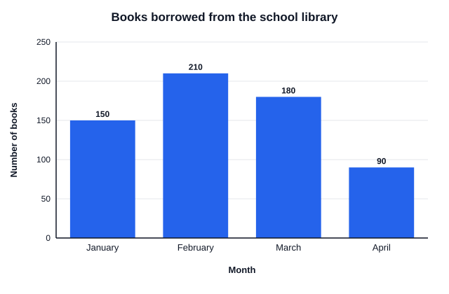

*Renderable data: `assets/chart_data/ENG-CHT-0004.json`*

<!-- meta {"id":"ENG-WRT-CHT-0169","topic_id":"ENG-TOP-CHART","category":"cht","difficulty":"Beginner","question_type":"identify_values","answer_type":"open_ended","asset_id":"ENG-CHT-0004"} -->
**ENG-WRT-CHT-0169** Stage 1–2: read the chart. Write the value for each category and name the highest and lowest.

<details><summary>Answer</summary>

January: 150 books; February: 210 books; March: 180 books; April: 90 books — highest: February; lowest: April.

</details>

<!-- meta {"id":"ENG-WRT-CHT-0170","topic_id":"ENG-TOP-CHART","category":"cht","difficulty":"Intermediate","question_type":"guided_writing","answer_type":"open_ended","asset_id":"ENG-CHT-0004","template_id":"ENG-TPL-BAR-0001"} -->
**ENG-WRT-CHT-0170** Stage 3–5: complete the first paragraph and two comparison sentences for ENG-CHT-0004.

<details><summary>Model</summary>

The bar chart shows the books borrowed from the school library. The X-axis represents the month, while the Y-axis represents the number of books.  
February has the highest number of books borrowed, at 210 books. March has 180 books.

</details>

<!-- meta {"id":"ENG-WRT-CHT-0171","topic_id":"ENG-TOP-CHART","category":"cht","difficulty":"Examination Level","question_type":"independent_writing","answer_type":"open_ended","asset_id":"ENG-CHT-0004","template_id":"ENG-TPL-BAR-0001","word_count":"about 100 words","marks":10,"criteria":"Content 3 + Language 3 + Format & organisation 2 + Mechanics 2 (2020 Test 14 criteria)","required_content":["January","February","March","April"]} -->
**ENG-WRT-CHT-0171** Stage 6–7: describe ENG-CHT-0004 in about 100 words, then compare with the model.

<details><summary>Model answer</summary>

> The bar chart shows the books borrowed from the school library. The X-axis represents the month, while the Y-axis represents the number of books.  
> February has the highest number of books borrowed, at 210 books. March has 180 books. January has 150 books. April has the lowest number of books borrowed, with only 90 books. The difference between February and April is 120 books.  
> Overall, February has the highest number of books borrowed, while April has the lowest.  
*Word count: 78. Every number and comparison in this model is computed from the chart data.*

</details>

### ENG-CHT-0005 — Rainfall in a town (2024)

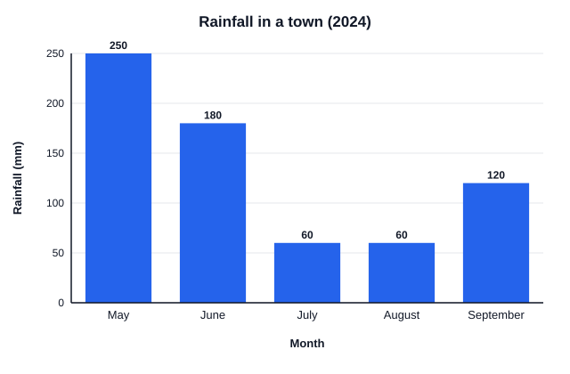

*Renderable data: `assets/chart_data/ENG-CHT-0005.json`*

<!-- meta {"id":"ENG-WRT-CHT-0172","topic_id":"ENG-TOP-CHART","category":"cht","difficulty":"Beginner","question_type":"identify_values","answer_type":"open_ended","asset_id":"ENG-CHT-0005"} -->
**ENG-WRT-CHT-0172** Stage 1–2: read the chart. Write the value for each category and name the highest and lowest.

<details><summary>Answer</summary>

May: 250 mm; June: 180 mm; July: 60 mm; August: 60 mm; September: 120 mm — highest: May; lowest: July, August.

</details>

<!-- meta {"id":"ENG-WRT-CHT-0173","topic_id":"ENG-TOP-CHART","category":"cht","difficulty":"Intermediate","question_type":"guided_writing","answer_type":"open_ended","asset_id":"ENG-CHT-0005","template_id":"ENG-TPL-BAR-0001"} -->
**ENG-WRT-CHT-0173** Stage 3–5: complete the first paragraph and two comparison sentences for ENG-CHT-0005.

<details><summary>Model</summary>

The bar chart shows the rainfall in a town (2024). The X-axis represents the month, while the Y-axis represents the rainfall (mm).  
May has the highest rainfall, at 250 mm. June has 180 mm.

</details>

<!-- meta {"id":"ENG-WRT-CHT-0174","topic_id":"ENG-TOP-CHART","category":"cht","difficulty":"Examination Level","question_type":"independent_writing","answer_type":"open_ended","asset_id":"ENG-CHT-0005","template_id":"ENG-TPL-BAR-0001","word_count":"about 100 words","marks":10,"criteria":"Content 3 + Language 3 + Format & organisation 2 + Mechanics 2 (2020 Test 14 criteria)","required_content":["May","June","July","August","September"]} -->
**ENG-WRT-CHT-0174** Stage 6–7: describe ENG-CHT-0005 in about 100 words, then compare with the model.

<details><summary>Model answer</summary>

> The bar chart shows the rainfall in a town (2024). The X-axis represents the month, while the Y-axis represents the rainfall (mm).  
> May has the highest rainfall, at 250 mm. June has 180 mm. September has 120 mm. July and August have the lowest rainfall, with only 60 mm each.  
> Overall, May has the highest rainfall, while July and August have the lowest.  
*Word count: 63. Every number and comparison in this model is computed from the chart data.*

</details>

### ENG-CHT-0006 — Favourite school subjects

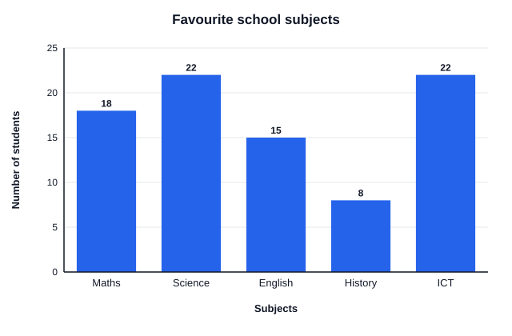

*Renderable data: `assets/chart_data/ENG-CHT-0006.json`*

<!-- meta {"id":"ENG-WRT-CHT-0175","topic_id":"ENG-TOP-CHART","category":"cht","difficulty":"Beginner","question_type":"identify_values","answer_type":"open_ended","asset_id":"ENG-CHT-0006"} -->
**ENG-WRT-CHT-0175** Stage 1–2: read the chart. Write the value for each category and name the highest and lowest.

<details><summary>Answer</summary>

Maths: 18; Science: 22; English: 15; History: 8; ICT: 22 — highest: Science, ICT; lowest: History.

</details>

<!-- meta {"id":"ENG-WRT-CHT-0176","topic_id":"ENG-TOP-CHART","category":"cht","difficulty":"Intermediate","question_type":"guided_writing","answer_type":"open_ended","asset_id":"ENG-CHT-0006","template_id":"ENG-TPL-BAR-0001"} -->
**ENG-WRT-CHT-0176** Stage 3–5: complete the first paragraph and two comparison sentences for ENG-CHT-0006.

<details><summary>Model</summary>

The bar chart shows the favourite school subjects. The X-axis represents the subjects, while the Y-axis represents the number of students.  
Science and ICT are equally the most popular, with 22 students each. Maths is preferred by 18 students.

</details>

<!-- meta {"id":"ENG-WRT-CHT-0177","topic_id":"ENG-TOP-CHART","category":"cht","difficulty":"Examination Level","question_type":"independent_writing","answer_type":"open_ended","asset_id":"ENG-CHT-0006","template_id":"ENG-TPL-BAR-0001","word_count":"about 100 words","marks":10,"criteria":"Content 3 + Language 3 + Format & organisation 2 + Mechanics 2 (2020 Test 14 criteria)","required_content":["Maths","Science","English","History","ICT"]} -->
**ENG-WRT-CHT-0177** Stage 6–7: describe ENG-CHT-0006 in about 100 words, then compare with the model.

<details><summary>Model answer</summary>

> The bar chart shows the favourite school subjects. The X-axis represents the subjects, while the Y-axis represents the number of students.  
> Science and ICT are equally the most popular, with 22 students each. Maths is preferred by 18 students. English is preferred by 15 students. History is the least popular subject, with only 8 students.  
> Overall, Science and ICT are the most popular, while History is the least popular among the students.  
*Word count: 72. Every number and comparison in this model is computed from the chart data.*

</details>

### ENG-CHT-0007 — Money collected by each class for charity

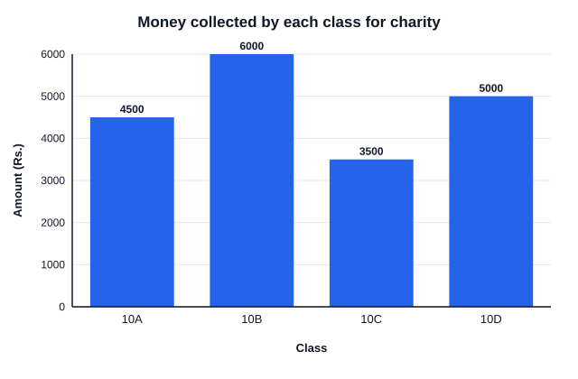

*Renderable data: `assets/chart_data/ENG-CHT-0007.json`*

<!-- meta {"id":"ENG-WRT-CHT-0178","topic_id":"ENG-TOP-CHART","category":"cht","difficulty":"Beginner","question_type":"identify_values","answer_type":"open_ended","asset_id":"ENG-CHT-0007"} -->
**ENG-WRT-CHT-0178** Stage 1–2: read the chart. Write the value for each category and name the highest and lowest.

<details><summary>Answer</summary>

10A: Rs. 4,500; 10B: Rs. 6,000; 10C: Rs. 3,500; 10D: Rs. 5,000 — highest: 10B; lowest: 10C.

</details>

<!-- meta {"id":"ENG-WRT-CHT-0179","topic_id":"ENG-TOP-CHART","category":"cht","difficulty":"Intermediate","question_type":"guided_writing","answer_type":"open_ended","asset_id":"ENG-CHT-0007","template_id":"ENG-TPL-BAR-0001"} -->
**ENG-WRT-CHT-0179** Stage 3–5: complete the first paragraph and two comparison sentences for ENG-CHT-0007.

<details><summary>Model</summary>

The bar chart shows the money collected by each class for charity. The X-axis represents the class, while the Y-axis represents the amount (Rs.).  
10B has the highest amount of money collected, at Rs. 6,000. 10D has Rs. 5,000.

</details>

<!-- meta {"id":"ENG-WRT-CHT-0180","topic_id":"ENG-TOP-CHART","category":"cht","difficulty":"Examination Level","question_type":"independent_writing","answer_type":"open_ended","asset_id":"ENG-CHT-0007","template_id":"ENG-TPL-BAR-0001","word_count":"about 100 words","marks":10,"criteria":"Content 3 + Language 3 + Format & organisation 2 + Mechanics 2 (2020 Test 14 criteria)","required_content":["10A","10B","10C","10D"]} -->
**ENG-WRT-CHT-0180** Stage 6–7: describe ENG-CHT-0007 in about 100 words, then compare with the model.

<details><summary>Model answer</summary>

> The bar chart shows the money collected by each class for charity. The X-axis represents the class, while the Y-axis represents the amount (Rs.).  
> 10B has the highest amount of money collected, at Rs. 6,000. 10D has Rs. 5,000. 10A has Rs. 4,500. 10C has the lowest amount of money collected, with only Rs. 3,500. The difference between 10B and 10C is Rs. 2,500.  
> Overall, 10B has the highest amount of money collected, while 10C has the lowest.  
*Word count: 83. Every number and comparison in this model is computed from the chart data.*

</details>

### ENG-CHT-0008 — Hours spent on activities in a week

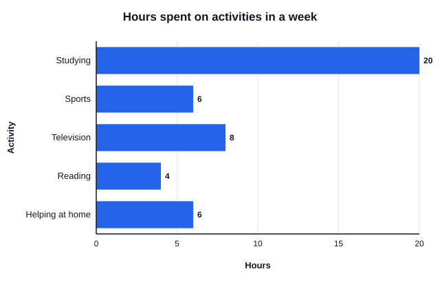

*Renderable data: `assets/chart_data/ENG-CHT-0008.json`*

<!-- meta {"id":"ENG-WRT-CHT-0181","topic_id":"ENG-TOP-CHART","category":"cht","difficulty":"Beginner","question_type":"identify_values","answer_type":"open_ended","asset_id":"ENG-CHT-0008"} -->
**ENG-WRT-CHT-0181** Stage 1–2: read the chart. Write the value for each category and name the highest and lowest.

<details><summary>Answer</summary>

Studying: 20 hours; Sports: 6 hours; Television: 8 hours; Reading: 4 hours; Helping at home: 6 hours — highest: Studying; lowest: Reading.

</details>

<!-- meta {"id":"ENG-WRT-CHT-0182","topic_id":"ENG-TOP-CHART","category":"cht","difficulty":"Intermediate","question_type":"guided_writing","answer_type":"open_ended","asset_id":"ENG-CHT-0008","template_id":"ENG-TPL-BAR-0001"} -->
**ENG-WRT-CHT-0182** Stage 3–5: complete the first paragraph and two comparison sentences for ENG-CHT-0008.

<details><summary>Model</summary>

The bar chart shows the hours spent on activities in a week. The vertical axis shows the activity, while the horizontal axis shows the hours.  
Studying has the highest number of hours, at 20 hours. Television has 8 hours.

</details>

<!-- meta {"id":"ENG-WRT-CHT-0183","topic_id":"ENG-TOP-CHART","category":"cht","difficulty":"Examination Level","question_type":"independent_writing","answer_type":"open_ended","asset_id":"ENG-CHT-0008","template_id":"ENG-TPL-BAR-0001","word_count":"about 100 words","marks":10,"criteria":"Content 3 + Language 3 + Format & organisation 2 + Mechanics 2 (2020 Test 14 criteria)","required_content":["Studying","Sports","Television","Reading","Helping at home"]} -->
**ENG-WRT-CHT-0183** Stage 6–7: describe ENG-CHT-0008 in about 100 words, then compare with the model.

<details><summary>Model answer</summary>

> The bar chart shows the hours spent on activities in a week. The vertical axis shows the activity, while the horizontal axis shows the hours.  
> Studying has the highest number of hours, at 20 hours. Television has 8 hours. Sports and Helping at home have 6 hours each. Reading has the lowest number of hours, with only 4 hours. The difference between Studying and Reading is 16 hours.  
> Overall, Studying has the highest number of hours, while Reading has the lowest.  
*Word count: 81. Every number and comparison in this model is computed from the chart data.*

</details>

### ENG-CHT-0009 — Visitors to a museum

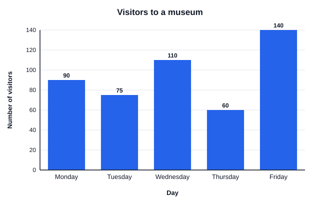

*Renderable data: `assets/chart_data/ENG-CHT-0009.json`*

<!-- meta {"id":"ENG-WRT-CHT-0184","topic_id":"ENG-TOP-CHART","category":"cht","difficulty":"Beginner","question_type":"identify_values","answer_type":"open_ended","asset_id":"ENG-CHT-0009"} -->
**ENG-WRT-CHT-0184** Stage 1–2: read the chart. Write the value for each category and name the highest and lowest.

<details><summary>Answer</summary>

Monday: 90 visitors; Tuesday: 75 visitors; Wednesday: 110 visitors; Thursday: 60 visitors; Friday: 140 visitors — highest: Friday; lowest: Thursday.

</details>

<!-- meta {"id":"ENG-WRT-CHT-0185","topic_id":"ENG-TOP-CHART","category":"cht","difficulty":"Intermediate","question_type":"guided_writing","answer_type":"open_ended","asset_id":"ENG-CHT-0009","template_id":"ENG-TPL-BAR-0001"} -->
**ENG-WRT-CHT-0185** Stage 3–5: complete the first paragraph and two comparison sentences for ENG-CHT-0009.

<details><summary>Model</summary>

The bar chart shows the visitors to a museum. The X-axis represents the day, while the Y-axis represents the number of visitors.  
Friday has the highest number of visitors, at 140 visitors. Wednesday has 110 visitors.

</details>

<!-- meta {"id":"ENG-WRT-CHT-0186","topic_id":"ENG-TOP-CHART","category":"cht","difficulty":"Examination Level","question_type":"independent_writing","answer_type":"open_ended","asset_id":"ENG-CHT-0009","template_id":"ENG-TPL-BAR-0001","word_count":"about 100 words","marks":10,"criteria":"Content 3 + Language 3 + Format & organisation 2 + Mechanics 2 (2020 Test 14 criteria)","required_content":["Monday","Tuesday","Wednesday","Thursday","Friday"]} -->
**ENG-WRT-CHT-0186** Stage 6–7: describe ENG-CHT-0009 in about 100 words, then compare with the model.

<details><summary>Model answer</summary>

> The bar chart shows the visitors to a museum. The X-axis represents the day, while the Y-axis represents the number of visitors.  
> Friday has the highest number of visitors, at 140 visitors. Wednesday has 110 visitors. Monday has 90 visitors. Tuesday has 75 visitors. Thursday has the lowest number of visitors, with only 60 visitors. The difference between Friday and Thursday is 80 visitors.  
> Overall, Friday has the highest number of visitors, while Thursday has the lowest.  
*Word count: 77. Every number and comparison in this model is computed from the chart data.*

</details>

### ENG-CHT-0010 — Favourite types of films

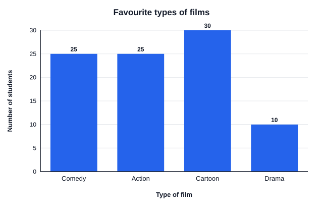

*Renderable data: `assets/chart_data/ENG-CHT-0010.json`*

<!-- meta {"id":"ENG-WRT-CHT-0187","topic_id":"ENG-TOP-CHART","category":"cht","difficulty":"Beginner","question_type":"identify_values","answer_type":"open_ended","asset_id":"ENG-CHT-0010"} -->
**ENG-WRT-CHT-0187** Stage 1–2: read the chart. Write the value for each category and name the highest and lowest.

<details><summary>Answer</summary>

Comedy: 25; Action: 25; Cartoon: 30; Drama: 10 — highest: Cartoon; lowest: Drama.

</details>

<!-- meta {"id":"ENG-WRT-CHT-0188","topic_id":"ENG-TOP-CHART","category":"cht","difficulty":"Intermediate","question_type":"guided_writing","answer_type":"open_ended","asset_id":"ENG-CHT-0010","template_id":"ENG-TPL-BAR-0001"} -->
**ENG-WRT-CHT-0188** Stage 3–5: complete the first paragraph and two comparison sentences for ENG-CHT-0010.

<details><summary>Model</summary>

The bar chart shows the favourite types of films. The X-axis represents the type of film, while the Y-axis represents the number of students.  
Cartoon is the most popular type of film, with 30 students choosing it. An equal number of students (25) prefer comedy and action.

</details>

<!-- meta {"id":"ENG-WRT-CHT-0189","topic_id":"ENG-TOP-CHART","category":"cht","difficulty":"Examination Level","question_type":"independent_writing","answer_type":"open_ended","asset_id":"ENG-CHT-0010","template_id":"ENG-TPL-BAR-0001","word_count":"about 100 words","marks":10,"criteria":"Content 3 + Language 3 + Format & organisation 2 + Mechanics 2 (2020 Test 14 criteria)","required_content":["Comedy","Action","Cartoon","Drama"]} -->
**ENG-WRT-CHT-0189** Stage 6–7: describe ENG-CHT-0010 in about 100 words, then compare with the model.

<details><summary>Model answer</summary>

> The bar chart shows the favourite types of films. The X-axis represents the type of film, while the Y-axis represents the number of students.  
> Cartoon is the most popular type of film, with 30 students choosing it. An equal number of students (25) prefer comedy and action. Drama is the least popular type of film, with only 10 students. Cartoon is chosen by 5 more students than comedy and action.  
> Overall, cartoon is the most popular, while drama is the least popular among the students.  
*Word count: 85. Every number and comparison in this model is computed from the chart data.*

</details>

### ENG-CHT-0011 — Vegetables sold at a market stall

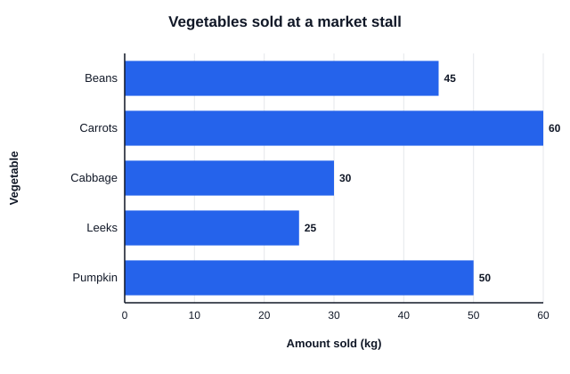

*Renderable data: `assets/chart_data/ENG-CHT-0011.json`*

<!-- meta {"id":"ENG-WRT-CHT-0190","topic_id":"ENG-TOP-CHART","category":"cht","difficulty":"Beginner","question_type":"identify_values","answer_type":"open_ended","asset_id":"ENG-CHT-0011"} -->
**ENG-WRT-CHT-0190** Stage 1–2: read the chart. Write the value for each category and name the highest and lowest.

<details><summary>Answer</summary>

Beans: 45 kg; Carrots: 60 kg; Cabbage: 30 kg; Leeks: 25 kg; Pumpkin: 50 kg — highest: Carrots; lowest: Leeks.

</details>

<!-- meta {"id":"ENG-WRT-CHT-0191","topic_id":"ENG-TOP-CHART","category":"cht","difficulty":"Intermediate","question_type":"guided_writing","answer_type":"open_ended","asset_id":"ENG-CHT-0011","template_id":"ENG-TPL-BAR-0001"} -->
**ENG-WRT-CHT-0191** Stage 3–5: complete the first paragraph and two comparison sentences for ENG-CHT-0011.

<details><summary>Model</summary>

The bar chart shows the vegetables sold at a market stall. The vertical axis shows the vegetable, while the horizontal axis shows the amount sold (kg).  
Carrots has the highest amount sold, at 60 kg. Pumpkin has 50 kg.

</details>

<!-- meta {"id":"ENG-WRT-CHT-0192","topic_id":"ENG-TOP-CHART","category":"cht","difficulty":"Examination Level","question_type":"independent_writing","answer_type":"open_ended","asset_id":"ENG-CHT-0011","template_id":"ENG-TPL-BAR-0001","word_count":"about 100 words","marks":10,"criteria":"Content 3 + Language 3 + Format & organisation 2 + Mechanics 2 (2020 Test 14 criteria)","required_content":["Beans","Carrots","Cabbage","Leeks","Pumpkin"]} -->
**ENG-WRT-CHT-0192** Stage 6–7: describe ENG-CHT-0011 in about 100 words, then compare with the model.

<details><summary>Model answer</summary>

> The bar chart shows the vegetables sold at a market stall. The vertical axis shows the vegetable, while the horizontal axis shows the amount sold (kg).  
> Carrots has the highest amount sold, at 60 kg. Pumpkin has 50 kg. Beans has 45 kg. Cabbage has 30 kg. Leeks has the lowest amount sold, with only 25 kg. The difference between Carrots and Leeks is 35 kg.  
> Overall, Carrots has the highest amount sold, while Leeks has the lowest.  
*Word count: 78. Every number and comparison in this model is computed from the chart data.*

</details>

### ENG-CHT-0012 — Trees planted by school clubs

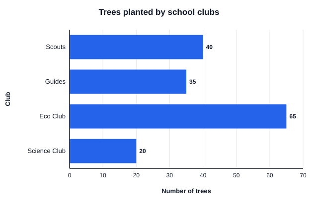

*Renderable data: `assets/chart_data/ENG-CHT-0012.json`*

<!-- meta {"id":"ENG-WRT-CHT-0193","topic_id":"ENG-TOP-CHART","category":"cht","difficulty":"Beginner","question_type":"identify_values","answer_type":"open_ended","asset_id":"ENG-CHT-0012"} -->
**ENG-WRT-CHT-0193** Stage 1–2: read the chart. Write the value for each category and name the highest and lowest.

<details><summary>Answer</summary>

Scouts: 40 trees; Guides: 35 trees; Eco Club: 65 trees; Science Club: 20 trees — highest: Eco Club; lowest: Science Club.

</details>

<!-- meta {"id":"ENG-WRT-CHT-0194","topic_id":"ENG-TOP-CHART","category":"cht","difficulty":"Intermediate","question_type":"guided_writing","answer_type":"open_ended","asset_id":"ENG-CHT-0012","template_id":"ENG-TPL-BAR-0001"} -->
**ENG-WRT-CHT-0194** Stage 3–5: complete the first paragraph and two comparison sentences for ENG-CHT-0012.

<details><summary>Model</summary>

The bar chart shows the trees planted by school clubs. The vertical axis shows the club, while the horizontal axis shows the number of trees.  
Eco Club has the highest number of trees planted, at 65 trees. Scouts has 40 trees.

</details>

<!-- meta {"id":"ENG-WRT-CHT-0195","topic_id":"ENG-TOP-CHART","category":"cht","difficulty":"Examination Level","question_type":"independent_writing","answer_type":"open_ended","asset_id":"ENG-CHT-0012","template_id":"ENG-TPL-BAR-0001","word_count":"about 100 words","marks":10,"criteria":"Content 3 + Language 3 + Format & organisation 2 + Mechanics 2 (2020 Test 14 criteria)","required_content":["Scouts","Guides","Eco Club","Science Club"]} -->
**ENG-WRT-CHT-0195** Stage 6–7: describe ENG-CHT-0012 in about 100 words, then compare with the model.

<details><summary>Model answer</summary>

> The bar chart shows the trees planted by school clubs. The vertical axis shows the club, while the horizontal axis shows the number of trees.  
> Eco Club has the highest number of trees planted, at 65 trees. Scouts has 40 trees. Guides has 35 trees. Science Club has the lowest number of trees planted, with only 20 trees. The difference between Eco Club and Science Club is 45 trees.  
> Overall, Eco Club has the highest number of trees planted, while Science Club has the lowest.  
*Word count: 85. Every number and comparison in this model is computed from the chart data.*

</details>

### ENG-CHT-0013 — Favourite sports of boys and girls

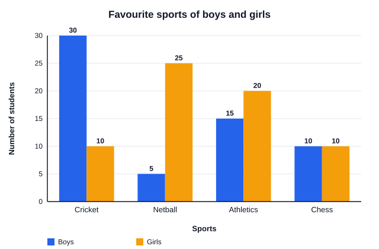

*Renderable data: `assets/chart_data/ENG-CHT-0013.json`*

<!-- meta {"id":"ENG-WRT-CHT-0196","topic_id":"ENG-TOP-CHART","category":"cht","difficulty":"Beginner","question_type":"identify_values","answer_type":"open_ended","asset_id":"ENG-CHT-0013"} -->
**ENG-WRT-CHT-0196** Stage 1–2: read the chart. Write the value for each category and name the highest and lowest.

<details><summary>Answer</summary>

**Boys:** Cricket: 30; Netball: 5; Athletics: 15; Chess: 10 — highest: Cricket; lowest: Netball.  
**Girls:** Cricket: 10; Netball: 25; Athletics: 20; Chess: 10 — highest: Netball; lowest: Cricket, Chess.

</details>

<!-- meta {"id":"ENG-WRT-CHT-0197","topic_id":"ENG-TOP-CHART","category":"cht","difficulty":"Intermediate","question_type":"guided_writing","answer_type":"open_ended","asset_id":"ENG-CHT-0013","template_id":"ENG-TPL-BAR-0001"} -->
**ENG-WRT-CHT-0197** Stage 3–5: complete the first paragraph and two comparison sentences for ENG-CHT-0013.

<details><summary>Model</summary>

The bar chart shows the favourite sports of boys and girls. The X-axis represents the sports, while the Y-axis represents the number of students.  
In Cricket, boys have 30, which is 20 more than girls (10). In Netball, girls have 25, which is 20 more than boys (5).

</details>

<!-- meta {"id":"ENG-WRT-CHT-0198","topic_id":"ENG-TOP-CHART","category":"cht","difficulty":"Examination Level","question_type":"independent_writing","answer_type":"open_ended","asset_id":"ENG-CHT-0013","template_id":"ENG-TPL-BAR-0001","word_count":"about 100 words","marks":10,"criteria":"Content 3 + Language 3 + Format & organisation 2 + Mechanics 2 (2020 Test 14 criteria)","required_content":["Cricket","Netball","Athletics","Chess"]} -->
**ENG-WRT-CHT-0198** Stage 6–7: describe ENG-CHT-0013 in about 100 words, then compare with the model.

<details><summary>Model answer</summary>

> The bar chart shows the favourite sports of boys and girls. The X-axis represents the sports, while the Y-axis represents the number of students.  
> In Cricket, boys have 30, which is 20 more than girls (10). In Netball, girls have 25, which is 20 more than boys (5). In Athletics, girls have 20, which is 5 more than boys (15). In Chess, boys and girls are equal, with 10 each.  
> Overall, the total for boys is 60 and the total for girls is 65, so girls have the higher total.  
*Word count: 90. Every number and comparison in this model is computed from the chart data.*

</details>

### ENG-CHT-0014 — Marks of two students in four subjects

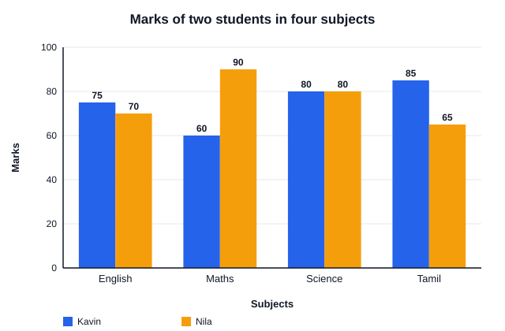

*Renderable data: `assets/chart_data/ENG-CHT-0014.json`*

<!-- meta {"id":"ENG-WRT-CHT-0199","topic_id":"ENG-TOP-CHART","category":"cht","difficulty":"Beginner","question_type":"identify_values","answer_type":"open_ended","asset_id":"ENG-CHT-0014"} -->
**ENG-WRT-CHT-0199** Stage 1–2: read the chart. Write the value for each category and name the highest and lowest.

<details><summary>Answer</summary>

**Kavin:** English: 75; Maths: 60; Science: 80; Tamil: 85 — highest: Tamil; lowest: Maths.  
**Nila:** English: 70; Maths: 90; Science: 80; Tamil: 65 — highest: Maths; lowest: Tamil.

</details>

<!-- meta {"id":"ENG-WRT-CHT-0200","topic_id":"ENG-TOP-CHART","category":"cht","difficulty":"Intermediate","question_type":"guided_writing","answer_type":"open_ended","asset_id":"ENG-CHT-0014","template_id":"ENG-TPL-BAR-0001"} -->
**ENG-WRT-CHT-0200** Stage 3–5: complete the first paragraph and two comparison sentences for ENG-CHT-0014.

<details><summary>Model</summary>

The bar chart shows the marks of two students in four subjects. The X-axis represents the subjects, while the Y-axis represents the marks.  
In English, Kavin scored 75, which is 5 more than Nila (70). In Maths, Nila scored 90, which is 30 more than Kavin (60).

</details>

<!-- meta {"id":"ENG-WRT-CHT-0201","topic_id":"ENG-TOP-CHART","category":"cht","difficulty":"Examination Level","question_type":"independent_writing","answer_type":"open_ended","asset_id":"ENG-CHT-0014","template_id":"ENG-TPL-BAR-0001","word_count":"about 100 words","marks":10,"criteria":"Content 3 + Language 3 + Format & organisation 2 + Mechanics 2 (2020 Test 14 criteria)","required_content":["English","Maths","Science","Tamil"]} -->
**ENG-WRT-CHT-0201** Stage 6–7: describe ENG-CHT-0014 in about 100 words, then compare with the model.

<details><summary>Model answer</summary>

> The bar chart shows the marks of two students in four subjects. The X-axis represents the subjects, while the Y-axis represents the marks.  
> In English, Kavin scored 75, which is 5 more than Nila (70). In Maths, Nila scored 90, which is 30 more than Kavin (60). In Science, Kavin and Nila are equal, with 80 each. In Tamil, Kavin scored 85, which is 20 more than Nila (65).  
> Overall, the total for Kavin is 300 and the total for Nila is 305, so Nila has the higher total.  
*Word count: 89. Every number and comparison in this model is computed from the chart data.*

</details>

### ENG-CHT-0015 — Students using the canteen and bringing lunch

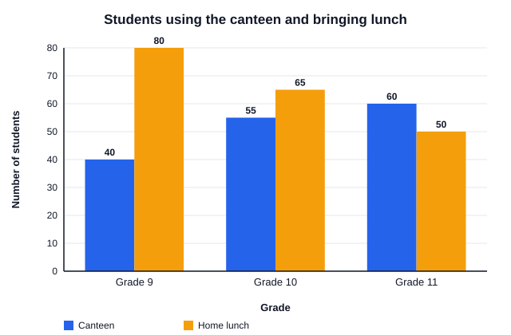

*Renderable data: `assets/chart_data/ENG-CHT-0015.json`*

<!-- meta {"id":"ENG-WRT-CHT-0202","topic_id":"ENG-TOP-CHART","category":"cht","difficulty":"Beginner","question_type":"identify_values","answer_type":"open_ended","asset_id":"ENG-CHT-0015"} -->
**ENG-WRT-CHT-0202** Stage 1–2: read the chart. Write the value for each category and name the highest and lowest.

<details><summary>Answer</summary>

**Canteen:** Grade 9: 40; Grade 10: 55; Grade 11: 60 — highest: Grade 11; lowest: Grade 9.  
**Home lunch:** Grade 9: 80; Grade 10: 65; Grade 11: 50 — highest: Grade 9; lowest: Grade 11.

</details>

<!-- meta {"id":"ENG-WRT-CHT-0203","topic_id":"ENG-TOP-CHART","category":"cht","difficulty":"Intermediate","question_type":"guided_writing","answer_type":"open_ended","asset_id":"ENG-CHT-0015","template_id":"ENG-TPL-BAR-0001"} -->
**ENG-WRT-CHT-0203** Stage 3–5: complete the first paragraph and two comparison sentences for ENG-CHT-0015.

<details><summary>Model</summary>

The bar chart shows the students using the canteen and bringing lunch. The X-axis represents the grade, while the Y-axis represents the number of students.  
In Grade 9, home lunch have 80, which is 40 more than canteen (40). In Grade 10, home lunch have 65, which is 10 more than canteen (55).

</details>

<!-- meta {"id":"ENG-WRT-CHT-0204","topic_id":"ENG-TOP-CHART","category":"cht","difficulty":"Examination Level","question_type":"independent_writing","answer_type":"open_ended","asset_id":"ENG-CHT-0015","template_id":"ENG-TPL-BAR-0001","word_count":"about 100 words","marks":10,"criteria":"Content 3 + Language 3 + Format & organisation 2 + Mechanics 2 (2020 Test 14 criteria)","required_content":["Grade 9","Grade 10","Grade 11"]} -->
**ENG-WRT-CHT-0204** Stage 6–7: describe ENG-CHT-0015 in about 100 words, then compare with the model.

<details><summary>Model answer</summary>

> The bar chart shows the students using the canteen and bringing lunch. The X-axis represents the grade, while the Y-axis represents the number of students.  
> In Grade 9, home lunch have 80, which is 40 more than canteen (40). In Grade 10, home lunch have 65, which is 10 more than canteen (55). In Grade 11, canteen have 60, which is 10 more than home lunch (50).  
> Overall, the total for canteen is 155 and the total for home lunch is 195, so home lunch have the higher total.  
*Word count: 89. Every number and comparison in this model is computed from the chart data.*

</details>

### ENG-CHT-0016 — Daily screen time of students

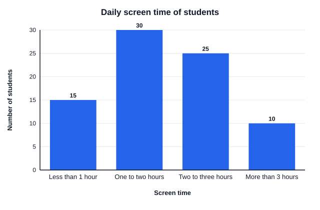

*Renderable data: `assets/chart_data/ENG-CHT-0016.json`*

<!-- meta {"id":"ENG-WRT-CHT-0205","topic_id":"ENG-TOP-CHART","category":"cht","difficulty":"Beginner","question_type":"identify_values","answer_type":"open_ended","asset_id":"ENG-CHT-0016"} -->
**ENG-WRT-CHT-0205** Stage 1–2: read the chart. Write the value for each category and name the highest and lowest.

<details><summary>Answer</summary>

Less than 1 hour: 15 students; One to two hours: 30 students; Two to three hours: 25 students; More than 3 hours: 10 students — highest: One to two hours; lowest: More than 3 hours.

</details>

<!-- meta {"id":"ENG-WRT-CHT-0206","topic_id":"ENG-TOP-CHART","category":"cht","difficulty":"Intermediate","question_type":"guided_writing","answer_type":"open_ended","asset_id":"ENG-CHT-0016","template_id":"ENG-TPL-BAR-0001"} -->
**ENG-WRT-CHT-0206** Stage 3–5: complete the first paragraph and two comparison sentences for ENG-CHT-0016.

<details><summary>Model</summary>

The bar chart shows the daily screen time of students. The X-axis represents the screen time, while the Y-axis represents the number of students.  
One to two hours has the highest number of students, at 30 students. Two to three hours has 25 students.

</details>

<!-- meta {"id":"ENG-WRT-CHT-0207","topic_id":"ENG-TOP-CHART","category":"cht","difficulty":"Examination Level","question_type":"independent_writing","answer_type":"open_ended","asset_id":"ENG-CHT-0016","template_id":"ENG-TPL-BAR-0001","word_count":"about 100 words","marks":10,"criteria":"Content 3 + Language 3 + Format & organisation 2 + Mechanics 2 (2020 Test 14 criteria)","required_content":["Less than 1 hour","One to two hours","Two to three hours","More than 3 hours"]} -->
**ENG-WRT-CHT-0207** Stage 6–7: describe ENG-CHT-0016 in about 100 words, then compare with the model.

<details><summary>Model answer</summary>

> The bar chart shows the daily screen time of students. The X-axis represents the screen time, while the Y-axis represents the number of students.  
> One to two hours has the highest number of students, at 30 students. Two to three hours has 25 students. Less than 1 hour has 15 students. More than 3 hours has the lowest number of students, with only 10 students. The difference between One to two hours and More than 3 hours is 20 students.  
> Overall, One to two hours has the highest number of students, while More than 3 hours has the lowest.  
*Word count: 99. Every number and comparison in this model is computed from the chart data.*

</details>

---

## Section H — Pie Chart Description Mastery

**Remember:** a pie chart has **no X-axis or Y-axis**. Use *the largest proportion*, *accounts for … %*, *represents … %*, *the smallest proportion*.

### ENG-CHT-0017 — How a family spends its monthly income


*Renderable data: `assets/chart_data/ENG-CHT-0017.json`*

<!-- meta {"id":"ENG-WRT-CHT-0208","topic_id":"ENG-TOP-PIE","category":"cht","difficulty":"Intermediate","question_type":"guided_writing","answer_type":"open_ended","asset_id":"ENG-CHT-0017","template_id":"ENG-TPL-PIE-0001"} -->
**ENG-WRT-CHT-0208** Stage 3–5: complete the first paragraph and two comparison sentences for ENG-CHT-0017.

<details><summary>Model</summary>

The pie chart shows how a family spends its monthly income. It presents the percentage of the monthly income in 5 categories.  
The largest proportion belongs to Food, which accounts for 40%. Education represents 20%, which is one fifth.

</details>

<!-- meta {"id":"ENG-WRT-CHT-0209","topic_id":"ENG-TOP-PIE","category":"cht","difficulty":"Examination Level","question_type":"independent_writing","answer_type":"open_ended","asset_id":"ENG-CHT-0017","template_id":"ENG-TPL-PIE-0001","word_count":"about 100 words","marks":10,"criteria":"Content 3 + Language 3 + Format & organisation 2 + Mechanics 2 (2020 Test 14 criteria)","required_content":["Food","Education","Transport","Savings","Other"]} -->
**ENG-WRT-CHT-0209** Stage 6–7: describe ENG-CHT-0017 in about 100 words, then compare with the model.

<details><summary>Model answer</summary>

> The pie chart shows how a family spends its monthly income. It presents the percentage of the monthly income in 5 categories.  
> The largest proportion belongs to Food, which accounts for 40%. Education represents 20%, which is one fifth. Both Transport and Other have the same percentage, 15% each. The smallest proportion belongs to Savings, with only 10%.  
> Overall, Food represents the largest proportion, while Savings represents the smallest proportion.  
*Word count: 70. Every number and comparison in this model is computed from the chart data.*

</details>

### ENG-CHT-0018 — Favourite drinks of students


*Renderable data: `assets/chart_data/ENG-CHT-0018.json`*

<!-- meta {"id":"ENG-WRT-CHT-0210","topic_id":"ENG-TOP-PIE","category":"cht","difficulty":"Intermediate","question_type":"guided_writing","answer_type":"open_ended","asset_id":"ENG-CHT-0018","template_id":"ENG-TPL-PIE-0001"} -->
**ENG-WRT-CHT-0210** Stage 3–5: complete the first paragraph and two comparison sentences for ENG-CHT-0018.

<details><summary>Model</summary>

The pie chart shows the favourite drinks of students. It presents the percentage of the students in 4 categories.  
The largest proportion belongs to Fruit juice, which accounts for 35%. Both Milk and Water have the same percentage, 25% each.

</details>

<!-- meta {"id":"ENG-WRT-CHT-0211","topic_id":"ENG-TOP-PIE","category":"cht","difficulty":"Examination Level","question_type":"independent_writing","answer_type":"open_ended","asset_id":"ENG-CHT-0018","template_id":"ENG-TPL-PIE-0001","word_count":"about 100 words","marks":10,"criteria":"Content 3 + Language 3 + Format & organisation 2 + Mechanics 2 (2020 Test 14 criteria)","required_content":["Milk","Fruit juice","Tea","Water"]} -->
**ENG-WRT-CHT-0211** Stage 6–7: describe ENG-CHT-0018 in about 100 words, then compare with the model.

<details><summary>Model answer</summary>

> The pie chart shows the favourite drinks of students. It presents the percentage of the students in 4 categories.  
> The largest proportion belongs to Fruit juice, which accounts for 35%. Both Milk and Water have the same percentage, 25% each. The smallest proportion belongs to Tea, with only 15%.  
> Overall, Fruit juice represents the largest proportion, while Tea represents the smallest proportion.  
*Word count: 62. Every number and comparison in this model is computed from the chart data.*

</details>

### ENG-CHT-0019 — Waste collected in a school

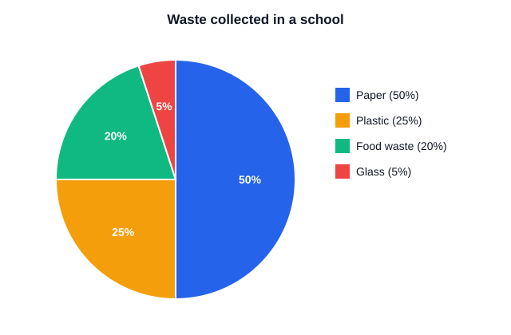

*Renderable data: `assets/chart_data/ENG-CHT-0019.json`*

<!-- meta {"id":"ENG-WRT-CHT-0212","topic_id":"ENG-TOP-PIE","category":"cht","difficulty":"Intermediate","question_type":"guided_writing","answer_type":"open_ended","asset_id":"ENG-CHT-0019","template_id":"ENG-TPL-PIE-0001"} -->
**ENG-WRT-CHT-0212** Stage 3–5: complete the first paragraph and two comparison sentences for ENG-CHT-0019.

<details><summary>Model</summary>

The pie chart shows the waste collected in a school. It presents the percentage of the waste collected in 4 categories.  
The largest proportion belongs to Paper, which accounts for 50% (half). Plastic represents 25%, which is a quarter.

</details>

<!-- meta {"id":"ENG-WRT-CHT-0213","topic_id":"ENG-TOP-PIE","category":"cht","difficulty":"Examination Level","question_type":"independent_writing","answer_type":"open_ended","asset_id":"ENG-CHT-0019","template_id":"ENG-TPL-PIE-0001","word_count":"about 100 words","marks":10,"criteria":"Content 3 + Language 3 + Format & organisation 2 + Mechanics 2 (2020 Test 14 criteria)","required_content":["Paper","Plastic","Food waste","Glass"]} -->
**ENG-WRT-CHT-0213** Stage 6–7: describe ENG-CHT-0019 in about 100 words, then compare with the model.

<details><summary>Model answer</summary>

> The pie chart shows the waste collected in a school. It presents the percentage of the waste collected in 4 categories.  
> The largest proportion belongs to Paper, which accounts for 50% (half). Plastic represents 25%, which is a quarter. Food waste represents 20%, which is one fifth. The smallest proportion belongs to Glass, with only 5%.  
> Overall, Paper represents the largest proportion, while Glass represents the smallest proportion.  
*Word count: 68. Every number and comparison in this model is computed from the chart data.*

</details>

### ENG-CHT-0020 — Languages spoken at home by students

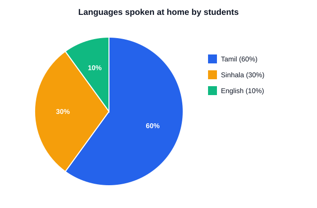

*Renderable data: `assets/chart_data/ENG-CHT-0020.json`*

<!-- meta {"id":"ENG-WRT-CHT-0214","topic_id":"ENG-TOP-PIE","category":"cht","difficulty":"Intermediate","question_type":"guided_writing","answer_type":"open_ended","asset_id":"ENG-CHT-0020","template_id":"ENG-TPL-PIE-0001"} -->
**ENG-WRT-CHT-0214** Stage 3–5: complete the first paragraph and two comparison sentences for ENG-CHT-0020.

<details><summary>Model</summary>

The pie chart shows the languages spoken at home by students. It presents the percentage of the students in 3 categories.  
The largest proportion belongs to Tamil, which accounts for 60%. Sinhala represents 30%.

</details>

<!-- meta {"id":"ENG-WRT-CHT-0215","topic_id":"ENG-TOP-PIE","category":"cht","difficulty":"Examination Level","question_type":"independent_writing","answer_type":"open_ended","asset_id":"ENG-CHT-0020","template_id":"ENG-TPL-PIE-0001","word_count":"about 100 words","marks":10,"criteria":"Content 3 + Language 3 + Format & organisation 2 + Mechanics 2 (2020 Test 14 criteria)","required_content":["Tamil","Sinhala","English"]} -->
**ENG-WRT-CHT-0215** Stage 6–7: describe ENG-CHT-0020 in about 100 words, then compare with the model.

<details><summary>Model answer</summary>

> The pie chart shows the languages spoken at home by students. It presents the percentage of the students in 3 categories.  
> The largest proportion belongs to Tamil, which accounts for 60%. Sinhala represents 30%. The smallest proportion belongs to English, with only 10%.  
> Overall, Tamil represents the largest proportion, while English represents the smallest proportion.  
*Word count: 55. Every number and comparison in this model is computed from the chart data.*

</details>

### ENG-CHT-0021 — How students spend their free time

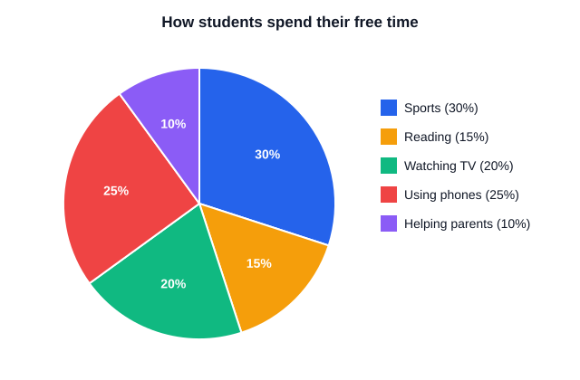

*Renderable data: `assets/chart_data/ENG-CHT-0021.json`*

<!-- meta {"id":"ENG-WRT-CHT-0216","topic_id":"ENG-TOP-PIE","category":"cht","difficulty":"Intermediate","question_type":"guided_writing","answer_type":"open_ended","asset_id":"ENG-CHT-0021","template_id":"ENG-TPL-PIE-0001"} -->
**ENG-WRT-CHT-0216** Stage 3–5: complete the first paragraph and two comparison sentences for ENG-CHT-0021.

<details><summary>Model</summary>

The pie chart shows how students spend their free time. It presents the percentage of the students in 5 categories.  
The largest proportion belongs to Sports, which accounts for 30%. Using phones represents 25%, which is a quarter.

</details>

<!-- meta {"id":"ENG-WRT-CHT-0217","topic_id":"ENG-TOP-PIE","category":"cht","difficulty":"Examination Level","question_type":"independent_writing","answer_type":"open_ended","asset_id":"ENG-CHT-0021","template_id":"ENG-TPL-PIE-0001","word_count":"about 100 words","marks":10,"criteria":"Content 3 + Language 3 + Format & organisation 2 + Mechanics 2 (2020 Test 14 criteria)","required_content":["Sports","Reading","Watching TV","Using phones","Helping parents"]} -->
**ENG-WRT-CHT-0217** Stage 6–7: describe ENG-CHT-0021 in about 100 words, then compare with the model.

<details><summary>Model answer</summary>

> The pie chart shows how students spend their free time. It presents the percentage of the students in 5 categories.  
> The largest proportion belongs to Sports, which accounts for 30%. Using phones represents 25%, which is a quarter. Watching TV represents 20%, which is one fifth. Reading represents 15%. The smallest proportion belongs to Helping parents, with only 10%.  
> Overall, Sports represents the largest proportion, while Helping parents represents the smallest proportion.  
*Word count: 72. Every number and comparison in this model is computed from the chart data.*

</details>

### ENG-CHT-0022 — Uses of water in a home

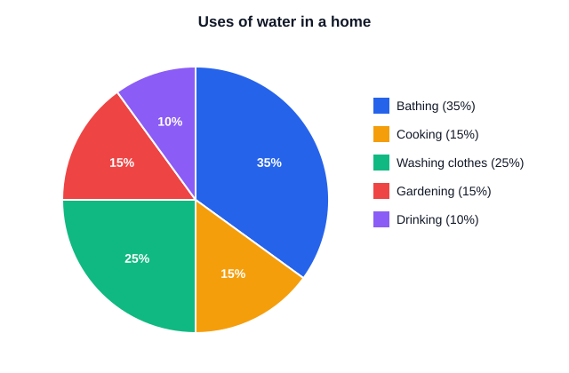

*Renderable data: `assets/chart_data/ENG-CHT-0022.json`*

<!-- meta {"id":"ENG-WRT-CHT-0218","topic_id":"ENG-TOP-PIE","category":"cht","difficulty":"Intermediate","question_type":"guided_writing","answer_type":"open_ended","asset_id":"ENG-CHT-0022","template_id":"ENG-TPL-PIE-0001"} -->
**ENG-WRT-CHT-0218** Stage 3–5: complete the first paragraph and two comparison sentences for ENG-CHT-0022.

<details><summary>Model</summary>

The pie chart shows the uses of water in a home. It presents the percentage of the water used in 5 categories.  
The largest proportion belongs to Bathing, which accounts for 35%. Washing clothes represents 25%, which is a quarter.

</details>

<!-- meta {"id":"ENG-WRT-CHT-0219","topic_id":"ENG-TOP-PIE","category":"cht","difficulty":"Examination Level","question_type":"independent_writing","answer_type":"open_ended","asset_id":"ENG-CHT-0022","template_id":"ENG-TPL-PIE-0001","word_count":"about 100 words","marks":10,"criteria":"Content 3 + Language 3 + Format & organisation 2 + Mechanics 2 (2020 Test 14 criteria)","required_content":["Bathing","Cooking","Washing clothes","Gardening","Drinking"]} -->
**ENG-WRT-CHT-0219** Stage 6–7: describe ENG-CHT-0022 in about 100 words, then compare with the model.

<details><summary>Model answer</summary>

> The pie chart shows the uses of water in a home. It presents the percentage of the water used in 5 categories.  
> The largest proportion belongs to Bathing, which accounts for 35%. Washing clothes represents 25%, which is a quarter. Both Cooking and Gardening have the same percentage, 15% each. The smallest proportion belongs to Drinking, with only 10%.  
> Overall, Bathing represents the largest proportion, while Drinking represents the smallest proportion.  
*Word count: 71. Every number and comparison in this model is computed from the chart data.*

</details>

### ENG-CHT-0023 — Reasons for being late to school

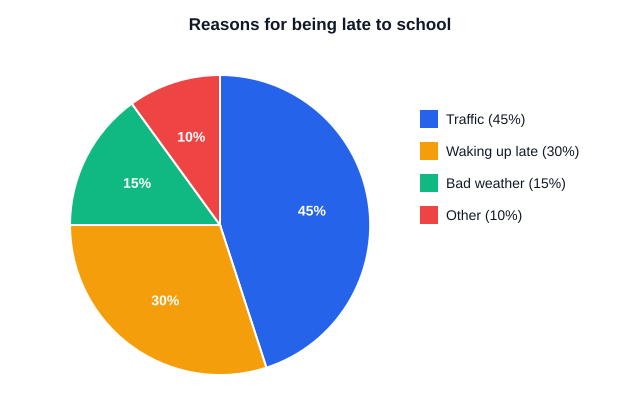

*Renderable data: `assets/chart_data/ENG-CHT-0023.json`*

<!-- meta {"id":"ENG-WRT-CHT-0220","topic_id":"ENG-TOP-PIE","category":"cht","difficulty":"Intermediate","question_type":"guided_writing","answer_type":"open_ended","asset_id":"ENG-CHT-0023","template_id":"ENG-TPL-PIE-0001"} -->
**ENG-WRT-CHT-0220** Stage 3–5: complete the first paragraph and two comparison sentences for ENG-CHT-0023.

<details><summary>Model</summary>

The pie chart shows the reasons for being late to school. It presents the percentage of the late arrivals in 4 categories.  
The largest proportion belongs to Traffic, which accounts for 45%. Waking up late represents 30%.

</details>

<!-- meta {"id":"ENG-WRT-CHT-0221","topic_id":"ENG-TOP-PIE","category":"cht","difficulty":"Examination Level","question_type":"independent_writing","answer_type":"open_ended","asset_id":"ENG-CHT-0023","template_id":"ENG-TPL-PIE-0001","word_count":"about 100 words","marks":10,"criteria":"Content 3 + Language 3 + Format & organisation 2 + Mechanics 2 (2020 Test 14 criteria)","required_content":["Traffic","Waking up late","Bad weather","Other"]} -->
**ENG-WRT-CHT-0221** Stage 6–7: describe ENG-CHT-0023 in about 100 words, then compare with the model.

<details><summary>Model answer</summary>

> The pie chart shows the reasons for being late to school. It presents the percentage of the late arrivals in 4 categories.  
> The largest proportion belongs to Traffic, which accounts for 45%. Waking up late represents 30%. Bad weather represents 15%. The smallest proportion belongs to Other, with only 10%.  
> Overall, Traffic represents the largest proportion, while Other represents the smallest proportion.  
*Word count: 62. Every number and comparison in this model is computed from the chart data.*

</details>

### ENG-CHT-0024 — Types of books in a class library

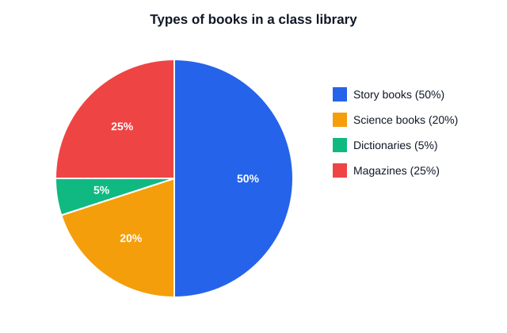

*Renderable data: `assets/chart_data/ENG-CHT-0024.json`*

<!-- meta {"id":"ENG-WRT-CHT-0222","topic_id":"ENG-TOP-PIE","category":"cht","difficulty":"Intermediate","question_type":"guided_writing","answer_type":"open_ended","asset_id":"ENG-CHT-0024","template_id":"ENG-TPL-PIE-0001"} -->
**ENG-WRT-CHT-0222** Stage 3–5: complete the first paragraph and two comparison sentences for ENG-CHT-0024.

<details><summary>Model</summary>

The pie chart shows the types of books in a class library. It presents the percentage of the books in 4 categories.  
The largest proportion belongs to Story books, which accounts for 50% (half). Magazines represents 25%, which is a quarter.

</details>

<!-- meta {"id":"ENG-WRT-CHT-0223","topic_id":"ENG-TOP-PIE","category":"cht","difficulty":"Examination Level","question_type":"independent_writing","answer_type":"open_ended","asset_id":"ENG-CHT-0024","template_id":"ENG-TPL-PIE-0001","word_count":"about 100 words","marks":10,"criteria":"Content 3 + Language 3 + Format & organisation 2 + Mechanics 2 (2020 Test 14 criteria)","required_content":["Story books","Science books","Dictionaries","Magazines"]} -->
**ENG-WRT-CHT-0223** Stage 6–7: describe ENG-CHT-0024 in about 100 words, then compare with the model.

<details><summary>Model answer</summary>

> The pie chart shows the types of books in a class library. It presents the percentage of the books in 4 categories.  
> The largest proportion belongs to Story books, which accounts for 50% (half). Magazines represents 25%, which is a quarter. Science books represents 20%, which is one fifth. The smallest proportion belongs to Dictionaries, with only 5%.  
> Overall, Story books represents the largest proportion, while Dictionaries represents the smallest proportion.  
*Word count: 71. Every number and comparison in this model is computed from the chart data.*

</details>

---

## Section I — Line Graphs

**Expressions:** increased from … to … · decreased from … to … · remained unchanged · a gradual increase · a sudden decrease · the highest value was recorded in … · Overall, …

### ENG-CHT-0025 — Number of students in a school (2019–2024)


*Renderable data: `assets/chart_data/ENG-CHT-0025.json`*

<!-- meta {"id":"ENG-WRT-CHT-0224","topic_id":"ENG-TOP-LINE","category":"cht","difficulty":"Beginner","question_type":"identify_values","answer_type":"open_ended","asset_id":"ENG-CHT-0025"} -->
**ENG-WRT-CHT-0224** Stage 1–2: read the chart. Write the value for each category and name the highest and lowest.

<details><summary>Answer</summary>

2019: 600 students; 2020: 650 students; 2021: 640 students; 2022: 720 students; 2023: 800 students; 2024: 850 students — highest: 2024; lowest: 2019.

</details>

<!-- meta {"id":"ENG-WRT-CHT-0225","topic_id":"ENG-TOP-LINE","category":"cht","difficulty":"Intermediate","question_type":"guided_writing","answer_type":"open_ended","asset_id":"ENG-CHT-0025","template_id":"ENG-TPL-LINE-0001"} -->
**ENG-WRT-CHT-0225** Stage 3–5: complete the first paragraph and two comparison sentences for ENG-CHT-0025.

<details><summary>Model</summary>

The line graph shows the number of students in a school (2019–2024). The horizontal axis shows the year and the vertical axis shows the number of students.  
The number of students increased from 600 students in 2019 to 850 students in 2024. The highest value was recorded in 2024 (850 students), and the lowest in 2019 (600 students).

</details>

<!-- meta {"id":"ENG-WRT-CHT-0226","topic_id":"ENG-TOP-LINE","category":"cht","difficulty":"Examination Level","question_type":"independent_writing","answer_type":"open_ended","asset_id":"ENG-CHT-0025","template_id":"ENG-TPL-LINE-0001","word_count":"about 100 words","marks":10,"criteria":"Content 3 + Language 3 + Format & organisation 2 + Mechanics 2 (2020 Test 14 criteria)","required_content":["2019","2020","2021","2022","2023","2024"]} -->
**ENG-WRT-CHT-0226** Stage 6–7: describe ENG-CHT-0025 in about 100 words, then compare with the model.

<details><summary>Model answer</summary>

> The line graph shows the number of students in a school (2019–2024). The horizontal axis shows the year and the vertical axis shows the number of students.  
> The number of students increased from 600 students in 2019 to 850 students in 2024. The highest value was recorded in 2024 (850 students), and the lowest in 2019 (600 students). The biggest changes were between 2021 and 2022, when it rose by 80 students and between 2022 and 2023, when it rose by 80 students.  
> Overall, the number of students increased during the period.  
*Word count: 93. Every number and comparison in this model is computed from the chart data.*

</details>

### ENG-CHT-0026 — Price of 1 kg of rice (Rs.)


*Renderable data: `assets/chart_data/ENG-CHT-0026.json`*

<!-- meta {"id":"ENG-WRT-CHT-0227","topic_id":"ENG-TOP-LINE","category":"cht","difficulty":"Beginner","question_type":"identify_values","answer_type":"open_ended","asset_id":"ENG-CHT-0026"} -->
**ENG-WRT-CHT-0227** Stage 1–2: read the chart. Write the value for each category and name the highest and lowest.

<details><summary>Answer</summary>

January: Rs. 220; February: Rs. 230; March: Rs. 260; April: Rs. 260; May: Rs. 240; June: Rs. 210 — highest: March, April; lowest: June.

</details>

<!-- meta {"id":"ENG-WRT-CHT-0228","topic_id":"ENG-TOP-LINE","category":"cht","difficulty":"Intermediate","question_type":"guided_writing","answer_type":"open_ended","asset_id":"ENG-CHT-0026","template_id":"ENG-TPL-LINE-0001"} -->
**ENG-WRT-CHT-0228** Stage 3–5: complete the first paragraph and two comparison sentences for ENG-CHT-0026.

<details><summary>Model</summary>

The line graph shows the price of 1 kg of rice (Rs.). The horizontal axis shows the month and the vertical axis shows the price (Rs.).  
The price of rice decreased from Rs. 220 in January to Rs. 210 in June. The highest value was recorded in March and April (Rs. 260), and the lowest in June (Rs. 210).

</details>

<!-- meta {"id":"ENG-WRT-CHT-0229","topic_id":"ENG-TOP-LINE","category":"cht","difficulty":"Examination Level","question_type":"independent_writing","answer_type":"open_ended","asset_id":"ENG-CHT-0026","template_id":"ENG-TPL-LINE-0001","word_count":"about 100 words","marks":10,"criteria":"Content 3 + Language 3 + Format & organisation 2 + Mechanics 2 (2020 Test 14 criteria)","required_content":["January","February","March","April","May","June"]} -->
**ENG-WRT-CHT-0229** Stage 6–7: describe ENG-CHT-0026 in about 100 words, then compare with the model.

<details><summary>Model answer</summary>

> The line graph shows the price of 1 kg of rice (Rs.). The horizontal axis shows the month and the vertical axis shows the price (Rs.).  
> The price of rice decreased from Rs. 220 in January to Rs. 210 in June. The highest value was recorded in March and April (Rs. 260), and the lowest in June (Rs. 210). It remained unchanged between March and April. The biggest changes were between February and March, when it rose by Rs. 30 and between May and June, when it fell by Rs. 30.  
> Overall, the price of rice rose to a peak of Rs. 260 in March and April and then fell.  
*Word count: 110. Every number and comparison in this model is computed from the chart data.*

</details>

### ENG-CHT-0027 — Temperature during a day

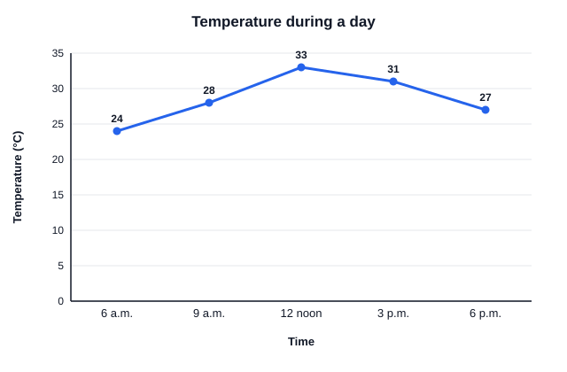

*Renderable data: `assets/chart_data/ENG-CHT-0027.json`*

<!-- meta {"id":"ENG-WRT-CHT-0230","topic_id":"ENG-TOP-LINE","category":"cht","difficulty":"Beginner","question_type":"identify_values","answer_type":"open_ended","asset_id":"ENG-CHT-0027"} -->
**ENG-WRT-CHT-0230** Stage 1–2: read the chart. Write the value for each category and name the highest and lowest.

<details><summary>Answer</summary>

6 a.m.: 24 °C; 9 a.m.: 28 °C; 12 noon: 33 °C; 3 p.m.: 31 °C; 6 p.m.: 27 °C — highest: 12 noon; lowest: 6 a.m..

</details>

<!-- meta {"id":"ENG-WRT-CHT-0231","topic_id":"ENG-TOP-LINE","category":"cht","difficulty":"Intermediate","question_type":"guided_writing","answer_type":"open_ended","asset_id":"ENG-CHT-0027","template_id":"ENG-TPL-LINE-0001"} -->
**ENG-WRT-CHT-0231** Stage 3–5: complete the first paragraph and two comparison sentences for ENG-CHT-0027.

<details><summary>Model</summary>

The line graph shows the temperature during a day. The horizontal axis shows the time and the vertical axis shows the temperature (°C).  
The temperature increased from 24 °C at 6 a.m. to 27 °C at 6 p.m. The highest value was recorded at 12 noon (33 °C), and the lowest at 6 a.m. (24 °C).

</details>

<!-- meta {"id":"ENG-WRT-CHT-0232","topic_id":"ENG-TOP-LINE","category":"cht","difficulty":"Examination Level","question_type":"independent_writing","answer_type":"open_ended","asset_id":"ENG-CHT-0027","template_id":"ENG-TPL-LINE-0001","word_count":"about 100 words","marks":10,"criteria":"Content 3 + Language 3 + Format & organisation 2 + Mechanics 2 (2020 Test 14 criteria)","required_content":["6 a.m.","9 a.m.","12 noon","3 p.m.","6 p.m."]} -->
**ENG-WRT-CHT-0232** Stage 6–7: describe ENG-CHT-0027 in about 100 words, then compare with the model.

<details><summary>Model answer</summary>

> The line graph shows the temperature during a day. The horizontal axis shows the time and the vertical axis shows the temperature (°C).  
> The temperature increased from 24 °C at 6 a.m. to 27 °C at 6 p.m. The highest value was recorded at 12 noon (33 °C), and the lowest at 6 a.m. (24 °C). The biggest change was between 9 a.m. and 12 noon, when it rose by 5 °C.  
> Overall, the temperature rose to a peak of 33 °C at 12 noon and then fell.  
*Word count: 92. Every number and comparison in this model is computed from the chart data.*

</details>

### ENG-CHT-0028 — Tourists visiting a town (thousands)

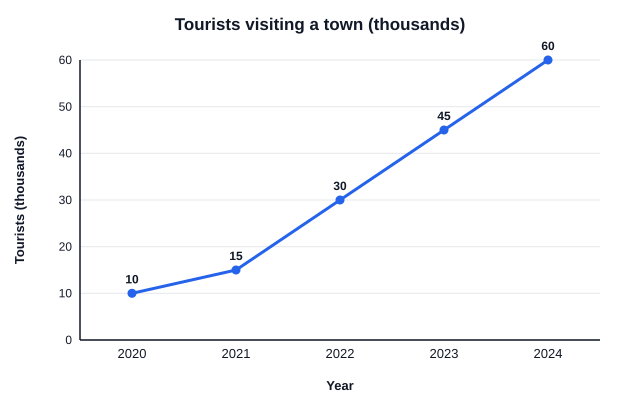

*Renderable data: `assets/chart_data/ENG-CHT-0028.json`*

<!-- meta {"id":"ENG-WRT-CHT-0233","topic_id":"ENG-TOP-LINE","category":"cht","difficulty":"Beginner","question_type":"identify_values","answer_type":"open_ended","asset_id":"ENG-CHT-0028"} -->
**ENG-WRT-CHT-0233** Stage 1–2: read the chart. Write the value for each category and name the highest and lowest.

<details><summary>Answer</summary>

2020: 10 thousand; 2021: 15 thousand; 2022: 30 thousand; 2023: 45 thousand; 2024: 60 thousand — highest: 2024; lowest: 2020.

</details>

<!-- meta {"id":"ENG-WRT-CHT-0234","topic_id":"ENG-TOP-LINE","category":"cht","difficulty":"Intermediate","question_type":"guided_writing","answer_type":"open_ended","asset_id":"ENG-CHT-0028","template_id":"ENG-TPL-LINE-0001"} -->
**ENG-WRT-CHT-0234** Stage 3–5: complete the first paragraph and two comparison sentences for ENG-CHT-0028.

<details><summary>Model</summary>

The line graph shows the tourists visiting a town (thousands). The horizontal axis shows the year and the vertical axis shows the tourists (thousands).  
The number of tourists increased from 10 thousand in 2020 to 60 thousand in 2024. The highest value was recorded in 2024 (60 thousand), and the lowest in 2020 (10 thousand).

</details>

<!-- meta {"id":"ENG-WRT-CHT-0235","topic_id":"ENG-TOP-LINE","category":"cht","difficulty":"Examination Level","question_type":"independent_writing","answer_type":"open_ended","asset_id":"ENG-CHT-0028","template_id":"ENG-TPL-LINE-0001","word_count":"about 100 words","marks":10,"criteria":"Content 3 + Language 3 + Format & organisation 2 + Mechanics 2 (2020 Test 14 criteria)","required_content":["2020","2021","2022","2023","2024"]} -->
**ENG-WRT-CHT-0235** Stage 6–7: describe ENG-CHT-0028 in about 100 words, then compare with the model.

<details><summary>Model answer</summary>

> The line graph shows the tourists visiting a town (thousands). The horizontal axis shows the year and the vertical axis shows the tourists (thousands).  
> The number of tourists increased from 10 thousand in 2020 to 60 thousand in 2024. The highest value was recorded in 2024 (60 thousand), and the lowest in 2020 (10 thousand). The biggest changes were between 2021 and 2022, when it rose by 15 thousand, between 2022 and 2023, when it rose by 15 thousand and between 2023 and 2024, when it rose by 15 thousand.  
> Overall, the number of tourists increased during the period.  
*Word count: 99. Every number and comparison in this model is computed from the chart data.*

</details>

### ENG-CHT-0029 — Dengue cases in a district

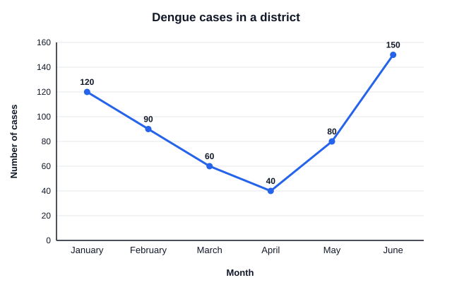

*Renderable data: `assets/chart_data/ENG-CHT-0029.json`*

<!-- meta {"id":"ENG-WRT-CHT-0236","topic_id":"ENG-TOP-LINE","category":"cht","difficulty":"Beginner","question_type":"identify_values","answer_type":"open_ended","asset_id":"ENG-CHT-0029"} -->
**ENG-WRT-CHT-0236** Stage 1–2: read the chart. Write the value for each category and name the highest and lowest.

<details><summary>Answer</summary>

January: 120 cases; February: 90 cases; March: 60 cases; April: 40 cases; May: 80 cases; June: 150 cases — highest: June; lowest: April.

</details>

<!-- meta {"id":"ENG-WRT-CHT-0237","topic_id":"ENG-TOP-LINE","category":"cht","difficulty":"Intermediate","question_type":"guided_writing","answer_type":"open_ended","asset_id":"ENG-CHT-0029","template_id":"ENG-TPL-LINE-0001"} -->
**ENG-WRT-CHT-0237** Stage 3–5: complete the first paragraph and two comparison sentences for ENG-CHT-0029.

<details><summary>Model</summary>

The line graph shows the dengue cases in a district. The horizontal axis shows the month and the vertical axis shows the number of cases.  
The number of dengue cases increased from 120 cases in January to 150 cases in June. The highest value was recorded in June (150 cases), and the lowest in April (40 cases).

</details>

<!-- meta {"id":"ENG-WRT-CHT-0238","topic_id":"ENG-TOP-LINE","category":"cht","difficulty":"Examination Level","question_type":"independent_writing","answer_type":"open_ended","asset_id":"ENG-CHT-0029","template_id":"ENG-TPL-LINE-0001","word_count":"about 100 words","marks":10,"criteria":"Content 3 + Language 3 + Format & organisation 2 + Mechanics 2 (2020 Test 14 criteria)","required_content":["January","February","March","April","May","June"]} -->
**ENG-WRT-CHT-0238** Stage 6–7: describe ENG-CHT-0029 in about 100 words, then compare with the model.

<details><summary>Model answer</summary>

> The line graph shows the dengue cases in a district. The horizontal axis shows the month and the vertical axis shows the number of cases.  
> The number of dengue cases increased from 120 cases in January to 150 cases in June. The highest value was recorded in June (150 cases), and the lowest in April (40 cases). The biggest change was between May and June, when it rose by 70 cases.  
> Overall, the number of dengue cases fell to a low of 40 cases in April and then rose again.  
*Word count: 90. Every number and comparison in this model is computed from the chart data.*

</details>

### ENG-CHT-0030 — Mobile phone users in a village

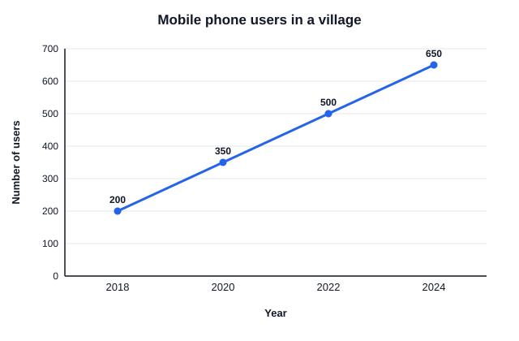

*Renderable data: `assets/chart_data/ENG-CHT-0030.json`*

<!-- meta {"id":"ENG-WRT-CHT-0239","topic_id":"ENG-TOP-LINE","category":"cht","difficulty":"Beginner","question_type":"identify_values","answer_type":"open_ended","asset_id":"ENG-CHT-0030"} -->
**ENG-WRT-CHT-0239** Stage 1–2: read the chart. Write the value for each category and name the highest and lowest.

<details><summary>Answer</summary>

2018: 200 users; 2020: 350 users; 2022: 500 users; 2024: 650 users — highest: 2024; lowest: 2018.

</details>

<!-- meta {"id":"ENG-WRT-CHT-0240","topic_id":"ENG-TOP-LINE","category":"cht","difficulty":"Intermediate","question_type":"guided_writing","answer_type":"open_ended","asset_id":"ENG-CHT-0030","template_id":"ENG-TPL-LINE-0001"} -->
**ENG-WRT-CHT-0240** Stage 3–5: complete the first paragraph and two comparison sentences for ENG-CHT-0030.

<details><summary>Model</summary>

The line graph shows the mobile phone users in a village. The horizontal axis shows the year and the vertical axis shows the number of users.  
The number of mobile phone users increased from 200 users in 2018 to 650 users in 2024. The highest value was recorded in 2024 (650 users), and the lowest in 2018 (200 users).

</details>

<!-- meta {"id":"ENG-WRT-CHT-0241","topic_id":"ENG-TOP-LINE","category":"cht","difficulty":"Examination Level","question_type":"independent_writing","answer_type":"open_ended","asset_id":"ENG-CHT-0030","template_id":"ENG-TPL-LINE-0001","word_count":"about 100 words","marks":10,"criteria":"Content 3 + Language 3 + Format & organisation 2 + Mechanics 2 (2020 Test 14 criteria)","required_content":["2018","2020","2022","2024"]} -->
**ENG-WRT-CHT-0241** Stage 6–7: describe ENG-CHT-0030 in about 100 words, then compare with the model.

<details><summary>Model answer</summary>

> The line graph shows the mobile phone users in a village. The horizontal axis shows the year and the vertical axis shows the number of users.  
> The number of mobile phone users increased from 200 users in 2018 to 650 users in 2024. The highest value was recorded in 2024 (650 users), and the lowest in 2018 (200 users). It rose steadily by 150 users in each period.  
> Overall, the number of mobile phone users increased during the period.  
*Word count: 79. Every number and comparison in this model is computed from the chart data.*

</details>

### ENG-CHT-0031 — Sales of ice cream and hot drinks at a canteen

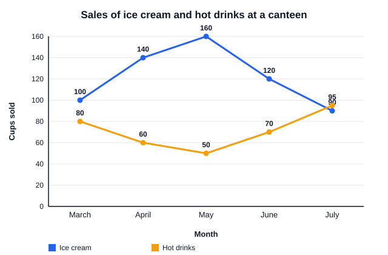

*Renderable data: `assets/chart_data/ENG-CHT-0031.json`*

<!-- meta {"id":"ENG-WRT-CHT-0242","topic_id":"ENG-TOP-LINE","category":"cht","difficulty":"Beginner","question_type":"identify_values","answer_type":"open_ended","asset_id":"ENG-CHT-0031"} -->
**ENG-WRT-CHT-0242** Stage 1–2: read the chart. Write the value for each category and name the highest and lowest.

<details><summary>Answer</summary>

**Ice cream:** March: 100 cups; April: 140 cups; May: 160 cups; June: 120 cups; July: 90 cups — highest: May; lowest: July.  
**Hot drinks:** March: 80 cups; April: 60 cups; May: 50 cups; June: 70 cups; July: 95 cups — highest: July; lowest: May.

</details>

<!-- meta {"id":"ENG-WRT-CHT-0243","topic_id":"ENG-TOP-LINE","category":"cht","difficulty":"Intermediate","question_type":"guided_writing","answer_type":"open_ended","asset_id":"ENG-CHT-0031","template_id":"ENG-TPL-LINE-0001"} -->
**ENG-WRT-CHT-0243** Stage 3–5: complete the first paragraph and two comparison sentences for ENG-CHT-0031.

<details><summary>Model</summary>

The line graph shows the sales of ice cream and hot drinks at a canteen. The horizontal axis shows the month and the vertical axis shows the cups sold.  
The sales of ice cream decreased from 100 cups in March to 90 cups in July. The highest value was recorded in May (160 cups), and the lowest in July (90 cups).

</details>

<!-- meta {"id":"ENG-WRT-CHT-0244","topic_id":"ENG-TOP-LINE","category":"cht","difficulty":"Examination Level","question_type":"independent_writing","answer_type":"open_ended","asset_id":"ENG-CHT-0031","template_id":"ENG-TPL-LINE-0001","word_count":"about 100 words","marks":10,"criteria":"Content 3 + Language 3 + Format & organisation 2 + Mechanics 2 (2020 Test 14 criteria)","required_content":["March","April","May","June","July"]} -->
**ENG-WRT-CHT-0244** Stage 6–7: describe ENG-CHT-0031 in about 100 words, then compare with the model.

<details><summary>Model answer</summary>

> The line graph shows the sales of ice cream and hot drinks at a canteen. The horizontal axis shows the month and the vertical axis shows the cups sold.  
> The sales of ice cream decreased from 100 cups in March to 90 cups in July. The highest value was recorded in May (160 cups), and the lowest in July (90 cups). The biggest changes were between March and April, when it rose by 40 cups and between May and June, when it fell by 40 cups. The sales of hot drinks increased from 80 cups in March to 95 cups in July. The highest value was recorded in July (95 cups), and the lowest in May (50 cups). The biggest change was between June and July, when it rose by 25 cups.  
> Overall, from March to July, the sales of ice cream decreased and the sales of hot drinks increased.  
*Word count: 150. Every number and comparison in this model is computed from the chart data.*

</details>

---

## Section I — Table Descriptions

**Expressions:** The above table provides information about … · The highest value is … · The lowest value is … · Compared with …, … has a higher value · Both … have the same value.

### ENG-CHT-0032 — Results of the inter-house sports meet


*Renderable data: `assets/chart_data/ENG-CHT-0032.json`*

<!-- meta {"id":"ENG-WRT-CHT-0245","topic_id":"ENG-TOP-LINE","category":"cht","difficulty":"Intermediate","question_type":"guided_writing","answer_type":"open_ended","asset_id":"ENG-CHT-0032","template_id":"ENG-TPL-TAB-0001"} -->
**ENG-WRT-CHT-0245** Stage 3–5: complete the first paragraph and two comparison sentences for ENG-CHT-0032.

<details><summary>Model</summary>

The table provides information about the results of the inter-house sports meet. It compares 4 houses under 3 headings: Gold, Silver and Bronze.  
In the 'Gold' column, the highest value is 7 (Gemunu) and the lowest is 2 (Parakrama). In the 'Silver' column, the highest value is 6 (Tissa) and the lowest is 2 (Gemunu).

</details>

<!-- meta {"id":"ENG-WRT-CHT-0246","topic_id":"ENG-TOP-LINE","category":"cht","difficulty":"Examination Level","question_type":"independent_writing","answer_type":"open_ended","asset_id":"ENG-CHT-0032","template_id":"ENG-TPL-TAB-0001","word_count":"about 100 words","marks":10,"criteria":"Content 3 + Language 3 + Format & organisation 2 + Mechanics 2 (2020 Test 14 criteria)","required_content":[]} -->
**ENG-WRT-CHT-0246** Stage 6–7: describe ENG-CHT-0032 in about 100 words, then compare with the model.

<details><summary>Model answer</summary>

> The table provides information about the results of the inter-house sports meet. It compares 4 houses under 3 headings: Gold, Silver and Bronze.  
> In the 'Gold' column, the highest value is 7 (Gemunu) and the lowest is 2 (Parakrama). In the 'Silver' column, the highest value is 6 (Tissa) and the lowest is 2 (Gemunu). In the 'Bronze' column, the highest value is 6 (Parakrama) and the lowest is 1 (Gemunu).  
> Overall, Tissa has the highest total (13).  
*Word count: 78. Every number and comparison in this model is computed from the chart data.*

</details>

### ENG-CHT-0033 — Bus fares from Kandy


*Renderable data: `assets/chart_data/ENG-CHT-0033.json`*

<!-- meta {"id":"ENG-WRT-CHT-0247","topic_id":"ENG-TOP-LINE","category":"cht","difficulty":"Intermediate","question_type":"guided_writing","answer_type":"open_ended","asset_id":"ENG-CHT-0033","template_id":"ENG-TPL-TAB-0001"} -->
**ENG-WRT-CHT-0247** Stage 3–5: complete the first paragraph and two comparison sentences for ENG-CHT-0033.

<details><summary>Model</summary>

The table provides information about the bus fares from Kandy. It compares 4 destinations under 2 headings: Normal (Rs.) and Luxury (Rs.).  
In the 'Normal (Rs.)' column, the highest value is 900 (Jaffna) and the lowest is 200 (Nuwara Eliya). In the 'Luxury (Rs.)' column, the highest value is 1500 (Jaffna) and the lowest is 350 (Nuwara Eliya).

</details>

<!-- meta {"id":"ENG-WRT-CHT-0248","topic_id":"ENG-TOP-LINE","category":"cht","difficulty":"Examination Level","question_type":"independent_writing","answer_type":"open_ended","asset_id":"ENG-CHT-0033","template_id":"ENG-TPL-TAB-0001","word_count":"about 100 words","marks":10,"criteria":"Content 3 + Language 3 + Format & organisation 2 + Mechanics 2 (2020 Test 14 criteria)","required_content":[]} -->
**ENG-WRT-CHT-0248** Stage 6–7: describe ENG-CHT-0033 in about 100 words, then compare with the model.

<details><summary>Model answer</summary>

> The table provides information about the bus fares from Kandy. It compares 4 destinations under 2 headings: Normal (Rs.) and Luxury (Rs.).  
> In the 'Normal (Rs.)' column, the highest value is 900 (Jaffna) and the lowest is 200 (Nuwara Eliya). In the 'Luxury (Rs.)' column, the highest value is 1500 (Jaffna) and the lowest is 350 (Nuwara Eliya).  
> Overall, Jaffna has the highest values, while Nuwara Eliya has the lowest values in the 'Normal (Rs.)' column.  
*Word count: 79. Every number and comparison in this model is computed from the chart data.*

</details>

### ENG-CHT-0034 — Daily study hours of four students

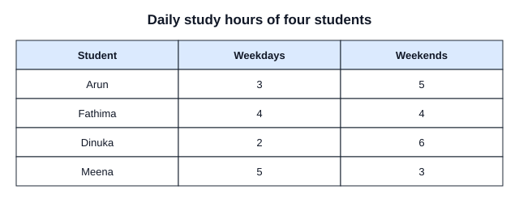

*Renderable data: `assets/chart_data/ENG-CHT-0034.json`*

<!-- meta {"id":"ENG-WRT-CHT-0249","topic_id":"ENG-TOP-LINE","category":"cht","difficulty":"Intermediate","question_type":"guided_writing","answer_type":"open_ended","asset_id":"ENG-CHT-0034","template_id":"ENG-TPL-TAB-0001"} -->
**ENG-WRT-CHT-0249** Stage 3–5: complete the first paragraph and two comparison sentences for ENG-CHT-0034.

<details><summary>Model</summary>

The table provides information about the daily study hours of four students. It compares 4 students under 2 headings: Weekdays and Weekends.  
In the 'Weekdays' column, the highest value is 5 (Meena) and the lowest is 2 (Dinuka). In the 'Weekends' column, the highest value is 6 (Dinuka) and the lowest is 3 (Meena).

</details>

<!-- meta {"id":"ENG-WRT-CHT-0250","topic_id":"ENG-TOP-LINE","category":"cht","difficulty":"Examination Level","question_type":"independent_writing","answer_type":"open_ended","asset_id":"ENG-CHT-0034","template_id":"ENG-TPL-TAB-0001","word_count":"about 100 words","marks":10,"criteria":"Content 3 + Language 3 + Format & organisation 2 + Mechanics 2 (2020 Test 14 criteria)","required_content":[]} -->
**ENG-WRT-CHT-0250** Stage 6–7: describe ENG-CHT-0034 in about 100 words, then compare with the model.

<details><summary>Model answer</summary>

> The table provides information about the daily study hours of four students. It compares 4 students under 2 headings: Weekdays and Weekends.  
> In the 'Weekdays' column, the highest value is 5 (Meena) and the lowest is 2 (Dinuka). In the 'Weekends' column, the highest value is 6 (Dinuka) and the lowest is 3 (Meena).  
> Overall, all the students have the same total (8).  
*Word count: 63. Every number and comparison in this model is computed from the chart data.*

</details>

### ENG-CHT-0035 — Library visits by grade

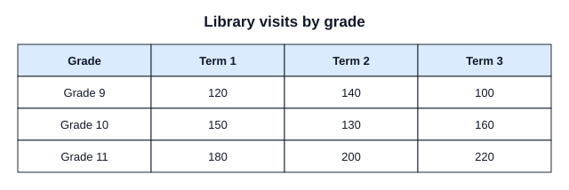

*Renderable data: `assets/chart_data/ENG-CHT-0035.json`*

<!-- meta {"id":"ENG-WRT-CHT-0251","topic_id":"ENG-TOP-LINE","category":"cht","difficulty":"Intermediate","question_type":"guided_writing","answer_type":"open_ended","asset_id":"ENG-CHT-0035","template_id":"ENG-TPL-TAB-0001"} -->
**ENG-WRT-CHT-0251** Stage 3–5: complete the first paragraph and two comparison sentences for ENG-CHT-0035.

<details><summary>Model</summary>

The table provides information about the library visits by grade. It compares 3 grades under 3 headings: Term 1, Term 2 and Term 3.  
In the 'Term 1' column, the highest value is 180 (Grade 11) and the lowest is 120 (Grade 9). In the 'Term 2' column, the highest value is 200 (Grade 11) and the lowest is 130 (Grade 10).

</details>

<!-- meta {"id":"ENG-WRT-CHT-0252","topic_id":"ENG-TOP-LINE","category":"cht","difficulty":"Examination Level","question_type":"independent_writing","answer_type":"open_ended","asset_id":"ENG-CHT-0035","template_id":"ENG-TPL-TAB-0001","word_count":"about 100 words","marks":10,"criteria":"Content 3 + Language 3 + Format & organisation 2 + Mechanics 2 (2020 Test 14 criteria)","required_content":[]} -->
**ENG-WRT-CHT-0252** Stage 6–7: describe ENG-CHT-0035 in about 100 words, then compare with the model.

<details><summary>Model answer</summary>

> The table provides information about the library visits by grade. It compares 3 grades under 3 headings: Term 1, Term 2 and Term 3.  
> In the 'Term 1' column, the highest value is 180 (Grade 11) and the lowest is 120 (Grade 9). In the 'Term 2' column, the highest value is 200 (Grade 11) and the lowest is 130 (Grade 10). In the 'Term 3' column, the highest value is 220 (Grade 11) and the lowest is 100 (Grade 9).  
> Overall, Grade 11 has the highest total (600).  
*Word count: 89. Every number and comparison in this model is computed from the chart data.*

</details>

### ENG-CHT-0036 — Nutrition in 100 g of food

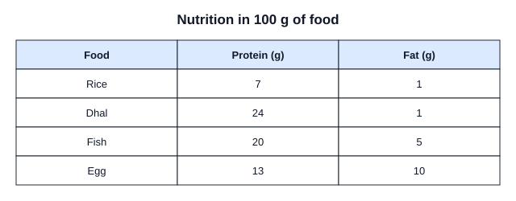

*Renderable data: `assets/chart_data/ENG-CHT-0036.json`*

<!-- meta {"id":"ENG-WRT-CHT-0253","topic_id":"ENG-TOP-LINE","category":"cht","difficulty":"Intermediate","question_type":"guided_writing","answer_type":"open_ended","asset_id":"ENG-CHT-0036","template_id":"ENG-TPL-TAB-0001"} -->
**ENG-WRT-CHT-0253** Stage 3–5: complete the first paragraph and two comparison sentences for ENG-CHT-0036.

<details><summary>Model</summary>

The table provides information about the nutrition in 100 g of food. It compares 4 foods under 2 headings: Protein (g) and Fat (g).  
In the 'Protein (g)' column, the highest value is 24 (Dhal) and the lowest is 7 (Rice). In the 'Fat (g)' column, the highest value is 10 (Egg) and the lowest is 1 (Rice and Dhal).

</details>

<!-- meta {"id":"ENG-WRT-CHT-0254","topic_id":"ENG-TOP-LINE","category":"cht","difficulty":"Examination Level","question_type":"independent_writing","answer_type":"open_ended","asset_id":"ENG-CHT-0036","template_id":"ENG-TPL-TAB-0001","word_count":"about 100 words","marks":10,"criteria":"Content 3 + Language 3 + Format & organisation 2 + Mechanics 2 (2020 Test 14 criteria)","required_content":[]} -->
**ENG-WRT-CHT-0254** Stage 6–7: describe ENG-CHT-0036 in about 100 words, then compare with the model.

<details><summary>Model answer</summary>

> The table provides information about the nutrition in 100 g of food. It compares 4 foods under 2 headings: Protein (g) and Fat (g).  
> In the 'Protein (g)' column, the highest value is 24 (Dhal) and the lowest is 7 (Rice). In the 'Fat (g)' column, the highest value is 10 (Egg) and the lowest is 1 (Rice and Dhal).  
> Overall, Dhal has the highest values, while Rice has the lowest values in the 'Protein (g)' column.  
*Word count: 80. Every number and comparison in this model is computed from the chart data.*

</details>

---

## Section J — Writing Sentence Bank

### Introducing a topic

<!-- meta {"id":"ENG-SBK-0001","function":"Introducing a topic"} -->
- **ENG-SBK-0001** ______ is very important in our lives.
<!-- meta {"id":"ENG-SBK-0002","function":"Introducing a topic"} -->
- **ENG-SBK-0002** Many people enjoy ______.
<!-- meta {"id":"ENG-SBK-0003","function":"Introducing a topic"} -->
- **ENG-SBK-0003** Today, ______ has become an important part of our lives.
<!-- meta {"id":"ENG-SBK-0004","function":"Introducing a topic"} -->
- **ENG-SBK-0004** There are many benefits of ______.

*Adapted examples:* Water is very important in our lives. · Many people enjoy travelling. · Today, the internet has become an important part of our lives.

<!-- meta {"id":"ENG-WRT-SBK-0255","topic_id":"ENG-TOP-WRIT","category":"sbk","difficulty":"Intermediate","question_type":"adapt_pattern","answer_type":"open_ended"} -->
**ENG-WRT-SBK-0255** Use two patterns from *Introducing a topic* in sentences about **road safety** or **your school**.

<details><summary>Model answer</summary>

Any correct sentences that use the patterns.

</details>

### Giving opinions

<!-- meta {"id":"ENG-SBK-0005","function":"Giving opinions"} -->
- **ENG-SBK-0005** I think ______.
<!-- meta {"id":"ENG-SBK-0006","function":"Giving opinions"} -->
- **ENG-SBK-0006** In my opinion, ______.
<!-- meta {"id":"ENG-SBK-0007","function":"Giving opinions"} -->
- **ENG-SBK-0007** I believe that ______.

*Adapted examples:* I think students should learn to cook. · In my opinion, school uniforms are useful.

<!-- meta {"id":"ENG-WRT-SBK-0256","topic_id":"ENG-TOP-WRIT","category":"sbk","difficulty":"Intermediate","question_type":"adapt_pattern","answer_type":"open_ended"} -->
**ENG-WRT-SBK-0256** Use two patterns from *Giving opinions* in sentences about **road safety** or **your school**.

<details><summary>Model answer</summary>

Any correct sentences that use the patterns.

</details>

### Giving reasons

<!-- meta {"id":"ENG-SBK-0008","function":"Giving reasons"} -->
- **ENG-SBK-0008** This is because ______.
<!-- meta {"id":"ENG-SBK-0009","function":"Giving reasons"} -->
- **ENG-SBK-0009** One reason is that ______.
<!-- meta {"id":"ENG-SBK-0010","function":"Giving reasons"} -->
- **ENG-SBK-0010** Another reason is ______.

*Adapted examples:* This is because exercise keeps our hearts strong.

<!-- meta {"id":"ENG-WRT-SBK-0257","topic_id":"ENG-TOP-WRIT","category":"sbk","difficulty":"Intermediate","question_type":"adapt_pattern","answer_type":"open_ended"} -->
**ENG-WRT-SBK-0257** Use two patterns from *Giving reasons* in sentences about **road safety** or **your school**.

<details><summary>Model answer</summary>

Any correct sentences that use the patterns.

</details>

### Giving examples

<!-- meta {"id":"ENG-SBK-0011","function":"Giving examples"} -->
- **ENG-SBK-0011** For example, ______.
<!-- meta {"id":"ENG-SBK-0012","function":"Giving examples"} -->
- **ENG-SBK-0012** For instance, ______.
<!-- meta {"id":"ENG-SBK-0013","function":"Giving examples"} -->
- **ENG-SBK-0013** One example is ______.

*Adapted examples:* For example, we can switch off fans when we leave the room.

<!-- meta {"id":"ENG-WRT-SBK-0258","topic_id":"ENG-TOP-WRIT","category":"sbk","difficulty":"Intermediate","question_type":"adapt_pattern","answer_type":"open_ended"} -->
**ENG-WRT-SBK-0258** Use two patterns from *Giving examples* in sentences about **road safety** or **your school**.

<details><summary>Model answer</summary>

Any correct sentences that use the patterns.

</details>

### Discussing advantages

<!-- meta {"id":"ENG-SBK-0014","function":"Discussing advantages"} -->
- **ENG-SBK-0014** One advantage is ______.
<!-- meta {"id":"ENG-SBK-0015","function":"Discussing advantages"} -->
- **ENG-SBK-0015** It helps us to ______.
<!-- meta {"id":"ENG-SBK-0016","function":"Discussing advantages"} -->
- **ENG-SBK-0016** It is useful because ______.

*Adapted examples:* One advantage of online learning is that we can study at home.

<!-- meta {"id":"ENG-WRT-SBK-0259","topic_id":"ENG-TOP-WRIT","category":"sbk","difficulty":"Intermediate","question_type":"adapt_pattern","answer_type":"open_ended"} -->
**ENG-WRT-SBK-0259** Use two patterns from *Discussing advantages* in sentences about **road safety** or **your school**.

<details><summary>Model answer</summary>

Any correct sentences that use the patterns.

</details>

### Discussing disadvantages

<!-- meta {"id":"ENG-SBK-0017","function":"Discussing disadvantages"} -->
- **ENG-SBK-0017** One disadvantage is ______.
<!-- meta {"id":"ENG-SBK-0018","function":"Discussing disadvantages"} -->
- **ENG-SBK-0018** It can cause ______.
<!-- meta {"id":"ENG-SBK-0019","function":"Discussing disadvantages"} -->
- **ENG-SBK-0019** Too much ______ can be harmful.

*Adapted examples:* One disadvantage is that phones can waste our time.

<!-- meta {"id":"ENG-WRT-SBK-0260","topic_id":"ENG-TOP-WRIT","category":"sbk","difficulty":"Intermediate","question_type":"adapt_pattern","answer_type":"open_ended"} -->
**ENG-WRT-SBK-0260** Use two patterns from *Discussing disadvantages* in sentences about **road safety** or **your school**.

<details><summary>Model answer</summary>

Any correct sentences that use the patterns.

</details>

### Providing suggestions

<!-- meta {"id":"ENG-SBK-0020","function":"Providing suggestions"} -->
- **ENG-SBK-0020** We should ______.
<!-- meta {"id":"ENG-SBK-0021","function":"Providing suggestions"} -->
- **ENG-SBK-0021** We must ______.
<!-- meta {"id":"ENG-SBK-0022","function":"Providing suggestions"} -->
- **ENG-SBK-0022** People can ______.
<!-- meta {"id":"ENG-SBK-0023","function":"Providing suggestions"} -->
- **ENG-SBK-0023** It is important to ______.

*Adapted examples:* We should plant more trees in our school.

<!-- meta {"id":"ENG-WRT-SBK-0261","topic_id":"ENG-TOP-WRIT","category":"sbk","difficulty":"Intermediate","question_type":"adapt_pattern","answer_type":"open_ended"} -->
**ENG-WRT-SBK-0261** Use two patterns from *Providing suggestions* in sentences about **road safety** or **your school**.

<details><summary>Model answer</summary>

Any correct sentences that use the patterns.

</details>

### Ending a paragraph or essay

<!-- meta {"id":"ENG-SBK-0024","function":"Ending a paragraph or essay"} -->
- **ENG-SBK-0024** Therefore, we should ______.
<!-- meta {"id":"ENG-SBK-0025","function":"Ending a paragraph or essay"} -->
- **ENG-SBK-0025** In conclusion, ______.
<!-- meta {"id":"ENG-SBK-0026","function":"Ending a paragraph or essay"} -->
- **ENG-SBK-0026** Overall, ______.
<!-- meta {"id":"ENG-SBK-0027","function":"Ending a paragraph or essay"} -->
- **ENG-SBK-0027** I hope that ______.

*Adapted examples:* Therefore, we should protect our environment for the future.

<!-- meta {"id":"ENG-WRT-SBK-0262","topic_id":"ENG-TOP-WRIT","category":"sbk","difficulty":"Intermediate","question_type":"adapt_pattern","answer_type":"open_ended"} -->
**ENG-WRT-SBK-0262** Use two patterns from *Ending a paragraph or essay* in sentences about **road safety** or **your school**.

<details><summary>Model answer</summary>

Any correct sentences that use the patterns.

</details>

---

## Section K — Writing Correction and Improvement

<!-- meta {"id":"ENG-WRT-COR-0263","topic_id":"ENG-TOP-ERR","category":"cor","difficulty":"Intermediate","question_type":"correct_text","answer_type":"open_ended","text_type":"punctuation"} -->
**ENG-WRT-COR-0263** Correct this punctuation:

> my friend name is nimal he is very clever

<details><summary>Corrected answer and explanations</summary>

> My friend's name is Nimal. He is very clever.

- Capital letters
- Apostrophe: friend's
- Full stop between sentences

</details>

<!-- meta {"id":"ENG-WRT-COR-0264","topic_id":"ENG-TOP-ERR","category":"cor","difficulty":"Intermediate","question_type":"correct_text","answer_type":"open_ended","text_type":"picture description"} -->
**ENG-WRT-COR-0264** Correct this picture description:

> In this picture there is a boy. He played football. There is a tree.

<details><summary>Corrected answer and explanations</summary>

> In this picture, a boy is playing football under a tree.

- Use the present continuous for pictures.
- Combine short sentences.

</details>

<!-- meta {"id":"ENG-WRT-COR-0265","topic_id":"ENG-TOP-ERR","category":"cor","difficulty":"Intermediate","question_type":"correct_text","answer_type":"open_ended","text_type":"letter"} -->
**ENG-WRT-COR-0265** Correct this letter:

> Dear Sir, I want to say that the road near our school is very bad. Please do something. Yours lovingly, Kamal

<details><summary>Corrected answer and explanations</summary>

> Dear Sir, I am writing to bring to your attention the poor condition of the road near our school. … I would be grateful if you could repair it. Yours faithfully, K. Kamal

- Formal opening sentence
- Polite request
- *Yours faithfully* in a formal letter

</details>

<!-- meta {"id":"ENG-WRT-COR-0266","topic_id":"ENG-TOP-ERR","category":"cor","difficulty":"Intermediate","question_type":"correct_text","answer_type":"open_ended","text_type":"notice"} -->
**ENG-WRT-COR-0266** Correct this notice:

> NOTICE. Dear students, sports meet is on. Come. Thank you.

<details><summary>Corrected answer and explanations</summary>

> NOTICE
Annual Sports Meet
The annual sports meet will be held on Saturday, 15 March at 1.00 p.m. on the school ground. All students are invited.
Sports Teacher

- Add date, time, venue
- No 'Dear students' in a notice
- Complete sentences

</details>

<!-- meta {"id":"ENG-WRT-COR-0267","topic_id":"ENG-TOP-ERR","category":"cor","difficulty":"Intermediate","question_type":"correct_text","answer_type":"open_ended","text_type":"chart description"} -->
**ENG-WRT-COR-0267** Correct this chart description:

> The bar chart shows about sports. Cricket is most popular because it is fun. Badminton have 10.

<details><summary>Corrected answer and explanations</summary>

> The bar chart shows the favourite sports of students. Cricket is the most popular sport, with 40 students. Badminton has only 10 students.

- *shows about* → *shows*
- Do not add reasons that are not in the chart
- the most popular
- have → has

</details>

<!-- meta {"id":"ENG-WRT-COR-0268","topic_id":"ENG-TOP-ERR","category":"cor","difficulty":"Intermediate","question_type":"correct_text","answer_type":"open_ended","text_type":"chart description"} -->
**ENG-WRT-COR-0268** Correct this chart description:

> The pie chart shows X-axis is foods.

<details><summary>Corrected answer and explanations</summary>

> The pie chart shows how a family spends its monthly income.

- Pie charts do not have axes.

</details>

<!-- meta {"id":"ENG-WRT-COR-0269","topic_id":"ENG-TOP-ERR","category":"cor","difficulty":"Intermediate","question_type":"correct_text","answer_type":"open_ended","text_type":"essay"} -->
**ENG-WRT-COR-0269** Correct this essay:

> Plastic is very danger to animals. We must reduce the using of plastic.

<details><summary>Corrected answer and explanations</summary>

> Plastic is very dangerous to animals. We must reduce the use of plastic.

- danger → dangerous (adjective)
- the using of → the use of

</details>

<!-- meta {"id":"ENG-WRT-COR-0270","topic_id":"ENG-TOP-ERR","category":"cor","difficulty":"Intermediate","question_type":"correct_text","answer_type":"open_ended","text_type":"essay"} -->
**ENG-WRT-COR-0270** Correct this essay:

> Technology is very useful. But it has also disadvantages.

<details><summary>Corrected answer and explanations</summary>

> Technology is very useful. However, it also has disadvantages.

- Use *However* to start a sentence formally
- *also* before the main verb

</details>

<!-- meta {"id":"ENG-WRT-COR-0271","topic_id":"ENG-TOP-ERR","category":"cor","difficulty":"Intermediate","question_type":"correct_text","answer_type":"open_ended","text_type":"story"} -->
**ENG-WRT-COR-0271** Correct this story:

> One day a boy was walking. Suddenly he sees a snake. He runs.

<details><summary>Corrected answer and explanations</summary>

> One day, a boy was walking home. Suddenly, he saw a snake. He ran away.

- Keep the story in the past tense: saw, ran.

</details>

<!-- meta {"id":"ENG-WRT-COR-0272","topic_id":"ENG-TOP-ERR","category":"cor","difficulty":"Intermediate","question_type":"correct_text","answer_type":"open_ended","text_type":"speech"} -->
**ENG-WRT-COR-0272** Correct this speech:

> Good morning everyone. Thank you. Today I talk about health.

<details><summary>Corrected answer and explanations</summary>

> Good morning, everyone. Today, I am going to speak about health. … Thank you for listening.

- Thank the audience at the end, not the beginning
- I am going to speak about …

</details>

<!-- meta {"id":"ENG-WRT-COR-0273","topic_id":"ENG-TOP-ERR","category":"cor","difficulty":"Intermediate","question_type":"correct_text","answer_type":"open_ended","text_type":"notice"} -->
**ENG-WRT-COR-0273** Correct this notice:

> The school will reopen in Monday.

<details><summary>Corrected answer and explanations</summary>

> The school will reopen on Monday.

- on + day

</details>

### Student self-checking checklist

- [ ] Have I answered the question?
- [ ] Have I included all required information?
- [ ] Are my sentences complete?
- [ ] Are my tenses correct?
- [ ] Is my spelling correct?
- [ ] Have I used appropriate punctuation?
- [ ] Have I used the correct format?
- [ ] Is my answer within the required word count?

### Feedback structure for future AI checking (for developers)

Each open-ended activity carries `word_count`, `marks`, `criteria` and (where relevant) `required_content`. Feedback should: (1) list grammar, spelling and punctuation errors, (2) list missing content points, (3) check the format, (4) give simple corrections with reasons, (5) suggest improved sentences, (6) give an **estimated StudyBuddy mark (not an official mark)**, and (7) invite the student to try again before showing the full model.

Example — *She go to school every day.* → **She goes to school every day.** Reason: use *goes* with *she* in the present simple.


---

## Limitations

- Practice rubrics adapt the official 2020 criteria; marks given for practice tasks are StudyBuddy estimates, not official marks.
- Pictures are simple original illustrations; they are less detailed than examination pictures.
- Model answers show one possible answer; different correct ideas and simpler correct English are equally acceptable.
