# StudyBuddy — GCE O/L Mathematics · 08 Visual Mathematics

*Your Virtual Learning Partner · studybuddy.com.lk · English Medium*

<!-- meta {"file": "08", "medium": "en", "schema": "StudyBuddy-Maths-1.0"} -->

Accurate, programmatically drawn graphs, diagrams, charts and step-by-step constructions (SVG in Shared_Assets). Every plotted value was computed from the mathematics, not drawn by hand.

## VIS-GEO-COMPOSITE-01 — See which edges belong to a perimeter.

<!-- meta {"id": "VIS-GEO-COMPOSITE-01", "asset": "Shared_Assets/Geometry/GEO-COMPOSITE-01.svg", "grade": 10, "chapter": "G10C01", "formulas": ["F-MEN-CIRC"], "related_questions": ["MQ-G10C01-G-RECT_SEMIC-01", "MQ-G10C01-G-RECT_SEMIC-02", "MQ-G10C01-G-RECT_SEMIC-03", "MQ-G10C01-G-RECT_SEMIC-04"], "medium": "en"} -->
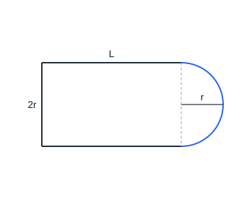

- **Grade:** 10 · **Topic:** Perimeter
- **Learning objective:** See which edges belong to a perimeter.
- **Explanation:** The dashed side lies inside the shape, so it is not part of the perimeter.
- **Formulas:** `F-MEN-CIRC` $C = 2\pi r = \pi d$
- **Related question IDs:** `MQ-G10C01-G-RECT_SEMIC-01`, `MQ-G10C01-G-RECT_SEMIC-02`, `MQ-G10C01-G-RECT_SEMIC-03`, `MQ-G10C01-G-RECT_SEMIC-04`
- **Pathway:** Grade Improvement

## VIS-GEO-ISOS-BISECT-01 — Isosceles triangle facts used in proofs.

<!-- meta {"id": "VIS-GEO-ISOS-BISECT-01", "asset": "Shared_Assets/Geometry/GEO-ISOS-BISECT-01.svg", "grade": 10, "chapter": "G10C09", "formulas": ["T-GEO-ISOS", "T-GEO-CONG"], "related_questions": ["MQ-G10C05-A-CONG_PROOF-01", "MQ-G10C09-A-ISOSCELES_-01"], "medium": "en"} -->
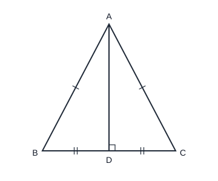

- **Grade:** 10 · **Topic:** Triangles II
- **Learning objective:** Isosceles triangle facts used in proofs.
- **Explanation:** Ticks show equal lengths: AB = AC and BD = DC; AD ⟂ BC.
- **Formulas:** `T-GEO-ISOS` $AB = AC \iff \angle B = \angle C$, `T-GEO-CONG` $\text{SAS, ASA, AAS, SSS, RHS}$
- **Related question IDs:** `MQ-G10C05-A-CONG_PROOF-01`, `MQ-G10C09-A-ISOSCELES_-01`
- **Pathway:** Grade Improvement

## VIS-GEO-EXTANGLE-01 — Locate the exterior angle.

<!-- meta {"id": "VIS-GEO-EXTANGLE-01", "asset": "Shared_Assets/Geometry/GEO-EXTANGLE-01.svg", "grade": 10, "chapter": "G10C08", "formulas": ["T-GEO-EXT"], "related_questions": ["MQ-G10C08-G-EXTERIOR_A-01", "MQ-G10C08-G-EXTERIOR_A-02", "MQ-G10C08-G-EXTERIOR_A-03", "MQ-G10C08-G-EXTERIOR_A-04"], "medium": "en"} -->
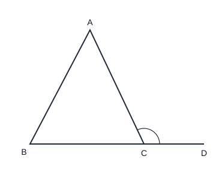

- **Grade:** 10 · **Topic:** Triangles I
- **Learning objective:** Locate the exterior angle.
- **Explanation:** ∠ACD is outside the triangle; it equals ∠A + ∠B.
- **Formulas:** `T-GEO-EXT` $\angle ACD = \angle A + \angle B$
- **Related question IDs:** `MQ-G10C08-G-EXTERIOR_A-01`, `MQ-G10C08-G-EXTERIOR_A-02`, `MQ-G10C08-G-EXTERIOR_A-03`, `MQ-G10C08-G-EXTERIOR_A-04`
- **Pathway:** Grade Improvement

## VIS-GEO-PARA-01 — Parallelogram properties at a glance.

<!-- meta {"id": "VIS-GEO-PARA-01", "asset": "Shared_Assets/Geometry/GEO-PARA-01.svg", "grade": 10, "chapter": "G10C16", "formulas": ["T-GEO-PARA"], "related_questions": ["MQ-G10C16-F-PARA_ANGLE-01", "MQ-G10C16-F-PARA_ANGLE-02", "MQ-G10C16-F-PARA_ANGLE-03", "MQ-G10C16-F-PARA_ANGLE-04", "MQ-G10C16-A-PARA_PROOF-01", "MQ-G10C17-A-PARA_MIDPO-01"], "medium": "en"} -->
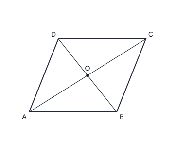

- **Grade:** 10 · **Topic:** Parallelograms I
- **Learning objective:** Parallelogram properties at a glance.
- **Explanation:** Diagonals AC and BD cut each other in half at O.
- **Formulas:** `T-GEO-PARA` $AB=DC,\ AD=BC,\ \angle A=\angle C,\ AO=OC$
- **Related question IDs:** `MQ-G10C16-F-PARA_ANGLE-01`, `MQ-G10C16-F-PARA_ANGLE-02`, `MQ-G10C16-F-PARA_ANGLE-03`, `MQ-G10C16-F-PARA_ANGLE-04`, `MQ-G10C16-A-PARA_PROOF-01`, `MQ-G10C17-A-PARA_MIDPO-01`
- **Pathway:** Grade Improvement

## VIS-GEO-CHORD-01 — Right triangle inside a circle from a chord.

<!-- meta {"id": "VIS-GEO-CHORD-01", "asset": "Shared_Assets/Geometry/GEO-CHORD-01.svg", "grade": 10, "chapter": "G10C27", "formulas": ["T-GEO-CHORD", "T-GEO-PYTH"], "related_questions": ["MQ-G10C27-F-CHORD_LENG-01", "MQ-G10C27-F-CHORD_LENG-02", "MQ-G10C27-F-CHORD_LENG-03", "MQ-G10C27-F-CHORD_LENG-04", "MQ-G10C27-G-CHORD_DIST-01", "MQ-G10C27-G-CHORD_DIST-02"], "medium": "en"} -->
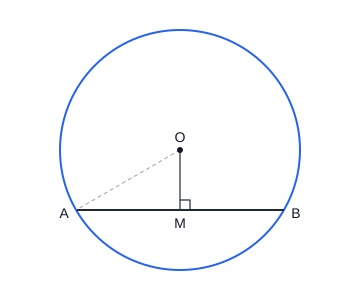

- **Grade:** 10 · **Topic:** Chords of a Circle
- **Learning objective:** Right triangle inside a circle from a chord.
- **Explanation:** OM ⟂ AB so AM = MB; OA (radius) is the hypotenuse of ΔOMA.
- **Computed check values:** `{"r": 1, "OM/r": 0.5}`
- **Formulas:** `T-GEO-CHORD` $OM\perp AB \Rightarrow AM = MB;\ r^2 = OM^2 + AM^2$, `T-GEO-PYTH` $c^2 = a^2 + b^2$
- **Related question IDs:** `MQ-G10C27-F-CHORD_LENG-01`, `MQ-G10C27-F-CHORD_LENG-02`, `MQ-G10C27-F-CHORD_LENG-03`, `MQ-G10C27-F-CHORD_LENG-04`, `MQ-G10C27-G-CHORD_DIST-01`, `MQ-G10C27-G-CHORD_DIST-02`
- **Pathway:** Grade Improvement

## VIS-GEO-CIRC-CENTRE-01 — Angle at the centre vs at the circumference.

<!-- meta {"id": "VIS-GEO-CIRC-CENTRE-01", "asset": "Shared_Assets/Geometry/GEO-CIRC-CENTRE-01.svg", "grade": 10, "chapter": "G10C31", "formulas": ["T-CIR-CENTRE"], "related_questions": ["MQ-G10C31-F-ANGLE_CENT-01", "MQ-G10C31-F-ANGLE_CENT-02", "MQ-G10C31-F-ANGLE_CENT-03", "MQ-G10C31-F-ANGLE_CENT-04"], "medium": "en"} -->
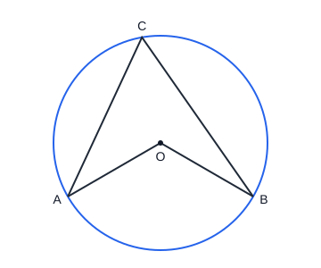

- **Grade:** 10 · **Topic:** Angles in a Circle
- **Learning objective:** Angle at the centre vs at the circumference.
- **Explanation:** Both angles stand on arc AB; the centre angle is double.
- **Formulas:** `T-CIR-CENTRE` $\angle AOB = 2\angle ACB$
- **Related question IDs:** `MQ-G10C31-F-ANGLE_CENT-01`, `MQ-G10C31-F-ANGLE_CENT-02`, `MQ-G10C31-F-ANGLE_CENT-03`, `MQ-G10C31-F-ANGLE_CENT-04`
- **Pathway:** Grade Improvement

## VIS-GEO-CYCLIC-01 — Cyclic quadrilateral angle facts.

<!-- meta {"id": "VIS-GEO-CYCLIC-01", "asset": "Shared_Assets/Geometry/GEO-CYCLIC-01.svg", "grade": 11, "chapter": "G11C21", "formulas": ["T-CIR-CYCLIC"], "related_questions": ["MQ-G11C21-F-CYCLIC_OPP-01", "MQ-G11C21-F-CYCLIC_OPP-02", "MQ-G11C21-F-CYCLIC_OPP-03", "MQ-G11C21-F-CYCLIC_OPP-04", "MQ-G11C21-G-CYCLIC_EXT-01", "MQ-G11C21-G-CYCLIC_EXT-02"], "medium": "en"} -->
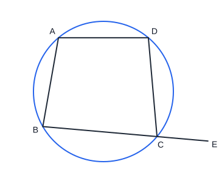

- **Grade:** 11 · **Topic:** Cyclic Quadrilaterals
- **Learning objective:** Cyclic quadrilateral angle facts.
- **Explanation:** ∠A + ∠C = 180°; the exterior angle ∠DCE equals ∠A.
- **Formulas:** `T-CIR-CYCLIC` $\angle A+\angle C = 180^\circ;\ \text{ext.}\angle = \text{int. opp.}\angle$
- **Related question IDs:** `MQ-G11C21-F-CYCLIC_OPP-01`, `MQ-G11C21-F-CYCLIC_OPP-02`, `MQ-G11C21-F-CYCLIC_OPP-03`, `MQ-G11C21-F-CYCLIC_OPP-04`, `MQ-G11C21-G-CYCLIC_EXT-01`, `MQ-G11C21-G-CYCLIC_EXT-02`
- **Pathway:** Grade Improvement

## VIS-GEO-TANGENT-01 — Tangent meets radius at 90°.

<!-- meta {"id": "VIS-GEO-TANGENT-01", "asset": "Shared_Assets/Geometry/GEO-TANGENT-01.svg", "grade": 11, "chapter": "G11C22", "formulas": ["T-CIR-TAN", "T-GEO-PYTH"], "related_questions": ["MQ-G11C22-F-TANGENT_RA-01", "MQ-G11C22-F-TANGENT_RA-02", "MQ-G11C22-F-TANGENT_RA-03", "MQ-G11C22-F-TANGENT_RA-04"], "medium": "en"} -->
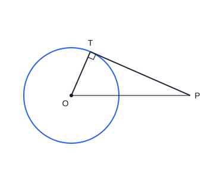

- **Grade:** 11 · **Topic:** Tangents
- **Learning objective:** Tangent meets radius at 90°.
- **Explanation:** ΔOTP is right-angled at T, so PT² = OP² − OT².
- **Computed check values:** `{"dot_OT_PT": -0.0}`
- **Formulas:** `T-CIR-TAN` $OT\perp PT;\ PA = PB$, `T-GEO-PYTH` $c^2 = a^2 + b^2$
- **Related question IDs:** `MQ-G11C22-F-TANGENT_RA-01`, `MQ-G11C22-F-TANGENT_RA-02`, `MQ-G11C22-F-TANGENT_RA-03`, `MQ-G11C22-F-TANGENT_RA-04`
- **Pathway:** Grade Improvement

## VIS-GEO-TANGENT-02 — Equal tangents from a point.

<!-- meta {"id": "VIS-GEO-TANGENT-02", "asset": "Shared_Assets/Geometry/GEO-TANGENT-02.svg", "grade": 11, "chapter": "G11C22", "formulas": ["T-CIR-TAN"], "related_questions": ["MQ-G11C22-G-TWO_TANGEN-01", "MQ-G11C22-G-TWO_TANGEN-02", "MQ-G11C22-G-TWO_TANGEN-03", "MQ-G11C22-G-TWO_TANGEN-04"], "medium": "en"} -->
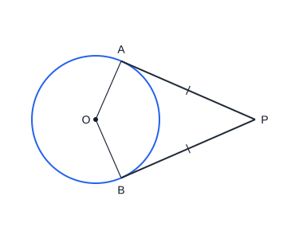

- **Grade:** 11 · **Topic:** Tangents
- **Learning objective:** Equal tangents from a point.
- **Explanation:** PA = PB (measured equal in the drawing), so ΔPAB is isosceles.
- **Computed check values:** `{"PA": 183.303028, "PB": 183.303028}`
- **Formulas:** `T-CIR-TAN` $OT\perp PT;\ PA = PB$
- **Related question IDs:** `MQ-G11C22-G-TWO_TANGEN-01`, `MQ-G11C22-G-TWO_TANGEN-02`, `MQ-G11C22-G-TWO_TANGEN-03`, `MQ-G11C22-G-TWO_TANGEN-04`
- **Pathway:** Grade Improvement

## VIS-GEO-ALTSEG-01 — Alternate segment theorem.

<!-- meta {"id": "VIS-GEO-ALTSEG-01", "asset": "Shared_Assets/Geometry/GEO-ALTSEG-01.svg", "grade": 11, "chapter": "G11C22", "formulas": ["T-CIR-ALTSEG"], "related_questions": ["MQ-G11C22-A-ALTERNATE_-01", "MQ-G11C22-A-ALTERNATE_-02", "MQ-G11C22-A-ALTERNATE_-03"], "medium": "en"} -->
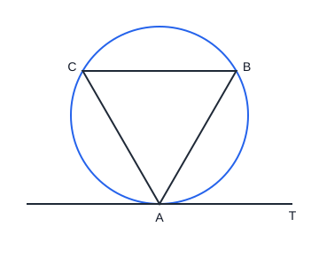

- **Grade:** 11 · **Topic:** Tangents
- **Learning objective:** Alternate segment theorem.
- **Explanation:** The angle between tangent TA and chord AB equals the angle ACB in the other segment.
- **Formulas:** `T-CIR-ALTSEG` $\angle TAB = \angle ACB$
- **Related question IDs:** `MQ-G11C22-A-ALTERNATE_-01`, `MQ-G11C22-A-ALTERNATE_-02`, `MQ-G11C22-A-ALTERNATE_-03`
- **Pathway:** Grade Improvement

## VIS-GEO-PARALLEL-AREA-01 — Equal areas between parallels.

<!-- meta {"id": "VIS-GEO-PARALLEL-AREA-01", "asset": "Shared_Assets/Geometry/GEO-PARALLEL-AREA-01.svg", "grade": 11, "chapter": "G11C08", "formulas": ["T-GEO-AREA-PAR"], "related_questions": ["MQ-G11C08-F-SAME_BASE_-01", "MQ-G11C08-F-SAME_BASE_-02", "MQ-G11C08-F-SAME_BASE_-03", "MQ-G11C08-F-SAME_BASE_-04", "MQ-G11C08-G-PARA_TRIAN-01", "MQ-G11C08-G-PARA_TRIAN-02"], "medium": "en"} -->
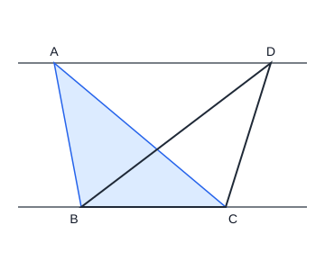

- **Grade:** 11 · **Topic:** Areas of Plane Figures between Parallel Lines
- **Learning objective:** Equal areas between parallels.
- **Explanation:** Same base BC and same height (distance between the parallels) → equal areas.
- **Formulas:** `T-GEO-AREA-PAR` $\triangle = \tfrac12\,\square\ (\text{same base, same parallels})$
- **Related question IDs:** `MQ-G11C08-F-SAME_BASE_-01`, `MQ-G11C08-F-SAME_BASE_-02`, `MQ-G11C08-F-SAME_BASE_-03`, `MQ-G11C08-F-SAME_BASE_-04`, `MQ-G11C08-G-PARA_TRIAN-01`, `MQ-G11C08-G-PARA_TRIAN-02`
- **Pathway:** Grade Improvement

## VIS-GEO-MIDPT-01 — Mid-point theorem.

<!-- meta {"id": "VIS-GEO-MIDPT-01", "asset": "Shared_Assets/Geometry/GEO-MIDPT-01.svg", "grade": 11, "chapter": "G11C11", "formulas": ["T-GEO-MID"], "related_questions": ["MQ-G11C11-F-MIDPOINT_L-01", "MQ-G11C11-F-MIDPOINT_L-02", "MQ-G11C11-F-MIDPOINT_L-03", "MQ-G11C11-F-MIDPOINT_L-04", "MQ-G11C11-G-MIDPOINT_P-01", "MQ-G11C11-G-MIDPOINT_P-02"], "medium": "en"} -->
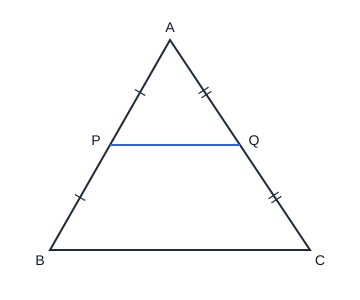

- **Grade:** 11 · **Topic:** Mid-point Theorem
- **Learning objective:** Mid-point theorem.
- **Explanation:** PQ joins midpoints; the drawing gives PQ/BC = 0.5 exactly.
- **Computed check values:** `{"PQ/BC": 0.5}`
- **Formulas:** `T-GEO-MID` $PQ\parallel BC,\ PQ = \tfrac12 BC$
- **Related question IDs:** `MQ-G11C11-F-MIDPOINT_L-01`, `MQ-G11C11-F-MIDPOINT_L-02`, `MQ-G11C11-F-MIDPOINT_L-03`, `MQ-G11C11-F-MIDPOINT_L-04`, `MQ-G11C11-G-MIDPOINT_P-01`, `MQ-G11C11-G-MIDPOINT_P-02`
- **Pathway:** Grade Improvement

## VIS-GEO-CHORDS-INT-01 — Intersecting chords.

<!-- meta {"id": "VIS-GEO-CHORDS-INT-01", "asset": "Shared_Assets/Geometry/GEO-CHORDS-INT-01.svg", "grade": 11, "chapter": "G11C14", "formulas": ["T-GEO-SIM"], "related_questions": ["MQ-G11C14-A-SIMILAR_PR-01"], "medium": "en"} -->
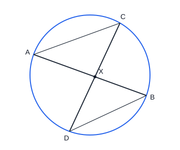

- **Grade:** 11 · **Topic:** Equiangular Triangles
- **Learning objective:** Intersecting chords.
- **Explanation:** AX × XB = CX × XD (equal in the drawing to 4 d.p.).
- **Computed check values:** `{"AX*XB": 14289.7786, "CX*XD": 14289.7786}`
- **Formulas:** `T-GEO-SIM` $\frac{AB}{PQ} = \frac{BC}{QR} = \frac{CA}{RP}$
- **Related question IDs:** `MQ-G11C14-A-SIMILAR_PR-01`
- **Pathway:** Grade Improvement

## VIS-GEO-RIGHT-01 — Naming the sides of a right triangle.

<!-- meta {"id": "VIS-GEO-RIGHT-01", "asset": "Shared_Assets/Geometry/GEO-RIGHT-01.svg", "grade": 11, "chapter": "G11C17", "formulas": ["T-GEO-PYTH", "F-TRI-RATIOS"], "related_questions": ["MQ-G11C17-F-PYTH_HYP-01", "MQ-G11C17-F-PYTH_HYP-02", "MQ-G11C17-F-PYTH_HYP-03", "MQ-G11C17-F-PYTH_HYP-04", "MQ-G11C17-G-PYTH_LADDE-01", "MQ-G11C17-G-PYTH_LADDE-02"], "medium": "en"} -->
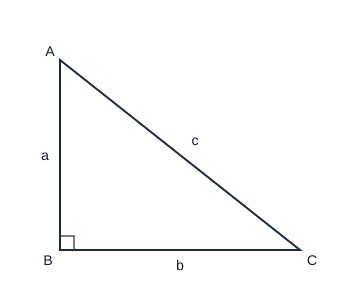

- **Grade:** 11 · **Topic:** Pythagoras' Theorem
- **Learning objective:** Naming the sides of a right triangle.
- **Explanation:** c (AC) is opposite the right angle at B — the hypotenuse.
- **Formulas:** `T-GEO-PYTH` $c^2 = a^2 + b^2$, `F-TRI-RATIOS` $\sin\theta = \frac{opp}{hyp},\ \cos\theta = \frac{adj}{hyp},\ \tan\theta = \frac{opp}{adj}$
- **Related question IDs:** `MQ-G11C17-F-PYTH_HYP-01`, `MQ-G11C17-F-PYTH_HYP-02`, `MQ-G11C17-F-PYTH_HYP-03`, `MQ-G11C17-F-PYTH_HYP-04`, `MQ-G11C17-G-PYTH_LADDE-01`, `MQ-G11C17-G-PYTH_LADDE-02`
- **Pathway:** Grade Improvement

## VIS-SET-VENN2-01 — Two-set Venn diagram regions.

<!-- meta {"id": "VIS-SET-VENN2-01", "asset": "Shared_Assets/Other_Diagrams/SET-VENN2-01.svg", "grade": 10, "chapter": "G10C18", "formulas": ["F-SET-UNION"], "related_questions": ["MQ-G10C18-F-SETS_UNION-01", "MQ-G10C18-F-SETS_UNION-02", "MQ-G10C18-F-SETS_UNION-03", "MQ-G10C18-F-SETS_UNION-04", "MQ-G10C18-G-SETS_NEITH-01", "MQ-G10C18-G-SETS_NEITH-02"], "medium": "en"} -->
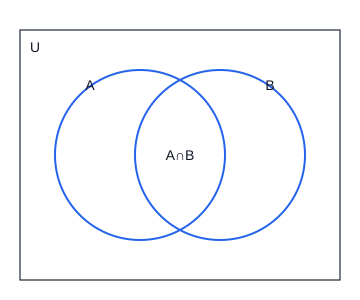

- **Grade:** 10 · **Topic:** Sets
- **Learning objective:** Two-set Venn diagram regions.
- **Explanation:** Four regions: A only, A∩B, B only, outside both.
- **Formulas:** `F-SET-UNION` $n(A\cup B) = n(A)+n(B)-n(A\cap B)$
- **Related question IDs:** `MQ-G10C18-F-SETS_UNION-01`, `MQ-G10C18-F-SETS_UNION-02`, `MQ-G10C18-F-SETS_UNION-03`, `MQ-G10C18-F-SETS_UNION-04`, `MQ-G10C18-G-SETS_NEITH-01`, `MQ-G10C18-G-SETS_NEITH-02`
- **Pathway:** Foundation Mastery

## VIS-SET-VENN3-01 — Three-set Venn diagram regions.

<!-- meta {"id": "VIS-SET-VENN3-01", "asset": "Shared_Assets/Other_Diagrams/SET-VENN3-01.svg", "grade": 11, "chapter": "G11C24", "formulas": ["F-SET-UNION3"], "related_questions": ["MQ-G11C24-G-THREE_SETS-01", "MQ-G11C24-G-THREE_SETS-02"], "medium": "en"} -->
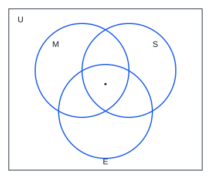

- **Grade:** 11 · **Topic:** Sets
- **Learning objective:** Three-set Venn diagram regions.
- **Explanation:** Eight regions; the dot marks the centre (all three).
**Sequential instructions:**
1. Fill the centre first.
2. Fill the three 'exactly two' regions.
3. Fill 'only' regions, then outside.
- **Formulas:** `F-SET-UNION3` $n(A\cup B\cup C) = \Sigma n(A) - \Sigma n(A\cap B) + n(A\cap B\cap C)$
- **Related question IDs:** `MQ-G11C24-G-THREE_SETS-01`, `MQ-G11C24-G-THREE_SETS-02`
- **Pathway:** Grade Improvement

## VIS-PRO-GRID-01 — Sample space of two dice.

<!-- meta {"id": "VIS-PRO-GRID-01", "asset": "Shared_Assets/Other_Diagrams/PRO-GRID-01.svg", "grade": 10, "chapter": "G10C30", "formulas": ["F-PRO-BASIC"], "related_questions": ["MQ-G10C30-A-PROB_DICE_-01", "MQ-G10C30-A-PROB_DICE_-02", "MQ-G10C30-A-PROB_DICE_-03"], "medium": "en"} -->
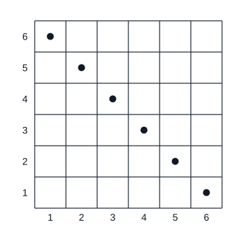

- **Grade:** 10 · **Topic:** Probability
- **Learning objective:** Sample space of two dice.
- **Explanation:** 36 equally likely cells; the 6 dots show sum = 7, so P = 6/36 = 1/6.
- **Computed check values:** `{"sum7": 6, "total": 36}`
- **Formulas:** `F-PRO-BASIC` $P(A) = \frac{n(A)}{n(S)}$
- **Related question IDs:** `MQ-G10C30-A-PROB_DICE_-01`, `MQ-G10C30-A-PROB_DICE_-02`, `MQ-G10C30-A-PROB_DICE_-03`
- **Pathway:** Foundation Mastery

## VIS-PRO-TREE-01 — Structure of a tree diagram.

<!-- meta {"id": "VIS-PRO-TREE-01", "asset": "Shared_Assets/Other_Diagrams/PRO-TREE-01.svg", "grade": 11, "chapter": "G11C25", "formulas": ["F-PRO-TREE"], "related_questions": ["MQ-G11C25-G-TREE_TWO_B-01", "MQ-G11C25-G-TREE_TWO_B-02", "MQ-G11C25-G-TREE_TWO_B-03", "MQ-G11C25-G-TREE_TWO_B-04", "MQ-G11C25-A-TREE_WITHO-01", "MQ-G11C25-A-TREE_WITHO-02"], "medium": "en"} -->
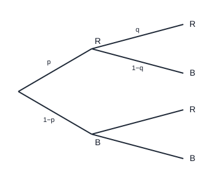

- **Grade:** 11 · **Topic:** Probability
- **Learning objective:** Structure of a tree diagram.
- **Explanation:** Branches from each point add to 1; multiply along a path.
- **Formulas:** `F-PRO-TREE` $\text{along: } \times,\quad \text{between outcomes: } +$
- **Related question IDs:** `MQ-G11C25-G-TREE_TWO_B-01`, `MQ-G11C25-G-TREE_TWO_B-02`, `MQ-G11C25-G-TREE_TWO_B-03`, `MQ-G11C25-G-TREE_TWO_B-04`, `MQ-G11C25-A-TREE_WITHO-01`, `MQ-G11C25-A-TREE_WITHO-02`
- **Pathway:** Grade Improvement

## VIS-GRA-LINE-01 — Gradient and intercept on a graph.

<!-- meta {"id": "VIS-GRA-LINE-01", "asset": "Shared_Assets/Graphs/GRA-LINE-01.svg", "grade": 10, "chapter": "G10C21", "formulas": ["F-GRA-LINE", "F-GRA-GRAD"], "related_questions": ["MQ-G10C21-F-GRADIENT_I-01", "MQ-G10C21-F-GRADIENT_I-02", "MQ-G10C21-F-GRADIENT_I-03", "MQ-G10C21-F-GRADIENT_I-04", "MQ-G10C21-G-GRADIENT_T-01", "MQ-G10C21-G-GRADIENT_T-02"], "medium": "en"} -->
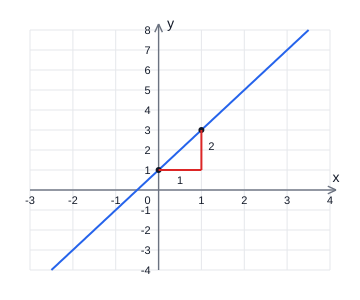

- **Grade:** 10 · **Topic:** Graphs
- **Learning objective:** Gradient and intercept on a graph.
- **Explanation:** For y = 2x + 1: start at (0, 1); for each 1 step right go 2 up.

| x | y |
|---|---|
| -2 | -3 |
| -1 | -1 |
| 0 | 1 |
| 1 | 3 |
| 2 | 5 |
| 3 | 7 |

**Sequential instructions:**
1. Make a table for x = −2 … 3.
2. Plot the points.
3. Join with a ruler.
- **Formulas:** `F-GRA-LINE` $y = mx + c$, `F-GRA-GRAD` $m = \frac{y_2-y_1}{x_2-x_1}$
- **Related question IDs:** `MQ-G10C21-F-GRADIENT_I-01`, `MQ-G10C21-F-GRADIENT_I-02`, `MQ-G10C21-F-GRADIENT_I-03`, `MQ-G10C21-F-GRADIENT_I-04`, `MQ-G10C21-G-GRADIENT_T-01`, `MQ-G10C21-G-GRADIENT_T-02`
- **Pathway:** Foundation Mastery

## VIS-GRA-QUAD-01 — Reading a quadratic graph.

<!-- meta {"id": "VIS-GRA-QUAD-01", "asset": "Shared_Assets/Graphs/GRA-QUAD-01.svg", "grade": 11, "chapter": "G11C12", "formulas": ["F-GRA-QUAD", "F-GRA-VERTEX"], "related_questions": ["MQ-G11C12-F-TP_FROM_VE-01", "MQ-G11C12-F-TP_FROM_VE-02", "MQ-G11C12-F-TP_FROM_VE-03", "MQ-G11C12-F-TP_FROM_VE-04", "MQ-G11C12-G-QUAD_TABLE-01", "MQ-G11C12-G-QUAD_TABLE-02"], "medium": "en"} -->
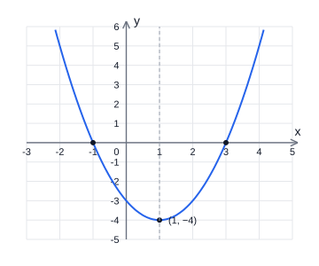

- **Grade:** 11 · **Topic:** Graphs
- **Learning objective:** Reading a quadratic graph.
- **Explanation:** y = x² − 2x − 3: roots −1 and 3, minimum (1, −4), axis x = 1.

| x | y |
|---|---|
| -2 | 5 |
| -1 | 0 |
| 0 | -3 |
| 1 | -4 |
| 2 | -3 |
| 3 | 0 |
| 4 | 5 |

**Sequential instructions:**
1. Complete the table (x = −2 to 4).
2. Plot points; draw a smooth curve.
3. Read roots where y = 0.
4. Turning point midway between roots.
- **Formulas:** `F-GRA-QUAD` $y = ax^2+bx+c,\ \ x_{tp} = -\frac{b}{2a}$, `F-GRA-VERTEX` $y = (x+b)^2 + c \Rightarrow (-b,\ c)$
- **Related question IDs:** `MQ-G11C12-F-TP_FROM_VE-01`, `MQ-G11C12-F-TP_FROM_VE-02`, `MQ-G11C12-F-TP_FROM_VE-03`, `MQ-G11C12-F-TP_FROM_VE-04`, `MQ-G11C12-G-QUAD_TABLE-01`, `MQ-G11C12-G-QUAD_TABLE-02`
- **Pathway:** Grade Improvement

## VIS-GRA-QUAD-02 — Maximum and minimum parabolas.

<!-- meta {"id": "VIS-GRA-QUAD-02", "asset": "Shared_Assets/Graphs/GRA-QUAD-02.svg", "grade": 10, "chapter": "G10C21", "formulas": ["F-GRA-QUAD"], "related_questions": ["MQ-G10C21-A-QUAD_AX2C-01", "MQ-G10C21-A-QUAD_AX2C-02", "MQ-G10C21-A-QUAD_AX2C-03"], "medium": "en"} -->
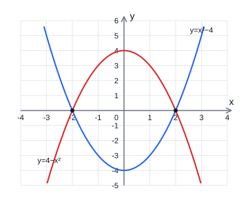

- **Grade:** 10 · **Topic:** Graphs
- **Learning objective:** Maximum and minimum parabolas.
- **Explanation:** y = x² − 4 opens up (minimum); y = 4 − x² opens down (maximum).

| x | y1=x^2-4 | y2=4-x^2 |
|---|---|---|
| -3 | 5 | -5 |
| -2 | 0 | 0 |
| -1 | -3 | 3 |
| 0 | -4 | 4 |
| 1 | -3 | 3 |
| 2 | 0 | 0 |
| 3 | 5 | -5 |

- **Formulas:** `F-GRA-QUAD` $y = ax^2+bx+c,\ \ x_{tp} = -\frac{b}{2a}$
- **Related question IDs:** `MQ-G10C21-A-QUAD_AX2C-01`, `MQ-G10C21-A-QUAD_AX2C-02`, `MQ-G10C21-A-QUAD_AX2C-03`
- **Pathway:** Grade Improvement

## VIS-GRA-NUMLINE-01 — Showing an inequality on a number line.

<!-- meta {"id": "VIS-GRA-NUMLINE-01", "asset": "Shared_Assets/Graphs/GRA-NUMLINE-01.svg", "grade": 10, "chapter": "G10C25", "formulas": ["F-ALG-INEQ"], "related_questions": ["MQ-G10C25-F-INEQ_SOLVE-01", "MQ-G10C25-F-INEQ_SOLVE-02", "MQ-G10C25-F-INEQ_SOLVE-03", "MQ-G10C25-F-INEQ_SOLVE-04", "MQ-G10C25-G-INEQ_NEGAT-01", "MQ-G10C25-G-INEQ_NEGAT-02"], "medium": "en"} -->
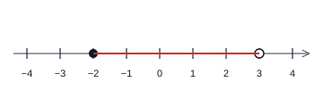

- **Grade:** 10 · **Topic:** Algebraic Inequalities
- **Learning objective:** Showing an inequality on a number line.
- **Explanation:** Filled dot = included (≤); open dot = not included (<).
- **Formulas:** `F-ALG-INEQ` $a<b \Rightarrow -a>-b$
- **Related question IDs:** `MQ-G10C25-F-INEQ_SOLVE-01`, `MQ-G10C25-F-INEQ_SOLVE-02`, `MQ-G10C25-F-INEQ_SOLVE-03`, `MQ-G10C25-F-INEQ_SOLVE-04`, `MQ-G10C25-G-INEQ_NEGAT-01`, `MQ-G10C25-G-INEQ_NEGAT-02`
- **Pathway:** Grade Improvement

## VIS-GRA-REGION-01 — Region defined by inequalities.

<!-- meta {"id": "VIS-GRA-REGION-01", "asset": "Shared_Assets/Graphs/GRA-REGION-01.svg", "grade": 11, "chapter": "G11C20", "formulas": ["F-ALG-INEQ2"], "related_questions": ["MQ-G11C20-F-POINT_IN_R-01", "MQ-G11C20-F-POINT_IN_R-02", "MQ-G11C20-F-POINT_IN_R-03", "MQ-G11C20-F-POINT_IN_R-04", "MQ-G11C20-G-REGION_DES-01", "MQ-G11C20-A-SIMULTANEO-01"], "medium": "en"} -->
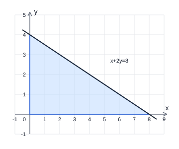

- **Grade:** 11 · **Topic:** Inequalities
- **Learning objective:** Region defined by inequalities.
- **Explanation:** Shaded triangle: x ≥ 0, y ≥ 0, x + 2y ≤ 8.
**Sequential instructions:**
1. Draw x + 2y = 8 through (8, 0) and (0, 4).
2. Test (0, 0): 0 ≤ 8 true → shade towards origin.
- **Formulas:** `F-ALG-INEQ2` $ax+by\le c$
- **Related question IDs:** `MQ-G11C20-F-POINT_IN_R-01`, `MQ-G11C20-F-POINT_IN_R-02`, `MQ-G11C20-F-POINT_IN_R-03`, `MQ-G11C20-F-POINT_IN_R-04`, `MQ-G11C20-G-REGION_DES-01`, `MQ-G11C20-A-SIMULTANEO-01`
- **Pathway:** Grade Improvement

## VIS-STA-PIE-01 — Reading a pie chart.

<!-- meta {"id": "VIS-STA-PIE-01", "asset": "Shared_Assets/Statistical_Charts/STA-PIE-01.svg", "grade": 10, "chapter": "G10C11", "formulas": ["F-STA-PIE"], "related_questions": ["MQ-G10C11-F-PIE_ANGLE-01", "MQ-G10C11-F-PIE_ANGLE-02", "MQ-G10C11-F-PIE_ANGLE-03", "MQ-G10C11-F-PIE_ANGLE-04"], "medium": "en"} -->
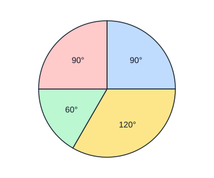

- **Grade:** 10 · **Topic:** Data Representation
- **Learning objective:** Reading a pie chart.
- **Explanation:** Angles 90°, 120°, 60°, 90° add to 360°.
- **Computed check values:** `{"sum": 360}`
- **Formulas:** `F-STA-PIE` $\theta = \frac{\text{part}}{\text{total}}\times 360^\circ$
- **Related question IDs:** `MQ-G10C11-F-PIE_ANGLE-01`, `MQ-G10C11-F-PIE_ANGLE-02`, `MQ-G10C11-F-PIE_ANGLE-03`, `MQ-G10C11-F-PIE_ANGLE-04`
- **Pathway:** Foundation Mastery

## VIS-STA-HIST-01 — Histogram and frequency polygon.

<!-- meta {"id": "VIS-STA-HIST-01", "asset": "Shared_Assets/Statistical_Charts/STA-HIST-01.svg", "grade": 10, "chapter": "G10C26", "formulas": ["F-STA-MEAN"], "related_questions": ["MQ-G10C26-G-MEAN_GROUP-01", "MQ-G10C26-G-MEAN_GROUP-02", "MQ-G10C26-G-MEAN_GROUP-03"], "medium": "en"} -->
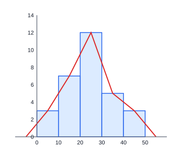

- **Grade:** 10 · **Topic:** Frequency Distribution
- **Learning objective:** Histogram and frequency polygon.
- **Explanation:** Bars for each class; the polygon joins mid-points and closes on the axis.

| class | f | mid |
|---|---|---|
| 0-10 | 3 | 5 |
| 10-20 | 7 | 15 |
| 20-30 | 12 | 25 |
| 30-40 | 5 | 35 |
| 40-50 | 3 | 45 |

**Sequential instructions:**
1. Mark class boundaries on x.
2. Draw bars to frequency height.
3. Join mid-points of bar tops.
- **Formulas:** `F-STA-MEAN` $\bar x = \frac{\Sigma fx}{\Sigma f}$
- **Related question IDs:** `MQ-G10C26-G-MEAN_GROUP-01`, `MQ-G10C26-G-MEAN_GROUP-02`, `MQ-G10C26-G-MEAN_GROUP-03`
- **Pathway:** Grade Improvement

## VIS-STA-OGIVE-01 — Cumulative frequency curve and median.

<!-- meta {"id": "VIS-STA-OGIVE-01", "asset": "Shared_Assets/Statistical_Charts/STA-OGIVE-01.svg", "grade": 11, "chapter": "G11C15", "formulas": ["F-STA-QUART"], "related_questions": ["MQ-G11C15-A-OGIVE_READ-01", "MQ-G11C15-A-OGIVE_READ-02", "MQ-G11C15-A-OGIVE_READ-03"], "medium": "en"} -->
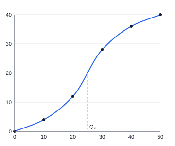

- **Grade:** 11 · **Topic:** Data Representation and Prediction
- **Learning objective:** Cumulative frequency curve and median.
- **Explanation:** Plot c.f. at upper boundaries; median at N/2 = 20 gives 25.
- **Computed check values:** `{"median": 25}`

| upper | cf |
|---|---|
| 0 | 0 |
| 10 | 4 |
| 20 | 12 |
| 30 | 28 |
| 40 | 36 |
| 50 | 40 |

**Sequential instructions:**
1. Make the c.f. column.
2. Plot (10,4), (20,12), (30,28), (40,36), (50,40) and (0,0).
3. Read across from 20, then down.
- **Formulas:** `F-STA-QUART` $Q_1: \frac{n+1}{4},\ Q_3: \frac{3(n+1)}{4},\ \text{IQR} = Q_3-Q_1$
- **Related question IDs:** `MQ-G11C15-A-OGIVE_READ-01`, `MQ-G11C15-A-OGIVE_READ-02`, `MQ-G11C15-A-OGIVE_READ-03`
- **Pathway:** Grade Improvement

## VIS-TRI-BEARING-01 — Measuring a bearing.

<!-- meta {"id": "VIS-TRI-BEARING-01", "asset": "Shared_Assets/Other_Diagrams/TRI-BEARING-01.svg", "grade": 10, "chapter": "G10C32", "formulas": ["F-TRI-BEAR"], "related_questions": ["MQ-G10C32-G-BEARING_BA-01", "MQ-G10C32-G-BEARING_BA-02", "MQ-G10C32-G-BEARING_BA-03", "MQ-G10C32-G-BEARING_BA-04"], "medium": "en"} -->
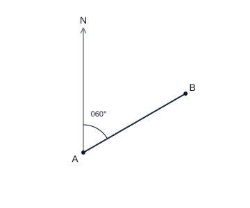

- **Grade:** 10 · **Topic:** Scale Diagrams
- **Learning objective:** Measuring a bearing.
- **Explanation:** Start at North, turn clockwise 60° → 060°.
- **Formulas:** `F-TRI-BEAR` $\beta_{back} = \beta \pm 180^\circ$
- **Related question IDs:** `MQ-G10C32-G-BEARING_BA-01`, `MQ-G10C32-G-BEARING_BA-02`, `MQ-G10C32-G-BEARING_BA-03`, `MQ-G10C32-G-BEARING_BA-04`
- **Pathway:** Grade Improvement

## VIS-TRI-ELEV-01 — Angle of elevation.

<!-- meta {"id": "VIS-TRI-ELEV-01", "asset": "Shared_Assets/Other_Diagrams/TRI-ELEV-01.svg", "grade": 11, "chapter": "G11C18", "formulas": ["F-TRI-RATIOS"], "related_questions": ["MQ-G10C32-A-ELEVATION_-01", "MQ-G10C32-A-ELEVATION_-02", "MQ-G10C32-A-ELEVATION_-03", "MQ-G11C18-G-ELEVATION_-01", "MQ-G11C18-G-ELEVATION_-02", "MQ-G11C18-G-ELEVATION_-03"], "medium": "en"} -->
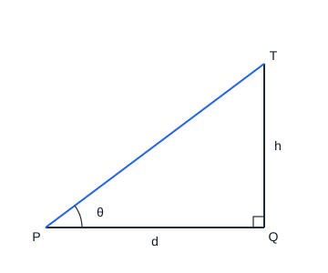

- **Grade:** 11 · **Topic:** Trigonometry
- **Learning objective:** Angle of elevation.
- **Explanation:** tan θ = h ÷ d.
- **Formulas:** `F-TRI-RATIOS` $\sin\theta = \frac{opp}{hyp},\ \cos\theta = \frac{adj}{hyp},\ \tan\theta = \frac{opp}{adj}$
- **Related question IDs:** `MQ-G10C32-A-ELEVATION_-01`, `MQ-G10C32-A-ELEVATION_-02`, `MQ-G10C32-A-ELEVATION_-03`, `MQ-G11C18-G-ELEVATION_-01`, `MQ-G11C18-G-ELEVATION_-02`, `MQ-G11C18-G-ELEVATION_-03`
- **Pathway:** Grade Improvement

## VIS-TRI-DEPR-01 — Angles of depression to two objects.

<!-- meta {"id": "VIS-TRI-DEPR-01", "asset": "Shared_Assets/Other_Diagrams/TRI-DEPR-01.svg", "grade": 11, "chapter": "G11C18", "formulas": ["F-TRI-RATIOS"], "related_questions": ["MQ-G11C18-A-TWO_ANGLES-01", "MQ-G11C18-A-TWO_ANGLES-02", "MQ-G11C18-A-TWO_ANGLES-03"], "medium": "en"} -->
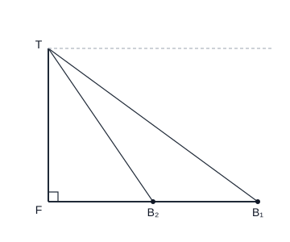

- **Grade:** 11 · **Topic:** Trigonometry
- **Learning objective:** Angles of depression to two objects.
- **Explanation:** Measured down from the horizontal (dashed); the farther boat has the smaller angle.
- **Formulas:** `F-TRI-RATIOS` $\sin\theta = \frac{opp}{hyp},\ \cos\theta = \frac{adj}{hyp},\ \tan\theta = \frac{opp}{adj}$
- **Related question IDs:** `MQ-G11C18-A-TWO_ANGLES-01`, `MQ-G11C18-A-TWO_ANGLES-02`, `MQ-G11C18-A-TWO_ANGLES-03`
- **Pathway:** Grade Improvement

## VIS-SOL-CYL-01 — Cylinder measurements.

<!-- meta {"id": "VIS-SOL-CYL-01", "asset": "Shared_Assets/Other_Diagrams/SOL-CYL-01.svg", "grade": 10, "chapter": "G10C29", "formulas": ["F-MEN-CYLV", "F-MEN-CYLA"], "related_questions": ["MQ-G10C29-F-CYLINDER_V-01", "MQ-G10C29-F-CYLINDER_V-02", "MQ-G10C29-F-CYLINDER_V-03", "MQ-G10C29-F-CYLINDER_V-04", "MQ-G10C29-G-CYLINDER_T-01", "MQ-G10C29-G-CYLINDER_T-02"], "medium": "en"} -->
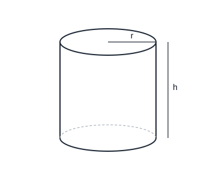

- **Grade:** 10 · **Topic:** Surface Area and Volume
- **Learning objective:** Cylinder measurements.
- **Explanation:** Radius r of the circular end, height h.
- **Formulas:** `F-MEN-CYLV` $V = \pi r^2 h$, `F-MEN-CYLA` $\text{CSA} = 2\pi rh,\ \text{TSA} = 2\pi rh + 2\pi r^2$
- **Related question IDs:** `MQ-G10C29-F-CYLINDER_V-01`, `MQ-G10C29-F-CYLINDER_V-02`, `MQ-G10C29-F-CYLINDER_V-03`, `MQ-G10C29-F-CYLINDER_V-04`, `MQ-G10C29-G-CYLINDER_T-01`, `MQ-G10C29-G-CYLINDER_T-02`
- **Pathway:** Grade Improvement

## VIS-SOL-CONE-01 — Cone: r, h and l.

<!-- meta {"id": "VIS-SOL-CONE-01", "asset": "Shared_Assets/Other_Diagrams/SOL-CONE-01.svg", "grade": 11, "chapter": "G11C04", "formulas": ["F-MEN-CONEA", "F-MEN-CONEV"], "related_questions": ["MQ-G11C04-G-CONE_CSA-01", "MQ-G11C04-G-CONE_CSA-02", "MQ-G11C04-G-CONE_CSA-03", "MQ-G11C04-G-CONE_CSA-04", "MQ-G11C05-F-CONE_VOLUM-01", "MQ-G11C05-F-CONE_VOLUM-02"], "medium": "en"} -->
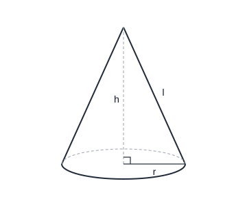

- **Grade:** 11 · **Topic:** Surface Area of Solids
- **Learning objective:** Cone: r, h and l.
- **Explanation:** h, r and l form a right triangle: l² = r² + h².
- **Formulas:** `F-MEN-CONEA` $\text{CSA} = \pi rl,\ l = \sqrt{r^2+h^2}$, `F-MEN-CONEV` $V = \frac13\pi r^2h$
- **Related question IDs:** `MQ-G11C04-G-CONE_CSA-01`, `MQ-G11C04-G-CONE_CSA-02`, `MQ-G11C04-G-CONE_CSA-03`, `MQ-G11C04-G-CONE_CSA-04`, `MQ-G11C05-F-CONE_VOLUM-01`, `MQ-G11C05-F-CONE_VOLUM-02`
- **Pathway:** Grade Improvement

## VIS-SOL-HEMI-01 — Solid hemisphere surfaces.

<!-- meta {"id": "VIS-SOL-HEMI-01", "asset": "Shared_Assets/Other_Diagrams/SOL-HEMI-01.svg", "grade": 11, "chapter": "G11C04", "formulas": ["F-MEN-SPHA"], "related_questions": ["MQ-G11C04-A-HEMISPHERE-01", "MQ-G11C04-A-HEMISPHERE-02", "MQ-G11C04-A-HEMISPHERE-03"], "medium": "en"} -->
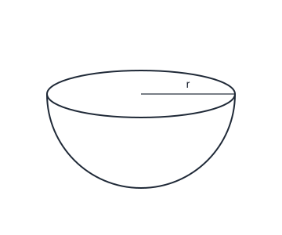

- **Grade:** 11 · **Topic:** Surface Area of Solids
- **Learning objective:** Solid hemisphere surfaces.
- **Explanation:** Curved part 2πr² plus flat circle πr² = 3πr².
- **Formulas:** `F-MEN-SPHA` $A = 4\pi r^2\ (\text{hemisphere solid: } 3\pi r^2)$
- **Related question IDs:** `MQ-G11C04-A-HEMISPHERE-01`, `MQ-G11C04-A-HEMISPHERE-02`, `MQ-G11C04-A-HEMISPHERE-03`
- **Pathway:** Grade Improvement

## VIS-CON-PERPBIS-01 — Constructing a perpendicular bisector.

<!-- meta {"id": "VIS-CON-PERPBIS-01", "asset": "Shared_Assets/Constructions/CON-PERPBIS-01.svg", "grade": 10, "chapter": "G10C28", "formulas": ["C-PERPBIS"], "related_questions": ["MQ-G10C28-F-LOCUS_IDEN-01", "MQ-G10C28-F-LOCUS_IDEN-02", "MQ-G10C28-F-LOCUS_IDEN-03", "MQ-G10C28-F-LOCUS_IDEN-04", "MQ-G10C28-G-CONSTRUCT_-01", "MQ-G10C28-G-CONSTRUCT_-02"], "medium": "en"} -->

- **Grade:** 10 · **Topic:** Construction
- **Learning objective:** Constructing a perpendicular bisector.
- **Explanation:** Arcs of equal radius from A and B meet at P and Q; PQ bisects AB at 90°.
- **Computed check values:** `{"AP": 140.0, "BP": 140.0}`
**Sequential instructions:**
1. Stage 1: arcs from A (radius > ½AB).
2. Stage 2: same radius from B; mark P, Q.
3. Stage 3: join PQ.

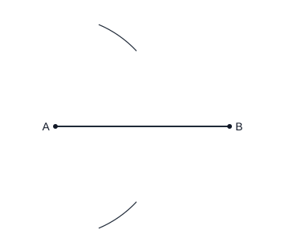 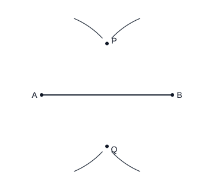 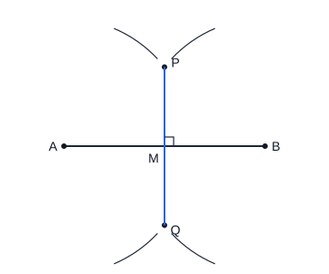

- **Formulas:** `C-PERPBIS` $\text{equal arcs from A and B}$
- **Related question IDs:** `MQ-G10C28-F-LOCUS_IDEN-01`, `MQ-G10C28-F-LOCUS_IDEN-02`, `MQ-G10C28-F-LOCUS_IDEN-03`, `MQ-G10C28-F-LOCUS_IDEN-04`, `MQ-G10C28-G-CONSTRUCT_-01`, `MQ-G10C28-G-CONSTRUCT_-02`
- **Pathway:** Grade Improvement

## VIS-CON-ANGBIS-01 — Constructing an angle bisector.

<!-- meta {"id": "VIS-CON-ANGBIS-01", "asset": "Shared_Assets/Constructions/CON-ANGBIS-01.svg", "grade": 10, "chapter": "G10C28", "formulas": ["C-ANGBIS"], "related_questions": ["MQ-G10C28-A-CONSTRUCT_-01", "MQ-G11C23-A-CONSTRUCT_-01"], "medium": "en"} -->
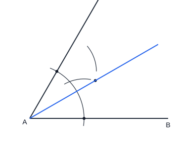

- **Grade:** 10 · **Topic:** Construction
- **Learning objective:** Constructing an angle bisector.
- **Explanation:** The bisector of a 60° angle makes 30° with each arm (checked numerically).
- **Computed check values:** `{"bisector_angle_deg": 30.0, "half_angle_deg": 30}`
**Sequential instructions:**
1. Stage 1: arc from A cutting both arms.
2. Stage 2: equal arcs from those two points meet.
3. Stage 3: join A to the meeting point.

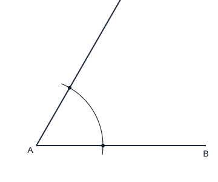 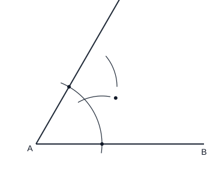 

- **Formulas:** `C-ANGBIS` $\text{arc on both arms, then equal arcs}$
- **Related question IDs:** `MQ-G10C28-A-CONSTRUCT_-01`, `MQ-G11C23-A-CONSTRUCT_-01`
- **Pathway:** Grade Improvement

## VIS-CON-TANGENT-01 — Constructing a tangent at a point.

<!-- meta {"id": "VIS-CON-TANGENT-01", "asset": "Shared_Assets/Constructions/CON-TANGENT-01.svg", "grade": 11, "chapter": "G11C23", "formulas": ["C-TANGENT"], "related_questions": ["MQ-G11C23-F-CONSTRUCT_-01", "MQ-G11C23-F-CONSTRUCT_-02", "MQ-G11C23-F-CONSTRUCT_-03"], "medium": "en"} -->
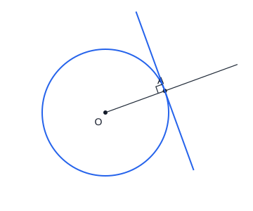

- **Grade:** 11 · **Topic:** Constructions
- **Learning objective:** Constructing a tangent at a point.
- **Explanation:** Extend OA and construct a perpendicular at A.
**Sequential instructions:**
1. Stage 1: join and extend OA.
2. Stage 2: perpendicular at A = tangent.

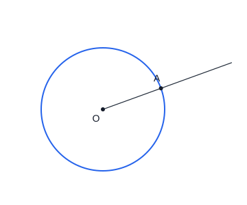 

- **Formulas:** `C-TANGENT` $\perp OA\ \text{at } A$
- **Related question IDs:** `MQ-G11C23-F-CONSTRUCT_-01`, `MQ-G11C23-F-CONSTRUCT_-02`, `MQ-G11C23-F-CONSTRUCT_-03`
- **Pathway:** Grade Improvement

## VIS-CON-CIRCUM-01 — Constructing a circumcircle.

<!-- meta {"id": "VIS-CON-CIRCUM-01", "asset": "Shared_Assets/Constructions/CON-CIRCUM-01.svg", "grade": 11, "chapter": "G11C23", "formulas": ["C-CIRCUM"], "related_questions": ["MQ-G11C23-G-CONSTRUCT_-01"], "medium": "en"} -->
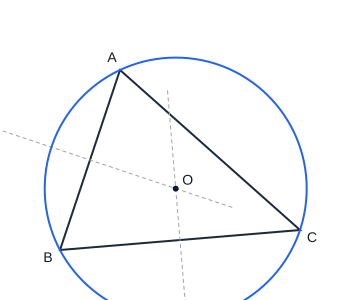

- **Grade:** 11 · **Topic:** Constructions
- **Learning objective:** Constructing a circumcircle.
- **Explanation:** Perpendicular bisectors of two sides meet at O; OA = OB = OC (equal in the drawing).
- **Computed check values:** `{"OA": 131.008646, "OB": 131.008646, "OC": 131.008646}`
**Sequential instructions:**
1. Stage 1: two perpendicular bisectors → O.
2. Stage 2: circle centre O through A.

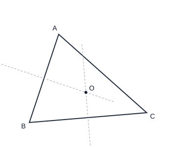 

- **Formulas:** `C-CIRCUM` $\text{perp. bisectors meet at } O$
- **Related question IDs:** `MQ-G11C23-G-CONSTRUCT_-01`
- **Pathway:** Grade Improvement

## Graph interpretation exercises

### MQ-G10C21-F-GRADIENT_I-01
<!-- meta {"id": "MQ-G10C21-F-GRADIENT_I-01", "grade": 10, "chapter": "G10C21", "area": "GRA", "medium": "en", "pathway": "Foundation Mastery", "difficulty": "easy", "formula": "F-GRA-LINE", "diagram": "GRA-LINE-01", "kind": "numeric", "verification": "logic-review", "steps": ["MQ-G10C21-F-GRADIENT_I-01-S1", "MQ-G10C21-F-GRADIENT_I-01-S2"]} -->
**Topic:** Graphs · **Pathway:** Foundation Mastery · **Difficulty:** easy · **Formula:** `F-GRA-LINE`

**Question:** For the straight line $y = -3x  + 1$, write down the gradient and the y-intercept.

**Diagram:** `GRA-LINE-01` → `Shared_Assets/Graphs/GRA-LINE-01.svg` (generic diagram — not drawn to scale; use the values in the question)

- **Hint 1:** The number multiplying x is the gradient.

**Step-by-step solution**

Step 1 — Compare with y = mx + c. <!-- MQ-G10C21-F-GRADIENT_I-01-S1 -->

$$y = -3x  + 1$$

Step 2 — m is the gradient, c is the intercept. <!-- MQ-G10C21-F-GRADIENT_I-01-S2 -->

$$m = -3,\quad c = 1$$

**Final answer:** $m=-3,\ c=1$
 **Accepted answer formats:** $m=-3,\ c=1$

Verification: logic-reviewed (teacher review recommended)

### MQ-G10C21-F-GRADIENT_I-02
<!-- meta {"id": "MQ-G10C21-F-GRADIENT_I-02", "grade": 10, "chapter": "G10C21", "area": "GRA", "medium": "en", "pathway": "Foundation Mastery", "difficulty": "easy", "formula": "F-GRA-LINE", "diagram": "GRA-LINE-01", "kind": "numeric", "verification": "logic-review", "steps": ["MQ-G10C21-F-GRADIENT_I-02-S1", "MQ-G10C21-F-GRADIENT_I-02-S2"]} -->
**Topic:** Graphs · **Pathway:** Foundation Mastery · **Difficulty:** easy · **Formula:** `F-GRA-LINE`

**Question:** For the straight line $y = \frac{1}{2}x  - 2$, write down the gradient and the y-intercept.

**Diagram:** `GRA-LINE-01` → `Shared_Assets/Graphs/GRA-LINE-01.svg` (generic diagram — not drawn to scale; use the values in the question)

- **Hint 1:** The number multiplying x is the gradient.

**Step-by-step solution**

Step 1 — Compare with y = mx + c. <!-- MQ-G10C21-F-GRADIENT_I-02-S1 -->

$$y = \frac{1}{2}x  - 2$$

Step 2 — m is the gradient, c is the intercept. <!-- MQ-G10C21-F-GRADIENT_I-02-S2 -->

$$m = \frac{1}{2},\quad c = -2$$

**Final answer:** $m=\frac{1}{2},\ c=-2$
 **Accepted answer formats:** $m=\frac{1}{2},\ c=-2$

Verification: logic-reviewed (teacher review recommended)

### MQ-G10C21-F-GRADIENT_I-03
<!-- meta {"id": "MQ-G10C21-F-GRADIENT_I-03", "grade": 10, "chapter": "G10C21", "area": "GRA", "medium": "en", "pathway": "Foundation Mastery", "difficulty": "easy", "formula": "F-GRA-LINE", "diagram": "GRA-LINE-01", "kind": "numeric", "verification": "logic-review", "steps": ["MQ-G10C21-F-GRADIENT_I-03-S1", "MQ-G10C21-F-GRADIENT_I-03-S2"]} -->
**Topic:** Graphs · **Pathway:** Foundation Mastery · **Difficulty:** easy · **Formula:** `F-GRA-LINE`

**Question:** For the straight line $y = 4x  - 5$, write down the gradient and the y-intercept.

**Diagram:** `GRA-LINE-01` → `Shared_Assets/Graphs/GRA-LINE-01.svg` (generic diagram — not drawn to scale; use the values in the question)

- **Hint 1:** The number multiplying x is the gradient.

**Step-by-step solution**

Step 1 — Compare with y = mx + c. <!-- MQ-G10C21-F-GRADIENT_I-03-S1 -->

$$y = 4x  - 5$$

Step 2 — m is the gradient, c is the intercept. <!-- MQ-G10C21-F-GRADIENT_I-03-S2 -->

$$m = 4,\quad c = -5$$

**Final answer:** $m=4,\ c=-5$
 **Accepted answer formats:** $m=4,\ c=-5$

Verification: logic-reviewed (teacher review recommended)

### MQ-G10C21-F-GRADIENT_I-04
<!-- meta {"id": "MQ-G10C21-F-GRADIENT_I-04", "grade": 10, "chapter": "G10C21", "area": "GRA", "medium": "en", "pathway": "Foundation Mastery", "difficulty": "easy", "formula": "F-GRA-LINE", "diagram": "GRA-LINE-01", "kind": "numeric", "verification": "logic-review", "steps": ["MQ-G10C21-F-GRADIENT_I-04-S1", "MQ-G10C21-F-GRADIENT_I-04-S2"]} -->
**Topic:** Graphs · **Pathway:** Foundation Mastery · **Difficulty:** easy · **Formula:** `F-GRA-LINE`

**Question:** For the straight line $y = 2x  + 3$, write down the gradient and the y-intercept.

**Diagram:** `GRA-LINE-01` → `Shared_Assets/Graphs/GRA-LINE-01.svg` (generic diagram — not drawn to scale; use the values in the question)

- **Hint 1:** The number multiplying x is the gradient.

**Step-by-step solution**

Step 1 — Compare with y = mx + c. <!-- MQ-G10C21-F-GRADIENT_I-04-S1 -->

$$y = 2x  + 3$$

Step 2 — m is the gradient, c is the intercept. <!-- MQ-G10C21-F-GRADIENT_I-04-S2 -->

$$m = 2,\quad c = 3$$

**Final answer:** $m=2,\ c=3$
 **Accepted answer formats:** $m=2,\ c=3$

Verification: logic-reviewed (teacher review recommended)

### MQ-G10C21-G-GRADIENT_T-01
<!-- meta {"id": "MQ-G10C21-G-GRADIENT_T-01", "grade": 10, "chapter": "G10C21", "area": "GRA", "medium": "en", "pathway": "Grade Improvement", "difficulty": "medium", "formula": "F-GRA-GRAD", "diagram": "GRA-LINE-01", "kind": "numeric", "verification": "machine-checked", "steps": ["MQ-G10C21-G-GRADIENT_T-01-S1", "MQ-G10C21-G-GRADIENT_T-01-S2", "MQ-G10C21-G-GRADIENT_T-01-S3"]} -->
**Topic:** Graphs · **Pathway:** Grade Improvement · **Difficulty:** medium · **Formula:** `F-GRA-GRAD`

**Question:** Find the gradient of the line through (2, 1) and (6, 3), and its equation.

**Diagram:** `GRA-LINE-01` → `Shared_Assets/Graphs/GRA-LINE-01.svg` (generic diagram — not drawn to scale; use the values in the question)

- **Hint 1:** Subtract in the same order for top and bottom.

**Step-by-step solution**

Step 1 — Gradient = change in y ÷ change in x. <!-- MQ-G10C21-G-GRADIENT_T-01-S1 -->

$$m = \frac{3 - (1)}{6 - (2)} = \frac{1}{2}$$

Step 2 — Substitute one point in y = mx + c. <!-- MQ-G10C21-G-GRADIENT_T-01-S2 -->

$$1 = \frac{1}{2}\times(2) + c \Rightarrow c = 0$$

Step 3 — Write the equation. <!-- MQ-G10C21-G-GRADIENT_T-01-S3 -->

$$y = \frac{1}{2}x + 0$$

**Final answer:** $m=\frac{1}{2},\ y=\frac{1}{2}x + 0$
 **Accepted answer formats:** $m=\frac{1}{2},\ y=\frac{1}{2}x + 0$

Verification: machine-checked

### MQ-G10C21-G-GRADIENT_T-02
<!-- meta {"id": "MQ-G10C21-G-GRADIENT_T-02", "grade": 10, "chapter": "G10C21", "area": "GRA", "medium": "en", "pathway": "Grade Improvement", "difficulty": "medium", "formula": "F-GRA-GRAD", "diagram": "GRA-LINE-01", "kind": "numeric", "verification": "machine-checked", "steps": ["MQ-G10C21-G-GRADIENT_T-02-S1", "MQ-G10C21-G-GRADIENT_T-02-S2", "MQ-G10C21-G-GRADIENT_T-02-S3"]} -->
**Topic:** Graphs · **Pathway:** Grade Improvement · **Difficulty:** medium · **Formula:** `F-GRA-GRAD`

**Question:** Find the gradient of the line through (0, -2) and (2, 4), and its equation.

**Diagram:** `GRA-LINE-01` → `Shared_Assets/Graphs/GRA-LINE-01.svg` (generic diagram — not drawn to scale; use the values in the question)

- **Hint 1:** Subtract in the same order for top and bottom.

**Step-by-step solution**

Step 1 — Gradient = change in y ÷ change in x. <!-- MQ-G10C21-G-GRADIENT_T-02-S1 -->

$$m = \frac{4 - (-2)}{2 - (0)} = 3$$

Step 2 — Substitute one point in y = mx + c. <!-- MQ-G10C21-G-GRADIENT_T-02-S2 -->

$$-2 = 3\times(0) + c \Rightarrow c = -2$$

Step 3 — Write the equation. <!-- MQ-G10C21-G-GRADIENT_T-02-S3 -->

$$y = 3x - 2$$

**Final answer:** $m=3,\ y=3x - 2$
 **Accepted answer formats:** $m=3,\ y=3x - 2$

Verification: machine-checked

## Limitations and review notes

- Mathematical content was generated from a shared, machine-checked foundation; questions marked 'logic-reviewed' (proofs, constructions, concepts) should be checked by a qualified Mathematics teacher before publication.
- Tamil terminology follows the e-thaksalawa Tamil-medium chapter titles; other Tamil terms were not checked against the printed Tamil textbooks (not accessible in this session) and need teacher review.
- Diagrams referenced by questions are generic illustrations (not to scale). Interactive buttons (hint, next step) are NOT implemented by these Markdown files; the step IDs and JSON export support the website developer.
- SVG labels are language-neutral (letters, numbers); captions and instructions are in this file. Structured JSON for interactive versions is in Developer_Resources/Asset_Manifest.json.

