# StudyBuddy — GCE O/L Mathematics · 08 காட்சிக் கணிதம்

*உங்கள் மெய்நிகர் கற்றல் துணை · studybuddy.com.lk · தமிழ் மொழிமூலம்*

<!-- meta {"file": "08", "medium": "ta", "schema": "StudyBuddy-Maths-1.0"} -->

நிரல்மூலம் துல்லியமாக வரைந்த வரைபுகள், படங்கள், அட்டவணைகள், படிமுறை அமைப்புகள் (Shared_Assets இல் SVG). ஒவ்வொரு பெறுமானமும் கணிதத்திலிருந்து கணிக்கப்பட்டது.

## VIS-GEO-COMPOSITE-01 — சுற்றளவுக்குரிய விளிம்புகளைக் காணல்.

<!-- meta {"id": "VIS-GEO-COMPOSITE-01", "asset": "Shared_Assets/Geometry/GEO-COMPOSITE-01.svg", "grade": 10, "chapter": "G10C01", "formulas": ["F-MEN-CIRC"], "related_questions": ["MQ-G10C01-G-RECT_SEMIC-01", "MQ-G10C01-G-RECT_SEMIC-02", "MQ-G10C01-G-RECT_SEMIC-03", "MQ-G10C01-G-RECT_SEMIC-04"], "medium": "ta"} -->
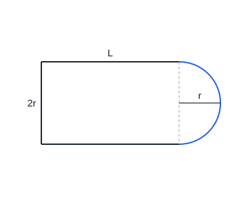

- **தரம்:** 10 · **தலைப்பு:** சுற்றளவு
- **கற்றல் நோக்கம்:** சுற்றளவுக்குரிய விளிம்புகளைக் காணல்.
- **விளக்கம்:** குற்றுக் கோட்டுப் பக்கம் உருவுக்குள் உள்ளதால் சுற்றளவில் சேராது.
- **சூத்திரங்கள்:** `F-MEN-CIRC` $C = 2\pi r = \pi d$
- **தொடர்புடைய வினா அடையாளங்கள்:** `MQ-G10C01-G-RECT_SEMIC-01`, `MQ-G10C01-G-RECT_SEMIC-02`, `MQ-G10C01-G-RECT_SEMIC-03`, `MQ-G10C01-G-RECT_SEMIC-04`
- **கற்றல் பாதை:** தர மேம்பாடு

## VIS-GEO-ISOS-BISECT-01 — நிறுவல்களில் பயன்படும் இருசமபக்க உண்மைகள்.

<!-- meta {"id": "VIS-GEO-ISOS-BISECT-01", "asset": "Shared_Assets/Geometry/GEO-ISOS-BISECT-01.svg", "grade": 10, "chapter": "G10C09", "formulas": ["T-GEO-ISOS", "T-GEO-CONG"], "related_questions": ["MQ-G10C05-A-CONG_PROOF-01", "MQ-G10C09-A-ISOSCELES_-01"], "medium": "ta"} -->
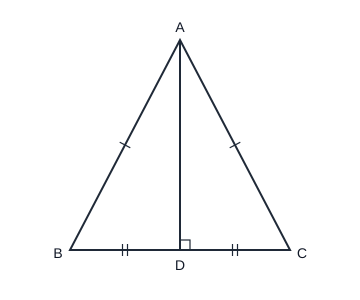

- **தரம்:** 10 · **தலைப்பு:** முக்கோணிகள் II
- **கற்றல் நோக்கம்:** நிறுவல்களில் பயன்படும் இருசமபக்க உண்மைகள்.
- **விளக்கம்:** குறிகள் சம நீளங்களைக் காட்டும்: AB = AC, BD = DC; AD ⟂ BC.
- **சூத்திரங்கள்:** `T-GEO-ISOS` $AB = AC \iff \angle B = \angle C$, `T-GEO-CONG` $\text{SAS, ASA, AAS, SSS, RHS}$
- **தொடர்புடைய வினா அடையாளங்கள்:** `MQ-G10C05-A-CONG_PROOF-01`, `MQ-G10C09-A-ISOSCELES_-01`
- **கற்றல் பாதை:** தர மேம்பாடு

## VIS-GEO-EXTANGLE-01 — புறக்கோணத்தைக் கண்டறிதல்.

<!-- meta {"id": "VIS-GEO-EXTANGLE-01", "asset": "Shared_Assets/Geometry/GEO-EXTANGLE-01.svg", "grade": 10, "chapter": "G10C08", "formulas": ["T-GEO-EXT"], "related_questions": ["MQ-G10C08-G-EXTERIOR_A-01", "MQ-G10C08-G-EXTERIOR_A-02", "MQ-G10C08-G-EXTERIOR_A-03", "MQ-G10C08-G-EXTERIOR_A-04"], "medium": "ta"} -->
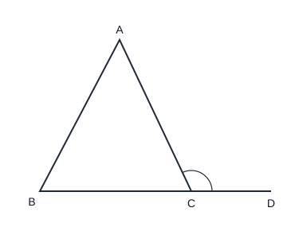

- **தரம்:** 10 · **தலைப்பு:** முக்கோணிகள் I
- **கற்றல் நோக்கம்:** புறக்கோணத்தைக் கண்டறிதல்.
- **விளக்கம்:** ∠ACD முக்கோணிக்கு வெளியே; அது ∠A + ∠B க்குச் சமம்.
- **சூத்திரங்கள்:** `T-GEO-EXT` $\angle ACD = \angle A + \angle B$
- **தொடர்புடைய வினா அடையாளங்கள்:** `MQ-G10C08-G-EXTERIOR_A-01`, `MQ-G10C08-G-EXTERIOR_A-02`, `MQ-G10C08-G-EXTERIOR_A-03`, `MQ-G10C08-G-EXTERIOR_A-04`
- **கற்றல் பாதை:** தர மேம்பாடு

## VIS-GEO-PARA-01 — இணைகரப் பண்புகள் ஒரே பார்வையில்.

<!-- meta {"id": "VIS-GEO-PARA-01", "asset": "Shared_Assets/Geometry/GEO-PARA-01.svg", "grade": 10, "chapter": "G10C16", "formulas": ["T-GEO-PARA"], "related_questions": ["MQ-G10C16-F-PARA_ANGLE-01", "MQ-G10C16-F-PARA_ANGLE-02", "MQ-G10C16-F-PARA_ANGLE-03", "MQ-G10C16-F-PARA_ANGLE-04", "MQ-G10C16-A-PARA_PROOF-01", "MQ-G10C17-A-PARA_MIDPO-01"], "medium": "ta"} -->
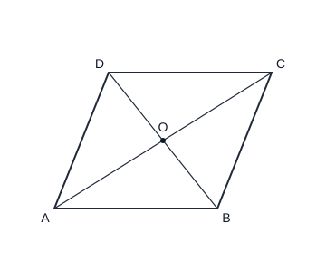

- **தரம்:** 10 · **தலைப்பு:** இணைகரங்கள் I
- **கற்றல் நோக்கம்:** இணைகரப் பண்புகள் ஒரே பார்வையில்.
- **விளக்கம்:** மூலைவிட்டங்கள் AC, BD, O இல் ஒன்றையொன்று அரைவாசியாக்கும்.
- **சூத்திரங்கள்:** `T-GEO-PARA` $AB=DC,\ AD=BC,\ \angle A=\angle C,\ AO=OC$
- **தொடர்புடைய வினா அடையாளங்கள்:** `MQ-G10C16-F-PARA_ANGLE-01`, `MQ-G10C16-F-PARA_ANGLE-02`, `MQ-G10C16-F-PARA_ANGLE-03`, `MQ-G10C16-F-PARA_ANGLE-04`, `MQ-G10C16-A-PARA_PROOF-01`, `MQ-G10C17-A-PARA_MIDPO-01`
- **கற்றல் பாதை:** தர மேம்பாடு

## VIS-GEO-CHORD-01 — நாணிலிருந்து வட்டத்துக்குள் செங்கோண முக்கோணி.

<!-- meta {"id": "VIS-GEO-CHORD-01", "asset": "Shared_Assets/Geometry/GEO-CHORD-01.svg", "grade": 10, "chapter": "G10C27", "formulas": ["T-GEO-CHORD", "T-GEO-PYTH"], "related_questions": ["MQ-G10C27-F-CHORD_LENG-01", "MQ-G10C27-F-CHORD_LENG-02", "MQ-G10C27-F-CHORD_LENG-03", "MQ-G10C27-F-CHORD_LENG-04", "MQ-G10C27-G-CHORD_DIST-01", "MQ-G10C27-G-CHORD_DIST-02"], "medium": "ta"} -->
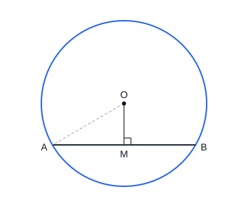

- **தரம்:** 10 · **தலைப்பு:** வட்டத்தின் நாண்கள்
- **கற்றல் நோக்கம்:** நாணிலிருந்து வட்டத்துக்குள் செங்கோண முக்கோணி.
- **விளக்கம்:** OM ⟂ AB எனவே AM = MB; OA (ஆரை) ΔOMA இன் செம்பக்கம்.
- **கணித்த சரிபார்ப்புப் பெறுமானங்கள்:** `{"r": 1, "OM/r": 0.5}`
- **சூத்திரங்கள்:** `T-GEO-CHORD` $OM\perp AB \Rightarrow AM = MB;\ r^2 = OM^2 + AM^2$, `T-GEO-PYTH` $c^2 = a^2 + b^2$
- **தொடர்புடைய வினா அடையாளங்கள்:** `MQ-G10C27-F-CHORD_LENG-01`, `MQ-G10C27-F-CHORD_LENG-02`, `MQ-G10C27-F-CHORD_LENG-03`, `MQ-G10C27-F-CHORD_LENG-04`, `MQ-G10C27-G-CHORD_DIST-01`, `MQ-G10C27-G-CHORD_DIST-02`
- **கற்றல் பாதை:** தர மேம்பாடு

## VIS-GEO-CIRC-CENTRE-01 — மையக் கோணம் vs பரிதிக் கோணம்.

<!-- meta {"id": "VIS-GEO-CIRC-CENTRE-01", "asset": "Shared_Assets/Geometry/GEO-CIRC-CENTRE-01.svg", "grade": 10, "chapter": "G10C31", "formulas": ["T-CIR-CENTRE"], "related_questions": ["MQ-G10C31-F-ANGLE_CENT-01", "MQ-G10C31-F-ANGLE_CENT-02", "MQ-G10C31-F-ANGLE_CENT-03", "MQ-G10C31-F-ANGLE_CENT-04"], "medium": "ta"} -->
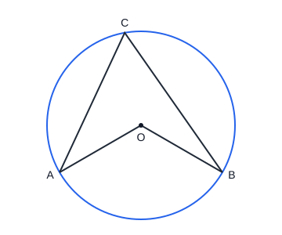

- **தரம்:** 10 · **தலைப்பு:** வட்டத்தின் கோணங்கள்
- **கற்றல் நோக்கம்:** மையக் கோணம் vs பரிதிக் கோணம்.
- **விளக்கம்:** இரு கோணங்களும் வில் AB மீது; மையக் கோணம் இரட்டிப்பு.
- **சூத்திரங்கள்:** `T-CIR-CENTRE` $\angle AOB = 2\angle ACB$
- **தொடர்புடைய வினா அடையாளங்கள்:** `MQ-G10C31-F-ANGLE_CENT-01`, `MQ-G10C31-F-ANGLE_CENT-02`, `MQ-G10C31-F-ANGLE_CENT-03`, `MQ-G10C31-F-ANGLE_CENT-04`
- **கற்றல் பாதை:** தர மேம்பாடு

## VIS-GEO-CYCLIC-01 — வட்ட நாற்பக்கல் கோண உண்மைகள்.

<!-- meta {"id": "VIS-GEO-CYCLIC-01", "asset": "Shared_Assets/Geometry/GEO-CYCLIC-01.svg", "grade": 11, "chapter": "G11C21", "formulas": ["T-CIR-CYCLIC"], "related_questions": ["MQ-G11C21-F-CYCLIC_OPP-01", "MQ-G11C21-F-CYCLIC_OPP-02", "MQ-G11C21-F-CYCLIC_OPP-03", "MQ-G11C21-F-CYCLIC_OPP-04", "MQ-G11C21-G-CYCLIC_EXT-01", "MQ-G11C21-G-CYCLIC_EXT-02"], "medium": "ta"} -->
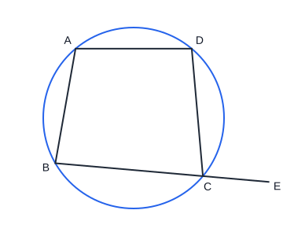

- **தரம்:** 11 · **தலைப்பு:** வட்ட நாற்பக்கல்கள்
- **கற்றல் நோக்கம்:** வட்ட நாற்பக்கல் கோண உண்மைகள்.
- **விளக்கம்:** ∠A + ∠C = 180°; புறக்கோணம் ∠DCE = ∠A.
- **சூத்திரங்கள்:** `T-CIR-CYCLIC` $\angle A+\angle C = 180^\circ;\ \text{ext.}\angle = \text{int. opp.}\angle$
- **தொடர்புடைய வினா அடையாளங்கள்:** `MQ-G11C21-F-CYCLIC_OPP-01`, `MQ-G11C21-F-CYCLIC_OPP-02`, `MQ-G11C21-F-CYCLIC_OPP-03`, `MQ-G11C21-F-CYCLIC_OPP-04`, `MQ-G11C21-G-CYCLIC_EXT-01`, `MQ-G11C21-G-CYCLIC_EXT-02`
- **கற்றல் பாதை:** தர மேம்பாடு

## VIS-GEO-TANGENT-01 — தொடலி ஆரையை 90° இல் சந்திக்கும்.

<!-- meta {"id": "VIS-GEO-TANGENT-01", "asset": "Shared_Assets/Geometry/GEO-TANGENT-01.svg", "grade": 11, "chapter": "G11C22", "formulas": ["T-CIR-TAN", "T-GEO-PYTH"], "related_questions": ["MQ-G11C22-F-TANGENT_RA-01", "MQ-G11C22-F-TANGENT_RA-02", "MQ-G11C22-F-TANGENT_RA-03", "MQ-G11C22-F-TANGENT_RA-04"], "medium": "ta"} -->
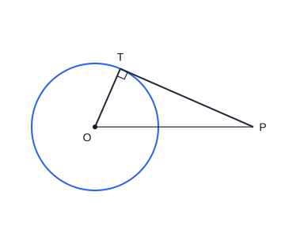

- **தரம்:** 11 · **தலைப்பு:** தொடலிகள்
- **கற்றல் நோக்கம்:** தொடலி ஆரையை 90° இல் சந்திக்கும்.
- **விளக்கம்:** ΔOTP, T இல் செங்கோணம்; எனவே PT² = OP² − OT².
- **கணித்த சரிபார்ப்புப் பெறுமானங்கள்:** `{"dot_OT_PT": -0.0}`
- **சூத்திரங்கள்:** `T-CIR-TAN` $OT\perp PT;\ PA = PB$, `T-GEO-PYTH` $c^2 = a^2 + b^2$
- **தொடர்புடைய வினா அடையாளங்கள்:** `MQ-G11C22-F-TANGENT_RA-01`, `MQ-G11C22-F-TANGENT_RA-02`, `MQ-G11C22-F-TANGENT_RA-03`, `MQ-G11C22-F-TANGENT_RA-04`
- **கற்றல் பாதை:** தர மேம்பாடு

## VIS-GEO-TANGENT-02 — ஒரு புள்ளியிலிருந்து சம தொடலிகள்.

<!-- meta {"id": "VIS-GEO-TANGENT-02", "asset": "Shared_Assets/Geometry/GEO-TANGENT-02.svg", "grade": 11, "chapter": "G11C22", "formulas": ["T-CIR-TAN"], "related_questions": ["MQ-G11C22-G-TWO_TANGEN-01", "MQ-G11C22-G-TWO_TANGEN-02", "MQ-G11C22-G-TWO_TANGEN-03", "MQ-G11C22-G-TWO_TANGEN-04"], "medium": "ta"} -->
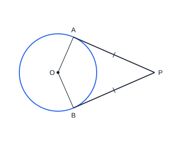

- **தரம்:** 11 · **தலைப்பு:** தொடலிகள்
- **கற்றல் நோக்கம்:** ஒரு புள்ளியிலிருந்து சம தொடலிகள்.
- **விளக்கம்:** PA = PB (படத்தில் அளவில் சமம்), எனவே ΔPAB இருசமபக்கம்.
- **கணித்த சரிபார்ப்புப் பெறுமானங்கள்:** `{"PA": 183.303028, "PB": 183.303028}`
- **சூத்திரங்கள்:** `T-CIR-TAN` $OT\perp PT;\ PA = PB$
- **தொடர்புடைய வினா அடையாளங்கள்:** `MQ-G11C22-G-TWO_TANGEN-01`, `MQ-G11C22-G-TWO_TANGEN-02`, `MQ-G11C22-G-TWO_TANGEN-03`, `MQ-G11C22-G-TWO_TANGEN-04`
- **கற்றல் பாதை:** தர மேம்பாடு

## VIS-GEO-ALTSEG-01 — ஒன்றுவிட்ட துண்டத் தேற்றம்.

<!-- meta {"id": "VIS-GEO-ALTSEG-01", "asset": "Shared_Assets/Geometry/GEO-ALTSEG-01.svg", "grade": 11, "chapter": "G11C22", "formulas": ["T-CIR-ALTSEG"], "related_questions": ["MQ-G11C22-A-ALTERNATE_-01", "MQ-G11C22-A-ALTERNATE_-02", "MQ-G11C22-A-ALTERNATE_-03"], "medium": "ta"} -->
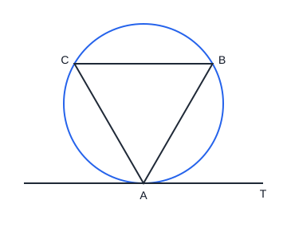

- **தரம்:** 11 · **தலைப்பு:** தொடலிகள்
- **கற்றல் நோக்கம்:** ஒன்றுவிட்ட துண்டத் தேற்றம்.
- **விளக்கம்:** தொடலி TA க்கும் நாண் AB க்கும் இடையிலான கோணம் மற்றத் துண்டத்திலுள்ள ∠ACB க்குச் சமம்.
- **சூத்திரங்கள்:** `T-CIR-ALTSEG` $\angle TAB = \angle ACB$
- **தொடர்புடைய வினா அடையாளங்கள்:** `MQ-G11C22-A-ALTERNATE_-01`, `MQ-G11C22-A-ALTERNATE_-02`, `MQ-G11C22-A-ALTERNATE_-03`
- **கற்றல் பாதை:** தர மேம்பாடு

## VIS-GEO-PARALLEL-AREA-01 — சமாந்தரங்களுக்கிடையே சம பரப்புகள்.

<!-- meta {"id": "VIS-GEO-PARALLEL-AREA-01", "asset": "Shared_Assets/Geometry/GEO-PARALLEL-AREA-01.svg", "grade": 11, "chapter": "G11C08", "formulas": ["T-GEO-AREA-PAR"], "related_questions": ["MQ-G11C08-F-SAME_BASE_-01", "MQ-G11C08-F-SAME_BASE_-02", "MQ-G11C08-F-SAME_BASE_-03", "MQ-G11C08-F-SAME_BASE_-04", "MQ-G11C08-G-PARA_TRIAN-01", "MQ-G11C08-G-PARA_TRIAN-02"], "medium": "ta"} -->
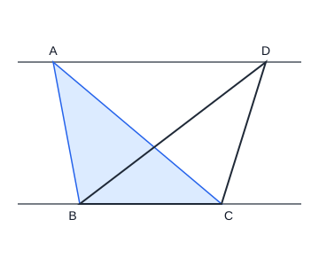

- **தரம்:** 11 · **தலைப்பு:** சமாந்தரக் கோடுகளுக்கிடையே உள்ள தளஉருவங்களின் பரப்பளவு
- **கற்றல் நோக்கம்:** சமாந்தரங்களுக்கிடையே சம பரப்புகள்.
- **விளக்கம்:** ஒரே அடி BC, ஒரே உயரம் → சம பரப்புகள்.
- **சூத்திரங்கள்:** `T-GEO-AREA-PAR` $\triangle = \tfrac12\,\square\ (\text{same base, same parallels})$
- **தொடர்புடைய வினா அடையாளங்கள்:** `MQ-G11C08-F-SAME_BASE_-01`, `MQ-G11C08-F-SAME_BASE_-02`, `MQ-G11C08-F-SAME_BASE_-03`, `MQ-G11C08-F-SAME_BASE_-04`, `MQ-G11C08-G-PARA_TRIAN-01`, `MQ-G11C08-G-PARA_TRIAN-02`
- **கற்றல் பாதை:** தர மேம்பாடு

## VIS-GEO-MIDPT-01 — நடுப்புள்ளித் தேற்றம்.

<!-- meta {"id": "VIS-GEO-MIDPT-01", "asset": "Shared_Assets/Geometry/GEO-MIDPT-01.svg", "grade": 11, "chapter": "G11C11", "formulas": ["T-GEO-MID"], "related_questions": ["MQ-G11C11-F-MIDPOINT_L-01", "MQ-G11C11-F-MIDPOINT_L-02", "MQ-G11C11-F-MIDPOINT_L-03", "MQ-G11C11-F-MIDPOINT_L-04", "MQ-G11C11-G-MIDPOINT_P-01", "MQ-G11C11-G-MIDPOINT_P-02"], "medium": "ta"} -->
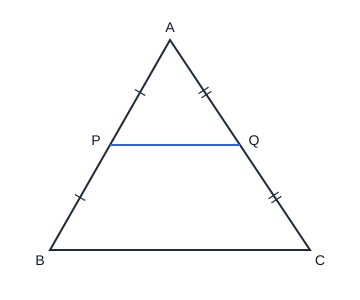

- **தரம்:** 11 · **தலைப்பு:** நடுப்புள்ளித் தேற்றம்
- **கற்றல் நோக்கம்:** நடுப்புள்ளித் தேற்றம்.
- **விளக்கம்:** PQ நடுப்புள்ளிகளை இணைக்கும்; படத்தில் PQ/BC = 0.5.
- **கணித்த சரிபார்ப்புப் பெறுமானங்கள்:** `{"PQ/BC": 0.5}`
- **சூத்திரங்கள்:** `T-GEO-MID` $PQ\parallel BC,\ PQ = \tfrac12 BC$
- **தொடர்புடைய வினா அடையாளங்கள்:** `MQ-G11C11-F-MIDPOINT_L-01`, `MQ-G11C11-F-MIDPOINT_L-02`, `MQ-G11C11-F-MIDPOINT_L-03`, `MQ-G11C11-F-MIDPOINT_L-04`, `MQ-G11C11-G-MIDPOINT_P-01`, `MQ-G11C11-G-MIDPOINT_P-02`
- **கற்றல் பாதை:** தர மேம்பாடு

## VIS-GEO-CHORDS-INT-01 — வெட்டும் நாண்கள்.

<!-- meta {"id": "VIS-GEO-CHORDS-INT-01", "asset": "Shared_Assets/Geometry/GEO-CHORDS-INT-01.svg", "grade": 11, "chapter": "G11C14", "formulas": ["T-GEO-SIM"], "related_questions": ["MQ-G11C14-A-SIMILAR_PR-01"], "medium": "ta"} -->
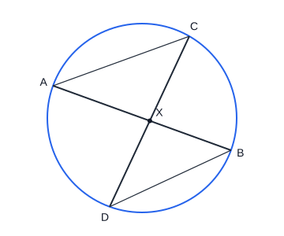

- **தரம்:** 11 · **தலைப்பு:** இயல்பொத்த முக்கோணிகள்
- **கற்றல் நோக்கம்:** வெட்டும் நாண்கள்.
- **விளக்கம்:** AX × XB = CX × XD (படத்தில் 4 தசமதானம் வரை சமம்).
- **கணித்த சரிபார்ப்புப் பெறுமானங்கள்:** `{"AX*XB": 14289.7786, "CX*XD": 14289.7786}`
- **சூத்திரங்கள்:** `T-GEO-SIM` $\frac{AB}{PQ} = \frac{BC}{QR} = \frac{CA}{RP}$
- **தொடர்புடைய வினா அடையாளங்கள்:** `MQ-G11C14-A-SIMILAR_PR-01`
- **கற்றல் பாதை:** தர மேம்பாடு

## VIS-GEO-RIGHT-01 — செங்கோண முக்கோணியின் பக்கங்களைப் பெயரிடல்.

<!-- meta {"id": "VIS-GEO-RIGHT-01", "asset": "Shared_Assets/Geometry/GEO-RIGHT-01.svg", "grade": 11, "chapter": "G11C17", "formulas": ["T-GEO-PYTH", "F-TRI-RATIOS"], "related_questions": ["MQ-G11C17-F-PYTH_HYP-01", "MQ-G11C17-F-PYTH_HYP-02", "MQ-G11C17-F-PYTH_HYP-03", "MQ-G11C17-F-PYTH_HYP-04", "MQ-G11C17-G-PYTH_LADDE-01", "MQ-G11C17-G-PYTH_LADDE-02"], "medium": "ta"} -->
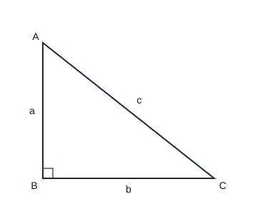

- **தரம்:** 11 · **தலைப்பு:** பைதகரசின் தேற்றம்
- **கற்றல் நோக்கம்:** செங்கோண முக்கோணியின் பக்கங்களைப் பெயரிடல்.
- **விளக்கம்:** B இலுள்ள செங்கோணத்துக்கு எதிரே c (AC) — செம்பக்கம்.
- **சூத்திரங்கள்:** `T-GEO-PYTH` $c^2 = a^2 + b^2$, `F-TRI-RATIOS` $\sin\theta = \frac{opp}{hyp},\ \cos\theta = \frac{adj}{hyp},\ \tan\theta = \frac{opp}{adj}$
- **தொடர்புடைய வினா அடையாளங்கள்:** `MQ-G11C17-F-PYTH_HYP-01`, `MQ-G11C17-F-PYTH_HYP-02`, `MQ-G11C17-F-PYTH_HYP-03`, `MQ-G11C17-F-PYTH_HYP-04`, `MQ-G11C17-G-PYTH_LADDE-01`, `MQ-G11C17-G-PYTH_LADDE-02`
- **கற்றல் பாதை:** தர மேம்பாடு

## VIS-SET-VENN2-01 — இரு தொடை வென் பிரதேசங்கள்.

<!-- meta {"id": "VIS-SET-VENN2-01", "asset": "Shared_Assets/Other_Diagrams/SET-VENN2-01.svg", "grade": 10, "chapter": "G10C18", "formulas": ["F-SET-UNION"], "related_questions": ["MQ-G10C18-F-SETS_UNION-01", "MQ-G10C18-F-SETS_UNION-02", "MQ-G10C18-F-SETS_UNION-03", "MQ-G10C18-F-SETS_UNION-04", "MQ-G10C18-G-SETS_NEITH-01", "MQ-G10C18-G-SETS_NEITH-02"], "medium": "ta"} -->
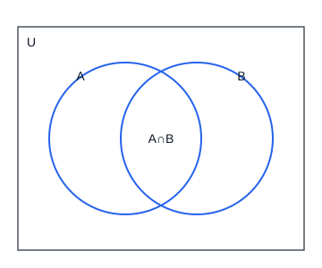

- **தரம்:** 10 · **தலைப்பு:** தொடைகள்
- **கற்றல் நோக்கம்:** இரு தொடை வென் பிரதேசங்கள்.
- **விளக்கம்:** நான்கு பிரதேசங்கள்: A மட்டும், A∩B, B மட்டும், இரண்டுக்கும் வெளியே.
- **சூத்திரங்கள்:** `F-SET-UNION` $n(A\cup B) = n(A)+n(B)-n(A\cap B)$
- **தொடர்புடைய வினா அடையாளங்கள்:** `MQ-G10C18-F-SETS_UNION-01`, `MQ-G10C18-F-SETS_UNION-02`, `MQ-G10C18-F-SETS_UNION-03`, `MQ-G10C18-F-SETS_UNION-04`, `MQ-G10C18-G-SETS_NEITH-01`, `MQ-G10C18-G-SETS_NEITH-02`
- **கற்றல் பாதை:** அடிப்படைத் தேர்ச்சி

## VIS-SET-VENN3-01 — மூன்று தொடை வென் பிரதேசங்கள்.

<!-- meta {"id": "VIS-SET-VENN3-01", "asset": "Shared_Assets/Other_Diagrams/SET-VENN3-01.svg", "grade": 11, "chapter": "G11C24", "formulas": ["F-SET-UNION3"], "related_questions": ["MQ-G11C24-G-THREE_SETS-01", "MQ-G11C24-G-THREE_SETS-02"], "medium": "ta"} -->
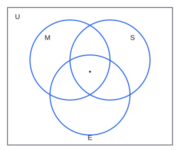

- **தரம்:** 11 · **தலைப்பு:** தொடைகள்
- **கற்றல் நோக்கம்:** மூன்று தொடை வென் பிரதேசங்கள்.
- **விளக்கம்:** எட்டுப் பிரதேசங்கள்; புள்ளி நடுவைக் (மூன்றும்) குறிக்கும்.
**படிமுறை அறிவுறுத்தல்கள்:**
1. முதலில் நடுவை நிரப்புக.
2. மூன்று 'சரியாக இரண்டு' பிரதேசங்கள்.
3. 'மட்டும்' பிரதேசங்கள், பின் வெளியே.
- **சூத்திரங்கள்:** `F-SET-UNION3` $n(A\cup B\cup C) = \Sigma n(A) - \Sigma n(A\cap B) + n(A\cap B\cap C)$
- **தொடர்புடைய வினா அடையாளங்கள்:** `MQ-G11C24-G-THREE_SETS-01`, `MQ-G11C24-G-THREE_SETS-02`
- **கற்றல் பாதை:** தர மேம்பாடு

## VIS-PRO-GRID-01 — இரு தாயக்கட்டைகளின் மாதிரிவெளி.

<!-- meta {"id": "VIS-PRO-GRID-01", "asset": "Shared_Assets/Other_Diagrams/PRO-GRID-01.svg", "grade": 10, "chapter": "G10C30", "formulas": ["F-PRO-BASIC"], "related_questions": ["MQ-G10C30-A-PROB_DICE_-01", "MQ-G10C30-A-PROB_DICE_-02", "MQ-G10C30-A-PROB_DICE_-03"], "medium": "ta"} -->
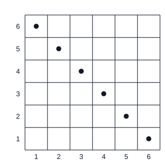

- **தரம்:** 10 · **தலைப்பு:** நிகழ்தகவு
- **கற்றல் நோக்கம்:** இரு தாயக்கட்டைகளின் மாதிரிவெளி.
- **விளக்கம்:** 36 சம வாய்ப்புக் கலங்கள்; 6 புள்ளிகள் கூட்டுத்தொகை 7; P = 6/36 = 1/6.
- **கணித்த சரிபார்ப்புப் பெறுமானங்கள்:** `{"sum7": 6, "total": 36}`
- **சூத்திரங்கள்:** `F-PRO-BASIC` $P(A) = \frac{n(A)}{n(S)}$
- **தொடர்புடைய வினா அடையாளங்கள்:** `MQ-G10C30-A-PROB_DICE_-01`, `MQ-G10C30-A-PROB_DICE_-02`, `MQ-G10C30-A-PROB_DICE_-03`
- **கற்றல் பாதை:** அடிப்படைத் தேர்ச்சி

## VIS-PRO-TREE-01 — மர வரிப்பட அமைப்பு.

<!-- meta {"id": "VIS-PRO-TREE-01", "asset": "Shared_Assets/Other_Diagrams/PRO-TREE-01.svg", "grade": 11, "chapter": "G11C25", "formulas": ["F-PRO-TREE"], "related_questions": ["MQ-G11C25-G-TREE_TWO_B-01", "MQ-G11C25-G-TREE_TWO_B-02", "MQ-G11C25-G-TREE_TWO_B-03", "MQ-G11C25-G-TREE_TWO_B-04", "MQ-G11C25-A-TREE_WITHO-01", "MQ-G11C25-A-TREE_WITHO-02"], "medium": "ta"} -->
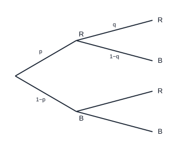

- **தரம்:** 11 · **தலைப்பு:** நிகழ்தகவு
- **கற்றல் நோக்கம்:** மர வரிப்பட அமைப்பு.
- **விளக்கம்:** ஒவ்வொரு புள்ளியிலிருந்தும் கிளைகள் 1; பாதை வழியே பெருக்குக.
- **சூத்திரங்கள்:** `F-PRO-TREE` $\text{along: } \times,\quad \text{between outcomes: } +$
- **தொடர்புடைய வினா அடையாளங்கள்:** `MQ-G11C25-G-TREE_TWO_B-01`, `MQ-G11C25-G-TREE_TWO_B-02`, `MQ-G11C25-G-TREE_TWO_B-03`, `MQ-G11C25-G-TREE_TWO_B-04`, `MQ-G11C25-A-TREE_WITHO-01`, `MQ-G11C25-A-TREE_WITHO-02`
- **கற்றல் பாதை:** தர மேம்பாடு

## VIS-GRA-LINE-01 — வரைபில் படித்திறனும் வெட்டுத்துண்டும்.

<!-- meta {"id": "VIS-GRA-LINE-01", "asset": "Shared_Assets/Graphs/GRA-LINE-01.svg", "grade": 10, "chapter": "G10C21", "formulas": ["F-GRA-LINE", "F-GRA-GRAD"], "related_questions": ["MQ-G10C21-F-GRADIENT_I-01", "MQ-G10C21-F-GRADIENT_I-02", "MQ-G10C21-F-GRADIENT_I-03", "MQ-G10C21-F-GRADIENT_I-04", "MQ-G10C21-G-GRADIENT_T-01", "MQ-G10C21-G-GRADIENT_T-02"], "medium": "ta"} -->
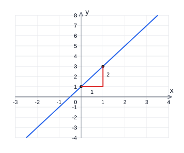

- **தரம்:** 10 · **தலைப்பு:** வரைபுகள்
- **கற்றல் நோக்கம்:** வரைபில் படித்திறனும் வெட்டுத்துண்டும்.
- **விளக்கம்:** y = 2x + 1: (0, 1) இலிருந்து; வலப்புறம் 1 இற்கு மேலே 2.

| x | y |
|---|---|
| -2 | -3 |
| -1 | -1 |
| 0 | 1 |
| 1 | 3 |
| 2 | 5 |
| 3 | 7 |

**படிமுறை அறிவுறுத்தல்கள்:**
1. x = −2 … 3 அட்டவணை.
2. புள்ளிகளைக் குறிக்க.
3. அளவுகோலால் இணைக்க.
- **சூத்திரங்கள்:** `F-GRA-LINE` $y = mx + c$, `F-GRA-GRAD` $m = \frac{y_2-y_1}{x_2-x_1}$
- **தொடர்புடைய வினா அடையாளங்கள்:** `MQ-G10C21-F-GRADIENT_I-01`, `MQ-G10C21-F-GRADIENT_I-02`, `MQ-G10C21-F-GRADIENT_I-03`, `MQ-G10C21-F-GRADIENT_I-04`, `MQ-G10C21-G-GRADIENT_T-01`, `MQ-G10C21-G-GRADIENT_T-02`
- **கற்றல் பாதை:** அடிப்படைத் தேர்ச்சி

## VIS-GRA-QUAD-01 — இருபடி வரைபை வாசித்தல்.

<!-- meta {"id": "VIS-GRA-QUAD-01", "asset": "Shared_Assets/Graphs/GRA-QUAD-01.svg", "grade": 11, "chapter": "G11C12", "formulas": ["F-GRA-QUAD", "F-GRA-VERTEX"], "related_questions": ["MQ-G11C12-F-TP_FROM_VE-01", "MQ-G11C12-F-TP_FROM_VE-02", "MQ-G11C12-F-TP_FROM_VE-03", "MQ-G11C12-F-TP_FROM_VE-04", "MQ-G11C12-G-QUAD_TABLE-01", "MQ-G11C12-G-QUAD_TABLE-02"], "medium": "ta"} -->
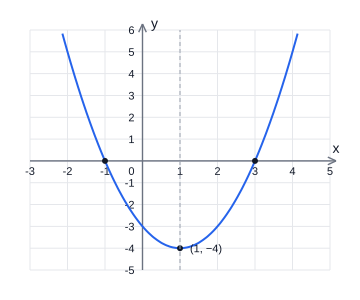

- **தரம்:** 11 · **தலைப்பு:** வரைபுகள்
- **கற்றல் நோக்கம்:** இருபடி வரைபை வாசித்தல்.
- **விளக்கம்:** y = x² − 2x − 3: மூலங்கள் −1, 3; இழிவு (1, −4); அச்சு x = 1.

| x | y |
|---|---|
| -2 | 5 |
| -1 | 0 |
| 0 | -3 |
| 1 | -4 |
| 2 | -3 |
| 3 | 0 |
| 4 | 5 |

**படிமுறை அறிவுறுத்தல்கள்:**
1. அட்டவணை நிரப்புக (x = −2 முதல் 4).
2. புள்ளிகள்; மென்மையான வளைவு.
3. y = 0 இல் மூலங்கள்.
4. மூலங்களின் நடுவில் திரும்பற் புள்ளி.
- **சூத்திரங்கள்:** `F-GRA-QUAD` $y = ax^2+bx+c,\ \ x_{tp} = -\frac{b}{2a}$, `F-GRA-VERTEX` $y = (x+b)^2 + c \Rightarrow (-b,\ c)$
- **தொடர்புடைய வினா அடையாளங்கள்:** `MQ-G11C12-F-TP_FROM_VE-01`, `MQ-G11C12-F-TP_FROM_VE-02`, `MQ-G11C12-F-TP_FROM_VE-03`, `MQ-G11C12-F-TP_FROM_VE-04`, `MQ-G11C12-G-QUAD_TABLE-01`, `MQ-G11C12-G-QUAD_TABLE-02`
- **கற்றல் பாதை:** தர மேம்பாடு

## VIS-GRA-QUAD-02 — உயர்வு, இழிவுப் பரவளைவுகள்.

<!-- meta {"id": "VIS-GRA-QUAD-02", "asset": "Shared_Assets/Graphs/GRA-QUAD-02.svg", "grade": 10, "chapter": "G10C21", "formulas": ["F-GRA-QUAD"], "related_questions": ["MQ-G10C21-A-QUAD_AX2C-01", "MQ-G10C21-A-QUAD_AX2C-02", "MQ-G10C21-A-QUAD_AX2C-03"], "medium": "ta"} -->
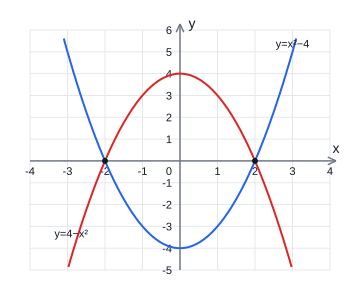

- **தரம்:** 10 · **தலைப்பு:** வரைபுகள்
- **கற்றல் நோக்கம்:** உயர்வு, இழிவுப் பரவளைவுகள்.
- **விளக்கம்:** y = x² − 4 மேல்நோக்கி (இழிவு); y = 4 − x² கீழ்நோக்கி (உயர்வு).

| x | y1=x^2-4 | y2=4-x^2 |
|---|---|---|
| -3 | 5 | -5 |
| -2 | 0 | 0 |
| -1 | -3 | 3 |
| 0 | -4 | 4 |
| 1 | -3 | 3 |
| 2 | 0 | 0 |
| 3 | 5 | -5 |

- **சூத்திரங்கள்:** `F-GRA-QUAD` $y = ax^2+bx+c,\ \ x_{tp} = -\frac{b}{2a}$
- **தொடர்புடைய வினா அடையாளங்கள்:** `MQ-G10C21-A-QUAD_AX2C-01`, `MQ-G10C21-A-QUAD_AX2C-02`, `MQ-G10C21-A-QUAD_AX2C-03`
- **கற்றல் பாதை:** தர மேம்பாடு

## VIS-GRA-NUMLINE-01 — எண் கோட்டில் சமனிலி.

<!-- meta {"id": "VIS-GRA-NUMLINE-01", "asset": "Shared_Assets/Graphs/GRA-NUMLINE-01.svg", "grade": 10, "chapter": "G10C25", "formulas": ["F-ALG-INEQ"], "related_questions": ["MQ-G10C25-F-INEQ_SOLVE-01", "MQ-G10C25-F-INEQ_SOLVE-02", "MQ-G10C25-F-INEQ_SOLVE-03", "MQ-G10C25-F-INEQ_SOLVE-04", "MQ-G10C25-G-INEQ_NEGAT-01", "MQ-G10C25-G-INEQ_NEGAT-02"], "medium": "ta"} -->
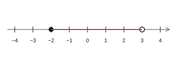

- **தரம்:** 10 · **தலைப்பு:** அட்சரகணிதச் சமனிலிகள்
- **கற்றல் நோக்கம்:** எண் கோட்டில் சமனிலி.
- **விளக்கம்:** நிரப்பிய புள்ளி = உள்ளடக்கம் (≤); திறந்த புள்ளி = இல்லை (<).
- **சூத்திரங்கள்:** `F-ALG-INEQ` $a<b \Rightarrow -a>-b$
- **தொடர்புடைய வினா அடையாளங்கள்:** `MQ-G10C25-F-INEQ_SOLVE-01`, `MQ-G10C25-F-INEQ_SOLVE-02`, `MQ-G10C25-F-INEQ_SOLVE-03`, `MQ-G10C25-F-INEQ_SOLVE-04`, `MQ-G10C25-G-INEQ_NEGAT-01`, `MQ-G10C25-G-INEQ_NEGAT-02`
- **கற்றல் பாதை:** தர மேம்பாடு

## VIS-GRA-REGION-01 — சமனிலிகளால் வரையறுக்கும் பிரதேசம்.

<!-- meta {"id": "VIS-GRA-REGION-01", "asset": "Shared_Assets/Graphs/GRA-REGION-01.svg", "grade": 11, "chapter": "G11C20", "formulas": ["F-ALG-INEQ2"], "related_questions": ["MQ-G11C20-F-POINT_IN_R-01", "MQ-G11C20-F-POINT_IN_R-02", "MQ-G11C20-F-POINT_IN_R-03", "MQ-G11C20-F-POINT_IN_R-04", "MQ-G11C20-G-REGION_DES-01", "MQ-G11C20-A-SIMULTANEO-01"], "medium": "ta"} -->
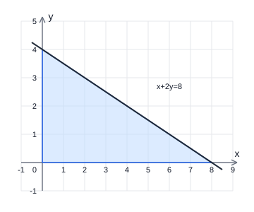

- **தரம்:** 11 · **தலைப்பு:** சமனிலிகள்
- **கற்றல் நோக்கம்:** சமனிலிகளால் வரையறுக்கும் பிரதேசம்.
- **விளக்கம்:** நிழற்றிய முக்கோணி: x ≥ 0, y ≥ 0, x + 2y ≤ 8.
**படிமுறை அறிவுறுத்தல்கள்:**
1. (8, 0), (0, 4) ஊடாக x + 2y = 8.
2. (0, 0): 0 ≤ 8 உண்மை → ஆதி நோக்கி நிழற்றுக.
- **சூத்திரங்கள்:** `F-ALG-INEQ2` $ax+by\le c$
- **தொடர்புடைய வினா அடையாளங்கள்:** `MQ-G11C20-F-POINT_IN_R-01`, `MQ-G11C20-F-POINT_IN_R-02`, `MQ-G11C20-F-POINT_IN_R-03`, `MQ-G11C20-F-POINT_IN_R-04`, `MQ-G11C20-G-REGION_DES-01`, `MQ-G11C20-A-SIMULTANEO-01`
- **கற்றல் பாதை:** தர மேம்பாடு

## VIS-STA-PIE-01 — வட்ட வரைபை வாசித்தல்.

<!-- meta {"id": "VIS-STA-PIE-01", "asset": "Shared_Assets/Statistical_Charts/STA-PIE-01.svg", "grade": 10, "chapter": "G10C11", "formulas": ["F-STA-PIE"], "related_questions": ["MQ-G10C11-F-PIE_ANGLE-01", "MQ-G10C11-F-PIE_ANGLE-02", "MQ-G10C11-F-PIE_ANGLE-03", "MQ-G10C11-F-PIE_ANGLE-04"], "medium": "ta"} -->
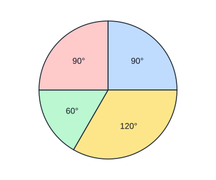

- **தரம்:** 10 · **தலைப்பு:** தரவுகளை வகைகுறித்தல்
- **கற்றல் நோக்கம்:** வட்ட வரைபை வாசித்தல்.
- **விளக்கம்:** கோணங்கள் 90°, 120°, 60°, 90° = 360°.
- **கணித்த சரிபார்ப்புப் பெறுமானங்கள்:** `{"sum": 360}`
- **சூத்திரங்கள்:** `F-STA-PIE` $\theta = \frac{\text{part}}{\text{total}}\times 360^\circ$
- **தொடர்புடைய வினா அடையாளங்கள்:** `MQ-G10C11-F-PIE_ANGLE-01`, `MQ-G10C11-F-PIE_ANGLE-02`, `MQ-G10C11-F-PIE_ANGLE-03`, `MQ-G10C11-F-PIE_ANGLE-04`
- **கற்றல் பாதை:** அடிப்படைத் தேர்ச்சி

## VIS-STA-HIST-01 — இடைவரிப்படமும் மீடிறன் பல்கோணியும்.

<!-- meta {"id": "VIS-STA-HIST-01", "asset": "Shared_Assets/Statistical_Charts/STA-HIST-01.svg", "grade": 10, "chapter": "G10C26", "formulas": ["F-STA-MEAN"], "related_questions": ["MQ-G10C26-G-MEAN_GROUP-01", "MQ-G10C26-G-MEAN_GROUP-02", "MQ-G10C26-G-MEAN_GROUP-03"], "medium": "ta"} -->
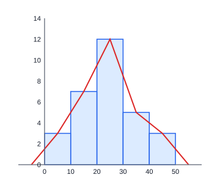

- **தரம்:** 10 · **தலைப்பு:** மீடிறன் பரம்பல்
- **கற்றல் நோக்கம்:** இடைவரிப்படமும் மீடிறன் பல்கோணியும்.
- **விளக்கம்:** ஒவ்வொரு வகுப்புக்கும் சலாகை; பல்கோணி நடுப்புள்ளிகளை இணைத்து அச்சில் முடியும்.

| class | f | mid |
|---|---|---|
| 0-10 | 3 | 5 |
| 10-20 | 7 | 15 |
| 20-30 | 12 | 25 |
| 30-40 | 5 | 35 |
| 40-50 | 3 | 45 |

**படிமுறை அறிவுறுத்தல்கள்:**
1. x இல் வகுப்பெல்லைகள்.
2. மீடிறன் உயரத்துக்குச் சலாகைகள்.
3. சலாகை மேல்களின் நடுப்புள்ளிகளை இணைக்க.
- **சூத்திரங்கள்:** `F-STA-MEAN` $\bar x = \frac{\Sigma fx}{\Sigma f}$
- **தொடர்புடைய வினா அடையாளங்கள்:** `MQ-G10C26-G-MEAN_GROUP-01`, `MQ-G10C26-G-MEAN_GROUP-02`, `MQ-G10C26-G-MEAN_GROUP-03`
- **கற்றல் பாதை:** தர மேம்பாடு

## VIS-STA-OGIVE-01 — திரள் மீடிறன் வளையியும் இடையமும்.

<!-- meta {"id": "VIS-STA-OGIVE-01", "asset": "Shared_Assets/Statistical_Charts/STA-OGIVE-01.svg", "grade": 11, "chapter": "G11C15", "formulas": ["F-STA-QUART"], "related_questions": ["MQ-G11C15-A-OGIVE_READ-01", "MQ-G11C15-A-OGIVE_READ-02", "MQ-G11C15-A-OGIVE_READ-03"], "medium": "ta"} -->
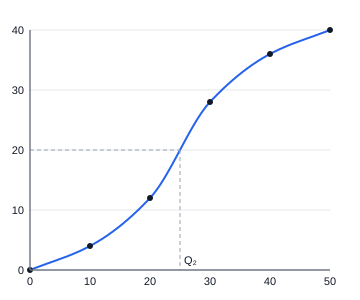

- **தரம்:** 11 · **தலைப்பு:** தரவுகளை வகைகுறித்தல்
- **கற்றல் நோக்கம்:** திரள் மீடிறன் வளையியும் இடையமும்.
- **விளக்கம்:** மேல் எல்லைகளில் தி.மீ.; N/2 = 20 இல் இடையம் 25.
- **கணித்த சரிபார்ப்புப் பெறுமானங்கள்:** `{"median": 25}`

| upper | cf |
|---|---|
| 0 | 0 |
| 10 | 4 |
| 20 | 12 |
| 30 | 28 |
| 40 | 36 |
| 50 | 40 |

**படிமுறை அறிவுறுத்தல்கள்:**
1. தி.மீ. நிரல்.
2. (10,4), (20,12), (30,28), (40,36), (50,40), (0,0) குறிக்க.
3. 20 இலிருந்து குறுக்கே, பின் கீழே.
- **சூத்திரங்கள்:** `F-STA-QUART` $Q_1: \frac{n+1}{4},\ Q_3: \frac{3(n+1)}{4},\ \text{IQR} = Q_3-Q_1$
- **தொடர்புடைய வினா அடையாளங்கள்:** `MQ-G11C15-A-OGIVE_READ-01`, `MQ-G11C15-A-OGIVE_READ-02`, `MQ-G11C15-A-OGIVE_READ-03`
- **கற்றல் பாதை:** தர மேம்பாடு

## VIS-TRI-BEARING-01 — திசைகோளை அளத்தல்.

<!-- meta {"id": "VIS-TRI-BEARING-01", "asset": "Shared_Assets/Other_Diagrams/TRI-BEARING-01.svg", "grade": 10, "chapter": "G10C32", "formulas": ["F-TRI-BEAR"], "related_questions": ["MQ-G10C32-G-BEARING_BA-01", "MQ-G10C32-G-BEARING_BA-02", "MQ-G10C32-G-BEARING_BA-03", "MQ-G10C32-G-BEARING_BA-04"], "medium": "ta"} -->
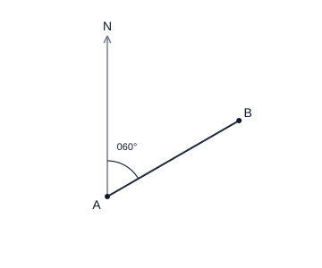

- **தரம்:** 10 · **தலைப்பு:** அளவிடைப் படங்கள்
- **கற்றல் நோக்கம்:** திசைகோளை அளத்தல்.
- **விளக்கம்:** வடக்கிலிருந்து வலஞ்சுழியாக 60° → 060°.
- **சூத்திரங்கள்:** `F-TRI-BEAR` $\beta_{back} = \beta \pm 180^\circ$
- **தொடர்புடைய வினா அடையாளங்கள்:** `MQ-G10C32-G-BEARING_BA-01`, `MQ-G10C32-G-BEARING_BA-02`, `MQ-G10C32-G-BEARING_BA-03`, `MQ-G10C32-G-BEARING_BA-04`
- **கற்றல் பாதை:** தர மேம்பாடு

## VIS-TRI-ELEV-01 — ஏற்றக்கோணம்.

<!-- meta {"id": "VIS-TRI-ELEV-01", "asset": "Shared_Assets/Other_Diagrams/TRI-ELEV-01.svg", "grade": 11, "chapter": "G11C18", "formulas": ["F-TRI-RATIOS"], "related_questions": ["MQ-G10C32-A-ELEVATION_-01", "MQ-G10C32-A-ELEVATION_-02", "MQ-G10C32-A-ELEVATION_-03", "MQ-G11C18-G-ELEVATION_-01", "MQ-G11C18-G-ELEVATION_-02", "MQ-G11C18-G-ELEVATION_-03"], "medium": "ta"} -->
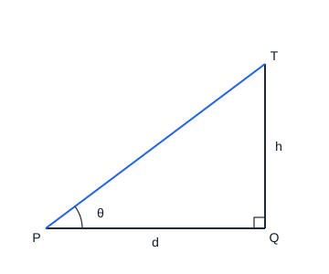

- **தரம்:** 11 · **தலைப்பு:** திரிகோண கணிதம்
- **கற்றல் நோக்கம்:** ஏற்றக்கோணம்.
- **விளக்கம்:** tan θ = h ÷ d.
- **சூத்திரங்கள்:** `F-TRI-RATIOS` $\sin\theta = \frac{opp}{hyp},\ \cos\theta = \frac{adj}{hyp},\ \tan\theta = \frac{opp}{adj}$
- **தொடர்புடைய வினா அடையாளங்கள்:** `MQ-G10C32-A-ELEVATION_-01`, `MQ-G10C32-A-ELEVATION_-02`, `MQ-G10C32-A-ELEVATION_-03`, `MQ-G11C18-G-ELEVATION_-01`, `MQ-G11C18-G-ELEVATION_-02`, `MQ-G11C18-G-ELEVATION_-03`
- **கற்றல் பாதை:** தர மேம்பாடு

## VIS-TRI-DEPR-01 — இரு பொருட்களுக்கான இறக்கக்கோணங்கள்.

<!-- meta {"id": "VIS-TRI-DEPR-01", "asset": "Shared_Assets/Other_Diagrams/TRI-DEPR-01.svg", "grade": 11, "chapter": "G11C18", "formulas": ["F-TRI-RATIOS"], "related_questions": ["MQ-G11C18-A-TWO_ANGLES-01", "MQ-G11C18-A-TWO_ANGLES-02", "MQ-G11C18-A-TWO_ANGLES-03"], "medium": "ta"} -->
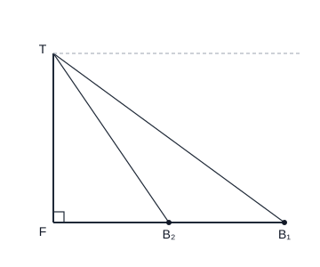

- **தரம்:** 11 · **தலைப்பு:** திரிகோண கணிதம்
- **கற்றல் நோக்கம்:** இரு பொருட்களுக்கான இறக்கக்கோணங்கள்.
- **விளக்கம்:** கிடையிலிருந்து (குற்றுக்கோடு) கீழே; தொலைவிலுள்ளதற்குச் சிறிய கோணம்.
- **சூத்திரங்கள்:** `F-TRI-RATIOS` $\sin\theta = \frac{opp}{hyp},\ \cos\theta = \frac{adj}{hyp},\ \tan\theta = \frac{opp}{adj}$
- **தொடர்புடைய வினா அடையாளங்கள்:** `MQ-G11C18-A-TWO_ANGLES-01`, `MQ-G11C18-A-TWO_ANGLES-02`, `MQ-G11C18-A-TWO_ANGLES-03`
- **கற்றல் பாதை:** தர மேம்பாடு

## VIS-SOL-CYL-01 — உருளை அளவீடுகள்.

<!-- meta {"id": "VIS-SOL-CYL-01", "asset": "Shared_Assets/Other_Diagrams/SOL-CYL-01.svg", "grade": 10, "chapter": "G10C29", "formulas": ["F-MEN-CYLV", "F-MEN-CYLA"], "related_questions": ["MQ-G10C29-F-CYLINDER_V-01", "MQ-G10C29-F-CYLINDER_V-02", "MQ-G10C29-F-CYLINDER_V-03", "MQ-G10C29-F-CYLINDER_V-04", "MQ-G10C29-G-CYLINDER_T-01", "MQ-G10C29-G-CYLINDER_T-02"], "medium": "ta"} -->
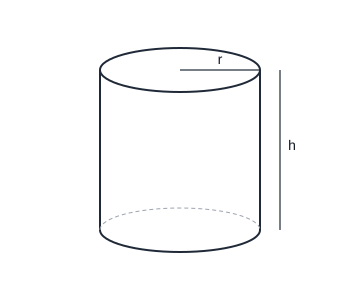

- **தரம்:** 10 · **தலைப்பு:** மேற்பரப்பளவும் கனவளவும்
- **கற்றல் நோக்கம்:** உருளை அளவீடுகள்.
- **விளக்கம்:** வட்ட முனையின் ஆரை r, உயரம் h.
- **சூத்திரங்கள்:** `F-MEN-CYLV` $V = \pi r^2 h$, `F-MEN-CYLA` $\text{CSA} = 2\pi rh,\ \text{TSA} = 2\pi rh + 2\pi r^2$
- **தொடர்புடைய வினா அடையாளங்கள்:** `MQ-G10C29-F-CYLINDER_V-01`, `MQ-G10C29-F-CYLINDER_V-02`, `MQ-G10C29-F-CYLINDER_V-03`, `MQ-G10C29-F-CYLINDER_V-04`, `MQ-G10C29-G-CYLINDER_T-01`, `MQ-G10C29-G-CYLINDER_T-02`
- **கற்றல் பாதை:** தர மேம்பாடு

## VIS-SOL-CONE-01 — கூம்பு: r, h, l.

<!-- meta {"id": "VIS-SOL-CONE-01", "asset": "Shared_Assets/Other_Diagrams/SOL-CONE-01.svg", "grade": 11, "chapter": "G11C04", "formulas": ["F-MEN-CONEA", "F-MEN-CONEV"], "related_questions": ["MQ-G11C04-G-CONE_CSA-01", "MQ-G11C04-G-CONE_CSA-02", "MQ-G11C04-G-CONE_CSA-03", "MQ-G11C04-G-CONE_CSA-04", "MQ-G11C05-F-CONE_VOLUM-01", "MQ-G11C05-F-CONE_VOLUM-02"], "medium": "ta"} -->
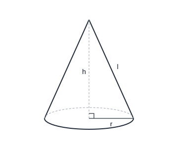

- **தரம்:** 11 · **தலைப்பு:** திண்மங்களின் மேற்பரப்பின் பரப்பளவு
- **கற்றல் நோக்கம்:** கூம்பு: r, h, l.
- **விளக்கம்:** h, r, l செங்கோண முக்கோணி: l² = r² + h².
- **சூத்திரங்கள்:** `F-MEN-CONEA` $\text{CSA} = \pi rl,\ l = \sqrt{r^2+h^2}$, `F-MEN-CONEV` $V = \frac13\pi r^2h$
- **தொடர்புடைய வினா அடையாளங்கள்:** `MQ-G11C04-G-CONE_CSA-01`, `MQ-G11C04-G-CONE_CSA-02`, `MQ-G11C04-G-CONE_CSA-03`, `MQ-G11C04-G-CONE_CSA-04`, `MQ-G11C05-F-CONE_VOLUM-01`, `MQ-G11C05-F-CONE_VOLUM-02`
- **கற்றல் பாதை:** தர மேம்பாடு

## VIS-SOL-HEMI-01 — திண்ம அரைக்கோள மேற்பரப்புகள்.

<!-- meta {"id": "VIS-SOL-HEMI-01", "asset": "Shared_Assets/Other_Diagrams/SOL-HEMI-01.svg", "grade": 11, "chapter": "G11C04", "formulas": ["F-MEN-SPHA"], "related_questions": ["MQ-G11C04-A-HEMISPHERE-01", "MQ-G11C04-A-HEMISPHERE-02", "MQ-G11C04-A-HEMISPHERE-03"], "medium": "ta"} -->
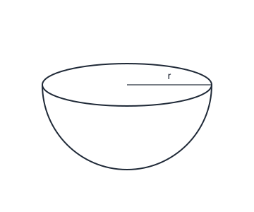

- **தரம்:** 11 · **தலைப்பு:** திண்மங்களின் மேற்பரப்பின் பரப்பளவு
- **கற்றல் நோக்கம்:** திண்ம அரைக்கோள மேற்பரப்புகள்.
- **விளக்கம்:** வளைந்த பகுதி 2πr² + தட்டை வட்டம் πr² = 3πr².
- **சூத்திரங்கள்:** `F-MEN-SPHA` $A = 4\pi r^2\ (\text{hemisphere solid: } 3\pi r^2)$
- **தொடர்புடைய வினா அடையாளங்கள்:** `MQ-G11C04-A-HEMISPHERE-01`, `MQ-G11C04-A-HEMISPHERE-02`, `MQ-G11C04-A-HEMISPHERE-03`
- **கற்றல் பாதை:** தர மேம்பாடு

## VIS-CON-PERPBIS-01 — செங்குத்து இருசமகூறாக்கி அமைத்தல்.

<!-- meta {"id": "VIS-CON-PERPBIS-01", "asset": "Shared_Assets/Constructions/CON-PERPBIS-01.svg", "grade": 10, "chapter": "G10C28", "formulas": ["C-PERPBIS"], "related_questions": ["MQ-G10C28-F-LOCUS_IDEN-01", "MQ-G10C28-F-LOCUS_IDEN-02", "MQ-G10C28-F-LOCUS_IDEN-03", "MQ-G10C28-F-LOCUS_IDEN-04", "MQ-G10C28-G-CONSTRUCT_-01", "MQ-G10C28-G-CONSTRUCT_-02"], "medium": "ta"} -->
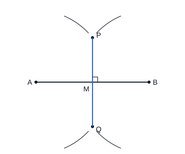

- **தரம்:** 10 · **தலைப்பு:** அமைப்புகள்
- **கற்றல் நோக்கம்:** செங்குத்து இருசமகூறாக்கி அமைத்தல்.
- **விளக்கம்:** A, B இலிருந்து சம ஆரை விற்கள் P, Q இல்; PQ, AB ஐ 90° இல் இருசமகூறிடும்.
- **கணித்த சரிபார்ப்புப் பெறுமானங்கள்:** `{"AP": 140.0, "BP": 140.0}`
**படிமுறை அறிவுறுத்தல்கள்:**
1. நிலை 1: A இலிருந்து விற்கள் (ஆரை > ½AB).
2. நிலை 2: B இலிருந்து அதே ஆரை; P, Q.
3. நிலை 3: PQ இணைக்க.

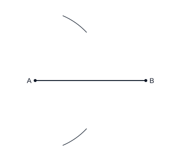 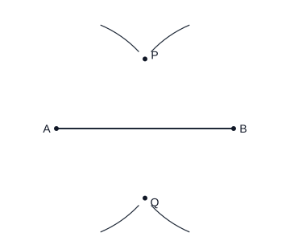 

- **சூத்திரங்கள்:** `C-PERPBIS` $\text{equal arcs from A and B}$
- **தொடர்புடைய வினா அடையாளங்கள்:** `MQ-G10C28-F-LOCUS_IDEN-01`, `MQ-G10C28-F-LOCUS_IDEN-02`, `MQ-G10C28-F-LOCUS_IDEN-03`, `MQ-G10C28-F-LOCUS_IDEN-04`, `MQ-G10C28-G-CONSTRUCT_-01`, `MQ-G10C28-G-CONSTRUCT_-02`
- **கற்றல் பாதை:** தர மேம்பாடு

## VIS-CON-ANGBIS-01 — கோண இருசமகூறாக்கி அமைத்தல்.

<!-- meta {"id": "VIS-CON-ANGBIS-01", "asset": "Shared_Assets/Constructions/CON-ANGBIS-01.svg", "grade": 10, "chapter": "G10C28", "formulas": ["C-ANGBIS"], "related_questions": ["MQ-G10C28-A-CONSTRUCT_-01", "MQ-G11C23-A-CONSTRUCT_-01"], "medium": "ta"} -->
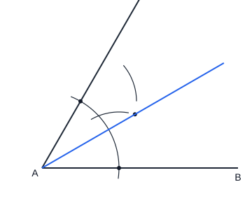

- **தரம்:** 10 · **தலைப்பு:** அமைப்புகள்
- **கற்றல் நோக்கம்:** கோண இருசமகூறாக்கி அமைத்தல்.
- **விளக்கம்:** 60° கோணத்தின் இருசமகூறாக்கி ஒவ்வொரு கையுடனும் 30° (எண்முறையில் சரிபார்க்கப்பட்டது).
- **கணித்த சரிபார்ப்புப் பெறுமானங்கள்:** `{"bisector_angle_deg": 30.0, "half_angle_deg": 30}`
**படிமுறை அறிவுறுத்தல்கள்:**
1. நிலை 1: இரு கைகளையும் வெட்டும் வில்.
2. நிலை 2: அவ்விரு புள்ளிகளிலிருந்தும் சம விற்கள் சந்திக்கும்.
3. நிலை 3: A ஐ சந்திப்புப் புள்ளியுடன் இணைக்க.

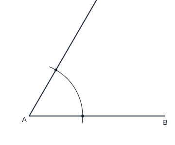 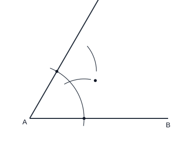 

- **சூத்திரங்கள்:** `C-ANGBIS` $\text{arc on both arms, then equal arcs}$
- **தொடர்புடைய வினா அடையாளங்கள்:** `MQ-G10C28-A-CONSTRUCT_-01`, `MQ-G11C23-A-CONSTRUCT_-01`
- **கற்றல் பாதை:** தர மேம்பாடு

## VIS-CON-TANGENT-01 — ஒரு புள்ளியில் தொடலி அமைத்தல்.

<!-- meta {"id": "VIS-CON-TANGENT-01", "asset": "Shared_Assets/Constructions/CON-TANGENT-01.svg", "grade": 11, "chapter": "G11C23", "formulas": ["C-TANGENT"], "related_questions": ["MQ-G11C23-F-CONSTRUCT_-01", "MQ-G11C23-F-CONSTRUCT_-02", "MQ-G11C23-F-CONSTRUCT_-03"], "medium": "ta"} -->
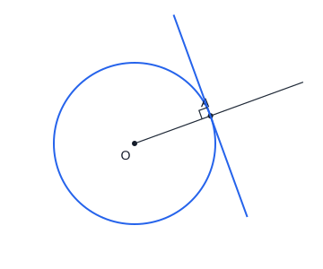

- **தரம்:** 11 · **தலைப்பு:** அமைப்புகள்
- **கற்றல் நோக்கம்:** ஒரு புள்ளியில் தொடலி அமைத்தல்.
- **விளக்கம்:** OA ஐ நீட்டி A இல் செங்குத்து அமைக்க.
**படிமுறை அறிவுறுத்தல்கள்:**
1. நிலை 1: OA இணைத்து நீட்டுக.
2. நிலை 2: A இல் செங்குத்து = தொடலி.

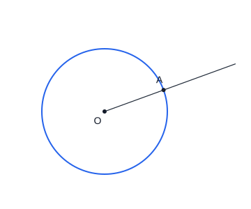 

- **சூத்திரங்கள்:** `C-TANGENT` $\perp OA\ \text{at } A$
- **தொடர்புடைய வினா அடையாளங்கள்:** `MQ-G11C23-F-CONSTRUCT_-01`, `MQ-G11C23-F-CONSTRUCT_-02`, `MQ-G11C23-F-CONSTRUCT_-03`
- **கற்றல் பாதை:** தர மேம்பாடு

## VIS-CON-CIRCUM-01 — சுற்றுவட்டம் அமைத்தல்.

<!-- meta {"id": "VIS-CON-CIRCUM-01", "asset": "Shared_Assets/Constructions/CON-CIRCUM-01.svg", "grade": 11, "chapter": "G11C23", "formulas": ["C-CIRCUM"], "related_questions": ["MQ-G11C23-G-CONSTRUCT_-01"], "medium": "ta"} -->
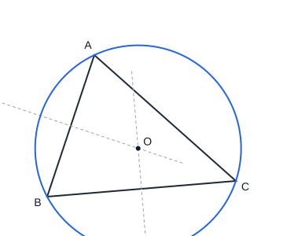

- **தரம்:** 11 · **தலைப்பு:** அமைப்புகள்
- **கற்றல் நோக்கம்:** சுற்றுவட்டம் அமைத்தல்.
- **விளக்கம்:** இரு பக்கங்களின் செங்குத்து இருசமகூறாக்கிகள் O இல்; OA = OB = OC.
- **கணித்த சரிபார்ப்புப் பெறுமானங்கள்:** `{"OA": 131.008646, "OB": 131.008646, "OC": 131.008646}`
**படிமுறை அறிவுறுத்தல்கள்:**
1. நிலை 1: இரு செங்குத்து இருசமகூறாக்கிகள் → O.
2. நிலை 2: மையம் O, A ஊடாக வட்டம்.

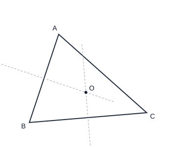 

- **சூத்திரங்கள்:** `C-CIRCUM` $\text{perp. bisectors meet at } O$
- **தொடர்புடைய வினா அடையாளங்கள்:** `MQ-G11C23-G-CONSTRUCT_-01`
- **கற்றல் பாதை:** தர மேம்பாடு

## வரைபு விளக்க அப்பியாசங்கள்

### MQ-G10C21-F-GRADIENT_I-01
<!-- meta {"id": "MQ-G10C21-F-GRADIENT_I-01", "grade": 10, "chapter": "G10C21", "area": "GRA", "medium": "ta", "pathway": "Foundation Mastery", "difficulty": "easy", "formula": "F-GRA-LINE", "diagram": "GRA-LINE-01", "kind": "numeric", "verification": "logic-review", "steps": ["MQ-G10C21-F-GRADIENT_I-01-S1", "MQ-G10C21-F-GRADIENT_I-01-S2"]} -->
**தலைப்பு:** வரைபுகள் · **கற்றல் பாதை:** அடிப்படைத் தேர்ச்சி · **கடினம்:** எளிது · **சூத்திரம்:** `F-GRA-LINE`

**வினா:** $y = -3x  + 1$ என்ற நேர்கோட்டின் படித்திறனையும் y வெட்டுத்துண்டையும் எழுதுக.

**படம்:** `GRA-LINE-01` → `Shared_Assets/Graphs/GRA-LINE-01.svg` (பொதுப் படம் — அளவிடைக்கு வரையப்படவில்லை; வினாவிலுள்ள பெறுமானங்களைப் பயன்படுத்துக)

- **குறிப்பு 1:** x ஐப் பெருக்கும் எண் படித்திறன்.

**படிமுறைத் தீர்வு**

படி 1 — y = mx + c உடன் ஒப்பிடுக. <!-- MQ-G10C21-F-GRADIENT_I-01-S1 -->

$$y = -3x  + 1$$

படி 2 — m படித்திறன், c வெட்டுத்துண்டு. <!-- MQ-G10C21-F-GRADIENT_I-01-S2 -->

$$m = -3,\quad c = 1$$

**இறுதி விடை:** $m=-3,\ c=1$
 **ஏற்கும் விடை வடிவங்கள்:** $m=-3,\ c=1$

சரிபார்ப்பு: தர்க்க ரீதியாக மீளாய்வு (ஆசிரியர் மீளாய்வு பரிந்துரை)

### MQ-G10C21-F-GRADIENT_I-02
<!-- meta {"id": "MQ-G10C21-F-GRADIENT_I-02", "grade": 10, "chapter": "G10C21", "area": "GRA", "medium": "ta", "pathway": "Foundation Mastery", "difficulty": "easy", "formula": "F-GRA-LINE", "diagram": "GRA-LINE-01", "kind": "numeric", "verification": "logic-review", "steps": ["MQ-G10C21-F-GRADIENT_I-02-S1", "MQ-G10C21-F-GRADIENT_I-02-S2"]} -->
**தலைப்பு:** வரைபுகள் · **கற்றல் பாதை:** அடிப்படைத் தேர்ச்சி · **கடினம்:** எளிது · **சூத்திரம்:** `F-GRA-LINE`

**வினா:** $y = \frac{1}{2}x  - 2$ என்ற நேர்கோட்டின் படித்திறனையும் y வெட்டுத்துண்டையும் எழுதுக.

**படம்:** `GRA-LINE-01` → `Shared_Assets/Graphs/GRA-LINE-01.svg` (பொதுப் படம் — அளவிடைக்கு வரையப்படவில்லை; வினாவிலுள்ள பெறுமானங்களைப் பயன்படுத்துக)

- **குறிப்பு 1:** x ஐப் பெருக்கும் எண் படித்திறன்.

**படிமுறைத் தீர்வு**

படி 1 — y = mx + c உடன் ஒப்பிடுக. <!-- MQ-G10C21-F-GRADIENT_I-02-S1 -->

$$y = \frac{1}{2}x  - 2$$

படி 2 — m படித்திறன், c வெட்டுத்துண்டு. <!-- MQ-G10C21-F-GRADIENT_I-02-S2 -->

$$m = \frac{1}{2},\quad c = -2$$

**இறுதி விடை:** $m=\frac{1}{2},\ c=-2$
 **ஏற்கும் விடை வடிவங்கள்:** $m=\frac{1}{2},\ c=-2$

சரிபார்ப்பு: தர்க்க ரீதியாக மீளாய்வு (ஆசிரியர் மீளாய்வு பரிந்துரை)

### MQ-G10C21-F-GRADIENT_I-03
<!-- meta {"id": "MQ-G10C21-F-GRADIENT_I-03", "grade": 10, "chapter": "G10C21", "area": "GRA", "medium": "ta", "pathway": "Foundation Mastery", "difficulty": "easy", "formula": "F-GRA-LINE", "diagram": "GRA-LINE-01", "kind": "numeric", "verification": "logic-review", "steps": ["MQ-G10C21-F-GRADIENT_I-03-S1", "MQ-G10C21-F-GRADIENT_I-03-S2"]} -->
**தலைப்பு:** வரைபுகள் · **கற்றல் பாதை:** அடிப்படைத் தேர்ச்சி · **கடினம்:** எளிது · **சூத்திரம்:** `F-GRA-LINE`

**வினா:** $y = 4x  - 5$ என்ற நேர்கோட்டின் படித்திறனையும் y வெட்டுத்துண்டையும் எழுதுக.

**படம்:** `GRA-LINE-01` → `Shared_Assets/Graphs/GRA-LINE-01.svg` (பொதுப் படம் — அளவிடைக்கு வரையப்படவில்லை; வினாவிலுள்ள பெறுமானங்களைப் பயன்படுத்துக)

- **குறிப்பு 1:** x ஐப் பெருக்கும் எண் படித்திறன்.

**படிமுறைத் தீர்வு**

படி 1 — y = mx + c உடன் ஒப்பிடுக. <!-- MQ-G10C21-F-GRADIENT_I-03-S1 -->

$$y = 4x  - 5$$

படி 2 — m படித்திறன், c வெட்டுத்துண்டு. <!-- MQ-G10C21-F-GRADIENT_I-03-S2 -->

$$m = 4,\quad c = -5$$

**இறுதி விடை:** $m=4,\ c=-5$
 **ஏற்கும் விடை வடிவங்கள்:** $m=4,\ c=-5$

சரிபார்ப்பு: தர்க்க ரீதியாக மீளாய்வு (ஆசிரியர் மீளாய்வு பரிந்துரை)

### MQ-G10C21-F-GRADIENT_I-04
<!-- meta {"id": "MQ-G10C21-F-GRADIENT_I-04", "grade": 10, "chapter": "G10C21", "area": "GRA", "medium": "ta", "pathway": "Foundation Mastery", "difficulty": "easy", "formula": "F-GRA-LINE", "diagram": "GRA-LINE-01", "kind": "numeric", "verification": "logic-review", "steps": ["MQ-G10C21-F-GRADIENT_I-04-S1", "MQ-G10C21-F-GRADIENT_I-04-S2"]} -->
**தலைப்பு:** வரைபுகள் · **கற்றல் பாதை:** அடிப்படைத் தேர்ச்சி · **கடினம்:** எளிது · **சூத்திரம்:** `F-GRA-LINE`

**வினா:** $y = 2x  + 3$ என்ற நேர்கோட்டின் படித்திறனையும் y வெட்டுத்துண்டையும் எழுதுக.

**படம்:** `GRA-LINE-01` → `Shared_Assets/Graphs/GRA-LINE-01.svg` (பொதுப் படம் — அளவிடைக்கு வரையப்படவில்லை; வினாவிலுள்ள பெறுமானங்களைப் பயன்படுத்துக)

- **குறிப்பு 1:** x ஐப் பெருக்கும் எண் படித்திறன்.

**படிமுறைத் தீர்வு**

படி 1 — y = mx + c உடன் ஒப்பிடுக. <!-- MQ-G10C21-F-GRADIENT_I-04-S1 -->

$$y = 2x  + 3$$

படி 2 — m படித்திறன், c வெட்டுத்துண்டு. <!-- MQ-G10C21-F-GRADIENT_I-04-S2 -->

$$m = 2,\quad c = 3$$

**இறுதி விடை:** $m=2,\ c=3$
 **ஏற்கும் விடை வடிவங்கள்:** $m=2,\ c=3$

சரிபார்ப்பு: தர்க்க ரீதியாக மீளாய்வு (ஆசிரியர் மீளாய்வு பரிந்துரை)

### MQ-G10C21-G-GRADIENT_T-01
<!-- meta {"id": "MQ-G10C21-G-GRADIENT_T-01", "grade": 10, "chapter": "G10C21", "area": "GRA", "medium": "ta", "pathway": "Grade Improvement", "difficulty": "medium", "formula": "F-GRA-GRAD", "diagram": "GRA-LINE-01", "kind": "numeric", "verification": "machine-checked", "steps": ["MQ-G10C21-G-GRADIENT_T-01-S1", "MQ-G10C21-G-GRADIENT_T-01-S2", "MQ-G10C21-G-GRADIENT_T-01-S3"]} -->
**தலைப்பு:** வரைபுகள் · **கற்றல் பாதை:** தர மேம்பாடு · **கடினம்:** நடுத்தரம் · **சூத்திரம்:** `F-GRA-GRAD`

**வினா:** (2, 1), (6, 3) ஊடான நேர்கோட்டின் படித்திறனையும் சமன்பாட்டையும் காண்க.

**படம்:** `GRA-LINE-01` → `Shared_Assets/Graphs/GRA-LINE-01.svg` (பொதுப் படம் — அளவிடைக்கு வரையப்படவில்லை; வினாவிலுள்ள பெறுமானங்களைப் பயன்படுத்துக)

- **குறிப்பு 1:** மேலும் கீழும் ஒரே ஒழுங்கில் கழிக்க.

**படிமுறைத் தீர்வு**

படி 1 — படித்திறன் = y மாற்றம் ÷ x மாற்றம். <!-- MQ-G10C21-G-GRADIENT_T-01-S1 -->

$$m = \frac{3 - (1)}{6 - (2)} = \frac{1}{2}$$

படி 2 — ஒரு புள்ளியை y = mx + c இல் பிரதியிடுக. <!-- MQ-G10C21-G-GRADIENT_T-01-S2 -->

$$1 = \frac{1}{2}\times(2) + c \Rightarrow c = 0$$

படி 3 — சமன்பாட்டை எழுதுக. <!-- MQ-G10C21-G-GRADIENT_T-01-S3 -->

$$y = \frac{1}{2}x + 0$$

**இறுதி விடை:** $m=\frac{1}{2},\ y=\frac{1}{2}x + 0$
 **ஏற்கும் விடை வடிவங்கள்:** $m=\frac{1}{2},\ y=\frac{1}{2}x + 0$

சரிபார்ப்பு: கணினியால் சரிபார்க்கப்பட்டது

### MQ-G10C21-G-GRADIENT_T-02
<!-- meta {"id": "MQ-G10C21-G-GRADIENT_T-02", "grade": 10, "chapter": "G10C21", "area": "GRA", "medium": "ta", "pathway": "Grade Improvement", "difficulty": "medium", "formula": "F-GRA-GRAD", "diagram": "GRA-LINE-01", "kind": "numeric", "verification": "machine-checked", "steps": ["MQ-G10C21-G-GRADIENT_T-02-S1", "MQ-G10C21-G-GRADIENT_T-02-S2", "MQ-G10C21-G-GRADIENT_T-02-S3"]} -->
**தலைப்பு:** வரைபுகள் · **கற்றல் பாதை:** தர மேம்பாடு · **கடினம்:** நடுத்தரம் · **சூத்திரம்:** `F-GRA-GRAD`

**வினா:** (0, -2), (2, 4) ஊடான நேர்கோட்டின் படித்திறனையும் சமன்பாட்டையும் காண்க.

**படம்:** `GRA-LINE-01` → `Shared_Assets/Graphs/GRA-LINE-01.svg` (பொதுப் படம் — அளவிடைக்கு வரையப்படவில்லை; வினாவிலுள்ள பெறுமானங்களைப் பயன்படுத்துக)

- **குறிப்பு 1:** மேலும் கீழும் ஒரே ஒழுங்கில் கழிக்க.

**படிமுறைத் தீர்வு**

படி 1 — படித்திறன் = y மாற்றம் ÷ x மாற்றம். <!-- MQ-G10C21-G-GRADIENT_T-02-S1 -->

$$m = \frac{4 - (-2)}{2 - (0)} = 3$$

படி 2 — ஒரு புள்ளியை y = mx + c இல் பிரதியிடுக. <!-- MQ-G10C21-G-GRADIENT_T-02-S2 -->

$$-2 = 3\times(0) + c \Rightarrow c = -2$$

படி 3 — சமன்பாட்டை எழுதுக. <!-- MQ-G10C21-G-GRADIENT_T-02-S3 -->

$$y = 3x - 2$$

**இறுதி விடை:** $m=3,\ y=3x - 2$
 **ஏற்கும் விடை வடிவங்கள்:** $m=3,\ y=3x - 2$

சரிபார்ப்பு: கணினியால் சரிபார்க்கப்பட்டது

## வரம்புகளும் மீளாய்வுக் குறிப்புகளும்

- கணித உள்ளடக்கம் கணினியால் சரிபார்க்கப்பட்ட பொது அடித்தளத்திலிருந்து உருவாக்கப்பட்டது; 'தர்க்க மீளாய்வு' எனக் குறித்தவை (நிறுவல்கள், அமைப்புகள், கருத்துகள்) வெளியிடுமுன் தகுதியான கணித ஆசிரியரால் சரிபார்க்கப்பட வேண்டும்.
- தமிழ்ச் சொற்கள் e-thaksalawa தமிழ்மொழிமூல அத்தியாயத் தலைப்புகளைப் பின்பற்றுகின்றன; ஏனைய சொற்கள் அச்சிட்ட தமிழ்ப் பாடநூல்களுடன் ஒப்பிடப்படவில்லை (இவ்வமர்வில் அணுக முடியவில்லை) — ஆசிரியர் மீளாய்வு தேவை.
- வினாக்கள் குறிக்கும் படங்கள் பொது விளக்கப்படங்கள் (அளவிடையற்றவை). ஊடாடும் பொத்தான்கள் இக்கோப்புகளால் செயற்படுத்தப்படவில்லை; படி அடையாளங்களும் JSON ஏற்றுமதியும் இணைய உருவாக்குநருக்கு உதவும்.
- SVG குறிகள் மொழிசாராதவை (எழுத்துகள், எண்கள்); விளக்கங்கள் இக்கோப்பில். ஊடாடும் பதிப்புகளுக்கான JSON Developer_Resources/Asset_Manifest.json இல்.

