# StudyBuddy — Science Diagram Mastery

> Every diagram is an original SVG drawn in Python for this edition (no textbook figures copied). There are labelled and unlabelled (with number boxes) versions. Each label matches a `<g id=…>` target in the SVG.
> Modes: learn · identify · label · match functions · draw · exam. Interactive drag-and-drop must be built on the website; the data needed is in the meta JSON.

---

## BIO-D01: Plant cell

<!-- meta {"type":"diagram","id":"BIO-D01","chapter_id":"SC10-06","labelled":"science_assets/biology/BIO-D01_labelled.svg","unlabelled":"science_assets/biology/BIO-D01_unlabelled.svg","schematic":true,"labels":[{"label_id":"BIO-D01-L01","svg_target":"BIO-D01-L01-target","key":"wall","ta":"Cell wall","en":"cell wall","function":"Mechanical support, shape"},{"label_id":"BIO-D01-L02","svg_target":"BIO-D01-L02-target","key":"membrane","ta":"Cell membrane","en":"cell membrane","function":"Controls the entry and exit of substances"},{"label_id":"BIO-D01-L03","svg_target":"BIO-D01-L03-target","key":"nucleus","ta":"Nucleus","en":"nucleus","function":"Controls cell activities; DNA"},{"label_id":"BIO-D01-L04","svg_target":"BIO-D01-L04-target","key":"vacuole","ta":"Vacuole","en":"vacuole","function":"Stores cell sap; maintains turgor"},{"label_id":"BIO-D01-L05","svg_target":"BIO-D01-L05-target","key":"chloroplast","ta":"Chloroplast","en":"chloroplast","function":"Photosynthesis"},{"label_id":"BIO-D01-L06","svg_target":"BIO-D01-L06-target","key":"mito","ta":"Mitochondrion","en":"mitochondrion","function":"Aerobic respiration; ATP"},{"label_id":"BIO-D01-L07","svg_target":"BIO-D01-L07-target","key":"cyto","ta":"Cytoplasm","en":"cytoplasm","function":"Where chemical reactions take place"}],"provenance":"original-programmatic-svg"} -->

*Structure and functions of plant and animal cells* · source: original programmatic SVG · ⚠️ schematic — proportions are not exact; teacher review

### 1. Learn mode

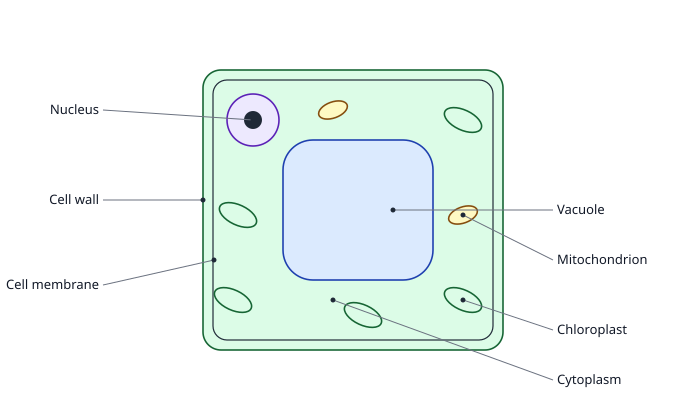

| No. | Part | Function / note | SVG target |
|---|---|---|---|
| 1 | Cell wall | Mechanical support, shape | `BIO-D01-L01-target` |
| 2 | Cell membrane | Controls the entry and exit of substances | `BIO-D01-L02-target` |
| 3 | Nucleus | Controls cell activities; DNA | `BIO-D01-L03-target` |
| 4 | Vacuole | Stores cell sap; maintains turgor | `BIO-D01-L04-target` |
| 5 | Chloroplast | Photosynthesis | `BIO-D01-L05-target` |
| 6 | Mitochondrion | Aerobic respiration; ATP | `BIO-D01-L06-target` |
| 7 | Cytoplasm | Where chemical reactions take place | `BIO-D01-L07-target` |

### 2. Identify mode

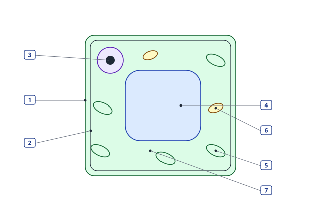

- Which part is shown by number 1?
- Which part is shown by number 2?
- Which part is shown by number 3?
- Which part is shown by number 4?
- Which part is shown by number 5?
- Which part is shown by number 6?
- Which part is shown by number 7?

Answers

1. Cell wall
2. Cell membrane
3. Nucleus
4. Vacuole
5. Chloroplast
6. Mitochondrion
7. Cytoplasm

### 3. Label mode

Put the following names in the number boxes of the unlabelled diagram: Cell membrane · Cell wall · Chloroplast · Cytoplasm · Mitochondrion · Nucleus · Vacuole

### 4. Match functions

| Part | Function (shuffled) |
|---|---|
| A. Cell wall | 1. Controls the entry and exit of substances |
| B. Cell membrane | 2. Photosynthesis |
| C. Nucleus | 3. Stores cell sap; maintains turgor |
| D. Vacuole | 4. Where chemical reactions take place |
| E. Chloroplast | 5. Controls cell activities; DNA |
| F. Mitochondrion | 6. Mechanical support, shape |
| G. Cytoplasm | 7. Aerobic respiration; ATP |

Answers

- A → 6
- B → 1
- C → 5
- D → 3
- E → 2
- F → 7
- G → 4

### 5. Draw mode — checklist

- [ ] Clear, continuous pencil lines
- [ ] Correct proportions and order
- [ ] At least 5 parts labelled; label lines do not cross
- [ ] A title is written

### 6. Exam mode

In the unlabelled diagram (i) name the parts numbered 1 and 2 [2] (ii) give one function of the 'Cell wall' [1].

Marking scheme (original)

(i) 1 — Cell wall; 2 — Cell membrane [1 each] (ii) Mechanical support, shape [1]

---

## BIO-D02: Animal cell

<!-- meta {"type":"diagram","id":"BIO-D02","chapter_id":"SC10-06","labelled":"science_assets/biology/BIO-D02_labelled.svg","unlabelled":"science_assets/biology/BIO-D02_unlabelled.svg","schematic":true,"labels":[{"label_id":"BIO-D02-L01","svg_target":"BIO-D02-L01-target","key":"membrane","ta":"Cell membrane","en":"cell membrane","function":"Controls entry and exit"},{"label_id":"BIO-D02-L02","svg_target":"BIO-D02-L02-target","key":"nucleus","ta":"Nucleus","en":"nucleus","function":"Control centre"},{"label_id":"BIO-D02-L03","svg_target":"BIO-D02-L03-target","key":"nucleolus","ta":"Nucleolus","en":"nucleolus","function":"Makes ribosomes"},{"label_id":"BIO-D02-L04","svg_target":"BIO-D02-L04-target","key":"mito","ta":"Mitochondrion","en":"mitochondrion","function":"Produces energy (ATP)"},{"label_id":"BIO-D02-L05","svg_target":"BIO-D02-L05-target","key":"cyto","ta":"Cytoplasm","en":"cytoplasm","function":"Metabolic reactions"},{"label_id":"BIO-D02-L06","svg_target":"BIO-D02-L06-target","key":"vac","ta":"Small vacuole","en":"small vacuole","function":"Temporary storage"}],"provenance":"original-programmatic-svg"} -->

*Structure and functions of plant and animal cells* · source: original programmatic SVG · ⚠️ schematic — proportions are not exact; teacher review

### 1. Learn mode

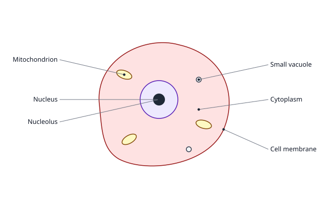

| No. | Part | Function / note | SVG target |
|---|---|---|---|
| 1 | Cell membrane | Controls entry and exit | `BIO-D02-L01-target` |
| 2 | Nucleus | Control centre | `BIO-D02-L02-target` |
| 3 | Nucleolus | Makes ribosomes | `BIO-D02-L03-target` |
| 4 | Mitochondrion | Produces energy (ATP) | `BIO-D02-L04-target` |
| 5 | Cytoplasm | Metabolic reactions | `BIO-D02-L05-target` |
| 6 | Small vacuole | Temporary storage | `BIO-D02-L06-target` |

### 2. Identify mode

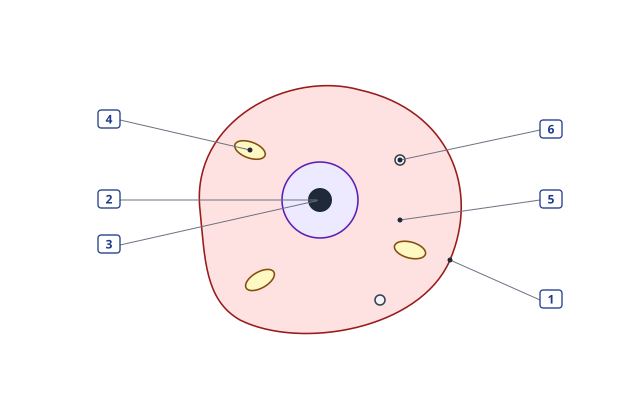

- Which part is shown by number 1?
- Which part is shown by number 2?
- Which part is shown by number 3?
- Which part is shown by number 4?
- Which part is shown by number 5?
- Which part is shown by number 6?

Answers

1. Cell membrane
2. Nucleus
3. Nucleolus
4. Mitochondrion
5. Cytoplasm
6. Small vacuole

### 3. Label mode

Put the following names in the number boxes of the unlabelled diagram: Cell membrane · Cytoplasm · Mitochondrion · Nucleolus · Nucleus · Small vacuole

### 4. Match functions

| Part | Function (shuffled) |
|---|---|
| A. Cell membrane | 1. Control centre |
| B. Nucleus | 2. Makes ribosomes |
| C. Nucleolus | 3. Produces energy (ATP) |
| D. Mitochondrion | 4. Metabolic reactions |
| E. Cytoplasm | 5. Controls entry and exit |
| F. Small vacuole | 6. Temporary storage |

Answers

- A → 5
- B → 1
- C → 2
- D → 3
- E → 4
- F → 6

### 5. Draw mode — checklist

- [ ] Clear, continuous pencil lines
- [ ] Correct proportions and order
- [ ] At least 5 parts labelled; label lines do not cross
- [ ] A title is written

### 6. Exam mode

In the unlabelled diagram (i) name the parts numbered 1 and 2 [2] (ii) give one function of the 'Cell membrane' [1].

Marking scheme (original)

(i) 1 — Cell membrane; 2 — Nucleus [1 each] (ii) Controls entry and exit [1]

---

## BIO-D03: Cross-section of a leaf

<!-- meta {"type":"diagram","id":"BIO-D03","chapter_id":"SC11-02","labelled":"science_assets/biology/BIO-D03_labelled.svg","unlabelled":"science_assets/biology/BIO-D03_unlabelled.svg","schematic":true,"labels":[{"label_id":"BIO-D03-L01","svg_target":"BIO-D03-L01-target","key":"cuticle","ta":"Cuticle","en":"waxy cuticle","function":"Reduces water loss"},{"label_id":"BIO-D03-L02","svg_target":"BIO-D03-L02-target","key":"uepi","ta":"Upper epidermis","en":"upper epidermis","function":"Protection; lets light through"},{"label_id":"BIO-D03-L03","svg_target":"BIO-D03-L03-target","key":"palisade","ta":"Palisade mesophyll","en":"palisade mesophyll","function":"Main site of photosynthesis"},{"label_id":"BIO-D03-L04","svg_target":"BIO-D03-L04-target","key":"spongy","ta":"Spongy mesophyll","en":"spongy mesophyll","function":"Gas exchange — air spaces"},{"label_id":"BIO-D03-L05","svg_target":"BIO-D03-L05-target","key":"xylem","ta":"Xylem","en":"xylem","function":"Transports water and minerals"},{"label_id":"BIO-D03-L06","svg_target":"BIO-D03-L06-target","key":"phloem","ta":"Phloem","en":"phloem","function":"Transports food (sucrose)"},{"label_id":"BIO-D03-L07","svg_target":"BIO-D03-L07-target","key":"lepi","ta":"Lower epidermis","en":"lower epidermis","function":"Protection; stomata"},{"label_id":"BIO-D03-L08","svg_target":"BIO-D03-L08-target","key":"guard","ta":"Guard cell","en":"guard cell","function":"Opens/closes the stoma"},{"label_id":"BIO-D03-L09","svg_target":"BIO-D03-L09-target","key":"stoma","ta":"Stoma","en":"stoma","function":"CO₂ in, O₂/water vapour out"}],"provenance":"original-programmatic-svg"} -->

*Photosynthesis* · source: original programmatic SVG · ⚠️ schematic — proportions are not exact; teacher review

### 1. Learn mode

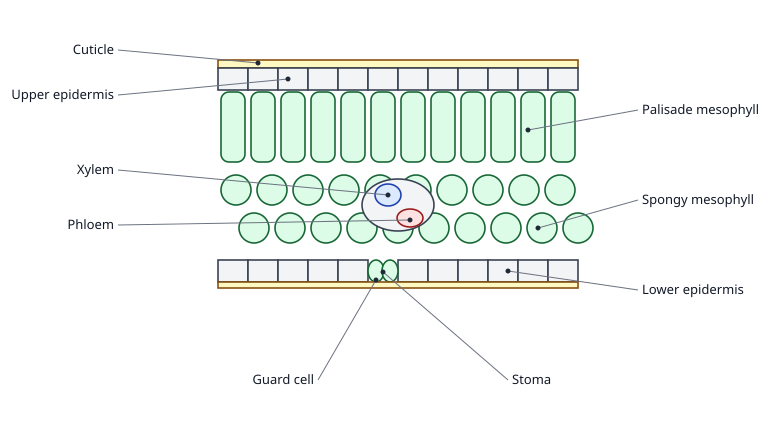

| No. | Part | Function / note | SVG target |
|---|---|---|---|
| 1 | Cuticle | Reduces water loss | `BIO-D03-L01-target` |
| 2 | Upper epidermis | Protection; lets light through | `BIO-D03-L02-target` |
| 3 | Palisade mesophyll | Main site of photosynthesis | `BIO-D03-L03-target` |
| 4 | Spongy mesophyll | Gas exchange — air spaces | `BIO-D03-L04-target` |
| 5 | Xylem | Transports water and minerals | `BIO-D03-L05-target` |
| 6 | Phloem | Transports food (sucrose) | `BIO-D03-L06-target` |
| 7 | Lower epidermis | Protection; stomata | `BIO-D03-L07-target` |
| 8 | Guard cell | Opens/closes the stoma | `BIO-D03-L08-target` |
| 9 | Stoma | CO₂ in, O₂/water vapour out | `BIO-D03-L09-target` |

### 2. Identify mode

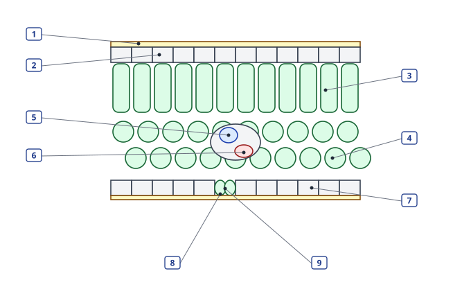

- Which part is shown by number 1?
- Which part is shown by number 2?
- Which part is shown by number 3?
- Which part is shown by number 4?
- Which part is shown by number 5?
- Which part is shown by number 6?
- Which part is shown by number 7?
- Which part is shown by number 8?
- Which part is shown by number 9?

Answers

1. Cuticle
2. Upper epidermis
3. Palisade mesophyll
4. Spongy mesophyll
5. Xylem
6. Phloem
7. Lower epidermis
8. Guard cell
9. Stoma

### 3. Label mode

Put the following names in the number boxes of the unlabelled diagram: Cuticle · Guard cell · Lower epidermis · Palisade mesophyll · Phloem · Spongy mesophyll · Stoma · Upper epidermis · Xylem

### 4. Match functions

| Part | Function (shuffled) |
|---|---|
| A. Cuticle | 1. Reduces water loss |
| B. Upper epidermis | 2. Gas exchange — air spaces |
| C. Palisade mesophyll | 3. Protection; stomata |
| D. Spongy mesophyll | 4. Protection; lets light through |
| E. Xylem | 5. Transports water and minerals |
| F. Phloem | 6. Transports food (sucrose) |
| G. Lower epidermis | 7. CO₂ in, O₂/water vapour out |
| H. Guard cell | 8. Main site of photosynthesis |
| I. Stoma | 9. Opens/closes the stoma |

Answers

- A → 1
- B → 4
- C → 8
- D → 2
- E → 5
- F → 6
- G → 3
- H → 9
- I → 7

### 5. Draw mode — checklist

- [ ] Clear, continuous pencil lines
- [ ] Correct proportions and order
- [ ] At least 5 parts labelled; label lines do not cross
- [ ] A title is written

### 6. Exam mode

In the unlabelled diagram (i) name the parts numbered 1 and 2 [2] (ii) give one function of the 'Cuticle' [1].

Marking scheme (original)

(i) 1 — Cuticle; 2 — Upper epidermis [1 each] (ii) Reduces water loss [1]

---

## BIO-D04: Human heart (schematic)

<!-- meta {"type":"diagram","id":"BIO-D04","chapter_id":"SC11-06","labelled":"science_assets/biology/BIO-D04_labelled.svg","unlabelled":"science_assets/biology/BIO-D04_unlabelled.svg","schematic":true,"labels":[{"label_id":"BIO-D04-L01","svg_target":"BIO-D04-L01-target","key":"ra","ta":"Right atrium","en":"right atrium","function":"Receives deoxygenated blood from the body"},{"label_id":"BIO-D04-L02","svg_target":"BIO-D04-L02-target","key":"rv","ta":"Right ventricle","en":"right ventricle","function":"Pumps blood to the lungs"},{"label_id":"BIO-D04-L03","svg_target":"BIO-D04-L03-target","key":"la","ta":"Left atrium","en":"left atrium","function":"Oxygenated blood from the lungs"},{"label_id":"BIO-D04-L04","svg_target":"BIO-D04-L04-target","key":"lv","ta":"Left ventricle","en":"left ventricle","function":"Pumps to the body — thick wall"},{"label_id":"BIO-D04-L05","svg_target":"BIO-D04-L05-target","key":"septum","ta":"Septum","en":"septum","function":"Keeps blood of the two sides separate"},{"label_id":"BIO-D04-L06","svg_target":"BIO-D04-L06-target","key":"svc","ta":"Superior vena cava","en":"superior vena cava","function":"Blood from the upper body"},{"label_id":"BIO-D04-L07","svg_target":"BIO-D04-L07-target","key":"ivc","ta":"Inferior vena cava","en":"inferior vena cava","function":"Blood from the lower body"},{"label_id":"BIO-D04-L08","svg_target":"BIO-D04-L08-target","key":"aorta","ta":"Aorta","en":"aorta","function":"Oxygenated blood to the body"},{"label_id":"BIO-D04-L09","svg_target":"BIO-D04-L09-target","key":"pa","ta":"Pulmonary artery","en":"pulmonary artery","function":"Deoxygenated blood to the lungs"},{"label_id":"BIO-D04-L10","svg_target":"BIO-D04-L10-target","key":"pv","ta":"Pulmonary vein","en":"pulmonary vein","function":"Oxygenated blood from the lungs"},{"label_id":"BIO-D04-L11","svg_target":"BIO-D04-L11-target","key":"tricuspid","ta":"Tricuspid valve","en":"tricuspid valve","function":"Prevents backflow"},{"label_id":"BIO-D04-L12","svg_target":"BIO-D04-L12-target","key":"bicuspid","ta":"Bicuspid valve","en":"bicuspid valve","function":"Prevents backflow"}],"provenance":"original-programmatic-svg"} -->

*Biological processes in the human body* · source: original programmatic SVG · ⚠️ schematic — proportions are not exact; teacher review

### 1. Learn mode

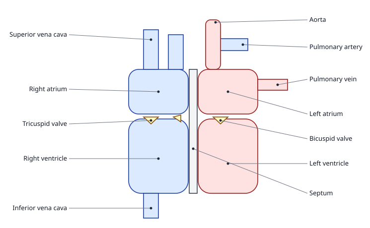

| No. | Part | Function / note | SVG target |
|---|---|---|---|
| 1 | Right atrium | Receives deoxygenated blood from the body | `BIO-D04-L01-target` |
| 2 | Right ventricle | Pumps blood to the lungs | `BIO-D04-L02-target` |
| 3 | Left atrium | Oxygenated blood from the lungs | `BIO-D04-L03-target` |
| 4 | Left ventricle | Pumps to the body — thick wall | `BIO-D04-L04-target` |
| 5 | Septum | Keeps blood of the two sides separate | `BIO-D04-L05-target` |
| 6 | Superior vena cava | Blood from the upper body | `BIO-D04-L06-target` |
| 7 | Inferior vena cava | Blood from the lower body | `BIO-D04-L07-target` |
| 8 | Aorta | Oxygenated blood to the body | `BIO-D04-L08-target` |
| 9 | Pulmonary artery | Deoxygenated blood to the lungs | `BIO-D04-L09-target` |
| 10 | Pulmonary vein | Oxygenated blood from the lungs | `BIO-D04-L10-target` |
| 11 | Tricuspid valve | Prevents backflow | `BIO-D04-L11-target` |
| 12 | Bicuspid valve | Prevents backflow | `BIO-D04-L12-target` |

### 2. Identify mode

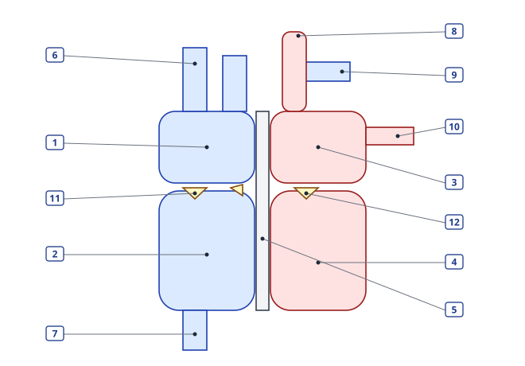

- Which part is shown by number 1?
- Which part is shown by number 2?
- Which part is shown by number 3?
- Which part is shown by number 4?
- Which part is shown by number 5?
- Which part is shown by number 6?
- Which part is shown by number 7?
- Which part is shown by number 8?
- Which part is shown by number 9?
- Which part is shown by number 10?
- Which part is shown by number 11?
- Which part is shown by number 12?

Answers

1. Right atrium
2. Right ventricle
3. Left atrium
4. Left ventricle
5. Septum
6. Superior vena cava
7. Inferior vena cava
8. Aorta
9. Pulmonary artery
10. Pulmonary vein
11. Tricuspid valve
12. Bicuspid valve

### 3. Label mode

Put the following names in the number boxes of the unlabelled diagram: Aorta · Bicuspid valve · Inferior vena cava · Left atrium · Left ventricle · Pulmonary artery · Pulmonary vein · Right atrium · Right ventricle · Septum · Superior vena cava · Tricuspid valve

### 4. Match functions

| Part | Function (shuffled) |
|---|---|
| A. Right atrium | 1. Keeps blood of the two sides separate |
| B. Right ventricle | 2. Pumps blood to the lungs |
| C. Left atrium | 3. Blood from the upper body |
| D. Left ventricle | 4. Prevents backflow |
| E. Septum | 5. Pumps to the body — thick wall |
| F. Superior vena cava | 6. Prevents backflow |
| G. Inferior vena cava | 7. Receives deoxygenated blood from the body |
| H. Aorta | 8. Oxygenated blood from the lungs |
| I. Pulmonary artery | 9. Deoxygenated blood to the lungs |
| J. Pulmonary vein | 10. Oxygenated blood to the body |
| K. Tricuspid valve | 11. Oxygenated blood from the lungs |
| L. Bicuspid valve | 12. Blood from the lower body |

Answers

- A → 7
- B → 2
- C → 8
- D → 5
- E → 1
- F → 3
- G → 12
- H → 10
- I → 9
- J → 8
- K → 4
- L → 4

### 5. Draw mode — checklist

- [ ] Clear, continuous pencil lines
- [ ] Correct proportions and order
- [ ] At least 5 parts labelled; label lines do not cross
- [ ] A title is written

### 6. Exam mode

In the unlabelled diagram (i) name the parts numbered 1 and 2 [2] (ii) give one function of the 'Right atrium' [1].

Marking scheme (original)

(i) 1 — Right atrium; 2 — Right ventricle [1 each] (ii) Receives deoxygenated blood from the body [1]

---

## BIO-D05: Digestive system (schematic)

<!-- meta {"type":"diagram","id":"BIO-D05","chapter_id":"SC11-06","labelled":"science_assets/biology/BIO-D05_labelled.svg","unlabelled":"science_assets/biology/BIO-D05_unlabelled.svg","schematic":true,"labels":[{"label_id":"BIO-D05-L01","svg_target":"BIO-D05-L01-target","key":"mouth","ta":"Mouth cavity","en":"buccal cavity","function":"Chewing; salivary amylase"},{"label_id":"BIO-D05-L02","svg_target":"BIO-D05-L02-target","key":"oes","ta":"Oesophagus","en":"oesophagus","function":"Moves food by peristalsis"},{"label_id":"BIO-D05-L03","svg_target":"BIO-D05-L03-target","key":"liver","ta":"Liver","en":"liver","function":"Produces bile"},{"label_id":"BIO-D05-L04","svg_target":"BIO-D05-L04-target","key":"stomach","ta":"Stomach","en":"stomach","function":"Pepsin, HCl — protein digestion"},{"label_id":"BIO-D05-L05","svg_target":"BIO-D05-L05-target","key":"pancreas","ta":"Pancreas","en":"pancreas","function":"Pancreatic juice (amylase, trypsin, lipase)"},{"label_id":"BIO-D05-L06","svg_target":"BIO-D05-L06-target","key":"si","ta":"Small intestine","en":"small intestine","function":"Digestion completed; absorption (villi)"},{"label_id":"BIO-D05-L07","svg_target":"BIO-D05-L07-target","key":"li","ta":"Large intestine","en":"large intestine","function":"Reabsorbs water"},{"label_id":"BIO-D05-L08","svg_target":"BIO-D05-L08-target","key":"rectum","ta":"Rectum/anus","en":"rectum/anus","function":"Temporary storage and removal of faeces"}],"provenance":"original-programmatic-svg"} -->

*Biological processes in the human body* · source: original programmatic SVG · ⚠️ schematic — proportions are not exact; teacher review

### 1. Learn mode

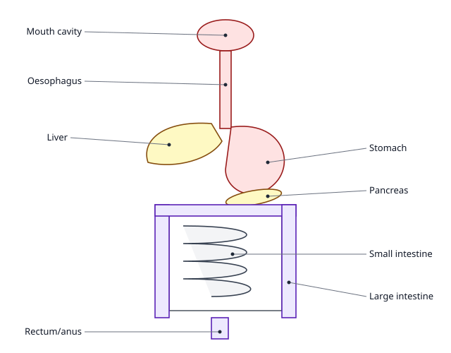

| No. | Part | Function / note | SVG target |
|---|---|---|---|
| 1 | Mouth cavity | Chewing; salivary amylase | `BIO-D05-L01-target` |
| 2 | Oesophagus | Moves food by peristalsis | `BIO-D05-L02-target` |
| 3 | Liver | Produces bile | `BIO-D05-L03-target` |
| 4 | Stomach | Pepsin, HCl — protein digestion | `BIO-D05-L04-target` |
| 5 | Pancreas | Pancreatic juice (amylase, trypsin, lipase) | `BIO-D05-L05-target` |
| 6 | Small intestine | Digestion completed; absorption (villi) | `BIO-D05-L06-target` |
| 7 | Large intestine | Reabsorbs water | `BIO-D05-L07-target` |
| 8 | Rectum/anus | Temporary storage and removal of faeces | `BIO-D05-L08-target` |

### 2. Identify mode

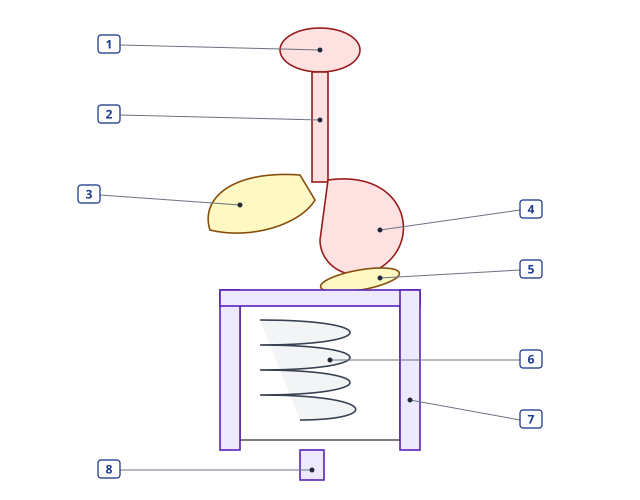

- Which part is shown by number 1?
- Which part is shown by number 2?
- Which part is shown by number 3?
- Which part is shown by number 4?
- Which part is shown by number 5?
- Which part is shown by number 6?
- Which part is shown by number 7?
- Which part is shown by number 8?

Answers

1. Mouth cavity
2. Oesophagus
3. Liver
4. Stomach
5. Pancreas
6. Small intestine
7. Large intestine
8. Rectum/anus

### 3. Label mode

Put the following names in the number boxes of the unlabelled diagram: Large intestine · Liver · Mouth cavity · Oesophagus · Pancreas · Rectum/anus · Small intestine · Stomach

### 4. Match functions

| Part | Function (shuffled) |
|---|---|
| A. Mouth cavity | 1. Reabsorbs water |
| B. Oesophagus | 2. Pancreatic juice (amylase, trypsin, lipase) |
| C. Liver | 3. Moves food by peristalsis |
| D. Stomach | 4. Digestion completed; absorption (villi) |
| E. Pancreas | 5. Temporary storage and removal of faeces |
| F. Small intestine | 6. Produces bile |
| G. Large intestine | 7. Chewing; salivary amylase |
| H. Rectum/anus | 8. Pepsin, HCl — protein digestion |

Answers

- A → 7
- B → 3
- C → 6
- D → 8
- E → 2
- F → 4
- G → 1
- H → 5

### 5. Draw mode — checklist

- [ ] Clear, continuous pencil lines
- [ ] Correct proportions and order
- [ ] At least 5 parts labelled; label lines do not cross
- [ ] A title is written

### 6. Exam mode

In the unlabelled diagram (i) name the parts numbered 1 and 2 [2] (ii) give one function of the 'Mouth cavity' [1].

Marking scheme (original)

(i) 1 — Mouth cavity; 2 — Oesophagus [1 each] (ii) Chewing; salivary amylase [1]

---

## BIO-D06: Respiratory system

<!-- meta {"type":"diagram","id":"BIO-D06","chapter_id":"SC11-06","labelled":"science_assets/biology/BIO-D06_labelled.svg","unlabelled":"science_assets/biology/BIO-D06_unlabelled.svg","schematic":true,"labels":[{"label_id":"BIO-D06-L01","svg_target":"BIO-D06-L01-target","key":"trachea","ta":"Trachea","en":"trachea","function":"C-shaped cartilage rings — keep it open"},{"label_id":"BIO-D06-L02","svg_target":"BIO-D06-L02-target","key":"bronchus","ta":"Bronchus","en":"bronchus","function":"Carries air to the lungs"},{"label_id":"BIO-D06-L03","svg_target":"BIO-D06-L03-target","key":"bronchiole","ta":"Bronchiole","en":"bronchiole","function":"Air to the alveoli"},{"label_id":"BIO-D06-L04","svg_target":"BIO-D06-L04-target","key":"lung","ta":"Lung","en":"lung","function":"Gas exchange (alveoli)"},{"label_id":"BIO-D06-L05","svg_target":"BIO-D06-L05-target","key":"diaphragm","ta":"Diaphragm","en":"diaphragm","function":"Flattens when it contracts — inhalation"},{"label_id":"BIO-D06-L06","svg_target":"BIO-D06-L06-target","key":"ribs","ta":"Ribs","en":"ribs","function":"Change thoracic volume with the intercostal muscles"}],"provenance":"original-programmatic-svg"} -->

*Biological processes in the human body* · source: original programmatic SVG · ⚠️ schematic — proportions are not exact; teacher review

### 1. Learn mode

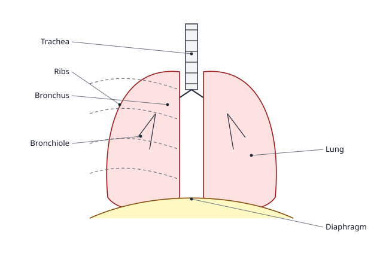

| No. | Part | Function / note | SVG target |
|---|---|---|---|
| 1 | Trachea | C-shaped cartilage rings — keep it open | `BIO-D06-L01-target` |
| 2 | Bronchus | Carries air to the lungs | `BIO-D06-L02-target` |
| 3 | Bronchiole | Air to the alveoli | `BIO-D06-L03-target` |
| 4 | Lung | Gas exchange (alveoli) | `BIO-D06-L04-target` |
| 5 | Diaphragm | Flattens when it contracts — inhalation | `BIO-D06-L05-target` |
| 6 | Ribs | Change thoracic volume with the intercostal muscles | `BIO-D06-L06-target` |

### 2. Identify mode

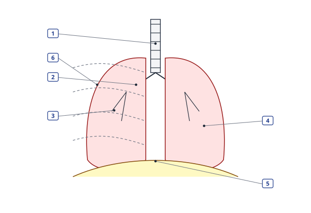

- Which part is shown by number 1?
- Which part is shown by number 2?
- Which part is shown by number 3?
- Which part is shown by number 4?
- Which part is shown by number 5?
- Which part is shown by number 6?

Answers

1. Trachea
2. Bronchus
3. Bronchiole
4. Lung
5. Diaphragm
6. Ribs

### 3. Label mode

Put the following names in the number boxes of the unlabelled diagram: Bronchiole · Bronchus · Diaphragm · Lung · Ribs · Trachea

### 4. Match functions

| Part | Function (shuffled) |
|---|---|
| A. Trachea | 1. Change thoracic volume with the intercostal muscles |
| B. Bronchus | 2. Air to the alveoli |
| C. Bronchiole | 3. C-shaped cartilage rings — keep it open |
| D. Lung | 4. Flattens when it contracts — inhalation |
| E. Diaphragm | 5. Carries air to the lungs |
| F. Ribs | 6. Gas exchange (alveoli) |

Answers

- A → 3
- B → 5
- C → 2
- D → 6
- E → 4
- F → 1

### 5. Draw mode — checklist

- [ ] Clear, continuous pencil lines
- [ ] Correct proportions and order
- [ ] At least 5 parts labelled; label lines do not cross
- [ ] A title is written

### 6. Exam mode

In the unlabelled diagram (i) name the parts numbered 1 and 2 [2] (ii) give one function of the 'Trachea' [1].

Marking scheme (original)

(i) 1 — Trachea; 2 — Bronchus [1 each] (ii) C-shaped cartilage rings — keep it open [1]

---

## BIO-D07: Nephron (schematic)

<!-- meta {"type":"diagram","id":"BIO-D07","chapter_id":"SC11-06","labelled":"science_assets/biology/BIO-D07_labelled.svg","unlabelled":"science_assets/biology/BIO-D07_unlabelled.svg","schematic":true,"labels":[{"label_id":"BIO-D07-L01","svg_target":"BIO-D07-L01-target","key":"glom","ta":"Glomerulus","en":"glomerulus","function":"Pressure filtration (ultrafiltration)"},{"label_id":"BIO-D07-L02","svg_target":"BIO-D07-L02-target","key":"bowman","ta":"Bowman's capsule","en":"Bowman's capsule","function":"Collects the filtrate"},{"label_id":"BIO-D07-L03","svg_target":"BIO-D07-L03-target","key":"pct","ta":"Proximal convoluted tubule","en":"proximal convoluted tubule","function":"Reabsorbs glucose and amino acids"},{"label_id":"BIO-D07-L04","svg_target":"BIO-D07-L04-target","key":"loop","ta":"Loop of Henle","en":"loop of Henle","function":"Reabsorbs water and salt"},{"label_id":"BIO-D07-L05","svg_target":"BIO-D07-L05-target","key":"dct","ta":"Distal convoluted tubule","en":"distal convoluted tubule","function":"Maintains ion balance"},{"label_id":"BIO-D07-L06","svg_target":"BIO-D07-L06-target","key":"cd","ta":"Collecting duct","en":"collecting duct","function":"Water reabsorption controlled by ADH"}],"provenance":"original-programmatic-svg"} -->

*Biological processes in the human body* · source: original programmatic SVG · ⚠️ schematic — proportions are not exact; teacher review

### 1. Learn mode

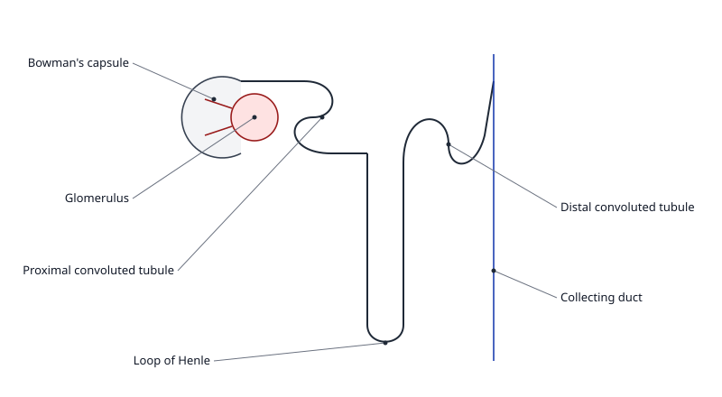

| No. | Part | Function / note | SVG target |
|---|---|---|---|
| 1 | Glomerulus | Pressure filtration (ultrafiltration) | `BIO-D07-L01-target` |
| 2 | Bowman's capsule | Collects the filtrate | `BIO-D07-L02-target` |
| 3 | Proximal convoluted tubule | Reabsorbs glucose and amino acids | `BIO-D07-L03-target` |
| 4 | Loop of Henle | Reabsorbs water and salt | `BIO-D07-L04-target` |
| 5 | Distal convoluted tubule | Maintains ion balance | `BIO-D07-L05-target` |
| 6 | Collecting duct | Water reabsorption controlled by ADH | `BIO-D07-L06-target` |

### 2. Identify mode

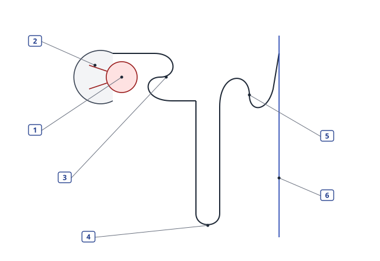

- Which part is shown by number 1?
- Which part is shown by number 2?
- Which part is shown by number 3?
- Which part is shown by number 4?
- Which part is shown by number 5?
- Which part is shown by number 6?

Answers

1. Glomerulus
2. Bowman's capsule
3. Proximal convoluted tubule
4. Loop of Henle
5. Distal convoluted tubule
6. Collecting duct

### 3. Label mode

Put the following names in the number boxes of the unlabelled diagram: Bowman's capsule · Collecting duct · Distal convoluted tubule · Glomerulus · Loop of Henle · Proximal convoluted tubule

### 4. Match functions

| Part | Function (shuffled) |
|---|---|
| A. Glomerulus | 1. Maintains ion balance |
| B. Bowman's capsule | 2. Water reabsorption controlled by ADH |
| C. Proximal convoluted tubule | 3. Reabsorbs water and salt |
| D. Loop of Henle | 4. Reabsorbs glucose and amino acids |
| E. Distal convoluted tubule | 5. Pressure filtration (ultrafiltration) |
| F. Collecting duct | 6. Collects the filtrate |

Answers

- A → 5
- B → 6
- C → 4
- D → 3
- E → 1
- F → 2

### 5. Draw mode — checklist

- [ ] Clear, continuous pencil lines
- [ ] Correct proportions and order
- [ ] At least 5 parts labelled; label lines do not cross
- [ ] A title is written

### 6. Exam mode

In the unlabelled diagram (i) name the parts numbered 1 and 2 [2] (ii) give one function of the 'Glomerulus' [1].

Marking scheme (original)

(i) 1 — Glomerulus; 2 — Bowman's capsule [1 each] (ii) Pressure filtration (ultrafiltration) [1]

---

## BIO-D08: Longitudinal section of a flower

<!-- meta {"type":"diagram","id":"BIO-D08","chapter_id":"SC10-14","labelled":"science_assets/biology/BIO-D08_labelled.svg","unlabelled":"science_assets/biology/BIO-D08_unlabelled.svg","schematic":true,"labels":[{"label_id":"BIO-D08-L01","svg_target":"BIO-D08-L01-target","key":"stigma","ta":"Stigma","en":"stigma","function":"Receives pollen grains"},{"label_id":"BIO-D08-L02","svg_target":"BIO-D08-L02-target","key":"style","ta":"Style","en":"style","function":"Path along which the pollen tube grows"},{"label_id":"BIO-D08-L03","svg_target":"BIO-D08-L03-target","key":"ovary","ta":"Ovary","en":"ovary","function":"Contains ovules; becomes the fruit"},{"label_id":"BIO-D08-L04","svg_target":"BIO-D08-L04-target","key":"ovule","ta":"Ovule","en":"ovule","function":"Becomes the seed after fertilisation"},{"label_id":"BIO-D08-L05","svg_target":"BIO-D08-L05-target","key":"anther","ta":"Anther","en":"anther","function":"Produces pollen grains"},{"label_id":"BIO-D08-L06","svg_target":"BIO-D08-L06-target","key":"filament","ta":"Filament","en":"filament","function":"Supports the anther"},{"label_id":"BIO-D08-L07","svg_target":"BIO-D08-L07-target","key":"petal","ta":"Petal","en":"petal","function":"Attracts insects"},{"label_id":"BIO-D08-L08","svg_target":"BIO-D08-L08-target","key":"sepal","ta":"Sepal","en":"sepal","function":"Protects the bud"},{"label_id":"BIO-D08-L09","svg_target":"BIO-D08-L09-target","key":"recept","ta":"Receptacle","en":"receptacle","function":"Supports the flower parts"}],"provenance":"original-programmatic-svg"} -->

*Continuity of life* · source: original programmatic SVG · ⚠️ schematic — proportions are not exact; teacher review

### 1. Learn mode

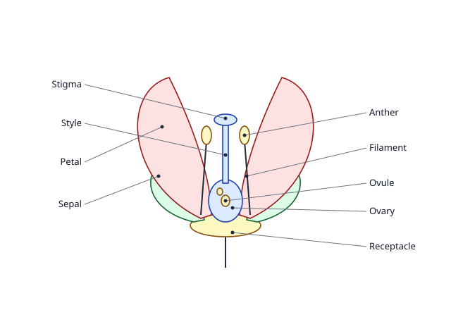

| No. | Part | Function / note | SVG target |
|---|---|---|---|
| 1 | Stigma | Receives pollen grains | `BIO-D08-L01-target` |
| 2 | Style | Path along which the pollen tube grows | `BIO-D08-L02-target` |
| 3 | Ovary | Contains ovules; becomes the fruit | `BIO-D08-L03-target` |
| 4 | Ovule | Becomes the seed after fertilisation | `BIO-D08-L04-target` |
| 5 | Anther | Produces pollen grains | `BIO-D08-L05-target` |
| 6 | Filament | Supports the anther | `BIO-D08-L06-target` |
| 7 | Petal | Attracts insects | `BIO-D08-L07-target` |
| 8 | Sepal | Protects the bud | `BIO-D08-L08-target` |
| 9 | Receptacle | Supports the flower parts | `BIO-D08-L09-target` |

### 2. Identify mode

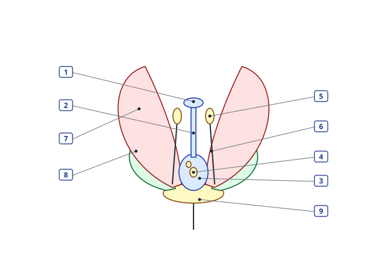

- Which part is shown by number 1?
- Which part is shown by number 2?
- Which part is shown by number 3?
- Which part is shown by number 4?
- Which part is shown by number 5?
- Which part is shown by number 6?
- Which part is shown by number 7?
- Which part is shown by number 8?
- Which part is shown by number 9?

Answers

1. Stigma
2. Style
3. Ovary
4. Ovule
5. Anther
6. Filament
7. Petal
8. Sepal
9. Receptacle

### 3. Label mode

Put the following names in the number boxes of the unlabelled diagram: Anther · Filament · Ovary · Ovule · Petal · Receptacle · Sepal · Stigma · Style

### 4. Match functions

| Part | Function (shuffled) |
|---|---|
| A. Stigma | 1. Path along which the pollen tube grows |
| B. Style | 2. Produces pollen grains |
| C. Ovary | 3. Receives pollen grains |
| D. Ovule | 4. Protects the bud |
| E. Anther | 5. Supports the flower parts |
| F. Filament | 6. Becomes the seed after fertilisation |
| G. Petal | 7. Attracts insects |
| H. Sepal | 8. Contains ovules; becomes the fruit |
| I. Receptacle | 9. Supports the anther |

Answers

- A → 3
- B → 1
- C → 8
- D → 6
- E → 2
- F → 9
- G → 7
- H → 4
- I → 5

### 5. Draw mode — checklist

- [ ] Clear, continuous pencil lines
- [ ] Correct proportions and order
- [ ] At least 5 parts labelled; label lines do not cross
- [ ] A title is written

### 6. Exam mode

In the unlabelled diagram (i) name the parts numbered 1 and 2 [2] (ii) give one function of the 'Stigma' [1].

Marking scheme (original)

(i) 1 — Stigma; 2 — Style [1 each] (ii) Receives pollen grains [1]

---

## BIO-D09: Pond food web (model)

<!-- meta {"type":"diagram","id":"BIO-D09","chapter_id":"SC10-13","labelled":"science_assets/biology/BIO-D09_labelled.svg","unlabelled":"science_assets/biology/BIO-D09_unlabelled.svg","schematic":true,"labels":[{"label_id":"BIO-D09-L01","svg_target":"BIO-D09-L01-target","key":"alg","ta":"Algae","en":"algae","function":""},{"label_id":"BIO-D09-L02","svg_target":"BIO-D09-L02-target","key":"hyd","ta":"Water plant","en":"Hydrilla","function":""},{"label_id":"BIO-D09-L03","svg_target":"BIO-D09-L03-target","key":"zoo","ta":"Zooplankton","en":"zooplankton","function":""},{"label_id":"BIO-D09-L04","svg_target":"BIO-D09-L04-target","key":"snail","ta":"Snail","en":"snail","function":""},{"label_id":"BIO-D09-L05","svg_target":"BIO-D09-L05-target","key":"tad","ta":"Tadpole","en":"tadpole","function":""},{"label_id":"BIO-D09-L06","svg_target":"BIO-D09-L06-target","key":"fish","ta":"Small fish","en":"small fish","function":""},{"label_id":"BIO-D09-L07","svg_target":"BIO-D09-L07-target","key":"king","ta":"Kingfisher","en":"kingfisher","function":""}],"provenance":"original-programmatic-svg"} -->

*Biosphere* · source: original programmatic SVG · ⚠️ schematic — proportions are not exact; teacher review

### 1. Learn mode

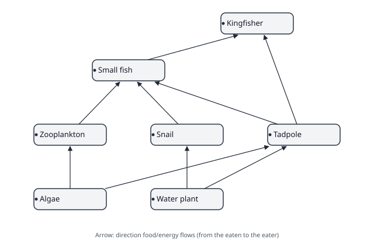

| No. | Part | Function / note | SVG target |
|---|---|---|---|
| 1 | Algae | — | `BIO-D09-L01-target` |
| 2 | Water plant | — | `BIO-D09-L02-target` |
| 3 | Zooplankton | — | `BIO-D09-L03-target` |
| 4 | Snail | — | `BIO-D09-L04-target` |
| 5 | Tadpole | — | `BIO-D09-L05-target` |
| 6 | Small fish | — | `BIO-D09-L06-target` |
| 7 | Kingfisher | — | `BIO-D09-L07-target` |

### 2. Identify mode

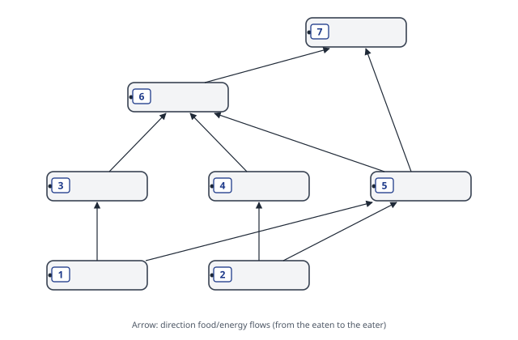

- Which part is shown by number 1?
- Which part is shown by number 2?
- Which part is shown by number 3?
- Which part is shown by number 4?
- Which part is shown by number 5?
- Which part is shown by number 6?
- Which part is shown by number 7?

Answers

1. Algae
2. Water plant
3. Zooplankton
4. Snail
5. Tadpole
6. Small fish
7. Kingfisher

### 3. Label mode

Put the following names in the number boxes of the unlabelled diagram: Algae · Kingfisher · Small fish · Snail · Tadpole · Water plant · Zooplankton

### 5. Draw mode — checklist

- [ ] Clear, continuous pencil lines
- [ ] Correct proportions and order
- [ ] At least 5 parts labelled; label lines do not cross
- [ ] A title is written

### 6. Exam mode

In the unlabelled diagram (i) name the parts numbered 1 and 2 [2] (ii) give one function of the 'Algae' [1].

Marking scheme (original)

(i) 1 — Algae; 2 — Water plant [1 each] (ii) a suitable function [1]

---

## BIO-D10: Punnett square: Tt × Tt

<!-- meta {"type":"diagram","id":"BIO-D10","chapter_id":"SC10-20","labelled":"science_assets/biology/BIO-D10_labelled.svg","unlabelled":"science_assets/biology/BIO-D10_unlabelled.svg","schematic":true,"labels":[{"label_id":"BIO-D10-L01","svg_target":"BIO-D10-L01-target","key":"c1","ta":"Homozygous tall (TT)","en":"homozygous tall","function":""},{"label_id":"BIO-D10-L02","svg_target":"BIO-D10-L02-target","key":"c2","ta":"Heterozygous tall (Tt)","en":"heterozygous tall","function":""},{"label_id":"BIO-D10-L03","svg_target":"BIO-D10-L03-target","key":"c4","ta":"Homozygous dwarf (tt)","en":"homozygous dwarf","function":"The recessive trait is expressed"}],"provenance":"original-programmatic-svg"} -->

*Inheritance* · source: original programmatic SVG · ⚠️ schematic — proportions are not exact; teacher review

### 1. Learn mode

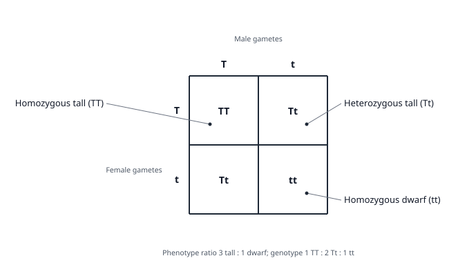

| No. | Part | Function / note | SVG target |
|---|---|---|---|
| 1 | Homozygous tall (TT) | — | `BIO-D10-L01-target` |
| 2 | Heterozygous tall (Tt) | — | `BIO-D10-L02-target` |
| 3 | Homozygous dwarf (tt) | The recessive trait is expressed | `BIO-D10-L03-target` |

### 2. Identify mode

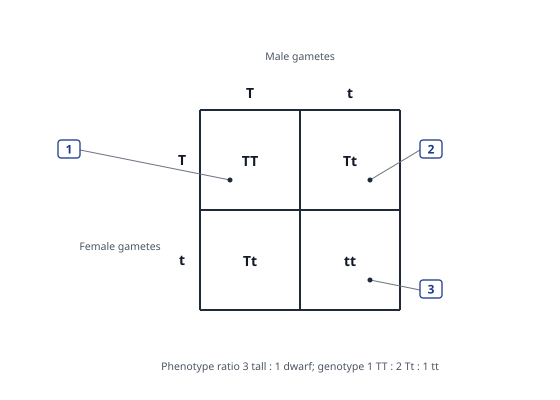

- Which part is shown by number 1?
- Which part is shown by number 2?
- Which part is shown by number 3?

Answers

1. Homozygous tall (TT)
2. Heterozygous tall (Tt)
3. Homozygous dwarf (tt)

### 3. Label mode

Put the following names in the number boxes of the unlabelled diagram: Heterozygous tall (Tt) · Homozygous dwarf (tt) · Homozygous tall (TT)

### 5. Draw mode — checklist

- [ ] Clear, continuous pencil lines
- [ ] Correct proportions and order
- [ ] At least 3 parts labelled; label lines do not cross
- [ ] A title is written

### 6. Exam mode

In the unlabelled diagram (i) name the parts numbered 1 and 2 [2] (ii) give one function of the 'Homozygous tall (TT)' [1].

Marking scheme (original)

(i) 1 — Homozygous tall (TT); 2 — Heterozygous tall (Tt) [1 each] (ii) a suitable function [1]

---

## BIO-D11: Human eye (schematic)

<!-- meta {"type":"diagram","id":"BIO-D11","chapter_id":"SC11-05","labelled":"science_assets/biology/BIO-D11_labelled.svg","unlabelled":"science_assets/biology/BIO-D11_unlabelled.svg","schematic":true,"labels":[{"label_id":"BIO-D11-L01","svg_target":"BIO-D11-L01-target","key":"cornea","ta":"Cornea","en":"cornea","function":"Refracts light — most of it"},{"label_id":"BIO-D11-L02","svg_target":"BIO-D11-L02-target","key":"iris","ta":"Iris","en":"iris","function":"Controls the size of the pupil"},{"label_id":"BIO-D11-L03","svg_target":"BIO-D11-L03-target","key":"pupil","ta":"Pupil","en":"pupil","function":"Opening through which light enters"},{"label_id":"BIO-D11-L04","svg_target":"BIO-D11-L04-target","key":"lens","ta":"Lens","en":"lens","function":"Adjusts the focal length"},{"label_id":"BIO-D11-L05","svg_target":"BIO-D11-L05-target","key":"retina","ta":"Retina","en":"retina","function":"Light-sensitive layer where the image forms"},{"label_id":"BIO-D11-L06","svg_target":"BIO-D11-L06-target","key":"nerve","ta":"Optic nerve","en":"optic nerve","function":"Impulses to the brain"}],"provenance":"original-programmatic-svg"} -->

*Geometrical optics* · source: original programmatic SVG · ⚠️ schematic — proportions are not exact; teacher review

### 1. Learn mode

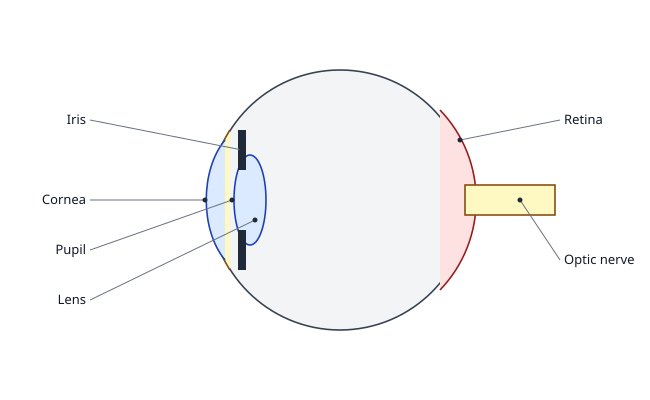

| No. | Part | Function / note | SVG target |
|---|---|---|---|
| 1 | Cornea | Refracts light — most of it | `BIO-D11-L01-target` |
| 2 | Iris | Controls the size of the pupil | `BIO-D11-L02-target` |
| 3 | Pupil | Opening through which light enters | `BIO-D11-L03-target` |
| 4 | Lens | Adjusts the focal length | `BIO-D11-L04-target` |
| 5 | Retina | Light-sensitive layer where the image forms | `BIO-D11-L05-target` |
| 6 | Optic nerve | Impulses to the brain | `BIO-D11-L06-target` |

### 2. Identify mode

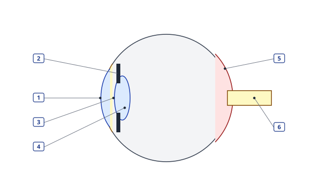

- Which part is shown by number 1?
- Which part is shown by number 2?
- Which part is shown by number 3?
- Which part is shown by number 4?
- Which part is shown by number 5?
- Which part is shown by number 6?

Answers

1. Cornea
2. Iris
3. Pupil
4. Lens
5. Retina
6. Optic nerve

### 3. Label mode

Put the following names in the number boxes of the unlabelled diagram: Cornea · Iris · Lens · Optic nerve · Pupil · Retina

### 4. Match functions

| Part | Function (shuffled) |
|---|---|
| A. Cornea | 1. Opening through which light enters |
| B. Iris | 2. Controls the size of the pupil |
| C. Pupil | 3. Adjusts the focal length |
| D. Lens | 4. Impulses to the brain |
| E. Retina | 5. Light-sensitive layer where the image forms |
| F. Optic nerve | 6. Refracts light — most of it |

Answers

- A → 6
- B → 2
- C → 1
- D → 3
- E → 5
- F → 4

### 5. Draw mode — checklist

- [ ] Clear, continuous pencil lines
- [ ] Correct proportions and order
- [ ] At least 5 parts labelled; label lines do not cross
- [ ] A title is written

### 6. Exam mode

In the unlabelled diagram (i) name the parts numbered 1 and 2 [2] (ii) give one function of the 'Cornea' [1].

Marking scheme (original)

(i) 1 — Cornea; 2 — Iris [1 each] (ii) Refracts light — most of it [1]

---

## CHE-D01: Electronic configuration of a sodium atom (2,8,1)

<!-- meta {"type":"diagram","id":"CHE-D01","chapter_id":"SC10-03","labelled":"science_assets/chemistry/CHE-D01_labelled.svg","unlabelled":"science_assets/chemistry/CHE-D01_unlabelled.svg","schematic":true,"labels":[{"label_id":"CHE-D01-L01","svg_target":"CHE-D01-L01-target","key":"nucleus","ta":"Nucleus","en":"nucleus","function":"Protons and neutrons"},{"label_id":"CHE-D01-L02","svg_target":"CHE-D01-L02-target","key":"e","ta":"Electron","en":"electron","function":"Negative charge; in shells"},{"label_id":"CHE-D01-L03","svg_target":"CHE-D01-L03-target","key":"shell1","ta":"First energy level","en":"first shell (K)","function":"Maximum 2 electrons"},{"label_id":"CHE-D01-L04","svg_target":"CHE-D01-L04-target","key":"shell2","ta":"Second energy level","en":"second shell (L)","function":"Maximum 8"},{"label_id":"CHE-D01-L05","svg_target":"CHE-D01-L05-target","key":"valence","ta":"Valence shell","en":"valence shell","function":"1 electron — Group 1"}],"provenance":"original-programmatic-svg"} -->

*Structure of matter* · source: original programmatic SVG

### 1. Learn mode

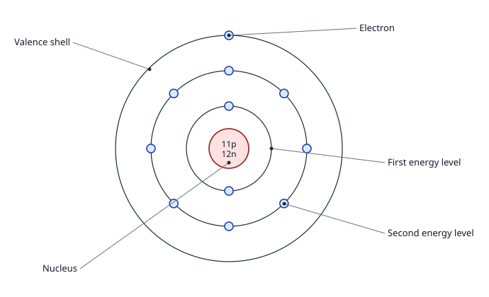

| No. | Part | Function / note | SVG target |
|---|---|---|---|
| 1 | Nucleus | Protons and neutrons | `CHE-D01-L01-target` |
| 2 | Electron | Negative charge; in shells | `CHE-D01-L02-target` |
| 3 | First energy level | Maximum 2 electrons | `CHE-D01-L03-target` |
| 4 | Second energy level | Maximum 8 | `CHE-D01-L04-target` |
| 5 | Valence shell | 1 electron — Group 1 | `CHE-D01-L05-target` |

### 2. Identify mode

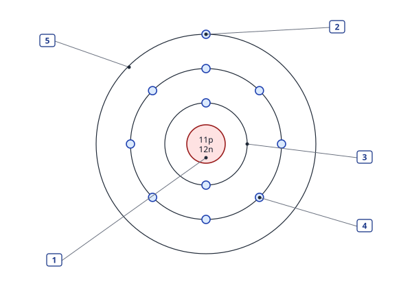

- Which part is shown by number 1?
- Which part is shown by number 2?
- Which part is shown by number 3?
- Which part is shown by number 4?
- Which part is shown by number 5?

Answers

1. Nucleus
2. Electron
3. First energy level
4. Second energy level
5. Valence shell

### 3. Label mode

Put the following names in the number boxes of the unlabelled diagram: Electron · First energy level · Nucleus · Second energy level · Valence shell

### 4. Match functions

| Part | Function (shuffled) |
|---|---|
| A. Nucleus | 1. 1 electron — Group 1 |
| B. Electron | 2. Protons and neutrons |
| C. First energy level | 3. Maximum 2 electrons |
| D. Second energy level | 4. Negative charge; in shells |
| E. Valence shell | 5. Maximum 8 |

Answers

- A → 2
- B → 4
- C → 3
- D → 5
- E → 1

### 5. Draw mode — checklist

- [ ] Clear, continuous pencil lines
- [ ] Correct proportions and order
- [ ] At least 5 parts labelled; label lines do not cross
- [ ] A title is written

### 6. Exam mode

In the unlabelled diagram (i) name the parts numbered 1 and 2 [2] (ii) give one function of the 'Nucleus' [1].

Marking scheme (original)

(i) 1 — Nucleus; 2 — Electron [1 each] (ii) Protons and neutrons [1]

---

## CHE-D02: Electrolytic cell

<!-- meta {"type":"diagram","id":"CHE-D02","chapter_id":"SC11-12","labelled":"science_assets/chemistry/CHE-D02_labelled.svg","unlabelled":"science_assets/chemistry/CHE-D02_unlabelled.svg","schematic":true,"labels":[{"label_id":"CHE-D02-L01","svg_target":"CHE-D02-L01-target","key":"anode","ta":"Anode (+)","en":"anode","function":"Oxidation — anions lose electrons"},{"label_id":"CHE-D02-L02","svg_target":"CHE-D02-L02-target","key":"cathode","ta":"Cathode (−)","en":"cathode","function":"Reduction — cations gain electrons"},{"label_id":"CHE-D02-L03","svg_target":"CHE-D02-L03-target","key":"electrolyte","ta":"Electrolyte","en":"electrolyte","function":"Ions move and conduct electricity"},{"label_id":"CHE-D02-L04","svg_target":"CHE-D02-L04-target","key":"battery","ta":"Battery","en":"battery (d.c.)","function":"DC power supply"}],"provenance":"original-programmatic-svg"} -->

*Electrochemistry* · source: original programmatic SVG

### 1. Learn mode

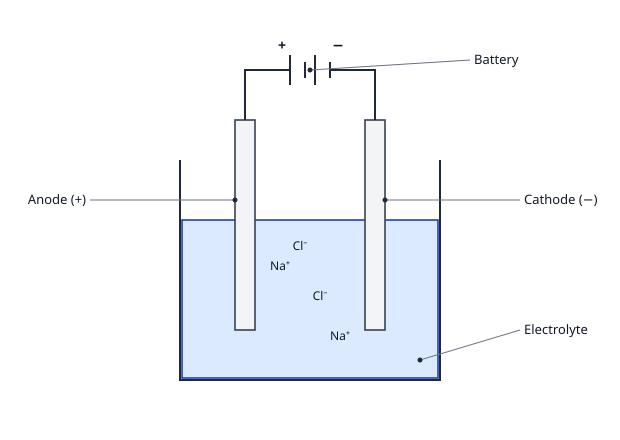

| No. | Part | Function / note | SVG target |
|---|---|---|---|
| 1 | Anode (+) | Oxidation — anions lose electrons | `CHE-D02-L01-target` |
| 2 | Cathode (−) | Reduction — cations gain electrons | `CHE-D02-L02-target` |
| 3 | Electrolyte | Ions move and conduct electricity | `CHE-D02-L03-target` |
| 4 | Battery | DC power supply | `CHE-D02-L04-target` |

### 2. Identify mode

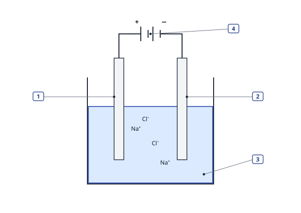

- Which part is shown by number 1?
- Which part is shown by number 2?
- Which part is shown by number 3?
- Which part is shown by number 4?

Answers

1. Anode (+)
2. Cathode (−)
3. Electrolyte
4. Battery

### 3. Label mode

Put the following names in the number boxes of the unlabelled diagram: Anode (+) · Battery · Cathode (−) · Electrolyte

### 4. Match functions

| Part | Function (shuffled) |
|---|---|
| A. Anode (+) | 1. Oxidation — anions lose electrons |
| B. Cathode (−) | 2. Ions move and conduct electricity |
| C. Electrolyte | 3. DC power supply |
| D. Battery | 4. Reduction — cations gain electrons |

Answers

- A → 1
- B → 4
- C → 2
- D → 3

### 5. Draw mode — checklist

- [ ] Clear, continuous pencil lines
- [ ] Correct proportions and order
- [ ] At least 4 parts labelled; label lines do not cross
- [ ] A title is written

### 6. Exam mode

In the unlabelled diagram (i) name the parts numbered 1 and 2 [2] (ii) give one function of the 'Anode (+)' [1].

Marking scheme (original)

(i) 1 — Anode (+); 2 — Cathode (−) [1 each] (ii) Oxidation — anions lose electrons [1]

---

## CHE-D03: Preparing hydrogen — downward displacement of water

<!-- meta {"type":"diagram","id":"CHE-D03","chapter_id":"SC11-07","labelled":"science_assets/chemistry/CHE-D03_labelled.svg","unlabelled":"science_assets/chemistry/CHE-D03_unlabelled.svg","schematic":true,"labels":[{"label_id":"CHE-D03-L01","svg_target":"CHE-D03-L01-target","key":"thistle","ta":"Thistle funnel","en":"thistle funnel","function":"Adding the acid"},{"label_id":"CHE-D03-L02","svg_target":"CHE-D03-L02-target","key":"acid","ta":"Dilute HCl","en":"dilute HCl","function":"Reactant"},{"label_id":"CHE-D03-L03","svg_target":"CHE-D03-L03-target","key":"zinc","ta":"Zinc granules","en":"zinc granules","function":"Zn + 2HCl → ZnCl₂ + H₂"},{"label_id":"CHE-D03-L04","svg_target":"CHE-D03-L04-target","key":"tube","ta":"Delivery tube","en":"delivery tube","function":"Carries the gas"},{"label_id":"CHE-D03-L05","svg_target":"CHE-D03-L05-target","key":"jar","ta":"Gas jar (H₂)","en":"gas jar","function":"Gas collects by displacing water"},{"label_id":"CHE-D03-L06","svg_target":"CHE-D03-L06-target","key":"trough","ta":"Water trough","en":"water trough","function":"H₂ is only slightly soluble in water"}],"provenance":"original-programmatic-svg"} -->

*Acids, bases and salts* · source: original programmatic SVG

### 1. Learn mode

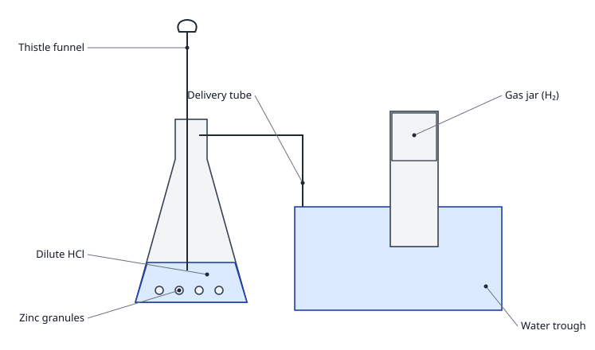

| No. | Part | Function / note | SVG target |
|---|---|---|---|
| 1 | Thistle funnel | Adding the acid | `CHE-D03-L01-target` |
| 2 | Dilute HCl | Reactant | `CHE-D03-L02-target` |
| 3 | Zinc granules | Zn + 2HCl → ZnCl₂ + H₂ | `CHE-D03-L03-target` |
| 4 | Delivery tube | Carries the gas | `CHE-D03-L04-target` |
| 5 | Gas jar (H₂) | Gas collects by displacing water | `CHE-D03-L05-target` |
| 6 | Water trough | H₂ is only slightly soluble in water | `CHE-D03-L06-target` |

### 2. Identify mode

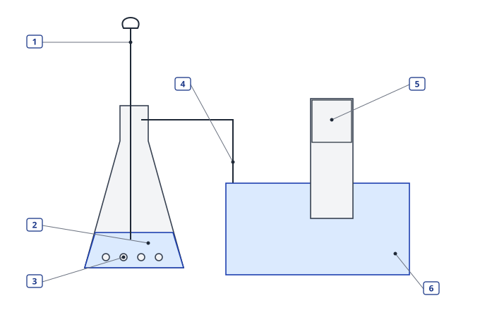

- Which part is shown by number 1?
- Which part is shown by number 2?
- Which part is shown by number 3?
- Which part is shown by number 4?
- Which part is shown by number 5?
- Which part is shown by number 6?

Answers

1. Thistle funnel
2. Dilute HCl
3. Zinc granules
4. Delivery tube
5. Gas jar (H₂)
6. Water trough

### 3. Label mode

Put the following names in the number boxes of the unlabelled diagram: Delivery tube · Dilute HCl · Gas jar (H₂) · Thistle funnel · Water trough · Zinc granules

### 4. Match functions

| Part | Function (shuffled) |
|---|---|
| A. Thistle funnel | 1. Zn + 2HCl → ZnCl₂ + H₂ |
| B. Dilute HCl | 2. H₂ is only slightly soluble in water |
| C. Zinc granules | 3. Reactant |
| D. Delivery tube | 4. Carries the gas |
| E. Gas jar (H₂) | 5. Gas collects by displacing water |
| F. Water trough | 6. Adding the acid |

Answers

- A → 6
- B → 3
- C → 1
- D → 4
- E → 5
- F → 2

### 5. Draw mode — checklist

- [ ] Clear, continuous pencil lines
- [ ] Correct proportions and order
- [ ] At least 5 parts labelled; label lines do not cross
- [ ] A title is written

### 6. Exam mode

In the unlabelled diagram (i) name the parts numbered 1 and 2 [2] (ii) give one function of the 'Thistle funnel' [1].

Marking scheme (original)

(i) 1 — Thistle funnel; 2 — Dilute HCl [1 each] (ii) Adding the acid [1]

---

## CHE-D04: Distillation

<!-- meta {"type":"diagram","id":"CHE-D04","chapter_id":"SC11-03","labelled":"science_assets/chemistry/CHE-D04_labelled.svg","unlabelled":"science_assets/chemistry/CHE-D04_unlabelled.svg","schematic":true,"labels":[{"label_id":"CHE-D04-L01","svg_target":"CHE-D04-L01-target","key":"flask","ta":"Distillation flask","en":"distillation flask","function":"Heats the mixture"},{"label_id":"CHE-D04-L02","svg_target":"CHE-D04-L02-target","key":"therm","ta":"Thermometer","en":"thermometer","function":"Bulb at the side-arm level — boiling point of the vapour"},{"label_id":"CHE-D04-L03","svg_target":"CHE-D04-L03-target","key":"cond","ta":"Liebig condenser","en":"Liebig condenser","function":"Cools and condenses the vapour"},{"label_id":"CHE-D04-L04","svg_target":"CHE-D04-L04-target","key":"win","ta":"Cold water in","en":"cooling water in","function":"From bottom to top"},{"label_id":"CHE-D04-L05","svg_target":"CHE-D04-L05-target","key":"wout","ta":"Water out","en":"water out","function":""},{"label_id":"CHE-D04-L06","svg_target":"CHE-D04-L06-target","key":"dist","ta":"Distillate","en":"distillate","function":"Pure liquid"},{"label_id":"CHE-D04-L07","svg_target":"CHE-D04-L07-target","key":"heat","ta":"Heat","en":"heat","function":""}],"provenance":"original-programmatic-svg"} -->

*Mixtures* · source: original programmatic SVG

### 1. Learn mode

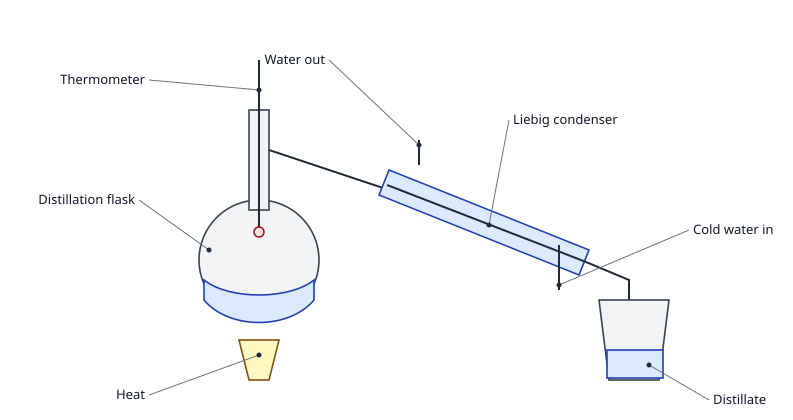

| No. | Part | Function / note | SVG target |
|---|---|---|---|
| 1 | Distillation flask | Heats the mixture | `CHE-D04-L01-target` |
| 2 | Thermometer | Bulb at the side-arm level — boiling point of the vapour | `CHE-D04-L02-target` |
| 3 | Liebig condenser | Cools and condenses the vapour | `CHE-D04-L03-target` |
| 4 | Cold water in | From bottom to top | `CHE-D04-L04-target` |
| 5 | Water out | — | `CHE-D04-L05-target` |
| 6 | Distillate | Pure liquid | `CHE-D04-L06-target` |
| 7 | Heat | — | `CHE-D04-L07-target` |

### 2. Identify mode

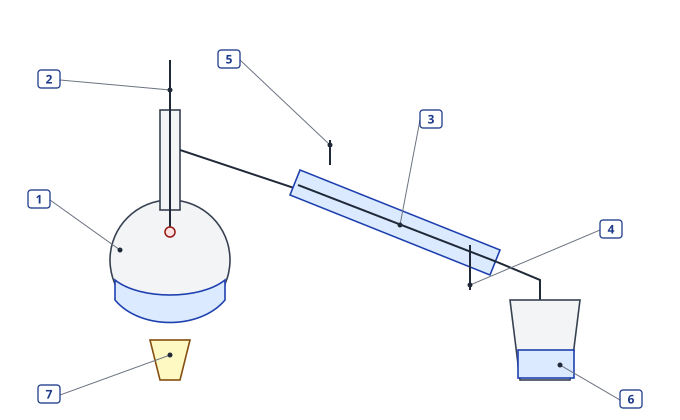

- Which part is shown by number 1?
- Which part is shown by number 2?
- Which part is shown by number 3?
- Which part is shown by number 4?
- Which part is shown by number 5?
- Which part is shown by number 6?
- Which part is shown by number 7?

Answers

1. Distillation flask
2. Thermometer
3. Liebig condenser
4. Cold water in
5. Water out
6. Distillate
7. Heat

### 3. Label mode

Put the following names in the number boxes of the unlabelled diagram: Cold water in · Distillate · Distillation flask · Heat · Liebig condenser · Thermometer · Water out

### 4. Match functions

| Part | Function (shuffled) |
|---|---|
| A. Distillation flask | 1. Heats the mixture |
| B. Thermometer | 2. Bulb at the side-arm level — boiling point of the vapour |
| C. Liebig condenser | 3. Pure liquid |
| D. Cold water in | 4. Cools and condenses the vapour |
| E. Distillate | 5. From bottom to top |

Answers

- A → 1
- B → 2
- C → 4
- D → 5
- E → 3

### 5. Draw mode — checklist

- [ ] Clear, continuous pencil lines
- [ ] Correct proportions and order
- [ ] At least 5 parts labelled; label lines do not cross
- [ ] A title is written

### 6. Exam mode

In the unlabelled diagram (i) name the parts numbered 1 and 2 [2] (ii) give one function of the 'Distillation flask' [1].

Marking scheme (original)

(i) 1 — Distillation flask; 2 — Thermometer [1 each] (ii) Heats the mixture [1]

---

## CHE-D05: Blast furnace (schematic)

<!-- meta {"type":"diagram","id":"CHE-D05","chapter_id":"SC10-16","labelled":"science_assets/chemistry/CHE-D05_labelled.svg","unlabelled":"science_assets/chemistry/CHE-D05_unlabelled.svg","schematic":true,"labels":[{"label_id":"CHE-D05-L01","svg_target":"CHE-D05-L01-target","key":"charge","ta":"Input: haematite, coke, limestone","en":"iron ore, coke, limestone","function":""},{"label_id":"CHE-D05-L02","svg_target":"CHE-D05-L02-target","key":"blastair","ta":"Hot air","en":"hot air blast","function":"C + O₂ → CO₂ — a lot of heat"},{"label_id":"CHE-D05-L03","svg_target":"CHE-D05-L03-target","key":"zone","ta":"Reduction zone","en":"reduction zone","function":"Fe₂O₃ + 3CO → 2Fe + 3CO₂"},{"label_id":"CHE-D05-L04","svg_target":"CHE-D05-L04-target","key":"slag","ta":"Slag","en":"slag (CaSiO₃)","function":"Removes impurities; floats on the molten iron"},{"label_id":"CHE-D05-L05","svg_target":"CHE-D05-L05-target","key":"iron","ta":"Molten iron","en":"molten iron","function":"Collected at the bottom"},{"label_id":"CHE-D05-L06","svg_target":"CHE-D05-L06-target","key":"waste","ta":"Waste gases","en":"waste gases","function":""}],"provenance":"original-programmatic-svg"} -->

*Changes in matter* · source: original programmatic SVG

### 1. Learn mode

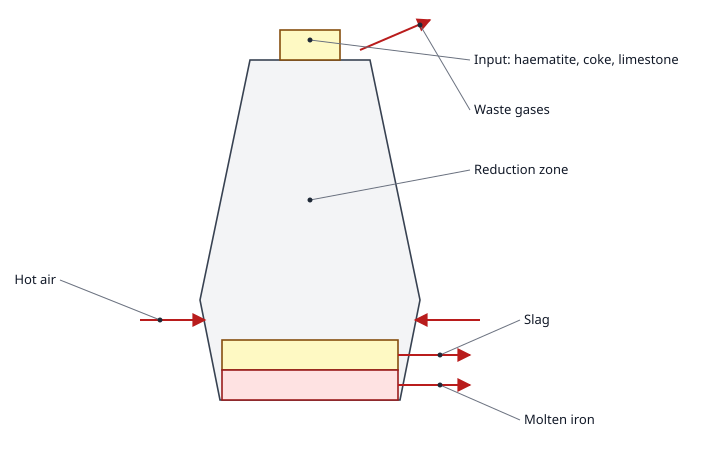

| No. | Part | Function / note | SVG target |
|---|---|---|---|
| 1 | Input: haematite, coke, limestone | — | `CHE-D05-L01-target` |
| 2 | Hot air | C + O₂ → CO₂ — a lot of heat | `CHE-D05-L02-target` |
| 3 | Reduction zone | Fe₂O₃ + 3CO → 2Fe + 3CO₂ | `CHE-D05-L03-target` |
| 4 | Slag | Removes impurities; floats on the molten iron | `CHE-D05-L04-target` |
| 5 | Molten iron | Collected at the bottom | `CHE-D05-L05-target` |
| 6 | Waste gases | — | `CHE-D05-L06-target` |

### 2. Identify mode

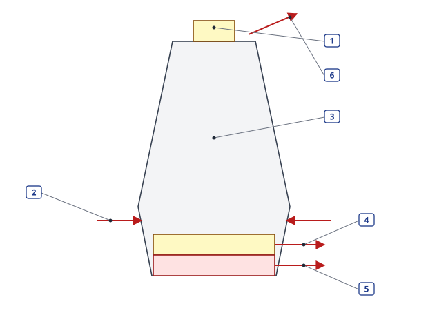

- Which part is shown by number 1?
- Which part is shown by number 2?
- Which part is shown by number 3?
- Which part is shown by number 4?
- Which part is shown by number 5?
- Which part is shown by number 6?

Answers

1. Input: haematite, coke, limestone
2. Hot air
3. Reduction zone
4. Slag
5. Molten iron
6. Waste gases

### 3. Label mode

Put the following names in the number boxes of the unlabelled diagram: Hot air · Input: haematite, coke, limestone · Molten iron · Reduction zone · Slag · Waste gases

### 4. Match functions

| Part | Function (shuffled) |
|---|---|
| A. Hot air | 1. Removes impurities; floats on the molten iron |
| B. Reduction zone | 2. C + O₂ → CO₂ — a lot of heat |
| C. Slag | 3. Fe₂O₃ + 3CO → 2Fe + 3CO₂ |
| D. Molten iron | 4. Collected at the bottom |

Answers

- A → 2
- B → 3
- C → 1
- D → 4

### 5. Draw mode — checklist

- [ ] Clear, continuous pencil lines
- [ ] Correct proportions and order
- [ ] At least 5 parts labelled; label lines do not cross
- [ ] A title is written

### 6. Exam mode

In the unlabelled diagram (i) name the parts numbered 1 and 2 [2] (ii) give one function of the 'Input: haematite, coke, limestone' [1].

Marking scheme (original)

(i) 1 — Input: haematite, coke, limestone; 2 — Hot air [1 each] (ii) a suitable function [1]

---

## CHE-D06: Simple cell (Zn–Cu)

<!-- meta {"type":"diagram","id":"CHE-D06","chapter_id":"SC11-12","labelled":"science_assets/chemistry/CHE-D06_labelled.svg","unlabelled":"science_assets/chemistry/CHE-D06_unlabelled.svg","schematic":true,"labels":[{"label_id":"CHE-D06-L01","svg_target":"CHE-D06-L01-target","key":"zn","ta":"Zinc plate (−)","en":"zinc plate (negative)","function":"Oxidation: Zn → Zn²⁺ + 2e⁻"},{"label_id":"CHE-D06-L02","svg_target":"CHE-D06-L02-target","key":"cu","ta":"Copper plate (+)","en":"copper plate (positive)","function":"Less reactive metal"},{"label_id":"CHE-D06-L03","svg_target":"CHE-D06-L03-target","key":"el","ta":"Dilute H₂SO₄","en":"dilute sulfuric acid","function":"Electrolyte"},{"label_id":"CHE-D06-L04","svg_target":"CHE-D06-L04-target","key":"vm","ta":"Voltmeter","en":"voltmeter","function":"Potential difference"}],"provenance":"original-programmatic-svg"} -->

*Electrochemistry* · source: original programmatic SVG

### 1. Learn mode

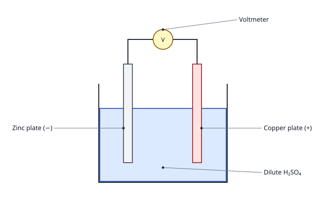

| No. | Part | Function / note | SVG target |
|---|---|---|---|
| 1 | Zinc plate (−) | Oxidation: Zn → Zn²⁺ + 2e⁻ | `CHE-D06-L01-target` |
| 2 | Copper plate (+) | Less reactive metal | `CHE-D06-L02-target` |
| 3 | Dilute H₂SO₄ | Electrolyte | `CHE-D06-L03-target` |
| 4 | Voltmeter | Potential difference | `CHE-D06-L04-target` |

### 2. Identify mode

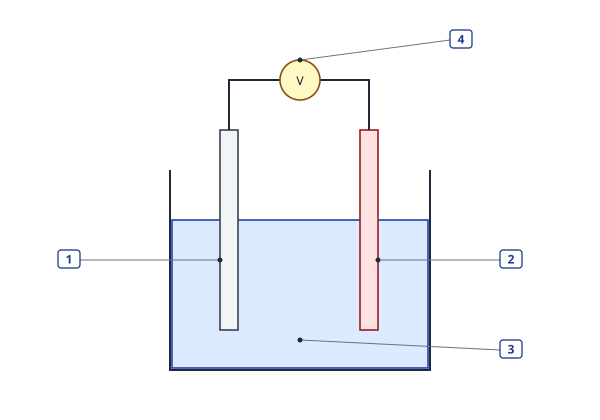

- Which part is shown by number 1?
- Which part is shown by number 2?
- Which part is shown by number 3?
- Which part is shown by number 4?

Answers

1. Zinc plate (−)
2. Copper plate (+)
3. Dilute H₂SO₄
4. Voltmeter

### 3. Label mode

Put the following names in the number boxes of the unlabelled diagram: Copper plate (+) · Dilute H₂SO₄ · Voltmeter · Zinc plate (−)

### 4. Match functions

| Part | Function (shuffled) |
|---|---|
| A. Zinc plate (−) | 1. Potential difference |
| B. Copper plate (+) | 2. Oxidation: Zn → Zn²⁺ + 2e⁻ |
| C. Dilute H₂SO₄ | 3. Less reactive metal |
| D. Voltmeter | 4. Electrolyte |

Answers

- A → 2
- B → 3
- C → 4
- D → 1

### 5. Draw mode — checklist

- [ ] Clear, continuous pencil lines
- [ ] Correct proportions and order
- [ ] At least 4 parts labelled; label lines do not cross
- [ ] A title is written

### 6. Exam mode

In the unlabelled diagram (i) name the parts numbered 1 and 2 [2] (ii) give one function of the 'Zinc plate (−)' [1].

Marking scheme (original)

(i) 1 — Zinc plate (−); 2 — Copper plate (+) [1 each] (ii) Oxidation: Zn → Zn²⁺ + 2e⁻ [1]

---

## PHY-D01: Series circuit (ammeter, voltmeter)

<!-- meta {"type":"diagram","id":"PHY-D01","chapter_id":"SC10-19","labelled":"science_assets/physics/PHY-D01_labelled.svg","unlabelled":"science_assets/physics/PHY-D01_unlabelled.svg","schematic":true,"labels":[{"label_id":"PHY-D01-L01","svg_target":"PHY-D01-L01-target","key":"cell","ta":"Cell","en":"cell","function":"Provides the e.m.f."},{"label_id":"PHY-D01-L02","svg_target":"PHY-D01-L02-target","key":"res","ta":"Resistor","en":"resistor","function":"Opposes the current"},{"label_id":"PHY-D01-L03","svg_target":"PHY-D01-L03-target","key":"amm","ta":"Ammeter","en":"ammeter","function":"In series — measures current"},{"label_id":"PHY-D01-L04","svg_target":"PHY-D01-L04-target","key":"volt","ta":"Voltmeter","en":"voltmeter","function":"In parallel — potential difference"},{"label_id":"PHY-D01-L05","svg_target":"PHY-D01-L05-target","key":"sw","ta":"Switch","en":"switch","function":"Opens/closes the circuit"}],"provenance":"original-programmatic-svg"} -->

*Current electricity* · source: original programmatic SVG

### 1. Learn mode

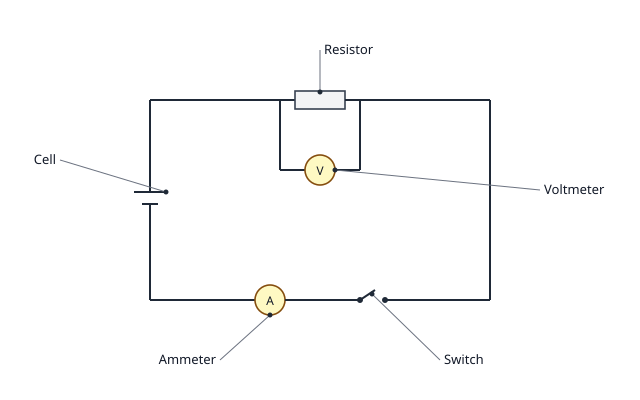

| No. | Part | Function / note | SVG target |
|---|---|---|---|
| 1 | Cell | Provides the e.m.f. | `PHY-D01-L01-target` |
| 2 | Resistor | Opposes the current | `PHY-D01-L02-target` |
| 3 | Ammeter | In series — measures current | `PHY-D01-L03-target` |
| 4 | Voltmeter | In parallel — potential difference | `PHY-D01-L04-target` |
| 5 | Switch | Opens/closes the circuit | `PHY-D01-L05-target` |

### 2. Identify mode

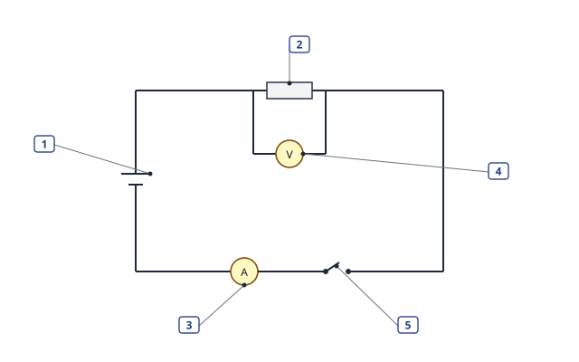

- Which part is shown by number 1?
- Which part is shown by number 2?
- Which part is shown by number 3?
- Which part is shown by number 4?
- Which part is shown by number 5?

Answers

1. Cell
2. Resistor
3. Ammeter
4. Voltmeter
5. Switch

### 3. Label mode

Put the following names in the number boxes of the unlabelled diagram: Ammeter · Cell · Resistor · Switch · Voltmeter

### 4. Match functions

| Part | Function (shuffled) |
|---|---|
| A. Cell | 1. In parallel — potential difference |
| B. Resistor | 2. Opens/closes the circuit |
| C. Ammeter | 3. In series — measures current |
| D. Voltmeter | 4. Opposes the current |
| E. Switch | 5. Provides the e.m.f. |

Answers

- A → 5
- B → 4
- C → 3
- D → 1
- E → 2

### 5. Draw mode — checklist

- [ ] Clear, continuous pencil lines
- [ ] Correct proportions and order
- [ ] At least 5 parts labelled; label lines do not cross
- [ ] A title is written

### 6. Exam mode

In the unlabelled diagram (i) name the parts numbered 1 and 2 [2] (ii) give one function of the 'Cell' [1].

Marking scheme (original)

(i) 1 — Cell; 2 — Resistor [1 each] (ii) Provides the e.m.f. [1]

---

## PHY-D02: Parallel circuit

<!-- meta {"type":"diagram","id":"PHY-D02","chapter_id":"SC10-19","labelled":"science_assets/physics/PHY-D02_labelled.svg","unlabelled":"science_assets/physics/PHY-D02_unlabelled.svg","schematic":true,"labels":[{"label_id":"PHY-D02-L01","svg_target":"PHY-D02-L01-target","key":"cell","ta":"Cell","en":"cell","function":""},{"label_id":"PHY-D02-L02","svg_target":"PHY-D02-L02-target","key":"r1","ta":"Branch 1 (R₁)","en":"branch 1","function":"Potential difference equals that of the cell"},{"label_id":"PHY-D02-L03","svg_target":"PHY-D02-L03-target","key":"r2","ta":"Branch 2 (R₂)","en":"branch 2","function":"Sum of branch currents = total"},{"label_id":"PHY-D02-L04","svg_target":"PHY-D02-L04-target","key":"junc","ta":"Junction","en":"junction","function":"Point where the current splits/joins"},{"label_id":"PHY-D02-L05","svg_target":"PHY-D02-L05-target","key":"amm","ta":"Main ammeter","en":"main ammeter","function":"Total current"}],"provenance":"original-programmatic-svg"} -->

*Current electricity* · source: original programmatic SVG

### 1. Learn mode

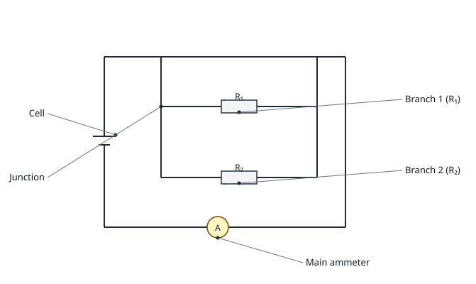

| No. | Part | Function / note | SVG target |
|---|---|---|---|
| 1 | Cell | — | `PHY-D02-L01-target` |
| 2 | Branch 1 (R₁) | Potential difference equals that of the cell | `PHY-D02-L02-target` |
| 3 | Branch 2 (R₂) | Sum of branch currents = total | `PHY-D02-L03-target` |
| 4 | Junction | Point where the current splits/joins | `PHY-D02-L04-target` |
| 5 | Main ammeter | Total current | `PHY-D02-L05-target` |

### 2. Identify mode

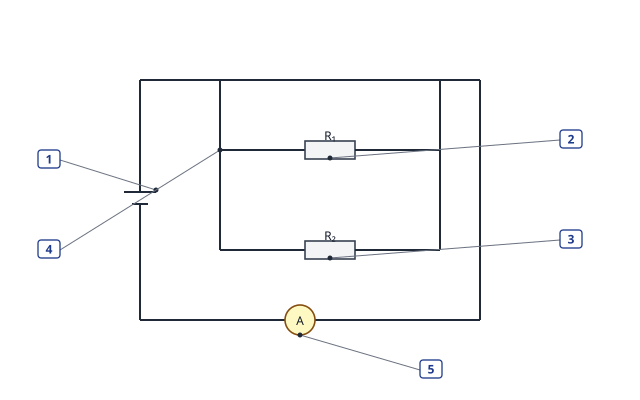

- Which part is shown by number 1?
- Which part is shown by number 2?
- Which part is shown by number 3?
- Which part is shown by number 4?
- Which part is shown by number 5?

Answers

1. Cell
2. Branch 1 (R₁)
3. Branch 2 (R₂)
4. Junction
5. Main ammeter

### 3. Label mode

Put the following names in the number boxes of the unlabelled diagram: Branch 1 (R₁) · Branch 2 (R₂) · Cell · Junction · Main ammeter

### 4. Match functions

| Part | Function (shuffled) |
|---|---|
| A. Branch 1 (R₁) | 1. Point where the current splits/joins |
| B. Branch 2 (R₂) | 2. Total current |
| C. Junction | 3. Sum of branch currents = total |
| D. Main ammeter | 4. Potential difference equals that of the cell |

Answers

- A → 4
- B → 3
- C → 1
- D → 2

### 5. Draw mode — checklist

- [ ] Clear, continuous pencil lines
- [ ] Correct proportions and order
- [ ] At least 5 parts labelled; label lines do not cross
- [ ] A title is written

### 6. Exam mode

In the unlabelled diagram (i) name the parts numbered 1 and 2 [2] (ii) give one function of the 'Cell' [1].

Marking scheme (original)

(i) 1 — Cell; 2 — Branch 1 (R₁) [1 each] (ii) a suitable function [1]

---

## PHY-D03: Convex lens: object beyond 2F

<!-- meta {"type":"diagram","id":"PHY-D03","chapter_id":"SC11-05","labelled":"science_assets/physics/PHY-D03_labelled.svg","unlabelled":"science_assets/physics/PHY-D03_unlabelled.svg","schematic":false,"labels":[{"label_id":"PHY-D03-L01","svg_target":"PHY-D03-L01-target","key":"obj","ta":"Object","en":"object","function":"Beyond 2F"},{"label_id":"PHY-D03-L02","svg_target":"PHY-D03-L02-target","key":"img","ta":"Image","en":"image","function":"Real, inverted, diminished; between F and 2F"},{"label_id":"PHY-D03-L03","svg_target":"PHY-D03-L03-target","key":"lens","ta":"Convex lens","en":"convex lens","function":"Converging"},{"label_id":"PHY-D03-L04","svg_target":"PHY-D03-L04-target","key":"axis","ta":"Principal axis","en":"principal axis","function":""},{"label_id":"PHY-D03-L05","svg_target":"PHY-D03-L05-target","key":"f","ta":"Focus","en":"principal focus","function":"Point where parallel rays meet"}],"provenance":"original-programmatic-svg"} -->

*Geometrical optics* · source: original programmatic SVG · Calculated to scale: f = 80, u = 200, v = 133.3 (diagram units)

### 1. Learn mode

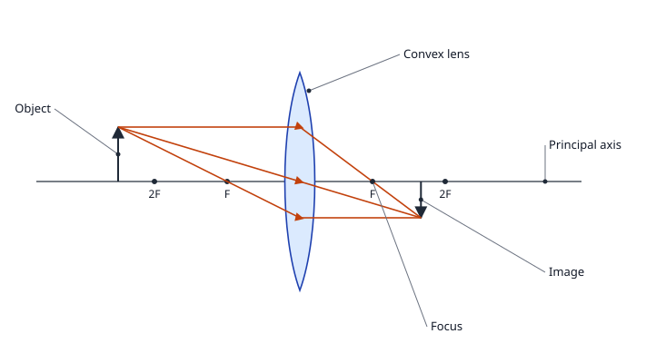

| No. | Part | Function / note | SVG target |
|---|---|---|---|
| 1 | Object | Beyond 2F | `PHY-D03-L01-target` |
| 2 | Image | Real, inverted, diminished; between F and 2F | `PHY-D03-L02-target` |
| 3 | Convex lens | Converging | `PHY-D03-L03-target` |
| 4 | Principal axis | — | `PHY-D03-L04-target` |
| 5 | Focus | Point where parallel rays meet | `PHY-D03-L05-target` |

### 2. Identify mode

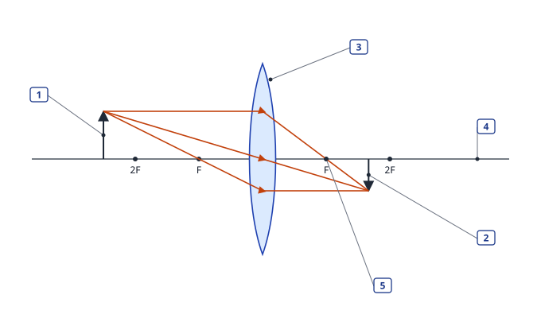

- Which part is shown by number 1?
- Which part is shown by number 2?
- Which part is shown by number 3?
- Which part is shown by number 4?
- Which part is shown by number 5?

Answers

1. Object
2. Image
3. Convex lens
4. Principal axis
5. Focus

### 3. Label mode

Put the following names in the number boxes of the unlabelled diagram: Convex lens · Focus · Image · Object · Principal axis

### 4. Match functions

| Part | Function (shuffled) |
|---|---|
| A. Object | 1. Point where parallel rays meet |
| B. Image | 2. Beyond 2F |
| C. Convex lens | 3. Real, inverted, diminished; between F and 2F |
| D. Focus | 4. Converging |

Answers

- A → 2
- B → 3
- C → 4
- D → 1

### 5. Draw mode — checklist

- [ ] Clear, continuous pencil lines
- [ ] Correct proportions and order
- [ ] At least 5 parts labelled; label lines do not cross
- [ ] A title is written

### 6. Exam mode

In the unlabelled diagram (i) name the parts numbered 1 and 2 [2] (ii) give one function of the 'Object' [1].

Marking scheme (original)

(i) 1 — Object; 2 — Image [1 each] (ii) Beyond 2F [1]

---

## PHY-D04: Magnetic field lines of a bar magnet

<!-- meta {"type":"diagram","id":"PHY-D04","chapter_id":"SC11-13","labelled":"science_assets/physics/PHY-D04_labelled.svg","unlabelled":"science_assets/physics/PHY-D04_unlabelled.svg","schematic":true,"labels":[{"label_id":"PHY-D04-L01","svg_target":"PHY-D04-L01-target","key":"n","ta":"North pole","en":"north pole","function":"Field lines leave"},{"label_id":"PHY-D04-L02","svg_target":"PHY-D04-L02-target","key":"s","ta":"South pole","en":"south pole","function":"Field lines enter"},{"label_id":"PHY-D04-L03","svg_target":"PHY-D04-L03-target","key":"line","ta":"Field line","en":"field line","function":"From N to S"},{"label_id":"PHY-D04-L04","svg_target":"PHY-D04-L04-target","key":"strong","ta":"Strong field","en":"strong field","function":"Lines close together — at the poles"}],"provenance":"original-programmatic-svg"} -->

*Electromagnetism and electromagnetic induction* · source: original programmatic SVG

### 1. Learn mode

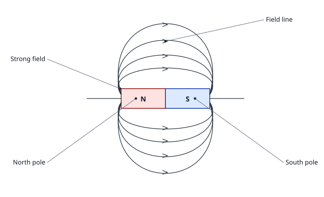

| No. | Part | Function / note | SVG target |
|---|---|---|---|
| 1 | North pole | Field lines leave | `PHY-D04-L01-target` |
| 2 | South pole | Field lines enter | `PHY-D04-L02-target` |
| 3 | Field line | From N to S | `PHY-D04-L03-target` |
| 4 | Strong field | Lines close together — at the poles | `PHY-D04-L04-target` |

### 2. Identify mode

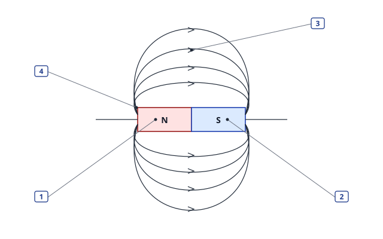

- Which part is shown by number 1?
- Which part is shown by number 2?
- Which part is shown by number 3?
- Which part is shown by number 4?

Answers

1. North pole
2. South pole
3. Field line
4. Strong field

### 3. Label mode

Put the following names in the number boxes of the unlabelled diagram: Field line · North pole · South pole · Strong field

### 4. Match functions

| Part | Function (shuffled) |
|---|---|
| A. North pole | 1. Field lines leave |
| B. South pole | 2. Field lines enter |
| C. Field line | 3. Lines close together — at the poles |
| D. Strong field | 4. From N to S |

Answers

- A → 1
- B → 2
- C → 4
- D → 3

### 5. Draw mode — checklist

- [ ] Clear, continuous pencil lines
- [ ] Correct proportions and order
- [ ] At least 4 parts labelled; label lines do not cross
- [ ] A title is written

### 6. Exam mode

In the unlabelled diagram (i) name the parts numbered 1 and 2 [2] (ii) give one function of the 'North pole' [1].

Marking scheme (original)

(i) 1 — North pole; 2 — South pole [1 each] (ii) Field lines leave [1]

---

## PHY-D05: Transverse wave

<!-- meta {"type":"diagram","id":"PHY-D05","chapter_id":"SC11-04","labelled":"science_assets/physics/PHY-D05_labelled.svg","unlabelled":"science_assets/physics/PHY-D05_unlabelled.svg","schematic":false,"labels":[{"label_id":"PHY-D05-L01","svg_target":"PHY-D05-L01-target","key":"crest","ta":"Crest","en":"crest","function":"Maximum upward displacement"},{"label_id":"PHY-D05-L02","svg_target":"PHY-D05-L02-target","key":"trough","ta":"Trough","en":"trough","function":"Maximum downward displacement"},{"label_id":"PHY-D05-L03","svg_target":"PHY-D05-L03-target","key":"lambda","ta":"Wavelength","en":"wavelength (λ)","function":"Distance between two successive crests"},{"label_id":"PHY-D05-L04","svg_target":"PHY-D05-L04-target","key":"amp","ta":"Amplitude","en":"amplitude","function":"Maximum displacement from equilibrium"},{"label_id":"PHY-D05-L05","svg_target":"PHY-D05-L05-target","key":"eq","ta":"Equilibrium line","en":"rest position","function":""}],"provenance":"original-programmatic-svg"} -->

*Waves and their applications* · source: original programmatic SVG

### 1. Learn mode

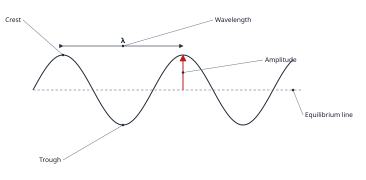

| No. | Part | Function / note | SVG target |
|---|---|---|---|
| 1 | Crest | Maximum upward displacement | `PHY-D05-L01-target` |
| 2 | Trough | Maximum downward displacement | `PHY-D05-L02-target` |
| 3 | Wavelength | Distance between two successive crests | `PHY-D05-L03-target` |
| 4 | Amplitude | Maximum displacement from equilibrium | `PHY-D05-L04-target` |
| 5 | Equilibrium line | — | `PHY-D05-L05-target` |

### 2. Identify mode

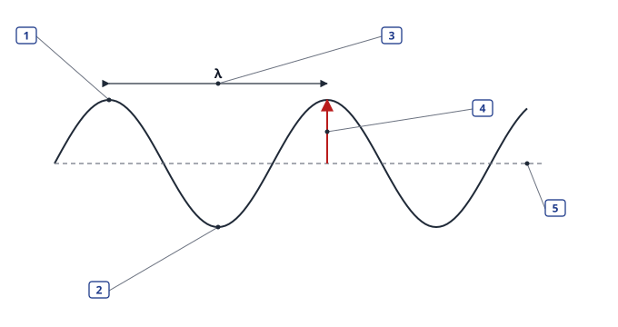

- Which part is shown by number 1?
- Which part is shown by number 2?
- Which part is shown by number 3?
- Which part is shown by number 4?
- Which part is shown by number 5?

Answers

1. Crest
2. Trough
3. Wavelength
4. Amplitude
5. Equilibrium line

### 3. Label mode

Put the following names in the number boxes of the unlabelled diagram: Amplitude · Crest · Equilibrium line · Trough · Wavelength

### 4. Match functions

| Part | Function (shuffled) |
|---|---|
| A. Crest | 1. Distance between two successive crests |
| B. Trough | 2. Maximum downward displacement |
| C. Wavelength | 3. Maximum upward displacement |
| D. Amplitude | 4. Maximum displacement from equilibrium |

Answers

- A → 3
- B → 2
- C → 1
- D → 4

### 5. Draw mode — checklist

- [ ] Clear, continuous pencil lines
- [ ] Correct proportions and order
- [ ] At least 5 parts labelled; label lines do not cross
- [ ] A title is written

### 6. Exam mode

In the unlabelled diagram (i) name the parts numbered 1 and 2 [2] (ii) give one function of the 'Crest' [1].

Marking scheme (original)

(i) 1 — Crest; 2 — Trough [1 each] (ii) Maximum upward displacement [1]

---

## PHY-D06: Force diagram of a box pulled along a table

<!-- meta {"type":"diagram","id":"PHY-D06","chapter_id":"SC10-05","labelled":"science_assets/physics/PHY-D06_labelled.svg","unlabelled":"science_assets/physics/PHY-D06_unlabelled.svg","schematic":true,"labels":[{"label_id":"PHY-D06-L01","svg_target":"PHY-D06-L01-target","key":"W","ta":"Weight (W = mg)","en":"weight","function":"Gravity — downwards"},{"label_id":"PHY-D06-L02","svg_target":"PHY-D06-L02-target","key":"R","ta":"Normal reaction (R)","en":"normal reaction","function":"Perpendicular to the surface"},{"label_id":"PHY-D06-L03","svg_target":"PHY-D06-L03-target","key":"F","ta":"Pulling force (F)","en":"applied force","function":""},{"label_id":"PHY-D06-L04","svg_target":"PHY-D06-L04-target","key":"fr","ta":"Friction (f)","en":"friction","function":"Opposite to the motion"}],"provenance":"original-programmatic-svg"} -->

*Friction* · source: original programmatic SVG

### 1. Learn mode

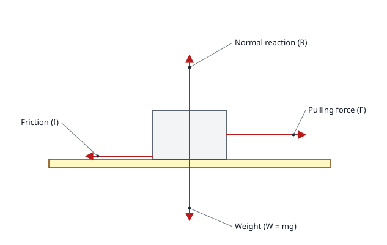

| No. | Part | Function / note | SVG target |
|---|---|---|---|
| 1 | Weight (W = mg) | Gravity — downwards | `PHY-D06-L01-target` |
| 2 | Normal reaction (R) | Perpendicular to the surface | `PHY-D06-L02-target` |
| 3 | Pulling force (F) | — | `PHY-D06-L03-target` |
| 4 | Friction (f) | Opposite to the motion | `PHY-D06-L04-target` |

### 2. Identify mode

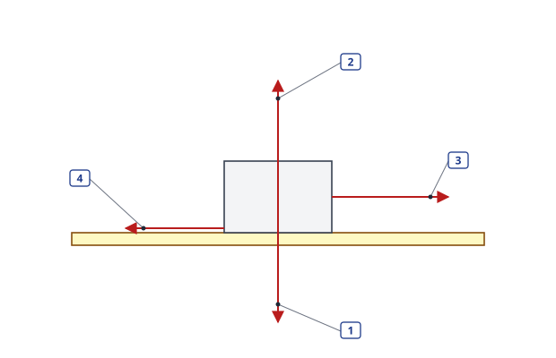

- Which part is shown by number 1?
- Which part is shown by number 2?
- Which part is shown by number 3?
- Which part is shown by number 4?

Answers

1. Weight (W = mg)
2. Normal reaction (R)
3. Pulling force (F)
4. Friction (f)

### 3. Label mode

Put the following names in the number boxes of the unlabelled diagram: Friction (f) · Normal reaction (R) · Pulling force (F) · Weight (W = mg)

### 4. Match functions

| Part | Function (shuffled) |
|---|---|
| A. Weight (W = mg) | 1. Gravity — downwards |
| B. Normal reaction (R) | 2. Perpendicular to the surface |
| C. Friction (f) | 3. Opposite to the motion |

Answers

- A → 1
- B → 2
- C → 3

### 5. Draw mode — checklist

- [ ] Clear, continuous pencil lines
- [ ] Correct proportions and order
- [ ] At least 4 parts labelled; label lines do not cross
- [ ] A title is written

### 6. Exam mode

In the unlabelled diagram (i) name the parts numbered 1 and 2 [2] (ii) give one function of the 'Weight (W = mg)' [1].

Marking scheme (original)

(i) 1 — Weight (W = mg); 2 — Normal reaction (R) [1 each] (ii) Gravity — downwards [1]

---

## PHY-D07: Transformer

<!-- meta {"type":"diagram","id":"PHY-D07","chapter_id":"SC11-13","labelled":"science_assets/physics/PHY-D07_labelled.svg","unlabelled":"science_assets/physics/PHY-D07_unlabelled.svg","schematic":true,"labels":[{"label_id":"PHY-D07-L01","svg_target":"PHY-D07-L01-target","key":"core","ta":"Soft iron core","en":"soft-iron core","function":"Links the magnetic flux"},{"label_id":"PHY-D07-L02","svg_target":"PHY-D07-L02-target","key":"prim","ta":"Primary coil (Np)","en":"primary coil","function":"AC — changing magnetic flux"},{"label_id":"PHY-D07-L03","svg_target":"PHY-D07-L03-target","key":"sec","ta":"Secondary coil (Ns)","en":"secondary coil","function":"Induced e.m.f."}],"provenance":"original-programmatic-svg"} -->

*Electromagnetism and electromagnetic induction* · source: original programmatic SVG

### 1. Learn mode

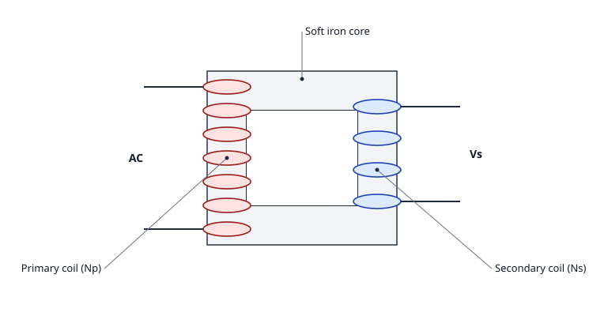

| No. | Part | Function / note | SVG target |
|---|---|---|---|
| 1 | Soft iron core | Links the magnetic flux | `PHY-D07-L01-target` |
| 2 | Primary coil (Np) | AC — changing magnetic flux | `PHY-D07-L02-target` |
| 3 | Secondary coil (Ns) | Induced e.m.f. | `PHY-D07-L03-target` |

### 2. Identify mode

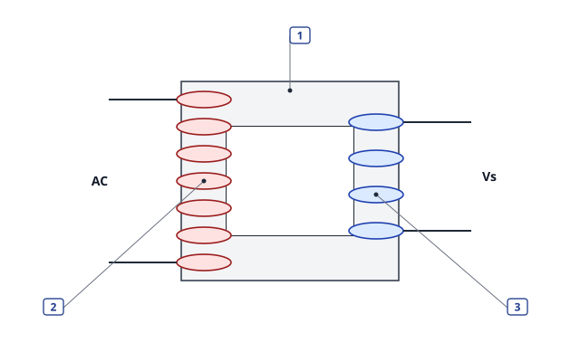

- Which part is shown by number 1?
- Which part is shown by number 2?
- Which part is shown by number 3?

Answers

1. Soft iron core
2. Primary coil (Np)
3. Secondary coil (Ns)

### 3. Label mode

Put the following names in the number boxes of the unlabelled diagram: Primary coil (Np) · Secondary coil (Ns) · Soft iron core

### 4. Match functions

| Part | Function (shuffled) |
|---|---|
| A. Soft iron core | 1. Links the magnetic flux |
| B. Primary coil (Np) | 2. AC — changing magnetic flux |
| C. Secondary coil (Ns) | 3. Induced e.m.f. |

Answers

- A → 1
- B → 2
- C → 3

### 5. Draw mode — checklist

- [ ] Clear, continuous pencil lines
- [ ] Correct proportions and order
- [ ] At least 3 parts labelled; label lines do not cross
- [ ] A title is written

### 6. Exam mode

In the unlabelled diagram (i) name the parts numbered 1 and 2 [2] (ii) give one function of the 'Soft iron core' [1].

Marking scheme (original)

(i) 1 — Soft iron core; 2 — Primary coil (Np) [1 each] (ii) Links the magnetic flux [1]

---

## PHY-D08: Public address system (block diagram)

<!-- meta {"type":"diagram","id":"PHY-D08","chapter_id":"SC11-11","labelled":"science_assets/physics/PHY-D08_labelled.svg","unlabelled":"science_assets/physics/PHY-D08_unlabelled.svg","schematic":true,"labels":[{"label_id":"PHY-D08-L01","svg_target":"PHY-D08-L01-target","key":"mic","ta":"Microphone","en":"microphone","function":"Sound → electrical signal"},{"label_id":"PHY-D08-L02","svg_target":"PHY-D08-L02-target","key":"amp","ta":"Amplifier (transistor)","en":"amplifier","function":"Increases the signal amplitude"},{"label_id":"PHY-D08-L03","svg_target":"PHY-D08-L03-target","key":"spk","ta":"Loudspeaker","en":"loudspeaker","function":"Electrical → sound"},{"label_id":"PHY-D08-L04","svg_target":"PHY-D08-L04-target","key":"psu","ta":"Power supply","en":"power supply","function":"Energy for amplification"}],"provenance":"original-programmatic-svg"} -->

*Electronics* · source: original programmatic SVG

### 1. Learn mode

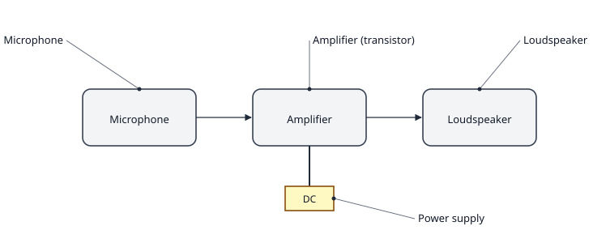

| No. | Part | Function / note | SVG target |
|---|---|---|---|
| 1 | Microphone | Sound → electrical signal | `PHY-D08-L01-target` |
| 2 | Amplifier (transistor) | Increases the signal amplitude | `PHY-D08-L02-target` |
| 3 | Loudspeaker | Electrical → sound | `PHY-D08-L03-target` |
| 4 | Power supply | Energy for amplification | `PHY-D08-L04-target` |

### 2. Identify mode

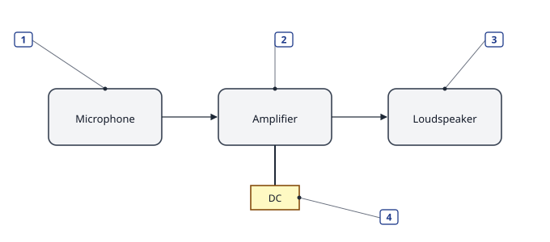

- Which part is shown by number 1?
- Which part is shown by number 2?
- Which part is shown by number 3?
- Which part is shown by number 4?

Answers

1. Microphone
2. Amplifier (transistor)
3. Loudspeaker
4. Power supply

### 3. Label mode

Put the following names in the number boxes of the unlabelled diagram: Amplifier (transistor) · Loudspeaker · Microphone · Power supply

### 4. Match functions

| Part | Function (shuffled) |
|---|---|
| A. Microphone | 1. Electrical → sound |
| B. Amplifier (transistor) | 2. Increases the signal amplitude |
| C. Loudspeaker | 3. Sound → electrical signal |
| D. Power supply | 4. Energy for amplification |

Answers

- A → 3
- B → 2
- C → 1
- D → 4

### 5. Draw mode — checklist

- [ ] Clear, continuous pencil lines
- [ ] Correct proportions and order
- [ ] At least 4 parts labelled; label lines do not cross
- [ ] A title is written

### 6. Exam mode

In the unlabelled diagram (i) name the parts numbered 1 and 2 [2] (ii) give one function of the 'Microphone' [1].

Marking scheme (original)

(i) 1 — Microphone; 2 — Amplifier (transistor) [1 each] (ii) Sound → electrical signal [1]

---

## PHY-D09: npn transistor symbol

<!-- meta {"type":"diagram","id":"PHY-D09","chapter_id":"SC11-11","labelled":"science_assets/physics/PHY-D09_labelled.svg","unlabelled":"science_assets/physics/PHY-D09_unlabelled.svg","schematic":true,"labels":[{"label_id":"PHY-D09-L01","svg_target":"PHY-D09-L01-target","key":"b","ta":"Base (B)","en":"base","function":"Small control current"},{"label_id":"PHY-D09-L02","svg_target":"PHY-D09-L02-target","key":"c","ta":"Collector (C)","en":"collector","function":"Large current enters"},{"label_id":"PHY-D09-L03","svg_target":"PHY-D09-L03-target","key":"e","ta":"Emitter (E)","en":"emitter","function":"Arrow: conventional current direction"}],"provenance":"original-programmatic-svg"} -->

*Electronics* · source: original programmatic SVG

### 1. Learn mode

| No. | Part | Function / note | SVG target |
|---|---|---|---|
| 1 | Base (B) | Small control current | `PHY-D09-L01-target` |
| 2 | Collector (C) | Large current enters | `PHY-D09-L02-target` |
| 3 | Emitter (E) | Arrow: conventional current direction | `PHY-D09-L03-target` |

### 2. Identify mode

- Which part is shown by number 1?
- Which part is shown by number 2?
- Which part is shown by number 3?

Answers

1. Base (B)
2. Collector (C)
3. Emitter (E)

### 3. Label mode

Put the following names in the number boxes of the unlabelled diagram: Base (B) · Collector (C) · Emitter (E)

### 4. Match functions

| Part | Function (shuffled) |
|---|---|
| A. Base (B) | 1. Small control current |
| B. Collector (C) | 2. Arrow: conventional current direction |
| C. Emitter (E) | 3. Large current enters |

Answers

- A → 1
- B → 3
- C → 2

### 5. Draw mode — checklist

- [ ] Clear, continuous pencil lines
- [ ] Correct proportions and order
- [ ] At least 3 parts labelled; label lines do not cross
- [ ] A title is written

### 6. Exam mode

In the unlabelled diagram (i) name the parts numbered 1 and 2 [2] (ii) give one function of the 'Base (B)' [1].

Marking scheme (original)

(i) 1 — Base (B); 2 — Collector (C) [1 each] (ii) Small control current [1]

---

## PHY-D10: Liquid pressure with depth

<!-- meta {"type":"diagram","id":"PHY-D10","chapter_id":"SC10-15","labelled":"science_assets/physics/PHY-D10_labelled.svg","unlabelled":"science_assets/physics/PHY-D10_unlabelled.svg","schematic":true,"labels":[{"label_id":"PHY-D10-L01","svg_target":"PHY-D10-L01-target","key":"top","ta":"Top hole","en":"upper hole","function":"Less depth — short jet"},{"label_id":"PHY-D10-L02","svg_target":"PHY-D10-L02-target","key":"bottom","ta":"Bottom hole","en":"lower hole","function":"Greater depth — more pressure, longer jet"},{"label_id":"PHY-D10-L03","svg_target":"PHY-D10-L03-target","key":"level","ta":"Water level","en":"water surface","function":"Where h is measured from"}],"provenance":"original-programmatic-svg"} -->

*Hydrostatic pressure and its applications* · source: original programmatic SVG

### 1. Learn mode

| No. | Part | Function / note | SVG target |
|---|---|---|---|
| 1 | Top hole | Less depth — short jet | `PHY-D10-L01-target` |
| 2 | Bottom hole | Greater depth — more pressure, longer jet | `PHY-D10-L02-target` |
| 3 | Water level | Where h is measured from | `PHY-D10-L03-target` |

### 2. Identify mode

- Which part is shown by number 1?
- Which part is shown by number 2?
- Which part is shown by number 3?

Answers

1. Top hole
2. Bottom hole
3. Water level

### 3. Label mode

Put the following names in the number boxes of the unlabelled diagram: Bottom hole · Top hole · Water level

### 4. Match functions

| Part | Function (shuffled) |
|---|---|
| A. Top hole | 1. Greater depth — more pressure, longer jet |
| B. Bottom hole | 2. Less depth — short jet |
| C. Water level | 3. Where h is measured from |

Answers

- A → 2
- B → 1
- C → 3

### 5. Draw mode — checklist

- [ ] Clear, continuous pencil lines
- [ ] Correct proportions and order
- [ ] At least 3 parts labelled; label lines do not cross
- [ ] A title is written

### 6. Exam mode

In the unlabelled diagram (i) name the parts numbered 1 and 2 [2] (ii) give one function of the 'Top hole' [1].

Marking scheme (original)

(i) 1 — Top hole; 2 — Bottom hole [1 each] (ii) Less depth — short jet [1]

---

## PHY-D11: Principle of moments — see-saw

<!-- meta {"type":"diagram","id":"PHY-D11","chapter_id":"SC10-11","labelled":"science_assets/physics/PHY-D11_labelled.svg","unlabelled":"science_assets/physics/PHY-D11_unlabelled.svg","schematic":true,"labels":[{"label_id":"PHY-D11-L01","svg_target":"PHY-D11-L01-target","key":"pivot","ta":"Pivot","en":"pivot (fulcrum)","function":"Point about which moments are taken"},{"label_id":"PHY-D11-L02","svg_target":"PHY-D11-L02-target","key":"f1","ta":"W₁ (anticlockwise moment)","en":"anticlockwise moment","function":"W₁ × d₁"},{"label_id":"PHY-D11-L03","svg_target":"PHY-D11-L03-target","key":"f2","ta":"W₂ (clockwise moment)","en":"clockwise moment","function":"W₂ × d₂"},{"label_id":"PHY-D11-L04","svg_target":"PHY-D11-L04-target","key":"cond","ta":"Equilibrium: W₁d₁ = W₂d₂","en":"balance condition","function":""}],"provenance":"original-programmatic-svg"} -->

*Turning effect of a force* · source: original programmatic SVG

### 1. Learn mode

| No. | Part | Function / note | SVG target |
|---|---|---|---|
| 1 | Pivot | Point about which moments are taken | `PHY-D11-L01-target` |
| 2 | W₁ (anticlockwise moment) | W₁ × d₁ | `PHY-D11-L02-target` |
| 3 | W₂ (clockwise moment) | W₂ × d₂ | `PHY-D11-L03-target` |
| 4 | Equilibrium: W₁d₁ = W₂d₂ | — | `PHY-D11-L04-target` |

### 2. Identify mode

- Which part is shown by number 1?
- Which part is shown by number 2?
- Which part is shown by number 3?
- Which part is shown by number 4?

Answers

1. Pivot
2. W₁ (anticlockwise moment)
3. W₂ (clockwise moment)
4. Equilibrium: W₁d₁ = W₂d₂

### 3. Label mode

Put the following names in the number boxes of the unlabelled diagram: Equilibrium: W₁d₁ = W₂d₂ · Pivot · W₁ (anticlockwise moment) · W₂ (clockwise moment)

### 4. Match functions

| Part | Function (shuffled) |
|---|---|
| A. Pivot | 1. Point about which moments are taken |
| B. W₁ (anticlockwise moment) | 2. W₂ × d₂ |
| C. W₂ (clockwise moment) | 3. W₁ × d₁ |

Answers

- A → 1
- B → 3
- C → 2

### 5. Draw mode — checklist

- [ ] Clear, continuous pencil lines
- [ ] Correct proportions and order
- [ ] At least 4 parts labelled; label lines do not cross
- [ ] A title is written

### 6. Exam mode

In the unlabelled diagram (i) name the parts numbered 1 and 2 [2] (ii) give one function of the 'Pivot' [1].

Marking scheme (original)

(i) 1 — Pivot; 2 — W₁ (anticlockwise moment) [1 each] (ii) Point about which moments are taken [1]

---

## PHY-D12: Solenoid and electromagnet

<!-- meta {"type":"diagram","id":"PHY-D12","chapter_id":"SC11-13","labelled":"science_assets/physics/PHY-D12_labelled.svg","unlabelled":"science_assets/physics/PHY-D12_unlabelled.svg","schematic":true,"labels":[{"label_id":"PHY-D12-L01","svg_target":"PHY-D12-L01-target","key":"core","ta":"Soft iron core","en":"soft-iron core","function":"Strengthens the field"},{"label_id":"PHY-D12-L02","svg_target":"PHY-D12-L02-target","key":"coil","ta":"Coil of wire","en":"coil (insulated wire)","function":"More turns, stronger field"},{"label_id":"PHY-D12-L03","svg_target":"PHY-D12-L03-target","key":"cell","ta":"Cell","en":"cell","function":"A magnet only while current flows"}],"provenance":"original-programmatic-svg"} -->

*Electromagnetism and electromagnetic induction* · source: original programmatic SVG

### 1. Learn mode

| No. | Part | Function / note | SVG target |
|---|---|---|---|
| 1 | Soft iron core | Strengthens the field | `PHY-D12-L01-target` |
| 2 | Coil of wire | More turns, stronger field | `PHY-D12-L02-target` |
| 3 | Cell | A magnet only while current flows | `PHY-D12-L03-target` |

### 2. Identify mode

- Which part is shown by number 1?
- Which part is shown by number 2?
- Which part is shown by number 3?

Answers

1. Soft iron core
2. Coil of wire
3. Cell

### 3. Label mode

Put the following names in the number boxes of the unlabelled diagram: Cell · Coil of wire · Soft iron core

### 4. Match functions

| Part | Function (shuffled) |
|---|---|
| A. Soft iron core | 1. A magnet only while current flows |
| B. Coil of wire | 2. Strengthens the field |
| C. Cell | 3. More turns, stronger field |

Answers

- A → 2
- B → 3
- C → 1

### 5. Draw mode — checklist

- [ ] Clear, continuous pencil lines
- [ ] Correct proportions and order
- [ ] At least 3 parts labelled; label lines do not cross
- [ ] A title is written

### 6. Exam mode

In the unlabelled diagram (i) name the parts numbered 1 and 2 [2] (ii) give one function of the 'Soft iron core' [1].

Marking scheme (original)

(i) 1 — Soft iron core; 2 — Coil of wire [1 each] (ii) Strengthens the field [1]

---

## GR-D01: Velocity–time graph

<!-- meta {"type":"diagram","id":"GR-D01","chapter_id":"SC10-02","labelled":"science_assets/graphs/GR-D01_labelled.svg","unlabelled":"science_assets/graphs/GR-D01_unlabelled.svg","schematic":false,"labels":[{"label_id":"GR-D01-L01","svg_target":"GR-D01-L01-target","key":"acc","ta":"Acceleration (gradient 2.5 m s⁻²)","en":"acceleration","function":""},{"label_id":"GR-D01-L02","svg_target":"GR-D01-L02-target","key":"const","ta":"Uniform velocity","en":"constant velocity","function":"Acceleration 0"},{"label_id":"GR-D01-L03","svg_target":"GR-D01-L03-target","key":"dec","ta":"Deceleration (−5 m s⁻²)","en":"deceleration","function":""},{"label_id":"GR-D01-L04","svg_target":"GR-D01-L04-target","key":"area","ta":"Area under the graph","en":"area under graph","function":"Displacement = 90 m"}],"provenance":"original-programmatic-svg"} -->

*Motion in a straight line* · source: original programmatic SVG · Scale: x 1 s = 40 px, y 1 m s⁻¹ = 20 px; data (0,0)→(4,10)→(10,10)→(12,0)

### 1. Learn mode

| No. | Part | Function / note | SVG target |
|---|---|---|---|
| 1 | Acceleration (gradient 2.5 m s⁻²) | — | `GR-D01-L01-target` |
| 2 | Uniform velocity | Acceleration 0 | `GR-D01-L02-target` |
| 3 | Deceleration (−5 m s⁻²) | — | `GR-D01-L03-target` |
| 4 | Area under the graph | Displacement = 90 m | `GR-D01-L04-target` |

### 2. Identify mode

- Which part is shown by number 1?
- Which part is shown by number 2?
- Which part is shown by number 3?
- Which part is shown by number 4?

Answers

1. Acceleration (gradient 2.5 m s⁻²)
2. Uniform velocity
3. Deceleration (−5 m s⁻²)
4. Area under the graph

### 3. Label mode

Put the following names in the number boxes of the unlabelled diagram: Acceleration (gradient 2.5 m s⁻²) · Area under the graph · Deceleration (−5 m s⁻²) · Uniform velocity

### 4. Match functions

| Part | Function (shuffled) |
|---|---|
| A. Uniform velocity | 1. Displacement = 90 m |
| B. Area under the graph | 2. Acceleration 0 |

Answers

- A → 2
- B → 1

### 5. Draw mode — checklist

- [ ] Clear, continuous pencil lines
- [ ] Correct proportions and order
- [ ] At least 4 parts labelled; label lines do not cross
- [ ] A title is written

### 6. Exam mode

In the unlabelled diagram (i) name the parts numbered 1 and 2 [2] (ii) give one function of the 'Acceleration (gradient 2.5 m s⁻²)' [1].

Marking scheme (original)

(i) 1 — Acceleration (gradient 2.5 m s⁻²); 2 — Uniform velocity [1 each] (ii) a suitable function [1]

---

## GR-D02: Heating curve of water

<!-- meta {"type":"diagram","id":"GR-D02","chapter_id":"SC11-09","labelled":"science_assets/graphs/GR-D02_labelled.svg","unlabelled":"science_assets/graphs/GR-D02_unlabelled.svg","schematic":true,"labels":[{"label_id":"GR-D02-L01","svg_target":"GR-D02-L01-target","key":"ice","ta":"Ice warming","en":"ice warming","function":""},{"label_id":"GR-D02-L02","svg_target":"GR-D02-L02-target","key":"melt","ta":"Melting — temperature constant","en":"melting (latent heat)","function":"Q = mL"},{"label_id":"GR-D02-L03","svg_target":"GR-D02-L03-target","key":"water","ta":"Water warming","en":"water warming","function":"Q = mcθ"},{"label_id":"GR-D02-L04","svg_target":"GR-D02-L04-target","key":"boil","ta":"Boiling","en":"boiling (latent heat of vaporisation)","function":""},{"label_id":"GR-D02-L05","svg_target":"GR-D02-L05-target","key":"steam","ta":"Steam warming","en":"steam warming","function":""}],"provenance":"original-programmatic-svg"} -->

*Heat* · source: original programmatic SVG · Qualitative graph; not to scale

### 1. Learn mode

| No. | Part | Function / note | SVG target |
|---|---|---|---|
| 1 | Ice warming | — | `GR-D02-L01-target` |
| 2 | Melting — temperature constant | Q = mL | `GR-D02-L02-target` |
| 3 | Water warming | Q = mcθ | `GR-D02-L03-target` |
| 4 | Boiling | — | `GR-D02-L04-target` |
| 5 | Steam warming | — | `GR-D02-L05-target` |

### 2. Identify mode

- Which part is shown by number 1?
- Which part is shown by number 2?
- Which part is shown by number 3?
- Which part is shown by number 4?
- Which part is shown by number 5?

Answers

1. Ice warming
2. Melting — temperature constant
3. Water warming
4. Boiling
5. Steam warming

### 3. Label mode

Put the following names in the number boxes of the unlabelled diagram: Boiling · Ice warming · Melting — temperature constant · Steam warming · Water warming

### 4. Match functions

| Part | Function (shuffled) |
|---|---|
| A. Melting — temperature constant | 1. Q = mcθ |
| B. Water warming | 2. Q = mL |

Answers

- A → 2
- B → 1

### 5. Draw mode — checklist

- [ ] Clear, continuous pencil lines
- [ ] Correct proportions and order
- [ ] At least 5 parts labelled; label lines do not cross
- [ ] A title is written

### 6. Exam mode

In the unlabelled diagram (i) name the parts numbered 1 and 2 [2] (ii) give one function of the 'Ice warming' [1].

Marking scheme (original)

(i) 1 — Ice warming; 2 — Melting — temperature constant [1 each] (ii) a suitable function [1]

---

## GR-D03: Rate of reaction: gas volume–time

<!-- meta {"type":"diagram","id":"GR-D03","chapter_id":"SC10-17","labelled":"science_assets/graphs/GR-D03_labelled.svg","unlabelled":"science_assets/graphs/GR-D03_unlabelled.svg","schematic":true,"labels":[{"label_id":"GR-D03-L01","svg_target":"GR-D03-L01-target","key":"A","ta":"A: higher temperature / powder","en":"faster reaction","function":"Steeper initial gradient"},{"label_id":"GR-D03-L02","svg_target":"GR-D03-L02-target","key":"B","ta":"B: lower temperature / lumps","en":"slower reaction","function":""},{"label_id":"GR-D03-L03","svg_target":"GR-D03-L03-target","key":"final","ta":"Same final volume","en":"same final volume","function":"Same amount of reactants"}],"provenance":"original-programmatic-svg"} -->

*Rate of reactions* · source: original programmatic SVG · Qualitative graph

### 1. Learn mode

| No. | Part | Function / note | SVG target |
|---|---|---|---|
| 1 | A: higher temperature / powder | Steeper initial gradient | `GR-D03-L01-target` |
| 2 | B: lower temperature / lumps | — | `GR-D03-L02-target` |
| 3 | Same final volume | Same amount of reactants | `GR-D03-L03-target` |

### 2. Identify mode

- Which part is shown by number 1?
- Which part is shown by number 2?
- Which part is shown by number 3?

Answers

1. A: higher temperature / powder
2. B: lower temperature / lumps
3. Same final volume

### 3. Label mode

Put the following names in the number boxes of the unlabelled diagram: A: higher temperature / powder · B: lower temperature / lumps · Same final volume

### 4. Match functions

| Part | Function (shuffled) |
|---|---|
| A. A: higher temperature / powder | 1. Same amount of reactants |
| B. Same final volume | 2. Steeper initial gradient |

Answers

- A → 2
- B → 1

### 5. Draw mode — checklist

- [ ] Clear, continuous pencil lines
- [ ] Correct proportions and order
- [ ] At least 3 parts labelled; label lines do not cross
- [ ] A title is written

### 6. Exam mode

In the unlabelled diagram (i) name the parts numbered 1 and 2 [2] (ii) give one function of the 'A: higher temperature / powder' [1].

Marking scheme (original)

(i) 1 — A: higher temperature / powder; 2 — B: lower temperature / lumps [1 each] (ii) Steeper initial gradient [1]

---

## GR-D04: Ohm's law: V–I graph

<!-- meta {"type":"diagram","id":"GR-D04","chapter_id":"SC10-19","labelled":"science_assets/graphs/GR-D04_labelled.svg","unlabelled":"science_assets/graphs/GR-D04_unlabelled.svg","schematic":false,"labels":[{"label_id":"GR-D04-L01","svg_target":"GR-D04-L01-target","key":"line","ta":"Straight line through the origin","en":"straight line through origin","function":"V ∝ I"},{"label_id":"GR-D04-L02","svg_target":"GR-D04-L02-target","key":"grad","ta":"Gradient = R = 4 Ω","en":"gradient = resistance","function":""}],"provenance":"original-programmatic-svg"} -->

*Current electricity* · source: original programmatic SVG · R = 4 Ω; scale x 0.5 A = 80 px, y 1 V = 25 px

### 1. Learn mode

| No. | Part | Function / note | SVG target |
|---|---|---|---|
| 1 | Straight line through the origin | V ∝ I | `GR-D04-L01-target` |
| 2 | Gradient = R = 4 Ω | — | `GR-D04-L02-target` |

### 2. Identify mode

- Which part is shown by number 1?
- Which part is shown by number 2?

Answers

1. Straight line through the origin
2. Gradient = R = 4 Ω

### 3. Label mode

Put the following names in the number boxes of the unlabelled diagram: Gradient = R = 4 Ω · Straight line through the origin

### 5. Draw mode — checklist

- [ ] Clear, continuous pencil lines
- [ ] Correct proportions and order
- [ ] At least 2 parts labelled; label lines do not cross
- [ ] A title is written

### 6. Exam mode

In the unlabelled diagram (i) name the parts numbered 1 and 2 [2] (ii) give one function of the 'Straight line through the origin' [1].

Marking scheme (original)

(i) 1 — Straight line through the origin; 2 — Gradient = R = 4 Ω [1 each] (ii) V ∝ I [1]

---

## GR-D05: Energy level diagram of an exothermic reaction

<!-- meta {"type":"diagram","id":"GR-D05","chapter_id":"SC11-08","labelled":"science_assets/graphs/GR-D05_labelled.svg","unlabelled":"science_assets/graphs/GR-D05_unlabelled.svg","schematic":true,"labels":[{"label_id":"GR-D05-L01","svg_target":"GR-D05-L01-target","key":"dh","ta":"ΔH < 0 (heat released)","en":"ΔH negative","function":""},{"label_id":"GR-D05-L02","svg_target":"GR-D05-L02-target","key":"react","ta":"Higher energy level","en":"higher enthalpy","function":""},{"label_id":"GR-D05-L03","svg_target":"GR-D05-L03-target","key":"prod","ta":"Lower energy level","en":"lower enthalpy","function":""}],"provenance":"original-programmatic-svg"} -->

*Heat changes associated with chemical reactions* · source: original programmatic SVG

### 1. Learn mode

| No. | Part | Function / note | SVG target |
|---|---|---|---|
| 1 | ΔH < 0 (heat released) | — | `GR-D05-L01-target` |
| 2 | Higher energy level | — | `GR-D05-L02-target` |
| 3 | Lower energy level | — | `GR-D05-L03-target` |

### 2. Identify mode

- Which part is shown by number 1?
- Which part is shown by number 2?
- Which part is shown by number 3?

Answers

1. ΔH < 0 (heat released)
2. Higher energy level
3. Lower energy level

### 3. Label mode

Put the following names in the number boxes of the unlabelled diagram: Higher energy level · Lower energy level · ΔH < 0 (heat released)

### 5. Draw mode — checklist

- [ ] Clear, continuous pencil lines
- [ ] Correct proportions and order
- [ ] At least 3 parts labelled; label lines do not cross
- [ ] A title is written

### 6. Exam mode

In the unlabelled diagram (i) name the parts numbered 1 and 2 [2] (ii) give one function of the 'ΔH < 0 (heat released)' [1].

Marking scheme (original)

(i) 1 — ΔH < 0 (heat released); 2 — Higher energy level [1 each] (ii) a suitable function [1]

---

## EXP-D01: Testing a leaf for starch

<!-- meta {"type":"diagram","id":"EXP-D01","chapter_id":"SC11-02","labelled":"science_assets/experiments/EXP-D01_labelled.svg","unlabelled":"science_assets/experiments/EXP-D01_unlabelled.svg","schematic":true,"labels":[{"label_id":"EXP-D01-L01","svg_target":"EXP-D01-L01-target","key":"boil","ta":"Boiling water for 1–2 minutes","en":"boil in water","function":"Kills the cells, inactivates enzymes"},{"label_id":"EXP-D01-L02","svg_target":"EXP-D01-L02-target","key":"alc","ta":"Alcohol in a hot-water bath","en":"warm alcohol (water bath)","function":"Removes chlorophyll — avoid a naked flame"},{"label_id":"EXP-D01-L03","svg_target":"EXP-D01-L03-target","key":"wash","ta":"Rinse in warm water","en":"rinse in warm water","function":"Softens the leaf"},{"label_id":"EXP-D01-L04","svg_target":"EXP-D01-L04-target","key":"iodine","ta":"Iodine solution","en":"iodine solution","function":"Blue-black if starch is present"}],"provenance":"original-programmatic-svg"} -->

*Photosynthesis* · source: original programmatic SVG

### 1. Learn mode

| No. | Part | Function / note | SVG target |
|---|---|---|---|
| 1 | Boiling water for 1–2 minutes | Kills the cells, inactivates enzymes | `EXP-D01-L01-target` |
| 2 | Alcohol in a hot-water bath | Removes chlorophyll — avoid a naked flame | `EXP-D01-L02-target` |
| 3 | Rinse in warm water | Softens the leaf | `EXP-D01-L03-target` |
| 4 | Iodine solution | Blue-black if starch is present | `EXP-D01-L04-target` |

### 2. Identify mode

- Which part is shown by number 1?
- Which part is shown by number 2?
- Which part is shown by number 3?
- Which part is shown by number 4?

Answers

1. Boiling water for 1–2 minutes
2. Alcohol in a hot-water bath
3. Rinse in warm water
4. Iodine solution

### 3. Label mode

Put the following names in the number boxes of the unlabelled diagram: Alcohol in a hot-water bath · Boiling water for 1–2 minutes · Iodine solution · Rinse in warm water

### 4. Match functions

| Part | Function (shuffled) |
|---|---|
| A. Boiling water for 1–2 minutes | 1. Kills the cells, inactivates enzymes |
| B. Alcohol in a hot-water bath | 2. Softens the leaf |
| C. Rinse in warm water | 3. Blue-black if starch is present |
| D. Iodine solution | 4. Removes chlorophyll — avoid a naked flame |

Answers

- A → 1
- B → 4
- C → 2
- D → 3

### 5. Draw mode — checklist

- [ ] Clear, continuous pencil lines
- [ ] Correct proportions and order
- [ ] At least 4 parts labelled; label lines do not cross
- [ ] A title is written

### 6. Exam mode

In the unlabelled diagram (i) name the parts numbered 1 and 2 [2] (ii) give one function of the 'Boiling water for 1–2 minutes' [1].

Marking scheme (original)

(i) 1 — Boiling water for 1–2 minutes; 2 — Alcohol in a hot-water bath [1 each] (ii) Kills the cells, inactivates enzymes [1]

---

## EXP-D02: O₂ released in photosynthesis

<!-- meta {"type":"diagram","id":"EXP-D02","chapter_id":"SC11-02","labelled":"science_assets/experiments/EXP-D02_labelled.svg","unlabelled":"science_assets/experiments/EXP-D02_unlabelled.svg","schematic":true,"labels":[{"label_id":"EXP-D02-L01","svg_target":"EXP-D02-L01-target","key":"plant","ta":"Water plant (Hydrilla)","en":"aquatic plant","function":""},{"label_id":"EXP-D02-L02","svg_target":"EXP-D02-L02-target","key":"funnel","ta":"Funnel","en":"inverted funnel","function":""},{"label_id":"EXP-D02-L03","svg_target":"EXP-D02-L03-target","key":"tube","ta":"Test tube — gas collects","en":"test tube (gas)","function":"Relights a glowing splint → O₂"},{"label_id":"EXP-D02-L04","svg_target":"EXP-D02-L04-target","key":"light","ta":"Light source","en":"light source","function":"Change light intensity by changing distance"},{"label_id":"EXP-D02-L05","svg_target":"EXP-D02-L05-target","key":"water","ta":"Water (+ NaHCO₃)","en":"water with NaHCO₃","function":"Supplies CO₂"}],"provenance":"original-programmatic-svg"} -->

*Photosynthesis* · source: original programmatic SVG

### 1. Learn mode

| No. | Part | Function / note | SVG target |
|---|---|---|---|
| 1 | Water plant (Hydrilla) | — | `EXP-D02-L01-target` |
| 2 | Funnel | — | `EXP-D02-L02-target` |
| 3 | Test tube — gas collects | Relights a glowing splint → O₂ | `EXP-D02-L03-target` |
| 4 | Light source | Change light intensity by changing distance | `EXP-D02-L04-target` |
| 5 | Water (+ NaHCO₃) | Supplies CO₂ | `EXP-D02-L05-target` |

### 2. Identify mode

- Which part is shown by number 1?
- Which part is shown by number 2?
- Which part is shown by number 3?
- Which part is shown by number 4?
- Which part is shown by number 5?

Answers

1. Water plant (Hydrilla)
2. Funnel
3. Test tube — gas collects
4. Light source
5. Water (+ NaHCO₃)

### 3. Label mode

Put the following names in the number boxes of the unlabelled diagram: Funnel · Light source · Test tube — gas collects · Water (+ NaHCO₃) · Water plant (Hydrilla)

### 4. Match functions

| Part | Function (shuffled) |
|---|---|
| A. Test tube — gas collects | 1. Change light intensity by changing distance |
| B. Light source | 2. Supplies CO₂ |
| C. Water (+ NaHCO₃) | 3. Relights a glowing splint → O₂ |

Answers

- A → 3
- B → 1
- C → 2

### 5. Draw mode — checklist

- [ ] Clear, continuous pencil lines
- [ ] Correct proportions and order
- [ ] At least 5 parts labelled; label lines do not cross
- [ ] A title is written

### 6. Exam mode

In the unlabelled diagram (i) name the parts numbered 1 and 2 [2] (ii) give one function of the 'Water plant (Hydrilla)' [1].

Marking scheme (original)

(i) 1 — Water plant (Hydrilla); 2 — Funnel [1 each] (ii) a suitable function [1]

---

## EXP-D03: Measuring specific heat capacity (metal block)

<!-- meta {"type":"diagram","id":"EXP-D03","chapter_id":"SC11-09","labelled":"science_assets/experiments/EXP-D03_labelled.svg","unlabelled":"science_assets/experiments/EXP-D03_unlabelled.svg","schematic":true,"labels":[{"label_id":"EXP-D03-L01","svg_target":"EXP-D03-L01-target","key":"block","ta":"Metal block (mass m)","en":"metal block","function":""},{"label_id":"EXP-D03-L02","svg_target":"EXP-D03-L02-target","key":"heater","ta":"Immersion heater","en":"immersion heater","function":"Q = VIt or Pt"},{"label_id":"EXP-D03-L03","svg_target":"EXP-D03-L03-target","key":"therm","ta":"Thermometer","en":"thermometer","function":"Read θ₁, θ₂"},{"label_id":"EXP-D03-L04","svg_target":"EXP-D03-L04-target","key":"insul","ta":"Insulation","en":"insulation","function":"Reduces heat loss"},{"label_id":"EXP-D03-L05","svg_target":"EXP-D03-L05-target","key":"supply","ta":"Power supply","en":"power supply","function":""}],"provenance":"original-programmatic-svg"} -->

*Heat* · source: original programmatic SVG

### 1. Learn mode

| No. | Part | Function / note | SVG target |
|---|---|---|---|
| 1 | Metal block (mass m) | — | `EXP-D03-L01-target` |
| 2 | Immersion heater | Q = VIt or Pt | `EXP-D03-L02-target` |
| 3 | Thermometer | Read θ₁, θ₂ | `EXP-D03-L03-target` |
| 4 | Insulation | Reduces heat loss | `EXP-D03-L04-target` |
| 5 | Power supply | — | `EXP-D03-L05-target` |

### 2. Identify mode

- Which part is shown by number 1?
- Which part is shown by number 2?
- Which part is shown by number 3?
- Which part is shown by number 4?
- Which part is shown by number 5?

Answers

1. Metal block (mass m)
2. Immersion heater
3. Thermometer
4. Insulation
5. Power supply

### 3. Label mode

Put the following names in the number boxes of the unlabelled diagram: Immersion heater · Insulation · Metal block (mass m) · Power supply · Thermometer

### 4. Match functions

| Part | Function (shuffled) |
|---|---|
| A. Immersion heater | 1. Q = VIt or Pt |
| B. Thermometer | 2. Read θ₁, θ₂ |
| C. Insulation | 3. Reduces heat loss |

Answers

- A → 1
- B → 2
- C → 3

### 5. Draw mode — checklist

- [ ] Clear, continuous pencil lines
- [ ] Correct proportions and order
- [ ] At least 5 parts labelled; label lines do not cross
- [ ] A title is written

### 6. Exam mode

In the unlabelled diagram (i) name the parts numbered 1 and 2 [2] (ii) give one function of the 'Metal block (mass m)' [1].

Marking scheme (original)

(i) 1 — Metal block (mass m); 2 — Immersion heater [1 each] (ii) a suitable function [1]

---

## EXP-D04: Focal length of a convex lens (distant object method)

<!-- meta {"type":"diagram","id":"EXP-D04","chapter_id":"SC11-05","labelled":"science_assets/experiments/EXP-D04_labelled.svg","unlabelled":"science_assets/experiments/EXP-D04_unlabelled.svg","schematic":true,"labels":[{"label_id":"EXP-D04-L01","svg_target":"EXP-D04-L01-target","key":"window","ta":"Distant object (window)","en":"distant object","function":"Rays are almost parallel"},{"label_id":"EXP-D04-L02","svg_target":"EXP-D04-L02-target","key":"lens","ta":"Convex lens","en":"convex lens","function":""},{"label_id":"EXP-D04-L03","svg_target":"EXP-D04-L03-target","key":"screen","ta":"Screen","en":"screen","function":"Move until a sharp image forms"},{"label_id":"EXP-D04-L04","svg_target":"EXP-D04-L04-target","key":"f","ta":"Lens–screen distance ≈ f","en":"focal length","function":""}],"provenance":"original-programmatic-svg"} -->

*Geometrical optics* · source: original programmatic SVG

### 1. Learn mode

| No. | Part | Function / note | SVG target |
|---|---|---|---|
| 1 | Distant object (window) | Rays are almost parallel | `EXP-D04-L01-target` |
| 2 | Convex lens | — | `EXP-D04-L02-target` |
| 3 | Screen | Move until a sharp image forms | `EXP-D04-L03-target` |
| 4 | Lens–screen distance ≈ f | — | `EXP-D04-L04-target` |

### 2. Identify mode

- Which part is shown by number 1?
- Which part is shown by number 2?
- Which part is shown by number 3?
- Which part is shown by number 4?

Answers

1. Distant object (window)
2. Convex lens
3. Screen
4. Lens–screen distance ≈ f

### 3. Label mode

Put the following names in the number boxes of the unlabelled diagram: Convex lens · Distant object (window) · Lens–screen distance ≈ f · Screen

### 4. Match functions

| Part | Function (shuffled) |
|---|---|
| A. Distant object (window) | 1. Move until a sharp image forms |
| B. Screen | 2. Rays are almost parallel |

Answers

- A → 2
- B → 1

### 5. Draw mode — checklist

- [ ] Clear, continuous pencil lines
- [ ] Correct proportions and order
- [ ] At least 4 parts labelled; label lines do not cross
- [ ] A title is written

### 6. Exam mode

In the unlabelled diagram (i) name the parts numbered 1 and 2 [2] (ii) give one function of the 'Distant object (window)' [1].

Marking scheme (original)

(i) 1 — Distant object (window); 2 — Convex lens [1 each] (ii) Rays are almost parallel [1]

---

## Limitations

- 38 diagrams × 2 versions = 76 SVGs.
- Biological anatomy diagrams are schematic; compare with textbook figures for exam drawing.
- The SVG labels use standard sans-serif fonts available on all devices.
- Drag-and-drop, scoring and a drawing canvas must be built on the website.
