# StudyBuddy — Science Flashcards

> Each card has: ID, grade, chapter, discipline, front, back, (optional) image and difficulty. The back is hidden in `
` — click to expand it in a Markdown viewer; interactive features such as card flipping and spaced repetition must be built on the website.

## SC10-01: Chemical basis of life

*Grade 10 · Chapter 1 · Biology · 16 cards*

<!-- meta {"type":"flashcard","id":"SCF-10-01-001","grade":10,"chapter_id":"SC10-01","discipline":"BIO","difficulty":1,"image":null} -->
**SCF-10-01-001** · Basic

**Front:** The four most abundant elements in living matter?

Back

C, H, O, N

<!-- meta {"type":"flashcard","id":"SCF-10-01-002","grade":10,"chapter_id":"SC10-01","discipline":"BIO","difficulty":1,"image":null} -->
**SCF-10-01-002** · Basic

**Front:** Test for starch?

Back

Iodine — blue/blue-black

<!-- meta {"type":"flashcard","id":"SCF-10-01-003","grade":10,"chapter_id":"SC10-01","discipline":"BIO","difficulty":1,"image":null} -->
**SCF-10-01-003** · Basic

**Front:** Test for reducing sugar?

Back

Heat with Benedict's solution — brick-red precipitate

<!-- meta {"type":"flashcard","id":"SCF-10-01-004","grade":10,"chapter_id":"SC10-01","discipline":"BIO","difficulty":1,"image":null} -->
**SCF-10-01-004** · Basic

**Front:** Test for protein?

Back

Biuret — purple colour

<!-- meta {"type":"flashcard","id":"SCF-10-01-005","grade":10,"chapter_id":"SC10-01","discipline":"BIO","difficulty":1,"image":null} -->
**SCF-10-01-005** · Basic

**Front:** Test for lipid?

Back

Sudan III — red

<!-- meta {"type":"flashcard","id":"SCF-10-01-006","grade":10,"chapter_id":"SC10-01","discipline":"BIO","difficulty":1,"image":null} -->
**SCF-10-01-006** · Basic

**Front:** The monomer of protein?

Back

Amino acid

<!-- meta {"type":"flashcard","id":"SCF-10-01-007","grade":10,"chapter_id":"SC10-01","discipline":"BIO","difficulty":1,"image":null} -->
**SCF-10-01-007** · Basic

**Front:** Storage polysaccharide in plants?

Back

Starch

<!-- meta {"type":"flashcard","id":"SCF-10-01-008","grade":10,"chapter_id":"SC10-01","discipline":"BIO","difficulty":1,"image":null} -->
**SCF-10-01-008** · Basic

**Front:** Storage polysaccharide in animals?

Back

Glycogen

<!-- meta {"type":"flashcard","id":"SCF-10-01-009","grade":10,"chapter_id":"SC10-01","discipline":"BIO","difficulty":1,"image":null} -->
**SCF-10-01-009** · Basic

**Front:** Main component of the plant cell wall?

Back

Cellulose

<!-- meta {"type":"flashcard","id":"SCF-10-01-010","grade":10,"chapter_id":"SC10-01","discipline":"BIO","difficulty":2,"image":null} -->
**SCF-10-01-010** · Intermediate

**Front:** What is an enzyme?

Back

A protein biological catalyst that increases the reaction rate

<!-- meta {"type":"flashcard","id":"SCF-10-01-011","grade":10,"chapter_id":"SC10-01","discipline":"BIO","difficulty":2,"image":null} -->
**SCF-10-01-011** · Intermediate

**Front:** Two factors that affect enzymes?

Back

Temperature, pH

<!-- meta {"type":"flashcard","id":"SCF-10-01-012","grade":10,"chapter_id":"SC10-01","discipline":"BIO","difficulty":2,"image":null} -->
**SCF-10-01-012** · Intermediate

**Front:** Components of a lipid?

Back

Fatty acids + glycerol

<!-- meta {"type":"flashcard","id":"SCF-10-01-013","grade":10,"chapter_id":"SC10-01","discipline":"BIO","difficulty":2,"image":null} -->
**SCF-10-01-013** · Intermediate

**Front:** Function of DNA?

Back

Storing hereditary information

<!-- meta {"type":"flashcard","id":"SCF-10-01-014","grade":10,"chapter_id":"SC10-01","discipline":"BIO","difficulty":2,"image":null} -->
**SCF-10-01-014** · Intermediate

**Front:** Property of water that helps regulate body temperature?

Back

High specific heat capacity

<!-- meta {"type":"flashcard","id":"SCF-10-01-015","grade":10,"chapter_id":"SC10-01","discipline":"BIO","difficulty":1,"image":null} -->
**SCF-10-01-015** · Basic

**Front:** An example of a disaccharide?

Back

Sucrose / maltose / lactose

<!-- meta {"type":"flashcard","id":"SCF-10-01-016","grade":10,"chapter_id":"SC10-01","discipline":"BIO","difficulty":3,"image":null} -->
**SCF-10-01-016** · Hard

**Front:** Misconception: cellulose gives energy to humans?

Back

Wrong — humans cannot digest cellulose

## SC10-02: Motion in a straight line

*Grade 10 · Chapter 2 · Physics · 19 cards*

<!-- meta {"type":"flashcard","id":"SCF-10-02-001","grade":10,"chapter_id":"SC10-02","discipline":"PHY","difficulty":1,"image":null} -->
**SCF-10-02-001** · Basic

**Front:** Vector quantity?

Back

Has magnitude and direction

<!-- meta {"type":"flashcard","id":"SCF-10-02-002","grade":10,"chapter_id":"SC10-02","discipline":"PHY","difficulty":1,"image":null} -->
**SCF-10-02-002** · Basic

**Front:** Scalar quantity?

Back

Magnitude only

<!-- meta {"type":"flashcard","id":"SCF-10-02-003","grade":10,"chapter_id":"SC10-02","discipline":"PHY","difficulty":1,"image":null} -->
**SCF-10-02-003** · Basic

**Front:** Unit of velocity?

Back

m s⁻¹

<!-- meta {"type":"flashcard","id":"SCF-10-02-004","grade":10,"chapter_id":"SC10-02","discipline":"PHY","difficulty":1,"image":null} -->
**SCF-10-02-004** · Basic

**Front:** Unit of acceleration?

Back

m s⁻²

<!-- meta {"type":"flashcard","id":"SCF-10-02-005","grade":10,"chapter_id":"SC10-02","discipline":"PHY","difficulty":1,"image":null} -->
**SCF-10-02-005** · Basic

**Front:** Acceleration formula?

Back

a = (v − u) / t

<!-- meta {"type":"flashcard","id":"SCF-10-02-006","grade":10,"chapter_id":"SC10-02","discipline":"PHY","difficulty":1,"image":null} -->
**SCF-10-02-006** · Basic

**Front:** Gradient of a v–t graph?

Back

Acceleration

<!-- meta {"type":"flashcard","id":"SCF-10-02-007","grade":10,"chapter_id":"SC10-02","discipline":"PHY","difficulty":2,"image":null} -->
**SCF-10-02-007** · Intermediate

**Front:** Area under a v–t graph?

Back

Displacement

<!-- meta {"type":"flashcard","id":"SCF-10-02-008","grade":10,"chapter_id":"SC10-02","discipline":"PHY","difficulty":1,"image":null} -->
**SCF-10-02-008** · Basic

**Front:** Gradient of an s–t graph?

Back

Velocity

<!-- meta {"type":"flashcard","id":"SCF-10-02-009","grade":10,"chapter_id":"SC10-02","discipline":"PHY","difficulty":1,"image":null} -->
**SCF-10-02-009** · Basic

**Front:** Value of g (O/L)?

Back

10 m s⁻²

<!-- meta {"type":"flashcard","id":"SCF-10-02-010","grade":10,"chapter_id":"SC10-02","discipline":"PHY","difficulty":2,"image":null} -->
**SCF-10-02-010** · Intermediate

**Front:** Deceleration?

Back

Decrease in velocity (negative acceleration)

<!-- meta {"type":"flashcard","id":"SCF-10-02-011","grade":10,"chapter_id":"SC10-02","discipline":"PHY","difficulty":2,"image":null} -->
**SCF-10-02-011** · Intermediate

**Front:** Displacement after running one lap?

Back

0

<!-- meta {"type":"flashcard","id":"SCF-10-02-012","grade":10,"chapter_id":"SC10-02","discipline":"PHY","difficulty":1,"image":null} -->
**SCF-10-02-012** · Basic

**Front:** Is speed a vector?

Back

No — a scalar

<!-- meta {"type":"flashcard","id":"SCF-10-02-013","grade":10,"chapter_id":"SC10-02","discipline":"PHY","difficulty":2,"image":null} -->
**SCF-10-02-013** · Intermediate

**Front:** v–t graph for constant velocity?

Back

A horizontal line

<!-- meta {"type":"flashcard","id":"SCF-10-02-014","grade":10,"chapter_id":"SC10-02","discipline":"PHY","difficulty":2,"image":null} -->
**SCF-10-02-014** · Intermediate

**Front:** v–t graph for uniform acceleration?

Back

A sloping straight line

<!-- meta {"type":"flashcard","id":"SCF-10-02-015","grade":10,"chapter_id":"SC10-02","discipline":"PHY","difficulty":3,"image":null} -->
**SCF-10-02-015** · Hard

**Front:** Misconception: area of v–t = velocity?

Back

Wrong — displacement

<!-- meta {"type":"flashcard","id":"SCF-10-02-016","grade":10,"chapter_id":"SC10-02","discipline":"PHY","difficulty":1,"image":"science_assets/graphs/GR-D01_unlabelled.svg"} -->
**SCF-10-02-016** · Basic

**Front:** Velocity–time graph — which part is marked by number 1 in the unlabelled diagram?

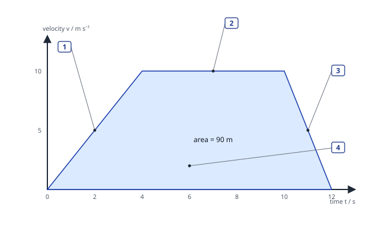

Back

Acceleration (gradient 2.5 m s⁻²)

<!-- meta {"type":"flashcard","id":"SCF-10-02-017","grade":10,"chapter_id":"SC10-02","discipline":"PHY","difficulty":1,"image":"science_assets/graphs/GR-D01_unlabelled.svg"} -->
**SCF-10-02-017** · Basic

**Front:** Velocity–time graph — which part is marked by number 2 in the unlabelled diagram?

Back

Uniform velocity — Acceleration 0

<!-- meta {"type":"flashcard","id":"SCF-10-02-018","grade":10,"chapter_id":"SC10-02","discipline":"PHY","difficulty":1,"image":"science_assets/graphs/GR-D01_unlabelled.svg"} -->
**SCF-10-02-018** · Basic

**Front:** Velocity–time graph — which part is marked by number 3 in the unlabelled diagram?

Back

Deceleration (−5 m s⁻²)

<!-- meta {"type":"flashcard","id":"SCF-10-02-019","grade":10,"chapter_id":"SC10-02","discipline":"PHY","difficulty":1,"image":"science_assets/graphs/GR-D01_unlabelled.svg"} -->
**SCF-10-02-019** · Basic

**Front:** Velocity–time graph — which part is marked by number 4 in the unlabelled diagram?

Back

Area under the graph — Displacement = 90 m

## SC10-03: Structure of matter

*Grade 10 · Chapter 3 · Chemistry · 19 cards*

<!-- meta {"type":"flashcard","id":"SCF-10-03-001","grade":10,"chapter_id":"SC10-03","discipline":"CHE","difficulty":1,"image":null} -->
**SCF-10-03-001** · Basic

**Front:** Charge of a proton?

Back

+1

<!-- meta {"type":"flashcard","id":"SCF-10-03-002","grade":10,"chapter_id":"SC10-03","discipline":"CHE","difficulty":1,"image":null} -->
**SCF-10-03-002** · Basic

**Front:** Charge of a neutron?

Back

0 (neutral)

<!-- meta {"type":"flashcard","id":"SCF-10-03-003","grade":10,"chapter_id":"SC10-03","discipline":"CHE","difficulty":1,"image":null} -->
**SCF-10-03-003** · Basic

**Front:** What is the atomic number?

Back

Number of protons

<!-- meta {"type":"flashcard","id":"SCF-10-03-004","grade":10,"chapter_id":"SC10-03","discipline":"CHE","difficulty":1,"image":null} -->
**SCF-10-03-004** · Basic

**Front:** What is the mass number?

Back

Protons + neutrons

<!-- meta {"type":"flashcard","id":"SCF-10-03-005","grade":10,"chapter_id":"SC10-03","discipline":"CHE","difficulty":1,"image":null} -->
**SCF-10-03-005** · Basic

**Front:** Isotopes?

Back

Same Z, different number of neutrons

<!-- meta {"type":"flashcard","id":"SCF-10-03-006","grade":10,"chapter_id":"SC10-03","discipline":"CHE","difficulty":1,"image":null} -->
**SCF-10-03-006** · Basic

**Front:** Electronic configuration of Na?

Back

2, 8, 1

<!-- meta {"type":"flashcard","id":"SCF-10-03-007","grade":10,"chapter_id":"SC10-03","discipline":"CHE","difficulty":1,"image":null} -->
**SCF-10-03-007** · Basic

**Front:** Electronic configuration of Cl?

Back

2, 8, 7

<!-- meta {"type":"flashcard","id":"SCF-10-03-008","grade":10,"chapter_id":"SC10-03","discipline":"CHE","difficulty":2,"image":null} -->
**SCF-10-03-008** · Intermediate

**Front:** Electronic configuration of Ca?

Back

2, 8, 8, 2

<!-- meta {"type":"flashcard","id":"SCF-10-03-009","grade":10,"chapter_id":"SC10-03","discipline":"CHE","difficulty":2,"image":null} -->
**SCF-10-03-009** · Intermediate

**Front:** $^{23}_{11}Na$: number of neutrons?

Back

23 − 11 = 12

<!-- meta {"type":"flashcard","id":"SCF-10-03-010","grade":10,"chapter_id":"SC10-03","discipline":"CHE","difficulty":2,"image":null} -->
**SCF-10-03-010** · Intermediate

**Front:** Electronegativity from left to right across a period?

Back

Increases

<!-- meta {"type":"flashcard","id":"SCF-10-03-011","grade":10,"chapter_id":"SC10-03","discipline":"CHE","difficulty":2,"image":null} -->
**SCF-10-03-011** · Intermediate

**Front:** Why are inert gases unreactive?

Back

Full outer energy level

<!-- meta {"type":"flashcard","id":"SCF-10-03-012","grade":10,"chapter_id":"SC10-03","discipline":"CHE","difficulty":2,"image":null} -->
**SCF-10-03-012** · Intermediate

**Front:** A non-metal that conducts electricity?

Back

Graphite

<!-- meta {"type":"flashcard","id":"SCF-10-03-013","grade":10,"chapter_id":"SC10-03","discipline":"CHE","difficulty":2,"image":null} -->
**SCF-10-03-013** · Intermediate

**Front:** What does the period number show?

Back

Number of energy levels

<!-- meta {"type":"flashcard","id":"SCF-10-03-014","grade":10,"chapter_id":"SC10-03","discipline":"CHE","difficulty":3,"image":null} -->
**SCF-10-03-014** · Hard

**Front:** Misconception: isotopes have different chemical properties?

Back

Wrong — they are similar

<!-- meta {"type":"flashcard","id":"SCF-10-03-015","grade":10,"chapter_id":"SC10-03","discipline":"CHE","difficulty":3,"image":null} -->
**SCF-10-03-015** · Hard

**Front:** First ionisation energy?

Back

Energy needed to remove one electron from a gaseous atom

<!-- meta {"type":"flashcard","id":"SCF-10-03-016","grade":10,"chapter_id":"SC10-03","discipline":"CHE","difficulty":1,"image":"science_assets/chemistry/CHE-D01_unlabelled.svg"} -->
**SCF-10-03-016** · Basic

**Front:** Electronic configuration of a sodium atom (2,8,1) — which part is marked by number 1 in the unlabelled diagram?

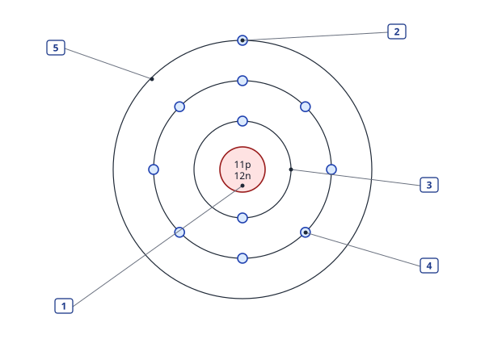

Back

Nucleus — Protons and neutrons

<!-- meta {"type":"flashcard","id":"SCF-10-03-017","grade":10,"chapter_id":"SC10-03","discipline":"CHE","difficulty":1,"image":"science_assets/chemistry/CHE-D01_unlabelled.svg"} -->
**SCF-10-03-017** · Basic

**Front:** Electronic configuration of a sodium atom (2,8,1) — which part is marked by number 2 in the unlabelled diagram?

Back

Electron — Negative charge; in shells

<!-- meta {"type":"flashcard","id":"SCF-10-03-018","grade":10,"chapter_id":"SC10-03","discipline":"CHE","difficulty":1,"image":"science_assets/chemistry/CHE-D01_unlabelled.svg"} -->
**SCF-10-03-018** · Basic

**Front:** Electronic configuration of a sodium atom (2,8,1) — which part is marked by number 3 in the unlabelled diagram?

Back

First energy level — Maximum 2 electrons

<!-- meta {"type":"flashcard","id":"SCF-10-03-019","grade":10,"chapter_id":"SC10-03","discipline":"CHE","difficulty":1,"image":"science_assets/chemistry/CHE-D01_unlabelled.svg"} -->
**SCF-10-03-019** · Basic

**Front:** Electronic configuration of a sodium atom (2,8,1) — which part is marked by number 4 in the unlabelled diagram?

Back

Second energy level — Maximum 8

## SC10-04: Newton's laws of motion

*Grade 10 · Chapter 4 · Physics · 15 cards*

<!-- meta {"type":"flashcard","id":"SCF-10-04-001","grade":10,"chapter_id":"SC10-04","discipline":"PHY","difficulty":1,"image":null} -->
**SCF-10-04-001** · Basic

**Front:** Newton's first law?

Back

If there is no unbalanced force, the state of motion does not change

<!-- meta {"type":"flashcard","id":"SCF-10-04-002","grade":10,"chapter_id":"SC10-04","discipline":"PHY","difficulty":1,"image":null} -->
**SCF-10-04-002** · Basic

**Front:** a in F = ma?

Back

Acceleration

<!-- meta {"type":"flashcard","id":"SCF-10-04-003","grade":10,"chapter_id":"SC10-04","discipline":"PHY","difficulty":1,"image":null} -->
**SCF-10-04-003** · Basic

**Front:** Momentum formula?

Back

p = mv

<!-- meta {"type":"flashcard","id":"SCF-10-04-004","grade":10,"chapter_id":"SC10-04","discipline":"PHY","difficulty":1,"image":null} -->
**SCF-10-04-004** · Basic

**Front:** Weight formula?

Back

W = mg

<!-- meta {"type":"flashcard","id":"SCF-10-04-005","grade":10,"chapter_id":"SC10-04","discipline":"PHY","difficulty":1,"image":null} -->
**SCF-10-04-005** · Basic

**Front:** 1 N = ?

Back

1 kg m s⁻²

<!-- meta {"type":"flashcard","id":"SCF-10-04-006","grade":10,"chapter_id":"SC10-04","discipline":"PHY","difficulty":2,"image":null} -->
**SCF-10-04-006** · Intermediate

**Front:** What does inertia depend on?

Back

Mass

<!-- meta {"type":"flashcard","id":"SCF-10-04-007","grade":10,"chapter_id":"SC10-04","discipline":"PHY","difficulty":1,"image":null} -->
**SCF-10-04-007** · Basic

**Front:** Third law?

Back

Every action has an equal and opposite reaction

<!-- meta {"type":"flashcard","id":"SCF-10-04-008","grade":10,"chapter_id":"SC10-04","discipline":"PHY","difficulty":2,"image":null} -->
**SCF-10-04-008** · Intermediate

**Front:** Do action and reaction act on the same object?

Back

No — on different objects

<!-- meta {"type":"flashcard","id":"SCF-10-04-009","grade":10,"chapter_id":"SC10-04","discipline":"PHY","difficulty":1,"image":null} -->
**SCF-10-04-009** · Basic

**Front:** Weight of a 60 kg man (g=10)?

Back

600 N

<!-- meta {"type":"flashcard","id":"SCF-10-04-010","grade":10,"chapter_id":"SC10-04","discipline":"PHY","difficulty":2,"image":null} -->
**SCF-10-04-010** · Intermediate

**Front:** Does mass change on the Moon?

Back

No — only weight changes

<!-- meta {"type":"flashcard","id":"SCF-10-04-011","grade":10,"chapter_id":"SC10-04","discipline":"PHY","difficulty":2,"image":null} -->
**SCF-10-04-011** · Intermediate

**Front:** A seat belt relates to which law?

Back

First (inertia)

<!-- meta {"type":"flashcard","id":"SCF-10-04-012","grade":10,"chapter_id":"SC10-04","discipline":"PHY","difficulty":2,"image":null} -->
**SCF-10-04-012** · Intermediate

**Front:** Rocket motion relates to which law?

Back

Third

<!-- meta {"type":"flashcard","id":"SCF-10-04-013","grade":10,"chapter_id":"SC10-04","discipline":"PHY","difficulty":1,"image":null} -->
**SCF-10-04-013** · Basic

**Front:** Unit of momentum?

Back

kg m s⁻¹

<!-- meta {"type":"flashcard","id":"SCF-10-04-014","grade":10,"chapter_id":"SC10-04","discipline":"PHY","difficulty":2,"image":null} -->
**SCF-10-04-014** · Intermediate

**Front:** Net force at constant velocity?

Back

Zero

<!-- meta {"type":"flashcard","id":"SCF-10-04-015","grade":10,"chapter_id":"SC10-04","discipline":"PHY","difficulty":3,"image":null} -->
**SCF-10-04-015** · Hard

**Front:** Misconception: motion always needs a force?

Back

Wrong

## SC10-05: Friction

*Grade 10 · Chapter 5 · Physics · 19 cards*

<!-- meta {"type":"flashcard","id":"SCF-10-05-001","grade":10,"chapter_id":"SC10-05","discipline":"PHY","difficulty":1,"image":null} -->
**SCF-10-05-001** · Basic

**Front:** What is friction?

Back

A force that opposes relative motion

<!-- meta {"type":"flashcard","id":"SCF-10-05-002","grade":10,"chapter_id":"SC10-05","discipline":"PHY","difficulty":1,"image":null} -->
**SCF-10-05-002** · Basic

**Front:** Limiting friction?

Back

The maximum friction when starting to move

<!-- meta {"type":"flashcard","id":"SCF-10-05-003","grade":10,"chapter_id":"SC10-05","discipline":"PHY","difficulty":2,"image":null} -->
**SCF-10-05-003** · Intermediate

**Front:** Kinetic friction vs limiting?

Back

Kinetic friction is slightly less

<!-- meta {"type":"flashcard","id":"SCF-10-05-004","grade":10,"chapter_id":"SC10-05","discipline":"PHY","difficulty":1,"image":null} -->
**SCF-10-05-004** · Basic

**Front:** A way to reduce friction?

Back

Lubricant / ball bearings

<!-- meta {"type":"flashcard","id":"SCF-10-05-005","grade":10,"chapter_id":"SC10-05","discipline":"PHY","difficulty":1,"image":null} -->
**SCF-10-05-005** · Basic

**Front:** An advantage of friction?

Back

For walking and braking

<!-- meta {"type":"flashcard","id":"SCF-10-05-006","grade":10,"chapter_id":"SC10-05","discipline":"PHY","difficulty":1,"image":null} -->
**SCF-10-05-006** · Basic

**Front:** A disadvantage of friction?

Back

Wear, heat loss

<!-- meta {"type":"flashcard","id":"SCF-10-05-007","grade":10,"chapter_id":"SC10-05","discipline":"PHY","difficulty":2,"image":null} -->
**SCF-10-05-007** · Intermediate

**Front:** What friction depends on?

Back

Nature of the surfaces, normal reaction

<!-- meta {"type":"flashcard","id":"SCF-10-05-008","grade":10,"chapter_id":"SC10-05","discipline":"PHY","difficulty":3,"image":null} -->
**SCF-10-05-008** · Hard

**Front:** Does it depend on contact area?

Back

(Approximately) no

<!-- meta {"type":"flashcard","id":"SCF-10-05-009","grade":10,"chapter_id":"SC10-05","discipline":"PHY","difficulty":1,"image":null} -->
**SCF-10-05-009** · Basic

**Front:** Why do tyres have patterns?

Back

To increase grip

<!-- meta {"type":"flashcard","id":"SCF-10-05-010","grade":10,"chapter_id":"SC10-05","discipline":"PHY","difficulty":2,"image":null} -->
**SCF-10-05-010** · Intermediate

**Front:** Streamlined shape?

Back

A shape that reduces air resistance

<!-- meta {"type":"flashcard","id":"SCF-10-05-011","grade":10,"chapter_id":"SC10-05","discipline":"PHY","difficulty":1,"image":null} -->
**SCF-10-05-011** · Basic

**Front:** Hands get warm when rubbed?

Back

Friction is converted into heat

<!-- meta {"type":"flashcard","id":"SCF-10-05-012","grade":10,"chapter_id":"SC10-05","discipline":"PHY","difficulty":2,"image":null} -->
**SCF-10-05-012** · Intermediate

**Front:** Ball bearings?

Back

Change sliding friction into rolling friction

<!-- meta {"type":"flashcard","id":"SCF-10-05-013","grade":10,"chapter_id":"SC10-05","discipline":"PHY","difficulty":2,"image":null} -->
**SCF-10-05-013** · Intermediate

**Front:** Rolling friction vs sliding?

Back

Rolling friction is less

<!-- meta {"type":"flashcard","id":"SCF-10-05-014","grade":10,"chapter_id":"SC10-05","discipline":"PHY","difficulty":2,"image":null} -->
**SCF-10-05-014** · Intermediate

**Front:** Static friction with the applied force?

Back

Increases equally up to the limit

<!-- meta {"type":"flashcard","id":"SCF-10-05-015","grade":10,"chapter_id":"SC10-05","discipline":"PHY","difficulty":3,"image":null} -->
**SCF-10-05-015** · Hard

**Front:** Misconception: friction is always a disadvantage?

Back

Wrong

<!-- meta {"type":"flashcard","id":"SCF-10-05-016","grade":10,"chapter_id":"SC10-05","discipline":"PHY","difficulty":1,"image":"science_assets/physics/PHY-D06_unlabelled.svg"} -->
**SCF-10-05-016** · Basic

**Front:** Force diagram of a box pulled along a table — which part is marked by number 1 in the unlabelled diagram?

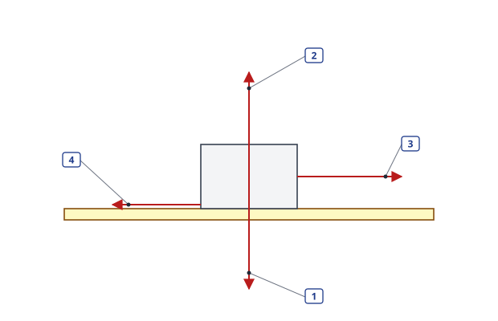

Back

Weight (W = mg) — Gravity — downwards

<!-- meta {"type":"flashcard","id":"SCF-10-05-017","grade":10,"chapter_id":"SC10-05","discipline":"PHY","difficulty":1,"image":"science_assets/physics/PHY-D06_unlabelled.svg"} -->
**SCF-10-05-017** · Basic

**Front:** Force diagram of a box pulled along a table — which part is marked by number 2 in the unlabelled diagram?

Back

Normal reaction (R) — Perpendicular to the surface

<!-- meta {"type":"flashcard","id":"SCF-10-05-018","grade":10,"chapter_id":"SC10-05","discipline":"PHY","difficulty":1,"image":"science_assets/physics/PHY-D06_unlabelled.svg"} -->
**SCF-10-05-018** · Basic

**Front:** Force diagram of a box pulled along a table — which part is marked by number 3 in the unlabelled diagram?

Back

Pulling force (F)

<!-- meta {"type":"flashcard","id":"SCF-10-05-019","grade":10,"chapter_id":"SC10-05","discipline":"PHY","difficulty":1,"image":"science_assets/physics/PHY-D06_unlabelled.svg"} -->
**SCF-10-05-019** · Basic

**Front:** Force diagram of a box pulled along a table — which part is marked by number 4 in the unlabelled diagram?

Back

Friction (f) — Opposite to the motion

## SC10-06: Structure and functions of plant and animal cells

*Grade 10 · Chapter 6 · Biology · 23 cards*

<!-- meta {"type":"flashcard","id":"SCF-10-06-001","grade":10,"chapter_id":"SC10-06","discipline":"BIO","difficulty":1,"image":null} -->
**SCF-10-06-001** · Basic

**Front:** Control centre of the cell?

Back

Nucleus

<!-- meta {"type":"flashcard","id":"SCF-10-06-002","grade":10,"chapter_id":"SC10-06","discipline":"BIO","difficulty":1,"image":null} -->
**SCF-10-06-002** · Basic

**Front:** Organelle where photosynthesis takes place?

Back

Chloroplast

<!-- meta {"type":"flashcard","id":"SCF-10-06-003","grade":10,"chapter_id":"SC10-06","discipline":"BIO","difficulty":1,"image":null} -->
**SCF-10-06-003** · Basic

**Front:** Organelle where aerobic respiration takes place?

Back

Mitochondrion

<!-- meta {"type":"flashcard","id":"SCF-10-06-004","grade":10,"chapter_id":"SC10-06","discipline":"BIO","difficulty":1,"image":null} -->
**SCF-10-06-004** · Basic

**Front:** Site of protein synthesis?

Back

Ribosome

<!-- meta {"type":"flashcard","id":"SCF-10-06-005","grade":10,"chapter_id":"SC10-06","discipline":"BIO","difficulty":1,"image":null} -->
**SCF-10-06-005** · Basic

**Front:** Main substance of the cell wall?

Back

Cellulose

<!-- meta {"type":"flashcard","id":"SCF-10-06-006","grade":10,"chapter_id":"SC10-06","discipline":"BIO","difficulty":1,"image":null} -->
**SCF-10-06-006** · Basic

**Front:** Which part is selectively permeable?

Back

Cell membrane

<!-- meta {"type":"flashcard","id":"SCF-10-06-007","grade":10,"chapter_id":"SC10-06","discipline":"BIO","difficulty":2,"image":null} -->
**SCF-10-06-007** · Intermediate

**Front:** Organelle found only in animal cells?

Back

Centriole

<!-- meta {"type":"flashcard","id":"SCF-10-06-008","grade":10,"chapter_id":"SC10-06","discipline":"BIO","difficulty":2,"image":null} -->
**SCF-10-06-008** · Intermediate

**Front:** Function of the large vacuole of a plant cell?

Back

Stores cell sap and provides turgor pressure

<!-- meta {"type":"flashcard","id":"SCF-10-06-009","grade":10,"chapter_id":"SC10-06","discipline":"BIO","difficulty":2,"image":null} -->
**SCF-10-06-009** · Intermediate

**Front:** Function of the Golgi apparatus?

Back

Packaging and secreting substances

<!-- meta {"type":"flashcard","id":"SCF-10-06-010","grade":10,"chapter_id":"SC10-06","discipline":"BIO","difficulty":1,"image":null} -->
**SCF-10-06-010** · Basic

**Front:** What is cytoplasm?

Back

The part inside the cell membrane, excluding the nucleus

<!-- meta {"type":"flashcard","id":"SCF-10-06-011","grade":10,"chapter_id":"SC10-06","discipline":"BIO","difficulty":1,"image":null} -->
**SCF-10-06-011** · Basic

**Front:** What is the basic unit of life?

Back

The cell is the basic unit of life

<!-- meta {"type":"flashcard","id":"SCF-10-06-012","grade":10,"chapter_id":"SC10-06","discipline":"BIO","difficulty":2,"image":null} -->
**SCF-10-06-012** · Intermediate

**Front:** Found in large numbers in cells that need a lot of energy?

Back

Mitochondrion

<!-- meta {"type":"flashcard","id":"SCF-10-06-013","grade":10,"chapter_id":"SC10-06","discipline":"BIO","difficulty":3,"image":null} -->
**SCF-10-06-013** · Hard

**Front:** Misconception: plant cells have no mitochondria?

Back

Wrong — they do

<!-- meta {"type":"flashcard","id":"SCF-10-06-014","grade":10,"chapter_id":"SC10-06","discipline":"BIO","difficulty":2,"image":null} -->
**SCF-10-06-014** · Intermediate

**Front:** Function of the endoplasmic reticulum?

Back

Transporting substances within the cell

<!-- meta {"type":"flashcard","id":"SCF-10-06-015","grade":10,"chapter_id":"SC10-06","discipline":"BIO","difficulty":3,"image":null} -->
**SCF-10-06-015** · Hard

**Front:** Where is DNA found?

Back

Nucleus (also a little in mitochondria and chloroplasts)

<!-- meta {"type":"flashcard","id":"SCF-10-06-016","grade":10,"chapter_id":"SC10-06","discipline":"BIO","difficulty":1,"image":"science_assets/biology/BIO-D01_unlabelled.svg"} -->
**SCF-10-06-016** · Basic

**Front:** Plant cell — which part is marked by number 1 in the unlabelled diagram?

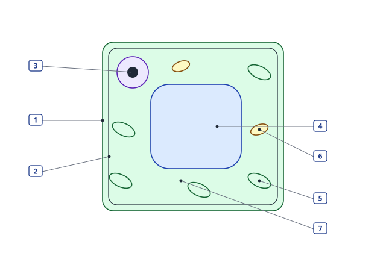

Back

Cell wall — Mechanical support, shape

<!-- meta {"type":"flashcard","id":"SCF-10-06-017","grade":10,"chapter_id":"SC10-06","discipline":"BIO","difficulty":1,"image":"science_assets/biology/BIO-D01_unlabelled.svg"} -->
**SCF-10-06-017** · Basic

**Front:** Plant cell — which part is marked by number 2 in the unlabelled diagram?

Back

Cell membrane — Controls the entry and exit of substances

<!-- meta {"type":"flashcard","id":"SCF-10-06-018","grade":10,"chapter_id":"SC10-06","discipline":"BIO","difficulty":1,"image":"science_assets/biology/BIO-D01_unlabelled.svg"} -->
**SCF-10-06-018** · Basic

**Front:** Plant cell — which part is marked by number 3 in the unlabelled diagram?

Back

Nucleus — Controls cell activities; DNA

<!-- meta {"type":"flashcard","id":"SCF-10-06-019","grade":10,"chapter_id":"SC10-06","discipline":"BIO","difficulty":1,"image":"science_assets/biology/BIO-D01_unlabelled.svg"} -->
**SCF-10-06-019** · Basic

**Front:** Plant cell — which part is marked by number 4 in the unlabelled diagram?

Back

Vacuole — Stores cell sap; maintains turgor

<!-- meta {"type":"flashcard","id":"SCF-10-06-020","grade":10,"chapter_id":"SC10-06","discipline":"BIO","difficulty":1,"image":"science_assets/biology/BIO-D02_unlabelled.svg"} -->
**SCF-10-06-020** · Basic

**Front:** Animal cell — which part is marked by number 1 in the unlabelled diagram?

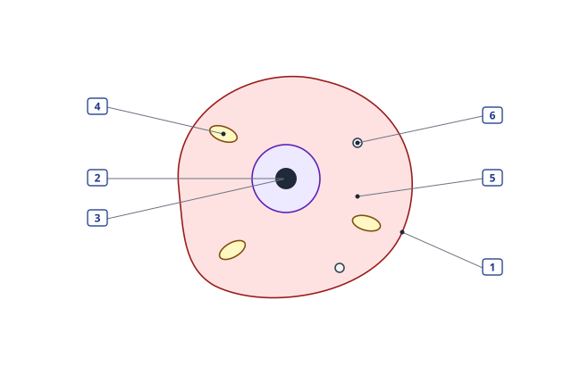

Back

Cell membrane — Controls entry and exit

<!-- meta {"type":"flashcard","id":"SCF-10-06-021","grade":10,"chapter_id":"SC10-06","discipline":"BIO","difficulty":1,"image":"science_assets/biology/BIO-D02_unlabelled.svg"} -->
**SCF-10-06-021** · Basic

**Front:** Animal cell — which part is marked by number 2 in the unlabelled diagram?

Back

Nucleus — Control centre

<!-- meta {"type":"flashcard","id":"SCF-10-06-022","grade":10,"chapter_id":"SC10-06","discipline":"BIO","difficulty":1,"image":"science_assets/biology/BIO-D02_unlabelled.svg"} -->
**SCF-10-06-022** · Basic

**Front:** Animal cell — which part is marked by number 3 in the unlabelled diagram?

Back

Nucleolus — Makes ribosomes

<!-- meta {"type":"flashcard","id":"SCF-10-06-023","grade":10,"chapter_id":"SC10-06","discipline":"BIO","difficulty":1,"image":"science_assets/biology/BIO-D02_unlabelled.svg"} -->
**SCF-10-06-023** · Basic

**Front:** Animal cell — which part is marked by number 4 in the unlabelled diagram?

Back

Mitochondrion — Produces energy (ATP)

## SC10-07: Quantification of elements and compounds

*Grade 10 · Chapter 7 · Chemistry · 15 cards*

<!-- meta {"type":"flashcard","id":"SCF-10-07-001","grade":10,"chapter_id":"SC10-07","discipline":"CHE","difficulty":1,"image":null} -->
**SCF-10-07-001** · Basic

**Front:** Avogadro constant?

Back

6.022 × 10²³ mol⁻¹

<!-- meta {"type":"flashcard","id":"SCF-10-07-002","grade":10,"chapter_id":"SC10-07","discipline":"CHE","difficulty":1,"image":null} -->
**SCF-10-07-002** · Basic

**Front:** Formula for number of moles?

Back

n = m / M

<!-- meta {"type":"flashcard","id":"SCF-10-07-003","grade":10,"chapter_id":"SC10-07","discipline":"CHE","difficulty":1,"image":null} -->
**SCF-10-07-003** · Basic

**Front:** Mr of H₂O? (H=1, O=16)

Back

18

<!-- meta {"type":"flashcard","id":"SCF-10-07-004","grade":10,"chapter_id":"SC10-07","discipline":"CHE","difficulty":1,"image":null} -->
**SCF-10-07-004** · Basic

**Front:** Mr of CO₂? (C=12, O=16)

Back

44

<!-- meta {"type":"flashcard","id":"SCF-10-07-005","grade":10,"chapter_id":"SC10-07","discipline":"CHE","difficulty":1,"image":null} -->
**SCF-10-07-005** · Basic

**Front:** Unit of concentration?

Back

mol dm⁻³

<!-- meta {"type":"flashcard","id":"SCF-10-07-006","grade":10,"chapter_id":"SC10-07","discipline":"CHE","difficulty":1,"image":null} -->
**SCF-10-07-006** · Basic

**Front:** 1 dm³ = ? cm³

Back

1000

<!-- meta {"type":"flashcard","id":"SCF-10-07-007","grade":10,"chapter_id":"SC10-07","discipline":"CHE","difficulty":2,"image":null} -->
**SCF-10-07-007** · Intermediate

**Front:** Molar mass of NaCl? (Na=23, Cl=35.5)

Back

58.5 g mol⁻¹

<!-- meta {"type":"flashcard","id":"SCF-10-07-008","grade":10,"chapter_id":"SC10-07","discipline":"CHE","difficulty":2,"image":null} -->
**SCF-10-07-008** · Intermediate

**Front:** Mass of 2 mol H₂O?

Back

36 g

<!-- meta {"type":"flashcard","id":"SCF-10-07-009","grade":10,"chapter_id":"SC10-07","discipline":"CHE","difficulty":1,"image":null} -->
**SCF-10-07-009** · Basic

**Front:** Concentration formula?

Back

C = n / V

<!-- meta {"type":"flashcard","id":"SCF-10-07-010","grade":10,"chapter_id":"SC10-07","discipline":"CHE","difficulty":3,"image":null} -->
**SCF-10-07-010** · Hard

**Front:** O atoms in 1 mol O₂?

Back

2 × 6.022 × 10²³

<!-- meta {"type":"flashcard","id":"SCF-10-07-011","grade":10,"chapter_id":"SC10-07","discipline":"CHE","difficulty":2,"image":null} -->
**SCF-10-07-011** · Intermediate

**Front:** Standard for relative atomic mass?

Back

1/12 of the mass of a ¹²C atom

<!-- meta {"type":"flashcard","id":"SCF-10-07-012","grade":10,"chapter_id":"SC10-07","discipline":"CHE","difficulty":2,"image":null} -->
**SCF-10-07-012** · Intermediate

**Front:** M of NaOH? (Na=23,O=16,H=1)

Back

40 g mol⁻¹

<!-- meta {"type":"flashcard","id":"SCF-10-07-013","grade":10,"chapter_id":"SC10-07","discipline":"CHE","difficulty":2,"image":null} -->
**SCF-10-07-013** · Intermediate

**Front:** What do the coefficients of an equation show?

Back

Mole ratio

<!-- meta {"type":"flashcard","id":"SCF-10-07-014","grade":10,"chapter_id":"SC10-07","discipline":"CHE","difficulty":2,"image":null} -->
**SCF-10-07-014** · Intermediate

**Front:** M of CaCO₃? (Ca=40,C=12,O=16)

Back

100 g mol⁻¹

<!-- meta {"type":"flashcard","id":"SCF-10-07-015","grade":10,"chapter_id":"SC10-07","discipline":"CHE","difficulty":3,"image":null} -->
**SCF-10-07-015** · Hard

**Front:** Concentration if 0.5 mol NaOH is dissolved in 500 cm³?

Back

1 mol dm⁻³

## SC10-08: Characteristics of living organisms

*Grade 10 · Chapter 8 · Biology · 15 cards*

<!-- meta {"type":"flashcard","id":"SCF-10-08-001","grade":10,"chapter_id":"SC10-08","discipline":"BIO","difficulty":1,"image":null} -->
**SCF-10-08-001** · Basic

**Front:** The two parts of a binomial name?

Back

Genus name + species name

<!-- meta {"type":"flashcard","id":"SCF-10-08-002","grade":10,"chapter_id":"SC10-08","discipline":"BIO","difficulty":1,"image":null} -->
**SCF-10-08-002** · Basic

**Front:** Binomial name of humans?

Back

Homo sapiens

<!-- meta {"type":"flashcard","id":"SCF-10-08-003","grade":10,"chapter_id":"SC10-08","discipline":"BIO","difficulty":2,"image":null} -->
**SCF-10-08-003** · Intermediate

**Front:** The three domains?

Back

Bacteria, Archaea, Eukarya

<!-- meta {"type":"flashcard","id":"SCF-10-08-004","grade":10,"chapter_id":"SC10-08","discipline":"BIO","difficulty":1,"image":null} -->
**SCF-10-08-004** · Basic

**Front:** Which kingdom does a mushroom belong to?

Back

Fungi

<!-- meta {"type":"flashcard","id":"SCF-10-08-005","grade":10,"chapter_id":"SC10-08","discipline":"BIO","difficulty":1,"image":null} -->
**SCF-10-08-005** · Basic

**Front:** Phylum with jointed legs?

Back

Arthropoda

<!-- meta {"type":"flashcard","id":"SCF-10-08-006","grade":10,"chapter_id":"SC10-08","discipline":"BIO","difficulty":2,"image":null} -->
**SCF-10-08-006** · Intermediate

**Front:** Phylum with spiny skin?

Back

Echinodermata

<!-- meta {"type":"flashcard","id":"SCF-10-08-007","grade":10,"chapter_id":"SC10-08","discipline":"BIO","difficulty":1,"image":null} -->
**SCF-10-08-007** · Basic

**Front:** What is irritability?

Back

The ability to respond to a stimulus

<!-- meta {"type":"flashcard","id":"SCF-10-08-008","grade":10,"chapter_id":"SC10-08","discipline":"BIO","difficulty":2,"image":null} -->
**SCF-10-08-008** · Intermediate

**Front:** What is a species?

Back

Similar organisms that interbreed and produce fertile offspring

<!-- meta {"type":"flashcard","id":"SCF-10-08-009","grade":10,"chapter_id":"SC10-08","discipline":"BIO","difficulty":2,"image":null} -->
**SCF-10-08-009** · Intermediate

**Front:** Phylum with stinging cells?

Back

Cnidaria

<!-- meta {"type":"flashcard","id":"SCF-10-08-010","grade":10,"chapter_id":"SC10-08","discipline":"BIO","difficulty":1,"image":null} -->
**SCF-10-08-010** · Basic

**Front:** The smallest unit of classification?

Back

Species

<!-- meta {"type":"flashcard","id":"SCF-10-08-011","grade":10,"chapter_id":"SC10-08","discipline":"BIO","difficulty":1,"image":null} -->
**SCF-10-08-011** · Basic

**Front:** Three characteristics of organisms?

Back

Respiration, growth, reproduction (and more)

<!-- meta {"type":"flashcard","id":"SCF-10-08-012","grade":10,"chapter_id":"SC10-08","discipline":"BIO","difficulty":1,"image":null} -->
**SCF-10-08-012** · Basic

**Front:** An example of an amphibian?

Back

Frog

<!-- meta {"type":"flashcard","id":"SCF-10-08-013","grade":10,"chapter_id":"SC10-08","discipline":"BIO","difficulty":3,"image":null} -->
**SCF-10-08-013** · Hard

**Front:** Misconception: plants do not move?

Back

Wrong — they show growth movements

<!-- meta {"type":"flashcard","id":"SCF-10-08-014","grade":10,"chapter_id":"SC10-08","discipline":"BIO","difficulty":2,"image":null} -->
**SCF-10-08-014** · Intermediate

**Front:** The 5 classes of vertebrates?

Back

Fish, amphibians, reptiles, birds, mammals

<!-- meta {"type":"flashcard","id":"SCF-10-08-015","grade":10,"chapter_id":"SC10-08","discipline":"BIO","difficulty":1,"image":null} -->
**SCF-10-08-015** · Basic

**Front:** In a binomial name, which part starts with a capital letter?

Back

Genus name

## SC10-09: Resultant force

*Grade 10 · Chapter 9 · Physics · 15 cards*

<!-- meta {"type":"flashcard","id":"SCF-10-09-001","grade":10,"chapter_id":"SC10-09","discipline":"PHY","difficulty":1,"image":null} -->
**SCF-10-09-001** · Basic

**Front:** Resultant of forces in the same direction?

Back

Sum

<!-- meta {"type":"flashcard","id":"SCF-10-09-002","grade":10,"chapter_id":"SC10-09","discipline":"PHY","difficulty":1,"image":null} -->
**SCF-10-09-002** · Basic

**Front:** Resultant of forces in opposite directions?

Back

Difference

<!-- meta {"type":"flashcard","id":"SCF-10-09-003","grade":10,"chapter_id":"SC10-09","discipline":"PHY","difficulty":2,"image":null} -->
**SCF-10-09-003** · Intermediate

**Front:** Resultant of perpendicular forces?

Back

√(F₁² + F₂²)

<!-- meta {"type":"flashcard","id":"SCF-10-09-004","grade":10,"chapter_id":"SC10-09","discipline":"PHY","difficulty":2,"image":null} -->
**SCF-10-09-004** · Intermediate

**Front:** Resultant in the parallelogram rule?

Back

Diagonal

<!-- meta {"type":"flashcard","id":"SCF-10-09-005","grade":10,"chapter_id":"SC10-09","discipline":"PHY","difficulty":1,"image":null} -->
**SCF-10-09-005** · Basic

**Front:** If the resultant is 0?

Back

Equilibrium

<!-- meta {"type":"flashcard","id":"SCF-10-09-006","grade":10,"chapter_id":"SC10-09","discipline":"PHY","difficulty":2,"image":null} -->
**SCF-10-09-006** · Intermediate

**Front:** 3 N and 4 N perpendicular — resultant?

Back

5 N

<!-- meta {"type":"flashcard","id":"SCF-10-09-007","grade":10,"chapter_id":"SC10-09","discipline":"PHY","difficulty":1,"image":null} -->
**SCF-10-09-007** · Basic

**Front:** 10 N east, 6 N west?

Back

4 N east

<!-- meta {"type":"flashcard","id":"SCF-10-09-008","grade":10,"chapter_id":"SC10-09","discipline":"PHY","difficulty":1,"image":null} -->
**SCF-10-09-008** · Basic

**Front:** What is a resultant force?

Back

A single force equivalent to several forces

<!-- meta {"type":"flashcard","id":"SCF-10-09-009","grade":10,"chapter_id":"SC10-09","discipline":"PHY","difficulty":1,"image":null} -->
**SCF-10-09-009** · Basic

**Front:** Is force a vector?

Back

Yes

<!-- meta {"type":"flashcard","id":"SCF-10-09-010","grade":10,"chapter_id":"SC10-09","discipline":"PHY","difficulty":2,"image":null} -->
**SCF-10-09-010** · Intermediate

**Front:** Maximum resultant of two forces?

Back

In the same direction — the sum

<!-- meta {"type":"flashcard","id":"SCF-10-09-011","grade":10,"chapter_id":"SC10-09","discipline":"PHY","difficulty":2,"image":null} -->
**SCF-10-09-011** · Intermediate

**Front:** Minimum resultant of two forces?

Back

In opposite directions — the difference

<!-- meta {"type":"flashcard","id":"SCF-10-09-012","grade":10,"chapter_id":"SC10-09","discipline":"PHY","difficulty":2,"image":null} -->
**SCF-10-09-012** · Intermediate

**Front:** Resultant force and acceleration?

Back

F = ma

<!-- meta {"type":"flashcard","id":"SCF-10-09-013","grade":10,"chapter_id":"SC10-09","discipline":"PHY","difficulty":1,"image":null} -->
**SCF-10-09-013** · Basic

**Front:** Who wins a tug-of-war?

Back

The direction of the resultant force

<!-- meta {"type":"flashcard","id":"SCF-10-09-014","grade":10,"chapter_id":"SC10-09","discipline":"PHY","difficulty":2,"image":null} -->
**SCF-10-09-014** · Intermediate

**Front:** If the scale is 1 cm = 2 N, 7 cm is?

Back

14 N

<!-- meta {"type":"flashcard","id":"SCF-10-09-015","grade":10,"chapter_id":"SC10-09","discipline":"PHY","difficulty":3,"image":null} -->
**SCF-10-09-015** · Hard

**Front:** Misconception: 3 N + 4 N = 7 N always?

Back

Wrong

## SC10-10: Chemical bonds

*Grade 10 · Chapter 10 · Chemistry · 15 cards*

<!-- meta {"type":"flashcard","id":"SCF-10-10-001","grade":10,"chapter_id":"SC10-10","discipline":"CHE","difficulty":1,"image":null} -->
**SCF-10-10-001** · Basic

**Front:** How is an ionic bond formed?

Back

By transfer of electrons

<!-- meta {"type":"flashcard","id":"SCF-10-10-002","grade":10,"chapter_id":"SC10-10","discipline":"CHE","difficulty":1,"image":null} -->
**SCF-10-10-002** · Basic

**Front:** Covalent bond?

Back

Sharing a pair of electrons

<!-- meta {"type":"flashcard","id":"SCF-10-10-003","grade":10,"chapter_id":"SC10-10","discipline":"CHE","difficulty":2,"image":null} -->
**SCF-10-10-003** · Intermediate

**Front:** Bond in N₂?

Back

Triple bond

<!-- meta {"type":"flashcard","id":"SCF-10-10-004","grade":10,"chapter_id":"SC10-10","discipline":"CHE","difficulty":1,"image":null} -->
**SCF-10-10-004** · Basic

**Front:** Bond in O₂?

Back

Double bond

<!-- meta {"type":"flashcard","id":"SCF-10-10-005","grade":10,"chapter_id":"SC10-10","discipline":"CHE","difficulty":1,"image":null} -->
**SCF-10-10-005** · Basic

**Front:** Covalent bonds in CH₄?

Back

4

<!-- meta {"type":"flashcard","id":"SCF-10-10-006","grade":10,"chapter_id":"SC10-10","discipline":"CHE","difficulty":2,"image":null} -->
**SCF-10-10-006** · Intermediate

**Front:** Bonding pairs in NH₃?

Back

3

<!-- meta {"type":"flashcard","id":"SCF-10-10-007","grade":10,"chapter_id":"SC10-10","discipline":"CHE","difficulty":3,"image":null} -->
**SCF-10-10-007** · Hard

**Front:** Bonds in CO₂?

Back

Two double bonds (4 bonding pairs in total)

<!-- meta {"type":"flashcard","id":"SCF-10-10-008","grade":10,"chapter_id":"SC10-10","discipline":"CHE","difficulty":2,"image":null} -->
**SCF-10-10-008** · Intermediate

**Front:** Does solid NaCl conduct?

Back

No

<!-- meta {"type":"flashcard","id":"SCF-10-10-009","grade":10,"chapter_id":"SC10-10","discipline":"CHE","difficulty":2,"image":null} -->
**SCF-10-10-009** · Intermediate

**Front:** Cause of a polar bond?

Back

Difference in electronegativity

<!-- meta {"type":"flashcard","id":"SCF-10-10-010","grade":10,"chapter_id":"SC10-10","discipline":"CHE","difficulty":1,"image":null} -->
**SCF-10-10-010** · Basic

**Front:** Valency of Mg?

Back

2

<!-- meta {"type":"flashcard","id":"SCF-10-10-011","grade":10,"chapter_id":"SC10-10","discipline":"CHE","difficulty":1,"image":null} -->
**SCF-10-10-011** · Basic

**Front:** Valency of Al?

Back

3

<!-- meta {"type":"flashcard","id":"SCF-10-10-012","grade":10,"chapter_id":"SC10-10","discipline":"CHE","difficulty":2,"image":null} -->
**SCF-10-10-012** · Intermediate

**Front:** Metallic bond?

Back

Positive ions + delocalised electrons

<!-- meta {"type":"flashcard","id":"SCF-10-10-013","grade":10,"chapter_id":"SC10-10","discipline":"CHE","difficulty":1,"image":null} -->
**SCF-10-10-013** · Basic

**Front:** Ion of Na in NaCl?

Back

Na⁺

<!-- meta {"type":"flashcard","id":"SCF-10-10-014","grade":10,"chapter_id":"SC10-10","discipline":"CHE","difficulty":2,"image":null} -->
**SCF-10-10-014** · Intermediate

**Front:** Ion of O in MgO?

Back

O²⁻

<!-- meta {"type":"flashcard","id":"SCF-10-10-015","grade":10,"chapter_id":"SC10-10","discipline":"CHE","difficulty":1,"image":null} -->
**SCF-10-10-015** · Basic

**Front:** Melting point of ionic compounds?

Back

High

## SC10-11: Turning effect of a force

*Grade 10 · Chapter 11 · Physics · 19 cards*

<!-- meta {"type":"flashcard","id":"SCF-10-11-001","grade":10,"chapter_id":"SC10-11","discipline":"PHY","difficulty":1,"image":null} -->
**SCF-10-11-001** · Basic

**Front:** Moment formula?

Back

M = F × d

<!-- meta {"type":"flashcard","id":"SCF-10-11-002","grade":10,"chapter_id":"SC10-11","discipline":"PHY","difficulty":1,"image":null} -->
**SCF-10-11-002** · Basic

**Front:** Unit of moment?

Back

N m

<!-- meta {"type":"flashcard","id":"SCF-10-11-003","grade":10,"chapter_id":"SC10-11","discipline":"PHY","difficulty":1,"image":null} -->
**SCF-10-11-003** · Basic

**Front:** Principle of moments?

Back

In equilibrium clockwise = anticlockwise

<!-- meta {"type":"flashcard","id":"SCF-10-11-004","grade":10,"chapter_id":"SC10-11","discipline":"PHY","difficulty":2,"image":null} -->
**SCF-10-11-004** · Intermediate

**Front:** What is a couple?

Back

A pair of equal and opposite parallel forces

<!-- meta {"type":"flashcard","id":"SCF-10-11-005","grade":10,"chapter_id":"SC10-11","discipline":"PHY","difficulty":1,"image":null} -->
**SCF-10-11-005** · Basic

**Front:** Why is a door handle far from the hinge?

Back

Larger d — less force

<!-- meta {"type":"flashcard","id":"SCF-10-11-006","grade":10,"chapter_id":"SC10-11","discipline":"PHY","difficulty":2,"image":null} -->
**SCF-10-11-006** · Intermediate

**Front:** What is d?

Back

Perpendicular distance from the pivot

<!-- meta {"type":"flashcard","id":"SCF-10-11-007","grade":10,"chapter_id":"SC10-11","discipline":"PHY","difficulty":1,"image":null} -->
**SCF-10-11-007** · Basic

**Front:** Three parts of a lever?

Back

Pivot, load, effort

<!-- meta {"type":"flashcard","id":"SCF-10-11-008","grade":10,"chapter_id":"SC10-11","discipline":"PHY","difficulty":2,"image":null} -->
**SCF-10-11-008** · Intermediate

**Front:** Effect of a couple?

Back

Rotation only

<!-- meta {"type":"flashcard","id":"SCF-10-11-009","grade":10,"chapter_id":"SC10-11","discipline":"PHY","difficulty":1,"image":null} -->
**SCF-10-11-009** · Basic

**Front:** 10 N, 0.5 m — moment?

Back

5 N m

<!-- meta {"type":"flashcard","id":"SCF-10-11-010","grade":10,"chapter_id":"SC10-11","discipline":"PHY","difficulty":2,"image":null} -->
**SCF-10-11-010** · Intermediate

**Front:** Moment of a force acting through the pivot?

Back

0

<!-- meta {"type":"flashcard","id":"SCF-10-11-011","grade":10,"chapter_id":"SC10-11","discipline":"PHY","difficulty":1,"image":null} -->
**SCF-10-11-011** · Basic

**Front:** Condition for a see-saw to balance?

Back

F₁d₁ = F₂d₂

<!-- meta {"type":"flashcard","id":"SCF-10-11-012","grade":10,"chapter_id":"SC10-11","discipline":"PHY","difficulty":2,"image":null} -->
**SCF-10-11-012** · Intermediate

**Front:** An example of a couple?

Back

Turning a water tap / steering wheel

<!-- meta {"type":"flashcard","id":"SCF-10-11-013","grade":10,"chapter_id":"SC10-11","discipline":"PHY","difficulty":1,"image":null} -->
**SCF-10-11-013** · Basic

**Front:** Clockwise moment?

Back

A moment that turns in the direction of a clock's hands

<!-- meta {"type":"flashcard","id":"SCF-10-11-014","grade":10,"chapter_id":"SC10-11","discipline":"PHY","difficulty":2,"image":null} -->
**SCF-10-11-014** · Intermediate

**Front:** Why does a long spanner help?

Back

The moment increases

<!-- meta {"type":"flashcard","id":"SCF-10-11-015","grade":10,"chapter_id":"SC10-11","discipline":"PHY","difficulty":3,"image":null} -->
**SCF-10-11-015** · Hard

**Front:** Misconception: a couple moves an object?

Back

Wrong

<!-- meta {"type":"flashcard","id":"SCF-10-11-016","grade":10,"chapter_id":"SC10-11","discipline":"PHY","difficulty":1,"image":"science_assets/physics/PHY-D11_unlabelled.svg"} -->
**SCF-10-11-016** · Basic

**Front:** Principle of moments — see-saw — which part is marked by number 1 in the unlabelled diagram?

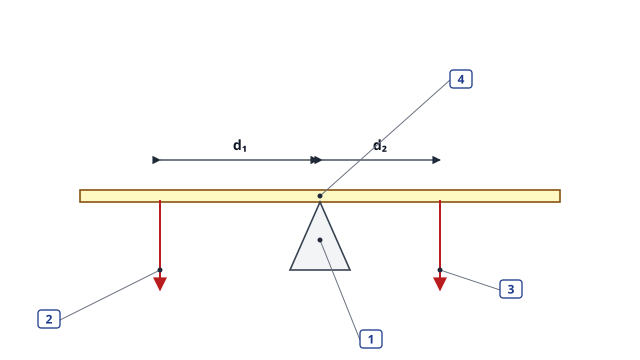

Back

Pivot — Point about which moments are taken

<!-- meta {"type":"flashcard","id":"SCF-10-11-017","grade":10,"chapter_id":"SC10-11","discipline":"PHY","difficulty":1,"image":"science_assets/physics/PHY-D11_unlabelled.svg"} -->
**SCF-10-11-017** · Basic

**Front:** Principle of moments — see-saw — which part is marked by number 2 in the unlabelled diagram?

Back

W₁ (anticlockwise moment) — W₁ × d₁

<!-- meta {"type":"flashcard","id":"SCF-10-11-018","grade":10,"chapter_id":"SC10-11","discipline":"PHY","difficulty":1,"image":"science_assets/physics/PHY-D11_unlabelled.svg"} -->
**SCF-10-11-018** · Basic

**Front:** Principle of moments — see-saw — which part is marked by number 3 in the unlabelled diagram?

Back

W₂ (clockwise moment) — W₂ × d₂

<!-- meta {"type":"flashcard","id":"SCF-10-11-019","grade":10,"chapter_id":"SC10-11","discipline":"PHY","difficulty":1,"image":"science_assets/physics/PHY-D11_unlabelled.svg"} -->
**SCF-10-11-019** · Basic

**Front:** Principle of moments — see-saw — which part is marked by number 4 in the unlabelled diagram?

Back

Equilibrium: W₁d₁ = W₂d₂

## SC10-12: Equilibrium of forces

*Grade 10 · Chapter 12 · Physics · 15 cards*

<!-- meta {"type":"flashcard","id":"SCF-10-12-001","grade":10,"chapter_id":"SC10-12","discipline":"PHY","difficulty":1,"image":null} -->
**SCF-10-12-001** · Basic

**Front:** Conditions for two-force equilibrium?

Back

Equal, opposite, same line

<!-- meta {"type":"flashcard","id":"SCF-10-12-002","grade":10,"chapter_id":"SC10-12","discipline":"PHY","difficulty":2,"image":null} -->
**SCF-10-12-002** · Intermediate

**Front:** Three-force equilibrium?

Back

Concurrent, resultant 0

<!-- meta {"type":"flashcard","id":"SCF-10-12-003","grade":10,"chapter_id":"SC10-12","discipline":"PHY","difficulty":1,"image":null} -->
**SCF-10-12-003** · Basic

**Front:** Centre of gravity?

Back

The point where the weight acts

<!-- meta {"type":"flashcard","id":"SCF-10-12-004","grade":10,"chapter_id":"SC10-12","discipline":"PHY","difficulty":1,"image":null} -->
**SCF-10-12-004** · Basic

**Front:** What increases stability?

Back

Low centre of gravity, wide base

<!-- meta {"type":"flashcard","id":"SCF-10-12-005","grade":10,"chapter_id":"SC10-12","discipline":"PHY","difficulty":2,"image":null} -->
**SCF-10-12-005** · Intermediate

**Front:** Method to find the centre of gravity of an irregular lamina?

Back

Plumb line method

<!-- meta {"type":"flashcard","id":"SCF-10-12-006","grade":10,"chapter_id":"SC10-12","discipline":"PHY","difficulty":2,"image":null} -->
**SCF-10-12-006** · Intermediate

**Front:** Centre of gravity of a ring?

Back

The centre (outside the material)

<!-- meta {"type":"flashcard","id":"SCF-10-12-007","grade":10,"chapter_id":"SC10-12","discipline":"PHY","difficulty":1,"image":null} -->
**SCF-10-12-007** · Basic

**Front:** Resultant force in equilibrium?

Back

0

<!-- meta {"type":"flashcard","id":"SCF-10-12-008","grade":10,"chapter_id":"SC10-12","discipline":"PHY","difficulty":2,"image":null} -->
**SCF-10-12-008** · Intermediate

**Front:** Net moment in equilibrium?

Back

0

<!-- meta {"type":"flashcard","id":"SCF-10-12-009","grade":10,"chapter_id":"SC10-12","discipline":"PHY","difficulty":3,"image":null} -->
**SCF-10-12-009** · Hard

**Front:** Scale diagram of three forces?

Back

A closed triangle

<!-- meta {"type":"flashcard","id":"SCF-10-12-010","grade":10,"chapter_id":"SC10-12","discipline":"PHY","difficulty":2,"image":null} -->
**SCF-10-12-010** · Intermediate

**Front:** An example of unstable equilibrium?

Back

A cone standing on its tip

<!-- meta {"type":"flashcard","id":"SCF-10-12-011","grade":10,"chapter_id":"SC10-12","discipline":"PHY","difficulty":2,"image":null} -->
**SCF-10-12-011** · Intermediate

**Front:** Neutral equilibrium?

Back

A rolling ball (on a horizontal surface)

<!-- meta {"type":"flashcard","id":"SCF-10-12-012","grade":10,"chapter_id":"SC10-12","discipline":"PHY","difficulty":1,"image":null} -->
**SCF-10-12-012** · Basic

**Front:** Why is a racing car low?

Back

Low centre of gravity

<!-- meta {"type":"flashcard","id":"SCF-10-12-013","grade":10,"chapter_id":"SC10-12","discipline":"PHY","difficulty":1,"image":null} -->
**SCF-10-12-013** · Basic

**Front:** Centre of gravity of a regular object?

Back

Geometric centre

<!-- meta {"type":"flashcard","id":"SCF-10-12-014","grade":10,"chapter_id":"SC10-12","discipline":"PHY","difficulty":3,"image":null} -->
**SCF-10-12-014** · Hard

**Front:** Condition for an object to topple?

Back

The line through the centre of gravity falls outside the base

<!-- meta {"type":"flashcard","id":"SCF-10-12-015","grade":10,"chapter_id":"SC10-12","discipline":"PHY","difficulty":3,"image":null} -->
**SCF-10-12-015** · Hard

**Front:** Misconception: there are no forces in equilibrium?

Back

Wrong

## SC10-13: Biosphere

*Grade 10 · Chapter 13 · Biology · 19 cards*

<!-- meta {"type":"flashcard","id":"SCF-10-13-001","grade":10,"chapter_id":"SC10-13","discipline":"BIO","difficulty":1,"image":null} -->
**SCF-10-13-001** · Basic

**Front:** What does the arrow in a food chain show?

Back

Direction of energy flow

<!-- meta {"type":"flashcard","id":"SCF-10-13-002","grade":10,"chapter_id":"SC10-13","discipline":"BIO","difficulty":1,"image":null} -->
**SCF-10-13-002** · Basic

**Front:** What is a producer?

Back

An organism that makes its own food (green plant)

<!-- meta {"type":"flashcard","id":"SCF-10-13-003","grade":10,"chapter_id":"SC10-13","discipline":"BIO","difficulty":1,"image":null} -->
**SCF-10-13-003** · Basic

**Front:** Examples of decomposers?

Back

Bacteria, fungi

<!-- meta {"type":"flashcard","id":"SCF-10-13-004","grade":10,"chapter_id":"SC10-13","discipline":"BIO","difficulty":2,"image":null} -->
**SCF-10-13-004** · Intermediate

**Front:** Approximate energy passed to the next trophic level?

Back

10%

<!-- meta {"type":"flashcard","id":"SCF-10-13-005","grade":10,"chapter_id":"SC10-13","discipline":"BIO","difficulty":1,"image":null} -->
**SCF-10-13-005** · Basic

**Front:** Process that removes CO₂ from the atmosphere?

Back

Photosynthesis

<!-- meta {"type":"flashcard","id":"SCF-10-13-006","grade":10,"chapter_id":"SC10-13","discipline":"BIO","difficulty":2,"image":null} -->
**SCF-10-13-006** · Intermediate

**Front:** Nitrogen-fixing bacterium in legume root nodules?

Back

Rhizobium

<!-- meta {"type":"flashcard","id":"SCF-10-13-007","grade":10,"chapter_id":"SC10-13","discipline":"BIO","difficulty":1,"image":null} -->
**SCF-10-13-007** · Basic

**Front:** Non-living components of an ecosystem?

Back

Light, water, soil, temperature, air

<!-- meta {"type":"flashcard","id":"SCF-10-13-008","grade":10,"chapter_id":"SC10-13","discipline":"BIO","difficulty":2,"image":null} -->
**SCF-10-13-008** · Intermediate

**Front:** Is energy recycled?

Back

No — it flows one way

<!-- meta {"type":"flashcard","id":"SCF-10-13-009","grade":10,"chapter_id":"SC10-13","discipline":"BIO","difficulty":2,"image":null} -->
**SCF-10-13-009** · Intermediate

**Front:** An example of mutualism?

Back

Legume – Rhizobium

<!-- meta {"type":"flashcard","id":"SCF-10-13-010","grade":10,"chapter_id":"SC10-13","discipline":"BIO","difficulty":1,"image":null} -->
**SCF-10-13-010** · Basic

**Front:** An example of a parasite?

Back

Mosquito / tick / head louse

<!-- meta {"type":"flashcard","id":"SCF-10-13-011","grade":10,"chapter_id":"SC10-13","discipline":"BIO","difficulty":1,"image":null} -->
**SCF-10-13-011** · Basic

**Front:** What is a food web?

Back

Many interconnected food chains

<!-- meta {"type":"flashcard","id":"SCF-10-13-012","grade":10,"chapter_id":"SC10-13","discipline":"BIO","difficulty":2,"image":null} -->
**SCF-10-13-012** · Intermediate

**Front:** Three processes that release CO₂?

Back

Respiration, combustion, decomposition

<!-- meta {"type":"flashcard","id":"SCF-10-13-013","grade":10,"chapter_id":"SC10-13","discipline":"BIO","difficulty":3,"image":null} -->
**SCF-10-13-013** · Hard

**Front:** What carries out denitrification?

Back

Denitrifying bacteria — convert nitrate into N₂

<!-- meta {"type":"flashcard","id":"SCF-10-13-014","grade":10,"chapter_id":"SC10-13","discipline":"BIO","difficulty":1,"image":null} -->
**SCF-10-13-014** · Basic

**Front:** What does a primary consumer eat?

Back

Producers (herbivore)

<!-- meta {"type":"flashcard","id":"SCF-10-13-015","grade":10,"chapter_id":"SC10-13","discipline":"BIO","difficulty":1,"image":null} -->
**SCF-10-13-015** · Basic

**Front:** What is the biosphere?

Back

The part of the Earth where organisms live

<!-- meta {"type":"flashcard","id":"SCF-10-13-016","grade":10,"chapter_id":"SC10-13","discipline":"BIO","difficulty":1,"image":"science_assets/biology/BIO-D09_unlabelled.svg"} -->
**SCF-10-13-016** · Basic

**Front:** Pond food web (model) — which part is marked by number 1 in the unlabelled diagram?

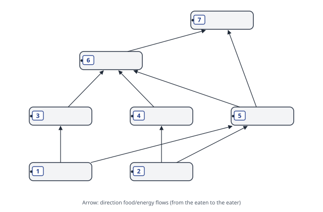

Back

Algae

<!-- meta {"type":"flashcard","id":"SCF-10-13-017","grade":10,"chapter_id":"SC10-13","discipline":"BIO","difficulty":1,"image":"science_assets/biology/BIO-D09_unlabelled.svg"} -->
**SCF-10-13-017** · Basic

**Front:** Pond food web (model) — which part is marked by number 2 in the unlabelled diagram?

Back

Water plant

<!-- meta {"type":"flashcard","id":"SCF-10-13-018","grade":10,"chapter_id":"SC10-13","discipline":"BIO","difficulty":1,"image":"science_assets/biology/BIO-D09_unlabelled.svg"} -->
**SCF-10-13-018** · Basic

**Front:** Pond food web (model) — which part is marked by number 3 in the unlabelled diagram?

Back

Zooplankton

<!-- meta {"type":"flashcard","id":"SCF-10-13-019","grade":10,"chapter_id":"SC10-13","discipline":"BIO","difficulty":1,"image":"science_assets/biology/BIO-D09_unlabelled.svg"} -->
**SCF-10-13-019** · Basic

**Front:** Pond food web (model) — which part is marked by number 4 in the unlabelled diagram?

Back

Snail

## SC10-14: Continuity of life

*Grade 10 · Chapter 14 · Biology · 19 cards*

<!-- meta {"type":"flashcard","id":"SCF-10-14-001","grade":10,"chapter_id":"SC10-14","discipline":"BIO","difficulty":1,"image":null} -->
**SCF-10-14-001** · Basic

**Front:** Daughter cells formed in mitosis?

Back

2

<!-- meta {"type":"flashcard","id":"SCF-10-14-002","grade":10,"chapter_id":"SC10-14","discipline":"BIO","difficulty":1,"image":null} -->
**SCF-10-14-002** · Basic

**Front:** Daughter cells formed in meiosis?

Back

4

<!-- meta {"type":"flashcard","id":"SCF-10-14-003","grade":10,"chapter_id":"SC10-14","discipline":"BIO","difficulty":1,"image":null} -->
**SCF-10-14-003** · Basic

**Front:** Chromosome number of a human body cell?

Back

46 (2n)

<!-- meta {"type":"flashcard","id":"SCF-10-14-004","grade":10,"chapter_id":"SC10-14","discipline":"BIO","difficulty":1,"image":null} -->
**SCF-10-14-004** · Basic

**Front:** Chromosome number of a human gamete?

Back

23 (n)

<!-- meta {"type":"flashcard","id":"SCF-10-14-005","grade":10,"chapter_id":"SC10-14","discipline":"BIO","difficulty":1,"image":null} -->
**SCF-10-14-005** · Basic

**Front:** Where does human fertilisation take place?

Back

Fallopian tube

<!-- meta {"type":"flashcard","id":"SCF-10-14-006","grade":10,"chapter_id":"SC10-14","discipline":"BIO","difficulty":1,"image":null} -->
**SCF-10-14-006** · Basic

**Front:** Function of the anther?

Back

Producing pollen grains

<!-- meta {"type":"flashcard","id":"SCF-10-14-007","grade":10,"chapter_id":"SC10-14","discipline":"BIO","difficulty":2,"image":null} -->
**SCF-10-14-007** · Intermediate

**Front:** Three parts of the carpel?

Back

Stigma, style, ovary

<!-- meta {"type":"flashcard","id":"SCF-10-14-008","grade":10,"chapter_id":"SC10-14","discipline":"BIO","difficulty":1,"image":null} -->
**SCF-10-14-008** · Basic

**Front:** How does yeast reproduce?

Back

Budding

<!-- meta {"type":"flashcard","id":"SCF-10-14-009","grade":10,"chapter_id":"SC10-14","discipline":"BIO","difficulty":2,"image":null} -->
**SCF-10-14-009** · Intermediate

**Front:** Offspring of asexual reproduction?

Back

Identical to the parent (clone)

<!-- meta {"type":"flashcard","id":"SCF-10-14-010","grade":10,"chapter_id":"SC10-14","discipline":"BIO","difficulty":2,"image":null} -->
**SCF-10-14-010** · Intermediate

**Front:** On about which day does ovulation occur?

Back

Day 14 of a 28-day cycle

<!-- meta {"type":"flashcard","id":"SCF-10-14-011","grade":10,"chapter_id":"SC10-14","discipline":"BIO","difficulty":1,"image":null} -->
**SCF-10-14-011** · Basic

**Front:** What is pollination?

Back

Pollen reaching the stigma

<!-- meta {"type":"flashcard","id":"SCF-10-14-012","grade":10,"chapter_id":"SC10-14","discipline":"BIO","difficulty":2,"image":null} -->
**SCF-10-14-012** · Intermediate

**Front:** Where does the embryo implant?

Back

Uterus wall

<!-- meta {"type":"flashcard","id":"SCF-10-14-013","grade":10,"chapter_id":"SC10-14","discipline":"BIO","difficulty":3,"image":null} -->
**SCF-10-14-013** · Hard

**Front:** Misconception: meiosis gives 2 cells?

Back

Wrong — 4

<!-- meta {"type":"flashcard","id":"SCF-10-14-014","grade":10,"chapter_id":"SC10-14","discipline":"BIO","difficulty":2,"image":null} -->
**SCF-10-14-014** · Intermediate

**Front:** Advantage of sexual reproduction?

Back

Genetic variation

<!-- meta {"type":"flashcard","id":"SCF-10-14-015","grade":10,"chapter_id":"SC10-14","discipline":"BIO","difficulty":2,"image":null} -->
**SCF-10-14-015** · Intermediate

**Front:** Advantage of tissue culture?

Back

Many disease-free plants in a short time

<!-- meta {"type":"flashcard","id":"SCF-10-14-016","grade":10,"chapter_id":"SC10-14","discipline":"BIO","difficulty":1,"image":"science_assets/biology/BIO-D08_unlabelled.svg"} -->
**SCF-10-14-016** · Basic

**Front:** Longitudinal section of a flower — which part is marked by number 1 in the unlabelled diagram?

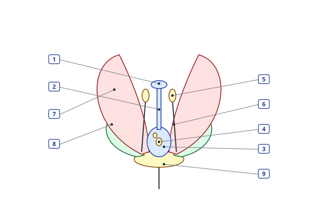

Back

Stigma — Receives pollen grains

<!-- meta {"type":"flashcard","id":"SCF-10-14-017","grade":10,"chapter_id":"SC10-14","discipline":"BIO","difficulty":1,"image":"science_assets/biology/BIO-D08_unlabelled.svg"} -->
**SCF-10-14-017** · Basic

**Front:** Longitudinal section of a flower — which part is marked by number 2 in the unlabelled diagram?

Back

Style — Path along which the pollen tube grows

<!-- meta {"type":"flashcard","id":"SCF-10-14-018","grade":10,"chapter_id":"SC10-14","discipline":"BIO","difficulty":1,"image":"science_assets/biology/BIO-D08_unlabelled.svg"} -->
**SCF-10-14-018** · Basic

**Front:** Longitudinal section of a flower — which part is marked by number 3 in the unlabelled diagram?

Back

Ovary — Contains ovules; becomes the fruit

<!-- meta {"type":"flashcard","id":"SCF-10-14-019","grade":10,"chapter_id":"SC10-14","discipline":"BIO","difficulty":1,"image":"science_assets/biology/BIO-D08_unlabelled.svg"} -->
**SCF-10-14-019** · Basic

**Front:** Longitudinal section of a flower — which part is marked by number 4 in the unlabelled diagram?

Back

Ovule — Becomes the seed after fertilisation

## SC10-15: Hydrostatic pressure and its applications

*Grade 10 · Chapter 15 · Physics · 18 cards*

<!-- meta {"type":"flashcard","id":"SCF-10-15-001","grade":10,"chapter_id":"SC10-15","discipline":"PHY","difficulty":1,"image":null} -->
**SCF-10-15-001** · Basic

**Front:** Pressure formula?

Back

P = F / A

<!-- meta {"type":"flashcard","id":"SCF-10-15-002","grade":10,"chapter_id":"SC10-15","discipline":"PHY","difficulty":1,"image":null} -->
**SCF-10-15-002** · Basic

**Front:** Unit of pressure?

Back

Pa (N m⁻²)

<!-- meta {"type":"flashcard","id":"SCF-10-15-003","grade":10,"chapter_id":"SC10-15","discipline":"PHY","difficulty":1,"image":null} -->
**SCF-10-15-003** · Basic

**Front:** Liquid pressure formula?

Back

P = hρg

<!-- meta {"type":"flashcard","id":"SCF-10-15-004","grade":10,"chapter_id":"SC10-15","discipline":"PHY","difficulty":1,"image":null} -->
**SCF-10-15-004** · Basic

**Front:** What does liquid pressure depend on?

Back

Depth, density, g

<!-- meta {"type":"flashcard","id":"SCF-10-15-005","grade":10,"chapter_id":"SC10-15","discipline":"PHY","difficulty":2,"image":null} -->
**SCF-10-15-005** · Intermediate

**Front:** Does it depend on the shape of the container?

Back

None

<!-- meta {"type":"flashcard","id":"SCF-10-15-006","grade":10,"chapter_id":"SC10-15","discipline":"PHY","difficulty":1,"image":null} -->
**SCF-10-15-006** · Basic

**Front:** Pascal's law?

Back

Pressure is transmitted equally

<!-- meta {"type":"flashcard","id":"SCF-10-15-007","grade":10,"chapter_id":"SC10-15","discipline":"PHY","difficulty":2,"image":null} -->
**SCF-10-15-007** · Intermediate

**Front:** Hydraulic press formula?

Back

F₁/A₁ = F₂/A₂

<!-- meta {"type":"flashcard","id":"SCF-10-15-008","grade":10,"chapter_id":"SC10-15","discipline":"PHY","difficulty":2,"image":null} -->
**SCF-10-15-008** · Intermediate

**Front:** Atmospheric pressure at sea level?

Back

≈ 1.0 × 10⁵ Pa

<!-- meta {"type":"flashcard","id":"SCF-10-15-009","grade":10,"chapter_id":"SC10-15","discipline":"PHY","difficulty":1,"image":null} -->
**SCF-10-15-009** · Basic

**Front:** Atmospheric pressure as altitude increases?

Back

Decreases

<!-- meta {"type":"flashcard","id":"SCF-10-15-010","grade":10,"chapter_id":"SC10-15","discipline":"PHY","difficulty":2,"image":null} -->
**SCF-10-15-010** · Intermediate

**Front:** Archimedes' principle?

Back

Upthrust = weight of liquid displaced

<!-- meta {"type":"flashcard","id":"SCF-10-15-011","grade":10,"chapter_id":"SC10-15","discipline":"PHY","difficulty":2,"image":null} -->
**SCF-10-15-011** · Intermediate

**Front:** Condition for floating?

Back

Upthrust = weight

<!-- meta {"type":"flashcard","id":"SCF-10-15-012","grade":10,"chapter_id":"SC10-15","discipline":"PHY","difficulty":1,"image":null} -->
**SCF-10-15-012** · Basic

**Front:** Why is the base of a dam thick?

Back

Greater pressure at depth

<!-- meta {"type":"flashcard","id":"SCF-10-15-013","grade":10,"chapter_id":"SC10-15","discipline":"PHY","difficulty":1,"image":null} -->
**SCF-10-15-013** · Basic

**Front:** Density of water?

Back

1000 kg m⁻³

<!-- meta {"type":"flashcard","id":"SCF-10-15-014","grade":10,"chapter_id":"SC10-15","discipline":"PHY","difficulty":1,"image":null} -->
**SCF-10-15-014** · Basic

**Front:** Why does a sharp knife cut?

Back

Small area — high pressure

<!-- meta {"type":"flashcard","id":"SCF-10-15-015","grade":10,"chapter_id":"SC10-15","discipline":"PHY","difficulty":3,"image":null} -->
**SCF-10-15-015** · Hard

**Front:** Misconception: wide container — more pressure?

Back

Wrong

<!-- meta {"type":"flashcard","id":"SCF-10-15-016","grade":10,"chapter_id":"SC10-15","discipline":"PHY","difficulty":1,"image":"science_assets/physics/PHY-D10_unlabelled.svg"} -->
**SCF-10-15-016** · Basic

**Front:** Liquid pressure with depth — which part is marked by number 1 in the unlabelled diagram?

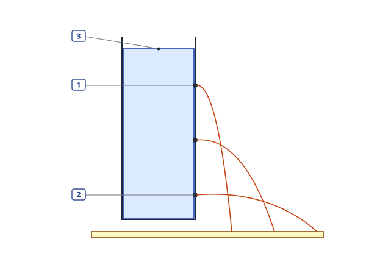

Back

Top hole — Less depth — short jet

<!-- meta {"type":"flashcard","id":"SCF-10-15-017","grade":10,"chapter_id":"SC10-15","discipline":"PHY","difficulty":1,"image":"science_assets/physics/PHY-D10_unlabelled.svg"} -->
**SCF-10-15-017** · Basic

**Front:** Liquid pressure with depth — which part is marked by number 2 in the unlabelled diagram?

Back

Bottom hole — Greater depth — more pressure, longer jet

<!-- meta {"type":"flashcard","id":"SCF-10-15-018","grade":10,"chapter_id":"SC10-15","discipline":"PHY","difficulty":1,"image":"science_assets/physics/PHY-D10_unlabelled.svg"} -->
**SCF-10-15-018** · Basic

**Front:** Liquid pressure with depth — which part is marked by number 3 in the unlabelled diagram?

Back

Water level — Where h is measured from

## SC10-16: Changes in matter

*Grade 10 · Chapter 16 · Chemistry · 19 cards*

<!-- meta {"type":"flashcard","id":"SCF-10-16-001","grade":10,"chapter_id":"SC10-16","discipline":"CHE","difficulty":1,"image":null} -->
**SCF-10-16-001** · Basic

**Front:** An example of a physical change?

Back

Melting of ice

<!-- meta {"type":"flashcard","id":"SCF-10-16-002","grade":10,"chapter_id":"SC10-16","discipline":"CHE","difficulty":1,"image":null} -->
**SCF-10-16-002** · Basic

**Front:** An example of a chemical change?

Back

Combustion / rusting

<!-- meta {"type":"flashcard","id":"SCF-10-16-003","grade":10,"chapter_id":"SC10-16","discipline":"CHE","difficulty":1,"image":null} -->
**SCF-10-16-003** · Basic

**Front:** Reaction type of CaCO₃ → CaO + CO₂?

Back

Decomposition

<!-- meta {"type":"flashcard","id":"SCF-10-16-004","grade":10,"chapter_id":"SC10-16","discipline":"CHE","difficulty":1,"image":null} -->
**SCF-10-16-004** · Basic

**Front:** Zn + CuSO₄ → ? reaction type

Back

Single displacement

<!-- meta {"type":"flashcard","id":"SCF-10-16-005","grade":10,"chapter_id":"SC10-16","discipline":"CHE","difficulty":1,"image":null} -->
**SCF-10-16-005** · Basic

**Front:** Highest in the reactivity series?

Back

K

<!-- meta {"type":"flashcard","id":"SCF-10-16-006","grade":10,"chapter_id":"SC10-16","discipline":"CHE","difficulty":2,"image":null} -->
**SCF-10-16-006** · Intermediate

**Front:** A metal that does not displace H₂ from acids?

Back

Cu / Ag / Au

<!-- meta {"type":"flashcard","id":"SCF-10-16-007","grade":10,"chapter_id":"SC10-16","discipline":"CHE","difficulty":2,"image":null} -->
**SCF-10-16-007** · Intermediate

**Front:** What reduces iron oxide in the blast furnace?

Back

CO

<!-- meta {"type":"flashcard","id":"SCF-10-16-008","grade":10,"chapter_id":"SC10-16","discipline":"CHE","difficulty":2,"image":null} -->
**SCF-10-16-008** · Intermediate

**Front:** Role of limestone in the blast furnace?

Back

Removing the SiO₂ impurity as slag

<!-- meta {"type":"flashcard","id":"SCF-10-16-009","grade":10,"chapter_id":"SC10-16","discipline":"CHE","difficulty":2,"image":null} -->
**SCF-10-16-009** · Intermediate

**Front:** AgNO₃ + NaCl → ? precipitate

Back

AgCl (white)

<!-- meta {"type":"flashcard","id":"SCF-10-16-010","grade":10,"chapter_id":"SC10-16","discipline":"CHE","difficulty":1,"image":null} -->
**SCF-10-16-010** · Basic

**Front:** Mg + 2HCl → ?

Back

MgCl₂ + H₂

<!-- meta {"type":"flashcard","id":"SCF-10-16-011","grade":10,"chapter_id":"SC10-16","discipline":"CHE","difficulty":1,"image":null} -->
**SCF-10-16-011** · Basic

**Front:** Gas given by Na with water?

Back

H₂

<!-- meta {"type":"flashcard","id":"SCF-10-16-012","grade":10,"chapter_id":"SC10-16","discipline":"CHE","difficulty":2,"image":null} -->
**SCF-10-16-012** · Intermediate

**Front:** Double displacement reaction?

Back

Two compounds exchanging ions

<!-- meta {"type":"flashcard","id":"SCF-10-16-013","grade":10,"chapter_id":"SC10-16","discipline":"CHE","difficulty":2,"image":null} -->
**SCF-10-16-013** · Intermediate

**Front:** Why is gold found free?

Back

Very low reactivity

<!-- meta {"type":"flashcard","id":"SCF-10-16-014","grade":10,"chapter_id":"SC10-16","discipline":"CHE","difficulty":3,"image":null} -->
**SCF-10-16-014** · Hard

**Front:** Misconception: dissolving is a chemical change?

Back

Wrong — a physical change

<!-- meta {"type":"flashcard","id":"SCF-10-16-015","grade":10,"chapter_id":"SC10-16","discipline":"CHE","difficulty":3,"image":null} -->
**SCF-10-16-015** · Hard

**Front:** Observation in Fe + CuSO₄?

Back

The blue colour fades; reddish-brown Cu is deposited

<!-- meta {"type":"flashcard","id":"SCF-10-16-016","grade":10,"chapter_id":"SC10-16","discipline":"CHE","difficulty":1,"image":"science_assets/chemistry/CHE-D05_unlabelled.svg"} -->
**SCF-10-16-016** · Basic

**Front:** Blast furnace (schematic) — which part is marked by number 1 in the unlabelled diagram?

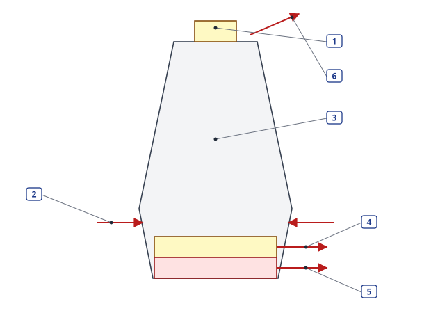

Back

Input: haematite, coke, limestone

<!-- meta {"type":"flashcard","id":"SCF-10-16-017","grade":10,"chapter_id":"SC10-16","discipline":"CHE","difficulty":1,"image":"science_assets/chemistry/CHE-D05_unlabelled.svg"} -->
**SCF-10-16-017** · Basic

**Front:** Blast furnace (schematic) — which part is marked by number 2 in the unlabelled diagram?

Back

Hot air — C + O₂ → CO₂ — a lot of heat

<!-- meta {"type":"flashcard","id":"SCF-10-16-018","grade":10,"chapter_id":"SC10-16","discipline":"CHE","difficulty":1,"image":"science_assets/chemistry/CHE-D05_unlabelled.svg"} -->
**SCF-10-16-018** · Basic

**Front:** Blast furnace (schematic) — which part is marked by number 3 in the unlabelled diagram?

Back

Reduction zone — Fe₂O₃ + 3CO → 2Fe + 3CO₂

<!-- meta {"type":"flashcard","id":"SCF-10-16-019","grade":10,"chapter_id":"SC10-16","discipline":"CHE","difficulty":1,"image":"science_assets/chemistry/CHE-D05_unlabelled.svg"} -->
**SCF-10-16-019** · Basic

**Front:** Blast furnace (schematic) — which part is marked by number 4 in the unlabelled diagram?

Back

Slag — Removes impurities; floats on the molten iron

## SC10-17: Rate of reactions

*Grade 10 · Chapter 17 · Chemistry · 18 cards*

<!-- meta {"type":"flashcard","id":"SCF-10-17-001","grade":10,"chapter_id":"SC10-17","discipline":"CHE","difficulty":1,"image":null} -->
**SCF-10-17-001** · Basic

**Front:** What is the rate of reaction?

Back

Change of reactant/product per unit time

<!-- meta {"type":"flashcard","id":"SCF-10-17-002","grade":10,"chapter_id":"SC10-17","discipline":"CHE","difficulty":1,"image":null} -->
**SCF-10-17-002** · Basic

**Front:** Rate when temperature increases?

Back

Increases

<!-- meta {"type":"flashcard","id":"SCF-10-17-003","grade":10,"chapter_id":"SC10-17","discipline":"CHE","difficulty":1,"image":null} -->
**SCF-10-17-003** · Basic

**Front:** Why does powdering increase the rate?

Back

Surface area increases

<!-- meta {"type":"flashcard","id":"SCF-10-17-004","grade":10,"chapter_id":"SC10-17","discipline":"CHE","difficulty":2,"image":null} -->
**SCF-10-17-004** · Intermediate

**Front:** Catalyst for the decomposition of H₂O₂?

Back

MnO₂

<!-- meta {"type":"flashcard","id":"SCF-10-17-005","grade":10,"chapter_id":"SC10-17","discipline":"CHE","difficulty":2,"image":null} -->
**SCF-10-17-005** · Intermediate

**Front:** Does a catalyst increase the amount of product?

Back

No — only the rate

<!-- meta {"type":"flashcard","id":"SCF-10-17-006","grade":10,"chapter_id":"SC10-17","discipline":"CHE","difficulty":2,"image":null} -->
**SCF-10-17-006** · Intermediate

**Front:** Gradient of a volume–time graph?

Back

Rate of reaction

<!-- meta {"type":"flashcard","id":"SCF-10-17-007","grade":10,"chapter_id":"SC10-17","discipline":"CHE","difficulty":2,"image":null} -->
**SCF-10-17-007** · Intermediate

**Front:** Why does the rate decrease with time?

Back

The concentration of reactants decreases

<!-- meta {"type":"flashcard","id":"SCF-10-17-008","grade":10,"chapter_id":"SC10-17","discipline":"CHE","difficulty":1,"image":null} -->
**SCF-10-17-008** · Basic

**Front:** Why does food last longer in a refrigerator?

Back

Low temperature — lower reaction rate

<!-- meta {"type":"flashcard","id":"SCF-10-17-009","grade":10,"chapter_id":"SC10-17","discipline":"CHE","difficulty":2,"image":null} -->
**SCF-10-17-009** · Intermediate

**Front:** In a gas reaction, if pressure increases?

Back

The rate increases

<!-- meta {"type":"flashcard","id":"SCF-10-17-010","grade":10,"chapter_id":"SC10-17","discipline":"CHE","difficulty":2,"image":null} -->
**SCF-10-17-010** · Intermediate

**Front:** A unit of rate?

Back

cm³ s⁻¹

<!-- meta {"type":"flashcard","id":"SCF-10-17-011","grade":10,"chapter_id":"SC10-17","discipline":"CHE","difficulty":2,"image":null} -->
**SCF-10-17-011** · Intermediate

**Front:** How can the rate of Mg + HCl be measured?

Back

Measuring the volume of H₂ released over time

<!-- meta {"type":"flashcard","id":"SCF-10-17-012","grade":10,"chapter_id":"SC10-17","discipline":"CHE","difficulty":1,"image":null} -->
**SCF-10-17-012** · Basic

**Front:** Four factors that affect the rate of reaction?

Back

Temperature, concentration, surface area, catalyst

<!-- meta {"type":"flashcard","id":"SCF-10-17-013","grade":10,"chapter_id":"SC10-17","discipline":"CHE","difficulty":3,"image":null} -->
**SCF-10-17-013** · Hard

**Front:** Basis of collision theory?

Back

Particles must collide with enough energy

<!-- meta {"type":"flashcard","id":"SCF-10-17-014","grade":10,"chapter_id":"SC10-17","discipline":"CHE","difficulty":3,"image":null} -->
**SCF-10-17-014** · Hard

**Front:** Misconception: a catalyst gives more product?

Back

Wrong

<!-- meta {"type":"flashcard","id":"SCF-10-17-015","grade":10,"chapter_id":"SC10-17","discipline":"CHE","difficulty":2,"image":null} -->
**SCF-10-17-015** · Intermediate

**Front:** Graph when the reaction ends?

Back

Becomes horizontal (gradient 0)

<!-- meta {"type":"flashcard","id":"SCF-10-17-016","grade":10,"chapter_id":"SC10-17","discipline":"CHE","difficulty":1,"image":"science_assets/graphs/GR-D03_unlabelled.svg"} -->
**SCF-10-17-016** · Basic

**Front:** Rate of reaction: gas volume–time — which part is marked by number 1 in the unlabelled diagram?

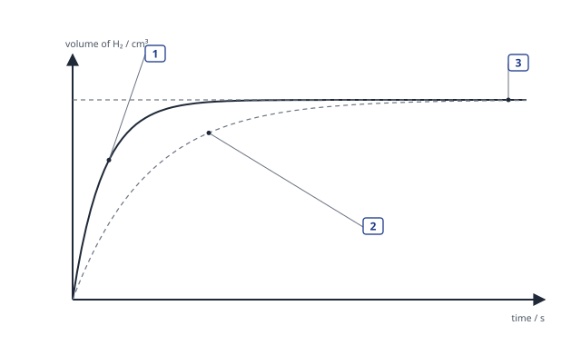

Back

A: higher temperature / powder — Steeper initial gradient

<!-- meta {"type":"flashcard","id":"SCF-10-17-017","grade":10,"chapter_id":"SC10-17","discipline":"CHE","difficulty":1,"image":"science_assets/graphs/GR-D03_unlabelled.svg"} -->
**SCF-10-17-017** · Basic

**Front:** Rate of reaction: gas volume–time — which part is marked by number 2 in the unlabelled diagram?

Back

B: lower temperature / lumps

<!-- meta {"type":"flashcard","id":"SCF-10-17-018","grade":10,"chapter_id":"SC10-17","discipline":"CHE","difficulty":1,"image":"science_assets/graphs/GR-D03_unlabelled.svg"} -->
**SCF-10-17-018** · Basic

**Front:** Rate of reaction: gas volume–time — which part is marked by number 3 in the unlabelled diagram?

Back

Same final volume — Same amount of reactants

## SC10-18: Work, energy and power

*Grade 10 · Chapter 18 · Physics · 15 cards*

<!-- meta {"type":"flashcard","id":"SCF-10-18-001","grade":10,"chapter_id":"SC10-18","discipline":"PHY","difficulty":1,"image":null} -->
**SCF-10-18-001** · Basic

**Front:** Work formula?

Back

W = Fs

<!-- meta {"type":"flashcard","id":"SCF-10-18-002","grade":10,"chapter_id":"SC10-18","discipline":"PHY","difficulty":1,"image":null} -->
**SCF-10-18-002** · Basic

**Front:** Unit of work?

Back

J

<!-- meta {"type":"flashcard","id":"SCF-10-18-003","grade":10,"chapter_id":"SC10-18","discipline":"PHY","difficulty":1,"image":null} -->
**SCF-10-18-003** · Basic

**Front:** Kinetic energy formula?

Back

½mv²

<!-- meta {"type":"flashcard","id":"SCF-10-18-004","grade":10,"chapter_id":"SC10-18","discipline":"PHY","difficulty":1,"image":null} -->
**SCF-10-18-004** · Basic

**Front:** Potential energy formula?

Back

mgh

<!-- meta {"type":"flashcard","id":"SCF-10-18-005","grade":10,"chapter_id":"SC10-18","discipline":"PHY","difficulty":1,"image":null} -->
**SCF-10-18-005** · Basic

**Front:** Power formula?

Back

P = W / t

<!-- meta {"type":"flashcard","id":"SCF-10-18-006","grade":10,"chapter_id":"SC10-18","discipline":"PHY","difficulty":1,"image":null} -->
**SCF-10-18-006** · Basic

**Front:** Unit of power?

Back

W (J s⁻¹)

<!-- meta {"type":"flashcard","id":"SCF-10-18-007","grade":10,"chapter_id":"SC10-18","discipline":"PHY","difficulty":1,"image":null} -->
**SCF-10-18-007** · Basic

**Front:** Law of conservation of energy?

Back

Energy is not created/destroyed; it changes form

<!-- meta {"type":"flashcard","id":"SCF-10-18-008","grade":10,"chapter_id":"SC10-18","discipline":"PHY","difficulty":2,"image":null} -->
**SCF-10-18-008** · Intermediate

**Front:** Efficiency?

Back

Useful output ÷ input × 100%

<!-- meta {"type":"flashcard","id":"SCF-10-18-009","grade":10,"chapter_id":"SC10-18","discipline":"PHY","difficulty":2,"image":null} -->
**SCF-10-18-009** · Intermediate

**Front:** Work done pushing a wall that does not move?

Back

0

<!-- meta {"type":"flashcard","id":"SCF-10-18-010","grade":10,"chapter_id":"SC10-18","discipline":"PHY","difficulty":3,"image":null} -->
**SCF-10-18-010** · Hard

**Front:** Ek if speed doubles?

Back

Four times

<!-- meta {"type":"flashcard","id":"SCF-10-18-011","grade":10,"chapter_id":"SC10-18","discipline":"PHY","difficulty":2,"image":null} -->
**SCF-10-18-011** · Intermediate

**Front:** Energy change in hydroelectricity?

Back

Potential → kinetic → electrical

<!-- meta {"type":"flashcard","id":"SCF-10-18-012","grade":10,"chapter_id":"SC10-18","discipline":"PHY","difficulty":1,"image":null} -->
**SCF-10-18-012** · Basic

**Front:** An example of renewable energy?

Back

Solar, wind, water

<!-- meta {"type":"flashcard","id":"SCF-10-18-013","grade":10,"chapter_id":"SC10-18","discipline":"PHY","difficulty":1,"image":null} -->
**SCF-10-18-013** · Basic

**Front:** 1 kW = ? W

Back

1000

<!-- meta {"type":"flashcard","id":"SCF-10-18-014","grade":10,"chapter_id":"SC10-18","discipline":"PHY","difficulty":1,"image":null} -->
**SCF-10-18-014** · Basic

**Front:** Energy change in a falling object?

Back

Potential → kinetic

<!-- meta {"type":"flashcard","id":"SCF-10-18-015","grade":10,"chapter_id":"SC10-18","discipline":"PHY","difficulty":3,"image":null} -->
**SCF-10-18-015** · Hard

**Front:** Misconception: efficiency > 100%?

Back

Not possible

## SC10-19: Current electricity

*Grade 10 · Chapter 19 · Physics · 25 cards*

<!-- meta {"type":"flashcard","id":"SCF-10-19-001","grade":10,"chapter_id":"SC10-19","discipline":"PHY","difficulty":1,"image":null} -->
**SCF-10-19-001** · Basic

**Front:** Ohm's law?

Back

V = IR

<!-- meta {"type":"flashcard","id":"SCF-10-19-002","grade":10,"chapter_id":"SC10-19","discipline":"PHY","difficulty":1,"image":null} -->
**SCF-10-19-002** · Basic

**Front:** Unit of current?

Back

Ampere (A)

<!-- meta {"type":"flashcard","id":"SCF-10-19-003","grade":10,"chapter_id":"SC10-19","discipline":"PHY","difficulty":1,"image":null} -->
**SCF-10-19-003** · Basic

**Front:** Unit of resistance?

Back

Ohm (Ω)

<!-- meta {"type":"flashcard","id":"SCF-10-19-004","grade":10,"chapter_id":"SC10-19","discipline":"PHY","difficulty":1,"image":null} -->
**SCF-10-19-004** · Basic

**Front:** How is an ammeter connected?

Back

In series

<!-- meta {"type":"flashcard","id":"SCF-10-19-005","grade":10,"chapter_id":"SC10-19","discipline":"PHY","difficulty":1,"image":null} -->
**SCF-10-19-005** · Basic

**Front:** How is a voltmeter connected?

Back

In parallel

<!-- meta {"type":"flashcard","id":"SCF-10-19-006","grade":10,"chapter_id":"SC10-19","discipline":"PHY","difficulty":1,"image":null} -->
**SCF-10-19-006** · Basic

**Front:** Resistors in series?

Back

R = R₁ + R₂

<!-- meta {"type":"flashcard","id":"SCF-10-19-007","grade":10,"chapter_id":"SC10-19","discipline":"PHY","difficulty":2,"image":null} -->
**SCF-10-19-007** · Intermediate

**Front:** Resistors in parallel?

Back

1/R = 1/R₁ + 1/R₂

<!-- meta {"type":"flashcard","id":"SCF-10-19-008","grade":10,"chapter_id":"SC10-19","discipline":"PHY","difficulty":1,"image":null} -->
**SCF-10-19-008** · Basic

**Front:** Resistance as length increases?

Back

Increases

<!-- meta {"type":"flashcard","id":"SCF-10-19-009","grade":10,"chapter_id":"SC10-19","discipline":"PHY","difficulty":2,"image":null} -->
**SCF-10-19-009** · Intermediate

**Front:** Resistance as cross-sectional area increases?

Back

Decreases

<!-- meta {"type":"flashcard","id":"SCF-10-19-010","grade":10,"chapter_id":"SC10-19","discipline":"PHY","difficulty":2,"image":null} -->
**SCF-10-19-010** · Intermediate

**Front:** Gradient of a V–I graph?

Back

Resistance R

<!-- meta {"type":"flashcard","id":"SCF-10-19-011","grade":10,"chapter_id":"SC10-19","discipline":"PHY","difficulty":2,"image":null} -->
**SCF-10-19-011** · Intermediate

**Front:** Two 6 Ω in parallel?

Back

3 Ω

<!-- meta {"type":"flashcard","id":"SCF-10-19-012","grade":10,"chapter_id":"SC10-19","discipline":"PHY","difficulty":1,"image":null} -->
**SCF-10-19-012** · Basic

**Front:** What type are house circuits?

Back

Parallel

<!-- meta {"type":"flashcard","id":"SCF-10-19-013","grade":10,"chapter_id":"SC10-19","discipline":"PHY","difficulty":1,"image":null} -->
**SCF-10-19-013** · Basic

**Front:** Current in a series circuit?

Back

The same everywhere

<!-- meta {"type":"flashcard","id":"SCF-10-19-014","grade":10,"chapter_id":"SC10-19","discipline":"PHY","difficulty":3,"image":null} -->
**SCF-10-19-014** · Hard

**Front:** Misconception: current decreases around a circuit?

Back

Wrong

<!-- meta {"type":"flashcard","id":"SCF-10-19-015","grade":10,"chapter_id":"SC10-19","discipline":"PHY","difficulty":3,"image":null} -->
**SCF-10-19-015** · Hard

**Front:** For polarity protection?

Back

Diode

<!-- meta {"type":"flashcard","id":"SCF-10-19-016","grade":10,"chapter_id":"SC10-19","discipline":"PHY","difficulty":1,"image":"science_assets/physics/PHY-D01_unlabelled.svg"} -->
**SCF-10-19-016** · Basic

**Front:** Series circuit (ammeter, voltmeter) — which part is marked by number 1 in the unlabelled diagram?

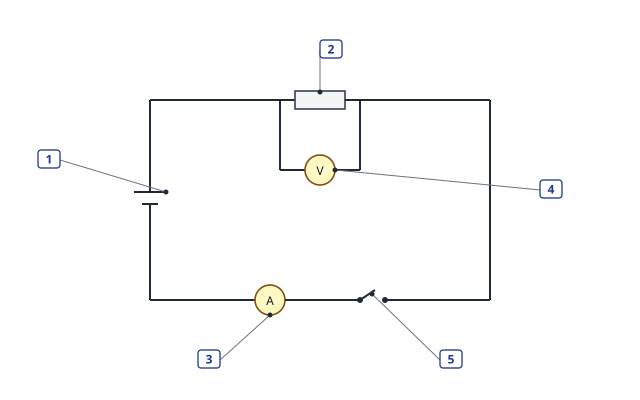

Back

Cell — Provides the e.m.f.

<!-- meta {"type":"flashcard","id":"SCF-10-19-017","grade":10,"chapter_id":"SC10-19","discipline":"PHY","difficulty":1,"image":"science_assets/physics/PHY-D01_unlabelled.svg"} -->
**SCF-10-19-017** · Basic

**Front:** Series circuit (ammeter, voltmeter) — which part is marked by number 2 in the unlabelled diagram?

Back

Resistor — Opposes the current

<!-- meta {"type":"flashcard","id":"SCF-10-19-018","grade":10,"chapter_id":"SC10-19","discipline":"PHY","difficulty":1,"image":"science_assets/physics/PHY-D01_unlabelled.svg"} -->
**SCF-10-19-018** · Basic

**Front:** Series circuit (ammeter, voltmeter) — which part is marked by number 3 in the unlabelled diagram?

Back

Ammeter — In series — measures current

<!-- meta {"type":"flashcard","id":"SCF-10-19-019","grade":10,"chapter_id":"SC10-19","discipline":"PHY","difficulty":1,"image":"science_assets/physics/PHY-D01_unlabelled.svg"} -->
**SCF-10-19-019** · Basic

**Front:** Series circuit (ammeter, voltmeter) — which part is marked by number 4 in the unlabelled diagram?

Back

Voltmeter — In parallel — potential difference

<!-- meta {"type":"flashcard","id":"SCF-10-19-020","grade":10,"chapter_id":"SC10-19","discipline":"PHY","difficulty":1,"image":"science_assets/physics/PHY-D02_unlabelled.svg"} -->
**SCF-10-19-020** · Basic

**Front:** Parallel circuit — which part is marked by number 1 in the unlabelled diagram?

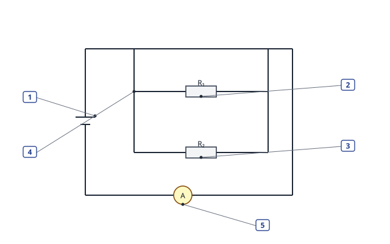

Back

Cell

<!-- meta {"type":"flashcard","id":"SCF-10-19-021","grade":10,"chapter_id":"SC10-19","discipline":"PHY","difficulty":1,"image":"science_assets/physics/PHY-D02_unlabelled.svg"} -->
**SCF-10-19-021** · Basic

**Front:** Parallel circuit — which part is marked by number 2 in the unlabelled diagram?

Back

Branch 1 (R₁) — Potential difference equals that of the cell

<!-- meta {"type":"flashcard","id":"SCF-10-19-022","grade":10,"chapter_id":"SC10-19","discipline":"PHY","difficulty":1,"image":"science_assets/physics/PHY-D02_unlabelled.svg"} -->
**SCF-10-19-022** · Basic

**Front:** Parallel circuit — which part is marked by number 3 in the unlabelled diagram?

Back

Branch 2 (R₂) — Sum of branch currents = total

<!-- meta {"type":"flashcard","id":"SCF-10-19-023","grade":10,"chapter_id":"SC10-19","discipline":"PHY","difficulty":1,"image":"science_assets/physics/PHY-D02_unlabelled.svg"} -->
**SCF-10-19-023** · Basic

**Front:** Parallel circuit — which part is marked by number 4 in the unlabelled diagram?

Back

Junction — Point where the current splits/joins

<!-- meta {"type":"flashcard","id":"SCF-10-19-024","grade":10,"chapter_id":"SC10-19","discipline":"PHY","difficulty":1,"image":"science_assets/graphs/GR-D04_unlabelled.svg"} -->
**SCF-10-19-024** · Basic

**Front:** Ohm's law: V–I graph — which part is marked by number 1 in the unlabelled diagram?

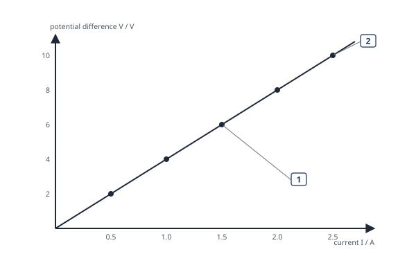

Back

Straight line through the origin — V ∝ I

<!-- meta {"type":"flashcard","id":"SCF-10-19-025","grade":10,"chapter_id":"SC10-19","discipline":"PHY","difficulty":1,"image":"science_assets/graphs/GR-D04_unlabelled.svg"} -->
**SCF-10-19-025** · Basic

**Front:** Ohm's law: V–I graph — which part is marked by number 2 in the unlabelled diagram?

Back

Gradient = R = 4 Ω

## SC10-20: Inheritance

*Grade 10 · Chapter 20 · Biology · 18 cards*

<!-- meta {"type":"flashcard","id":"SCF-10-20-001","grade":10,"chapter_id":"SC10-20","discipline":"BIO","difficulty":1,"image":null} -->
**SCF-10-20-001** · Basic

**Front:** How is a dominant allele written?

Back

Capital letter (T)

<!-- meta {"type":"flashcard","id":"SCF-10-20-002","grade":10,"chapter_id":"SC10-20","discipline":"BIO","difficulty":1,"image":null} -->
**SCF-10-20-002** · Basic

**Front:** Tt × Tt phenotype ratio?

Back

3 : 1

<!-- meta {"type":"flashcard","id":"SCF-10-20-003","grade":10,"chapter_id":"SC10-20","discipline":"BIO","difficulty":2,"image":null} -->
**SCF-10-20-003** · Intermediate

**Front:** Tt × Tt genotype ratio?

Back

1 TT : 2 Tt : 1 tt

<!-- meta {"type":"flashcard","id":"SCF-10-20-004","grade":10,"chapter_id":"SC10-20","discipline":"BIO","difficulty":1,"image":null} -->
**SCF-10-20-004** · Basic

**Front:** An example of homozygous?

Back

TT or tt

<!-- meta {"type":"flashcard","id":"SCF-10-20-005","grade":10,"chapter_id":"SC10-20","discipline":"BIO","difficulty":1,"image":null} -->
**SCF-10-20-005** · Basic

**Front:** Heterozygous?

Back

Tt

<!-- meta {"type":"flashcard","id":"SCF-10-20-006","grade":10,"chapter_id":"SC10-20","discipline":"BIO","difficulty":1,"image":null} -->
**SCF-10-20-006** · Basic

**Front:** Sex chromosomes of a male?

Back

XY

<!-- meta {"type":"flashcard","id":"SCF-10-20-007","grade":10,"chapter_id":"SC10-20","discipline":"BIO","difficulty":1,"image":null} -->
**SCF-10-20-007** · Basic

**Front:** Sex chromosomes of a female?

Back

XX

<!-- meta {"type":"flashcard","id":"SCF-10-20-008","grade":10,"chapter_id":"SC10-20","discipline":"BIO","difficulty":2,"image":null} -->
**SCF-10-20-008** · Intermediate

**Front:** What determines the child's sex?

Back

The father's sperm (X or Y)

<!-- meta {"type":"flashcard","id":"SCF-10-20-009","grade":10,"chapter_id":"SC10-20","discipline":"BIO","difficulty":1,"image":null} -->
**SCF-10-20-009** · Basic

**Front:** Probability of a boy being born?

Back

½

<!-- meta {"type":"flashcard","id":"SCF-10-20-010","grade":10,"chapter_id":"SC10-20","discipline":"BIO","difficulty":1,"image":null} -->
**SCF-10-20-010** · Basic

**Front:** What is phenotype?

Back

The observable characteristic

<!-- meta {"type":"flashcard","id":"SCF-10-20-011","grade":10,"chapter_id":"SC10-20","discipline":"BIO","difficulty":2,"image":null} -->
**SCF-10-20-011** · Intermediate

**Front:** What is an allele?

Back

Different forms of a gene

<!-- meta {"type":"flashcard","id":"SCF-10-20-012","grade":10,"chapter_id":"SC10-20","discipline":"BIO","difficulty":2,"image":null} -->
**SCF-10-20-012** · Intermediate

**Front:** Tt × tt phenotype ratio?

Back

1 : 1

<!-- meta {"type":"flashcard","id":"SCF-10-20-013","grade":10,"chapter_id":"SC10-20","discipline":"BIO","difficulty":2,"image":null} -->
**SCF-10-20-013** · Intermediate

**Front:** An example of an X-linked inherited disease?

Back

Colour blindness / haemophilia

<!-- meta {"type":"flashcard","id":"SCF-10-20-014","grade":10,"chapter_id":"SC10-20","discipline":"BIO","difficulty":3,"image":null} -->
**SCF-10-20-014** · Hard

**Front:** Probability that a child of two thalassaemia carriers has the disease?

Back

¼

<!-- meta {"type":"flashcard","id":"SCF-10-20-015","grade":10,"chapter_id":"SC10-20","discipline":"BIO","difficulty":1,"image":null} -->
**SCF-10-20-015** · Basic

**Front:** Where are genes located?

Back

On chromosomes

<!-- meta {"type":"flashcard","id":"SCF-10-20-016","grade":10,"chapter_id":"SC10-20","discipline":"BIO","difficulty":1,"image":"science_assets/biology/BIO-D10_unlabelled.svg"} -->
**SCF-10-20-016** · Basic

**Front:** Punnett square: Tt × Tt — which part is marked by number 1 in the unlabelled diagram?

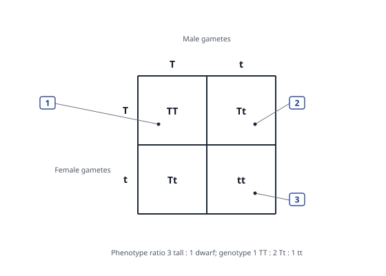

Back

Homozygous tall (TT)

<!-- meta {"type":"flashcard","id":"SCF-10-20-017","grade":10,"chapter_id":"SC10-20","discipline":"BIO","difficulty":1,"image":"science_assets/biology/BIO-D10_unlabelled.svg"} -->
**SCF-10-20-017** · Basic

**Front:** Punnett square: Tt × Tt — which part is marked by number 2 in the unlabelled diagram?

Back

Heterozygous tall (Tt)

<!-- meta {"type":"flashcard","id":"SCF-10-20-018","grade":10,"chapter_id":"SC10-20","discipline":"BIO","difficulty":1,"image":"science_assets/biology/BIO-D10_unlabelled.svg"} -->
**SCF-10-20-018** · Basic

**Front:** Punnett square: Tt × Tt — which part is marked by number 3 in the unlabelled diagram?

Back

Homozygous dwarf (tt) — The recessive trait is expressed

## SC11-01: Living tissues

*Grade 11 · Chapter 1 · Biology · 15 cards*

<!-- meta {"type":"flashcard","id":"SCF-11-01-001","grade":11,"chapter_id":"SC11-01","discipline":"BIO","difficulty":1,"image":null} -->
**SCF-11-01-001** · Basic

**Front:** Plant tissue that transports water?

Back

Xylem

<!-- meta {"type":"flashcard","id":"SCF-11-01-002","grade":11,"chapter_id":"SC11-01","discipline":"BIO","difficulty":1,"image":null} -->
**SCF-11-01-002** · Basic

**Front:** Plant tissue that transports food?

Back

Phloem

<!-- meta {"type":"flashcard","id":"SCF-11-01-003","grade":11,"chapter_id":"SC11-01","discipline":"BIO","difficulty":1,"image":null} -->
**SCF-11-01-003** · Basic

**Front:** Plant tissue where cell division takes place?

Back

Meristematic tissue

<!-- meta {"type":"flashcard","id":"SCF-11-01-004","grade":11,"chapter_id":"SC11-01","discipline":"BIO","difficulty":2,"image":null} -->
**SCF-11-01-004** · Intermediate

**Front:** Substance that strengthens xylem cell walls?

Back

Lignin

<!-- meta {"type":"flashcard","id":"SCF-11-01-005","grade":11,"chapter_id":"SC11-01","discipline":"BIO","difficulty":2,"image":null} -->
**SCF-11-01-005** · Intermediate

**Front:** Form in which food is transported in phloem?

Back

Sucrose

<!-- meta {"type":"flashcard","id":"SCF-11-01-006","grade":11,"chapter_id":"SC11-01","discipline":"BIO","difficulty":1,"image":null} -->
**SCF-11-01-006** · Basic

**Front:** Four types of animal tissue?

Back

Epithelial, connective, muscle, nervous

<!-- meta {"type":"flashcard","id":"SCF-11-01-007","grade":11,"chapter_id":"SC11-01","discipline":"BIO","difficulty":1,"image":null} -->
**SCF-11-01-007** · Basic

**Front:** Muscle that does not fatigue?

Back

Cardiac muscle

<!-- meta {"type":"flashcard","id":"SCF-11-01-008","grade":11,"chapter_id":"SC11-01","discipline":"BIO","difficulty":2,"image":null} -->
**SCF-11-01-008** · Intermediate

**Front:** Muscle cells with many nuclei?

Back

Skeletal muscle

<!-- meta {"type":"flashcard","id":"SCF-11-01-009","grade":11,"chapter_id":"SC11-01","discipline":"BIO","difficulty":2,"image":null} -->
**SCF-11-01-009** · Intermediate

**Front:** Blood is which type of tissue?

Back

Connective tissue

<!-- meta {"type":"flashcard","id":"SCF-11-01-010","grade":11,"chapter_id":"SC11-01","discipline":"BIO","difficulty":1,"image":null} -->
**SCF-11-01-010** · Basic

**Front:** Cell that conducts nerve impulses?

Back

Neuron

<!-- meta {"type":"flashcard","id":"SCF-11-01-011","grade":11,"chapter_id":"SC11-01","discipline":"BIO","difficulty":2,"image":null} -->
**SCF-11-01-011** · Intermediate

**Front:** Two cell types of phloem?

Back

Sieve tube, companion cell

<!-- meta {"type":"flashcard","id":"SCF-11-01-012","grade":11,"chapter_id":"SC11-01","discipline":"BIO","difficulty":2,"image":null} -->
**SCF-11-01-012** · Intermediate

**Front:** Where is smooth muscle found?

Back

Wall of the alimentary canal

<!-- meta {"type":"flashcard","id":"SCF-11-01-013","grade":11,"chapter_id":"SC11-01","discipline":"BIO","difficulty":3,"image":null} -->
**SCF-11-01-013** · Hard

**Front:** Tissue responsible for the hardness of a coconut shell?

Back

Sclerenchyma

<!-- meta {"type":"flashcard","id":"SCF-11-01-014","grade":11,"chapter_id":"SC11-01","discipline":"BIO","difficulty":3,"image":null} -->
**SCF-11-01-014** · Hard

**Front:** Misconception: phloem transports water?

Back

Wrong — xylem

<!-- meta {"type":"flashcard","id":"SCF-11-01-015","grade":11,"chapter_id":"SC11-01","discipline":"BIO","difficulty":1,"image":null} -->
**SCF-11-01-015** · Basic

**Front:** What is a tissue?

Back

A group of cells with similar structure and function

## SC11-02: Photosynthesis

*Grade 11 · Chapter 2 · Biology · 27 cards*

<!-- meta {"type":"flashcard","id":"SCF-11-02-001","grade":11,"chapter_id":"SC11-02","discipline":"BIO","difficulty":1,"image":null} -->
**SCF-11-02-001** · Basic

**Front:** Photosynthesis equation?

Back

6CO₂ + 6H₂O → C₆H₁₂O₆ + 6O₂

<!-- meta {"type":"flashcard","id":"SCF-11-02-002","grade":11,"chapter_id":"SC11-02","discipline":"BIO","difficulty":1,"image":null} -->
**SCF-11-02-002** · Basic

**Front:** Energy change in photosynthesis?

Back

Light energy → chemical energy

<!-- meta {"type":"flashcard","id":"SCF-11-02-003","grade":11,"chapter_id":"SC11-02","discipline":"BIO","difficulty":1,"image":null} -->
**SCF-11-02-003** · Basic

**Front:** Pigment that absorbs light?

Back

Chlorophyll

<!-- meta {"type":"flashcard","id":"SCF-11-02-004","grade":11,"chapter_id":"SC11-02","discipline":"BIO","difficulty":1,"image":null} -->
**SCF-11-02-004** · Basic

**Front:** Gas produced in photosynthesis?

Back

O₂

<!-- meta {"type":"flashcard","id":"SCF-11-02-005","grade":11,"chapter_id":"SC11-02","discipline":"BIO","difficulty":2,"image":null} -->
**SCF-11-02-005** · Intermediate

**Front:** Chemical used to remove CO₂?

Back

KOH (potassium hydroxide)

<!-- meta {"type":"flashcard","id":"SCF-11-02-006","grade":11,"chapter_id":"SC11-02","discipline":"BIO","difficulty":2,"image":null} -->
**SCF-11-02-006** · Intermediate

**Front:** What removes chlorophyll from a leaf?

Back

Ethanol (heated in a water bath)

<!-- meta {"type":"flashcard","id":"SCF-11-02-007","grade":11,"chapter_id":"SC11-02","discipline":"BIO","difficulty":2,"image":null} -->
**SCF-11-02-007** · Intermediate

**Front:** Purpose of keeping the leaf in the dark?

Back

To remove the starch already present

<!-- meta {"type":"flashcard","id":"SCF-11-02-008","grade":11,"chapter_id":"SC11-02","discipline":"BIO","difficulty":2,"image":null} -->
**SCF-11-02-008** · Intermediate

**Front:** What is a limiting factor?

Back

The factor in short supply that controls the rate

<!-- meta {"type":"flashcard","id":"SCF-11-02-009","grade":11,"chapter_id":"SC11-02","discipline":"BIO","difficulty":1,"image":null} -->
**SCF-11-02-009** · Basic

**Front:** Cells that control the stomata?

Back

Guard cells

<!-- meta {"type":"flashcard","id":"SCF-11-02-010","grade":11,"chapter_id":"SC11-02","discipline":"BIO","difficulty":2,"image":null} -->
**SCF-11-02-010** · Intermediate

**Front:** Leaf tissue with the most chloroplasts?

Back

Palisade mesophyll

<!-- meta {"type":"flashcard","id":"SCF-11-02-011","grade":11,"chapter_id":"SC11-02","discipline":"BIO","difficulty":1,"image":null} -->
**SCF-11-02-011** · Basic

**Front:** Three factors of photosynthesis?

Back

Light, CO₂, temperature

<!-- meta {"type":"flashcard","id":"SCF-11-02-012","grade":11,"chapter_id":"SC11-02","discipline":"BIO","difficulty":1,"image":null} -->
**SCF-11-02-012** · Basic

**Front:** Form in which glucose is stored?

Back

Starch

<!-- meta {"type":"flashcard","id":"SCF-11-02-013","grade":11,"chapter_id":"SC11-02","discipline":"BIO","difficulty":2,"image":null} -->
**SCF-11-02-013** · Intermediate

**Front:** Why should ethanol not be heated directly?

Back

It catches fire easily

<!-- meta {"type":"flashcard","id":"SCF-11-02-014","grade":11,"chapter_id":"SC11-02","discipline":"BIO","difficulty":2,"image":null} -->
**SCF-11-02-014** · Intermediate

**Front:** What does the variegated leaf experiment show?

Back

Chlorophyll is needed

<!-- meta {"type":"flashcard","id":"SCF-11-02-015","grade":11,"chapter_id":"SC11-02","discipline":"BIO","difficulty":3,"image":null} -->
**SCF-11-02-015** · Hard

**Front:** Misconception: plants respire only at night?

Back

Wrong — all the time

<!-- meta {"type":"flashcard","id":"SCF-11-02-016","grade":11,"chapter_id":"SC11-02","discipline":"BIO","difficulty":1,"image":"science_assets/biology/BIO-D03_unlabelled.svg"} -->
**SCF-11-02-016** · Basic

**Front:** Cross-section of a leaf — which part is marked by number 1 in the unlabelled diagram?

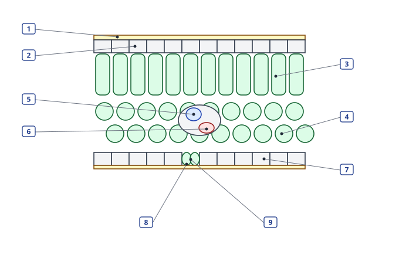

Back

Cuticle — Reduces water loss

<!-- meta {"type":"flashcard","id":"SCF-11-02-017","grade":11,"chapter_id":"SC11-02","discipline":"BIO","difficulty":1,"image":"science_assets/biology/BIO-D03_unlabelled.svg"} -->
**SCF-11-02-017** · Basic

**Front:** Cross-section of a leaf — which part is marked by number 2 in the unlabelled diagram?

Back

Upper epidermis — Protection; lets light through

<!-- meta {"type":"flashcard","id":"SCF-11-02-018","grade":11,"chapter_id":"SC11-02","discipline":"BIO","difficulty":1,"image":"science_assets/biology/BIO-D03_unlabelled.svg"} -->
**SCF-11-02-018** · Basic

**Front:** Cross-section of a leaf — which part is marked by number 3 in the unlabelled diagram?

Back

Palisade mesophyll — Main site of photosynthesis

<!-- meta {"type":"flashcard","id":"SCF-11-02-019","grade":11,"chapter_id":"SC11-02","discipline":"BIO","difficulty":1,"image":"science_assets/biology/BIO-D03_unlabelled.svg"} -->
**SCF-11-02-019** · Basic

**Front:** Cross-section of a leaf — which part is marked by number 4 in the unlabelled diagram?

Back

Spongy mesophyll — Gas exchange — air spaces

<!-- meta {"type":"flashcard","id":"SCF-11-02-020","grade":11,"chapter_id":"SC11-02","discipline":"BIO","difficulty":1,"image":"science_assets/experiments/EXP-D01_unlabelled.svg"} -->
**SCF-11-02-020** · Basic

**Front:** Testing a leaf for starch — which part is marked by number 1 in the unlabelled diagram?

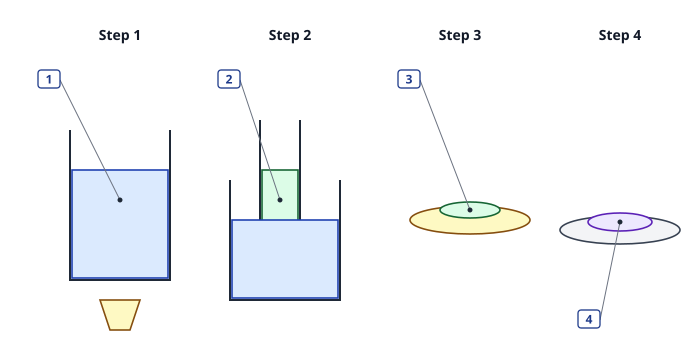

Back

Boiling water for 1–2 minutes — Kills the cells, inactivates enzymes

<!-- meta {"type":"flashcard","id":"SCF-11-02-021","grade":11,"chapter_id":"SC11-02","discipline":"BIO","difficulty":1,"image":"science_assets/experiments/EXP-D01_unlabelled.svg"} -->
**SCF-11-02-021** · Basic

**Front:** Testing a leaf for starch — which part is marked by number 2 in the unlabelled diagram?

Back

Alcohol in a hot-water bath — Removes chlorophyll — avoid a naked flame

<!-- meta {"type":"flashcard","id":"SCF-11-02-022","grade":11,"chapter_id":"SC11-02","discipline":"BIO","difficulty":1,"image":"science_assets/experiments/EXP-D01_unlabelled.svg"} -->
**SCF-11-02-022** · Basic

**Front:** Testing a leaf for starch — which part is marked by number 3 in the unlabelled diagram?

Back

Rinse in warm water — Softens the leaf

<!-- meta {"type":"flashcard","id":"SCF-11-02-023","grade":11,"chapter_id":"SC11-02","discipline":"BIO","difficulty":1,"image":"science_assets/experiments/EXP-D01_unlabelled.svg"} -->
**SCF-11-02-023** · Basic

**Front:** Testing a leaf for starch — which part is marked by number 4 in the unlabelled diagram?

Back

Iodine solution — Blue-black if starch is present

<!-- meta {"type":"flashcard","id":"SCF-11-02-024","grade":11,"chapter_id":"SC11-02","discipline":"BIO","difficulty":1,"image":"science_assets/experiments/EXP-D02_unlabelled.svg"} -->
**SCF-11-02-024** · Basic

**Front:** O₂ released in photosynthesis — which part is marked by number 1 in the unlabelled diagram?

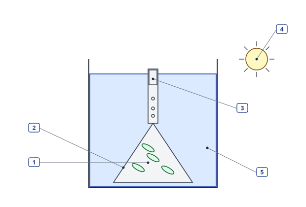

Back

Water plant (Hydrilla)

<!-- meta {"type":"flashcard","id":"SCF-11-02-025","grade":11,"chapter_id":"SC11-02","discipline":"BIO","difficulty":1,"image":"science_assets/experiments/EXP-D02_unlabelled.svg"} -->
**SCF-11-02-025** · Basic

**Front:** O₂ released in photosynthesis — which part is marked by number 2 in the unlabelled diagram?

Back

Funnel

<!-- meta {"type":"flashcard","id":"SCF-11-02-026","grade":11,"chapter_id":"SC11-02","discipline":"BIO","difficulty":1,"image":"science_assets/experiments/EXP-D02_unlabelled.svg"} -->
**SCF-11-02-026** · Basic

**Front:** O₂ released in photosynthesis — which part is marked by number 3 in the unlabelled diagram?

Back

Test tube — gas collects — Relights a glowing splint → O₂

<!-- meta {"type":"flashcard","id":"SCF-11-02-027","grade":11,"chapter_id":"SC11-02","discipline":"BIO","difficulty":1,"image":"science_assets/experiments/EXP-D02_unlabelled.svg"} -->
**SCF-11-02-027** · Basic

**Front:** O₂ released in photosynthesis — which part is marked by number 4 in the unlabelled diagram?

Back

Light source — Change light intensity by changing distance

## SC11-03: Mixtures

*Grade 11 · Chapter 3 · Chemistry · 19 cards*

<!-- meta {"type":"flashcard","id":"SCF-11-03-001","grade":11,"chapter_id":"SC11-03","discipline":"CHE","difficulty":1,"image":null} -->
**SCF-11-03-001** · Basic

**Front:** The two components of a solution?

Back

Solute, solvent

<!-- meta {"type":"flashcard","id":"SCF-11-03-002","grade":11,"chapter_id":"SC11-03","discipline":"CHE","difficulty":1,"image":null} -->
**SCF-11-03-002** · Basic

**Front:** To separate sand from water?

Back

Filtration

<!-- meta {"type":"flashcard","id":"SCF-11-03-003","grade":11,"chapter_id":"SC11-03","discipline":"CHE","difficulty":1,"image":null} -->
**SCF-11-03-003** · Basic

**Front:** To separate ethanol from water?

Back

Fractional distillation

<!-- meta {"type":"flashcard","id":"SCF-11-03-004","grade":11,"chapter_id":"SC11-03","discipline":"CHE","difficulty":1,"image":null} -->
**SCF-11-03-004** · Basic

**Front:** To separate ink pigments?

Back

Chromatography

<!-- meta {"type":"flashcard","id":"SCF-11-03-005","grade":11,"chapter_id":"SC11-03","discipline":"CHE","difficulty":1,"image":null} -->
**SCF-11-03-005** · Basic

**Front:** To separate oil from water?

Back

Separating funnel

<!-- meta {"type":"flashcard","id":"SCF-11-03-006","grade":11,"chapter_id":"SC11-03","discipline":"CHE","difficulty":2,"image":null} -->
**SCF-11-03-006** · Intermediate

**Front:** Extraction of cinnamon oil?

Back

Steam distillation

<!-- meta {"type":"flashcard","id":"SCF-11-03-007","grade":11,"chapter_id":"SC11-03","discipline":"CHE","difficulty":1,"image":null} -->
**SCF-11-03-007** · Basic

**Front:** Density formula?

Back

ρ = m / V

<!-- meta {"type":"flashcard","id":"SCF-11-03-008","grade":11,"chapter_id":"SC11-03","discipline":"CHE","difficulty":2,"image":null} -->
**SCF-11-03-008** · Intermediate

**Front:** w/w % formula?

Back

Mass of solute ÷ mass of solution × 100

<!-- meta {"type":"flashcard","id":"SCF-11-03-009","grade":11,"chapter_id":"SC11-03","discipline":"CHE","difficulty":2,"image":null} -->
**SCF-11-03-009** · Intermediate

**Front:** Gas solubility when temperature increases?

Back

Decreases

<!-- meta {"type":"flashcard","id":"SCF-11-03-010","grade":11,"chapter_id":"SC11-03","discipline":"CHE","difficulty":2,"image":null} -->
**SCF-11-03-010** · Intermediate

**Front:** Gas solubility when pressure increases?

Back

Increases

<!-- meta {"type":"flashcard","id":"SCF-11-03-011","grade":11,"chapter_id":"SC11-03","discipline":"CHE","difficulty":1,"image":null} -->
**SCF-11-03-011** · Basic

**Front:** An example of a homogeneous mixture?

Back

Salt solution / air

<!-- meta {"type":"flashcard","id":"SCF-11-03-012","grade":11,"chapter_id":"SC11-03","discipline":"CHE","difficulty":2,"image":null} -->
**SCF-11-03-012** · Intermediate

**Front:** Saturated solution?

Back

No more solute dissolves

<!-- meta {"type":"flashcard","id":"SCF-11-03-013","grade":11,"chapter_id":"SC11-03","discipline":"CHE","difficulty":2,"image":null} -->
**SCF-11-03-013** · Intermediate

**Front:** How is crude oil separated?

Back

Fractional distillation

<!-- meta {"type":"flashcard","id":"SCF-11-03-014","grade":11,"chapter_id":"SC11-03","discipline":"CHE","difficulty":3,"image":null} -->
**SCF-11-03-014** · Hard

**Front:** Misconception: filtration separates salt?

Back

Wrong

<!-- meta {"type":"flashcard","id":"SCF-11-03-015","grade":11,"chapter_id":"SC11-03","discipline":"CHE","difficulty":2,"image":null} -->
**SCF-11-03-015** · Intermediate

**Front:** Do the components of a mixture keep their properties?

Back

Yes

<!-- meta {"type":"flashcard","id":"SCF-11-03-016","grade":11,"chapter_id":"SC11-03","discipline":"CHE","difficulty":1,"image":"science_assets/chemistry/CHE-D04_unlabelled.svg"} -->
**SCF-11-03-016** · Basic

**Front:** Distillation — which part is marked by number 1 in the unlabelled diagram?

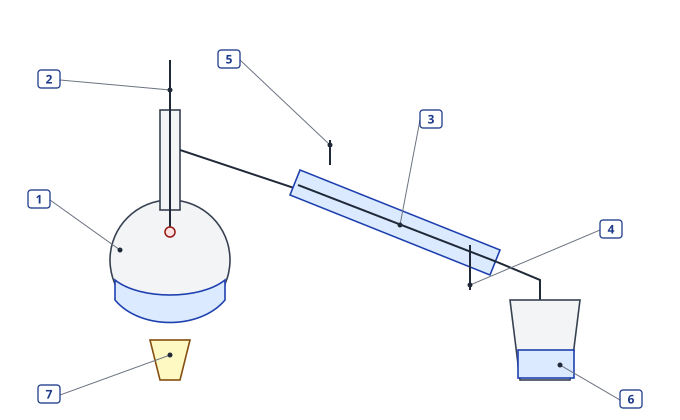

Back

Distillation flask — Heats the mixture

<!-- meta {"type":"flashcard","id":"SCF-11-03-017","grade":11,"chapter_id":"SC11-03","discipline":"CHE","difficulty":1,"image":"science_assets/chemistry/CHE-D04_unlabelled.svg"} -->
**SCF-11-03-017** · Basic

**Front:** Distillation — which part is marked by number 2 in the unlabelled diagram?

Back

Thermometer — Bulb at the side-arm level — boiling point of the vapour

<!-- meta {"type":"flashcard","id":"SCF-11-03-018","grade":11,"chapter_id":"SC11-03","discipline":"CHE","difficulty":1,"image":"science_assets/chemistry/CHE-D04_unlabelled.svg"} -->
**SCF-11-03-018** · Basic

**Front:** Distillation — which part is marked by number 3 in the unlabelled diagram?

Back

Liebig condenser — Cools and condenses the vapour

<!-- meta {"type":"flashcard","id":"SCF-11-03-019","grade":11,"chapter_id":"SC11-03","discipline":"CHE","difficulty":1,"image":"science_assets/chemistry/CHE-D04_unlabelled.svg"} -->
**SCF-11-03-019** · Basic

**Front:** Distillation — which part is marked by number 4 in the unlabelled diagram?

Back

Cold water in — From bottom to top

## SC11-04: Waves and their applications

*Grade 11 · Chapter 4 · Physics · 19 cards*

<!-- meta {"type":"flashcard","id":"SCF-11-04-001","grade":11,"chapter_id":"SC11-04","discipline":"PHY","difficulty":1,"image":null} -->
**SCF-11-04-001** · Basic

**Front:** Wave speed formula?

Back

v = fλ

<!-- meta {"type":"flashcard","id":"SCF-11-04-002","grade":11,"chapter_id":"SC11-04","discipline":"PHY","difficulty":1,"image":null} -->
**SCF-11-04-002** · Basic

**Front:** Unit of frequency?

Back

Hz

<!-- meta {"type":"flashcard","id":"SCF-11-04-003","grade":11,"chapter_id":"SC11-04","discipline":"PHY","difficulty":1,"image":null} -->
**SCF-11-04-003** · Basic

**Front:** What type of wave is sound?

Back

Longitudinal

<!-- meta {"type":"flashcard","id":"SCF-11-04-004","grade":11,"chapter_id":"SC11-04","discipline":"PHY","difficulty":1,"image":null} -->
**SCF-11-04-004** · Basic

**Front:** What type of wave is light?

Back

Transverse (electromagnetic)

<!-- meta {"type":"flashcard","id":"SCF-11-04-005","grade":11,"chapter_id":"SC11-04","discipline":"PHY","difficulty":1,"image":null} -->
**SCF-11-04-005** · Basic

**Front:** Speed of sound in air?

Back

≈ 340 m s⁻¹

<!-- meta {"type":"flashcard","id":"SCF-11-04-006","grade":11,"chapter_id":"SC11-04","discipline":"PHY","difficulty":1,"image":null} -->
**SCF-11-04-006** · Basic

**Front:** Speed of light in a vacuum?

Back

3 × 10⁸ m s⁻¹

<!-- meta {"type":"flashcard","id":"SCF-11-04-007","grade":11,"chapter_id":"SC11-04","discipline":"PHY","difficulty":2,"image":null} -->
**SCF-11-04-007** · Intermediate

**Front:** What does pitch depend on?

Back

Frequency

<!-- meta {"type":"flashcard","id":"SCF-11-04-008","grade":11,"chapter_id":"SC11-04","discipline":"PHY","difficulty":2,"image":null} -->
**SCF-11-04-008** · Intermediate

**Front:** What does loudness depend on?

Back

Amplitude

<!-- meta {"type":"flashcard","id":"SCF-11-04-009","grade":11,"chapter_id":"SC11-04","discipline":"PHY","difficulty":1,"image":null} -->
**SCF-11-04-009** · Basic

**Front:** Human audible range?

Back

20 Hz – 20 kHz

<!-- meta {"type":"flashcard","id":"SCF-11-04-010","grade":11,"chapter_id":"SC11-04","discipline":"PHY","difficulty":1,"image":null} -->
**SCF-11-04-010** · Basic

**Front:** Ultrasound?

Back

> 20 kHz

<!-- meta {"type":"flashcard","id":"SCF-11-04-011","grade":11,"chapter_id":"SC11-04","discipline":"PHY","difficulty":2,"image":null} -->
**SCF-11-04-011** · Intermediate

**Front:** Period T?

Back

1/f

<!-- meta {"type":"flashcard","id":"SCF-11-04-012","grade":11,"chapter_id":"SC11-04","discipline":"PHY","difficulty":1,"image":null} -->
**SCF-11-04-012** · Basic

**Front:** Does sound need a medium?

Back

Yes

<!-- meta {"type":"flashcard","id":"SCF-11-04-013","grade":11,"chapter_id":"SC11-04","discipline":"PHY","difficulty":2,"image":null} -->
**SCF-11-04-013** · Intermediate

**Front:** Electromagnetic wave with the most energy?

Back

Gamma

<!-- meta {"type":"flashcard","id":"SCF-11-04-014","grade":11,"chapter_id":"SC11-04","discipline":"PHY","difficulty":2,"image":null} -->
**SCF-11-04-014** · Intermediate

**Front:** Parts of a longitudinal wave?

Back

Compression, rarefaction

<!-- meta {"type":"flashcard","id":"SCF-11-04-015","grade":11,"chapter_id":"SC11-04","discipline":"PHY","difficulty":3,"image":null} -->
**SCF-11-04-015** · Hard

**Front:** Misconception: a wave carries water along?

Back

Wrong — only energy

<!-- meta {"type":"flashcard","id":"SCF-11-04-016","grade":11,"chapter_id":"SC11-04","discipline":"PHY","difficulty":1,"image":"science_assets/physics/PHY-D05_unlabelled.svg"} -->
**SCF-11-04-016** · Basic

**Front:** Transverse wave — which part is marked by number 1 in the unlabelled diagram?

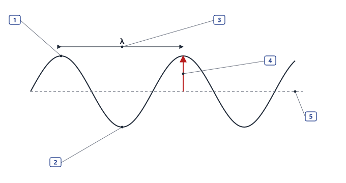

Back

Crest — Maximum upward displacement

<!-- meta {"type":"flashcard","id":"SCF-11-04-017","grade":11,"chapter_id":"SC11-04","discipline":"PHY","difficulty":1,"image":"science_assets/physics/PHY-D05_unlabelled.svg"} -->
**SCF-11-04-017** · Basic

**Front:** Transverse wave — which part is marked by number 2 in the unlabelled diagram?

Back

Trough — Maximum downward displacement

<!-- meta {"type":"flashcard","id":"SCF-11-04-018","grade":11,"chapter_id":"SC11-04","discipline":"PHY","difficulty":1,"image":"science_assets/physics/PHY-D05_unlabelled.svg"} -->
**SCF-11-04-018** · Basic

**Front:** Transverse wave — which part is marked by number 3 in the unlabelled diagram?

Back

Wavelength — Distance between two successive crests

<!-- meta {"type":"flashcard","id":"SCF-11-04-019","grade":11,"chapter_id":"SC11-04","discipline":"PHY","difficulty":1,"image":"science_assets/physics/PHY-D05_unlabelled.svg"} -->
**SCF-11-04-019** · Basic

**Front:** Transverse wave — which part is marked by number 4 in the unlabelled diagram?

Back

Amplitude — Maximum displacement from equilibrium

## SC11-05: Geometrical optics

*Grade 11 · Chapter 5 · Physics · 27 cards*

<!-- meta {"type":"flashcard","id":"SCF-11-05-001","grade":11,"chapter_id":"SC11-05","discipline":"PHY","difficulty":1,"image":null} -->
**SCF-11-05-001** · Basic

**Front:** Law of reflection?

Back

Angle of incidence = angle of reflection

<!-- meta {"type":"flashcard","id":"SCF-11-05-002","grade":11,"chapter_id":"SC11-05","discipline":"PHY","difficulty":1,"image":null} -->
**SCF-11-05-002** · Basic

**Front:** What is refraction?

Back

Bending of light when the medium changes

<!-- meta {"type":"flashcard","id":"SCF-11-05-003","grade":11,"chapter_id":"SC11-05","discipline":"PHY","difficulty":2,"image":null} -->
**SCF-11-05-003** · Intermediate

**Front:** Refractive index?

Back

n = sin i / sin r

<!-- meta {"type":"flashcard","id":"SCF-11-05-004","grade":11,"chapter_id":"SC11-05","discipline":"PHY","difficulty":2,"image":null} -->
**SCF-11-05-004** · Intermediate

**Front:** Condition for total internal reflection?

Back

Denser → less dense; angle of incidence > critical angle

<!-- meta {"type":"flashcard","id":"SCF-11-05-005","grade":11,"chapter_id":"SC11-05","discipline":"PHY","difficulty":1,"image":null} -->
**SCF-11-05-005** · Basic

**Front:** Convex lens?

Back

Converges

<!-- meta {"type":"flashcard","id":"SCF-11-05-006","grade":11,"chapter_id":"SC11-05","discipline":"PHY","difficulty":1,"image":null} -->
**SCF-11-05-006** · Basic

**Front:** Image of a concave lens?

Back

Virtual, upright, diminished

<!-- meta {"type":"flashcard","id":"SCF-11-05-007","grade":11,"chapter_id":"SC11-05","discipline":"PHY","difficulty":2,"image":null} -->
**SCF-11-05-007** · Intermediate

**Front:** Lens used as a magnifying glass?

Back

Convex; object within F

<!-- meta {"type":"flashcard","id":"SCF-11-05-008","grade":11,"chapter_id":"SC11-05","discipline":"PHY","difficulty":2,"image":null} -->
**SCF-11-05-008** · Intermediate

**Front:** Object at 2F — image?

Back

At 2F, same size, inverted

<!-- meta {"type":"flashcard","id":"SCF-11-05-009","grade":11,"chapter_id":"SC11-05","discipline":"PHY","difficulty":2,"image":null} -->
**SCF-11-05-009** · Intermediate

**Front:** Correction of short sight?

Back

Concave lens

<!-- meta {"type":"flashcard","id":"SCF-11-05-010","grade":11,"chapter_id":"SC11-05","discipline":"PHY","difficulty":2,"image":null} -->
**SCF-11-05-010** · Intermediate

**Front:** Correction of long sight?

Back

Convex lens

<!-- meta {"type":"flashcard","id":"SCF-11-05-011","grade":11,"chapter_id":"SC11-05","discipline":"PHY","difficulty":2,"image":null} -->
**SCF-11-05-011** · Intermediate

**Front:** Working principle of an optical fibre?

Back

Total internal reflection

<!-- meta {"type":"flashcard","id":"SCF-11-05-012","grade":11,"chapter_id":"SC11-05","discipline":"PHY","difficulty":3,"image":null} -->
**SCF-11-05-012** · Hard

**Front:** What does not change on refraction?

Back

Frequency

<!-- meta {"type":"flashcard","id":"SCF-11-05-013","grade":11,"chapter_id":"SC11-05","discipline":"PHY","difficulty":1,"image":null} -->
**SCF-11-05-013** · Basic

**Front:** Can a real image be obtained on a screen?

Back

Yes

<!-- meta {"type":"flashcard","id":"SCF-11-05-014","grade":11,"chapter_id":"SC11-05","discipline":"PHY","difficulty":3,"image":null} -->
**SCF-11-05-014** · Hard

**Front:** Lens formula?

Back

1/v − 1/u = 1/f

<!-- meta {"type":"flashcard","id":"SCF-11-05-015","grade":11,"chapter_id":"SC11-05","discipline":"PHY","difficulty":3,"image":null} -->
**SCF-11-05-015** · Hard

**Front:** Misconception: a concave lens gives a real image?

Back

Wrong

<!-- meta {"type":"flashcard","id":"SCF-11-05-016","grade":11,"chapter_id":"SC11-05","discipline":"PHY","difficulty":1,"image":"science_assets/biology/BIO-D11_unlabelled.svg"} -->
**SCF-11-05-016** · Basic

**Front:** Human eye (schematic) — which part is marked by number 1 in the unlabelled diagram?

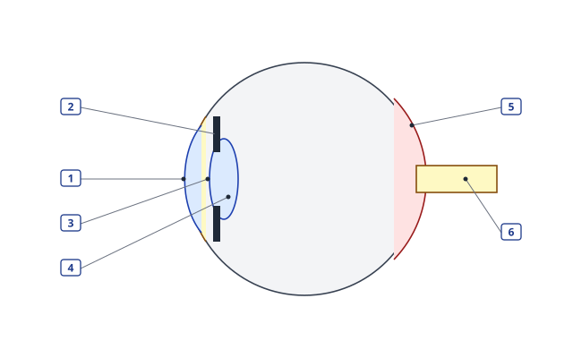

Back

Cornea — Refracts light — most of it

<!-- meta {"type":"flashcard","id":"SCF-11-05-017","grade":11,"chapter_id":"SC11-05","discipline":"PHY","difficulty":1,"image":"science_assets/biology/BIO-D11_unlabelled.svg"} -->
**SCF-11-05-017** · Basic

**Front:** Human eye (schematic) — which part is marked by number 2 in the unlabelled diagram?

Back

Iris — Controls the size of the pupil

<!-- meta {"type":"flashcard","id":"SCF-11-05-018","grade":11,"chapter_id":"SC11-05","discipline":"PHY","difficulty":1,"image":"science_assets/biology/BIO-D11_unlabelled.svg"} -->
**SCF-11-05-018** · Basic

**Front:** Human eye (schematic) — which part is marked by number 3 in the unlabelled diagram?

Back

Pupil — Opening through which light enters

<!-- meta {"type":"flashcard","id":"SCF-11-05-019","grade":11,"chapter_id":"SC11-05","discipline":"PHY","difficulty":1,"image":"science_assets/biology/BIO-D11_unlabelled.svg"} -->
**SCF-11-05-019** · Basic

**Front:** Human eye (schematic) — which part is marked by number 4 in the unlabelled diagram?

Back

Lens — Adjusts the focal length

<!-- meta {"type":"flashcard","id":"SCF-11-05-020","grade":11,"chapter_id":"SC11-05","discipline":"PHY","difficulty":1,"image":"science_assets/physics/PHY-D03_unlabelled.svg"} -->
**SCF-11-05-020** · Basic

**Front:** Convex lens: object beyond 2F — which part is marked by number 1 in the unlabelled diagram?

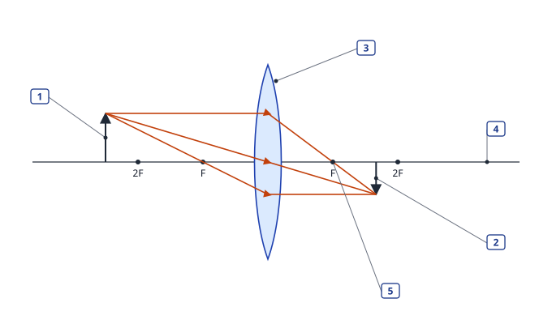

Back

Object — Beyond 2F

<!-- meta {"type":"flashcard","id":"SCF-11-05-021","grade":11,"chapter_id":"SC11-05","discipline":"PHY","difficulty":1,"image":"science_assets/physics/PHY-D03_unlabelled.svg"} -->
**SCF-11-05-021** · Basic

**Front:** Convex lens: object beyond 2F — which part is marked by number 2 in the unlabelled diagram?

Back

Image — Real, inverted, diminished; between F and 2F

<!-- meta {"type":"flashcard","id":"SCF-11-05-022","grade":11,"chapter_id":"SC11-05","discipline":"PHY","difficulty":1,"image":"science_assets/physics/PHY-D03_unlabelled.svg"} -->
**SCF-11-05-022** · Basic

**Front:** Convex lens: object beyond 2F — which part is marked by number 3 in the unlabelled diagram?

Back

Convex lens — Converging

<!-- meta {"type":"flashcard","id":"SCF-11-05-023","grade":11,"chapter_id":"SC11-05","discipline":"PHY","difficulty":1,"image":"science_assets/physics/PHY-D03_unlabelled.svg"} -->
**SCF-11-05-023** · Basic

**Front:** Convex lens: object beyond 2F — which part is marked by number 4 in the unlabelled diagram?

Back

Principal axis

<!-- meta {"type":"flashcard","id":"SCF-11-05-024","grade":11,"chapter_id":"SC11-05","discipline":"PHY","difficulty":1,"image":"science_assets/experiments/EXP-D04_unlabelled.svg"} -->
**SCF-11-05-024** · Basic

**Front:** Focal length of a convex lens (distant object method) — which part is marked by number 1 in the unlabelled diagram?

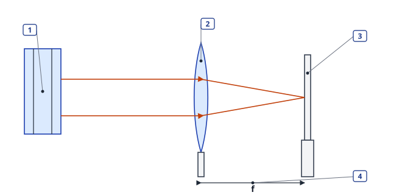

Back

Distant object (window) — Rays are almost parallel

<!-- meta {"type":"flashcard","id":"SCF-11-05-025","grade":11,"chapter_id":"SC11-05","discipline":"PHY","difficulty":1,"image":"science_assets/experiments/EXP-D04_unlabelled.svg"} -->
**SCF-11-05-025** · Basic

**Front:** Focal length of a convex lens (distant object method) — which part is marked by number 2 in the unlabelled diagram?

Back

Convex lens

<!-- meta {"type":"flashcard","id":"SCF-11-05-026","grade":11,"chapter_id":"SC11-05","discipline":"PHY","difficulty":1,"image":"science_assets/experiments/EXP-D04_unlabelled.svg"} -->
**SCF-11-05-026** · Basic

**Front:** Focal length of a convex lens (distant object method) — which part is marked by number 3 in the unlabelled diagram?

Back

Screen — Move until a sharp image forms

<!-- meta {"type":"flashcard","id":"SCF-11-05-027","grade":11,"chapter_id":"SC11-05","discipline":"PHY","difficulty":1,"image":"science_assets/experiments/EXP-D04_unlabelled.svg"} -->
**SCF-11-05-027** · Basic

**Front:** Focal length of a convex lens (distant object method) — which part is marked by number 4 in the unlabelled diagram?

Back

Lens–screen distance ≈ f

## SC11-06: Biological processes in the human body

*Grade 11 · Chapter 6 · Biology · 32 cards*

<!-- meta {"type":"flashcard","id":"SCF-11-06-001","grade":11,"chapter_id":"SC11-06","discipline":"BIO","difficulty":1,"image":null} -->
**SCF-11-06-001** · Basic

**Front:** Where does protein digestion begin?

Back

Stomach (pepsin)

<!-- meta {"type":"flashcard","id":"SCF-11-06-002","grade":11,"chapter_id":"SC11-06","discipline":"BIO","difficulty":1,"image":null} -->
**SCF-11-06-002** · Basic

**Front:** Where is most water absorbed?

Back

Large intestine

<!-- meta {"type":"flashcard","id":"SCF-11-06-003","grade":11,"chapter_id":"SC11-06","discipline":"BIO","difficulty":1,"image":null} -->
**SCF-11-06-003** · Basic

**Front:** Function of villi?

Back

Absorbing digested food

<!-- meta {"type":"flashcard","id":"SCF-11-06-004","grade":11,"chapter_id":"SC11-06","discipline":"BIO","difficulty":2,"image":null} -->
**SCF-11-06-004** · Intermediate

**Front:** Function of bile?

Back

Emulsifying fats

<!-- meta {"type":"flashcard","id":"SCF-11-06-005","grade":11,"chapter_id":"SC11-06","discipline":"BIO","difficulty":1,"image":null} -->
**SCF-11-06-005** · Basic

**Front:** Where does gas exchange take place?

Back

Alveoli

<!-- meta {"type":"flashcard","id":"SCF-11-06-006","grade":11,"chapter_id":"SC11-06","discipline":"BIO","difficulty":2,"image":null} -->
**SCF-11-06-006** · Intermediate

**Front:** Equation for aerobic respiration?

Back

C₆H₁₂O₆ + 6O₂ → 6CO₂ + 6H₂O + energy

<!-- meta {"type":"flashcard","id":"SCF-11-06-007","grade":11,"chapter_id":"SC11-06","discipline":"BIO","difficulty":2,"image":null} -->
**SCF-11-06-007** · Intermediate

**Front:** Product of anaerobic respiration in muscle?

Back

Lactic acid

<!-- meta {"type":"flashcard","id":"SCF-11-06-008","grade":11,"chapter_id":"SC11-06","discipline":"BIO","difficulty":1,"image":null} -->
**SCF-11-06-008** · Basic

**Front:** Number of chambers in the heart?

Back

4

<!-- meta {"type":"flashcard","id":"SCF-11-06-009","grade":11,"chapter_id":"SC11-06","discipline":"BIO","difficulty":1,"image":null} -->
**SCF-11-06-009** · Basic

**Front:** Blood component that carries O₂?

Back

Haemoglobin in red blood cells

<!-- meta {"type":"flashcard","id":"SCF-11-06-010","grade":11,"chapter_id":"SC11-06","discipline":"BIO","difficulty":1,"image":null} -->
**SCF-11-06-010** · Basic

**Front:** What helps blood clotting?

Back

Platelets

<!-- meta {"type":"flashcard","id":"SCF-11-06-011","grade":11,"chapter_id":"SC11-06","discipline":"BIO","difficulty":1,"image":null} -->
**SCF-11-06-011** · Basic

**Front:** Functional unit of the kidney?

Back

Nephron

<!-- meta {"type":"flashcard","id":"SCF-11-06-012","grade":11,"chapter_id":"SC11-06","discipline":"BIO","difficulty":2,"image":null} -->
**SCF-11-06-012** · Intermediate

**Front:** Main component of urine?

Back

Water

<!-- meta {"type":"flashcard","id":"SCF-11-06-013","grade":11,"chapter_id":"SC11-06","discipline":"BIO","difficulty":2,"image":null} -->
**SCF-11-06-013** · Intermediate

**Front:** Part of the brain that maintains body balance?

Back

Cerebellum

<!-- meta {"type":"flashcard","id":"SCF-11-06-014","grade":11,"chapter_id":"SC11-06","discipline":"BIO","difficulty":1,"image":null} -->
**SCF-11-06-014** · Basic

**Front:** Hormone that lowers blood glucose?

Back

Insulin

<!-- meta {"type":"flashcard","id":"SCF-11-06-015","grade":11,"chapter_id":"SC11-06","discipline":"BIO","difficulty":3,"image":null} -->
**SCF-11-06-015** · Hard

**Front:** Artery that carries deoxygenated blood?

Back

Pulmonary artery

<!-- meta {"type":"flashcard","id":"SCF-11-06-016","grade":11,"chapter_id":"SC11-06","discipline":"BIO","difficulty":2,"image":null} -->
**SCF-11-06-016** · Intermediate

**Front:** What is a reflex action?

Back

A rapid involuntary response to a stimulus

<!-- meta {"type":"flashcard","id":"SCF-11-06-017","grade":11,"chapter_id":"SC11-06","discipline":"BIO","difficulty":1,"image":"science_assets/biology/BIO-D04_unlabelled.svg"} -->
**SCF-11-06-017** · Basic

**Front:** Human heart (schematic) — which part is marked by number 1 in the unlabelled diagram?

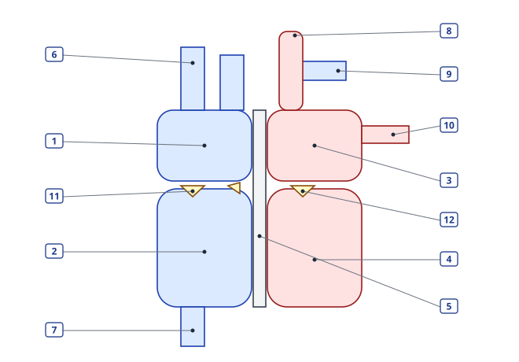

Back

Right atrium — Receives deoxygenated blood from the body

<!-- meta {"type":"flashcard","id":"SCF-11-06-018","grade":11,"chapter_id":"SC11-06","discipline":"BIO","difficulty":1,"image":"science_assets/biology/BIO-D04_unlabelled.svg"} -->
**SCF-11-06-018** · Basic

**Front:** Human heart (schematic) — which part is marked by number 2 in the unlabelled diagram?

Back

Right ventricle — Pumps blood to the lungs

<!-- meta {"type":"flashcard","id":"SCF-11-06-019","grade":11,"chapter_id":"SC11-06","discipline":"BIO","difficulty":1,"image":"science_assets/biology/BIO-D04_unlabelled.svg"} -->
**SCF-11-06-019** · Basic

**Front:** Human heart (schematic) — which part is marked by number 3 in the unlabelled diagram?

Back

Left atrium — Oxygenated blood from the lungs

<!-- meta {"type":"flashcard","id":"SCF-11-06-020","grade":11,"chapter_id":"SC11-06","discipline":"BIO","difficulty":1,"image":"science_assets/biology/BIO-D04_unlabelled.svg"} -->
**SCF-11-06-020** · Basic

**Front:** Human heart (schematic) — which part is marked by number 4 in the unlabelled diagram?

Back

Left ventricle — Pumps to the body — thick wall

<!-- meta {"type":"flashcard","id":"SCF-11-06-021","grade":11,"chapter_id":"SC11-06","discipline":"BIO","difficulty":1,"image":"science_assets/biology/BIO-D05_unlabelled.svg"} -->
**SCF-11-06-021** · Basic

**Front:** Digestive system (schematic) — which part is marked by number 1 in the unlabelled diagram?

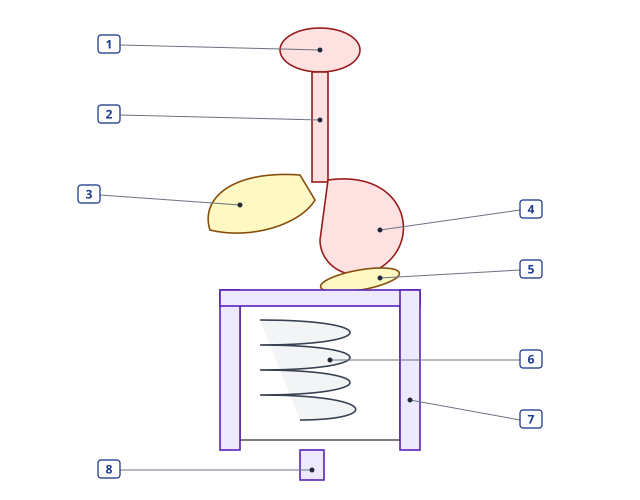

Back

Mouth cavity — Chewing; salivary amylase

<!-- meta {"type":"flashcard","id":"SCF-11-06-022","grade":11,"chapter_id":"SC11-06","discipline":"BIO","difficulty":1,"image":"science_assets/biology/BIO-D05_unlabelled.svg"} -->
**SCF-11-06-022** · Basic

**Front:** Digestive system (schematic) — which part is marked by number 2 in the unlabelled diagram?

Back

Oesophagus — Moves food by peristalsis

<!-- meta {"type":"flashcard","id":"SCF-11-06-023","grade":11,"chapter_id":"SC11-06","discipline":"BIO","difficulty":1,"image":"science_assets/biology/BIO-D05_unlabelled.svg"} -->
**SCF-11-06-023** · Basic

**Front:** Digestive system (schematic) — which part is marked by number 3 in the unlabelled diagram?

Back

Liver — Produces bile

<!-- meta {"type":"flashcard","id":"SCF-11-06-024","grade":11,"chapter_id":"SC11-06","discipline":"BIO","difficulty":1,"image":"science_assets/biology/BIO-D05_unlabelled.svg"} -->
**SCF-11-06-024** · Basic

**Front:** Digestive system (schematic) — which part is marked by number 4 in the unlabelled diagram?

Back

Stomach — Pepsin, HCl — protein digestion

<!-- meta {"type":"flashcard","id":"SCF-11-06-025","grade":11,"chapter_id":"SC11-06","discipline":"BIO","difficulty":1,"image":"science_assets/biology/BIO-D06_unlabelled.svg"} -->
**SCF-11-06-025** · Basic

**Front:** Respiratory system — which part is marked by number 1 in the unlabelled diagram?

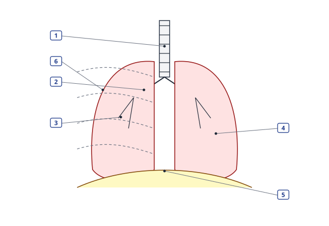

Back

Trachea — C-shaped cartilage rings — keep it open

<!-- meta {"type":"flashcard","id":"SCF-11-06-026","grade":11,"chapter_id":"SC11-06","discipline":"BIO","difficulty":1,"image":"science_assets/biology/BIO-D06_unlabelled.svg"} -->
**SCF-11-06-026** · Basic

**Front:** Respiratory system — which part is marked by number 2 in the unlabelled diagram?

Back

Bronchus — Carries air to the lungs

<!-- meta {"type":"flashcard","id":"SCF-11-06-027","grade":11,"chapter_id":"SC11-06","discipline":"BIO","difficulty":1,"image":"science_assets/biology/BIO-D06_unlabelled.svg"} -->
**SCF-11-06-027** · Basic

**Front:** Respiratory system — which part is marked by number 3 in the unlabelled diagram?

Back

Bronchiole — Air to the alveoli

<!-- meta {"type":"flashcard","id":"SCF-11-06-028","grade":11,"chapter_id":"SC11-06","discipline":"BIO","difficulty":1,"image":"science_assets/biology/BIO-D06_unlabelled.svg"} -->
**SCF-11-06-028** · Basic

**Front:** Respiratory system — which part is marked by number 4 in the unlabelled diagram?

Back

Lung — Gas exchange (alveoli)

<!-- meta {"type":"flashcard","id":"SCF-11-06-029","grade":11,"chapter_id":"SC11-06","discipline":"BIO","difficulty":1,"image":"science_assets/biology/BIO-D07_unlabelled.svg"} -->
**SCF-11-06-029** · Basic

**Front:** Nephron (schematic) — which part is marked by number 1 in the unlabelled diagram?

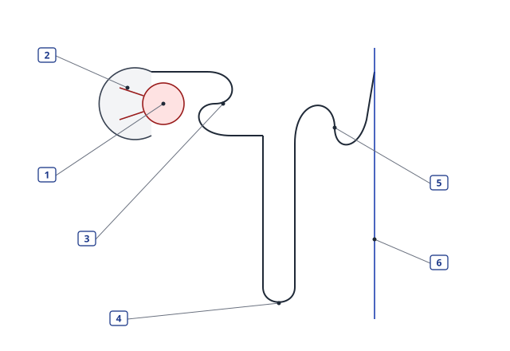

Back

Glomerulus — Pressure filtration (ultrafiltration)

<!-- meta {"type":"flashcard","id":"SCF-11-06-030","grade":11,"chapter_id":"SC11-06","discipline":"BIO","difficulty":1,"image":"science_assets/biology/BIO-D07_unlabelled.svg"} -->
**SCF-11-06-030** · Basic

**Front:** Nephron (schematic) — which part is marked by number 2 in the unlabelled diagram?

Back

Bowman's capsule — Collects the filtrate

<!-- meta {"type":"flashcard","id":"SCF-11-06-031","grade":11,"chapter_id":"SC11-06","discipline":"BIO","difficulty":1,"image":"science_assets/biology/BIO-D07_unlabelled.svg"} -->
**SCF-11-06-031** · Basic

**Front:** Nephron (schematic) — which part is marked by number 3 in the unlabelled diagram?

Back

Proximal convoluted tubule — Reabsorbs glucose and amino acids

<!-- meta {"type":"flashcard","id":"SCF-11-06-032","grade":11,"chapter_id":"SC11-06","discipline":"BIO","difficulty":1,"image":"science_assets/biology/BIO-D07_unlabelled.svg"} -->
**SCF-11-06-032** · Basic

**Front:** Nephron (schematic) — which part is marked by number 4 in the unlabelled diagram?

Back

Loop of Henle — Reabsorbs water and salt

## SC11-07: Acids, bases and salts

*Grade 11 · Chapter 7 · Chemistry · 19 cards*

<!-- meta {"type":"flashcard","id":"SCF-11-07-001","grade":11,"chapter_id":"SC11-07","discipline":"CHE","difficulty":1,"image":null} -->
**SCF-11-07-001** · Basic

**Front:** Ion given by an acid in water?

Back

H⁺

<!-- meta {"type":"flashcard","id":"SCF-11-07-002","grade":11,"chapter_id":"SC11-07","discipline":"CHE","difficulty":1,"image":null} -->
**SCF-11-07-002** · Basic

**Front:** Ion given by an alkali in water?

Back

OH⁻

<!-- meta {"type":"flashcard","id":"SCF-11-07-003","grade":11,"chapter_id":"SC11-07","discipline":"CHE","difficulty":1,"image":null} -->
**SCF-11-07-003** · Basic

**Front:** Neutral pH?

Back

7

<!-- meta {"type":"flashcard","id":"SCF-11-07-004","grade":11,"chapter_id":"SC11-07","discipline":"CHE","difficulty":1,"image":null} -->
**SCF-11-07-004** · Basic

**Front:** Litmus in acid?

Back

Red

<!-- meta {"type":"flashcard","id":"SCF-11-07-005","grade":11,"chapter_id":"SC11-07","discipline":"CHE","difficulty":1,"image":null} -->
**SCF-11-07-005** · Basic

**Front:** Phenolphthalein in alkali?

Back

Pink

<!-- meta {"type":"flashcard","id":"SCF-11-07-006","grade":11,"chapter_id":"SC11-07","discipline":"CHE","difficulty":2,"image":null} -->
**SCF-11-07-006** · Intermediate

**Front:** Ionic equation for neutralisation?

Back

H⁺ + OH⁻ → H₂O

<!-- meta {"type":"flashcard","id":"SCF-11-07-007","grade":11,"chapter_id":"SC11-07","discipline":"CHE","difficulty":1,"image":null} -->
**SCF-11-07-007** · Basic

**Front:** An example of a strong acid?

Back

HCl

<!-- meta {"type":"flashcard","id":"SCF-11-07-008","grade":11,"chapter_id":"SC11-07","discipline":"CHE","difficulty":1,"image":null} -->
**SCF-11-07-008** · Basic

**Front:** An example of a weak acid?

Back

Acetic acid

<!-- meta {"type":"flashcard","id":"SCF-11-07-009","grade":11,"chapter_id":"SC11-07","discipline":"CHE","difficulty":1,"image":null} -->
**SCF-11-07-009** · Basic

**Front:** Acid + Zn → ?

Back

Salt + H₂

<!-- meta {"type":"flashcard","id":"SCF-11-07-010","grade":11,"chapter_id":"SC11-07","discipline":"CHE","difficulty":2,"image":null} -->
**SCF-11-07-010** · Intermediate

**Front:** Acid + Na₂CO₃ → ?

Back

Salt + CO₂ + H₂O

<!-- meta {"type":"flashcard","id":"SCF-11-07-011","grade":11,"chapter_id":"SC11-07","discipline":"CHE","difficulty":1,"image":null} -->
**SCF-11-07-011** · Basic

**Front:** Salt from HCl + NaOH?

Back

NaCl

<!-- meta {"type":"flashcard","id":"SCF-11-07-012","grade":11,"chapter_id":"SC11-07","discipline":"CHE","difficulty":2,"image":null} -->
**SCF-11-07-012** · Intermediate

**Front:** Type of salt given by H₂SO₄?

Back

Sulfate

<!-- meta {"type":"flashcard","id":"SCF-11-07-013","grade":11,"chapter_id":"SC11-07","discipline":"CHE","difficulty":2,"image":null} -->
**SCF-11-07-013** · Intermediate

**Front:** Antacid for stomach acid?

Back

Mg(OH)₂ / Al(OH)₃

<!-- meta {"type":"flashcard","id":"SCF-11-07-014","grade":11,"chapter_id":"SC11-07","discipline":"CHE","difficulty":2,"image":null} -->
**SCF-11-07-014** · Intermediate

**Front:** To correct acidic soil?

Back

Lime (CaO/Ca(OH)₂)

<!-- meta {"type":"flashcard","id":"SCF-11-07-015","grade":11,"chapter_id":"SC11-07","discipline":"CHE","difficulty":3,"image":null} -->
**SCF-11-07-015** · Hard

**Front:** Misconception: weak acid = dilute?

Back

Wrong

<!-- meta {"type":"flashcard","id":"SCF-11-07-016","grade":11,"chapter_id":"SC11-07","discipline":"CHE","difficulty":1,"image":"science_assets/chemistry/CHE-D03_unlabelled.svg"} -->
**SCF-11-07-016** · Basic

**Front:** Preparing hydrogen — downward displacement of water — which part is marked by number 1 in the unlabelled diagram?

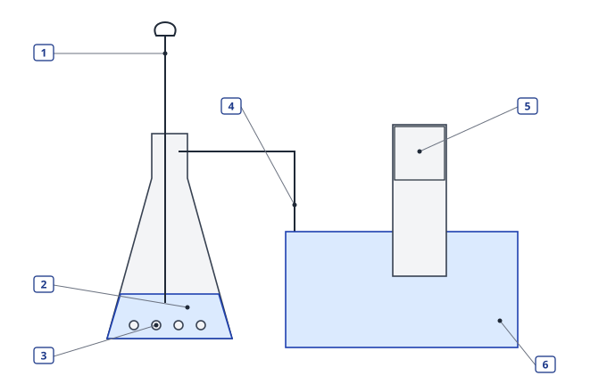

Back

Thistle funnel — Adding the acid

<!-- meta {"type":"flashcard","id":"SCF-11-07-017","grade":11,"chapter_id":"SC11-07","discipline":"CHE","difficulty":1,"image":"science_assets/chemistry/CHE-D03_unlabelled.svg"} -->
**SCF-11-07-017** · Basic

**Front:** Preparing hydrogen — downward displacement of water — which part is marked by number 2 in the unlabelled diagram?

Back

Dilute HCl — Reactant

<!-- meta {"type":"flashcard","id":"SCF-11-07-018","grade":11,"chapter_id":"SC11-07","discipline":"CHE","difficulty":1,"image":"science_assets/chemistry/CHE-D03_unlabelled.svg"} -->
**SCF-11-07-018** · Basic

**Front:** Preparing hydrogen — downward displacement of water — which part is marked by number 3 in the unlabelled diagram?

Back

Zinc granules — Zn + 2HCl → ZnCl₂ + H₂

<!-- meta {"type":"flashcard","id":"SCF-11-07-019","grade":11,"chapter_id":"SC11-07","discipline":"CHE","difficulty":1,"image":"science_assets/chemistry/CHE-D03_unlabelled.svg"} -->
**SCF-11-07-019** · Basic

**Front:** Preparing hydrogen — downward displacement of water — which part is marked by number 4 in the unlabelled diagram?

Back

Delivery tube — Carries the gas

## SC11-08: Heat changes associated with chemical reactions

*Grade 11 · Chapter 8 · Chemistry · 18 cards*

<!-- meta {"type":"flashcard","id":"SCF-11-08-001","grade":11,"chapter_id":"SC11-08","discipline":"CHE","difficulty":1,"image":null} -->
**SCF-11-08-001** · Basic

**Front:** Sign of ΔH in an exothermic reaction?

Back

Negative (−)

<!-- meta {"type":"flashcard","id":"SCF-11-08-002","grade":11,"chapter_id":"SC11-08","discipline":"CHE","difficulty":1,"image":null} -->
**SCF-11-08-002** · Basic

**Front:** Sign of ΔH in an endothermic reaction?

Back

Positive (+)

<!-- meta {"type":"flashcard","id":"SCF-11-08-003","grade":11,"chapter_id":"SC11-08","discipline":"CHE","difficulty":1,"image":null} -->
**SCF-11-08-003** · Basic

**Front:** Combustion is which type?

Back

Exothermic

<!-- meta {"type":"flashcard","id":"SCF-11-08-004","grade":11,"chapter_id":"SC11-08","discipline":"CHE","difficulty":1,"image":null} -->
**SCF-11-08-004** · Basic

**Front:** Thermal decomposition of CaCO₃?

Back

Endothermic

<!-- meta {"type":"flashcard","id":"SCF-11-08-005","grade":11,"chapter_id":"SC11-08","discipline":"CHE","difficulty":2,"image":null} -->
**SCF-11-08-005** · Intermediate

**Front:** Breaking bonds?

Back

Absorbs energy

<!-- meta {"type":"flashcard","id":"SCF-11-08-006","grade":11,"chapter_id":"SC11-08","discipline":"CHE","difficulty":2,"image":null} -->
**SCF-11-08-006** · Intermediate

**Front:** Forming bonds?

Back

Releases energy

<!-- meta {"type":"flashcard","id":"SCF-11-08-007","grade":11,"chapter_id":"SC11-08","discipline":"CHE","difficulty":2,"image":null} -->
**SCF-11-08-007** · Intermediate

**Front:** Temperature when NH₄Cl dissolves in water?

Back

Falls (endothermic)

<!-- meta {"type":"flashcard","id":"SCF-11-08-008","grade":11,"chapter_id":"SC11-08","discipline":"CHE","difficulty":1,"image":null} -->
**SCF-11-08-008** · Basic

**Front:** Neutralisation?

Back

Exothermic

<!-- meta {"type":"flashcard","id":"SCF-11-08-009","grade":11,"chapter_id":"SC11-08","discipline":"CHE","difficulty":2,"image":null} -->
**SCF-11-08-009** · Intermediate

**Front:** Exothermic energy level diagram?

Back

Products below reactants

<!-- meta {"type":"flashcard","id":"SCF-11-08-010","grade":11,"chapter_id":"SC11-08","discipline":"CHE","difficulty":2,"image":null} -->
**SCF-11-08-010** · Intermediate

**Front:** Photosynthesis?

Back

Endothermic

<!-- meta {"type":"flashcard","id":"SCF-11-08-011","grade":11,"chapter_id":"SC11-08","discipline":"CHE","difficulty":1,"image":null} -->
**SCF-11-08-011** · Basic

**Front:** Respiration?

Back

Exothermic

<!-- meta {"type":"flashcard","id":"SCF-11-08-012","grade":11,"chapter_id":"SC11-08","discipline":"CHE","difficulty":2,"image":null} -->
**SCF-11-08-012** · Intermediate

**Front:** Basis of an instant cold pack?

Back

Endothermic dissolving

<!-- meta {"type":"flashcard","id":"SCF-11-08-013","grade":11,"chapter_id":"SC11-08","discipline":"CHE","difficulty":3,"image":null} -->
**SCF-11-08-013** · Hard

**Front:** Misconception: combustion is endothermic?

Back

Wrong

<!-- meta {"type":"flashcard","id":"SCF-11-08-014","grade":11,"chapter_id":"SC11-08","discipline":"CHE","difficulty":2,"image":null} -->
**SCF-11-08-014** · Intermediate

**Front:** c in Q = mcΔθ?

Back

Specific heat capacity

<!-- meta {"type":"flashcard","id":"SCF-11-08-015","grade":11,"chapter_id":"SC11-08","discipline":"CHE","difficulty":2,"image":null} -->
**SCF-11-08-015** · Intermediate

**Front:** Unit of ΔH?

Back

kJ mol⁻¹

<!-- meta {"type":"flashcard","id":"SCF-11-08-016","grade":11,"chapter_id":"SC11-08","discipline":"CHE","difficulty":1,"image":"science_assets/graphs/GR-D05_unlabelled.svg"} -->
**SCF-11-08-016** · Basic

**Front:** Energy level diagram of an exothermic reaction — which part is marked by number 1 in the unlabelled diagram?

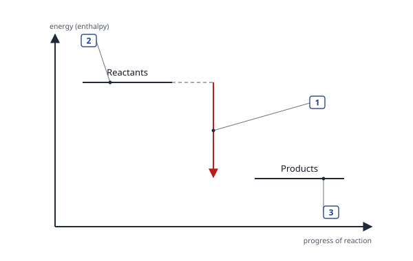

Back

ΔH < 0 (heat released)

<!-- meta {"type":"flashcard","id":"SCF-11-08-017","grade":11,"chapter_id":"SC11-08","discipline":"CHE","difficulty":1,"image":"science_assets/graphs/GR-D05_unlabelled.svg"} -->
**SCF-11-08-017** · Basic

**Front:** Energy level diagram of an exothermic reaction — which part is marked by number 2 in the unlabelled diagram?

Back

Higher energy level

<!-- meta {"type":"flashcard","id":"SCF-11-08-018","grade":11,"chapter_id":"SC11-08","discipline":"CHE","difficulty":1,"image":"science_assets/graphs/GR-D05_unlabelled.svg"} -->
**SCF-11-08-018** · Basic

**Front:** Energy level diagram of an exothermic reaction — which part is marked by number 3 in the unlabelled diagram?

Back

Lower energy level

## SC11-09: Heat

*Grade 11 · Chapter 9 · Physics · 23 cards*

<!-- meta {"type":"flashcard","id":"SCF-11-09-001","grade":11,"chapter_id":"SC11-09","discipline":"PHY","difficulty":1,"image":null} -->
**SCF-11-09-001** · Basic

**Front:** c in Q = mcθ?

Back

Specific heat capacity

<!-- meta {"type":"flashcard","id":"SCF-11-09-002","grade":11,"chapter_id":"SC11-09","discipline":"PHY","difficulty":1,"image":null} -->
**SCF-11-09-002** · Basic

**Front:** c of water?

Back

4200 J kg⁻¹ °C⁻¹

<!-- meta {"type":"flashcard","id":"SCF-11-09-003","grade":11,"chapter_id":"SC11-09","discipline":"PHY","difficulty":1,"image":null} -->
**SCF-11-09-003** · Basic

**Front:** Latent heat formula?

Back

Q = mL

<!-- meta {"type":"flashcard","id":"SCF-11-09-004","grade":11,"chapter_id":"SC11-09","discipline":"PHY","difficulty":1,"image":null} -->
**SCF-11-09-004** · Basic

**Front:** K = ?

Back

°C + 273

<!-- meta {"type":"flashcard","id":"SCF-11-09-005","grade":11,"chapter_id":"SC11-09","discipline":"PHY","difficulty":1,"image":null} -->
**SCF-11-09-005** · Basic

**Front:** 25 °C = ? K

Back

298 K

<!-- meta {"type":"flashcard","id":"SCF-11-09-006","grade":11,"chapter_id":"SC11-09","discipline":"PHY","difficulty":1,"image":null} -->
**SCF-11-09-006** · Basic

**Front:** Method of heat transfer in a vacuum?

Back

Radiation

<!-- meta {"type":"flashcard","id":"SCF-11-09-007","grade":11,"chapter_id":"SC11-09","discipline":"PHY","difficulty":1,"image":null} -->
**SCF-11-09-007** · Basic

**Front:** Heat in fluids?

Back

Convection

<!-- meta {"type":"flashcard","id":"SCF-11-09-008","grade":11,"chapter_id":"SC11-09","discipline":"PHY","difficulty":1,"image":null} -->
**SCF-11-09-008** · Basic

**Front:** In solids?

Back

Conduction

<!-- meta {"type":"flashcard","id":"SCF-11-09-009","grade":11,"chapter_id":"SC11-09","discipline":"PHY","difficulty":2,"image":null} -->
**SCF-11-09-009** · Intermediate

**Front:** Evaporation vs boiling: bubbles?

Back

Only in boiling

<!-- meta {"type":"flashcard","id":"SCF-11-09-010","grade":11,"chapter_id":"SC11-09","discipline":"PHY","difficulty":2,"image":null} -->
**SCF-11-09-010** · Intermediate

**Front:** Temperature during a change of state?

Back

Does not change

<!-- meta {"type":"flashcard","id":"SCF-11-09-011","grade":11,"chapter_id":"SC11-09","discipline":"PHY","difficulty":2,"image":null} -->
**SCF-11-09-011** · Intermediate

**Front:** Best absorber of radiation?

Back

A black surface

<!-- meta {"type":"flashcard","id":"SCF-11-09-012","grade":11,"chapter_id":"SC11-09","discipline":"PHY","difficulty":2,"image":null} -->
**SCF-11-09-012** · Intermediate

**Front:** Property suitable for a coolant?

Back

High specific heat capacity

<!-- meta {"type":"flashcard","id":"SCF-11-09-013","grade":11,"chapter_id":"SC11-09","discipline":"PHY","difficulty":3,"image":null} -->
**SCF-11-09-013** · Hard

**Front:** Temperature at which water has maximum density?

Back

4 °C

<!-- meta {"type":"flashcard","id":"SCF-11-09-014","grade":11,"chapter_id":"SC11-09","discipline":"PHY","difficulty":1,"image":null} -->
**SCF-11-09-014** · Basic

**Front:** Why are there gaps in railway lines?

Back

Thermal expansion

<!-- meta {"type":"flashcard","id":"SCF-11-09-015","grade":11,"chapter_id":"SC11-09","discipline":"PHY","difficulty":3,"image":null} -->
**SCF-11-09-015** · Hard

**Front:** Misconception: heat = temperature?

Back

Wrong

<!-- meta {"type":"flashcard","id":"SCF-11-09-016","grade":11,"chapter_id":"SC11-09","discipline":"PHY","difficulty":1,"image":"science_assets/graphs/GR-D02_unlabelled.svg"} -->
**SCF-11-09-016** · Basic

**Front:** Heating curve of water — which part is marked by number 1 in the unlabelled diagram?

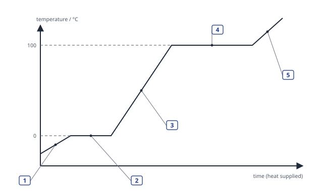

Back

Ice warming

<!-- meta {"type":"flashcard","id":"SCF-11-09-017","grade":11,"chapter_id":"SC11-09","discipline":"PHY","difficulty":1,"image":"science_assets/graphs/GR-D02_unlabelled.svg"} -->
**SCF-11-09-017** · Basic

**Front:** Heating curve of water — which part is marked by number 2 in the unlabelled diagram?

Back

Melting — temperature constant — Q = mL

<!-- meta {"type":"flashcard","id":"SCF-11-09-018","grade":11,"chapter_id":"SC11-09","discipline":"PHY","difficulty":1,"image":"science_assets/graphs/GR-D02_unlabelled.svg"} -->
**SCF-11-09-018** · Basic

**Front:** Heating curve of water — which part is marked by number 3 in the unlabelled diagram?

Back

Water warming — Q = mcθ

<!-- meta {"type":"flashcard","id":"SCF-11-09-019","grade":11,"chapter_id":"SC11-09","discipline":"PHY","difficulty":1,"image":"science_assets/graphs/GR-D02_unlabelled.svg"} -->
**SCF-11-09-019** · Basic

**Front:** Heating curve of water — which part is marked by number 4 in the unlabelled diagram?

Back

Boiling

<!-- meta {"type":"flashcard","id":"SCF-11-09-020","grade":11,"chapter_id":"SC11-09","discipline":"PHY","difficulty":1,"image":"science_assets/experiments/EXP-D03_unlabelled.svg"} -->
**SCF-11-09-020** · Basic

**Front:** Measuring specific heat capacity (metal block) — which part is marked by number 1 in the unlabelled diagram?

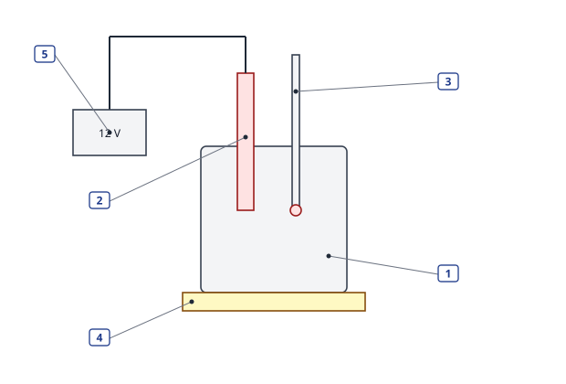

Back

Metal block (mass m)

<!-- meta {"type":"flashcard","id":"SCF-11-09-021","grade":11,"chapter_id":"SC11-09","discipline":"PHY","difficulty":1,"image":"science_assets/experiments/EXP-D03_unlabelled.svg"} -->
**SCF-11-09-021** · Basic

**Front:** Measuring specific heat capacity (metal block) — which part is marked by number 2 in the unlabelled diagram?

Back

Immersion heater — Q = VIt or Pt

<!-- meta {"type":"flashcard","id":"SCF-11-09-022","grade":11,"chapter_id":"SC11-09","discipline":"PHY","difficulty":1,"image":"science_assets/experiments/EXP-D03_unlabelled.svg"} -->
**SCF-11-09-022** · Basic

**Front:** Measuring specific heat capacity (metal block) — which part is marked by number 3 in the unlabelled diagram?

Back

Thermometer — Read θ₁, θ₂

<!-- meta {"type":"flashcard","id":"SCF-11-09-023","grade":11,"chapter_id":"SC11-09","discipline":"PHY","difficulty":1,"image":"science_assets/experiments/EXP-D03_unlabelled.svg"} -->
**SCF-11-09-023** · Basic

**Front:** Measuring specific heat capacity (metal block) — which part is marked by number 4 in the unlabelled diagram?

Back

Insulation — Reduces heat loss

## SC11-10: Power and energy of electric appliances

*Grade 11 · Chapter 10 · Physics · 15 cards*

<!-- meta {"type":"flashcard","id":"SCF-11-10-001","grade":11,"chapter_id":"SC11-10","discipline":"PHY","difficulty":1,"image":null} -->
**SCF-11-10-001** · Basic

**Front:** Power formula (electrical)?

Back

P = VI

<!-- meta {"type":"flashcard","id":"SCF-11-10-002","grade":11,"chapter_id":"SC11-10","discipline":"PHY","difficulty":1,"image":null} -->
**SCF-11-10-002** · Basic

**Front:** Energy formula?

Back

E = Pt

<!-- meta {"type":"flashcard","id":"SCF-11-10-003","grade":11,"chapter_id":"SC11-10","discipline":"PHY","difficulty":2,"image":null} -->
**SCF-11-10-003** · Intermediate

**Front:** 1 kWh = ? J

Back

3.6 × 10⁶ J

<!-- meta {"type":"flashcard","id":"SCF-11-10-004","grade":11,"chapter_id":"SC11-10","discipline":"PHY","difficulty":1,"image":null} -->
**SCF-11-10-004** · Basic

**Front:** Electricity bill?

Back

kWh × price per unit

<!-- meta {"type":"flashcard","id":"SCF-11-10-005","grade":11,"chapter_id":"SC11-10","discipline":"PHY","difficulty":1,"image":null} -->
**SCF-11-10-005** · Basic

**Front:** 1000 W 2 h?

Back

2 kWh

<!-- meta {"type":"flashcard","id":"SCF-11-10-006","grade":11,"chapter_id":"SC11-10","discipline":"PHY","difficulty":1,"image":null} -->
**SCF-11-10-006** · Basic

**Front:** Function of a fuse?

Back

Breaking the circuit at high current

<!-- meta {"type":"flashcard","id":"SCF-11-10-007","grade":11,"chapter_id":"SC11-10","discipline":"PHY","difficulty":2,"image":null} -->
**SCF-11-10-007** · Intermediate

**Front:** Wire in which the fuse is connected?

Back

Live wire

<!-- meta {"type":"flashcard","id":"SCF-11-10-008","grade":11,"chapter_id":"SC11-10","discipline":"PHY","difficulty":1,"image":null} -->
**SCF-11-10-008** · Basic

**Front:** Function of earthing?

Back

Carrying leakage current to the earth

<!-- meta {"type":"flashcard","id":"SCF-11-10-009","grade":11,"chapter_id":"SC11-10","discipline":"PHY","difficulty":2,"image":null} -->
**SCF-11-10-009** · Intermediate

**Front:** P = I²R?

Back

Yes — heating effect

<!-- meta {"type":"flashcard","id":"SCF-11-10-010","grade":11,"chapter_id":"SC11-10","discipline":"PHY","difficulty":1,"image":null} -->
**SCF-11-10-010** · Basic

**Front:** LED vs filament bulb?

Back

The LED is more efficient

<!-- meta {"type":"flashcard","id":"SCF-11-10-011","grade":11,"chapter_id":"SC11-10","discipline":"PHY","difficulty":2,"image":null} -->
**SCF-11-10-011** · Intermediate

**Front:** Current of a 230 V, 920 W appliance?

Back

4 A

<!-- meta {"type":"flashcard","id":"SCF-11-10-012","grade":11,"chapter_id":"SC11-10","discipline":"PHY","difficulty":2,"image":null} -->
**SCF-11-10-012** · Intermediate

**Front:** MCB?

Back

Miniature circuit breaker

<!-- meta {"type":"flashcard","id":"SCF-11-10-013","grade":11,"chapter_id":"SC11-10","discipline":"PHY","difficulty":2,"image":null} -->
**SCF-11-10-013** · Intermediate

**Front:** What is a kWh?

Back

A unit of energy (not power)

<!-- meta {"type":"flashcard","id":"SCF-11-10-014","grade":11,"chapter_id":"SC11-10","discipline":"PHY","difficulty":2,"image":null} -->
**SCF-11-10-014** · Intermediate

**Front:** Efficiency?

Back

Useful energy ÷ input × 100%

<!-- meta {"type":"flashcard","id":"SCF-11-10-015","grade":11,"chapter_id":"SC11-10","discipline":"PHY","difficulty":3,"image":null} -->
**SCF-11-10-015** · Hard

**Front:** Misconception: the fuse goes in the neutral wire?

Back

Wrong

## SC11-11: Electronics

*Grade 11 · Chapter 11 · Physics · 22 cards*

<!-- meta {"type":"flashcard","id":"SCF-11-11-001","grade":11,"chapter_id":"SC11-11","discipline":"PHY","difficulty":1,"image":null} -->
**SCF-11-11-001** · Basic

**Front:** An example of a semiconductor?

Back

Silicon / germanium

<!-- meta {"type":"flashcard","id":"SCF-11-11-002","grade":11,"chapter_id":"SC11-11","discipline":"PHY","difficulty":2,"image":null} -->
**SCF-11-11-002** · Intermediate

**Front:** Impurity for n-type?

Back

Phosphorus (valency 5)

<!-- meta {"type":"flashcard","id":"SCF-11-11-003","grade":11,"chapter_id":"SC11-11","discipline":"PHY","difficulty":2,"image":null} -->
**SCF-11-11-003** · Intermediate

**Front:** Impurity for p-type?

Back

Boron (valency 3)

<!-- meta {"type":"flashcard","id":"SCF-11-11-004","grade":11,"chapter_id":"SC11-11","discipline":"PHY","difficulty":2,"image":null} -->
**SCF-11-11-004** · Intermediate

**Front:** Majority carrier in p-type?

Back

Holes

<!-- meta {"type":"flashcard","id":"SCF-11-11-005","grade":11,"chapter_id":"SC11-11","discipline":"PHY","difficulty":1,"image":null} -->
**SCF-11-11-005** · Basic

**Front:** When does a diode conduct?

Back

Forward bias

<!-- meta {"type":"flashcard","id":"SCF-11-11-006","grade":11,"chapter_id":"SC11-11","discipline":"PHY","difficulty":1,"image":null} -->
**SCF-11-11-006** · Basic

**Front:** Rectification?

Back

AC → DC

<!-- meta {"type":"flashcard","id":"SCF-11-11-007","grade":11,"chapter_id":"SC11-11","discipline":"PHY","difficulty":2,"image":null} -->
**SCF-11-11-007** · Intermediate

**Front:** Diodes in a full-wave bridge rectifier?

Back

4

<!-- meta {"type":"flashcard","id":"SCF-11-11-008","grade":11,"chapter_id":"SC11-11","discipline":"PHY","difficulty":1,"image":null} -->
**SCF-11-11-008** · Basic

**Front:** Terminals of a transistor?

Back

Emitter, base, collector

<!-- meta {"type":"flashcard","id":"SCF-11-11-009","grade":11,"chapter_id":"SC11-11","discipline":"PHY","difficulty":1,"image":null} -->
**SCF-11-11-009** · Basic

**Front:** Two uses of a transistor?

Back

Switch, amplifier

<!-- meta {"type":"flashcard","id":"SCF-11-11-010","grade":11,"chapter_id":"SC11-11","discipline":"PHY","difficulty":2,"image":null} -->
**SCF-11-11-010** · Intermediate

**Front:** Resistance of an LDR as light increases?

Back

Decreases

<!-- meta {"type":"flashcard","id":"SCF-11-11-011","grade":11,"chapter_id":"SC11-11","discipline":"PHY","difficulty":1,"image":null} -->
**SCF-11-11-011** · Basic

**Front:** Energy change in a microphone?

Back

Sound → electrical

<!-- meta {"type":"flashcard","id":"SCF-11-11-012","grade":11,"chapter_id":"SC11-11","discipline":"PHY","difficulty":1,"image":null} -->
**SCF-11-11-012** · Basic

**Front:** Energy change in a loudspeaker?

Back

Electrical → sound

<!-- meta {"type":"flashcard","id":"SCF-11-11-013","grade":11,"chapter_id":"SC11-11","discipline":"PHY","difficulty":2,"image":null} -->
**SCF-11-11-013** · Intermediate

**Front:** Condition for an LED to light?

Back

Forward bias

<!-- meta {"type":"flashcard","id":"SCF-11-11-014","grade":11,"chapter_id":"SC11-11","discipline":"PHY","difficulty":3,"image":null} -->
**SCF-11-11-014** · Hard

**Front:** Conductivity of a semiconductor as temperature increases?

Back

Increases

<!-- meta {"type":"flashcard","id":"SCF-11-11-015","grade":11,"chapter_id":"SC11-11","discipline":"PHY","difficulty":3,"image":null} -->
**SCF-11-11-015** · Hard

**Front:** Misconception: a diode works in both directions?

Back

Wrong

<!-- meta {"type":"flashcard","id":"SCF-11-11-016","grade":11,"chapter_id":"SC11-11","discipline":"PHY","difficulty":1,"image":"science_assets/physics/PHY-D08_unlabelled.svg"} -->
**SCF-11-11-016** · Basic

**Front:** Public address system (block diagram) — which part is marked by number 1 in the unlabelled diagram?

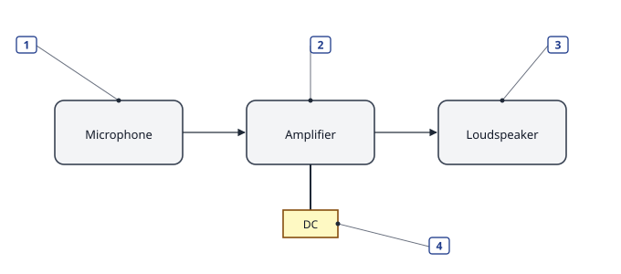

Back

Microphone — Sound → electrical signal

<!-- meta {"type":"flashcard","id":"SCF-11-11-017","grade":11,"chapter_id":"SC11-11","discipline":"PHY","difficulty":1,"image":"science_assets/physics/PHY-D08_unlabelled.svg"} -->
**SCF-11-11-017** · Basic

**Front:** Public address system (block diagram) — which part is marked by number 2 in the unlabelled diagram?

Back

Amplifier (transistor) — Increases the signal amplitude

<!-- meta {"type":"flashcard","id":"SCF-11-11-018","grade":11,"chapter_id":"SC11-11","discipline":"PHY","difficulty":1,"image":"science_assets/physics/PHY-D08_unlabelled.svg"} -->
**SCF-11-11-018** · Basic

**Front:** Public address system (block diagram) — which part is marked by number 3 in the unlabelled diagram?

Back

Loudspeaker — Electrical → sound

<!-- meta {"type":"flashcard","id":"SCF-11-11-019","grade":11,"chapter_id":"SC11-11","discipline":"PHY","difficulty":1,"image":"science_assets/physics/PHY-D08_unlabelled.svg"} -->
**SCF-11-11-019** · Basic

**Front:** Public address system (block diagram) — which part is marked by number 4 in the unlabelled diagram?

Back

Power supply — Energy for amplification

<!-- meta {"type":"flashcard","id":"SCF-11-11-020","grade":11,"chapter_id":"SC11-11","discipline":"PHY","difficulty":1,"image":"science_assets/physics/PHY-D09_unlabelled.svg"} -->
**SCF-11-11-020** · Basic

**Front:** npn transistor symbol — which part is marked by number 1 in the unlabelled diagram?

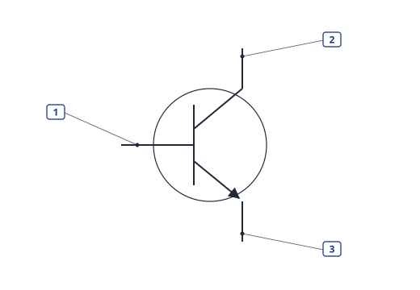

Back

Base (B) — Small control current

<!-- meta {"type":"flashcard","id":"SCF-11-11-021","grade":11,"chapter_id":"SC11-11","discipline":"PHY","difficulty":1,"image":"science_assets/physics/PHY-D09_unlabelled.svg"} -->
**SCF-11-11-021** · Basic

**Front:** npn transistor symbol — which part is marked by number 2 in the unlabelled diagram?

Back

Collector (C) — Large current enters

<!-- meta {"type":"flashcard","id":"SCF-11-11-022","grade":11,"chapter_id":"SC11-11","discipline":"PHY","difficulty":1,"image":"science_assets/physics/PHY-D09_unlabelled.svg"} -->
**SCF-11-11-022** · Basic

**Front:** npn transistor symbol — which part is marked by number 3 in the unlabelled diagram?

Back

Emitter (E) — Arrow: conventional current direction

## SC11-12: Electrochemistry

*Grade 11 · Chapter 12 · Chemistry · 23 cards*

<!-- meta {"type":"flashcard","id":"SCF-11-12-001","grade":11,"chapter_id":"SC11-12","discipline":"CHE","difficulty":1,"image":null} -->
**SCF-11-12-001** · Basic

**Front:** Cathode in electrolysis?

Back

Negative electrode — reduction

<!-- meta {"type":"flashcard","id":"SCF-11-12-002","grade":11,"chapter_id":"SC11-12","discipline":"CHE","difficulty":1,"image":null} -->
**SCF-11-12-002** · Basic

**Front:** Anode in electrolysis?

Back

Positive electrode — oxidation

<!-- meta {"type":"flashcard","id":"SCF-11-12-003","grade":11,"chapter_id":"SC11-12","discipline":"CHE","difficulty":1,"image":null} -->
**SCF-11-12-003** · Basic

**Front:** Oxidation?

Back

Loss of electrons

<!-- meta {"type":"flashcard","id":"SCF-11-12-004","grade":11,"chapter_id":"SC11-12","discipline":"CHE","difficulty":1,"image":null} -->
**SCF-11-12-004** · Basic

**Front:** Reduction?

Back

Gain of electrons

<!-- meta {"type":"flashcard","id":"SCF-11-12-005","grade":11,"chapter_id":"SC11-12","discipline":"CHE","difficulty":1,"image":null} -->
**SCF-11-12-005** · Basic

**Front:** Product at the cathode with molten NaCl?

Back

Na

<!-- meta {"type":"flashcard","id":"SCF-11-12-006","grade":11,"chapter_id":"SC11-12","discipline":"CHE","difficulty":1,"image":null} -->
**SCF-11-12-006** · Basic

**Front:** Product at the anode with molten NaCl?

Back

Cl₂

<!-- meta {"type":"flashcard","id":"SCF-11-12-007","grade":11,"chapter_id":"SC11-12","discipline":"CHE","difficulty":2,"image":null} -->
**SCF-11-12-007** · Intermediate

**Front:** Cell used to extract Na?

Back

Downs cell

<!-- meta {"type":"flashcard","id":"SCF-11-12-008","grade":11,"chapter_id":"SC11-12","discipline":"CHE","difficulty":2,"image":null} -->
**SCF-11-12-008** · Intermediate

**Front:** Gas at the cathode with aqueous NaCl?

Back

H₂

<!-- meta {"type":"flashcard","id":"SCF-11-12-009","grade":11,"chapter_id":"SC11-12","discipline":"CHE","difficulty":2,"image":null} -->
**SCF-11-12-009** · Intermediate

**Front:** In electroplating, the object is connected as?

Back

Cathode

<!-- meta {"type":"flashcard","id":"SCF-11-12-010","grade":11,"chapter_id":"SC11-12","discipline":"CHE","difficulty":1,"image":null} -->
**SCF-11-12-010** · Basic

**Front:** What is needed for rusting?

Back

O₂, water

<!-- meta {"type":"flashcard","id":"SCF-11-12-011","grade":11,"chapter_id":"SC11-12","discipline":"CHE","difficulty":2,"image":null} -->
**SCF-11-12-011** · Intermediate

**Front:** Galvanizing?

Back

A layer of Zn on iron

<!-- meta {"type":"flashcard","id":"SCF-11-12-012","grade":11,"chapter_id":"SC11-12","discipline":"CHE","difficulty":3,"image":null} -->
**SCF-11-12-012** · Hard

**Front:** Zn in a Zn–Cu cell?

Back

The electrode that is oxidised (negative)

<!-- meta {"type":"flashcard","id":"SCF-11-12-013","grade":11,"chapter_id":"SC11-12","discipline":"CHE","difficulty":2,"image":null} -->
**SCF-11-12-013** · Intermediate

**Front:** Cl⁻ at the anode?

Back

2Cl⁻ → Cl₂ + 2e⁻

<!-- meta {"type":"flashcard","id":"SCF-11-12-014","grade":11,"chapter_id":"SC11-12","discipline":"CHE","difficulty":2,"image":null} -->
**SCF-11-12-014** · Intermediate

**Front:** Metal used as a sacrificial anode?

Back

Mg / Zn

<!-- meta {"type":"flashcard","id":"SCF-11-12-015","grade":11,"chapter_id":"SC11-12","discipline":"CHE","difficulty":3,"image":null} -->
**SCF-11-12-015** · Hard

**Front:** Path of electrons in a cell?

Back

External circuit

<!-- meta {"type":"flashcard","id":"SCF-11-12-016","grade":11,"chapter_id":"SC11-12","discipline":"CHE","difficulty":1,"image":"science_assets/chemistry/CHE-D02_unlabelled.svg"} -->
**SCF-11-12-016** · Basic

**Front:** Electrolytic cell — which part is marked by number 1 in the unlabelled diagram?

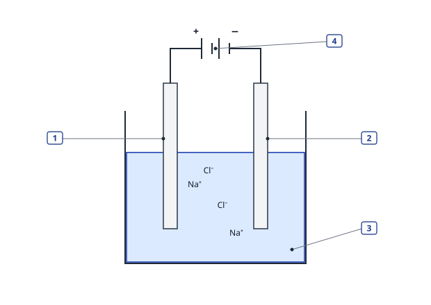

Back

Anode (+) — Oxidation — anions lose electrons

<!-- meta {"type":"flashcard","id":"SCF-11-12-017","grade":11,"chapter_id":"SC11-12","discipline":"CHE","difficulty":1,"image":"science_assets/chemistry/CHE-D02_unlabelled.svg"} -->
**SCF-11-12-017** · Basic

**Front:** Electrolytic cell — which part is marked by number 2 in the unlabelled diagram?

Back

Cathode (−) — Reduction — cations gain electrons

<!-- meta {"type":"flashcard","id":"SCF-11-12-018","grade":11,"chapter_id":"SC11-12","discipline":"CHE","difficulty":1,"image":"science_assets/chemistry/CHE-D02_unlabelled.svg"} -->
**SCF-11-12-018** · Basic

**Front:** Electrolytic cell — which part is marked by number 3 in the unlabelled diagram?

Back

Electrolyte — Ions move and conduct electricity

<!-- meta {"type":"flashcard","id":"SCF-11-12-019","grade":11,"chapter_id":"SC11-12","discipline":"CHE","difficulty":1,"image":"science_assets/chemistry/CHE-D02_unlabelled.svg"} -->
**SCF-11-12-019** · Basic

**Front:** Electrolytic cell — which part is marked by number 4 in the unlabelled diagram?

Back

Battery — DC power supply

<!-- meta {"type":"flashcard","id":"SCF-11-12-020","grade":11,"chapter_id":"SC11-12","discipline":"CHE","difficulty":1,"image":"science_assets/chemistry/CHE-D06_unlabelled.svg"} -->
**SCF-11-12-020** · Basic

**Front:** Simple cell (Zn–Cu) — which part is marked by number 1 in the unlabelled diagram?

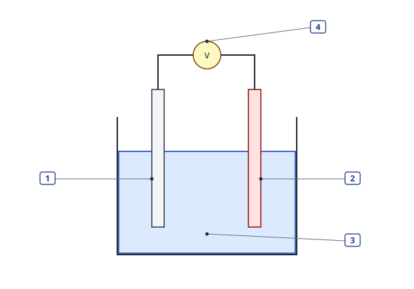

Back

Zinc plate (−) — Oxidation: Zn → Zn²⁺ + 2e⁻

<!-- meta {"type":"flashcard","id":"SCF-11-12-021","grade":11,"chapter_id":"SC11-12","discipline":"CHE","difficulty":1,"image":"science_assets/chemistry/CHE-D06_unlabelled.svg"} -->
**SCF-11-12-021** · Basic

**Front:** Simple cell (Zn–Cu) — which part is marked by number 2 in the unlabelled diagram?

Back

Copper plate (+) — Less reactive metal

<!-- meta {"type":"flashcard","id":"SCF-11-12-022","grade":11,"chapter_id":"SC11-12","discipline":"CHE","difficulty":1,"image":"science_assets/chemistry/CHE-D06_unlabelled.svg"} -->
**SCF-11-12-022** · Basic

**Front:** Simple cell (Zn–Cu) — which part is marked by number 3 in the unlabelled diagram?

Back

Dilute H₂SO₄ — Electrolyte

<!-- meta {"type":"flashcard","id":"SCF-11-12-023","grade":11,"chapter_id":"SC11-12","discipline":"CHE","difficulty":1,"image":"science_assets/chemistry/CHE-D06_unlabelled.svg"} -->
**SCF-11-12-023** · Basic

**Front:** Simple cell (Zn–Cu) — which part is marked by number 4 in the unlabelled diagram?

Back

Voltmeter — Potential difference

## SC11-13: Electromagnetism and electromagnetic induction

*Grade 11 · Chapter 13 · Physics · 25 cards*

<!-- meta {"type":"flashcard","id":"SCF-11-13-001","grade":11,"chapter_id":"SC11-13","discipline":"PHY","difficulty":1,"image":null} -->
**SCF-11-13-001** · Basic

**Front:** Direction of field lines?

Back

North pole → south pole

<!-- meta {"type":"flashcard","id":"SCF-11-13-002","grade":11,"chapter_id":"SC11-13","discipline":"PHY","difficulty":1,"image":null} -->
**SCF-11-13-002** · Basic

**Front:** Rule for the field direction around a straight conductor?

Back

Right-hand grip rule

<!-- meta {"type":"flashcard","id":"SCF-11-13-003","grade":11,"chapter_id":"SC11-13","discipline":"PHY","difficulty":2,"image":null} -->
**SCF-11-13-003** · Intermediate

**Front:** Rule for the force direction in a motor?

Back

Fleming's left-hand rule

<!-- meta {"type":"flashcard","id":"SCF-11-13-004","grade":11,"chapter_id":"SC11-13","discipline":"PHY","difficulty":1,"image":null} -->
**SCF-11-13-004** · Basic

**Front:** Energy change in a motor?

Back

Electrical → mechanical

<!-- meta {"type":"flashcard","id":"SCF-11-13-005","grade":11,"chapter_id":"SC11-13","discipline":"PHY","difficulty":1,"image":null} -->
**SCF-11-13-005** · Basic

**Front:** Energy change in a generator?

Back

Mechanical → electrical

<!-- meta {"type":"flashcard","id":"SCF-11-13-006","grade":11,"chapter_id":"SC11-13","discipline":"PHY","difficulty":1,"image":null} -->
**SCF-11-13-006** · Basic

**Front:** Transformer formula?

Back

Vs/Vp = Ns/Np

<!-- meta {"type":"flashcard","id":"SCF-11-13-007","grade":11,"chapter_id":"SC11-13","discipline":"PHY","difficulty":2,"image":null} -->
**SCF-11-13-007** · Intermediate

**Front:** Does a transformer work on DC?

Back

None

<!-- meta {"type":"flashcard","id":"SCF-11-13-008","grade":11,"chapter_id":"SC11-13","discipline":"PHY","difficulty":2,"image":null} -->
**SCF-11-13-008** · Intermediate

**Front:** Step-up transformer?

Back

Ns > Np

<!-- meta {"type":"flashcard","id":"SCF-11-13-009","grade":11,"chapter_id":"SC11-13","discipline":"PHY","difficulty":2,"image":null} -->
**SCF-11-13-009** · Intermediate

**Front:** Ways to increase the induced e.m.f.?

Back

Faster movement, more turns, stronger magnet

<!-- meta {"type":"flashcard","id":"SCF-11-13-010","grade":11,"chapter_id":"SC11-13","discipline":"PHY","difficulty":1,"image":null} -->
**SCF-11-13-010** · Basic

**Front:** Electromagnet core?

Back

Soft iron

<!-- meta {"type":"flashcard","id":"SCF-11-13-011","grade":11,"chapter_id":"SC11-13","discipline":"PHY","difficulty":3,"image":null} -->
**SCF-11-13-011** · Hard

**Front:** Ideal transformer?

Back

VpIp = VsIs

<!-- meta {"type":"flashcard","id":"SCF-11-13-012","grade":11,"chapter_id":"SC11-13","discipline":"PHY","difficulty":3,"image":null} -->
**SCF-11-13-012** · Hard

**Front:** Why is power transmitted at high voltage?

Back

Current decreases, so heat loss decreases

<!-- meta {"type":"flashcard","id":"SCF-11-13-013","grade":11,"chapter_id":"SC11-13","discipline":"PHY","difficulty":1,"image":null} -->
**SCF-11-13-013** · Basic

**Front:** Who discovered electromagnetic induction?

Back

Michael Faraday

<!-- meta {"type":"flashcard","id":"SCF-11-13-014","grade":11,"chapter_id":"SC11-13","discipline":"PHY","difficulty":2,"image":null} -->
**SCF-11-13-014** · Intermediate

**Front:** Principle of a loudspeaker?

Back

Force on a current-carrying conductor in a magnetic field

<!-- meta {"type":"flashcard","id":"SCF-11-13-015","grade":11,"chapter_id":"SC11-13","discipline":"PHY","difficulty":3,"image":null} -->
**SCF-11-13-015** · Hard

**Front:** Misconception: a step-up transformer increases energy?

Back

Wrong

<!-- meta {"type":"flashcard","id":"SCF-11-13-016","grade":11,"chapter_id":"SC11-13","discipline":"PHY","difficulty":1,"image":"science_assets/physics/PHY-D04_unlabelled.svg"} -->
**SCF-11-13-016** · Basic

**Front:** Magnetic field lines of a bar magnet — which part is marked by number 1 in the unlabelled diagram?

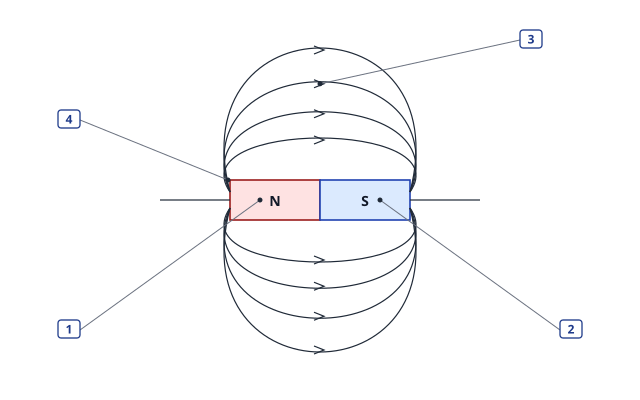

Back

North pole — Field lines leave

<!-- meta {"type":"flashcard","id":"SCF-11-13-017","grade":11,"chapter_id":"SC11-13","discipline":"PHY","difficulty":1,"image":"science_assets/physics/PHY-D04_unlabelled.svg"} -->
**SCF-11-13-017** · Basic

**Front:** Magnetic field lines of a bar magnet — which part is marked by number 2 in the unlabelled diagram?

Back

South pole — Field lines enter

<!-- meta {"type":"flashcard","id":"SCF-11-13-018","grade":11,"chapter_id":"SC11-13","discipline":"PHY","difficulty":1,"image":"science_assets/physics/PHY-D04_unlabelled.svg"} -->
**SCF-11-13-018** · Basic

**Front:** Magnetic field lines of a bar magnet — which part is marked by number 3 in the unlabelled diagram?

Back

Field line — From N to S

<!-- meta {"type":"flashcard","id":"SCF-11-13-019","grade":11,"chapter_id":"SC11-13","discipline":"PHY","difficulty":1,"image":"science_assets/physics/PHY-D04_unlabelled.svg"} -->
**SCF-11-13-019** · Basic

**Front:** Magnetic field lines of a bar magnet — which part is marked by number 4 in the unlabelled diagram?

Back

Strong field — Lines close together — at the poles

<!-- meta {"type":"flashcard","id":"SCF-11-13-020","grade":11,"chapter_id":"SC11-13","discipline":"PHY","difficulty":1,"image":"science_assets/physics/PHY-D07_unlabelled.svg"} -->
**SCF-11-13-020** · Basic

**Front:** Transformer — which part is marked by number 1 in the unlabelled diagram?

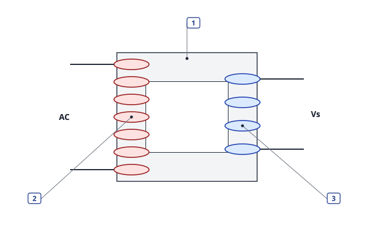

Back

Soft iron core — Links the magnetic flux

<!-- meta {"type":"flashcard","id":"SCF-11-13-021","grade":11,"chapter_id":"SC11-13","discipline":"PHY","difficulty":1,"image":"science_assets/physics/PHY-D07_unlabelled.svg"} -->
**SCF-11-13-021** · Basic

**Front:** Transformer — which part is marked by number 2 in the unlabelled diagram?

Back

Primary coil (Np) — AC — changing magnetic flux

<!-- meta {"type":"flashcard","id":"SCF-11-13-022","grade":11,"chapter_id":"SC11-13","discipline":"PHY","difficulty":1,"image":"science_assets/physics/PHY-D07_unlabelled.svg"} -->
**SCF-11-13-022** · Basic

**Front:** Transformer — which part is marked by number 3 in the unlabelled diagram?

Back

Secondary coil (Ns) — Induced e.m.f.

<!-- meta {"type":"flashcard","id":"SCF-11-13-023","grade":11,"chapter_id":"SC11-13","discipline":"PHY","difficulty":1,"image":"science_assets/physics/PHY-D12_unlabelled.svg"} -->
**SCF-11-13-023** · Basic

**Front:** Solenoid and electromagnet — which part is marked by number 1 in the unlabelled diagram?

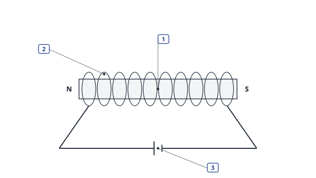

Back

Soft iron core — Strengthens the field

<!-- meta {"type":"flashcard","id":"SCF-11-13-024","grade":11,"chapter_id":"SC11-13","discipline":"PHY","difficulty":1,"image":"science_assets/physics/PHY-D12_unlabelled.svg"} -->
**SCF-11-13-024** · Basic

**Front:** Solenoid and electromagnet — which part is marked by number 2 in the unlabelled diagram?

Back

Coil of wire — More turns, stronger field

<!-- meta {"type":"flashcard","id":"SCF-11-13-025","grade":11,"chapter_id":"SC11-13","discipline":"PHY","difficulty":1,"image":"science_assets/physics/PHY-D12_unlabelled.svg"} -->
**SCF-11-13-025** · Basic

**Front:** Solenoid and electromagnet — which part is marked by number 3 in the unlabelled diagram?

Back

Cell — A magnet only while current flows

## SC11-14: Hydrocarbons and their derivatives

*Grade 11 · Chapter 14 · Chemistry · 15 cards*

<!-- meta {"type":"flashcard","id":"SCF-11-14-001","grade":11,"chapter_id":"SC11-14","discipline":"CHE","difficulty":1,"image":null} -->
**SCF-11-14-001** · Basic

**Front:** General formula of alkanes?

Back

CₙH₂ₙ₊₂

<!-- meta {"type":"flashcard","id":"SCF-11-14-002","grade":11,"chapter_id":"SC11-14","discipline":"CHE","difficulty":1,"image":null} -->
**SCF-11-14-002** · Basic

**Front:** General formula of alkenes?

Back

CₙH₂ₙ

<!-- meta {"type":"flashcard","id":"SCF-11-14-003","grade":11,"chapter_id":"SC11-14","discipline":"CHE","difficulty":2,"image":null} -->
**SCF-11-14-003** · Intermediate

**Front:** General formula of alkynes?

Back

CₙH₂ₙ₋₂

<!-- meta {"type":"flashcard","id":"SCF-11-14-004","grade":11,"chapter_id":"SC11-14","discipline":"CHE","difficulty":1,"image":null} -->
**SCF-11-14-004** · Basic

**Front:** Formula of methane?

Back

CH₄

<!-- meta {"type":"flashcard","id":"SCF-11-14-005","grade":11,"chapter_id":"SC11-14","discipline":"CHE","difficulty":1,"image":null} -->
**SCF-11-14-005** · Basic

**Front:** Formula of ethene?

Back

C₂H₄

<!-- meta {"type":"flashcard","id":"SCF-11-14-006","grade":11,"chapter_id":"SC11-14","discipline":"CHE","difficulty":2,"image":null} -->
**SCF-11-14-006** · Intermediate

**Front:** Test for unsaturation?

Back

Bromine water becomes colourless

<!-- meta {"type":"flashcard","id":"SCF-11-14-007","grade":11,"chapter_id":"SC11-14","discipline":"CHE","difficulty":1,"image":null} -->
**SCF-11-14-007** · Basic

**Front:** Monomer of polythene?

Back

Ethene

<!-- meta {"type":"flashcard","id":"SCF-11-14-008","grade":11,"chapter_id":"SC11-14","discipline":"CHE","difficulty":1,"image":null} -->
**SCF-11-14-008** · Basic

**Front:** Functional group of ethanol?

Back

–OH

<!-- meta {"type":"flashcard","id":"SCF-11-14-009","grade":11,"chapter_id":"SC11-14","discipline":"CHE","difficulty":2,"image":null} -->
**SCF-11-14-009** · Intermediate

**Front:** Functional group of acetic acid?

Back

–COOH

<!-- meta {"type":"flashcard","id":"SCF-11-14-010","grade":11,"chapter_id":"SC11-14","discipline":"CHE","difficulty":2,"image":null} -->
**SCF-11-14-010** · Intermediate

**Front:** Components of LP gas?

Back

Propane, butane

<!-- meta {"type":"flashcard","id":"SCF-11-14-011","grade":11,"chapter_id":"SC11-14","discipline":"CHE","difficulty":2,"image":null} -->
**SCF-11-14-011** · Intermediate

**Front:** Complete combustion of CH₄?

Back

CH₄ + 2O₂ → CO₂ + 2H₂O

<!-- meta {"type":"flashcard","id":"SCF-11-14-012","grade":11,"chapter_id":"SC11-14","discipline":"CHE","difficulty":1,"image":null} -->
**SCF-11-14-012** · Basic

**Front:** Toxic product of incomplete combustion?

Back

CO

<!-- meta {"type":"flashcard","id":"SCF-11-14-013","grade":11,"chapter_id":"SC11-14","discipline":"CHE","difficulty":2,"image":null} -->
**SCF-11-14-013** · Intermediate

**Front:** An example of a natural polymer?

Back

Rubber / cellulose / protein

<!-- meta {"type":"flashcard","id":"SCF-11-14-014","grade":11,"chapter_id":"SC11-14","discipline":"CHE","difficulty":2,"image":null} -->
**SCF-11-14-014** · Intermediate

**Front:** Difference between successive members of a homologous series?

Back

CH₂

<!-- meta {"type":"flashcard","id":"SCF-11-14-015","grade":11,"chapter_id":"SC11-14","discipline":"CHE","difficulty":2,"image":null} -->
**SCF-11-14-015** · Intermediate

**Front:** Formula of butane?

Back

C₄H₁₀

## SC11-15: Biosphere (Grade 11)

*Grade 11 · Chapter 15 · Biology · 15 cards*

<!-- meta {"type":"flashcard","id":"SCF-11-15-001","grade":11,"chapter_id":"SC11-15","discipline":"BIO","difficulty":1,"image":null} -->
**SCF-11-15-001** · Basic

**Front:** Gases that cause acid rain?

Back

SO₂, NO₂

<!-- meta {"type":"flashcard","id":"SCF-11-15-002","grade":11,"chapter_id":"SC11-15","discipline":"BIO","difficulty":1,"image":null} -->
**SCF-11-15-002** · Basic

**Front:** Substance that destroys ozone?

Back

CFC

<!-- meta {"type":"flashcard","id":"SCF-11-15-003","grade":11,"chapter_id":"SC11-15","discipline":"BIO","difficulty":1,"image":null} -->
**SCF-11-15-003** · Basic

**Front:** Function of the ozone layer?

Back

Absorbing UV rays

<!-- meta {"type":"flashcard","id":"SCF-11-15-004","grade":11,"chapter_id":"SC11-15","discipline":"BIO","difficulty":1,"image":null} -->
**SCF-11-15-004** · Basic

**Front:** Two greenhouse gases?

Back

CO₂, CH₄

<!-- meta {"type":"flashcard","id":"SCF-11-15-005","grade":11,"chapter_id":"SC11-15","discipline":"BIO","difficulty":2,"image":null} -->
**SCF-11-15-005** · Intermediate

**Front:** Cause of eutrophication?

Back

Run-off of fertiliser/sewage

<!-- meta {"type":"flashcard","id":"SCF-11-15-006","grade":11,"chapter_id":"SC11-15","discipline":"BIO","difficulty":1,"image":null} -->
**SCF-11-15-006** · Basic

**Front:** Main component of biogas?

Back

Methane (CH₄)

<!-- meta {"type":"flashcard","id":"SCF-11-15-007","grade":11,"chapter_id":"SC11-15","discipline":"BIO","difficulty":1,"image":null} -->
**SCF-11-15-007** · Basic

**Front:** 4R?

Back

Reduce, Reuse, Recycle, Refuse

<!-- meta {"type":"flashcard","id":"SCF-11-15-008","grade":11,"chapter_id":"SC11-15","discipline":"BIO","difficulty":2,"image":null} -->
**SCF-11-15-008** · Intermediate

**Front:** Benefit of reducing food mileage?

Back

Less CO₂ from transport

<!-- meta {"type":"flashcard","id":"SCF-11-15-009","grade":11,"chapter_id":"SC11-15","discipline":"BIO","difficulty":2,"image":null} -->
**SCF-11-15-009** · Intermediate

**Front:** An example of a pollutant that bioaccumulates?

Back

Mercury/lead/DDT

<!-- meta {"type":"flashcard","id":"SCF-11-15-010","grade":11,"chapter_id":"SC11-15","discipline":"BIO","difficulty":3,"image":null} -->
**SCF-11-15-010** · Hard

**Front:** What is needed for photochemical smog?

Back

NOₓ, hydrocarbons, sunlight

<!-- meta {"type":"flashcard","id":"SCF-11-15-011","grade":11,"chapter_id":"SC11-15","discipline":"BIO","difficulty":2,"image":null} -->
**SCF-11-15-011** · Intermediate

**Front:** Sustainable development?

Back

Development that does not harm future needs

<!-- meta {"type":"flashcard","id":"SCF-11-15-012","grade":11,"chapter_id":"SC11-15","discipline":"BIO","difficulty":3,"image":null} -->
**SCF-11-15-012** · Hard

**Front:** Secondary pollutant formed from SO₂?

Back

H₂SO₄ (sulfuric acid)

<!-- meta {"type":"flashcard","id":"SCF-11-15-013","grade":11,"chapter_id":"SC11-15","discipline":"BIO","difficulty":2,"image":null} -->
**SCF-11-15-013** · Intermediate

**Front:** Why is CO dangerous?

Back

It combines with haemoglobin and prevents O₂ transport

<!-- meta {"type":"flashcard","id":"SCF-11-15-014","grade":11,"chapter_id":"SC11-15","discipline":"BIO","difficulty":3,"image":null} -->
**SCF-11-15-014** · Hard

**Front:** Misconception: the ozone hole is global warming?

Back

Wrong — separate problems

<!-- meta {"type":"flashcard","id":"SCF-11-15-015","grade":11,"chapter_id":"SC11-15","discipline":"BIO","difficulty":1,"image":null} -->
**SCF-11-15-015** · Basic

**Front:** One effect of global warming?

Back

Sea level rise

---

## Limitations

- The numbers on diagram cards match the number boxes in the unlabelled SVGs.
- Target 15–30 per chapter; actual count 15–32.
