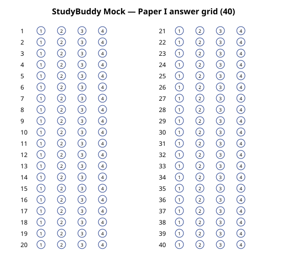

# StudyBuddy — Mock Exams

> **These are not official papers.** All questions are original questions written for StudyBuddy. The structure follows the exam format verified from the 2019 official marking scheme.

| Part | Structure | Marks |
|---|---|---|
| Paper I (1 hour) | 40 MCQ × 2 | 80 |
| Paper II A | 4 × 15 (compulsory) | 60 |
| Paper II B | 3 of 5 × 20 | 60 |
| Total | | 200 → final mark = total ÷ 2 (out of 100) |

Sample OMR answer sheet: 

---

# Mock Exam 1 (ORIGINAL MOCK 1)

<!-- meta {"type":"mock_exam","id":"MOCK-1","paper1_items":40,"paper1_marks":80,"partA_items":4,"partA_marks":60,"partB_items":5,"partB_answer":3,"partB_marks":60,"total":200,"scaled":100,"origin":"ORIGINAL"} -->

## Paper I — 1 hour

Answer all questions. 2 marks each.

<!-- meta {"type":"mock_mcq","id":"MOCK1-P1-Q01","chapter_id":"SC10-06","answer":2,"marks":2,"origin":"ORIGINAL"} -->
**1.** At ×100 the field of view has a diameter of 2 mm; 5 cells fill it across. Actual length of one cell (µm)? (the field diameter is given as the actual size) `[SC10-06]`

   (1) 800 µm
   (2) 400 µm
   (3) 200 µm
   (4) 4000 µm

<!-- meta {"type":"mock_mcq","id":"MOCK1-P1-Q02","chapter_id":"SC10-01","answer":2,"marks":2,"origin":"ORIGINAL"} -->
**2.** The peak of an enzyme activity–temperature graph shows? `[SC10-01]`

   (1) Denaturation temperature
   (2) Optimum temperature
   (3) Freezing point
   (4) Boiling point

<!-- meta {"type":"mock_mcq","id":"MOCK1-P1-Q03","chapter_id":"SC10-16","answer":2,"marks":2,"origin":"ORIGINAL"} -->
**3.** How are highly reactive metals extracted? `[SC10-16]`

   (1) Reduction with carbon
   (2) Electrolysis
   (3) Heating only
   (4) Washing in water

<!-- meta {"type":"mock_mcq","id":"MOCK1-P1-Q04","chapter_id":"SC11-11","answer":1,"marks":2,"origin":"ORIGINAL"} -->
**4.** Working principle of a microphone? `[SC11-11]`

   (1) Electromagnetic induction (moving-coil type)
   (2) Refraction
   (3) Doping
   (4) Thermal expansion

<!-- meta {"type":"mock_mcq","id":"MOCK1-P1-Q05","chapter_id":"SC11-04","answer":2,"marks":2,"origin":"ORIGINAL"} -->
**5.** If frequency is increased (speed unchanged), the wavelength? `[SC11-04]`

   (1) Increases
   (2) Decreases
   (3) Does not change
   (4) 0

<!-- meta {"type":"mock_mcq","id":"MOCK1-P1-Q06","chapter_id":"SC10-13","answer":3,"marks":2,"origin":"ORIGINAL"} -->
**6.** The producer has 50 000 kJ. By the 10% rule, energy reaching the secondary consumer? `[SC10-13]`

   (1) 1000 kJ
   (2) 250 kJ
   (3) 500 kJ
   (4) 5000 kJ

<!-- meta {"type":"mock_mcq","id":"MOCK1-P1-Q07","chapter_id":"SC10-20","answer":2,"marks":2,"origin":"ORIGINAL"} -->
**7.** A gene is? `[SC10-20]`

   (1) Protein
   (2) A piece of DNA
   (3) Cytoplasm
   (4) A lipid

<!-- meta {"type":"mock_mcq","id":"MOCK1-P1-Q08","chapter_id":"SC11-05","answer":3,"marks":2,"origin":"ORIGINAL"} -->
**8.** What does not change when light changes medium? `[SC11-05]`

   (1) Velocity
   (2) Wavelength
   (3) Frequency
   (4) Direction

<!-- meta {"type":"mock_mcq","id":"MOCK1-P1-Q09","chapter_id":"SC10-09","answer":4,"marks":2,"origin":"ORIGINAL"} -->
**9.** On a 4 kg object, 20 N acts to the right and 8 N to the left. Acceleration? `[SC10-09]`

   (1) 1.5 m s⁻²
   (2) 30 m s⁻²
   (3) 6 m s⁻²
   (4) 3 m s⁻²

<!-- meta {"type":"mock_mcq","id":"MOCK1-P1-Q10","chapter_id":"SC11-14","answer":2,"marks":2,"origin":"ORIGINAL"} -->
**10.** Best way to reduce plastic pollution? `[SC11-14]`

   (1) Burning
   (2) 4R — reduce, reuse, recycle
   (3) Dumping in the sea
   (4) Burying

<!-- meta {"type":"mock_mcq","id":"MOCK1-P1-Q11","chapter_id":"SC10-06","answer":4,"marks":2,"origin":"ORIGINAL"} -->
**11.** At ×400 the image of a cell is 8 mm long. Actual length (µm)? `[SC10-06]`

   (1) 40 µm
   (2) 10 µm
   (3) 200 µm
   (4) 20 µm

<!-- meta {"type":"mock_mcq","id":"MOCK1-P1-Q12","chapter_id":"SC10-15","answer":3,"marks":2,"origin":"ORIGINAL"} -->
**12.** A box of weight 800 N stands on an area of 0.04 m². Pressure? `[SC10-15]`

   (1) 10000 Pa
   (2) 40000 Pa
   (3) 20000 Pa
   (4) 2 × 10⁵ Pa

<!-- meta {"type":"mock_mcq","id":"MOCK1-P1-Q13","chapter_id":"SC10-18","answer":1,"marks":2,"origin":"ORIGINAL"} -->
**13.** Efficiency is always less than 100%. Why? `[SC10-18]`

   (1) Part of the energy is wasted as heat and sound
   (2) Energy is destroyed
   (3) Energy is created
   (4) Weight

<!-- meta {"type":"mock_mcq","id":"MOCK1-P1-Q14","chapter_id":"SC11-01","answer":1,"marks":2,"origin":"ORIGINAL"} -->
**14.** Living tissue that gives mechanical support to young plant stems? `[SC11-01]`

   (1) Collenchyma
   (2) Sclerenchyma
   (3) Xylem
   (4) Meristematic tissue

<!-- meta {"type":"mock_mcq","id":"MOCK1-P1-Q15","chapter_id":"SC10-18","answer":1,"marks":2,"origin":"ORIGINAL"} -->
**15.** A 40 N force moves a box 6 m in the direction of the force. Work done? `[SC10-18]`

   (1) 240 J
   (2) 120 J
   (3) 2400 J
   (4) 480 J

<!-- meta {"type":"mock_mcq","id":"MOCK1-P1-Q16","chapter_id":"SC10-06","answer":2,"marks":2,"origin":"ORIGINAL"} -->
**16.** What causes wilted spinach to become firm in water? `[SC10-06]`

   (1) Mitochondrion
   (2) Vacuole
   (3) Ribosome
   (4) Nucleus

<!-- meta {"type":"mock_mcq","id":"MOCK1-P1-Q17","chapter_id":"SC10-08","answer":2,"marks":2,"origin":"ORIGINAL"} -->
**17.** Where are organisms of domain Archaea mostly found? `[SC10-08]`

   (1) Mild environments
   (2) Extreme environments (high temperature, salt)
   (3) Only in the human body
   (4) In leaves

<!-- meta {"type":"mock_mcq","id":"MOCK1-P1-Q18","chapter_id":"SC11-08","answer":2,"marks":2,"origin":"ORIGINAL"} -->
**18.** In a neutralisation the temperature of 100 g of solution rose by 6.5 °C (c = 4200 J kg⁻¹ °C⁻¹). Heat released? `[SC11-08]`

   (1) 5460 J
   (2) 2730 J
   (3) 27300 J
   (4) 1365 J

<!-- meta {"type":"mock_mcq","id":"MOCK1-P1-Q19","chapter_id":"SC11-04","answer":4,"marks":2,"origin":"ORIGINAL"} -->
**19.** Sound travels at 340 m s⁻¹ in air. Wavelength of a 17 kHz sound (in cm)? `[SC11-04]`

   (1) 20 cm
   (2) 1 cm
   (3) 4 cm
   (4) 2 cm

<!-- meta {"type":"mock_mcq","id":"MOCK1-P1-Q20","chapter_id":"SC11-08","answer":3,"marks":2,"origin":"ORIGINAL"} -->
**20.** Combustion of CH₄ ΔH = −890 kJ mol⁻¹. Heat released when 2 mol burns? `[SC11-08]`

   (1) 17800 kJ
   (2) 890 kJ
   (3) 1780 kJ
   (4) 3560 kJ

<!-- meta {"type":"mock_mcq","id":"MOCK1-P1-Q21","chapter_id":"SC10-14","answer":1,"marks":2,"origin":"ORIGINAL"} -->
**21.** Structure that supplies food and O₂ to the foetus during development? `[SC10-14]`

   (1) Placenta
   (2) Ovary
   (3) Fallopian tube
   (4) Cervix

<!-- meta {"type":"mock_mcq","id":"MOCK1-P1-Q22","chapter_id":"SC10-09","answer":1,"marks":2,"origin":"ORIGINAL"} -->
**22.** 20 N north, 15 N south, 5 N south — resultant? `[SC10-09]`

   (1) 0
   (2) 40 N
   (3) 10 N north
   (4) 10 N south

<!-- meta {"type":"mock_mcq","id":"MOCK1-P1-Q23","chapter_id":"SC11-06","answer":2,"marks":2,"origin":"ORIGINAL"} -->
**23.** Disease caused by lack of insulin secretion? `[SC11-06]`

   (1) Goitre
   (2) Diabetes
   (3) Anaemia
   (4) Thalassaemia

<!-- meta {"type":"mock_mcq","id":"MOCK1-P1-Q24","chapter_id":"SC11-08","answer":2,"marks":2,"origin":"ORIGINAL"} -->
**24.** Reading of the thermometer used during neutralisation? `[SC11-08]`

   (1) Decreases
   (2) Increases
   (3) Does not change
   (4) Becomes 0

<!-- meta {"type":"mock_mcq","id":"MOCK1-P1-Q25","chapter_id":"SC10-03","answer":2,"marks":2,"origin":"ORIGINAL"} -->
**25.** Approximate relative mass of an electron? `[SC10-03]`

   (1) 1
   (2) 1/1840
   (3) 0
   (4) 2

<!-- meta {"type":"mock_mcq","id":"MOCK1-P1-Q26","chapter_id":"SC10-11","answer":2,"marks":2,"origin":"ORIGINAL"} -->
**26.** A 50 N force on a 2 m spanner at a 30° angle. If the perpendicular distance is 1 m, moment? `[SC10-11]`

   (1) 100 N m
   (2) 50 N m
   (3) 25 N m
   (4) 0

<!-- meta {"type":"mock_mcq","id":"MOCK1-P1-Q27","chapter_id":"SC10-19","answer":2,"marks":2,"origin":"ORIGINAL"} -->
**27.** 3 Ω and 6 Ω in parallel, with 4 Ω in series. Total? `[SC10-19]`

   (1) 13 Ω
   (2) 6 Ω
   (3) 2 Ω
   (4) 4.5 Ω

<!-- meta {"type":"mock_mcq","id":"MOCK1-P1-Q28","chapter_id":"SC11-10","answer":2,"marks":2,"origin":"ORIGINAL"} -->
**28.** If 120 units were used in a month — a unit is? `[SC11-10]`

   (1) 120 kW
   (2) 120 kWh
   (3) 120 J
   (4) 120 W

<!-- meta {"type":"mock_mcq","id":"MOCK1-P1-Q29","chapter_id":"SC10-04","answer":2,"marks":2,"origin":"ORIGINAL"} -->
**29.** A 2 kg object changes from 4 m s⁻¹ to 10 m s⁻¹ in 3 s. Force needed? `[SC10-04]`

   (1) 2 N
   (2) 4 N
   (3) 6 N
   (4) 12 N

<!-- meta {"type":"mock_mcq","id":"MOCK1-P1-Q30","chapter_id":"SC10-05","answer":1,"marks":2,"origin":"ORIGINAL"} -->
**30.** Purpose of sticking felt under chess pieces? `[SC10-05]`

   (1) To reduce friction/avoid scratches
   (2) To increase weight
   (3) Magnetism
   (4) Colour

<!-- meta {"type":"mock_mcq","id":"MOCK1-P1-Q31","chapter_id":"SC11-03","answer":2,"marks":2,"origin":"ORIGINAL"} -->
**31.** A simple way to increase the concentration of acetic acid in a vinegar solution? (2019 Paper II Q6C type) `[SC11-03]`

   (1) Filtration
   (2) Removing water by fractional distillation/evaporation
   (3) Chromatography
   (4) Separating funnel

<!-- meta {"type":"mock_mcq","id":"MOCK1-P1-Q32","chapter_id":"SC10-10","answer":1,"marks":2,"origin":"ORIGINAL"} -->
**32.** A substance with a high melting point that conducts when dissolved in water is probably? `[SC10-10]`

   (1) An ionic compound
   (2) A covalent gas
   (3) An inert gas
   (4) It is a metal

<!-- meta {"type":"mock_mcq","id":"MOCK1-P1-Q33","chapter_id":"SC11-13","answer":1,"marks":2,"origin":"ORIGINAL"} -->
**33.** Ideal transformer: Vp = 240 V, Ip = 0.5 A, Vs = 12 V. Is? `[SC11-13]`

   (1) 10 A
   (2) 100 A
   (3) 5 A
   (4) 20 A

<!-- meta {"type":"mock_mcq","id":"MOCK1-P1-Q34","chapter_id":"SC11-15","answer":1,"marks":2,"origin":"ORIGINAL"} -->
**34.** Which of the following is 'reuse' (Reuse)? `[SC11-15]`

   (1) Using a bottle again to fill water
   (2) Melting a bottle to make a new one
   (3) Not buying a bottle
   (4) Burning

<!-- meta {"type":"mock_mcq","id":"MOCK1-P1-Q35","chapter_id":"SC11-09","answer":1,"marks":2,"origin":"ORIGINAL"} -->
**35.** Water droplets on the outside of a cold drink bottle? `[SC11-09]`

   (1) Condensation
   (2) Evaporation
   (3) Boiling
   (4) Melting

<!-- meta {"type":"mock_mcq","id":"MOCK1-P1-Q36","chapter_id":"SC11-13","answer":1,"marks":2,"origin":"ORIGINAL"} -->
**36.** In an ideal transformer Vp = 240 V, Ip = 0.5 A, Vs = 12 V. Is? `[SC11-13]`

   (1) 10 A
   (2) 0.025 A
   (3) 5 A
   (4) 1 A

<!-- meta {"type":"mock_mcq","id":"MOCK1-P1-Q37","chapter_id":"SC10-15","answer":2,"marks":2,"origin":"ORIGINAL"} -->
**37.** Liquid pressure at the same depth? `[SC10-15]`

   (1) Downwards only
   (2) Equal in all directions
   (3) Upwards only
   (4) None sideways

<!-- meta {"type":"mock_mcq","id":"MOCK1-P1-Q38","chapter_id":"SC10-15","answer":2,"marks":2,"origin":"ORIGINAL"} -->
**38.** In a hydraulic jack the small piston is 5 cm² and the large one 200 cm². If 150 N is applied to the small one, the force on the large one? `[SC10-15]`

   (1) 12000 N
   (2) 6000 N
   (3) 60000 N
   (4) 3000 N

<!-- meta {"type":"mock_mcq","id":"MOCK1-P1-Q39","chapter_id":"SC10-02","answer":1,"marks":2,"origin":"ORIGINAL"} -->
**39.** A cyclist covers a distance of 120 m in 15 s. Find the average speed. `[SC10-02]`

   (1) 8 m s⁻¹
   (2) 80 m s⁻¹
   (3) 16 m s⁻¹
   (4) 4 m s⁻¹

<!-- meta {"type":"mock_mcq","id":"MOCK1-P1-Q40","chapter_id":"SC10-13","answer":1,"marks":2,"origin":"ORIGINAL"} -->
**40.** If a herbivore in a food web dies out, what may increase immediately? `[SC10-13]`

   (1) The plant it ate
   (2) The predator that ate it
   (3) Sunlight
   (4) Soil pH

## Paper II — 3 hours (+10 minutes reading)

### Part A — answer all questions (15 marks each)

<!-- meta {"type":"mock_structured","id":"MOCK1-P2A-Q1","chapter_ids":["SC10-06","SC11-01"],"marks":15,"origin":"ORIGINAL"} -->
**Question 1. Cells and tissues** `[SC10-06, SC11-01]`

- **A(i)** Name two organelles found only in a plant cell. *[2]*
- **A(ii)** What is the function of the mitochondrion? *[1]*
- **A(iii)** A ×10 eyepiece and a ×40 objective were used. Total magnification? *[1]*
- **A(iv)** At the above magnification the image of a cell is 12 mm. Find the actual length in µm. *[2]*
- **B(i)** Give one function each of xylem and phloem. *[2]*
- **B(ii)** Name the four main types of animal tissue. *[2]*
- **B(iii)** What type of tissue is blood? *[1]*
- **C(i)** Give one example of a cell with many nuclei. *[1]*
- **C(ii)** What is the advantage of having many chloroplasts in the palisade cells of a leaf? *[2]*
- **C(iii)** Give one statement of the cell theory. *[1]*

<!-- meta {"type":"mock_structured","id":"MOCK1-P2A-Q2","chapter_ids":["SC10-02","SC10-04"],"marks":15,"origin":"ORIGINAL"} -->
**Question 2. Motion in a straight line** `[SC10-02, SC10-04]`

- **A(i)** Of displacement and speed, which is a vector quantity? *[1]*
- **A(ii)** A car starting from rest reaches 24 m s⁻¹ in 8 s. Acceleration? *[2]*
- **A(iii)** It then travels at a uniform velocity for 10 s. Displacement during this time? *[2]*
- **A(iv)** It is then brought to rest uniformly in 6 s. Sketch the v–t graph for the whole motion and find the total displacement. *[4]*
- **B(i)** If the mass of the car is 1000 kg, the resultant force in the first 8 s? *[2]*
- **B(ii)** Which law explains passengers leaning forward when the car stops? *[1]*
- **B(iii)** How does a seat belt protect against this? *[1]*
- **B(iv)** Momentum of the car at the end of the first 8 s? *[2]*

<!-- meta {"type":"mock_structured","id":"MOCK1-P2A-Q3","chapter_ids":["SC10-03","SC10-10"],"marks":15,"origin":"ORIGINAL"} -->
**Question 3. Atomic structure and the periodic table** `[SC10-03, SC10-10]`

- **A(i)** Electronic configuration of magnesium (Z = 12)? *[1]*
- **A(ii)** Its group and period? *[2]*
- **A(iii)** Type of bond formed and formula of the compound when Mg and O combine? *[2]*
- **A(iv)** Show the transfer of electrons from Mg to O with a dot-and-cross diagram. *[3]*
- **B(i)** ³⁵Cl and ³⁷Cl are examples of what? *[1]*
- **B(ii)** The subatomic particle in which they differ? *[1]*
- **B(iii)** Type of bond in the Cl₂ molecule? *[1]*
- **B(iv)** Reason for the high melting point of NaCl? *[2]*
- **B(v)** Reason why solid NaCl does not conduct electricity? *[2]*

<!-- meta {"type":"mock_structured","id":"MOCK1-P2A-Q4","chapter_ids":["SC10-07","SC11-03"],"marks":15,"origin":"ORIGINAL"} -->
**Question 4. Mole calculations** `[SC10-07, SC11-03]`

- **A(i)** Relative molecular mass of CO₂? (C = 12, O = 16) *[1]*
- **A(ii)** Moles in 22 g of CO₂? *[2]*
- **A(iii)** Molecules in it? (Nₐ = 6.0 × 10²³) *[2]*
- **B(i)** Mass of NaOH needed to prepare 500 cm³ of 0.1 mol dm⁻³ NaOH? (NaOH = 40) *[3]*
- **B(ii)** Glassware used in the preparation? *[1]*
- **C(i)** CaCO₃ → CaO + CO₂. Mass of CaO formed if 50 g of CaCO₃ decomposes? (Ca = 40) *[4]*
- **C(ii)** Type of this reaction? *[1]*
- **C(iii)** Method of testing the gas released? *[1]*

### Part B — answer any three questions (20 marks each)

<!-- meta {"type":"mock_structured","id":"MOCK1-P2B-Q5","chapter_ids":["SC10-18","SC11-08"],"marks":20,"origin":"ORIGINAL"} -->
**Question 5. Energy and power + heat of reaction** `[SC10-18, SC11-08]`

- **A(i)** A 2 kg stone falls from a height of 5 m. Initial potential energy? (g = 10) *[2]*
- **A(ii)** Speed on reaching the ground (no air resistance)? *[3]*
- **A(iii)** State the law of conservation of energy. *[2]*
- **A(iv)** A 60 kg student climbs stairs 4 m high in 8 s. Power? *[3]*
- **B(i)** What is an exothermic reaction? Give an example. *[2]*
- **B(ii)** The temperature falls when NH₄NO₃ dissolves in water. Type of reaction? *[1]*
- **B(iii)** Draw the energy level diagram for an exothermic reaction. *[3]*
- **B(iv)** Combustion of CH₄ ΔH = −890 kJ mol⁻¹. Heat released when 8 g of methane burns? (CH₄ = 16) *[3]*
- **B(v)** Explain why ΔH is negative in terms of chemical bonds breaking and forming. *[1]*

<!-- meta {"type":"mock_structured","id":"MOCK1-P2B-Q6","chapter_ids":["SC11-06","SC10-15"],"marks":20,"origin":"ORIGINAL"} -->
**Question 6. Respiration and excretion + pressure** `[SC11-06, SC10-15]`

- **A(i)** What happens to the diaphragm and intercostal muscles during inhalation? *[3]*
- **A(ii)** Two adaptations of the alveoli for gas exchange? *[2]*
- **A(iii)** Equation for aerobic respiration? *[2]*
- **B(i)** Where does ultrafiltration take place in the nephron? *[1]*
- **B(ii)** Two components absent from normal urine? *[2]*
- **B(iii)** Function of ADH? *[2]*
- **C(i)** Explain the discomfort in the ear when an aeroplane takes off. *[3]*
- **C(ii)** Atmospheric pressure at sea level (Pa)? *[1]*
- **C(iii)** Total pressure at a water depth of 10 m? (ρ = 1000, g = 10) *[4]*

<!-- meta {"type":"mock_structured","id":"MOCK1-P2B-Q7","chapter_ids":["SC11-10","SC11-11"],"marks":20,"origin":"ORIGINAL"} -->
**Question 7. Electrical appliances + electronics** `[SC11-10, SC11-11]`

- **A(i)** Current of a 230 V, 1150 W electric iron? *[2]*
- **A(ii)** 30 minutes a day for 30 days. Units used? *[3]*
- **A(iii)** Cost if one unit is Rs. 40? *[1]*
- **A(iv)** Which of 3 A, 5 A and 13 A fuses is suitable? Reason? *[2]*
- **A(v)** Safety role of earthing? *[2]*
- **B(i)** Impurity element used to make an n-type semiconductor? *[1]*
- **B(ii)** Draw and explain the forward-bias connection of a diode. *[3]*
- **B(iii)** Three parts of a public address system and their energy changes? *[3]*
- **B(iv)** Three terminals of a transistor? *[2]*
- **B(v)** In one sentence, state how an automatic street lamp with an LDR as a switch works. *[1]*

<!-- meta {"type":"mock_structured","id":"MOCK1-P2B-Q8","chapter_ids":["SC10-14","SC11-03"],"marks":20,"origin":"ORIGINAL"} -->
**Question 8. Continuity of life + mixtures** `[SC10-14, SC11-03]`

- **A(i)** Three differences between mitosis and meiosis? *[3]*
- **A(ii)** Site of fertilisation in humans? *[1]*
- **A(iii)** Two examples of asexual reproduction in plants? *[2]*
- **A(iv)** Name the male and female parts of a flower. *[2]*
- **A(v)** Two features of insect-pollinated flowers? *[2]*
- **B(i)** Reason why cooled boiled water should not be put in a fish tank? *[2]*
- **B(ii)** Moles of solute in 250 cm³ of 0.2 mol dm⁻³ solution? *[2]*
- **B(iii)** Vinegar: density 1.02 g cm⁻³, 250 cm³ — mass? *[2]*
- **B(iv)** It contains 5% (by mass) acetic acid — mass of acid? *[2]*
- **B(v)** Its molar concentration? (CH₃COOH = 60) *[2]*

<!-- meta {"type":"mock_structured","id":"MOCK1-P2B-Q9","chapter_ids":["SC11-13","SC10-08"],"marks":20,"origin":"ORIGINAL"} -->
**Question 9. Electromagnetism + characteristics of living organisms** `[SC11-13, SC10-08]`

- **A(i)** Draw the field lines of a bar magnet. *[2]*
- **A(ii)** Two ways to increase the strength of an electromagnet? *[2]*
- **A(iii)** Principle of operation of a DC motor? *[2]*
- **A(iv)** Transformer: Np = 2000, Ns = 100, Vp = 230 V. Vs? *[2]*
- **A(v)** Efficiency 92%, primary power 50 W. Secondary power? *[2]*
- **B(i)** Five characteristics of living organisms? *[5]*
- **B(ii)** Write the scientific name of humans using binomial nomenclature and mark its two parts. *[3]*
- **B(iii)** Five classes of vertebrates? *[2]*

## Mock Exam 1 — Answer key and marking scheme

Paper I answers

| Q | Answer | Chapter | Q | Answer | Chapter |
|---|---|---|---|---|---|
| 1 | 2 | SC10-06 | 21 | 1 | SC10-14 |
| 2 | 2 | SC10-01 | 22 | 1 | SC10-09 |
| 3 | 2 | SC10-16 | 23 | 2 | SC11-06 |
| 4 | 1 | SC11-11 | 24 | 2 | SC11-08 |
| 5 | 2 | SC11-04 | 25 | 2 | SC10-03 |
| 6 | 3 | SC10-13 | 26 | 2 | SC10-11 |
| 7 | 2 | SC10-20 | 27 | 2 | SC10-19 |
| 8 | 3 | SC11-05 | 28 | 2 | SC11-10 |
| 9 | 4 | SC10-09 | 29 | 2 | SC10-04 |
| 10 | 2 | SC11-14 | 30 | 1 | SC10-05 |
| 11 | 4 | SC10-06 | 31 | 2 | SC11-03 |
| 12 | 3 | SC10-15 | 32 | 1 | SC10-10 |
| 13 | 1 | SC10-18 | 33 | 1 | SC11-13 |
| 14 | 1 | SC11-01 | 34 | 1 | SC11-15 |
| 15 | 1 | SC10-18 | 35 | 1 | SC11-09 |
| 16 | 2 | SC10-06 | 36 | 1 | SC11-13 |
| 17 | 2 | SC10-08 | 37 | 2 | SC10-15 |
| 18 | 2 | SC11-08 | 38 | 2 | SC10-15 |
| 19 | 4 | SC11-04 | 39 | 1 | SC10-02 |
| 20 | 3 | SC11-08 | 40 | 1 | SC10-13 |

Paper I — short explanations

1. (2) The correct answer is 400 µm. See the eight-step solution of CL-MICRO (Challenge) in File 5.
2. (2) The temperature of maximum activity is the optimum temperature.
3. (2) Na, Al and similar metals by electrolysis.
4. (1) The coil vibrates in a magnetic field and electricity is induced (SC11-13).
5. (2) λ = v/f.
6. (3) The correct answer is 500 kJ. See the eight-step solution of CL-ECO (Basic) in File 5.
7. (2) A DNA section that determines a characteristic.
8. (3) It is decided by the source.
9. (4) The correct answer is 3 m s⁻². See the eight-step solution of CL-RESULT (Exam level) in File 5.
10. (2) Burning gives toxic gases.
11. (4) The correct answer is 20 µm. See the eight-step solution of CL-MICRO (Intermediate) in File 5.
12. (3) The correct answer is 20000 Pa. See the eight-step solution of CL-PRESS (Basic) in File 5.
13. (1) Changed into useless forms.
14. (1) Collenchyma is living, thickened at the corners.
15. (1) The correct answer is 240 J. See the eight-step solution of CL-WORK (Basic) in File 5.
16. (2) The vacuole absorbs water and turgor pressure develops.
17. (2) Archaea mostly live in extreme environments.
18. (2) The correct answer is 2730 J. See the eight-step solution of CL-ENTH (Exam level) in File 5.
19. (4) The correct answer is 2 cm. See the eight-step solution of CL-WAVE (Intermediate) in File 5.
20. (3) The correct answer is 1780 kJ. See the eight-step solution of CL-ENTH (Basic) in File 5.
21. (1) The placenta allows mother–foetus exchange.
22. (1) 20 − 20 = 0.
23. (2) Blood glucose rises.
24. (2) Exothermic.
25. (2) ≈ 1/1840 of the mass of a proton.
26. (2) The perpendicular distance is used: 50 × 1.
27. (2) 2 + 4 = 6 Ω.
28. (2) Unit = kWh.
29. (2) a = 6/3 = 2; F = 2 × 2 = 4 N.
30. (1) Smooth movement.
31. (2) Difference in boiling point removes water.
32. (1) Properties of ionic compounds.
33. (1) The correct answer is 10 A. See the eight-step solution of CL-TRANS (Exam level) in File 5.
34. (1) Using it again in the same form.
35. (1) Water vapour in the air cools and condenses.
36. (1) 240 × 0.5 = 12 × Is.
37. (2) A property of liquid pressure.
38. (2) The correct answer is 6000 N. See the eight-step solution of CL-PRESS (Exam level) in File 5.
39. (1) The correct answer is 8 m s⁻¹. See the eight-step solution of CL-SPEED (Basic) in File 5.
40. (1) The plant multiplies because less of it is eaten.

Paper II marking scheme

**Question 1 (15 marks)**

- A(i) [2] Cell wall, chloroplast (a large permanent vacuole may also be accepted).
- A(ii) [1] Aerobic respiration — producing energy in the form of ATP.
- A(iii) [1] ×400.
- A(iv) [2] 12/400 = 0.03 mm = 30 µm.
- B(i) [2] Xylem — transports water and minerals (+ support); phloem — transports manufactured food.
- B(ii) [2] Epithelial, connective, muscle, nervous.
- B(iii) [1] Connective tissue (fluid connective tissue).
- C(i) [1] Skeletal muscle cell (fibre).
- C(ii) [2] They absorb more light near the surface and increase photosynthesis.
- C(iii) [1] All organisms are made of cells / the cell is the basic unit / cells arise from pre-existing cells.

**Question 2 (15 marks)**

- A(i) [1] Displacement.
- A(ii) [2] a = 24/8 = 3 m s⁻².
- A(iii) [2] 24 × 10 = 240 m.
- A(iv) [4] Graph: (0,0)→(8,24)→(18,24)→(24,0) [2]; area = ½·8·24 + 240 + ½·6·24 = 96 + 240 + 72 = 408 m [2].
- B(i) [2] F = ma = 1000 × 3 = 3000 N.
- B(ii) [1] Newton's first law (inertia).
- B(iii) [1] It applies a backward force on the body and prevents the forward motion.
- B(iv) [2] p = 1000 × 24 = 24 000 kg m s⁻¹.

**Question 3 (15 marks)**

- A(i) [1] 2, 8, 2.
- A(ii) [2] Group 2, period 3.
- A(iii) [2] Ionic bond; MgO.
- A(iv) [3] Mg loses 2 electrons to give Mg²⁺ (2,8); O gains 2 electrons to give O²⁻ (2,8) — diagram [3].
- B(i) [1] Isotopes.
- B(ii) [1] Number of neutrons.
- B(iii) [1] Non-polar covalent bond.
- B(iv) [2] Strong electrostatic attraction between oppositely charged ions — a lot of energy is needed.
- B(v) [2] The ions are fixed in the lattice; they cannot move.

**Question 4 (15 marks)**

- A(i) [1] 44.
- A(ii) [2] 22/44 = 0.5 mol.
- A(iii) [2] 0.5 × 6.0 × 10²³ = 3.0 × 10²³.
- B(i) [3] n = 0.1 × 0.5 = 0.05 mol [1]; m = 0.05 × 40 = 2.0 g [2].
- B(ii) [1] Volumetric flask.
- C(i) [4] n(CaCO₃) = 50/100 = 0.5 [2]; CaO = 0.5 × 56 = 28 g [2].
- C(ii) [1] Thermal decomposition.
- C(iii) [1] It turns lime water milky.

**Question 5 (20 marks)**

- A(i) [2] 100 J.
- A(ii) [3] ½·2·v² = 100 → v = 10 m s⁻¹.
- A(iii) [2] Energy cannot be created or destroyed; it can be changed from one form to another.
- A(iv) [3] W = 2400 J; P = 300 W.
- B(i) [2] A reaction that releases heat to the surroundings; combustion/neutralisation.
- B(ii) [1] Endothermic.
- B(iii) [3] Reactants above, products below, ΔH negative arrow (GR-D05).
- B(iv) [3] n = 0.5; 445 kJ.
- B(v) [1] Energy released by bonds formed > energy absorbed by bonds broken.

**Question 6 (20 marks)**

- A(i) [3] The diaphragm contracts and flattens; the external intercostal muscles contract, moving the ribs up and out — the thoracic volume increases and the pressure decreases.
- A(ii) [2] Thin wall, large surface area, moist, network of capillaries.
- A(iii) [2] C₆H₁₂O₆ + 6O₂ → 6CO₂ + 6H₂O + energy.
- B(i) [1] Glomerulus — Bowman's capsule.
- B(ii) [2] Glucose, protein (blood cells).
- B(iii) [2] It increases water reabsorption in the collecting duct.
- C(i) [3] As the outside air pressure falls, the pressure inside the middle ear becomes greater and the eardrum is pushed outwards.
- C(ii) [1] ≈ 1.0 × 10⁵ Pa.
- C(iii) [4] Liquid 1.0 × 10⁵ [2] + atmosphere 1.0 × 10⁵ [1] = 2.0 × 10⁵ Pa [1].

**Question 7 (20 marks)**

- A(i) [2] 5 A.
- A(ii) [3] 1.15 kW × 15 h = 17.25 kWh.
- A(iii) [1] Rs. 690.
- A(iv) [2] 13 A — the next value above 5 A (a 5 A fuse may melt at the normal current).
- A(v) [2] Leakage current goes to earth and the fuse melts — prevents shock.
- B(i) [1] Phosphorus / arsenic.
- B(ii) [3] p side to the + terminal, n side to the − terminal; current flows.
- B(iii) [3] Microphone (sound→electrical), amplifier, loudspeaker (electrical→sound).
- B(iv) [2] Emitter, base, collector.
- B(v) [1] In the dark the LDR resistance increases, the transistor turns ON and the lamp lights.

**Question 8 (20 marks)**

- A(i) [3] Daughter cells 2 vs 4; chromosome number unchanged vs halved; growth vs gamete formation.
- A(ii) [1] Fallopian tube (oviduct).
- A(iii) [2] Tuber (potato), runner, grafting, layering.
- A(iv) [2] Stamen (anther, filament); pistil (stigma, style, ovary).
- A(v) [2] Coloured petals, scent, nectar.
- B(i) [2] The dissolved O₂ has been driven out.
- B(ii) [2] 0.05 mol.
- B(iii) [2] 255 g.
- B(iv) [2] 12.75 g.
- B(v) [2] n = 0.2125 mol; C = 0.85 mol dm⁻³.

**Question 9 (20 marks)**

- A(i) [2] N→S, closed curves (PHY-D04).
- A(ii) [2] Increase the turns, increase the current, soft iron core.
- A(iii) [2] Force on a current-carrying conductor in a magnetic field (left-hand rule).
- A(iv) [2] 11.5 V.
- A(v) [2] 46 W.
- B(i) [5] Nutrition, respiration, excretion, movement, sensitivity, growth, reproduction (any 5).
- B(ii) [3] Homo sapiens — genus (Homo), species (sapiens).
- B(iii) [2] Fish, amphibians, reptiles, birds, mammals.

**Mark check:** Paper I = 40 × 2 = 80 · Part A = 15 + 15 + 15 + 15 = 60 · Part B (3 of them) = 3 × 20 = 60 · total 200 → 100.

*Chapter coverage: 30 / 35 chapters.*

---

# Mock Exam 2 (ORIGINAL MOCK 2)

<!-- meta {"type":"mock_exam","id":"MOCK-2","paper1_items":40,"paper1_marks":80,"partA_items":4,"partA_marks":60,"partB_items":5,"partB_answer":3,"partB_marks":60,"total":200,"scaled":100,"origin":"ORIGINAL"} -->

## Paper I — 1 hour

Answer all questions. 2 marks each.

<!-- meta {"type":"mock_mcq","id":"MOCK2-P1-Q01","chapter_id":"SC10-02","answer":2,"marks":2,"origin":"ORIGINAL"} -->
**1.** v–t graph of an object with uniform acceleration? `[SC10-02]`

   (1) A horizontal line
   (2) A sloping straight line
   (3) A curve
   (4) A vertical line

<!-- meta {"type":"mock_mcq","id":"MOCK2-P1-Q02","chapter_id":"SC10-06","answer":2,"marks":2,"origin":"ORIGINAL"} -->
**2.** Where is most of the cell's hereditary information? `[SC10-06]`

   (1) Cytoplasm
   (2) Nucleus
   (3) Cell wall
   (4) Vacuole

<!-- meta {"type":"mock_mcq","id":"MOCK2-P1-Q03","chapter_id":"SC11-07","answer":2,"marks":2,"origin":"ORIGINAL"} -->
**3.** Effect of adding lime to acidic soil? `[SC11-07]`

   (1) pH decreases
   (2) pH increases towards neutral
   (3) The soil becomes acidic
   (4) No change

<!-- meta {"type":"mock_mcq","id":"MOCK2-P1-Q04","chapter_id":"SC11-04","answer":1,"marks":2,"origin":"ORIGINAL"} -->
**4.** Radiation used by a TV remote control? `[SC11-04]`

   (1) Infrared
   (2) Ultraviolet
   (3) X
   (4) Gamma

<!-- meta {"type":"mock_mcq","id":"MOCK2-P1-Q05","chapter_id":"SC11-13","answer":4,"marks":2,"origin":"ORIGINAL"} -->
**5.** In a transformer Np = 1150, Ns = 60, Vp = 230 V. Vs? `[SC11-13]`

   (1) 6 V
   (2) 120 V
   (3) 24 V
   (4) 12 V

<!-- meta {"type":"mock_mcq","id":"MOCK2-P1-Q06","chapter_id":"SC11-02","answer":1,"marks":2,"origin":"ORIGINAL"} -->
**6.** Advantage of stomata being mostly on the lower surface of the leaf? `[SC11-02]`

   (1) Less water loss
   (2) More light
   (3) More CO₂ production
   (4) Faster growth

<!-- meta {"type":"mock_mcq","id":"MOCK2-P1-Q07","chapter_id":"SC10-01","answer":2,"marks":2,"origin":"ORIGINAL"} -->
**7.** Common to RNA and DNA? `[SC10-01]`

   (1) Double helix
   (2) Made of nucleotides
   (3) Found in the cell wall
   (4) Storing energy

<!-- meta {"type":"mock_mcq","id":"MOCK2-P1-Q08","chapter_id":"SC11-01","answer":2,"marks":2,"origin":"ORIGINAL"} -->
**8.** The long extension of a neuron? `[SC11-01]`

   (1) Dendrite
   (2) Axon
   (3) Nucleus
   (4) Cell body

<!-- meta {"type":"mock_mcq","id":"MOCK2-P1-Q09","chapter_id":"SC10-17","answer":4,"marks":2,"origin":"ORIGINAL"} -->
**9.** A reaction gives 48 cm³ of H₂ in 60 s. Average rate? `[SC10-17]`

   (1) 8 cm³ s⁻¹
   (2) 0.4 cm³ s⁻¹
   (3) 1.6 cm³ s⁻¹
   (4) 0.8 cm³ s⁻¹

<!-- meta {"type":"mock_mcq","id":"MOCK2-P1-Q10","chapter_id":"SC11-10","answer":4,"marks":2,"origin":"ORIGINAL"} -->
**10.** Power of a heater taking 5 A at 230 V? `[SC11-10]`

   (1) 2300 W
   (2) 11500 W
   (3) 575 W
   (4) 1150 W

<!-- meta {"type":"mock_mcq","id":"MOCK2-P1-Q11","chapter_id":"SC11-11","answer":1,"marks":2,"origin":"ORIGINAL"} -->
**11.** Advantage of an LED? `[SC11-11]`

   (1) Low power, long life
   (2) A lot of heat
   (3) Only with AC
   (4) Large size

<!-- meta {"type":"mock_mcq","id":"MOCK2-P1-Q12","chapter_id":"SC11-09","answer":4,"marks":2,"origin":"ORIGINAL"} -->
**12.** 250 K in °C? `[SC11-09]`

   (1) -230 °C
   (2) -11.5 °C
   (3) -46 °C
   (4) -23 °C

<!-- meta {"type":"mock_mcq","id":"MOCK2-P1-Q13","chapter_id":"SC11-05","answer":1,"marks":2,"origin":"ORIGINAL"} -->
**13.** Property of a real image? `[SC11-05]`

   (1) Can be obtained on a screen
   (2) Always upright
   (3) Always magnified
   (4) Cannot be obtained on a screen

<!-- meta {"type":"mock_mcq","id":"MOCK2-P1-Q14","chapter_id":"SC11-10","answer":1,"marks":2,"origin":"ORIGINAL"} -->
**14.** A 1500 W electric iron is used 2 hours a day for 30 days. If one unit costs Rs. 32, the cost? `[SC11-10]`

   (1) 2880 Rs.
   (2) 5760 Rs.
   (3) 28800 Rs.
   (4) 1440 Rs.

<!-- meta {"type":"mock_mcq","id":"MOCK2-P1-Q15","chapter_id":"SC10-10","answer":3,"marks":2,"origin":"ORIGINAL"} -->
**15.** Which of the following is a non-polar molecule? `[SC10-10]`

   (1) HCl
   (2) H₂O
   (3) Cl₂
   (4) NH₃

<!-- meta {"type":"mock_mcq","id":"MOCK2-P1-Q16","chapter_id":"SC11-06","answer":2,"marks":2,"origin":"ORIGINAL"} -->
**16.** Function of heart valves? `[SC11-06]`

   (1) Cleaning the blood
   (2) Preventing blood from flowing backwards
   (3) Adding O₂
   (4) Lowering pressure

<!-- meta {"type":"mock_mcq","id":"MOCK2-P1-Q17","chapter_id":"SC10-15","answer":1,"marks":2,"origin":"ORIGINAL"} -->
**17.** Purpose of placing a water tank high up? `[SC10-15]`

   (1) To get higher water pressure in the taps
   (2) To cool the water
   (3) To clean it
   (4) To reduce evaporation

<!-- meta {"type":"mock_mcq","id":"MOCK2-P1-Q18","chapter_id":"SC11-10","answer":1,"marks":2,"origin":"ORIGINAL"} -->
**18.** Use of an RCCB/ELCB? `[SC11-10]`

   (1) Disconnecting quickly on leakage current to prevent shock
   (2) Increasing voltage
   (3) Saving energy
   (4) Light

<!-- meta {"type":"mock_mcq","id":"MOCK2-P1-Q19","chapter_id":"SC11-15","answer":1,"marks":2,"origin":"ORIGINAL"} -->
**19.** Building material affected by acid rain? `[SC11-15]`

   (1) Limestone/marble (CaCO₃)
   (2) Glass
   (3) Plastic
   (4) Gold

<!-- meta {"type":"mock_mcq","id":"MOCK2-P1-Q20","chapter_id":"SC10-07","answer":2,"marks":2,"origin":"ORIGINAL"} -->
**20.** Mr of Ca(OH)₂? (Ca=40, O=16, H=1) `[SC10-07]`

   (1) 57
   (2) 74
   (3) 58
   (4) 112

<!-- meta {"type":"mock_mcq","id":"MOCK2-P1-Q21","chapter_id":"SC11-14","answer":3,"marks":2,"origin":"ORIGINAL"} -->
**21.** Which is not a property of members of a homologous series? `[SC11-14]`

   (1) The same general formula
   (2) Similar chemical properties
   (3) The same molecular mass
   (4) Differ by CH₂

<!-- meta {"type":"mock_mcq","id":"MOCK2-P1-Q22","chapter_id":"SC10-11","answer":1,"marks":2,"origin":"ORIGINAL"} -->
**22.** Turning a water tap handle is an example of? `[SC10-11]`

   (1) A couple
   (2) Equilibrium
   (3) Friction
   (4) Pressure

<!-- meta {"type":"mock_mcq","id":"MOCK2-P1-Q23","chapter_id":"SC10-04","answer":1,"marks":2,"origin":"ORIGINAL"} -->
**23.** Why do dishes not fall when a tablecloth is pulled quickly? `[SC10-04]`

   (1) Inertia
   (2) Gravity
   (3) Third law
   (4) Magnetism

<!-- meta {"type":"mock_mcq","id":"MOCK2-P1-Q24","chapter_id":"SC10-19","answer":1,"marks":2,"origin":"ORIGINAL"} -->
**24.** 3 Ω and 6 Ω in parallel with a 6 V cell. Total current from the cell? Check by two methods. `[SC10-19]`

   (1) 3 A
   (2) 6 A
   (3) 30 A
   (4) 1.5 A

<!-- meta {"type":"mock_mcq","id":"MOCK2-P1-Q25","chapter_id":"SC10-14","answer":3,"marks":2,"origin":"ORIGINAL"} -->
**25.** Which is not an advantage of tissue culture? `[SC10-14]`

   (1) Short time
   (2) Disease-free plants
   (3) High genetic variation
   (4) Mass production

<!-- meta {"type":"mock_mcq","id":"MOCK2-P1-Q26","chapter_id":"SC10-09","answer":1,"marks":2,"origin":"ORIGINAL"} -->
**26.** What happens in the direction of the resultant force? `[SC10-09]`

   (1) Acceleration
   (2) Friction
   (3) Weight
   (4) Equilibrium

<!-- meta {"type":"mock_mcq","id":"MOCK2-P1-Q27","chapter_id":"SC11-12","answer":1,"marks":2,"origin":"ORIGINAL"} -->
**27.** Approximate chemical name of rust? `[SC11-12]`

   (1) Fe₂O₃·xH₂O (hydrated iron(III) oxide)
   (2) FeCl₂
   (3) FeS
   (4) Fe₃C

<!-- meta {"type":"mock_mcq","id":"MOCK2-P1-Q28","chapter_id":"SC10-19","answer":4,"marks":2,"origin":"ORIGINAL"} -->
**28.** A 3 Ω resistor with a 9 V battery. Current? `[SC10-19]`

   (1) 30 A
   (2) 1.5 A
   (3) 6 A
   (4) 3 A

<!-- meta {"type":"mock_mcq","id":"MOCK2-P1-Q29","chapter_id":"SC10-20","answer":2,"marks":2,"origin":"ORIGINAL"} -->
**29.** A family has three daughters. Probability the fourth child is a boy? `[SC10-20]`

   (1) ¼
   (2) ½
   (3) ¾
   (4) 1

<!-- meta {"type":"mock_mcq","id":"MOCK2-P1-Q30","chapter_id":"SC10-12","answer":2,"marks":2,"origin":"ORIGINAL"} -->
**30.** If three forces in equilibrium are drawn to scale? `[SC10-12]`

   (1) An open line
   (2) A closed triangle
   (3) A circle
   (4) A straight line

<!-- meta {"type":"mock_mcq","id":"MOCK2-P1-Q31","chapter_id":"SC10-04","answer":1,"marks":2,"origin":"ORIGINAL"} -->
**31.** A 2 kg trolley moving at 3 m s⁻¹ joins a 1 kg trolley at rest and they move together. Common velocity? (conservation of momentum) `[SC10-04]`

   (1) 2 m s⁻¹
   (2) 1 m s⁻¹
   (3) 20 m s⁻¹
   (4) 4 m s⁻¹

<!-- meta {"type":"mock_mcq","id":"MOCK2-P1-Q32","chapter_id":"SC10-19","answer":2,"marks":2,"origin":"ORIGINAL"} -->
**32.** To prevent a radio being damaged if the battery is connected with the wrong polarity? `[SC10-19]`

   (1) A resistor
   (2) A diode in series
   (3) A bulb
   (4) A switch

<!-- meta {"type":"mock_mcq","id":"MOCK2-P1-Q33","chapter_id":"SC10-17","answer":2,"marks":2,"origin":"ORIGINAL"} -->
**33.** The point where the graph becomes horizontal shows? `[SC10-17]`

   (1) Start of the reaction
   (2) End of the reaction
   (3) Maximum rate
   (4) Addition of a catalyst

<!-- meta {"type":"mock_mcq","id":"MOCK2-P1-Q34","chapter_id":"SC10-11","answer":2,"marks":2,"origin":"ORIGINAL"} -->
**34.** A uniform metre rule of weight 1.0 N is pivoted at the 40 cm mark. 2.0 N hangs at the 10 cm mark. What weight must hang at the 90 cm mark? `[SC10-11]`

   (1) 0.5 N
   (2) 1 N
   (3) 2 N
   (4) 10 N

<!-- meta {"type":"mock_mcq","id":"MOCK2-P1-Q35","chapter_id":"SC10-05","answer":1,"marks":2,"origin":"ORIGINAL"} -->
**35.** Basis of how brakes work? `[SC10-05]`

   (1) Friction
   (2) Magnetism
   (3) Floating
   (4) Air pressure only

<!-- meta {"type":"mock_mcq","id":"MOCK2-P1-Q36","chapter_id":"SC10-19","answer":1,"marks":2,"origin":"ORIGINAL"} -->
**36.** 6 Ω and 12 Ω in parallel; 4 Ω in series with this combination. Total resistance? `[SC10-19]`

   (1) 8 Ω
   (2) 4 Ω
   (3) 16 Ω
   (4) 80 Ω

<!-- meta {"type":"mock_mcq","id":"MOCK2-P1-Q37","chapter_id":"SC11-09","answer":1,"marks":2,"origin":"ORIGINAL"} -->
**37.** Role of the silvered surfaces of a vacuum flask (thermos)? `[SC11-09]`

   (1) Reducing heat loss by radiation
   (2) Increasing conduction
   (3) Beauty
   (4) Increasing convection

<!-- meta {"type":"mock_mcq","id":"MOCK2-P1-Q38","chapter_id":"SC10-04","answer":3,"marks":2,"origin":"ORIGINAL"} -->
**38.** A 800 kg vehicle speeds up from 5 to 25 m s⁻¹ in 10 s. Average resultant force? `[SC10-04]`

   (1) 16000 N
   (2) 3200 N
   (3) 1600 N
   (4) 800 N

<!-- meta {"type":"mock_mcq","id":"MOCK2-P1-Q39","chapter_id":"SC10-16","answer":2,"marks":2,"origin":"ORIGINAL"} -->
**39.** What does Ca form when it reacts with cold water? `[SC10-16]`

   (1) CaO + H₂
   (2) Ca(OH)₂ + H₂
   (3) CaCO₃
   (4) CaH₂

<!-- meta {"type":"mock_mcq","id":"MOCK2-P1-Q40","chapter_id":"SC11-08","answer":3,"marks":2,"origin":"ORIGINAL"} -->
**40.** In the reaction above 0.05 mol of water was formed. Enthalpy change of neutralisation (kJ mol⁻¹)? `[SC11-08]`

   (1) -109.2 kJ mol⁻¹
   (2) -546 kJ mol⁻¹
   (3) -54.6 kJ mol⁻¹
   (4) -27.3 kJ mol⁻¹

## Paper II — 3 hours (+10 minutes reading)

### Part A — answer all questions (15 marks each)

<!-- meta {"type":"mock_structured","id":"MOCK2-P2A-Q1","chapter_ids":["SC11-02"],"marks":15,"origin":"ORIGINAL"} -->
**Question 1. Photosynthesis** `[SC11-02]`

- **A(i)** Write the balanced word or chemical equation for photosynthesis. *[2]*
- **A(ii)** Three external factors affecting photosynthesis? *[3]*
- **B(i)** Purpose of keeping the plant in the dark before the starch test? *[1]*
- **B(ii)** Purpose of putting the leaf in boiling water? *[1]*
- **B(iii)** Reason for heating alcohol only in a hot-water bath? *[1]*
- **B(iv)** Colour with iodine in the part that received light? *[1]*
- **C(i)** Explain why, in the Hydrilla experiment, the bubble rate decreases as the lamp distance increases. *[2]*
- **C(ii)** Two variables to be controlled in the above experiment? *[2]*
- **C(iii)** Method of testing the gas collected? *[2]*

<!-- meta {"type":"mock_structured","id":"MOCK2-P2A-Q2","chapter_ids":["SC10-19"],"marks":15,"origin":"ORIGINAL"} -->
**Question 2. Current electricity** `[SC10-19]`

- **A(i)** How are an ammeter and a voltmeter connected in a circuit? *[2]*
- **A(ii)** State Ohm's law. *[2]*
- **B(i)** 6 Ω and 3 Ω resistors are connected in parallel. Effective resistance? *[2]*
- **B(ii)** A 4 Ω resistor and a 12 V cell in series with this combination. Total current? *[2]*
- **B(iii)** Potential difference across the 4 Ω? *[1]*
- **B(iv)** Current through the 6 Ω? *[2]*
- **C(i)** What happens to the resistance if the length of the wire is doubled? *[1]*
- **C(ii)** Two advantages of connecting household circuits in parallel? *[2]*
- **C(iii)** What does the gradient of a V–I graph represent? *[1]*

<!-- meta {"type":"mock_structured","id":"MOCK2-P2A-Q3","chapter_ids":["SC11-07"],"marks":15,"origin":"ORIGINAL"} -->
**Question 3. Acids, bases and salts** `[SC11-07]`

- **A(i)** What are the properties of solutions of pH 2, 7 and 12 respectively? *[3]*
- **A(ii)** Ion formed when an acid dissolves in water? *[1]*
- **B(i)** A substance used to reduce stomach acidity? *[1]*
- **B(ii)** Balanced equation between HCl and Mg(OH)₂? *[2]*
- **B(iii)** Type of this reaction? *[1]*
- **C(i)** Balanced equation for zinc + dilute HCl? *[2]*
- **C(ii)** Method of testing the gas formed? *[1]*
- **C(iii)** Reason for collecting the gas by downward displacement of water? *[1]*
- **D(i)** Why is soap applied to reduce the pain of an ant bite? *[2]*
- **D(ii)** A gas that causes acid rain? *[1]*

<!-- meta {"type":"mock_structured","id":"MOCK2-P2A-Q4","chapter_ids":["SC11-09"],"marks":15,"origin":"ORIGINAL"} -->
**Question 4. Heat** `[SC11-09]`

- **A(i)** Difference between heat and temperature? *[2]*
- **A(ii)** 35 °C in kelvin? *[1]*
- **B(i)** Heat needed to heat 0.5 kg of water from 20 °C to 100 °C? (c = 4200) *[3]*
- **B(ii)** To turn 0.1 kg of that water into steam at 100 °C? (L = 2.26 × 10⁶ J kg⁻¹) *[2]*
- **B(iii)** Reason why the temperature does not change while boiling? *[2]*
- **C(i)** Two differences between evaporation and boiling? *[2]*
- **C(ii)** Reason why water stays cool in a clay pot? *[2]*
- **C(iii)** How is heat transferred from the Sun to the Earth? *[1]*

### Part B — answer any three questions (20 marks each)

<!-- meta {"type":"mock_structured","id":"MOCK2-P2B-Q5","chapter_ids":["SC10-01","SC10-16"],"marks":20,"origin":"ORIGINAL"} -->
**Question 5. Chemical basis of life + changes in matter** `[SC10-01, SC10-16]`

- **A(i)** Examples of the three types of carbohydrates? *[3]*
- **A(ii)** Polysaccharide in the plant cell wall? *[1]*
- **A(iii)** Two properties of enzymes? *[2]*
- **A(iv)** Disease caused by vitamin C deficiency? *[1]*
- **A(v)** Test for protein and the positive result? *[2]*
- **B(i)** Balance the following: (a) Fe + O₂ → Fe₂O₃ (b) C₃H₈ + O₂ → CO₂ + H₂O *[4]*
- **B(ii)** Role of limestone in the blast furnace? *[2]*
- **B(iii)** Equation for the reduction of iron oxide in the blast furnace? *[2]*
- **B(iv)** Three signs of a chemical change? *[3]*

<!-- meta {"type":"mock_structured","id":"MOCK2-P2B-Q6","chapter_ids":["SC10-09","SC10-05","SC11-01"],"marks":20,"origin":"ORIGINAL"} -->
**Question 6. Resultant force, friction + plant tissues** `[SC10-09, SC10-05, SC11-01]`

- **A(i)** A 5 kg box is pulled with 40 N; friction 15 N. Resultant force? *[2]*
- **A(ii)** Acceleration? *[2]*
- **A(iii)** Resultant of perpendicular forces of 8 N and 6 N? *[2]*
- **A(iv)** Explain from everyday experience that kinetic friction is less than limiting friction. *[2]*
- **A(v)** Two ways to reduce friction? *[2]*
- **B(i)** Name three simple tissues in plants. *[3]*
- **B(ii)** Function of meristematic tissue? *[2]*
- **B(iii)** Advantage of xylem vessels being dead cells? *[2]*
- **B(iv)** Advantage of having more stomata on the lower epidermis? *[3]*

<!-- meta {"type":"mock_structured","id":"MOCK2-P2B-Q7","chapter_ids":["SC11-12","SC11-11"],"marks":20,"origin":"ORIGINAL"} -->
**Question 7. Electrochemistry + public address system** `[SC11-12, SC11-11]`

- **A(i)** Reason why Na is not obtained at the cathode if NaCl solution is used instead of molten NaCl in the Downs cell? *[2]*
- **A(ii)** Anode half-equation? *[2]*
- **A(iii)** Reason for using iron as the cathode and graphite as the anode? *[2]*
- **A(iv)** Two uses of sodium? *[2]*
- **A(v)** One use of Cl₂? *[1]*
- **A(vi)** Directions in which the ions move towards the electrodes in molten NaCl? *[1]*
- **B(i)** Energy change in a microphone? *[1]*
- **B(ii)** What does the transistor do in an amplifier? *[3]*
- **B(iii)** Principle of operation of a loudspeaker? *[2]*
- **B(iv)** Effect if the loudspeaker is very close to the microphone? *[2]*
- **B(v)** Wave property to change to increase loudness? *[1]*
- **B(vi)** Does the frequency of the amplified sound change? *[1]*

<!-- meta {"type":"mock_structured","id":"MOCK2-P2B-Q8","chapter_ids":["SC11-02","SC11-09"],"marks":20,"origin":"ORIGINAL"} -->
**Question 8. Photosynthesis + heat** `[SC11-02, SC11-09]`

- **A(i)** Two parts of a chloroplast and the stages that take place in them? *[2]*
- **A(ii)** Three uses of glucose made in photosynthesis? *[3]*
- **A(iii)** Purpose of adding CO₂ in greenhouses? *[2]*
- **A(iv)** Reason why the white part of a variegated leaf has no starch? *[2]*
- **A(v)** Two reasons why photosynthesis is important? *[1]*
- **B(i)** A 50 W heater heats a 1 kg aluminium block for 10 minutes. The temperature rose by 33 °C. c? *[4]*
- **B(ii)** Reason why the value obtained is higher than the true value? *[2]*
- **B(iii)** One way to reduce it? *[1]*
- **B(iv)** Explain how a sea breeze forms in terms of specific heat capacity. *[3]*

<!-- meta {"type":"mock_structured","id":"MOCK2-P2B-Q9","chapter_ids":["SC11-14","SC10-18"],"marks":20,"origin":"ORIGINAL"} -->
**Question 9. Hydrocarbons + work, energy and power (biogas)** `[SC11-14, SC10-18]`

- **A(i)** Main component of biogas? *[1]*
- **A(ii)** Two raw materials used in biogas production? *[2]*
- **A(iii)** Process taking place in the biogas digester? *[2]*
- **A(iv)** Two environmental advantages of using biogas instead of firewood? *[2]*
- **A(v)** Is biogas a renewable energy source? Reason? *[2]*
- **A(vi)** Equation for the combustion of methane? *[1]*
- **B(i)** Energy change chain in a hydroelectric power station? *[3]*
- **B(ii)** 1000 kg of water falls from a height of 50 m. Loss of potential energy? *[2]*
- **B(iii)** If this happens every second and the efficiency is 80%, the electrical power? *[3]*
- **B(iv)** One disadvantage of solar cells? *[2]*

## Mock Exam 2 — Answer key and marking scheme

Paper I answers

| Q | Answer | Chapter | Q | Answer | Chapter |
|---|---|---|---|---|---|
| 1 | 2 | SC10-02 | 21 | 3 | SC11-14 |
| 2 | 2 | SC10-06 | 22 | 1 | SC10-11 |
| 3 | 2 | SC11-07 | 23 | 1 | SC10-04 |
| 4 | 1 | SC11-04 | 24 | 1 | SC10-19 |
| 5 | 4 | SC11-13 | 25 | 3 | SC10-14 |
| 6 | 1 | SC11-02 | 26 | 1 | SC10-09 |
| 7 | 2 | SC10-01 | 27 | 1 | SC11-12 |
| 8 | 2 | SC11-01 | 28 | 4 | SC10-19 |
| 9 | 4 | SC10-17 | 29 | 2 | SC10-20 |
| 10 | 4 | SC11-10 | 30 | 2 | SC10-12 |
| 11 | 1 | SC11-11 | 31 | 1 | SC10-04 |
| 12 | 4 | SC11-09 | 32 | 2 | SC10-19 |
| 13 | 1 | SC11-05 | 33 | 2 | SC10-17 |
| 14 | 1 | SC11-10 | 34 | 2 | SC10-11 |
| 15 | 3 | SC10-10 | 35 | 1 | SC10-05 |
| 16 | 2 | SC11-06 | 36 | 1 | SC10-19 |
| 17 | 1 | SC10-15 | 37 | 1 | SC11-09 |
| 18 | 1 | SC11-10 | 38 | 3 | SC10-04 |
| 19 | 1 | SC11-15 | 39 | 2 | SC10-16 |
| 20 | 2 | SC10-07 | 40 | 3 | SC11-08 |

Paper I — short explanations

1. (2) The gradient is constant.
2. (2) DNA is in the chromosomes in the nucleus.
3. (2) The base neutralises the acid.
4. (1) Infrared radiation.
5. (4) The correct answer is 12 V. See the eight-step solution of CL-TRANS (Basic) in File 5.
6. (1) Less direct sun heat → less transpiration.
7. (2) Both are polymers of nucleotides.
8. (2) The axon carries impulses away from the cell body.
9. (4) The correct answer is 0.8 cm³ s⁻¹. See the eight-step solution of CL-RATE (Basic) in File 5.
10. (4) The correct answer is 1150 W. See the eight-step solution of CL-EPOWER (Basic) in File 5.
11. (1) More efficient.
12. (4) The correct answer is -23 °C. See the eight-step solution of CL-TEMP (Intermediate) in File 5.
13. (1) The rays actually meet.
14. (1) The correct answer is 2880 Rs.. See the eight-step solution of CL-EPOWER (Intermediate) in File 5.
15. (3) Identical atoms — no electronegativity difference.
16. (2) They ensure one-way flow.
17. (1) Larger h gives larger P.
18. (1) Protection of life.
19. (1) CaCO₃ reacts with acid.
20. (2) 40 + 2(16 + 1) = 74.
21. (3) The mass increases step by step.
22. (1) Opposite forces of two fingers.
23. (1) An object at rest tends to stay at rest.
24. (1) The correct answer is 3 A. See the eight-step solution of CL-OHM (Challenge) in File 5.
25. (3) Tissue culture produces identical clones.
26. (1) F = ma — same direction.
27. (1) A hydrated oxide.
28. (4) The correct answer is 3 A. See the eight-step solution of CL-OHM (Basic) in File 5.
29. (2) Each birth is independent: ½.
30. (2) Resultant 0.
31. (1) The correct answer is 2 m s⁻¹. See the eight-step solution of CL-WMOM (Challenge) in File 5.
32. (2) A diode conducts in one direction only.
33. (2) No more gas forms.
34. (2) The correct answer is 1 N. See the eight-step solution of CL-MOMENT (Challenge) in File 5.
35. (1) Friction changes kinetic energy into heat.
36. (1) The correct answer is 8 Ω. See the eight-step solution of CL-OHM (Intermediate) in File 5.
37. (1) A shiny surface reflects radiation.
38. (3) The correct answer is 1600 N. See the eight-step solution of CL-FMA (Challenge) in File 5.
39. (2) Ca + 2H₂O → Ca(OH)₂ + H₂.
40. (3) The correct answer is -54.6 kJ mol⁻¹. See the eight-step solution of CL-ENTH (Challenge) in File 5.

Paper II marking scheme

**Question 1 (15 marks)**

- A(i) [2] 6CO₂ + 6H₂O → C₆H₁₂O₆ + 6O₂ (light, chlorophyll).
- A(ii) [3] Light intensity, CO₂ concentration, temperature.
- B(i) [1] To remove the starch in the leaves.
- B(ii) [1] To kill the cells and stop enzyme reactions; helps iodine to enter.
- B(iii) [1] Alcohol catches fire easily.
- B(iv) [1] Blue-black.
- C(i) [2] The light intensity decreases, so the rate of photosynthesis decreases.
- C(ii) [2] Water temperature, CO₂ (NaHCO₃) concentration / size of plant.
- C(iii) [2] A glowing splint inserted relights — O₂.

**Question 2 (15 marks)**

- A(i) [2] Ammeter in series; voltmeter in parallel.
- A(ii) [2] At constant temperature the current through a conductor is directly proportional to the potential difference across its ends.
- B(i) [2] 1/R = 1/6 + 1/3 = 1/2 → R = 2 Ω.
- B(ii) [2] R = 6 Ω; I = 12/6 = 2 A.
- B(iii) [1] 8 V.
- B(iv) [2] Voltage across the parallel part 4 V; I = 4/6 ≈ 0.67 A.
- C(i) [1] It doubles.
- C(ii) [2] Each appliance gets the full voltage; if one fails the others still work / separate switches.
- C(iii) [1] Resistance.

**Question 3 (15 marks)**

- A(i) [3] Strong acid, neutral, strong base.
- A(ii) [1] H⁺ (H₃O⁺).
- B(i) [1] Mg(OH)₂ / NaHCO₃ / Al(OH)₃.
- B(ii) [2] 2HCl + Mg(OH)₂ → MgCl₂ + 2H₂O.
- B(iii) [1] Neutralisation.
- C(i) [2] Zn + 2HCl → ZnCl₂ + H₂.
- C(ii) [1] A burning splint gives a 'pop' sound.
- C(iii) [1] It is only slightly soluble in water.
- D(i) [2] The base neutralises the ant's methanoic acid.
- D(ii) [1] SO₂ / NO₂.

**Question 4 (15 marks)**

- A(i) [2] Heat — energy that flows (J); temperature — the degree of hotness (°C/K).
- A(ii) [1] 308 K.
- B(i) [3] Q = 0.5 × 4200 × 80 = 168 000 J.
- B(ii) [2] Q = 0.1 × 2.26 × 10⁶ = 2.26 × 10⁵ J.
- B(iii) [2] The heat supplied is used to break the intermolecular attractions (latent heat).
- C(i) [2] Evaporation happens at the surface at any temperature; boiling happens throughout at the boiling point, with bubbles.
- C(ii) [2] Water seeping through the tiny pores evaporates and takes latent heat.
- C(iii) [1] Radiation.

**Question 5 (20 marks)**

- A(i) [3] Monosaccharide glucose; disaccharide sucrose; polysaccharide starch.
- A(ii) [1] Cellulose.
- A(iii) [2] Protein; specific; optimum temperature/pH; reusable.
- A(iv) [1] Scurvy.
- A(v) [2] Biuret — purple.
- B(i) [4] (a) 4Fe + 3O₂ → 2Fe₂O₃ [2]; (b) C₃H₈ + 5O₂ → 3CO₂ + 4H₂O [2].
- B(ii) [2] It decomposes to CaO, which forms slag (CaSiO₃) with the SiO₂ impurity.
- B(iii) [2] Fe₂O₃ + 3CO → 2Fe + 3CO₂.
- B(iv) [3] Colour change, gas given off, precipitate, temperature change, new substance.

**Question 6 (20 marks)**

- A(i) [2] 25 N.
- A(ii) [2] 5 m s⁻².
- A(iii) [2] 10 N.
- A(iv) [2] It is hard to start moving a heavy object; once it moves, it is easier to push.
- A(v) [2] Lubricants, ball bearings, polishing.
- B(i) [3] Parenchyma, collenchyma, sclerenchyma.
- B(ii) [2] Growth by cell division.
- B(iii) [2] With no cytoplasm, water flows without obstruction; lignin gives support.
- B(iv) [3] Away from direct sunlight, so less water is lost by transpiration.

**Question 7 (20 marks)**

- A(i) [2] H₂ forms from the water (Na reacts with water).
- A(ii) [2] 2Cl⁻ → Cl₂ + 2e⁻.
- A(iii) [2] Graphite does not react with Cl₂; iron does not react with Na.
- A(iv) [2] Street lamps, coolant in nuclear reactors, making Na compounds.
- A(v) [1] Water disinfection / PVC / bleach.
- A(vi) [1] Na⁺ to the cathode; Cl⁻ to the anode.
- B(i) [1] Sound → electrical.
- B(ii) [3] Small changes in base current give large changes in collector current — signal amplification.
- B(iii) [2] Force on a current-carrying conductor (coil) in a magnetic field — the cone vibrates.
- B(iv) [2] Feedback — a howling sound.
- B(v) [1] Amplitude.
- B(vi) [1] No.

**Question 8 (20 marks)**

- A(i) [2] Thylakoid — light reaction; stroma — dark reaction (carbon fixation).
- A(ii) [3] Respiration, starch storage, cellulose formation (transport as sucrose).
- A(iii) [2] To remove a limiting factor and increase the yield.
- A(iv) [2] There is no chlorophyll.
- A(v) [1] Food production; O₂ supply (CO₂ balance).
- B(i) [4] Q = 30 000 J [2]; c = 30 000/33 ≈ 909 J kg⁻¹ °C⁻¹ [2].
- B(ii) [2] Heat lost to the surroundings — the measured Δθ is smaller.
- B(iii) [1] Cover the block with insulation.
- B(iv) [3] In the day the land (lower c) heats up quickly and the air above it rises, so cooler air blows from the sea towards the land.

**Question 9 (20 marks)**

- A(i) [1] Methane.
- A(ii) [2] Cow dung, kitchen waste, plant waste.
- A(iii) [2] Anaerobic bacterial decomposition.
- A(iv) [2] Less deforestation; less smoke; waste management; fertiliser.
- A(v) [2] Yes — waste is continuously available.
- A(vi) [1] CH₄ + 2O₂ → CO₂ + 2H₂O.
- B(i) [3] Potential energy → kinetic energy → (turbine) mechanical energy → electrical energy.
- B(ii) [2] 5 × 10⁵ J.
- B(iii) [3] 4 × 10⁵ W = 400 kW.
- B(iv) [2] Low output at night/when cloudy; high initial cost.

**Mark check:** Paper I = 40 × 2 = 80 · Part A = 15 + 15 + 15 + 15 = 60 · Part B (3 of them) = 3 × 20 = 60 · total 200 → 100.

*Chapter coverage: 31 / 35 chapters.*

---

# Mock Exam 3 (ORIGINAL MOCK 3)

<!-- meta {"type":"mock_exam","id":"MOCK-3","paper1_items":40,"paper1_marks":80,"partA_items":4,"partA_marks":60,"partB_items":5,"partB_answer":3,"partB_marks":60,"total":200,"scaled":100,"origin":"ORIGINAL"} -->

## Paper I — 1 hour

Answer all questions. 2 marks each.

<!-- meta {"type":"mock_mcq","id":"MOCK3-P1-Q01","chapter_id":"SC10-11","answer":1,"marks":2,"origin":"ORIGINAL"} -->
**1.** A 25 N force acts perpendicularly at the end of a spanner, 0.4 m from the pivot. Moment? `[SC10-11]`

   (1) 10 N m
   (2) 20 N m
   (3) 100 N m
   (4) 5 N m

<!-- meta {"type":"mock_mcq","id":"MOCK3-P1-Q02","chapter_id":"SC10-01","answer":2,"marks":2,"origin":"ORIGINAL"} -->
**2.** Why is fibre (cellulose) important in the diet? `[SC10-01]`

   (1) It gives a lot of energy
   (2) It stimulates peristalsis and prevents constipation
   (3) It changes into protein
   (4) It forms blood

<!-- meta {"type":"mock_mcq","id":"MOCK3-P1-Q03","chapter_id":"SC10-06","answer":4,"marks":2,"origin":"ORIGINAL"} -->
**3.** A cell 30 mm long in a diagram is actually 0.075 mm. Magnification of the diagram? `[SC10-06]`

   (1) 800 times
   (2) 4000 times
   (3) 200 times
   (4) 400 times

<!-- meta {"type":"mock_mcq","id":"MOCK3-P1-Q04","chapter_id":"SC10-20","answer":1,"marks":2,"origin":"ORIGINAL"} -->
**4.** Offspring of tt × tt? `[SC10-20]`

   (1) All tt
   (2) 1:1
   (3) 3:1
   (4) All Tt

<!-- meta {"type":"mock_mcq","id":"MOCK3-P1-Q05","chapter_id":"SC10-08","answer":1,"marks":2,"origin":"ORIGINAL"} -->
**5.** The correct order in the classification hierarchy? `[SC10-08]`

   (1) Species → Genus → Family
   (2) Family → Species → Genus
   (3) Genus → Family → Species
   (4) Species → Family → Genus

<!-- meta {"type":"mock_mcq","id":"MOCK3-P1-Q06","chapter_id":"SC11-13","answer":1,"marks":2,"origin":"ORIGINAL"} -->
**6.** A transformer changes 11 kV into 230 V and has 4400 primary turns. Secondary turns? `[SC11-13]`

   (1) 92 turns
   (2) 920 turns
   (3) 184 turns
   (4) 46 turns

<!-- meta {"type":"mock_mcq","id":"MOCK3-P1-Q07","chapter_id":"SC10-20","answer":1,"marks":2,"origin":"ORIGINAL"} -->
**7.** Tall (Tt) × dwarf (tt) — 240 offspring. Dwarf plants? `[SC10-20]`

   (1) 120 plants
   (2) 1200 plants
   (3) 240 plants
   (4) 60 plants

<!-- meta {"type":"mock_mcq","id":"MOCK3-P1-Q08","chapter_id":"SC10-02","answer":4,"marks":2,"origin":"ORIGINAL"} -->
**8.** A bus travels 9 km in 15 minutes. Find the average speed in m s⁻¹. `[SC10-02]`

   (1) 100 m s⁻¹
   (2) 5 m s⁻¹
   (3) 20 m s⁻¹
   (4) 10 m s⁻¹

<!-- meta {"type":"mock_mcq","id":"MOCK3-P1-Q09","chapter_id":"SC10-17","answer":2,"marks":2,"origin":"ORIGINAL"} -->
**9.** In a fair test of the effect of temperature, what must be kept constant? `[SC10-17]`

   (1) Temperature
   (2) Acid concentration, mass of Mg, volume
   (3) Time
   (4) Nothing

<!-- meta {"type":"mock_mcq","id":"MOCK3-P1-Q10","chapter_id":"SC10-06","answer":4,"marks":2,"origin":"ORIGINAL"} -->
**10.** Eyepiece ×10, objective ×40. Total magnification? `[SC10-06]`

   (1) 800 times
   (2) 4000 times
   (3) 200 times
   (4) 400 times

<!-- meta {"type":"mock_mcq","id":"MOCK3-P1-Q11","chapter_id":"SC10-05","answer":2,"marks":2,"origin":"ORIGINAL"} -->
**11.** Direction of the friction force? `[SC10-05]`

   (1) In the direction of motion
   (2) Opposite to the relative motion
   (3) Upwards
   (4) Downwards

<!-- meta {"type":"mock_mcq","id":"MOCK3-P1-Q12","chapter_id":"SC10-11","answer":1,"marks":2,"origin":"ORIGINAL"} -->
**12.** If the centre of gravity of a metre rule is not at 50 cm, in the balance calculation? `[SC10-11]`

   (1) The moment of the rule's weight must also be included
   (2) It can be ignored
   (3) It must be doubled
   (4) It must be removed

<!-- meta {"type":"mock_mcq","id":"MOCK3-P1-Q13","chapter_id":"SC11-06","answer":2,"marks":2,"origin":"ORIGINAL"} -->
**13.** What does human double circulation mean? `[SC11-06]`

   (1) Two hearts
   (2) In one complete circuit, blood passes through the heart twice
   (3) Two kinds of blood
   (4) Two lungs

<!-- meta {"type":"mock_mcq","id":"MOCK3-P1-Q14","chapter_id":"SC11-07","answer":3,"marks":2,"origin":"ORIGINAL"} -->
**14.** Which is not a general property of acids? `[SC11-07]`

   (1) Sour taste
   (2) Turns blue litmus red
   (3) Slippery feel
   (4) H₂ with metals

<!-- meta {"type":"mock_mcq","id":"MOCK3-P1-Q15","chapter_id":"SC10-07","answer":4,"marks":2,"origin":"ORIGINAL"} -->
**15.** Mg + 2HCl → MgCl₂ + H₂. Mass of H₂ formed if 6 g of Mg reacts completely? (Mg = 24, H = 1) `[SC10-07]`

   (1) 0.25 g
   (2) 5 g
   (3) 1 g
   (4) 0.5 g

<!-- meta {"type":"mock_mcq","id":"MOCK3-P1-Q16","chapter_id":"SC11-10","answer":2,"marks":2,"origin":"ORIGINAL"} -->
**16.** An 8 W LED gives the same light as a 60 W filament bulb. If used 5 hours a day, the energy saved in a year (365 days)? `[SC11-10]`

   (1) 949 kWh
   (2) 94.9 kWh
   (3) 47.45 kWh
   (4) 189.8 kWh

<!-- meta {"type":"mock_mcq","id":"MOCK3-P1-Q17","chapter_id":"SC10-02","answer":2,"marks":2,"origin":"ORIGINAL"} -->
**17.** Distance travelled in 5 s by an object accelerating from rest at 2 m s⁻²? `[SC10-02]`

   (1) 10 m
   (2) 25 m
   (3) 50 m
   (4) 5 m

<!-- meta {"type":"mock_mcq","id":"MOCK3-P1-Q18","chapter_id":"SC10-15","answer":3,"marks":2,"origin":"ORIGINAL"} -->
**18.** Liquid pressure at a depth of 12 m in a water tank? (ρ = 1000 kg m⁻³) `[SC10-15]`

   (1) 1200000 Pa
   (2) 240000 Pa
   (3) 120000 Pa
   (4) 60000 Pa

<!-- meta {"type":"mock_mcq","id":"MOCK3-P1-Q19","chapter_id":"SC10-06","answer":1,"marks":2,"origin":"ORIGINAL"} -->
**19.** Why does a plant cell have a regular shape? `[SC10-06]`

   (1) Cell wall
   (2) Nucleus
   (3) Mitochondrion
   (4) Ribosome

<!-- meta {"type":"mock_mcq","id":"MOCK3-P1-Q20","chapter_id":"SC11-12","answer":1,"marks":2,"origin":"ORIGINAL"} -->
**20.** Why is sodium not extracted by reduction with carbon? `[SC11-12]`

   (1) Na is more reactive than carbon
   (2) Na is expensive
   (3) There is no carbon
   (4) Na is a liquid

<!-- meta {"type":"mock_mcq","id":"MOCK3-P1-Q21","chapter_id":"SC10-10","answer":2,"marks":2,"origin":"ORIGINAL"} -->
**21.** Formula of the compound Ca forms with N (Ca²⁺, N³⁻)? `[SC10-10]`

   (1) CaN
   (2) Ca₃N₂
   (3) Ca₂N₃
   (4) CaN₂

<!-- meta {"type":"mock_mcq","id":"MOCK3-P1-Q22","chapter_id":"SC10-18","answer":2,"marks":2,"origin":"ORIGINAL"} -->
**22.** A 60 kg student climbs stairs 3 m high in 6 s. Power? (g = 10) `[SC10-18]`

   (1) 30 W
   (2) 300 W
   (3) 1800 W
   (4) 180 W

<!-- meta {"type":"mock_mcq","id":"MOCK3-P1-Q23","chapter_id":"SC10-16","answer":2,"marks":2,"origin":"ORIGINAL"} -->
**23.** A metal displaces Fe from an Fe²⁺ salt solution but not from Zn²⁺. Its position? `[SC10-16]`

   (1) Above Zn
   (2) Between Zn and Fe
   (3) Below Fe
   (4) Below Cu

<!-- meta {"type":"mock_mcq","id":"MOCK3-P1-Q24","chapter_id":"SC11-13","answer":1,"marks":2,"origin":"ORIGINAL"} -->
**24.** To increase the output of a generator? `[SC11-13]`

   (1) Rotate the coil faster
   (2) Stop the coil
   (3) Remove the magnet
   (4) Fewer turns

<!-- meta {"type":"mock_mcq","id":"MOCK3-P1-Q25","chapter_id":"SC10-07","answer":2,"marks":2,"origin":"ORIGINAL"} -->
**25.** If a solution is diluted with water to double its volume, the concentration? `[SC10-07]`

   (1) Doubles
   (2) Halves
   (3) Does not change
   (4) Becomes four times

<!-- meta {"type":"mock_mcq","id":"MOCK3-P1-Q26","chapter_id":"SC11-04","answer":2,"marks":2,"origin":"ORIGINAL"} -->
**26.** Thunder is heard 4 s after the lightning is seen (ignore the light's time). Distance of the lightning? `[SC11-04]`

   (1) 680 m
   (2) 1360 m
   (3) 2720 m
   (4) 13600 m

<!-- meta {"type":"mock_mcq","id":"MOCK3-P1-Q27","chapter_id":"SC11-05","answer":4,"marks":2,"origin":"ORIGINAL"} -->
**27.** Speed of light in glass of refractive index 1.5? (3 × 10⁸ m s⁻¹ in air) `[SC11-05]`

   (1) 2 × 10⁹ m s⁻¹
   (2) 1 × 10⁸ m s⁻¹
   (3) 4 × 10⁸ m s⁻¹
   (4) 2 × 10⁸ m s⁻¹

<!-- meta {"type":"mock_mcq","id":"MOCK3-P1-Q28","chapter_id":"SC11-05","answer":1,"marks":2,"origin":"ORIGINAL"} -->
**28.** Lens used in a camera and the object position? `[SC11-05]`

   (1) Convex; beyond 2F
   (2) Concave; at F
   (3) Convex; within F
   (4) Concave; at 2F

<!-- meta {"type":"mock_mcq","id":"MOCK3-P1-Q29","chapter_id":"SC11-02","answer":3,"marks":2,"origin":"ORIGINAL"} -->
**29.** Not needed for photosynthesis? `[SC11-02]`

   (1) Light
   (2) CO₂
   (3) O₂
   (4) Chlorophyll

<!-- meta {"type":"mock_mcq","id":"MOCK3-P1-Q30","chapter_id":"SC11-01","answer":3,"marks":2,"origin":"ORIGINAL"} -->
**30.** The correct statement about transport in phloem? `[SC11-01]`

   (1) Upwards only
   (2) Downwards only
   (3) In both directions
   (4) Horizontally only

<!-- meta {"type":"mock_mcq","id":"MOCK3-P1-Q31","chapter_id":"SC11-10","answer":2,"marks":2,"origin":"ORIGINAL"} -->
**31.** 2 A, 3 minutes, 12 V. Energy converted? `[SC11-10]`

   (1) 72 J
   (2) 4320 J
   (3) 24 J
   (4) 432 J

<!-- meta {"type":"mock_mcq","id":"MOCK3-P1-Q32","chapter_id":"SC10-03","answer":4,"marks":2,"origin":"ORIGINAL"} -->
**32.** Which is not a property of a metal? `[SC10-03]`

   (1) Conducting electricity
   (2) Ductility
   (3) Lustre
   (4) Brittleness

<!-- meta {"type":"mock_mcq","id":"MOCK3-P1-Q33","chapter_id":"SC11-15","answer":3,"marks":2,"origin":"ORIGINAL"} -->
**33.** Which does not help reduce global warming? `[SC11-15]`

   (1) Planting trees
   (2) Public transport
   (3) Increasing fossil fuel use
   (4) Solar energy

<!-- meta {"type":"mock_mcq","id":"MOCK3-P1-Q34","chapter_id":"SC11-03","answer":2,"marks":2,"origin":"ORIGINAL"} -->
**34.** Which can be separated with a separating funnel? `[SC11-03]`

   (1) Salt + water
   (2) Kerosene + water
   (3) Ethanol + water
   (4) Sugar + water

<!-- meta {"type":"mock_mcq","id":"MOCK3-P1-Q35","chapter_id":"SC11-11","answer":2,"marks":2,"origin":"ORIGINAL"} -->
**35.** Resistance of a semiconductor as its temperature increases? `[SC11-11]`

   (1) Increases
   (2) Decreases
   (3) Does not change
   (4) Infinite

<!-- meta {"type":"mock_mcq","id":"MOCK3-P1-Q36","chapter_id":"SC10-15","answer":1,"marks":2,"origin":"ORIGINAL"} -->
**36.** The pressure at a depth of 2 m in a liquid is 16 000 Pa (g = 10). Density? `[SC10-15]`

   (1) 800 kg m⁻³
   (2) 1000 kg m⁻³
   (3) 320 kg m⁻³
   (4) 8000 kg m⁻³

<!-- meta {"type":"mock_mcq","id":"MOCK3-P1-Q37","chapter_id":"SC10-13","answer":2,"marks":2,"origin":"ORIGINAL"} -->
**37.** 2400 kJ in the primary consumer, 300 kJ in the secondary. Energy transfer %? `[SC10-13]`

   (1) 25 %
   (2) 12.5 %
   (3) 6.25 %
   (4) 125 %

<!-- meta {"type":"mock_mcq","id":"MOCK3-P1-Q38","chapter_id":"SC10-13","answer":1,"marks":2,"origin":"ORIGINAL"} -->
**38.** Why does crop rotation with legumes improve soil fertility? `[SC10-13]`

   (1) Because nitrogen is fixed in root nodules
   (2) Because water is stored
   (3) Because pH decreases
   (4) Because light increases

<!-- meta {"type":"mock_mcq","id":"MOCK3-P1-Q39","chapter_id":"SC11-08","answer":1,"marks":2,"origin":"ORIGINAL"} -->
**39.** Why is combustion exothermic even though a match is needed? `[SC11-08]`

   (1) More energy is released than the starting energy
   (2) The match absorbs heat
   (3) CO₂ is cold
   (4) O₂ is hot

<!-- meta {"type":"mock_mcq","id":"MOCK3-P1-Q40","chapter_id":"SC10-12","answer":1,"marks":2,"origin":"ORIGINAL"} -->
**40.** For an object not to topple, the vertical line through the centre of gravity must? `[SC10-12]`

   (1) Fall within the base
   (2) Fall outside the base
   (3) Upwards
   (4) Anywhere

## Paper II — 3 hours (+10 minutes reading)

### Part A — answer all questions (15 marks each)

<!-- meta {"type":"mock_structured","id":"MOCK3-P2A-Q1","chapter_ids":["SC10-13","SC11-15"],"marks":15,"origin":"ORIGINAL"} -->
**Question 1. Biosphere** `[SC10-13, SC11-15]`

- **A(i)** Write a food chain in a pond ecosystem (four organisms). *[2]*
- **A(ii)** The primary consumer in it? *[1]*
- **A(iii)** If the producer has 20 000 kJ, energy reaching the tertiary consumer (10% rule)? *[2]*
- **B(i)** Process in the carbon cycle that removes CO₂ from the atmosphere? *[1]*
- **B(ii)** Two processes that add CO₂ to the atmosphere? *[2]*
- **C(i)** Explain the greenhouse effect. *[2]*
- **C(ii)** Group of chemicals that destroy the ozone layer? *[1]*
- **C(iii)** One effect of ozone layer depletion? *[1]*
- **D(i)** How does reducing 'food mileage' help the environment? *[2]*
- **D(ii)** One measure to protect biodiversity? *[1]*

<!-- meta {"type":"mock_structured","id":"MOCK3-P2A-Q2","chapter_ids":["SC11-04"],"marks":15,"origin":"ORIGINAL"} -->
**Question 2. Waves** `[SC11-04]`

- **A(i)** Give one example each of a transverse wave and a longitudinal wave. *[2]*
- **A(ii)** Mark the wavelength and amplitude on a wave diagram. *[2]*
- **B(i)** A sound has a frequency of 500 Hz and a speed of 340 m s⁻¹ in air. Wavelength? *[2]*
- **B(ii)** Wavelength if the frequency is doubled? *[1]*
- **B(iii)** What determines the pitch of a sound? *[1]*
- **C(i)** A SONAR pulse returns in 0.8 s. Sound travels at 1500 m s⁻¹ in water. Depth? *[3]*
- **C(ii)** Type of sound used by bats? *[1]*
- **D(i)** The one with the shortest wavelength in the electromagnetic spectrum? *[1]*
- **D(ii)** Reason why sound cannot travel through a vacuum? *[2]*

<!-- meta {"type":"mock_structured","id":"MOCK3-P2A-Q3","chapter_ids":["SC10-16","SC10-17"],"marks":15,"origin":"ORIGINAL"} -->
**Question 3. Chemical reactions and rate of reaction** `[SC10-16, SC10-17]`

- **A(i)** Type of reaction Fe + CuSO₄ → FeSO₄ + Cu? *[1]*
- **A(ii)** Two observations in this reaction? *[2]*
- **A(iii)** Arrange Cu, Fe, Mg, Zn in decreasing order of reactivity. *[2]*
- **B(i)** Three ways to increase the rate of the CaCO₃ + HCl reaction? *[3]*
- **B(ii)** Explain the effect of temperature using collision theory. *[2]*
- **C(i)** Reason why the gradient of a gas volume–time graph gradually decreases? *[2]*
- **C(ii)** 30 cm³ of gas formed in 60 s. Average rate? *[2]*
- **C(iii)** Definition of a catalyst? *[1]*

<!-- meta {"type":"mock_structured","id":"MOCK3-P2A-Q4","chapter_ids":["SC10-15"],"marks":15,"origin":"ORIGINAL"} -->
**Question 4. Pressure** `[SC10-15]`

- **A(i)** Definition and SI unit of pressure? *[2]*
- **A(ii)** Pressure when a 60 kg student (g = 10) stands on one foot (area 0.015 m²)? *[2]*
- **A(iii)** Pressure when standing on both feet? *[1]*
- **B(i)** Water pressure at a depth of 8 m? (ρ = 1000, g = 10) *[2]*
- **B(ii)** Three factors on which liquid pressure depends? *[3]*
- **C(i)** In a hydraulic jack A₁ = 2 cm², A₂ = 100 cm², F₁ = 50 N. F₂? *[3]*
- **C(ii)** Basic principle of the above calculation? *[1]*
- **C(iii)** One property of the liquid used in hydraulic brakes? *[1]*

### Part B — answer any three questions (20 marks each)

<!-- meta {"type":"mock_structured","id":"MOCK3-P2B-Q5","chapter_ids":["SC10-20","SC11-04"],"marks":20,"origin":"ORIGINAL"} -->
**Question 5. Inheritance + waves** `[SC10-20, SC11-04]`

- **A(i)** Relationship between DNA, gene and chromosome? *[3]*
- **A(ii)** Number of chromosomes in a human cell? In a gamete? *[2]*
- **A(iii)** Parents who are thalassaemia carriers (Tt × Tt) — probability of a child with the disease? *[2]*
- **A(iv)** What is a mutation? *[2]*
- **A(v)** One advantage and one concern of genetically modified crops? *[1]*
- **B(i)** Range of human hearing? *[1]*
- **B(ii)** A wave makes 10 complete vibrations in 0.5 s. Frequency? *[2]*
- **B(iii)** If its wavelength is 17 m, the speed? *[2]*
- **B(iv)** Thunder was heard 2.5 s after the lightning was seen. Distance? *[2]*
- **B(v)** One use and one danger of X-rays? *[3]*

<!-- meta {"type":"mock_structured","id":"MOCK3-P2B-Q6","chapter_ids":["SC10-07","SC10-17"],"marks":20,"origin":"ORIGINAL"} -->
**Question 6. Quantification of elements and compounds + rate of reaction** `[SC10-07, SC10-17]`

- **A(i)** Definition of one mole? *[2]*
- **A(ii)** Molar mass of H₂SO₄? (H = 1, S = 32, O = 16) *[2]*
- **A(iii)** Moles in 4.9 g of H₂SO₄? *[2]*
- **A(iv)** Mg + 2HCl → MgCl₂ + H₂. Moles of HCl needed to react with 2.4 g of Mg? *[3]*
- **A(v)** Mass of H₂ formed? *[1]*
- **B(i)** Two methods of measuring the rate of the Mg + HCl reaction? *[2]*
- **B(ii)** Role of MnO₂ in the decomposition of H₂O₂? *[2]*
- **B(iii)** What would you expect to happen to the initial rate if the concentration is doubled? Reason? *[3]*
- **B(iv)** Explain why keeping food in a refrigerator delays spoilage. *[3]*

<!-- meta {"type":"mock_structured","id":"MOCK3-P2B-Q7","chapter_ids":["SC11-06","SC11-05"],"marks":20,"origin":"ORIGINAL"} -->
**Question 7. Heart + optics** `[SC11-06, SC11-05]`

- **A(i)** Write in order the path of blood through the heart from the right atrium to the aorta. *[4]*
- **A(ii)** Function of the heart valves? *[1]*
- **A(iii)** In a blood pressure of 120/80 mmHg, what does 120 represent? *[2]*
- **A(iv)** Two lifestyle habits to avoid heart disease? *[2]*
- **A(v)** One function of lymph? *[1]*
- **B(i)** Convex lens f = 15 cm; object at 45 cm. Image distance? *[3]*
- **B(ii)** Magnification? *[2]*
- **B(iii)** An instrument that uses this arrangement? *[1]*
- **B(iv)** Reason why white light splits into a spectrum in a prism? *[2]*
- **B(v)** Reason why a swimming pool looks shallower than it is? *[2]*

<!-- meta {"type":"mock_structured","id":"MOCK3-P2B-Q8","chapter_ids":["SC10-13","SC11-09"],"marks":20,"origin":"ORIGINAL"} -->
**Question 8. Biosphere (pond ecosystem) + heat** `[SC10-13, SC11-09]`

- **A(i)** Two non-living factors in a pond ecosystem? *[2]*
- **A(ii)** Role of decomposers? *[2]*
- **A(iii)** In the BIO-D09 food web, what happens to the number of tadpoles if the small fish are removed? Reason? *[3]*
- **A(iv)** Role of root-nodule bacteria in the nitrogen cycle? *[2]*
- **A(v)** What is eutrophication? *[1]*
- **B(i)** Heat needed to turn 0.1 kg of ice at 0 °C into water at 30 °C? (L = 3.36 × 10⁵, c = 4200) *[4]*
- **B(ii)** Reason why the temperature does not change while ice melts? *[2]*
- **B(iii)** Reason why fish survive in winter even when the surface of a pond freezes? *[4]*

<!-- meta {"type":"mock_structured","id":"MOCK3-P2B-Q9","chapter_ids":["SC11-07","SC10-04"],"marks":20,"origin":"ORIGINAL"} -->
**Question 9. Acids, bases and salts + Newton's laws** `[SC11-07, SC10-04]`

- **A(i)** Three methods of preparing salts? *[3]*
- **A(ii)** Steps for obtaining copper sulfate crystals from CuO + H₂SO₄? *[4]*
- **A(iii)** pH if a pH 3 solution is diluted with water? *[1]*
- **A(iv)** Colour shown by universal indicator at pH 13? *[1]*
- **A(v)** What is added to reduce soil acidity? *[1]*
- **B(i)** State Newton's third law. *[2]*
- **B(ii)** Use that law to explain how a rocket moves forward. *[2]*
- **B(iii)** Average force of a kick that gives a 0.5 kg ball a velocity of 20 m s⁻¹ in 0.1 s (from rest)? *[4]*
- **B(iv)** Final momentum of the ball? *[2]*

## Mock Exam 3 — Answer key and marking scheme

Paper I answers

| Q | Answer | Chapter | Q | Answer | Chapter |
|---|---|---|---|---|---|
| 1 | 1 | SC10-11 | 21 | 2 | SC10-10 |
| 2 | 2 | SC10-01 | 22 | 2 | SC10-18 |
| 3 | 4 | SC10-06 | 23 | 2 | SC10-16 |
| 4 | 1 | SC10-20 | 24 | 1 | SC11-13 |
| 5 | 1 | SC10-08 | 25 | 2 | SC10-07 |
| 6 | 1 | SC11-13 | 26 | 2 | SC11-04 |
| 7 | 1 | SC10-20 | 27 | 4 | SC11-05 |
| 8 | 4 | SC10-02 | 28 | 1 | SC11-05 |
| 9 | 2 | SC10-17 | 29 | 3 | SC11-02 |
| 10 | 4 | SC10-06 | 30 | 3 | SC11-01 |
| 11 | 2 | SC10-05 | 31 | 2 | SC11-10 |
| 12 | 1 | SC10-11 | 32 | 4 | SC10-03 |
| 13 | 2 | SC11-06 | 33 | 3 | SC11-15 |
| 14 | 3 | SC11-07 | 34 | 2 | SC11-03 |
| 15 | 4 | SC10-07 | 35 | 2 | SC11-11 |
| 16 | 2 | SC11-10 | 36 | 1 | SC10-15 |
| 17 | 2 | SC10-02 | 37 | 2 | SC10-13 |
| 18 | 3 | SC10-15 | 38 | 1 | SC10-13 |
| 19 | 1 | SC10-06 | 39 | 1 | SC11-08 |
| 20 | 1 | SC11-12 | 40 | 1 | SC10-12 |

Paper I — short explanations

1. (1) The correct answer is 10 N m. See the eight-step solution of CL-MOMENT (Basic) in File 5.
2. (2) Although not digested, it aids peristalsis.
3. (4) The correct answer is 400 times. See the eight-step solution of CL-MICRO (Exam level) in File 5.
4. (1) Both parents give only t.
5. (1) From bottom to top: species, genus, family, order…
6. (1) The correct answer is 92 turns. See the eight-step solution of CL-TRANS (Intermediate) in File 5.
7. (1) The correct answer is 120 plants. See the eight-step solution of CL-GENE (Exam level) in File 5.
8. (4) The correct answer is 10 m s⁻¹. See the eight-step solution of CL-SPEED (Intermediate) in File 5.
9. (2) The only independent variable is temperature.
10. (4) The correct answer is 400 times. See the eight-step solution of CL-MICRO (Basic) in File 5.
11. (2) An opposing force.
12. (1) The weight acts at the centre of gravity.
13. (2) Pulmonary circulation + systemic circulation.
14. (3) A slippery feel is a property of alkalis.
15. (4) The correct answer is 0.5 g. See the eight-step solution of CL-MOLE (Challenge) in File 5.
16. (2) The correct answer is 94.9 kWh. See the eight-step solution of CL-EPOWER (Exam level) in File 5.
17. (2) v = 10; area = ½ × 5 × 10 = 25 m.
18. (3) The correct answer is 120000 Pa. See the eight-step solution of CL-PRESS (Intermediate) in File 5.
19. (1) The rigid cell wall gives shape.
20. (1) Electrolysis is needed.
21. (2) 3(+2) + 2(−3) = 0.
22. (2) W = 60 × 10 × 3 = 1800 J; P = 1800/6.
23. (2) More reactive than Fe, less than Zn.
24. (1) Rate of change of flux.
25. (2) n does not change; V doubles.
26. (2) The correct answer is 1360 m. See the eight-step solution of CL-WAVE (Exam level) in File 5.
27. (4) The correct answer is 2 × 10⁸ m s⁻¹. See the eight-step solution of CL-OPTICS (Intermediate) in File 5.
28. (1) A diminished, real, inverted image.
29. (3) O₂ is a product; it is not needed.
30. (3) Phloem transports food in both directions.
31. (2) E = VIt = 12 × 2 × 180.
32. (4) Brittleness is mostly a non-metal property.
33. (3) Fossil fuels increase CO₂.
34. (2) Immiscible liquids.
35. (2) More carriers are released.
36. (1) ρ = P/(hg) = 16000/20.
37. (2) The correct answer is 12.5 %. See the eight-step solution of CL-ECO (Intermediate) in File 5.
38. (1) Rhizobium fixes N₂.
39. (1) Activation energy is needed, but net heat is released.
40. (1) The moment acts in the restoring direction.

Paper II marking scheme

**Question 1 (15 marks)**

- A(i) [2] Alga → zooplankton → small fish → kingfisher (suitable answers accepted).
- A(ii) [1] Zooplankton.
- A(iii) [2] 20 000 × 0.1³ = 20 kJ.
- B(i) [1] Photosynthesis.
- B(ii) [2] Respiration, combustion (decomposition).
- C(i) [2] Gases such as CO₂ and CH₄ absorb infrared radiation leaving the Earth and warm the atmosphere.
- C(ii) [1] CFCs (chlorofluorocarbons).
- C(iii) [1] More ultraviolet radiation — skin cancer, cataracts.
- D(i) [2] Less fuel burnt in transport, so less CO₂ is released.
- D(ii) [1] Reserves/sanctuaries, habitat protection, reforestation.

**Question 2 (15 marks)**

- A(i) [2] Transverse — light/water waves; longitudinal — sound.
- A(ii) [2] Distance between successive crests; height from equilibrium to a crest (PHY-D05).
- B(i) [2] λ = 340/500 = 0.68 m.
- B(ii) [1] Half (0.34 m).
- B(iii) [1] Frequency.
- C(i) [3] d = 1500 × 0.8 / 2 = 600 m.
- C(ii) [1] Ultrasound.
- D(i) [1] Gamma rays.
- D(ii) [2] Sound is a mechanical wave — it needs medium particles to vibrate.

**Question 3 (15 marks)**

- A(i) [1] Single displacement.
- A(ii) [2] The blue colour fades; a reddish-brown deposit on the iron.
- A(iii) [2] Mg > Zn > Fe > Cu.
- B(i) [3] Raise the temperature, increase the acid concentration, powder it (surface area).
- B(ii) [2] The kinetic energy of particles increases, so the collision frequency and the number of collisions exceeding the activation energy increase.
- C(i) [2] The concentration of reactants decreases.
- C(ii) [2] 0.5 cm³ s⁻¹.
- C(iii) [1] A substance that increases the rate of reaction and is chemically unchanged at the end of the reaction.

**Question 4 (15 marks)**

- A(i) [2] Force acting perpendicularly on unit area; Pa (N m⁻²).
- A(ii) [2] 600/0.015 = 40 000 Pa.
- A(iii) [1] 20 000 Pa.
- B(i) [2] 80 000 Pa.
- B(ii) [3] Depth, density of the liquid, g.
- C(i) [3] F₂ = 50 × 100/2 = 2500 N.
- C(ii) [1] Pascal's law.
- C(iii) [1] Incompressible (free of gas bubbles).

**Question 5 (20 marks)**

- A(i) [3] A chromosome is made of DNA; a gene is a section of DNA that codes for a trait.
- A(ii) [2] 46; 23.
- A(iii) [2] ¼.
- A(iv) [2] A sudden change in DNA.
- A(v) [1] Higher yield/pest resistance; environmental/health concerns (any).
- B(i) [1] 20 Hz – 20 kHz.
- B(ii) [2] 20 Hz.
- B(iii) [2] 340 m s⁻¹.
- B(iv) [2] 850 m.
- B(v) [3] Images of broken bones; ionising — cell damage/cancer.

**Question 6 (20 marks)**

- A(i) [2] The amount of substance containing 6.022 × 10²³ particles (the number of atoms in 12 g of ¹²C).
- A(ii) [2] 98 g mol⁻¹.
- A(iii) [2] 0.05 mol.
- A(iv) [3] n(Mg) = 0.1 [1]; HCl = 0.2 mol [2].
- A(v) [1] 0.2 g.
- B(i) [2] Volume/time with a gas syringe; mass lost/time.
- B(ii) [2] Catalyst — it increases the rate.
- B(iii) [3] It increases — more particles per unit volume, more collisions.
- B(iv) [3] At a low temperature the rate of microbial enzyme reactions decreases.

**Question 7 (20 marks)**

- A(i) [4] Right atrium → right ventricle → pulmonary artery → lungs → pulmonary vein → left atrium → left ventricle → aorta.
- A(ii) [1] To prevent backflow.
- A(iii) [2] Systolic pressure (when the ventricles contract).
- A(iv) [2] Exercise, food low in fat/salt, avoiding smoking.
- A(v) [1] Returns tissue fluid to the blood; immunity.
- B(i) [3] 1/v = 1/15 − 1/45 = 2/45 → v = 22.5 cm.
- B(ii) [2] 0.5.
- B(iii) [1] Camera / eye.
- B(iv) [2] Different wavelengths are refracted by different amounts (dispersion).
- B(v) [2] Rays coming from water into air are refracted away from the normal.

**Question 8 (20 marks)**

- A(i) [2] Light, temperature, dissolved O₂, pH.
- A(ii) [2] They break down dead organic matter and recycle nutrients.
- A(iii) [3] It increases at first — fewer predators (but the kingfisher may eat more tadpoles).
- A(iv) [2] They fix atmospheric N₂ into nitrate/ammonium.
- A(v) [1] Fertiliser is washed into water, nutrients increase and algae overgrow — O₂ decreases.
- B(i) [4] 33 600 + 12 600 = 46 200 J.
- B(ii) [2] The heat is used to break the intermolecular bonds (latent heat).
- B(iii) [4] Water is densest at 4 °C — it stays at the bottom; ice floats and acts as an insulator.

**Question 9 (20 marks)**

- A(i) [3] Acid + metal; acid + base/metal oxide; acid + carbonate (and precipitation).
- A(ii) [4] Add excess CuO to the acid and warm; filter; evaporate the filtrate to concentrate it; cool to crystallise.
- A(iii) [1] It increases (towards 7).
- A(iv) [1] Purple.
- A(v) [1] Lime (CaO / Ca(OH)₂ / dolomite).
- B(i) [2] For every action there is an equal and opposite reaction.
- B(ii) [2] It pushes the gases backwards, so the gases push the rocket forwards.
- B(iii) [4] a = 200 m s⁻² [2]; F = 100 N [2].
- B(iv) [2] 10 kg m s⁻¹.

**Mark check:** Paper I = 40 × 2 = 80 · Part A = 15 + 15 + 15 + 15 = 60 · Part B (3 of them) = 3 × 20 = 60 · total 200 → 100.

*Chapter coverage: 31 / 35 chapters.*

---

# Mock Exam 4 (ORIGINAL MOCK 4)

<!-- meta {"type":"mock_exam","id":"MOCK-4","paper1_items":40,"paper1_marks":80,"partA_items":4,"partA_marks":60,"partB_items":5,"partB_answer":3,"partB_marks":60,"total":200,"scaled":100,"origin":"ORIGINAL"} -->

## Paper I — 1 hour

Answer all questions. 2 marks each.

<!-- meta {"type":"mock_mcq","id":"MOCK4-P1-Q01","chapter_id":"SC11-12","answer":1,"marks":2,"origin":"ORIGINAL"} -->
**1.** Cu²⁺ + 2e⁻ → Cu at the cathode — observation? `[SC11-12]`

   (1) Reddish-brown deposit
   (2) Gas bubbles
   (3) Green solution
   (4) No change

<!-- meta {"type":"mock_mcq","id":"MOCK4-P1-Q02","chapter_id":"SC10-17","answer":1,"marks":2,"origin":"ORIGINAL"} -->
**2.** 20 cm³ of gas at 30 s, 35 cm³ at 60 s. Average rate between 30 and 60 s? `[SC10-17]`

   (1) 0.5 cm³ s⁻¹
   (2) 1 cm³ s⁻¹
   (3) 5 cm³ s⁻¹
   (4) 0.25 cm³ s⁻¹

<!-- meta {"type":"mock_mcq","id":"MOCK4-P1-Q03","chapter_id":"SC11-09","answer":1,"marks":2,"origin":"ORIGINAL"} -->
**3.** When 9000 J was given to a 1 kg object, its temperature rose by 10 °C. c? `[SC11-09]`

   (1) 900 J kg⁻¹ °C⁻¹
   (2) 90 000
   (3) 9000
   (4) 90

<!-- meta {"type":"mock_mcq","id":"MOCK4-P1-Q04","chapter_id":"SC10-19","answer":3,"marks":2,"origin":"ORIGINAL"} -->
**4.** If the ammeter is moved to another place in a series circuit, the reading? `[SC10-19]`

   (1) Increases
   (2) Decreases
   (3) Does not change
   (4) 0

<!-- meta {"type":"mock_mcq","id":"MOCK4-P1-Q05","chapter_id":"SC10-08","answer":1,"marks":2,"origin":"ORIGINAL"} -->
**5.** Which phylum is the sea anemone? `[SC10-08]`

   (1) Cnidaria
   (2) Platyhelminthes
   (3) Mollusca
   (4) Annelida

<!-- meta {"type":"mock_mcq","id":"MOCK4-P1-Q06","chapter_id":"SC11-08","answer":1,"marks":2,"origin":"ORIGINAL"} -->
**6.** Combustion of C₂H₄ ΔH = −1400 kJ mol⁻¹. Heat when 14 g of ethene burns? (C₂H₄ = 28) `[SC11-08]`

   (1) 700 kJ
   (2) 1400 kJ
   (3) 7000 kJ
   (4) 350 kJ

<!-- meta {"type":"mock_mcq","id":"MOCK4-P1-Q07","chapter_id":"SC10-11","answer":1,"marks":2,"origin":"ORIGINAL"} -->
**7.** To reduce the effort in a lever lifting a load? `[SC10-11]`

   (1) Lengthen the effort arm
   (2) Lengthen the load arm
   (3) Remove the pivot
   (4) Increase the load

<!-- meta {"type":"mock_mcq","id":"MOCK4-P1-Q08","chapter_id":"SC11-02","answer":2,"marks":2,"origin":"ORIGINAL"} -->
**8.** Counting bubbles released by an aquatic plant measures? `[SC11-02]`

   (1) Rate of respiration
   (2) Rate of photosynthesis
   (3) Transpiration
   (4) Transport

<!-- meta {"type":"mock_mcq","id":"MOCK4-P1-Q09","chapter_id":"SC10-17","answer":1,"marks":2,"origin":"ORIGINAL"} -->
**9.** The mass of a CaCO₃ + HCl flask decreased from 150.40 g to 149.80 g in 120 s. Average rate at which CO₂ escaped (g s⁻¹)? `[SC10-17]`

   (1) 0.005 g s⁻¹
   (2) 0.01 g s⁻¹
   (3) 0.05 g s⁻¹
   (4) 0.002 g s⁻¹

<!-- meta {"type":"mock_mcq","id":"MOCK4-P1-Q10","chapter_id":"SC10-18","answer":2,"marks":2,"origin":"ORIGINAL"} -->
**10.** At the highest point of a pendulum? `[SC10-18]`

   (1) Ek maximum
   (2) Ep maximum, Ek zero
   (3) Both zero
   (4) Both maximum

<!-- meta {"type":"mock_mcq","id":"MOCK4-P1-Q11","chapter_id":"SC10-14","answer":2,"marks":2,"origin":"ORIGINAL"} -->
**11.** If a haploid cell (n = 8) undergoes mitosis, the chromosome number of the daughter cells? `[SC10-14]`

   (1) 4
   (2) 8
   (3) 16
   (4) 2

<!-- meta {"type":"mock_mcq","id":"MOCK4-P1-Q12","chapter_id":"SC11-14","answer":1,"marks":2,"origin":"ORIGINAL"} -->
**12.** Why is ethanol not a hydrocarbon? `[SC11-14]`

   (1) It contains O
   (2) It has no C
   (3) It is a liquid
   (4) It burns

<!-- meta {"type":"mock_mcq","id":"MOCK4-P1-Q13","chapter_id":"SC10-13","answer":1,"marks":2,"origin":"ORIGINAL"} -->
**13.** A lion and a leopard fighting for the same prey shows? `[SC10-13]`

   (1) Competition
   (2) Parasitism
   (3) Mutualism
   (4) Decomposition

<!-- meta {"type":"mock_mcq","id":"MOCK4-P1-Q14","chapter_id":"SC10-16","answer":2,"marks":2,"origin":"ORIGINAL"} -->
**14.** Feature of a physical change? `[SC10-16]`

   (1) A new substance
   (2) Usually reversible, no new substance
   (3) Energy is always released
   (4) Colour always changes

<!-- meta {"type":"mock_mcq","id":"MOCK4-P1-Q15","chapter_id":"SC11-08","answer":1,"marks":2,"origin":"ORIGINAL"} -->
**15.** Why is photosynthesis endothermic? `[SC11-08]`

   (1) Because solar energy is absorbed and stored as chemical energy
   (2) Because heat is released
   (3) Because O₂ is released
   (4) Because water evaporates

<!-- meta {"type":"mock_mcq","id":"MOCK4-P1-Q16","chapter_id":"SC11-06","answer":2,"marks":2,"origin":"ORIGINAL"} -->
**16.** Bile is secreted and stored respectively in? `[SC11-06]`

   (1) Pancreas, liver
   (2) Liver, gall bladder
   (3) Gall bladder, liver
   (4) Stomach, liver

<!-- meta {"type":"mock_mcq","id":"MOCK4-P1-Q17","chapter_id":"SC11-09","answer":1,"marks":2,"origin":"ORIGINAL"} -->
**17.** 0.5 kg of water is heated from 293 K to 353 K. Heat needed? (c = 4200 J kg⁻¹ K⁻¹) `[SC11-09]`

   (1) 1.26 × 10⁵ J
   (2) 1.26 × 10⁶ J
   (3) 2.52 × 10⁵ J
   (4) 63000 J

<!-- meta {"type":"mock_mcq","id":"MOCK4-P1-Q18","chapter_id":"SC10-07","answer":4,"marks":2,"origin":"ORIGINAL"} -->
**18.** Which contains more atoms? `[SC10-07]`

   (1) 1 mol He
   (2) 1 mol H₂
   (3) 1 mol H₂O
   (4) 1 mol CH₄

<!-- meta {"type":"mock_mcq","id":"MOCK4-P1-Q19","chapter_id":"SC10-12","answer":1,"marks":2,"origin":"ORIGINAL"} -->
**19.** Why does a woman carrying a load on her head walk upright? `[SC10-12]`

   (1) To keep the centre of gravity over the base and stay stable
   (2) To walk fast
   (3) Friction
   (4) Energy

<!-- meta {"type":"mock_mcq","id":"MOCK4-P1-Q20","chapter_id":"SC11-01","answer":2,"marks":2,"origin":"ORIGINAL"} -->
**20.** Bone, cartilage, blood — common tissue type? `[SC11-01]`

   (1) Epithelium
   (2) Connective
   (3) Muscle
   (4) Nervous

<!-- meta {"type":"mock_mcq","id":"MOCK4-P1-Q21","chapter_id":"SC11-04","answer":2,"marks":2,"origin":"ORIGINAL"} -->
**21.** On a wave diagram the distance between two consecutive crests is 4 cm. Wavelength? `[SC11-04]`

   (1) 2 cm
   (2) 4 cm
   (3) 8 cm
   (4) 1 cm

<!-- meta {"type":"mock_mcq","id":"MOCK4-P1-Q22","chapter_id":"SC10-02","answer":4,"marks":2,"origin":"ORIGINAL"} -->
**22.** A car travels at a constant speed of 25 m s⁻¹ for 40 s. Distance travelled? `[SC10-02]`

   (1) 2000 m
   (2) 500 m
   (3) 10000 m
   (4) 1000 m

<!-- meta {"type":"mock_mcq","id":"MOCK4-P1-Q23","chapter_id":"SC10-04","answer":2,"marks":2,"origin":"ORIGINAL"} -->
**23.** A 10 N force gives an object an acceleration of 2 m s⁻². Mass? `[SC10-04]`

   (1) 20 kg
   (2) 5 kg
   (3) 0.2 kg
   (4) 12 kg

<!-- meta {"type":"mock_mcq","id":"MOCK4-P1-Q24","chapter_id":"SC11-09","answer":1,"marks":2,"origin":"ORIGINAL"} -->
**24.** Heat needed to heat 2 kg of water by 30 °C? (c = 4200 J kg⁻¹ °C⁻¹) `[SC11-09]`

   (1) 252000 J
   (2) 504000 J
   (3) 1.26 × 10⁵ J
   (4) 2520000 J

<!-- meta {"type":"mock_mcq","id":"MOCK4-P1-Q25","chapter_id":"SC10-02","answer":2,"marks":2,"origin":"ORIGINAL"} -->
**25.** If only the direction of velocity changes and not its magnitude? `[SC10-02]`

   (1) No acceleration
   (2) There is acceleration (velocity changes)
   (3) Speed changes
   (4) Rest

<!-- meta {"type":"mock_mcq","id":"MOCK4-P1-Q26","chapter_id":"SC10-01","answer":2,"marks":2,"origin":"ORIGINAL"} -->
**26.** Why does pepsin work in the stomach but not in the mouth? `[SC10-01]`

   (1) Difference in temperature
   (2) Difference in pH
   (3) Absence of water
   (4) Light

<!-- meta {"type":"mock_mcq","id":"MOCK4-P1-Q27","chapter_id":"SC11-13","answer":1,"marks":2,"origin":"ORIGINAL"} -->
**27.** Why does the cone of a loudspeaker vibrate? `[SC11-13]`

   (1) A changing force on the coil due to the changing current
   (2) Heat
   (3) Light
   (4) Induction only

<!-- meta {"type":"mock_mcq","id":"MOCK4-P1-Q28","chapter_id":"SC11-03","answer":1,"marks":2,"origin":"ORIGINAL"} -->
**28.** 25 cm³ of ethanol in 100 cm³ of solution. v/v %? `[SC11-03]`

   (1) 25%
   (2) 20%
   (3) 4%
   (4) 125%

<!-- meta {"type":"mock_mcq","id":"MOCK4-P1-Q29","chapter_id":"SC10-04","answer":3,"marks":2,"origin":"ORIGINAL"} -->
**29.** A resultant force of 4 N acts on a 500 g ball. Acceleration? `[SC10-04]`

   (1) 4 m s⁻²
   (2) 16 m s⁻²
   (3) 8 m s⁻²
   (4) 80 m s⁻²

<!-- meta {"type":"mock_mcq","id":"MOCK4-P1-Q30","chapter_id":"SC10-18","answer":3,"marks":2,"origin":"ORIGINAL"} -->
**30.** A 1500 kg car moves at 20 m s⁻¹. Kinetic energy (in kJ)? `[SC10-18]`

   (1) 600 kJ
   (2) 150 kJ
   (3) 300 kJ
   (4) 3000 kJ

<!-- meta {"type":"mock_mcq","id":"MOCK4-P1-Q31","chapter_id":"SC10-03","answer":2,"marks":2,"origin":"ORIGINAL"} -->
**31.** An ion has 11 protons and 10 electrons. Its charge? `[SC10-03]`

   (1) −1
   (2) +1
   (3) 0
   (4) +11

<!-- meta {"type":"mock_mcq","id":"MOCK4-P1-Q32","chapter_id":"SC10-11","answer":2,"marks":2,"origin":"ORIGINAL"} -->
**32.** A 30 N perpendicular force acts 60 cm from the hinge of a door. Moment? `[SC10-11]`

   (1) 9 N m
   (2) 18 N m
   (3) 36 N m
   (4) 180 N m

<!-- meta {"type":"mock_mcq","id":"MOCK4-P1-Q33","chapter_id":"SC11-09","answer":4,"marks":2,"origin":"ORIGINAL"} -->
**33.** Water goes from 20 °C to 80 °C. Change in temperature in kelvin? `[SC11-09]`

   (1) 120 K
   (2) 30 K
   (3) 600 K
   (4) 60 K

<!-- meta {"type":"mock_mcq","id":"MOCK4-P1-Q34","chapter_id":"SC11-07","answer":2,"marks":2,"origin":"ORIGINAL"} -->
**34.** pH if 0.1 mol dm⁻³ HCl is diluted with water? `[SC11-07]`

   (1) Decreases
   (2) Increases (towards 7)
   (3) Does not change
   (4) Becomes 14

<!-- meta {"type":"mock_mcq","id":"MOCK4-P1-Q35","chapter_id":"SC11-03","answer":3,"marks":2,"origin":"ORIGINAL"} -->
**35.** 0.2 mol of NaCl in 500 cm³ of solution. Concentration? `[SC11-03]`

   (1) 0.8 mol dm⁻³
   (2) 0.2 mol dm⁻³
   (3) 0.4 mol dm⁻³
   (4) 4 mol dm⁻³

<!-- meta {"type":"mock_mcq","id":"MOCK4-P1-Q36","chapter_id":"SC11-11","answer":1,"marks":2,"origin":"ORIGINAL"} -->
**36.** As a switch, the transistor in the 'ON' state? `[SC11-11]`

   (1) The base current is sufficient — collector current flows
   (2) Base current 0
   (3) Emitter disconnected
   (4) No collector

<!-- meta {"type":"mock_mcq","id":"MOCK4-P1-Q37","chapter_id":"SC10-09","answer":3,"marks":2,"origin":"ORIGINAL"} -->
**37.** A boat moves at 4 m s⁻¹ perpendicular to a river flowing at 3 m s⁻¹. Resultant speed? `[SC10-09]`

   (1) 7 m s⁻¹
   (2) 1 m s⁻¹
   (3) 5 m s⁻¹
   (4) 12 m s⁻¹

<!-- meta {"type":"mock_mcq","id":"MOCK4-P1-Q38","chapter_id":"SC10-06","answer":2,"marks":2,"origin":"ORIGINAL"} -->
**38.** A cell has a cell wall, nucleus and mitochondria, but no chloroplasts. What could it be? `[SC10-06]`

   (1) Animal cell
   (2) Root hair cell
   (3) Leaf mesophyll cell
   (4) Red blood cell

<!-- meta {"type":"mock_mcq","id":"MOCK4-P1-Q39","chapter_id":"SC10-17","answer":2,"marks":2,"origin":"ORIGINAL"} -->
**39.** If pressure is increased in a reaction between gases? `[SC10-17]`

   (1) The rate decreases
   (2) The rate increases
   (3) Does not change
   (4) The reaction stops

<!-- meta {"type":"mock_mcq","id":"MOCK4-P1-Q40","chapter_id":"SC10-13","answer":3,"marks":2,"origin":"ORIGINAL"} -->
**40.** A primary consumer eats 10 000 kJ; 60% is lost in respiration and 30% as waste. What remains for its body growth (available to the next level)? `[SC10-13]`

   (1) 10000 kJ
   (2) 500 kJ
   (3) 1000 kJ
   (4) 2000 kJ

## Paper II — 3 hours (+10 minutes reading)

### Part A — answer all questions (15 marks each)

<!-- meta {"type":"mock_structured","id":"MOCK4-P2A-Q1","chapter_ids":["SC11-06"],"marks":15,"origin":"ORIGINAL"} -->
**Question 1. Human body processes — blood circulation** `[SC11-06]`

- **A(i)** Name the four chambers of the heart. *[2]*
- **A(ii)** Reason why the wall of the left ventricle is thick? *[2]*
- **A(iii)** Artery that carries deoxygenated blood? *[1]*
- **B(i)** Functions of red blood cells, white blood cells and platelets? *[3]*
- **B(ii)** A nutritional deficiency that causes anaemia? *[1]*
- **C(i)** Two differences between an artery and a vein? *[2]*
- **C(ii)** Advantage of the capillary wall being one cell thick? *[2]*
- **C(iii)** What is meant by double circulation? *[2]*

<!-- meta {"type":"mock_structured","id":"MOCK4-P2A-Q2","chapter_ids":["SC11-12"],"marks":15,"origin":"ORIGINAL"} -->
**Question 2. Electrochemistry** `[SC11-12]`

- **A(i)** Products at the cathode and anode in the electrolysis of molten NaCl? *[2]*
- **A(ii)** Cathode half-equation? *[1]*
- **A(iii)** Reason why NaCl cannot be electrolysed in the solid state? *[1]*
- **B(i)** In copper plating, the electrode to which the object to be plated is connected? *[1]*
- **B(ii)** A solution that can be used as the electrolyte? *[1]*
- **B(iii)** Cathode reaction? *[1]*
- **C(i)** Which is the negative terminal in a Zn–Cu simple cell? Reason? *[2]*
- **C(ii)** Two conditions needed for iron to rust? *[2]*
- **C(iii)** Metal used in sacrificial protection and the reason? *[2]*
- **C(iv)** Purpose of painting vehicles? *[2]*

<!-- meta {"type":"mock_structured","id":"MOCK4-P2A-Q3","chapter_ids":["SC10-20"],"marks":15,"origin":"ORIGINAL"} -->
**Question 3. Inheritance** `[SC10-20]`

- **A(i)** Define dominant and recessive traits. *[2]*
- **A(ii)** Give examples of homozygous and heterozygous (T/t). *[2]*
- **B(i)** Draw the Punnett square for a Tt × Tt cross. *[3]*
- **B(ii)** Phenotype ratio? *[1]*
- **B(iii)** Expected dwarf plants out of 400 offspring? *[1]*
- **C(i)** Chromosomes that determine sex in humans? *[2]*
- **C(ii)** Probability that a child is a boy? *[1]*
- **C(iii)** A common inherited disease in Sri Lanka? *[1]*
- **C(iv)** Importance of genetic testing before marriage? *[2]*

<!-- meta {"type":"mock_structured","id":"MOCK4-P2A-Q4","chapter_ids":["SC10-11","SC10-12"],"marks":15,"origin":"ORIGINAL"} -->
**Question 4. Turning effect of a force and equilibrium** `[SC10-11, SC10-12]`

- **A(i)** Definition of moment? *[2]*
- **A(ii)** A 40 N force at a distance of 0.25 m — moment? *[1]*
- **B(i)** On a see-saw a 500 N child sits 1.2 m from the centre. Distance at which a 300 N child must sit to balance? *[3]*
- **B(ii)** Principle used? *[1]*
- **C(i)** An everyday example of a couple? *[1]*
- **C(ii)** Briefly explain how to find the centre of gravity of an irregular lamina. *[3]*
- **C(iii)** Why is loading heavy goods on the roof of a bus dangerous? *[2]*
- **C(iv)** Conditions for three forces to be in equilibrium? *[2]*

### Part B — answer any three questions (20 marks each)

<!-- meta {"type":"mock_structured","id":"MOCK4-P2B-Q5","chapter_ids":["SC10-03","SC10-10"],"marks":20,"origin":"ORIGINAL"} -->
**Question 5. Structure of matter + bonding + periodic table** `[SC10-03, SC10-10]`

- **A(i)** Write the elements of period 2 in order. *[2]*
- **A(ii)** Which of them has the highest electronegativity? *[1]*
- **A(iii)** How does atomic radius change from left to right across a period? Reason? *[3]*
- **A(iv)** Reason why noble gases do not react? *[2]*
- **A(v)** Two allotropes of C? *[2]*
- **B(i)** Dot-and-cross diagram of H₂O. *[3]*
- **B(ii)** Reason why water is a polar molecule? *[2]*
- **B(iii)** Bond in N₂? *[1]*
- **B(iv)** Two differences in properties between ionic and covalent compounds? *[4]*

<!-- meta {"type":"mock_structured","id":"MOCK4-P2B-Q6","chapter_ids":["SC10-06","SC10-02"],"marks":20,"origin":"ORIGINAL"} -->
**Question 6. Plant and animal cells + motion in a straight line** `[SC10-06, SC10-02]`

- **A(i)** Three differences between plant and animal cells? *[3]*
- **A(ii)** Function of the cell membrane? *[1]*
- **A(iii)** What is osmosis? *[3]*
- **A(iv)** What happens to a plant cell placed in salt solution? *[2]*
- **A(v)** An example of a unicellular organism? *[1]*
- **B(i)** A vehicle stops from 72 km h⁻¹ in 5 s. Deceleration? *[3]*
- **B(ii)** Stopping distance? *[3]*
- **B(iii)** Extra distance if the driver brakes after a delay of 0.7 s? *[2]*
- **B(iv)** Stopping distance if the speed is doubled (same deceleration)? *[2]*

<!-- meta {"type":"mock_structured","id":"MOCK4-P2B-Q7","chapter_ids":["SC11-10","SC10-15"],"marks":20,"origin":"ORIGINAL"} -->
**Question 7. Electrical power + hydrostatic pressure** `[SC11-10, SC10-15]`

- **A(i)** A 10 W LED instead of a 60 W filament bulb — 6 hours a day, 30 days. Units saved? *[3]*
- **A(ii)** At Rs. 30 per unit — saving? *[1]*
- **A(iii)** What is meant by an LED being more efficient? *[2]*
- **A(iv)** According to P = I²R, a way to reduce heating of wires? *[2]*
- **A(v)** Advantage of an MCB compared with a fuse? *[2]*
- **B(i)** Water pressure at a tap 12 m below a water tank? (ρ = 1000, g = 10) *[2]*
- **B(ii)** If the area of the tap opening is 2 × 10⁻⁴ m², the force exerted by the water? *[2]*
- **B(iii)** Condition for a floating object and Archimedes' principle? *[3]*
- **B(iv)** Upthrust on an object weighing 12 N in air and 8 N in water? *[2]*
- **B(v)** Its volume? (ρ = 1000, g = 10) *[1]*

<!-- meta {"type":"mock_structured","id":"MOCK4-P2B-Q8","chapter_ids":["SC11-13","SC10-07"],"marks":20,"origin":"ORIGINAL"} -->
**Question 8. Electromagnetic induction + chemical bonding/quantification** `[SC11-13, SC10-07]`

- **A(i)** Behaviour of the galvanometer when a magnet is pushed into a coil and pulled out? *[2]*
- **A(ii)** Three ways to increase the induced current? *[3]*
- **A(iii)** Role of a step-up transformer in electricity distribution? *[2]*
- **A(iv)** Vp = 11 000 V, Vs = 230 V, Ns = 230. Np? *[3]*
- **B(i)** Molar mass of KMnO₄? (K = 39, Mn = 55, O = 16) *[2]*
- **B(ii)** Moles in 3.16 g of KMnO₄? *[2]*
- **B(iii)** Concentration if it is made into 200 cm³ of solution? *[2]*
- **B(iv)** Total atoms in one formula unit of Al₂(SO₄)₃? *[2]*
- **B(v)** Moles of O atoms in 0.5 mol of Al₂(SO₄)₃? *[2]*

<!-- meta {"type":"mock_structured","id":"MOCK4-P2B-Q9","chapter_ids":["SC11-15","SC11-03"],"marks":20,"origin":"ORIGINAL"} -->
**Question 9. Biosphere (biodiversity) + mixtures (water purification)** `[SC11-15, SC11-03]`

- **A(i)** Two biodiversity hotspots / protected areas in Sri Lanka? *[2]*
- **A(ii)** What is an endemic species? *[2]*
- **A(iii)** Three causes of biodiversity loss? *[3]*
- **A(iv)** Two effects of climate change? *[2]*
- **A(v)** One measure for sustainable development? *[1]*
- **B(i)** Three steps of drinking-water purification and their purposes? *[6]*
- **B(ii)** One method of softening hard water? *[2]*
- **B(iii)** Reason why well water cannot be made safe by filtration alone? *[2]*

## Mock Exam 4 — Answer key and marking scheme

Paper I answers

| Q | Answer | Chapter | Q | Answer | Chapter |
|---|---|---|---|---|---|
| 1 | 1 | SC11-12 | 21 | 2 | SC11-04 |
| 2 | 1 | SC10-17 | 22 | 4 | SC10-02 |
| 3 | 1 | SC11-09 | 23 | 2 | SC10-04 |
| 4 | 3 | SC10-19 | 24 | 1 | SC11-09 |
| 5 | 1 | SC10-08 | 25 | 2 | SC10-02 |
| 6 | 1 | SC11-08 | 26 | 2 | SC10-01 |
| 7 | 1 | SC10-11 | 27 | 1 | SC11-13 |
| 8 | 2 | SC11-02 | 28 | 1 | SC11-03 |
| 9 | 1 | SC10-17 | 29 | 3 | SC10-04 |
| 10 | 2 | SC10-18 | 30 | 3 | SC10-18 |
| 11 | 2 | SC10-14 | 31 | 2 | SC10-03 |
| 12 | 1 | SC11-14 | 32 | 2 | SC10-11 |
| 13 | 1 | SC10-13 | 33 | 4 | SC11-09 |
| 14 | 2 | SC10-16 | 34 | 2 | SC11-07 |
| 15 | 1 | SC11-08 | 35 | 3 | SC11-03 |
| 16 | 2 | SC11-06 | 36 | 1 | SC11-11 |
| 17 | 1 | SC11-09 | 37 | 3 | SC10-09 |
| 18 | 4 | SC10-07 | 38 | 2 | SC10-06 |
| 19 | 1 | SC10-12 | 39 | 2 | SC10-17 |
| 20 | 2 | SC11-01 | 40 | 3 | SC10-13 |

Paper I — short explanations

1. (1) Copper is deposited.
2. (1) The correct answer is 0.5 cm³ s⁻¹. See the eight-step solution of CL-RATE (Intermediate) in File 5.
3. (1) c = 9000/(1 × 10).
4. (3) Current is the same everywhere in a series circuit.
5. (1) Stinging cells, radial symmetry.
6. (1) The correct answer is 700 kJ. See the eight-step solution of CL-ENTH (Intermediate) in File 5.
7. (1) The effort's d must be increased.
8. (2) O₂ bubbles show the rate of photosynthesis.
9. (1) The correct answer is 0.005 g s⁻¹. See the eight-step solution of CL-RATE (Exam level) in File 5.
10. (2) Momentarily at rest.
11. (2) Mitosis does not change the number.
12. (1) A hydrocarbon contains only C and H.
13. (1) Competition for the same resource.
14. (2) Only the properties change.
15. (1) Energy is absorbed.
16. (2) The liver secretes; the gall bladder stores.
17. (1) The correct answer is 1.26 × 10⁵ J. See the eight-step solution of CL-TEMP (Challenge) in File 5.
18. (4) CH₄ has 5 atoms per molecule.
19. (1) Stability.
20. (2) These are connective tissues.
21. (2) Definition.
22. (4) The correct answer is 1000 m. See the eight-step solution of CL-SPEED (Exam level) in File 5.
23. (2) m = F/a.
24. (1) The correct answer is 252000 J. See the eight-step solution of CL-HEAT (Basic) in File 5.
25. (2) Velocity is a vector — a change of direction is a change of velocity.
26. (2) Pepsin works best at an acidic pH (stomach).
27. (1) The motor effect.
28. (1) 25/100 × 100 = 25%.
29. (3) The correct answer is 8 m s⁻². See the eight-step solution of CL-FMA (Intermediate) in File 5.
30. (3) The correct answer is 300 kJ. See the eight-step solution of CL-WORK (Intermediate) in File 5.
31. (2) 11 − 10 = +1 (Na⁺).
32. (2) The correct answer is 18 N m. See the eight-step solution of CL-MOMENT (Intermediate) in File 5.
33. (4) The correct answer is 60 K. See the eight-step solution of CL-TEMP (Exam level) in File 5.
34. (2) The H⁺ concentration decreases.
35. (3) The correct answer is 0.4 mol dm⁻³. See the eight-step solution of CL-CONC (Basic) in File 5.
36. (1) Saturation state.
37. (3) √(9 + 16).
38. (2) Cell wall → plant; no chloroplasts → a root cell that receives no light.
39. (2) More molecules per unit volume.
40. (3) The correct answer is 1000 kJ. See the eight-step solution of CL-ECO (Challenge) in File 5.

Paper II marking scheme

**Question 1 (15 marks)**

- A(i) [2] Right/left atrium, right/left ventricle.
- A(ii) [2] It must pump blood at high pressure to the whole body.
- A(iii) [1] Pulmonary artery.
- B(i) [3] Carry O₂; immunity; blood clotting.
- B(ii) [1] Deficiency of iron (or B₁₂/folic acid).
- C(i) [2] Artery — thick wall, high pressure, no valves; vein — thin wall, valves, low pressure.
- C(ii) [2] Short diffusion distance for the exchange of substances.
- C(iii) [2] In one complete circuit the blood passes through the heart twice (pulmonary and systemic circulations).

**Question 2 (15 marks)**

- A(i) [2] Cathode — Na; anode — Cl₂.
- A(ii) [1] Na⁺ + e⁻ → Na.
- A(iii) [1] The ions cannot move.
- B(i) [1] Cathode.
- B(ii) [1] CuSO₄ solution.
- B(iii) [1] Cu²⁺ + 2e⁻ → Cu.
- C(i) [2] Zn — it is more reactive, so it loses electrons.
- C(ii) [2] Water, oxygen.
- C(iii) [2] Mg/Zn — more reactive than iron, so it is oxidised first.
- C(iv) [2] To prevent contact with water and oxygen.

**Question 3 (15 marks)**

- A(i) [2] Dominant — expressed in the heterozygote; recessive — expressed only in the homozygote.
- A(ii) [2] TT/tt; Tt.
- B(i) [3] TT, Tt, Tt, tt (BIO-D10).
- B(ii) [1] 3 tall : 1 dwarf.
- B(iii) [1] 100.
- C(i) [2] Male XY, female XX.
- C(ii) [1] ½.
- C(iii) [1] Thalassaemia.
- C(iv) [2] To know the risk of a child with the disease being born from a marriage between two carriers (¼).

**Question 4 (15 marks)**

- A(i) [2] Force × perpendicular distance from the pivot to the line of action.
- A(ii) [1] 10 N m.
- B(i) [3] 500 × 1.2 = 300 × d → d = 2 m.
- B(ii) [1] Principle of moments.
- C(i) [1] Turning a water tap / a steering wheel.
- C(ii) [3] Hang it from two points and draw the plumb line each time; the point of intersection = centre of gravity.
- C(iii) [2] The centre of gravity rises, stability decreases and there is a risk of toppling.
- C(iv) [2] Coplanar, concurrent (meeting at one point), resultant zero.

**Question 5 (20 marks)**

- A(i) [2] Li, Be, B, C, N, O, F, Ne.
- A(ii) [1] F.
- A(iii) [3] It decreases — the nuclear charge increases and the electrons are pulled closer.
- A(iv) [2] A full valence shell (stable arrangement).
- A(v) [2] Diamond, graphite.
- B(i) [3] O with two shared pairs with two H + two lone pairs.
- B(ii) [2] Electronegativity difference between O and H + bent shape.
- B(iii) [1] Triple covalent bond.
- B(iv) [4] Ionic — high melting point, conducts when molten/dissolved; covalent — low melting point, usually does not conduct.

**Question 6 (20 marks)**

- A(i) [3] Cell wall, chloroplasts, large vacuole — in plants only (usually absent in animals).
- A(ii) [1] Selectively permeable — controls the entry and exit of substances.
- A(iii) [3] Movement of water molecules through a semi-permeable membrane from a dilute solution to a concentrated solution.
- A(iv) [2] It loses water and the protoplast shrinks (plasmolysis).
- A(v) [1] Amoeba / Paramecium / bacteria / yeast.
- B(i) [3] 20 m s⁻¹ [1]; a = −4 m s⁻² [2].
- B(ii) [3] ½ × 5 × 20 = 50 m.
- B(iii) [2] 20 × 0.7 = 14 m.
- B(iv) [2] Four times (200 m).

**Question 7 (20 marks)**

- A(i) [3] 0.05 kW × 180 h = 9 kWh.
- A(ii) [1] Rs. 270.
- A(iii) [2] A greater share of the input energy becomes light (less heat loss).
- A(iv) [2] Thicker wire (lower R) / lower current.
- A(v) [2] It can be reset (no need to replace); it is faster.
- B(i) [2] 1.2 × 10⁵ Pa.
- B(ii) [2] 24 N.
- B(iii) [3] Upthrust = weight; upthrust = weight of liquid displaced.
- B(iv) [2] 4 N.
- B(v) [1] 4 × 10⁻⁴ m³.

**Question 8 (20 marks)**

- A(i) [2] It deflects in opposite directions; zero when the magnet is still.
- A(ii) [3] Faster movement, more turns, stronger magnet.
- A(iii) [2] It increases the voltage and reduces the current, reducing the I²R loss.
- A(iv) [3] 11 000.
- B(i) [2] 158 g mol⁻¹.
- B(ii) [2] 0.02 mol.
- B(iii) [2] 0.1 mol dm⁻³.
- B(iv) [2] 2 + 3 + 12 = 17.
- B(v) [2] 6 mol.

**Question 9 (20 marks)**

- A(i) [2] Sinharaja Forest, Horton Plains, Yala, Wilpattu (any).
- A(ii) [2] A species found naturally only in a particular region.
- A(iii) [3] Habitat destruction, pollution, invasive species, overharvesting.
- A(iv) [2] Sea level rise, extreme weather, coral bleaching.
- A(v) [1] 3R — reduce, reuse, recycle.
- B(i) [6] Sedimentation (alum) — suspended particles; filtration (sand) — particles; chlorination — kills microbes [2 each].
- B(ii) [2] Boiling (temporary) / adding washing soda.
- B(iii) [2] Dissolved impurities and microbes pass through the filter.

**Mark check:** Paper I = 40 × 2 = 80 · Part A = 15 + 15 + 15 + 15 = 60 · Part B (3 of them) = 3 × 20 = 60 · total 200 → 100.

*Chapter coverage: 33 / 35 chapters.*

---

# Mock Exam 5 (ORIGINAL MOCK 5)

<!-- meta {"type":"mock_exam","id":"MOCK-5","paper1_items":40,"paper1_marks":80,"partA_items":4,"partA_marks":60,"partB_items":5,"partB_answer":3,"partB_marks":60,"total":200,"scaled":100,"origin":"ORIGINAL"} -->

## Paper I — 1 hour

Answer all questions. 2 marks each.

<!-- meta {"type":"mock_mcq","id":"MOCK5-P1-Q01","chapter_id":"SC11-15","answer":1,"marks":2,"origin":"ORIGINAL"} -->
**1.** Direct effect of increased UV rays? `[SC11-15]`

   (1) Skin cancer, cataract
   (2) Acid rain
   (3) Sea level rise
   (4) Eutrophication

<!-- meta {"type":"mock_mcq","id":"MOCK5-P1-Q02","chapter_id":"SC10-20","answer":4,"marks":2,"origin":"ORIGINAL"} -->
**2.** 600 offspring from Tt × Tt. Heterozygous (Tt) offspring? `[SC10-20]`

   (1) 150 offspring
   (2) 600 offspring
   (3) 3000 offspring
   (4) 300 offspring

<!-- meta {"type":"mock_mcq","id":"MOCK5-P1-Q03","chapter_id":"SC11-02","answer":2,"marks":2,"origin":"ORIGINAL"} -->
**3.** If a lamp is moved closer to an aquatic plant, the bubble rate? `[SC11-02]`

   (1) Decreases
   (2) Increases
   (3) Does not change
   (4) Stops

<!-- meta {"type":"mock_mcq","id":"MOCK5-P1-Q04","chapter_id":"SC10-08","answer":1,"marks":2,"origin":"ORIGINAL"} -->
**4.** What explains the increase of antibiotic-resistant bacteria? `[SC10-08]`

   (1) Adaptation / natural selection
   (2) Irritability
   (3) Growth
   (4) Excretion

<!-- meta {"type":"mock_mcq","id":"MOCK5-P1-Q05","chapter_id":"SC10-18","answer":4,"marks":2,"origin":"ORIGINAL"} -->
**5.** Which is not a unit of power? `[SC10-18]`

   (1) W
   (2) J s⁻¹
   (3) kW
   (4) J

<!-- meta {"type":"mock_mcq","id":"MOCK5-P1-Q06","chapter_id":"SC10-07","answer":2,"marks":2,"origin":"ORIGINAL"} -->
**6.** Molecules and oxygen atoms in 0.25 mol of CO₂? `[SC10-07]`

   (1) 3.011 × 10²³ molecules
   (2) 1.506 × 10²³ molecules
   (3) 1.506 × 10²⁴ molecules
   (4) 7.528 × 10²² molecules

<!-- meta {"type":"mock_mcq","id":"MOCK5-P1-Q07","chapter_id":"SC11-09","answer":2,"marks":2,"origin":"ORIGINAL"} -->
**7.** What does the horizontal part of a heating curve show? `[SC11-09]`

   (1) Temperature rise
   (2) Change of state
   (3) Cooling
   (4) Radiation

<!-- meta {"type":"mock_mcq","id":"MOCK5-P1-Q08","chapter_id":"SC11-03","answer":2,"marks":2,"origin":"ORIGINAL"} -->
**8.** The correct statement about a mixture? `[SC11-03]`

   (1) Fixed formula
   (2) Components can be separated by physical methods
   (3) New properties
   (4) Always homogeneous

<!-- meta {"type":"mock_mcq","id":"MOCK5-P1-Q09","chapter_id":"SC10-10","answer":2,"marks":2,"origin":"ORIGINAL"} -->
**9.** Electrons transferred when Mg (2,8,2) and O (2,6) combine? `[SC10-10]`

   (1) 1
   (2) 2
   (3) 3
   (4) 4

<!-- meta {"type":"mock_mcq","id":"MOCK5-P1-Q10","chapter_id":"SC11-09","answer":4,"marks":2,"origin":"ORIGINAL"} -->
**10.** Total heat needed to change 0.2 kg of ice at 0 °C into water at 20 °C? (L = 336 000 J kg⁻¹, c = 4200 J kg⁻¹ °C⁻¹) `[SC11-09]`

   (1) 1.68 × 10⁵ J
   (2) 8.4 × 10⁵ J
   (3) 42000 J
   (4) 84000 J

<!-- meta {"type":"mock_mcq","id":"MOCK5-P1-Q11","chapter_id":"SC11-05","answer":2,"marks":2,"origin":"ORIGINAL"} -->
**11.** Why does the bottom of a pool look higher than it really is? `[SC11-05]`

   (1) Reflection
   (2) Refraction
   (3) Total internal reflection
   (4) Scattering

<!-- meta {"type":"mock_mcq","id":"MOCK5-P1-Q12","chapter_id":"SC11-04","answer":2,"marks":2,"origin":"ORIGINAL"} -->
**12.** Speed of a sound of frequency 256 Hz and wavelength 1.3 m? `[SC11-04]`

   (1) 3328 m s⁻¹
   (2) 332.8 m s⁻¹
   (3) 665.6 m s⁻¹
   (4) 166.4 m s⁻¹

<!-- meta {"type":"mock_mcq","id":"MOCK5-P1-Q13","chapter_id":"SC10-20","answer":2,"marks":2,"origin":"ORIGINAL"} -->
**13.** What did Mendel use for his experiments? `[SC10-20]`

   (1) Maize
   (2) Pea
   (3) Rice
   (4) Wheat

<!-- meta {"type":"mock_mcq","id":"MOCK5-P1-Q14","chapter_id":"SC11-14","answer":3,"marks":2,"origin":"ORIGINAL"} -->
**14.** Carbon–carbon bond in C₂H₂? `[SC11-14]`

   (1) Single
   (2) Double
   (3) Triple
   (4) Ionic

<!-- meta {"type":"mock_mcq","id":"MOCK5-P1-Q15","chapter_id":"SC10-13","answer":2,"marks":2,"origin":"ORIGINAL"} -->
**15.** Which of the following statements is correct? `[SC10-13]`

   (1) Energy is recycled in an ecosystem
   (2) Materials are recycled; energy flows one way
   (3) Both are recycled
   (4) Both flow one way

<!-- meta {"type":"mock_mcq","id":"MOCK5-P1-Q16","chapter_id":"SC11-10","answer":3,"marks":2,"origin":"ORIGINAL"} -->
**16.** Which of these is NOT a unit of power (it is a unit of energy)? `[SC11-10]`

   (1) W
   (2) kW
   (3) kWh
   (4) J s⁻¹

<!-- meta {"type":"mock_mcq","id":"MOCK5-P1-Q17","chapter_id":"SC11-09","answer":2,"marks":2,"origin":"ORIGINAL"} -->
**17.** A 500 g aluminium pan is heated from 25 °C to 85 °C. (c = 900 J kg⁻¹ °C⁻¹) Heat absorbed? `[SC11-09]`

   (1) 2.7 × 10⁵ J
   (2) 27000 J
   (3) 13500 J
   (4) 54000 J

<!-- meta {"type":"mock_mcq","id":"MOCK5-P1-Q18","chapter_id":"SC10-13","answer":1,"marks":2,"origin":"ORIGINAL"} -->
**18.** Energy needed by the producer for the tertiary consumer to receive 20 kJ? (10%) `[SC10-13]`

   (1) 20000 kJ
   (2) 10000 kJ
   (3) 40000 kJ
   (4) 2 × 10⁵ kJ

<!-- meta {"type":"mock_mcq","id":"MOCK5-P1-Q19","chapter_id":"SC11-04","answer":3,"marks":2,"origin":"ORIGINAL"} -->
**19.** Medium in which sound travels fastest? `[SC11-04]`

   (1) Air
   (2) Water
   (3) Steel
   (4) Vacuum

<!-- meta {"type":"mock_mcq","id":"MOCK5-P1-Q20","chapter_id":"SC10-09","answer":2,"marks":2,"origin":"ORIGINAL"} -->
**20.** Three forces act but the object does not move. Resultant of the three? `[SC10-09]`

   (1) Sum
   (2) 0
   (3) The largest
   (4) The smallest

<!-- meta {"type":"mock_mcq","id":"MOCK5-P1-Q21","chapter_id":"SC10-09","answer":1,"marks":2,"origin":"ORIGINAL"} -->
**21.** 12 N east and 5 N west act on an object. Resultant? `[SC10-09]`

   (1) 7 N
   (2) 70 N
   (3) 14 N
   (4) 3.5 N

<!-- meta {"type":"mock_mcq","id":"MOCK5-P1-Q22","chapter_id":"SC10-02","answer":1,"marks":2,"origin":"ORIGINAL"} -->
**22.** A person runs 600 m in 100 s, then 900 m in 200 s. Average speed for the whole journey? `[SC10-02]`

   (1) 5 m s⁻¹
   (2) 10 m s⁻¹
   (3) 50 m s⁻¹
   (4) 2.5 m s⁻¹

<!-- meta {"type":"mock_mcq","id":"MOCK5-P1-Q23","chapter_id":"SC10-15","answer":2,"marks":2,"origin":"ORIGINAL"} -->
**23.** An object weighs 10 N in air and 7 N when immersed in water. Upthrust? `[SC10-15]`

   (1) 17 N
   (2) 3 N
   (3) 7 N
   (4) 10 N

<!-- meta {"type":"mock_mcq","id":"MOCK5-P1-Q24","chapter_id":"SC11-04","answer":2,"marks":2,"origin":"ORIGINAL"} -->
**24.** A ship's SONAR ultrasound pulse reflects from the sea bed and returns in 0.6 s. Sound travels at 1500 m s⁻¹ in water. Depth of the sea? `[SC11-04]`

   (1) 900 m
   (2) 450 m
   (3) 4500 m
   (4) 225 m

<!-- meta {"type":"mock_mcq","id":"MOCK5-P1-Q25","chapter_id":"SC11-12","answer":1,"marks":2,"origin":"ORIGINAL"} -->
**25.** Purpose of chromium-plating car parts? `[SC11-12]`

   (1) Preventing corrosion and appearance
   (2) To increase mass
   (3) To conduct electricity
   (4) To store heat

<!-- meta {"type":"mock_mcq","id":"MOCK5-P1-Q26","chapter_id":"SC11-07","answer":2,"marks":2,"origin":"ORIGINAL"} -->
**26.** What is mostly present in a solution of CH₃COOH? `[SC11-07]`

   (1) Ions completely
   (2) Mostly un-ionised molecules
   (3) Only OH⁻
   (4) Na⁺

<!-- meta {"type":"mock_mcq","id":"MOCK5-P1-Q27","chapter_id":"SC10-04","answer":1,"marks":2,"origin":"ORIGINAL"} -->
**27.** Why is it hard to stop a heavy vehicle? `[SC10-04]`

   (1) Greater inertia/momentum
   (2) Less friction
   (3) Less mass
   (4) Air

<!-- meta {"type":"mock_mcq","id":"MOCK5-P1-Q28","chapter_id":"SC10-07","answer":4,"marks":2,"origin":"ORIGINAL"} -->
**28.** Moles in 25 g of CaCO₃? (Ca = 40, C = 12, O = 16) `[SC10-07]`

   (1) 2.5 mol
   (2) 0.125 mol
   (3) 0.5 mol
   (4) 0.25 mol

<!-- meta {"type":"mock_mcq","id":"MOCK5-P1-Q29","chapter_id":"SC10-07","answer":1,"marks":2,"origin":"ORIGINAL"} -->
**29.** Moles in 5.85 g NaCl? (NaCl = 58.5) `[SC10-07]`

   (1) 0.1
   (2) 1
   (3) 0.01
   (4) 10

<!-- meta {"type":"mock_mcq","id":"MOCK5-P1-Q30","chapter_id":"SC11-03","answer":3,"marks":2,"origin":"ORIGINAL"} -->
**30.** 15 g of sugar was dissolved in 185 g of water. Mass fraction %? `[SC11-03]`

   (1) 15 %
   (2) 75 %
   (3) 7.5 %
   (4) 3.75 %

<!-- meta {"type":"mock_mcq","id":"MOCK5-P1-Q31","chapter_id":"SC10-05","answer":3,"marks":2,"origin":"ORIGINAL"} -->
**31.** What is friction approximately independent of? `[SC10-05]`

   (1) Nature of the surface
   (2) Normal reaction
   (3) Contact area
   (4) Type of surfaces

<!-- meta {"type":"mock_mcq","id":"MOCK5-P1-Q32","chapter_id":"SC10-14","answer":4,"marks":2,"origin":"ORIGINAL"} -->
**32.** Which pair is incorrect? `[SC10-14]`

   (1) Yeast – budding
   (2) Banana – suckers
   (3) Moss – spores
   (4) Human – asexual

<!-- meta {"type":"mock_mcq","id":"MOCK5-P1-Q33","chapter_id":"SC10-02","answer":4,"marks":2,"origin":"ORIGINAL"} -->
**33.** A motorcycle moving at 54 km h⁻¹ is stopped in 5 s. Acceleration? `[SC10-02]`

   (1) -1.5 m s⁻²
   (2) -6 m s⁻²
   (3) -30 m s⁻²
   (4) -3 m s⁻²

<!-- meta {"type":"mock_mcq","id":"MOCK5-P1-Q34","chapter_id":"SC10-12","answer":3,"marks":2,"origin":"ORIGINAL"} -->
**34.** A ball rolling on a horizontal surface? `[SC10-12]`

   (1) Stable
   (2) Unstable
   (3) Neutral equilibrium
   (4) Not in equilibrium

<!-- meta {"type":"mock_mcq","id":"MOCK5-P1-Q35","chapter_id":"SC10-02","answer":2,"marks":2,"origin":"ORIGINAL"} -->
**35.** 72 km h⁻¹ = ? m s⁻¹ `[SC10-02]`

   (1) 72
   (2) 20
   (3) 7.2
   (4) 259.2

<!-- meta {"type":"mock_mcq","id":"MOCK5-P1-Q36","chapter_id":"SC11-08","answer":2,"marks":2,"origin":"ORIGINAL"} -->
**36.** Unit of ΔH? `[SC11-08]`

   (1) J
   (2) kJ mol⁻¹
   (3) °C
   (4) W

<!-- meta {"type":"mock_mcq","id":"MOCK5-P1-Q37","chapter_id":"SC11-13","answer":1,"marks":2,"origin":"ORIGINAL"} -->
**37.** If a compass is placed near a current-carrying wire? `[SC11-13]`

   (1) It deflects
   (2) It does not deflect
   (3) It melts
   (4) It glows

<!-- meta {"type":"mock_mcq","id":"MOCK5-P1-Q38","chapter_id":"SC10-19","answer":3,"marks":2,"origin":"ORIGINAL"} -->
**38.** Total e.m.f. if three 1.5 V cells are connected in series (correct polarity)? `[SC10-19]`

   (1) 1.5 V
   (2) 3 V
   (3) 4.5 V
   (4) 0.5 V

<!-- meta {"type":"mock_mcq","id":"MOCK5-P1-Q39","chapter_id":"SC10-17","answer":1,"marks":2,"origin":"ORIGINAL"} -->
**39.** Enzymes are also catalysts; why does the rate drop at high temperature? `[SC10-17]`

   (1) Denaturation
   (2) Concentration
   (3) Surface area
   (4) Pressure

<!-- meta {"type":"mock_mcq","id":"MOCK5-P1-Q40","chapter_id":"SC10-03","answer":2,"marks":2,"origin":"ORIGINAL"} -->
**40.** Why does graphite conduct electricity? `[SC10-03]`

   (1) It has ions
   (2) It has free electrons
   (3) It is a metal
   (4) It dissolves in water

## Paper II — 3 hours (+10 minutes reading)

### Part A — answer all questions (15 marks each)

<!-- meta {"type":"mock_structured","id":"MOCK5-P2A-Q1","chapter_ids":["SC11-03"],"marks":15,"origin":"ORIGINAL"} -->
**Question 1. Mixtures** `[SC11-03]`

- **A(i)** One example each of a solution, a suspension and a colloid? *[3]*
- **A(ii)** Method of obtaining salt from sea water? *[1]*
- **B(i)** Method of separating the pigments in ink? *[1]*
- **B(ii)** Calculate Rf: pigment 3.6 cm, solvent 9.0 cm. *[2]*
- **C(i)** 15 g of salt in 185 g of water. Mass fraction %? *[2]*
- **C(ii)** Solubility of gases as temperature increases? *[1]*
- **C(iii)** Using solubility, explain the danger to deep-sea divers when they rise quickly. *[2]*
- **C(iv)** Method of separating crude oil into fractions? *[1]*
- **C(v)** Apparatus for separating a mixture of oil and water? *[2]*

<!-- meta {"type":"mock_structured","id":"MOCK5-P2A-Q2","chapter_ids":["SC11-14"],"marks":15,"origin":"ORIGINAL"} -->
**Question 2. Hydrocarbons** `[SC11-14]`

- **A(i)** General formula of the alkanes? *[1]*
- **A(ii)** Name of C₃H₈? *[1]*
- **A(iii)** Structural difference between ethane and ethene? *[2]*
- **B(i)** Test for unsaturation and the observation? *[2]*
- **B(ii)** Balanced equation for the complete combustion of methane? *[2]*
- **B(iii)** Dangerous product of incomplete combustion? *[1]*
- **C(i)** Monomer of polythene? *[1]*
- **C(ii)** Type of polymerisation? *[1]*
- **C(iii)** Two environmental effects of plastics not being biodegradable? *[2]*
- **C(iv)** Equation for making ethanol by fermentation? *[2]*

<!-- meta {"type":"mock_structured","id":"MOCK5-P2A-Q3","chapter_ids":["SC11-05"],"marks":15,"origin":"ORIGINAL"} -->
**Question 3. Geometrical optics** `[SC11-05]`

- **A(i)** The two laws of reflection? *[2]*
- **A(ii)** Two conditions for total internal reflection? *[2]*
- **B(i)** Object beyond 2F of a convex lens — draw the ray diagram. *[3]*
- **B(ii)** Three properties of the image? *[3]*
- **C(i)** Lens that corrects short sight? *[1]*
- **C(ii)** One medical use of optical fibres? *[1]*
- **C(iii)** Speed of light in glass of refractive index 1.5? (c = 3 × 10⁸) *[2]*
- **C(iv)** Where must the object be placed to use a convex lens as a magnifying glass? *[1]*

<!-- meta {"type":"mock_structured","id":"MOCK5-P2A-Q4","chapter_ids":["SC10-18"],"marks":15,"origin":"ORIGINAL"} -->
**Question 4. Work, energy and power** `[SC10-18]`

- **A(i)** Definition and unit of work? *[2]*
- **A(ii)** Work done if a box is pulled 5 m with a force of 30 N? *[1]*
- **A(iii)** Power if it is done in 10 s? *[1]*
- **B(i)** An 800 kg car at 15 m s⁻¹ — kinetic energy? *[2]*
- **B(ii)** How many times the kinetic energy if the speed becomes 30 m s⁻¹? *[1]*
- **B(iii)** Form into which kinetic energy mostly changes when a car stops? *[1]*
- **C(i)** An electric motor takes 2000 J of electrical energy and gives 1500 J of useful work. Efficiency? *[2]*
- **C(ii)** Two forms of the 500 J wasted? *[2]*
- **D(i)** Two examples each of renewable and non-renewable energy sources? *[2]*
- **D(ii)** Types of energy at a maximum at the highest and lowest points of a pendulum? *[1]*

### Part B — answer any three questions (20 marks each)

<!-- meta {"type":"mock_structured","id":"MOCK5-P2B-Q5","chapter_ids":["SC10-19","SC10-12"],"marks":20,"origin":"ORIGINAL"} -->
**Question 5. Current electricity (practical) + equilibrium** `[SC10-19, SC10-12]`

- **A(i)** Draw the circuit diagram for verifying Ohm's law. *[3]*
- **A(ii)** Readings obtained: (0.2 A, 1.0 V), (0.4 A, 2.0 V), (0.6 A, 3.0 V). Find the resistance. *[2]*
- **A(iii)** Reason for opening the switch after each reading? *[2]*
- **A(iv)** Reason why the V–I graph of a filament lamp curves? *[2]*
- **A(v)** Potential difference if 2 mA flows through 1 kΩ? *[1]*
- **B(i)** Three forces acting on a ladder leaning against a wall? *[3]*
- **B(ii)** Three conditions for equilibrium of two forces? *[3]*
- **B(iii)** One example each of stable, unstable and neutral equilibrium? *[3]*
- **B(iv)** Reason why racing cars are low and wide? *[1]*

<!-- meta {"type":"mock_structured","id":"MOCK5-P2B-Q6","chapter_ids":["SC11-06","SC11-08"],"marks":20,"origin":"ORIGINAL"} -->
**Question 6. Human body processes (nervous, digestion) + heat of reaction** `[SC11-06, SC11-08]`

- **A(i)** Three main parts of the brain and their functions? *[3]*
- **A(ii)** What is a reflex action? One example. *[2]*
- **A(iii)** Food components acted on by pepsin, amylase and lipase? *[3]*
- **A(iv)** Role of bile? *[2]*
- **B(i)** Combustion is exothermic; the evidence for this? *[1]*
- **B(ii)** 50 cm³ of 1 mol dm⁻³ HCl + 50 cm³ of 1 mol dm⁻³ NaOH — moles of water formed? *[2]*
- **B(iii)** The temperature rose by 6.8 °C (solution 100 g, c = 4200). Heat released? *[3]*
- **B(iv)** ΔH of neutralisation (kJ mol⁻¹)? *[2]*
- **B(v)** One reason why the value may be lower than the standard value? *[2]*

<!-- meta {"type":"mock_structured","id":"MOCK5-P2B-Q7","chapter_ids":["SC11-01","SC11-10"],"marks":20,"origin":"ORIGINAL"} -->
**Question 7. Cells (tissues) + current electricity (house wiring)** `[SC11-01, SC11-10]`

- **A(i)** Two types of epithelial tissue and where they are found? *[2]*
- **A(ii)** Three types of muscle tissue? *[3]*
- **A(iii)** One special feature of cardiac muscle? *[1]*
- **A(iv)** Three parts of a nerve cell? *[3]*
- **A(v)** What type of tissue is bone? *[1]*
- **B(i)** Three types of household electrical wires? *[3]*
- **B(ii)** Reason why the switch is connected in the live wire? *[2]*
- **B(iii)** 1000 W, 2000 W and 100 W appliances used at the same time at 230 V. Total current? *[3]*
- **B(iv)** Reason why switches should not be touched with wet hands? *[2]*

<!-- meta {"type":"mock_structured","id":"MOCK5-P2B-Q8","chapter_ids":["SC10-10","SC10-05"],"marks":20,"origin":"ORIGINAL"} -->
**Question 8. Bonding, quantification + friction (practical)** `[SC10-10, SC10-05]`

- **A(i)** Formula of the compound of aluminium (Al³⁺) and sulfate (SO₄²⁻)? *[2]*
- **A(ii)** Formula of ammonium carbonate? *[2]*
- **A(iii)** Use the electronic configuration to explain how Na ionises to give Na⁺. *[3]*
- **A(iv)** One feature of metallic bonding and a property that results from it? *[3]*
- **B(i)** Independent and dependent variables in the activity investigating how limiting friction changes with normal reaction? *[2]*
- **B(ii)** One variable to be controlled? *[1]*
- **B(iii)** At R = 2, 4, 6, 8 N, F = 0.8, 1.6, 2.4, 3.2 N. State the relationship between F and R. *[2]*
- **B(iv)** Expected F at R = 10 N? *[2]*
- **B(v)** Purpose of the treads on tyres? *[3]*

<!-- meta {"type":"mock_structured","id":"MOCK5-P2B-Q9","chapter_ids":["SC11-02","SC11-11"],"marks":20,"origin":"ORIGINAL"} -->
**Question 9. Gas exchange in photosynthesis/respiration + electronics (LDR)** `[SC11-02, SC11-11]`

- **A(i)** Structure through which gas exchange takes place in leaves? *[1]*
- **A(ii)** Net gases released from a leaf in the day and at night? *[2]*
- **A(iii)** Explain stomatal opening in terms of the swelling of guard cells. *[3]*
- **A(iv)** Two factors that increase transpiration? *[2]*
- **A(v)** One advantage of transpiration? *[2]*
- **B(i)** What happens to the resistance of an LDR as light intensity increases? *[1]*
- **B(ii)** Role of the transistor in an automatic street lamp circuit? *[2]*
- **B(iii)** How does the change of conductivity of semiconductors with temperature differ from metals? *[3]*
- **B(iv)** Purpose of connecting a resistor in series with an LED? *[2]*
- **B(v)** Output waveform of a bridge rectifier (qualitative)? *[2]*

## Mock Exam 5 — Answer key and marking scheme

Paper I answers

| Q | Answer | Chapter | Q | Answer | Chapter |
|---|---|---|---|---|---|
| 1 | 1 | SC11-15 | 21 | 1 | SC10-09 |
| 2 | 4 | SC10-20 | 22 | 1 | SC10-02 |
| 3 | 2 | SC11-02 | 23 | 2 | SC10-15 |
| 4 | 1 | SC10-08 | 24 | 2 | SC11-04 |
| 5 | 4 | SC10-18 | 25 | 1 | SC11-12 |
| 6 | 2 | SC10-07 | 26 | 2 | SC11-07 |
| 7 | 2 | SC11-09 | 27 | 1 | SC10-04 |
| 8 | 2 | SC11-03 | 28 | 4 | SC10-07 |
| 9 | 2 | SC10-10 | 29 | 1 | SC10-07 |
| 10 | 4 | SC11-09 | 30 | 3 | SC11-03 |
| 11 | 2 | SC11-05 | 31 | 3 | SC10-05 |
| 12 | 2 | SC11-04 | 32 | 4 | SC10-14 |
| 13 | 2 | SC10-20 | 33 | 4 | SC10-02 |
| 14 | 3 | SC11-14 | 34 | 3 | SC10-12 |
| 15 | 2 | SC10-13 | 35 | 2 | SC10-02 |
| 16 | 3 | SC11-10 | 36 | 2 | SC11-08 |
| 17 | 2 | SC11-09 | 37 | 1 | SC11-13 |
| 18 | 1 | SC10-13 | 38 | 3 | SC10-19 |
| 19 | 3 | SC11-04 | 39 | 1 | SC10-17 |
| 20 | 2 | SC10-09 | 40 | 2 | SC10-03 |

Paper I — short explanations

1. (1) An effect of ozone depletion.
2. (4) The correct answer is 300 offspring. See the eight-step solution of CL-GENE (Intermediate) in File 5.
3. (2) Light intensity increases.
4. (1) Resistant ones survive and multiply.
5. (4) J is a unit of work/energy.
6. (2) The correct answer is 1.506 × 10²³ molecules. See the eight-step solution of CL-MOLE (Exam level) in File 5.
7. (2) Latent heat.
8. (2) No chemical bonding.
9. (2) Mg gives two electrons to O.
10. (4) The correct answer is 84000 J. See the eight-step solution of CL-HEAT (Challenge) in File 5.
11. (2) Rays from water to air bend away from the normal.
12. (2) The correct answer is 332.8 m s⁻¹. See the eight-step solution of CL-WAVE (Basic) in File 5.
13. (2) Pisum sativum (pea).
14. (3) Ethyne (an alkyne).
15. (2) Energy is finally lost as heat.
16. (3) kWh is a unit of energy.
17. (2) The correct answer is 27000 J. See the eight-step solution of CL-HEAT (Intermediate) in File 5.
18. (1) The correct answer is 20000 kJ. See the eight-step solution of CL-ECO (Exam level) in File 5.
19. (3) Speed is higher in solids.
20. (2) Equilibrium.
21. (1) The correct answer is 7 N. See the eight-step solution of CL-RESULT (Basic) in File 5.
22. (1) The correct answer is 5 m s⁻¹. See the eight-step solution of CL-SPEED (Challenge) in File 5.
23. (2) 10 − 7 = 3 N.
24. (2) The correct answer is 450 m. See the eight-step solution of CL-WAVE (Challenge) in File 5.
25. (1) A use of electroplating.
26. (2) A weak acid ionises only partially.
27. (1) Inertia increases with mass.
28. (4) The correct answer is 0.25 mol. See the eight-step solution of CL-MOLE (Intermediate) in File 5.
29. (1) 5.85/58.5 = 0.1 mol.
30. (3) The correct answer is 7.5 %. See the eight-step solution of CL-CONC (Exam level) in File 5.
31. (3) At O/L it does not depend on area.
32. (4) Humans reproduce sexually only.
33. (4) The correct answer is -3 m s⁻². See the eight-step solution of CL-ACCEL (Intermediate) in File 5.
34. (3) The height of the centre of gravity does not change in any position.
35. (2) 72 × 1000/3600 = 20.
36. (2) Energy per mole.
37. (1) Magnetic effect of current (Oersted).
38. (3) 1.5 × 3.
39. (1) Protein catalysts are affected by heat (SC10-01).
40. (2) Each C atom gives one delocalised electron.

Paper II marking scheme

**Question 1 (15 marks)**

- A(i) [3] Sugar solution; muddy water; milk.
- A(ii) [1] Evaporation (solar evaporation — salterns).
- B(i) [1] Paper chromatography.
- B(ii) [2] 0.4.
- C(i) [2] 15/200 × 100 = 7.5%.
- C(ii) [1] It decreases.
- C(iii) [2] As pressure decreases, N₂ dissolved in the blood comes out as bubbles (decompression sickness).
- C(iv) [1] Fractional distillation.
- C(v) [2] Separating funnel.

**Question 2 (15 marks)**

- A(i) [1] CₙH₂ₙ₊₂.
- A(ii) [1] Propane.
- A(iii) [2] Ethane has a C–C single bond (saturated); ethene has a C=C double bond (unsaturated).
- B(i) [2] Bromine water — the orange colour disappears.
- B(ii) [2] CH₄ + 2O₂ → CO₂ + 2H₂O.
- B(iii) [1] CO (carbon monoxide).
- C(i) [1] Ethene.
- C(ii) [1] Addition polymerisation.
- C(iii) [2] Land/sea pollution, animals swallowing them, blocked drains.
- C(iv) [2] C₆H₁₂O₆ → 2C₂H₅OH + 2CO₂.

**Question 3 (15 marks)**

- A(i) [2] Angle of incidence = angle of reflection; incident ray, reflected ray and normal lie in the same plane.
- A(ii) [2] Denser → less dense medium; angle of incidence > critical angle.
- B(i) [3] Two correct rays [2]; image between F and 2F [1] (PHY-D03).
- B(ii) [3] Real, inverted, diminished.
- C(i) [1] Concave lens.
- C(ii) [1] Endoscope.
- C(iii) [2] 2 × 10⁸ m s⁻¹.
- C(iv) [1] Between F and the lens.

**Question 4 (15 marks)**

- A(i) [2] Force × displacement in the direction of the force; J.
- A(ii) [1] 150 J.
- A(iii) [1] 15 W.
- B(i) [2] ½ × 800 × 225 = 90 000 J.
- B(ii) [1] 4 times.
- B(iii) [1] Heat (friction in the brakes).
- C(i) [2] 75%.
- C(ii) [2] Heat, sound.
- D(i) [2] Sun, wind; coal, petroleum.
- D(ii) [1] Highest — potential energy; lowest — kinetic energy.

**Question 5 (20 marks)**

- A(i) [3] Cell, rheostat, resistor, ammeter in series, voltmeter in parallel, switch (PHY-D01).
- A(ii) [2] 5 Ω.
- A(iii) [2] To prevent the wire heating and its resistance changing.
- A(iv) [2] Resistance increases as temperature increases.
- A(v) [1] 2 V.
- B(i) [3] Weight, normal reaction of the wall, reaction of the ground (+ friction).
- B(ii) [3] Equal magnitude, opposite direction, same line of action.
- B(iii) [3] A cone on its base / a cone on its tip / a cone on its side or a ball.
- B(iv) [1] Low centre of gravity, wide base — stability.

**Question 6 (20 marks)**

- A(i) [3] Cerebrum — thinking, memory; cerebellum — balance, muscle coordination; medulla oblongata — breathing, heartbeat.
- A(ii) [2] An automatic, rapid response; pulling the hand away from a hot object.
- A(iii) [3] Protein, starch, lipid.
- A(iv) [2] Emulsifying fats.
- B(i) [1] Heat and light are given out.
- B(ii) [2] 0.05 mol.
- B(iii) [3] 0.1 × 4200 × 6.8 = 2856 J.
- B(iv) [2] −2.856/0.05 = −57.12 kJ mol⁻¹.
- B(v) [2] Heat lost to the surroundings.

**Question 7 (20 marks)**

- A(i) [2] Squamous epithelium — alveoli; columnar epithelium — intestine (ciliated epithelium — airways).
- A(ii) [3] Skeletal muscle, smooth muscle, cardiac muscle.
- A(iii) [1] It does not tire; it contracts on its own.
- A(iv) [3] Cell body, dendrites, axon.
- A(v) [1] Connective tissue.
- B(i) [3] Live, neutral, earth.
- B(ii) [2] So that the appliance is disconnected from the high voltage when the switch is open.
- B(iii) [3] 3100/230 ≈ 13.5 A.
- B(iv) [2] Water lowers the skin's resistance and increases the risk of electric shock.

**Question 8 (20 marks)**

- A(i) [2] Al₂(SO₄)₃.
- A(ii) [2] (NH₄)₂CO₃.
- A(iii) [3] 2,8,1 → loses one electron to give 2,8 (stable) Na⁺.
- A(iv) [3] Sea of mobile electrons — electrical/thermal conduction, malleability.
- B(i) [2] Independent — mass on the block (R); dependent — spring balance reading (F).
- B(ii) [1] Type of surface.
- B(iii) [2] Directly proportional (F = 0.4R).
- B(iv) [2] 4 N.
- B(v) [3] To increase grip; to remove rainwater and prevent skidding.

**Question 9 (20 marks)**

- A(i) [1] Stoma.
- A(ii) [2] Day O₂ (photosynthesis > respiration); night CO₂.
- A(iii) [3] Guard cells take in water, swell and bend, and the pore opens.
- A(iv) [2] High temperature, wind, low humidity, light.
- A(v) [2] Upward transport of water and minerals; cooling.
- B(i) [1] It decreases.
- B(ii) [2] It acts as a switch to turn the lamp ON/OFF.
- B(iii) [3] Semiconductor — conductivity increases as temperature increases; metal — it decreases.
- B(iv) [2] To limit the current and prevent the LED burning out.
- B(v) [2] Unidirectional, full-wave pulses.

**Mark check:** Paper I = 40 × 2 = 80 · Part A = 15 + 15 + 15 + 15 = 60 · Part B (3 of them) = 3 × 20 = 60 · total 200 → 100.

*Chapter coverage: 31 / 35 chapters.*
---

## Limitations

- The answer keys were generated automatically; calculation answers were checked in Python. Descriptive answers (Parts A/B) are sample marking schemes — teachers must decide which alternative answers are acceptable.
- Timing, automatic marking and Part B choice must be built on the website.
- It cannot be claimed that these questions exactly reflect the difficulty of the real exam.
