# StudyBuddy — G.C.E. O/L Science: Chapter Notes

> English medium · Grades 10–11 · Combined syllabus of Biology, Chemistry and Physics.

> The chapter order is taken from the e-thaksalawa (Ministry of Education) Grade 10 and 11 Science course lists. The notes are written independently; no textbook text has been copied.

## Contents

- [SC10-01 — Chemical basis of life](#sc10-01) · Biology
- [SC10-02 — Motion in a straight line](#sc10-02) · Physics
- [SC10-03 — Structure of matter](#sc10-03) · Chemistry
- [SC10-04 — Newton's laws of motion](#sc10-04) · Physics
- [SC10-05 — Friction](#sc10-05) · Physics
- [SC10-06 — Structure and functions of plant and animal cells](#sc10-06) · Biology
- [SC10-07 — Quantification of elements and compounds](#sc10-07) · Chemistry
- [SC10-08 — Characteristics of living organisms](#sc10-08) · Biology
- [SC10-09 — Resultant force](#sc10-09) · Physics
- [SC10-10 — Chemical bonds](#sc10-10) · Chemistry
- [SC10-11 — Turning effect of a force](#sc10-11) · Physics
- [SC10-12 — Equilibrium of forces](#sc10-12) · Physics
- [SC10-13 — Biosphere](#sc10-13) · Biology
- [SC10-14 — Continuity of life](#sc10-14) · Biology
- [SC10-15 — Hydrostatic pressure and its applications](#sc10-15) · Physics
- [SC10-16 — Changes in matter](#sc10-16) · Chemistry
- [SC10-17 — Rate of reactions](#sc10-17) · Chemistry
- [SC10-18 — Work, energy and power](#sc10-18) · Physics
- [SC10-19 — Current electricity](#sc10-19) · Physics
- [SC10-20 — Inheritance](#sc10-20) · Biology
- [SC11-01 — Living tissues](#sc11-01) · Biology
- [SC11-02 — Photosynthesis](#sc11-02) · Biology
- [SC11-03 — Mixtures](#sc11-03) · Chemistry
- [SC11-04 — Waves and their applications](#sc11-04) · Physics
- [SC11-05 — Geometrical optics](#sc11-05) · Physics
- [SC11-06 — Biological processes in the human body](#sc11-06) · Biology
- [SC11-07 — Acids, bases and salts](#sc11-07) · Chemistry
- [SC11-08 — Heat changes associated with chemical reactions](#sc11-08) · Chemistry
- [SC11-09 — Heat](#sc11-09) · Physics
- [SC11-10 — Power and energy of electric appliances](#sc11-10) · Physics
- [SC11-11 — Electronics](#sc11-11) · Physics
- [SC11-12 — Electrochemistry](#sc11-12) · Chemistry
- [SC11-13 — Electromagnetism and electromagnetic induction](#sc11-13) · Physics
- [SC11-14 — Hydrocarbons and their derivatives](#sc11-14) · Chemistry
- [SC11-15 — Biosphere (Grade 11)](#sc11-15) · Biology

---

## SC10-01: Chemical basis of life

<!-- meta {"type":"chapter_notes","id":"SC10-01","grade":10,"chapter":1,"discipline":"BIO"} -->

*Grade 10 · Chapter 1 · Biology*

Living organisms are made of organic compounds built from elements such as carbon, hydrogen, oxygen and nitrogen, and inorganic compounds such as water and minerals.

### Learning objectives

- State the main elements in living matter
- Explain the functions of carbohydrates, proteins, lipids and nucleic acids
- Explain the properties of enzymes

### Key concepts

- Elements abundant in living matter: C, H, O, N; in small amounts: P, S, Ca, Fe and others.
- Water: an excellent solvent; high specific heat capacity; regulates body temperature; medium for enzyme reactions.
- Carbohydrates: C, H, O; monosaccharides (glucose), disaccharides (sucrose, maltose, lactose), polysaccharides (starch, glycogen, cellulose).
- Proteins: polymers of amino acids; C, H, O, N (sometimes S); structure, enzymes, hormones, antibodies.
- Lipids: fatty acids + glycerol; energy storage, heat insulation, component of the cell membrane.
- Nucleic acids: DNA, RNA; made of nucleotides; store and transmit hereditary information.
- Enzymes: biological catalysts; proteins; specific; affected by temperature and pH; denatured at high temperature.

### Definitions

- **Enzyme:** A protein catalyst produced in living cells that increases the rate of a chemical reaction.
- **Polymer:** A large molecule formed by joining many monomers.
- **Amino acid:** The monomer of a protein.

### Comparison table

| Food component | Test | Positive result |
|---|---|---|
| Starch | Iodine solution | Blue–black |
| Reducing sugar | Benedict's + heat | Brick-red precipitate |
| Protein | Biuret | Purple |
| Lipid | Sudan III | Red |

### Everyday connections

- Bread tastes sweet when chewed — salivary amylase converts starch into maltose.
- A very high fever can affect enzymes.

### Common misconceptions

- ⚠️ Cellulose gives energy to humans — no; humans cannot digest it, but it helps as dietary fibre.
- ⚠️ All enzymes work at the same pH — no; pepsin works in an acidic medium, amylase near neutral.

### Exam focus

- Food tests: starch — iodine (blue/blue-black); reducing sugar — Benedict's (brick-red precipitate, on heating); protein — Biuret (purple); lipid — Sudan III (red).
- Enzyme activity–temperature graph: peak at the optimum temperature.

### Related resources

- Experiment EXP-01 — Tests for starch, sugar, protein and lipid in food (File 8)
- Experiment EXP-05 — Effect of temperature on the activity of the enzyme amylase (File 8)
- Equations EQ-042 (File 7)

---

## SC10-02: Motion in a straight line

<!-- meta {"type":"chapter_notes","id":"SC10-02","grade":10,"chapter":2,"discipline":"PHY"} -->

*Grade 10 · Chapter 2 · Physics*

In motion in a straight line we study the quantities distance, displacement, speed, velocity and acceleration, and motion graphs.

### Learning objectives

- Distinguish scalar and vector quantities
- Calculate speed, velocity and acceleration
- Interpret displacement–time and velocity–time graphs

### Key concepts

- Scalar quantity: magnitude only (distance, speed, mass, time). Vector quantity: magnitude and direction (displacement, velocity, acceleration, force) (2019 Paper I Q3).
- Average speed = total distance ÷ time; velocity = displacement ÷ time (m s⁻¹).
- Acceleration $a = \frac{v-u}{t}$ (m s⁻²); if velocity decreases, it is deceleration (negative acceleration).
- Gradient of a displacement–time graph = velocity.
- Gradient of a velocity–time graph = acceleration; area under the graph = displacement (2019 Paper I Q15).
- Acceleration due to gravity g ≈ 10 m s⁻² (in O/L calculations).

### Definitions

- **Displacement:** The straight-line distance from the starting point to the end point in a given direction.
- **Velocity:** Displacement per unit time.
- **Acceleration:** Change in velocity per unit time.

### Comparison table

| Graph | Gradient | Area |
|---|---|---|
| Displacement–time | Velocity | — |
| Velocity–time | Acceleration | Displacement |

### Everyday connections

- Running one lap of a track: distance 400 m, displacement 0.
- A vehicle speedometer shows speed.

### Common misconceptions

- ⚠️ Speed and velocity are the same — wrong; velocity has direction.
- ⚠️ The area of a velocity–time graph is velocity — wrong; it is displacement.

### Exam focus

- Calculating acceleration and displacement from a v–t graph (File 5).
- Classifying scalars and vectors.

### Related resources

- Diagram GR-D01 — Velocity–time graph ([labelled](science_assets/graphs/GR-D01_labelled.svg))
- Experiment EXP-18 — Average speed and acceleration with ticker tape / a ruler (File 8)
- Calculation CL-SPEED — Average speed (File 5)
- Calculation CL-ACCEL — Acceleration (File 5)

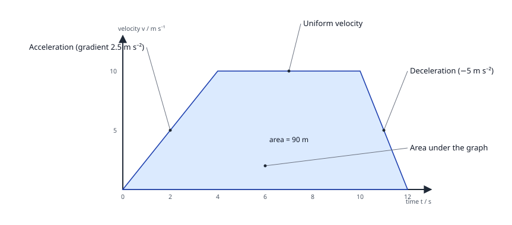

---

## SC10-03: Structure of matter

<!-- meta {"type":"chapter_notes","id":"SC10-03","grade":10,"chapter":3,"discipline":"CHE"} -->

*Grade 10 · Chapter 3 · Chemistry*

Matter is made of atoms. Atoms contain subatomic particles; elements are arranged in the periodic table.

### Learning objectives

- State the properties of subatomic particles
- Explain atomic number, mass number and isotopes
- Write electronic configurations
- Explain trends in the periodic table

### Key concepts

- Subatomic particles: proton (+1, in the nucleus), neutron (0, in the nucleus), electron (−1, in energy levels; very small mass).
- Atomic number (Z) = number of protons; mass number (A) = protons + neutrons. Symbol: $^{A}_{Z}X$.
- Isotopes: same Z, different number of neutrons (e.g. $^{12}_{6}C$, $^{14}_{6}C$; $^{35}Cl$, $^{37}Cl$).
- Electronic configuration: first level 2, second 8, third 8 (for the first 20 elements); e.g. Na 2,8,1; Cl 2,8,7; Ca 2,8,8,2.
- Period = number of energy levels; Group = number of outer electrons (for groups 1–2, 13–17).
- Across a period from left to right: first ionisation energy and electronegativity generally increase; atomic radius decreases.
- Group 18: inert gases — full outer level, very unreactive.
- Metals: lustre, conduct electricity and heat, ductile; non-metals: mostly the opposite properties (graphite is an exception — it conducts electricity).

### Definitions

- **Atomic number:** The number of protons in the nucleus.
- **Mass number:** The sum of the numbers of protons and neutrons.
- **Isotopes:** Atoms with the same atomic number but different mass numbers.
- **First ionisation energy:** The energy needed to remove one electron from a gaseous atom.

### Comparison table

| Particle | Charge | Relative mass | Location |
|---|---|---|---|
| Proton | +1 | 1 | Nucleus |
| Neutron | 0 | 1 | Nucleus |
| Electron | −1 | ≈ 1/1840 | Energy levels |

### Everyday connections

- $^{14}C$ isotope in archaeological dating.
- Neon, an inert gas, in advertising signs.

### Common misconceptions

- ⚠️ Isotopes have different chemical properties — wrong; they have the same number of electrons, so their chemical properties are similar.
- ⚠️ Mass number = protons + electrons — wrong; protons + neutrons.

### Exam focus

- Explaining the ionisation energy–atomic number graph (2016 seminar, 2019 Paper II Q3A).
- Calculating subatomic particles in isotopes (2019 Paper I Q36).

### Related resources

- Diagram CHE-D01 — Electronic configuration of a sodium atom (2,8,1) ([labelled](science_assets/chemistry/CHE-D01_labelled.svg))
- Experiment EXP-08 — Flame test (File 8)

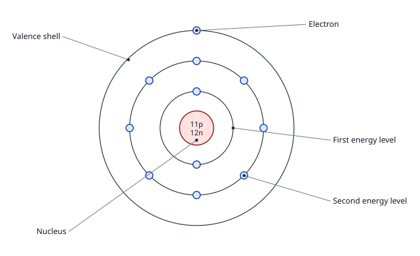

---

## SC10-04: Newton's laws of motion

<!-- meta {"type":"chapter_notes","id":"SC10-04","grade":10,"chapter":4,"discipline":"PHY"} -->

*Grade 10 · Chapter 4 · Physics*

Newton's three laws of motion explain the relationship between force and motion.

### Learning objectives

- Explain inertia
- Use F = ma
- Calculate momentum
- Identify action–reaction pairs

### Key concepts

- First law (law of inertia): unless an unbalanced force acts, an object stays at rest or continues at constant velocity. Greater mass means greater inertia.
- Second law: $F = ma$; 1 N = 1 kg m s⁻².
- Momentum $p = mv$ (kg m s⁻¹).
- Third law: every action has an equal and opposite reaction — acting on different objects.
- Weight $W = mg$ — the force the Earth exerts on an object (N); mass (kg) does not change, weight depends on g (2019 Paper I Q11).
- Applications: seat belts (inertia), rockets (third law).

### Definitions

- **Inertia:** The property of an object to resist a change in its state of motion.
- **Newton (N):** The force that gives a 1 kg mass an acceleration of 1 m s⁻².
- **Momentum:** Mass × velocity.

### Comparison table

| Quantity | Formula | Unit |
|---|---|---|
| Force | F = ma | N |
| Weight | W = mg | N |
| Momentum | p = mv | kg m s⁻¹ |

### Everyday connections

- Passengers lean forward when a bus stops suddenly.
- A boat moves backwards when you jump from it to the shore.

### Common misconceptions

- ⚠️ A moving object always needs a force — wrong; for constant velocity the net force is 0.
- ⚠️ Action and reaction balance each other — wrong; they act on different objects, so they do not.

### Exam focus

- F = ma, W = mg calculations.
- Weight on the Moon (g on the Moon ≈ g/6).

### Related resources

- Calculation CL-FMA — Newton's second law (File 5)
- Calculation CL-WMOM — Weight and momentum (File 5)

---

## SC10-05: Friction

<!-- meta {"type":"chapter_notes","id":"SC10-05","grade":10,"chapter":5,"discipline":"PHY"} -->

*Grade 10 · Chapter 5 · Physics*

Friction is the force that opposes relative motion between two surfaces in contact.

### Learning objectives

- Distinguish static, limiting and kinetic friction
- Explain the factors affecting friction
- Advantages and disadvantages of friction, ways of reducing it

### Key concepts

- Static friction: before the object starts to move; increases with the applied force.
- Limiting friction: the maximum static friction at the moment the object starts to move.
- Kinetic friction: while moving; slightly less than limiting friction.
- Friction depends on the nature of the surfaces and the normal reaction (R); it is (approximately) independent of the contact area.
- Advantages: walking, braking, grip. Disadvantages: wear, heat loss, wasted energy.
- Reducing it: lubricating oil, ball bearings, polishing, streamlining.

### Definitions

- **Friction:** A force that opposes the relative motion of surfaces in contact.
- **Limiting friction:** The maximum static friction when the object starts to move.

### Comparison table

| Type | State | Magnitude |
|---|---|---|
| Static | At rest | From 0 up to limiting |
| Limiting | Moment of starting to move | Maximum |
| Kinetic | While moving | Slightly less than limiting |

### Everyday connections

- Roads are slippery on rainy days — less friction.
- Patterns on shoe soles — grip.

### Common misconceptions

- ⚠️ Friction is always a disadvantage — wrong; we need friction to walk.
- ⚠️ Friction increases with area — wrong; it is (approximately) independent of area.

### Exam focus

- Force–friction graph (static → limiting → kinetic).
- Variables in the friction experiment (File 8).

### Related resources

- Diagram PHY-D06 — Force diagram of a box pulled along a table ([labelled](science_assets/physics/PHY-D06_labelled.svg))
- Experiment EXP-19 — Limiting friction and normal reaction (File 8)

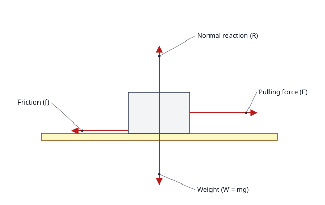

---

## SC10-06: Structure and functions of plant and animal cells

<!-- meta {"type":"chapter_notes","id":"SC10-06","grade":10,"chapter":6,"discipline":"BIO"} -->

*Grade 10 · Chapter 6 · Biology*

The cell is the basic unit of life. Plant and animal cells have common parts as well as distinctive parts.

### Learning objectives

- Identify cell organelles
- State the function of each organelle
- Compare plant and animal cells

### Key concepts

- Cell membrane: selectively permeable; controls the movement of substances in and out.
- Nucleus: contains DNA; controls cell activities.
- Cytoplasm: the medium containing organelles; site of many reactions.
- Mitochondria: aerobic respiration — produce energy as ATP.
- Chloroplast: photosynthesis; only in plant cells.
- Cell wall: cellulose; gives shape and protection; in plant cells.
- Vacuole: plant cells have a large central vacuole — cell sap, turgor pressure.
- Ribosome: protein synthesis. Endoplasmic reticulum (ER), Golgi apparatus — transport and secretion of substances.

### Definitions

- **Cell:** The basic structural and functional unit of life.
- **Organelle:** A membrane-bound structure inside a cell that performs a particular function.
- **Selectively permeable membrane:** A membrane that allows only some substances to pass through.

### Comparison table

| Part | Plant cell | Animal cell |
|---|---|---|
| Cell wall | Present | Absent |
| Chloroplast | Present | Absent |
| Large central vacuole | Present | Absent (small ones) |
| Centriole | Usually absent | Present |
| Shape | Regular | Irregular |

### Everyday connections

- When wilted spinach is placed in water, the vacuoles absorb water and the leaves become firm again.
- Muscle cells have many mitochondria — they need a lot of energy.

### Common misconceptions

- ⚠️ Plant cells do not have mitochondria — wrong; plant cells also respire.
- ⚠️ The cell wall is selectively permeable — wrong; it is fully permeable; the cell membrane is selectively permeable.

### Exam focus

- The plant–animal cell comparison table is asked frequently.
- Naming organelles in a diagram (see File 6).

### Related resources

- Diagram BIO-D01 — Plant cell ([labelled](science_assets/biology/BIO-D01_labelled.svg))
- Diagram BIO-D02 — Animal cell ([labelled](science_assets/biology/BIO-D02_labelled.svg))
- Experiment EXP-02 — Onion skin cells under a microscope (File 8)
- Calculation CL-MICRO — Microscope magnification (File 5)

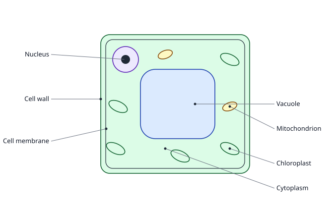

---

## SC10-07: Quantification of elements and compounds

<!-- meta {"type":"chapter_notes","id":"SC10-07","grade":10,"chapter":7,"discipline":"CHE"} -->

*Grade 10 · Chapter 7 · Chemistry*

In chemistry we measure amounts of substances with a unit called the mole. Relative atomic mass, molar mass and concentration are the basis of calculations.

### Learning objectives

- Calculate relative atomic mass and relative molecular mass
- Use the mole and the Avogadro constant
- Convert between mass, moles and number of particles
- Calculate solution concentration

### Key concepts

- Relative atomic mass (Ar): measured against $^{12}C$ — the mass of an atom compared with 1/12 of the mass of a carbon-12 atom (H = 1, C = 12, O = 16, Na = 23, Cl = 35.5).
- Relative molecular mass (Mr) = sum of the atomic masses; e.g. H₂O = 18.
- Mole: 6.022 × 10²³ particles (Avogadro constant, $N_A$).
- Molar mass (M) = Mr g mol⁻¹. Number of moles $n = \frac{m}{M}$.
- Number of particles $N = n \times N_A$.
- Concentration $C = \frac{n}{V}$ (mol dm⁻³; V in dm³). 1 dm³ = 1000 cm³.
- The coefficients of a balanced equation show the mole ratio — used for mass calculations (2019 Paper I Q17, Q30).

### Definitions

- **Mole:** The amount of substance containing 6.022 × 10²³ particles.
- **Molar mass:** The mass of one mole of a substance (g mol⁻¹).
- **Concentration:** The number of moles of solute in a unit volume of solution.

### Comparison table

| Quantity | Formula | Unit |
|---|---|---|
| Number of moles | $n = m/M$ | mol |
| Particles | $N = nN_A$ | — |
| Concentration | $C = n/V$ | mol dm⁻³ |

### Everyday connections

- Medicine doses in mg; saline is 0.9% NaCl.
- Percentages of N, P, K in fertilisers.

### Common misconceptions

- ⚠️ One mole of O₂ contains 6.022 × 10²³ atoms — wrong; that is molecules; atoms are double.
- ⚠️ Using cm³ directly in concentration calculations — wrong; convert to dm³.

### Exam focus

- Mass ↔ moles ↔ particles conversions (File 5).
- Mass needed to prepare a solution (2019 Paper I Q14).

### Related resources

- Calculation CL-MOLE — Moles, molar mass, particles (File 5)

---

## SC10-08: Characteristics of living organisms

<!-- meta {"type":"chapter_notes","id":"SC10-08","grade":10,"chapter":8,"discipline":"BIO"} -->

*Grade 10 · Chapter 8 · Biology*

Organisms have characteristics that distinguish them from non-living things; organisms are classified based on these.

### Learning objectives

- List the characteristics of organisms
- Explain binomial nomenclature
- Classify the main groups of organisms

### Key concepts

- Characteristics: cellular organisation, nutrition, respiration, excretion, irritability, movement, growth, reproduction, adaptation.
- Binomial nomenclature: genus name + species name; the genus starts with a capital letter; italics / underlined; e.g. Homo sapiens.
- Classification hierarchy: Domain → Kingdom → Phylum → Class → Order → Family → Genus → Species.
- Three domains: Bacteria, Archaea, Eukarya.
- Kingdoms of Eukarya: Protista, Fungi, Plantae, Animalia.
- Animal invertebrates: Cnidaria, Platyhelminthes, Annelida, Mollusca, Arthropoda, Echinodermata; vertebrates: fish, amphibians, reptiles, birds, mammals.

### Definitions

- **Species:** A group of similar organisms that can interbreed naturally and produce fertile offspring.
- **Irritability:** The ability to respond to stimuli.
- **Adaptation:** Structural/behavioural features that help an organism survive in its environment.

### Comparison table

| Phylum | Example | Key feature |
|---|---|---|
| Cnidaria | Hydra, sea anemone | Stinging cells, radial symmetry |
| Annelida | Earthworm | Body divided into segments |
| Mollusca | Snail | Soft body, shell |
| Arthropoda | Insect, crab | Jointed legs, exoskeleton |
| Echinodermata | Starfish | Spiny skin, tube feet |

### Everyday connections

- Touch-me-not (Mimosa) responding to touch — irritability.
- Bacteria gaining resistance to antibiotics — adaptation / evolution.

### Common misconceptions

- ⚠️ Plants do not move — wrong; plants show growth movements (e.g. phototropism).
- ⚠️ A mushroom is a plant — wrong; it belongs to the kingdom Fungi.

### Exam focus

- Classification keys and features of animal phyla are asked frequently (2019 Paper II Q2 classification chart).
- Rules for writing a binomial name.

---

## SC10-09: Resultant force

<!-- meta {"type":"chapter_notes","id":"SC10-09","grade":10,"chapter":9,"discipline":"PHY"} -->

*Grade 10 · Chapter 9 · Physics*

When several forces act on an object, the single force that gives their combined effect is the resultant force.

### Learning objectives

- Calculate the resultant of forces in one line
- Calculate the resultant of perpendicular forces
- Use the parallelogram rule

### Key concepts

- Same direction: resultant = F₁ + F₂; opposite directions: resultant = |F₁ − F₂| (in the direction of the larger force).
- Perpendicular forces: $R = \sqrt{F_1^2 + F_2^2}$.
- Parallelogram rule: if two forces are drawn as adjacent sides of a parallelogram, the diagonal from their common point is the resultant (scale drawing).
- If the resultant is 0, the object is in equilibrium.
- The resultant force gives F = ma (link with SC10-04).

### Definitions

- **Resultant force:** The single force that gives the total effect of several forces.

### Everyday connections

- Tug-of-war — motion in the direction of the resultant force.
- Rowing a boat + water current.

### Common misconceptions

- ⚠️ 3 N + 4 N is always 7 N — wrong; depending on direction it is from 1 N to 7 N.
- ⚠️ The resultant force is an extra force — wrong; it is a replacement.

### Exam focus

- Drawing a scale diagram by the parallelogram rule.
- Acceleration from the resultant.

### Related resources

- Calculation CL-RESULT — Resultant force (File 5)

---

## SC10-10: Chemical bonds

<!-- meta {"type":"chapter_notes","id":"SC10-10","grade":10,"chapter":10,"discipline":"CHE"} -->

*Grade 10 · Chapter 10 · Chemistry*

Atoms form chemical bonds by losing/gaining or sharing electrons to obtain a stable electronic configuration.

### Learning objectives

- Explain ionic and covalent bonding
- Draw dot-and-cross diagrams
- Explain polar bonds using electronegativity
- Relationship between bond type and properties

### Key concepts

- Ionic bond: a metal loses electrons to form a positive ion; a non-metal gains them to form a negative ion; electrostatic attraction (e.g. NaCl, MgO).
- Ionic compounds: high melting point, dissolve in water, conduct electricity when molten/dissolved (not when solid).
- Covalent bond: non-metal atoms share pairs of electrons: H₂ (single), O₂ (double), N₂ (triple), H₂O, CH₄, NH₃, CO₂.
- Polar covalent bond: partial charges (δ+, δ−) due to electronegativity difference; e.g. H₂O, HCl.
- Covalent molecular compounds: usually low melting/boiling points; do not conduct electricity.
- Metallic bond: positive ions + a sea of delocalised electrons — conductivity.
- Valency: H 1, O 2, N 3, C 4, Na 1, Mg 2, Al 3, Cl 1.

### Definitions

- **Ionic bond:** Electrostatic attraction between oppositely charged ions.
- **Covalent bond:** A bond formed when two atoms share a pair of electrons.
- **Electronegativity:** The ability of an atom to attract the electrons in a bond.

### Comparison table

| Property | Ionic compound | Covalent molecule |
|---|---|---|
| Melting point | High | Low |
| Solubility in water | Mostly soluble | Many insoluble |
| Electrical conductivity | When molten/dissolved | Usually none |

### Everyday connections

- Salt solution conducts electricity — ions.
- Sugar solution does not conduct — covalent molecules.

### Common misconceptions

- ⚠️ Solid NaCl conducts electricity — wrong; the ions cannot move.
- ⚠️ Ionic compounds contain molecules — wrong; they form an ionic lattice.

### Exam focus

- Dot-and-cross diagrams (File 6).
- Counting covalent bonds in a molecule (2019 Paper I Q8).

---

## SC10-11: Turning effect of a force

<!-- meta {"type":"chapter_notes","id":"SC10-11","grade":10,"chapter":11,"discipline":"PHY"} -->

*Grade 10 · Chapter 11 · Physics*

The turning effect of a force on an object is its moment. It is used in levers, doors and balances.

### Learning objectives

- Calculate the moment of a force
- Use the principle of moments
- Explain a couple
- Types of lever

### Key concepts

- Moment $M = F \times d$; d = perpendicular distance from the pivot to the line of action of the force; unit N m.
- Clockwise / anticlockwise moments.
- Principle of moments: in equilibrium, the sum of clockwise moments = the sum of anticlockwise moments.
- Couple: a pair of equal and opposite parallel forces; moment = F × separation (e.g. turning a tap, steering wheel).
- Lever: pivot, load, effort; a long handle — less effort.

### Definitions

- **Moment of a force:** Force × perpendicular distance from the pivot to the line of action.
- **Couple:** A pair of equal and opposite parallel forces not in the same line.

### Everyday connections

- A door handle is far from the hinge — a small force is enough.
- Balancing a see-saw.

### Common misconceptions

- ⚠️ Moment = force × any distance — wrong; perpendicular distance.
- ⚠️ A couple moves an object — wrong; it only rotates it.

### Exam focus

- See-saw/metre rule balance calculations (File 5).
- Principle of moments experiment (File 8).

### Related resources

- Diagram PHY-D11 — Principle of moments — see-saw ([labelled](science_assets/physics/PHY-D11_labelled.svg))
- Experiment EXP-20 — Verifying the principle of moments (metre rule) (File 8)
- Calculation CL-MOMENT — Moment of a force (File 5)

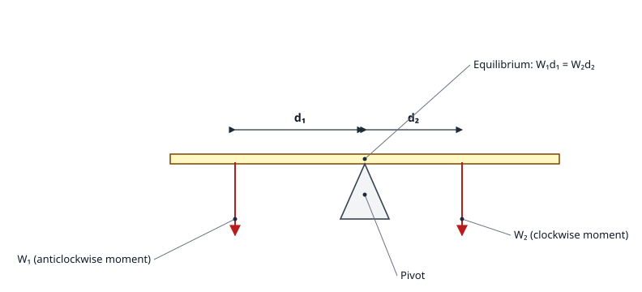

---

## SC10-12: Equilibrium of forces

<!-- meta {"type":"chapter_notes","id":"SC10-12","grade":10,"chapter":12,"discipline":"PHY"} -->

*Grade 10 · Chapter 12 · Physics*

An object is in equilibrium if the resultant of the forces on it and the net moment are zero.

### Learning objectives

- Conditions for equilibrium of two forces
- Equilibrium of three forces (concurrent forces)
- Centre of gravity and stability

### Key concepts

- Two-force equilibrium: forces equal, opposite and along the same line of action.
- Three-force equilibrium: in one plane, meeting at one point (concurrent), resultant 0; by the triangle rule the scale diagram is a closed triangle.
- Centre of gravity: the point where the whole weight of an object is considered to act. For regular objects it is the geometric centre.
- Stability: a low centre of gravity and a wide base increase stability.
- Stable, unstable and neutral equilibrium.

### Definitions

- **Equilibrium:** The state in which the resultant force and net moment are zero.
- **Centre of gravity:** The point where the weight of an object is considered to act.

### Everyday connections

- Racing cars are low — stability.
- People carrying loads on the neck lean as they walk — keeping the centre of gravity over the base.

### Common misconceptions

- ⚠️ There are no forces in equilibrium — wrong; there are forces, but the resultant is zero.
- ⚠️ The centre of gravity is always inside the object — wrong; for a ring it is outside.

### Exam focus

- Centre of gravity of an irregular lamina — plumb line method (File 8).
- Triangle diagram of three forces.

---

## SC10-13: Biosphere

<!-- meta {"type":"chapter_notes","id":"SC10-13","grade":10,"chapter":13,"discipline":"BIO"} -->

*Grade 10 · Chapter 13 · Biology*

The biosphere is the part of the Earth where organisms live. Organisms interact with each other and with the environment.

### Learning objectives

- Explain the components of an ecosystem
- Construct food chains and food webs
- Explain energy flow and nutrient cycles

### Key concepts

- Ecosystem = living components (producers, consumers, decomposers) + non-living components (light, water, soil, temperature).
- Food chain: producer → primary consumer → secondary consumer … The arrow shows the direction of energy flow.
- At each trophic level most energy is lost (respiration, heat); only about 10% passes to the next level.
- Carbon cycle: photosynthesis removes CO₂; respiration, combustion and decomposition release CO₂.
- Nitrogen cycle: nitrogen fixation (Rhizobium — legume root nodules, lightning), nitrification, denitrification.
- Interactions: predation, parasitism, mutualism, competition.

### Definitions

- **Ecosystem:** A unit in which the organisms of an area interact with their non-living environment.
- **Producer:** An organism that makes its own food by photosynthesis.
- **Decomposer:** Bacteria and fungi that decompose dead organic matter.

### Everyday connections

- Nitrogen increases in land where legumes are grown.
- In a pond ecosystem, aquatic plants release O₂ (2019 Paper II Q8).

### Common misconceptions

- ⚠️ The arrow shows 'who eats whom' — wrong; it shows the direction of energy flow (from the eaten to the eater).
- ⚠️ Energy is recycled — wrong; energy flows one way; only materials are recycled.

### Exam focus

- Constructing a food chain from given organisms.
- Energy calculations with the 10% rule (File 5).

### Related resources

- Diagram BIO-D09 — Pond food web (model) ([labelled](science_assets/biology/BIO-D09_labelled.svg))
- Calculation CL-ECO — Energy transfer in a food chain (File 5)

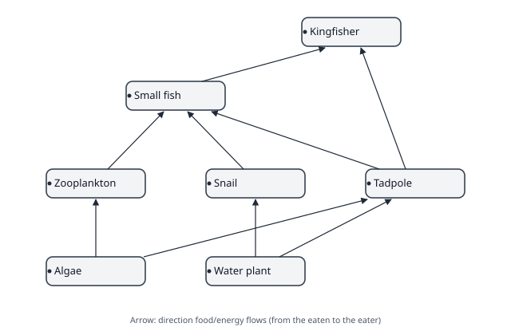

---

## SC10-14: Continuity of life

<!-- meta {"type":"chapter_notes","id":"SC10-14","grade":10,"chapter":14,"discipline":"BIO"} -->

*Grade 10 · Chapter 14 · Biology*

Organisms continue their species through reproduction. Cell division, asexual and sexual reproduction, and human reproduction are covered in this chapter.

### Learning objectives

- Compare mitosis and meiosis
- Explain asexual and sexual reproduction
- Explain the parts of a flower and pollination
- Explain the human reproductive system

### Key concepts

- Mitosis: 2 daughter cells; chromosome number unchanged (2n → 2n); growth, repair, asexual reproduction.
- Meiosis: 4 daughter cells; chromosome number halved (2n → n); gamete formation; variation.
- Humans: 2n = 46; gametes n = 23.
- Asexual reproduction: budding (yeast), fragmentation, spores, layering, grafting, tissue culture — offspring identical to the parent.
- Flower: sepals, petals, stamens (anther + filament), carpel (stigma, style, ovary). Pollination — insects, wind.
- Human fertilisation takes place in the fallopian tube; the embryo implants in the uterus wall.
- The menstrual cycle is about 28 days; ovulation around day 14.

### Definitions

- **Gamete:** A haploid (n) sex cell — sperm, ovum.
- **Fertilisation:** Fusion of the nuclei of male and female gametes.
- **Pollination:** Pollen grains reaching the stigma.

### Comparison table

| Feature | Mitosis | Meiosis |
|---|---|---|
| Daughter cells | 2 | 4 |
| Chromosome number | Unchanged (2n) | Halved (n) |
| Where it occurs | Body cells | Reproductive organs |
| Variation | None | Present |

### Everyday connections

- Banana and sugar cane are propagated by suckers/cuttings.
- Tissue culture gives large numbers of disease-free plants.

### Common misconceptions

- ⚠️ Meiosis produces 2 cells — wrong; 4.
- ⚠️ Fertilisation takes place in the uterus — wrong; in the fallopian tube (2019 Paper I Q13).

### Exam focus

- Comparison of mitosis and meiosis (2019 Paper II Q5B).
- Naming the parts of a flower.

### Related resources

- Diagram BIO-D08 — Longitudinal section of a flower ([labelled](science_assets/biology/BIO-D08_labelled.svg))
- Experiment EXP-07 — Conditions for seed germination (File 8)

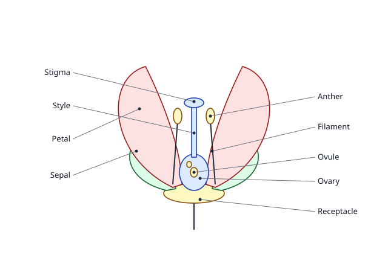

---

## SC10-15: Hydrostatic pressure and its applications

<!-- meta {"type":"chapter_notes","id":"SC10-15","grade":10,"chapter":15,"discipline":"PHY"} -->

*Grade 10 · Chapter 15 · Physics*

Liquids and gases exert pressure. Liquid pressure depends on depth, density and g; this is the basis of many applications.

### Learning objectives

- Calculate pressure (P = F/A)
- Liquid pressure P = hρg
- Pascal's law, hydraulic machines
- Atmospheric pressure, flotation

### Key concepts

- Pressure $P = \frac{F}{A}$; unit Pa (N m⁻²).
- Liquid pressure $P = h\rho g$ — depends on depth (h), density (ρ) and g; not on the shape of the container (2019 Paper I Q37).
- At the same depth it is equal in all directions.
- Pascal's law: pressure applied to an enclosed liquid is transmitted equally to all parts — hydraulic press, hydraulic brakes: $\frac{F_1}{A_1} = \frac{F_2}{A_2}$.
- Atmospheric pressure at sea level ≈ 1.0 × 10⁵ Pa (760 mmHg); it decreases with altitude (2019 Paper I Q22 — eardrum).
- Upthrust: the upward force on an object in a liquid = weight of liquid displaced (Archimedes' principle); it floats if upthrust = weight.

### Definitions

- **Pressure:** Force acting perpendicularly per unit area.
- **Pascal's law:** Pressure in an enclosed liquid is transmitted equally in all directions.
- **Upthrust:** The upward force on an object immersed in a liquid.

### Comparison table

| Formula | Use |
|---|---|
| P = F/A | Solid pressure |
| P = hρg | Liquid pressure |
| F₁/A₁ = F₂/A₂ | Hydraulic press |

### Everyday connections

- The base of a dam is thick — pressure is greater at depth.
- A sharp knife cuts — small area, high pressure.
- Hydraulic jack (garage jack).

### Common misconceptions

- ⚠️ Pressure at the bottom of a wide container is greater — wrong; depth decides.
- ⚠️ A heavy object always sinks — wrong; density and upthrust decide (ships).

### Exam focus

- P = hρg, F/A calculations (File 5).
- Force multiplication in a hydraulic press.

### Related resources

- Diagram PHY-D10 — Liquid pressure with depth ([labelled](science_assets/physics/PHY-D10_labelled.svg))
- Experiment EXP-21 — Liquid pressure with depth (File 8)
- Calculation CL-PRESS — Pressure, liquid pressure, Pascal (File 5)

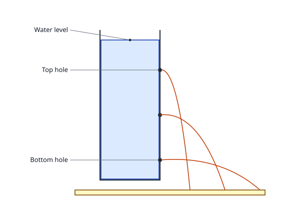

---

## SC10-16: Changes in matter

<!-- meta {"type":"chapter_notes","id":"SC10-16","grade":10,"chapter":16,"discipline":"CHE"} -->

*Grade 10 · Chapter 16 · Chemistry*

Physical and chemical changes take place in matter. Chemical reactions are of many types; the reactivity series of metals is important for this.

### Learning objectives

- Distinguish physical and chemical changes
- Identify types of reaction
- Use the reactivity series
- Explain the extraction of iron

### Key concepts

- Physical change: no new substance (melting, evaporation, dissolving). Chemical change: a new substance (combustion, rusting).
- Types of reaction: combination (2Mg + O₂ → 2MgO), decomposition (CaCO₃ → CaO + CO₂), single displacement (Zn + CuSO₄ → ZnSO₄ + Cu), double displacement (AgNO₃ + NaCl → AgCl + NaNO₃).
- Reactivity series: K > Na > Ca > Mg > Al > Zn > Fe > Sn > Pb > (H) > Cu > Hg > Ag > Au.
- Metals above H displace H₂ from dilute acids: Mg + 2HCl → MgCl₂ + H₂.
- With cold water: K, Na, Ca react to give a hydroxide + H₂; Mg with hot water/steam.
- A more reactive metal displaces a less reactive one from its salt solution.
- Extraction of iron (blast furnace): Fe₂O₃ + 3CO → 2Fe + 3CO₂; limestone (CaCO₃) → CaO, which removes the SiO₂ impurity as slag (CaSiO₃) (2019 Paper I Q34).

### Definitions

- **Chemical change:** A change in which new substances are formed.
- **Displacement reaction:** An element displacing another element from a compound.
- **Reactivity series:** Arranging metals in decreasing order of reactivity.

### Comparison table

| Metal | Cold water | Dilute acid |
|---|---|---|
| Na | Violent reaction | Dangerous |
| Mg | Very slow (fast with steam) | H₂ quickly |
| Zn | No | H₂ |
| Cu | No | No |

### Everyday connections

- Rusting of iron roofs — a chemical change.
- Gold is found free in nature — low reactivity.

### Common misconceptions

- ⚠️ Dissolving is a chemical change — wrong; it is a physical change.
- ⚠️ Cu gives H₂ with dilute HCl — wrong; Cu is below H.

### Exam focus

- Predicting whether a reaction takes place using the reactivity series.
- Identifying reaction types; balancing equations (File 7).

### Related resources

- Diagram CHE-D05 — Blast furnace (schematic) ([labelled](science_assets/chemistry/CHE-D05_labelled.svg))
- Equations EQ-001, EQ-002, EQ-003, EQ-004, EQ-005, EQ-006, EQ-007, EQ-008 … (File 7)

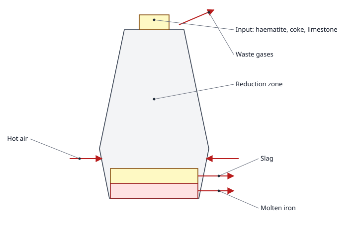

---

## SC10-17: Rate of reactions

<!-- meta {"type":"chapter_notes","id":"SC10-17","grade":10,"chapter":17,"discipline":"CHE"} -->

*Grade 10 · Chapter 17 · Chemistry*

The rate of reaction is the amount of reactants used up or products formed per unit time. Many factors affect it.

### Learning objectives

- Define and measure the rate of reaction
- Explain the effect of temperature, concentration, surface area and catalysts
- Interpret rate from graphs

### Key concepts

- Rate = change ÷ time (e.g. volume of gas released, cm³ s⁻¹).
- As temperature increases, the kinetic energy of particles increases and collisions increase → rate increases.
- Higher concentration means more particles per unit volume → more collisions.
- Smaller particle size of a solid (powder) gives a larger surface area → higher rate.
- Catalyst: increases the rate of reaction; is not permanently changed itself (e.g. MnO₂ in the decomposition of H₂O₂).
- In gas reactions, higher pressure increases the rate.
- Gradient of a gas volume–time graph = rate; the rate decreases with time (as reactants are used up).

### Definitions

- **Rate of reaction:** The change in amount of reactant/product per unit time.
- **Catalyst:** A substance that increases the rate without being permanently changed in the reaction.

### Comparison table

| Factor | Change | Rate | Reason |
|---|---|---|---|
| Temperature | Increase | Increases | More kinetic energy and collisions |
| Concentration | Increase | Increases | More particles |
| Surface area | Powdering | Increases | More contact area |
| Catalyst | Adding | Increases | Alternative pathway |

### Everyday connections

- Keeping food in a refrigerator — the rate of spoiling decreases.
- Sawdust burns faster than pieces of firewood.

### Common misconceptions

- ⚠️ A catalyst gives more product — wrong; it gives it faster, the amount does not change.
- ⚠️ The rate stays the same throughout a reaction — wrong; it decreases over time.

### Exam focus

- Comparing graphs (powder vs pieces; temperature).
- Controlling variables in a fair test (File 8).

### Related resources

- Diagram GR-D03 — Rate of reaction: gas volume–time ([labelled](science_assets/graphs/GR-D03_labelled.svg))
- Experiment EXP-09 — Temperature and rate of reaction (sodium thiosulfate + HCl) (File 8)
- Experiment EXP-10 — Surface area and rate of reaction (CaCO₃ + HCl) (File 8)
- Calculation CL-RATE — Average rate of reaction (File 5)

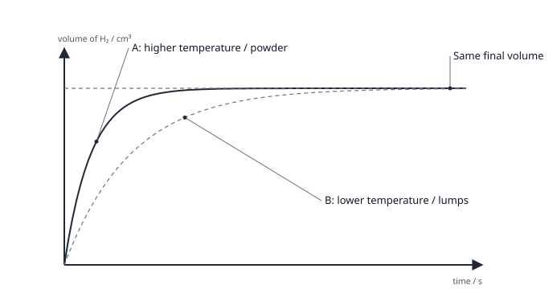

---

## SC10-18: Work, energy and power

<!-- meta {"type":"chapter_notes","id":"SC10-18","grade":10,"chapter":18,"discipline":"PHY"} -->

*Grade 10 · Chapter 18 · Physics*

Work is done when a force moves an object in its direction. Energy is the ability to do work; power is the rate of doing work.

### Learning objectives

- Calculate work, kinetic energy and potential energy
- Use the law of conservation of energy
- Calculate power and efficiency

### Key concepts

- Work $W = Fs$ (displacement in the direction of the force); unit J.
- Kinetic energy $E_k = \frac12 mv^2$; gravitational potential energy $E_p = mgh$.
- Law of conservation of energy: energy cannot be created or destroyed; it changes from one form to another. For an object falling without friction, loss of Ep = gain of Ek.
- Power $P = \frac{W}{t}$; unit W (J s⁻¹).
- Efficiency = (useful output ÷ input) × 100%.
- Forms of energy: kinetic, potential, heat, sound, light, electrical, chemical, nuclear; renewable/non-renewable sources.

### Definitions

- **Work:** The product of a force and the displacement in the direction of the force.
- **Power:** The rate of doing work.
- **Joule (J):** The work done when a 1 N force moves an object 1 m.

### Comparison table

| Quantity | Formula | Unit |
|---|---|---|
| Work | W = Fs | J |
| Kinetic energy | ½mv² | J |
| Potential energy | mgh | J |
| Power | W/t | W |

### Everyday connections

- Hydroelectric power station: potential energy → kinetic energy → electrical energy.
- Standing while holding a load (no movement) — physical work is 0.

### Common misconceptions

- ⚠️ Work is done on a wall that does not move when pushed — wrong; displacement is 0.
- ⚠️ Efficiency can exceed 100% — wrong.

### Exam focus

- Ep ↔ Ek conversion calculations (File 5).
- Energy conversion chains (2019 Paper II Q1B).

### Related resources

- Calculation CL-WORK — Work, energy, power, efficiency (File 5)

---

## SC10-19: Current electricity

<!-- meta {"type":"chapter_notes","id":"SC10-19","grade":10,"chapter":19,"discipline":"PHY"} -->

*Grade 10 · Chapter 19 · Physics*

In current electricity we study current, potential difference, resistance, Ohm's law relating them, and series–parallel circuits.

### Learning objectives

- Define current, potential difference and resistance
- Use Ohm's law
- Calculate series and parallel resistances
- Connect an ammeter and a voltmeter

### Key concepts

- Current (I): rate of flow of charge; unit A; an ammeter is connected in series.
- Potential difference (V): unit V; a voltmeter is connected in parallel.
- Ohm's law: at constant temperature $V = IR$; the V–I graph is a straight line through the origin, gradient = R.
- Resistance (R, Ω) depends on: length (directly proportional), cross-sectional area (inversely), material, temperature (2019 Paper I Q18).
- Series: $R = R_1 + R_2$; the same current. Parallel: $\frac1R = \frac1{R_1} + \frac1{R_2}$; the same potential difference.
- Connecting cells in series increases the total e.m.f.
- Polarity protection: a diode is used so that equipment is not damaged if connected with the wrong polarity (2019 Paper I Q19).

### Definitions

- **Current:** The rate at which charge flows through a point.
- **Ohm's law:** At constant temperature the current through a conductor is directly proportional to the potential difference.
- **Resistance:** The property of opposing current; R = V/I.

### Comparison table

| | Series | Parallel |
|---|---|---|
| Current | Same everywhere | Divides in branches |
| Potential difference | Divides | Same in every branch |
| Total resistance | R₁ + R₂ | 1/R = 1/R₁ + 1/R₂ |

### Everyday connections

- House circuits are parallel — if one bulb goes off, the others stay on.
- A long thin wire has high resistance — heater coil.

### Common misconceptions

- ⚠️ Current is 'used up' in the circuit and decreases — wrong; in a series circuit it is the same everywhere.
- ⚠️ Adding resistors in parallel increases the total resistance — wrong; it decreases.

### Exam focus

- V = IR, series–parallel calculations (File 5).
- Drawing circuit diagrams (File 6).

### Related resources

- Diagram PHY-D01 — Series circuit (ammeter, voltmeter) ([labelled](science_assets/physics/PHY-D01_labelled.svg))
- Diagram PHY-D02 — Parallel circuit ([labelled](science_assets/physics/PHY-D02_labelled.svg))
- Diagram GR-D04 — Ohm's law: V–I graph ([labelled](science_assets/graphs/GR-D04_labelled.svg))
- Experiment EXP-22 — Ohm's law (File 8)
- Experiment EXP-23 — Length of a wire and resistance (File 8)
- Calculation CL-OHM — Ohm's law and combinations of resistors (File 5)

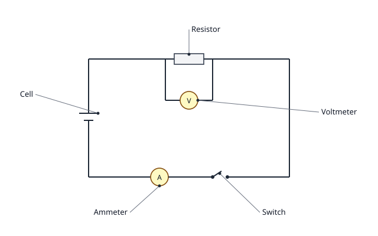

---

## SC10-20: Inheritance

<!-- meta {"type":"chapter_notes","id":"SC10-20","grade":10,"chapter":20,"discipline":"BIO"} -->

*Grade 10 · Chapter 20 · Biology*

Parents' characteristics are passed to offspring through genes. Mendel's experiments are the basis of this.

### Learning objectives

- Explain dominant and recessive characteristics
- Show a monohybrid cross with a Punnett square
- Explain sex determination

### Key concepts

- Gene: a section of DNA that determines a characteristic; located on a chromosome.
- Allele: different forms of a gene (T, t).
- The dominant allele is written in capital (T); the recessive in small letter (t).
- Genotype: TT, Tt, tt; Phenotype: tall/dwarf.
- Homozygous: TT, tt; Heterozygous: Tt.
- Tt × Tt → genotype ratio 1 TT : 2 Tt : 1 tt; phenotype 3 : 1.
- Sex: female XX, male XY; the father's sperm determines the sex; probability of a boy is ½.
- Inherited diseases: thalassaemia, colour blindness, haemophilia (X-linked — colour blindness, haemophilia).

### Definitions

- **Gene:** A piece of DNA that determines a characteristic.
- **Genotype:** The combination of alleles of an organism.
- **Phenotype:** The observable characteristic.

### Comparison table

| | T | t |
|---|---|---|
| **T** | TT | Tt |
| **t** | Tt | tt |

### Everyday connections

- If two thalassaemia carriers marry, the probability of a child having the disease is ¼ — testing before marriage.
- Colour blindness is more common in males.

### Common misconceptions

- ⚠️ A dominant characteristic is always more common in a population — wrong; it is only about expression.
- ⚠️ The mother determines the child's sex — wrong; the father's X/Y sperm does.

### Exam focus

- F1, F2 ratios with a Punnett square (2019 Paper II Q5C — seed shape).
- Defining terms: genotype, phenotype, homozygous.

### Related resources

- Diagram BIO-D10 — Punnett square: Tt × Tt ([labelled](science_assets/biology/BIO-D10_labelled.svg))
- Calculation CL-GENE — Mendelian ratios (File 5)

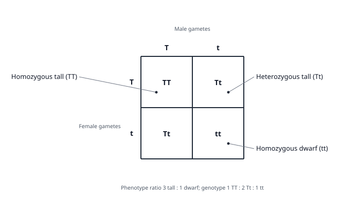

---

## SC11-01: Living tissues

<!-- meta {"type":"chapter_notes","id":"SC11-01","grade":11,"chapter":1,"discipline":"BIO"} -->

*Grade 11 · Chapter 1 · Biology*

A group of cells with similar structure and function is a tissue. Plants and animals have different tissues.

### Learning objectives

- Classify plant tissues
- Explain the types and functions of animal tissues
- Relate tissues to their locations

### Key concepts

- Plant tissues: meristematic tissue — cell division (apical, lateral); permanent tissue — parenchyma, collenchyma, sclerenchyma, xylem, phloem.
- Xylem: water and minerals upwards; dead cells (vessels, tracheids); lignin.
- Phloem: prepared food (sucrose) in both directions; sieve tubes, companion cells.
- Animal tissues: epithelial, connective (bone, cartilage, blood), muscle (skeletal, smooth, cardiac), nervous tissue.
- Cardiac muscle does not fatigue; it is involuntary; branched fibres.
- Skeletal muscle cells are multinucleate (2019 Paper I Q38 — multinucleate cells).

### Definitions

- **Tissue:** A group of cells with similar structure and function.
- **Meristematic tissue:** Plant tissue made of young cells that keep dividing.
- **Neuron:** A cell that conducts nerve impulses.

### Comparison table

| Muscle type | Location | Control | Nucleus |
|---|---|---|---|
| Skeletal muscle | Attached to bones | Voluntary | Many nuclei |
| Smooth muscle | Alimentary canal, blood vessels | Involuntary | One nucleus |
| Cardiac muscle | Heart | Involuntary | One nucleus, branched |

### Everyday connections

- Coconut shells and seed coats are hard because of sclerenchyma.
- When a stem is placed in coloured water the xylem is stained — evidence of water transport.

### Common misconceptions

- ⚠️ Phloem transports water — wrong; xylem transports water.
- ⚠️ All muscles contract voluntarily — wrong; smooth and cardiac muscles are involuntary.

### Exam focus

- Matching tissue — location — function.
- Comparison of muscle types.

---

## SC11-02: Photosynthesis

<!-- meta {"type":"chapter_notes","id":"SC11-02","grade":11,"chapter":2,"discipline":"BIO"} -->

*Grade 11 · Chapter 2 · Biology*

In photosynthesis, green plants use light energy to make glucose from CO₂ and water and release O₂.

### Learning objectives

- Write the equation for photosynthesis
- Explain the factors affecting it
- Explain the adaptations of the leaf
- Carry out photosynthesis experiments

### Key concepts

- Equation: 6CO₂ + 6H₂O →(light, chlorophyll) C₆H₁₂O₆ + 6O₂.
- Light energy is converted into chemical energy.
- Requirements: light, CO₂, water, chlorophyll; a suitable temperature.
- Leaf adaptations: broad surface, thin, stomata, closely packed palisade mesophyll (many chloroplasts), veins (xylem, phloem).
- Limiting factors: light intensity, CO₂ concentration, temperature — the one in shortest supply controls the rate.
- Glucose is stored as starch — can be tested with iodine.
- The leaf must be kept in the dark (destarched) before the starch test (2019 Paper II Q2B).

### Definitions

- **Photosynthesis:** Making glucose from CO₂ and H₂O using light energy.
- **Limiting factor:** The factor in short supply that controls the rate.
- **Stoma:** A leaf pore for gas exchange; controlled by guard cells.

### Comparison table

| Experiment | Factor tested | Control |
|---|---|---|
| Covering part of a leaf with black paper | Light | Uncovered part |
| Enclosed bottle with KOH | CO₂ | Bottle without KOH |
| Variegated leaf | Chlorophyll | Green part |

### Everyday connections

- Increasing CO₂ in greenhouses raises yield.
- Plants growing in shade grow slowly.

### Common misconceptions

- ⚠️ Plants respire only at night — wrong; they respire all the time.
- ⚠️ A plant gets its food from the soil — wrong; only water and minerals come from the soil.

### Exam focus

- Variegated leaf — chlorophyll needed; KOH — CO₂ needed; black paper — light needed.
- Starch test steps: boiling water → ethanol (in a water bath) → boiling water → iodine.

### Related resources

- Diagram BIO-D03 — Cross-section of a leaf ([labelled](science_assets/biology/BIO-D03_labelled.svg))
- Diagram EXP-D01 — Testing a leaf for starch ([labelled](science_assets/experiments/EXP-D01_labelled.svg))
- Diagram EXP-D02 — O₂ released in photosynthesis ([labelled](science_assets/experiments/EXP-D02_labelled.svg))
- Experiment EXP-03 — Light is necessary for photosynthesis (starch test) (File 8)
- Experiment EXP-04 — Light intensity and rate of photosynthesis (Hydrilla) (File 8)
- Equations EQ-041 (File 7)

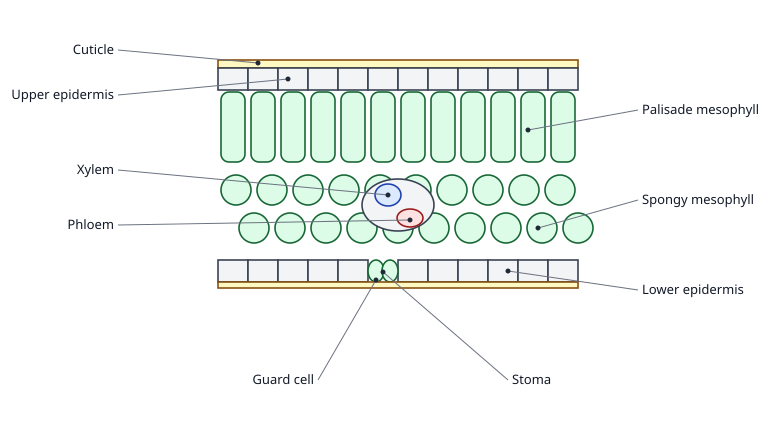

---

## SC11-03: Mixtures

<!-- meta {"type":"chapter_notes","id":"SC11-03","grade":11,"chapter":3,"discipline":"CHE"} -->

*Grade 11 · Chapter 3 · Chemistry*

A mixture is a combination of two or more substances not chemically bonded. Solutions, their concentration and separation methods are in this chapter.

### Learning objectives

- Distinguish homogeneous and heterogeneous mixtures
- Calculate solution concentration in several ways
- Choose a suitable separation method

### Key concepts

- Homogeneous mixture: one phase (salt solution, air). Heterogeneous mixture: different phases (soil + water).
- Solution = solute + solvent.
- Concentration: mass fraction (w/w %), volume fraction (v/v %), mass/volume (g dm⁻³), molar concentration (mol dm⁻³).
- Density $\rho = m/V$ — used to calculate the mass of a solution (2019 Paper II Q6C).
- Separation: filtration (insoluble solid), evaporation/crystallisation (dissolved solid), distillation (recovering the solvent), fractional distillation (liquids with different boiling points — crude oil, ethanol–water), chromatography (pigments), separating funnel (immiscible liquids), solvent extraction, steam distillation (essential oils — cinnamon).
- The solubility of gases increases as pressure increases and decreases as temperature increases.

### Definitions

- **Mixture:** Substances combined without chemical bonding; the components keep their properties.
- **Solubility:** The maximum mass of solute that dissolves in a given amount of solvent at a given temperature.
- **Saturated solution:** A solution in which no more solute dissolves.

### Comparison table

| Mixture | Method | Basis |
|---|---|---|
| Sand + water | Filtration | Solubility |
| Salt + water | Evaporation | Volatility |
| Ethanol + water | Fractional distillation | Difference in boiling point |
| Ink pigments | Chromatography | Difference in movement |
| Oil + water | Separating funnel | Immiscibility, density |
| Cinnamon oil | Steam distillation | Volatile oil |

### Everyday connections

- Cinnamon oil — steam distillation.
- Sea salt — evaporation; salterns.
- Deep-sea divers — gas solubility due to pressure (2019 Paper I Q32).

### Common misconceptions

- ⚠️ A mixture has a fixed formula — wrong; the ratio of components can vary.
- ⚠️ Filtration separates salt from water — wrong; dissolved salt passes through the filter.

### Exam focus

- Matching mixtures to separation methods (2019 Paper I Q29).
- Concentration and density calculations (File 5).

### Related resources

- Diagram CHE-D04 — Distillation ([labelled](science_assets/chemistry/CHE-D04_labelled.svg))
- Experiment EXP-13 — Pure water from salt water by distillation (File 8)
- Experiment EXP-14 — Paper chromatography (ink pigments) (File 8)
- Calculation CL-CONC — Solution concentration, density (File 5)

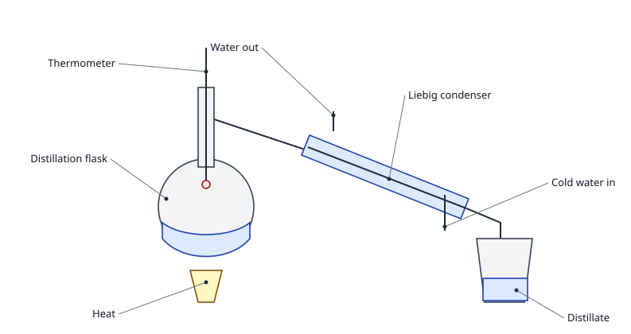

---

## SC11-04: Waves and their applications

<!-- meta {"type":"chapter_notes","id":"SC11-04","grade":11,"chapter":4,"discipline":"PHY"} -->

*Grade 11 · Chapter 4 · Physics*

Waves carry energy through a medium or a vacuum; matter is not transferred. Sound and electromagnetic waves are in this chapter.

### Learning objectives

- Distinguish transverse and longitudinal waves
- Wavelength, frequency, amplitude, wave speed
- Properties of sound
- The electromagnetic spectrum and its uses

### Key concepts

- Transverse wave: particles vibrate perpendicular to the direction of travel (water waves, light) — crests, troughs.
- Longitudinal wave: vibration parallel to the direction of travel (sound) — compressions, rarefactions (2019 Paper I Q33).
- Wave speed $v = f\lambda$; f (Hz), λ (m). Period $T = 1/f$.
- Sound needs a medium; it does not travel in a vacuum. In air ≈ 340 m s⁻¹; faster in solids.
- Pitch depends on frequency; loudness depends on amplitude.
- Audible range 20 Hz – 20 kHz; ultrasound (> 20 kHz): pregnancy scans, SONAR.
- Electromagnetic spectrum: radio, microwave, infrared, visible, ultraviolet, X-ray, gamma — 3 × 10⁸ m s⁻¹ in a vacuum.

### Definitions

- **Wavelength:** The distance between two consecutive crests (or corresponding points).
- **Frequency:** The number of waves produced in one second.
- **Amplitude:** The maximum displacement from the equilibrium position.

### Comparison table

| Feature | Transverse wave | Longitudinal wave |
|---|---|---|
| Direction of vibration | Perpendicular | Parallel |
| Example | Light, water waves | Sound |
| Parts | Crest, trough | Compression, rarefaction |

### Everyday connections

- Lightning is seen first and thunder heard later — light is faster than sound.
- Bats find their way using ultrasound.

### Common misconceptions

- ⚠️ A wave carries water forward — wrong; only energy is carried.
- ⚠️ Sound travels in a vacuum — wrong.

### Exam focus

- v = fλ calculations (File 5).
- Marking λ and amplitude on a wave diagram (File 6).

### Related resources

- Diagram PHY-D05 — Transverse wave ([labelled](science_assets/physics/PHY-D05_labelled.svg))
- Calculation CL-WAVE — Wave equation (File 5)

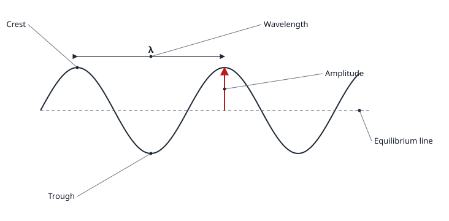

---

## SC11-05: Geometrical optics

<!-- meta {"type":"chapter_notes","id":"SC11-05","grade":11,"chapter":5,"discipline":"PHY"} -->

*Grade 11 · Chapter 5 · Physics*

Light travels in straight lines; reflection, refraction, total internal reflection and image formation by lenses are in this chapter.

### Learning objectives

- Laws of reflection
- Refraction and refractive index
- Total internal reflection
- Ray diagrams of convex and concave lenses
- Defects of the eye

### Key concepts

- Laws of reflection: angle of incidence = angle of reflection; the incident ray, reflected ray and normal lie in the same plane.
- Refraction: when light passes from one medium to another its speed changes and its direction changes; it bends towards the normal on entering a denser medium.
- Refractive index $n = \frac{\sin i}{\sin r}$ = (speed of light in air) ÷ (speed in the medium).
- Total internal reflection: when going from a denser to a less dense medium and the angle of incidence exceeds the critical angle; optical fibres, prisms.
- Convex lens: converges parallel rays to the focus; object beyond 2F → real, inverted, diminished image; between F and the lens → virtual, upright, magnified (magnifying glass).
- Concave lens: diverges; always a virtual, upright, diminished image.
- Lens formula (for checking): $\frac1v - \frac1u = \frac1f$ (Cartesian sign convention); magnification $m = v/u$.
- Eye: short sight (myopia) — concave lens; long sight (hypermetropia) — convex lens.

### Definitions

- **Refraction:** Change in direction of light when the medium changes.
- **Critical angle:** The angle of incidence at which the angle of refraction is 90°.
- **Focal point:** The point where rays parallel to the principal axis meet after refraction.

### Comparison table

| Object position (convex lens) | Image position | Properties |
|---|---|---|
| Beyond 2F | Between F and 2F | Real, inverted, diminished |
| At 2F | At 2F | Real, inverted, same size |
| Between F and 2F | Beyond 2F | Real, inverted, magnified |
| At F | At infinity | — |
| Between F and the lens | Same side | Virtual, upright, magnified |

### Everyday connections

- A stick looks bent in water — refraction.
- Optical fibre internet — total internal reflection.
- Magnifying glass — convex lens.

### Common misconceptions

- ⚠️ A concave lens gives a real image — wrong; it is always virtual.
- ⚠️ Frequency changes on refraction — wrong; speed and wavelength change.

### Exam focus

- Drawing ray diagrams and image properties (2019 Paper II Q7A) — File 6.
- Activity to find the focal length approximately (File 8).

### Related resources

- Diagram BIO-D11 — Human eye (schematic) ([labelled](science_assets/biology/BIO-D11_labelled.svg))
- Diagram PHY-D03 — Convex lens: object beyond 2F ([labelled](science_assets/physics/PHY-D03_labelled.svg))
- Diagram EXP-D04 — Focal length of a convex lens (distant object method) ([labelled](science_assets/experiments/EXP-D04_labelled.svg))
- Experiment EXP-25 — Focal length of a convex lens (approximate) (File 8)
- Calculation CL-OPTICS — Refractive index and lenses (File 5)

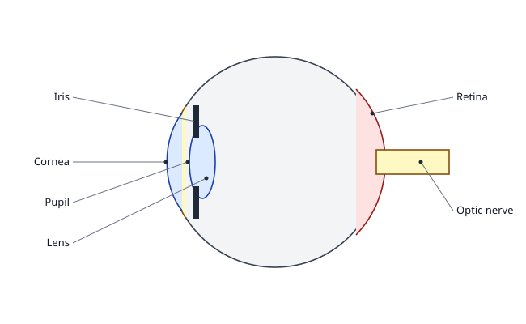

---

## SC11-06: Biological processes in the human body

<!-- meta {"type":"chapter_notes","id":"SC11-06","grade":11,"chapter":6,"discipline":"BIO"} -->

*Grade 11 · Chapter 6 · Biology*

In the human body, processes such as digestion, respiration, blood circulation, excretion and coordination work together.

### Learning objectives

- Explain the digestive system and enzymes
- Explain the respiratory system and gas exchange
- Explain the heart and blood circulation
- Explain the function of the kidney and nervous and hormonal coordination

### Key concepts

- Digestion: mouth (amylase) → oesophagus → stomach (pepsin, HCl) → small intestine (duodenum: pancreatic juice, bile; intestinal juice) → large intestine (water absorption).
- Villi of the small intestine: large surface area, thin wall, many capillaries, lacteal — adapted for absorption.
- Breathing: nose → pharynx → larynx → trachea → bronchi → alveoli — gas exchange by diffusion.
- Aerobic respiration: C₆H₁₂O₆ + 6O₂ → 6CO₂ + 6H₂O + energy (ATP). Anaerobic respiration (muscle): glucose → lactic acid.
- Heart: 4 chambers; right side deoxygenated blood → pulmonary circulation; left side oxygenated blood → systemic circulation. Valves prevent backflow. Double circulation.
- Blood: red blood cells (haemoglobin — O₂), white blood cells (defence), platelets (clotting), plasma (transport).
- Kidney: nephron — filtration (glomerulus), selective reabsorption, secretion; the main component of urine is water, then urea.
- Coordination: nervous system (brain — cerebrum, cerebellum, medulla oblongata; spinal cord; reflex action) and endocrine glands (insulin — lowers blood glucose).

### Definitions

- **Digestion:** Breaking large food molecules into small molecules that can be absorbed.
- **Reflex action:** A rapid, involuntary response to a stimulus.
- **Hormone:** A chemical messenger secreted into the blood by an endocrine gland.

### Comparison table

| Enzyme | Secreted by | Substrate → product |
|---|---|---|
| Salivary amylase | Salivary gland | Starch → maltose |
| Pepsin | Stomach | Protein → peptides |
| Lipase | Pancreas | Lipid → fatty acids + glycerol |
| Trypsin | Pancreas | Protein → peptides |
| Maltase | Small intestine | Maltose → glucose |

### Everyday connections

- Muscle cramps after hard exercise — lactic acid.
- Blockage of the coronary artery causes a heart attack (2019 Paper II Q5A).

### Common misconceptions

- ⚠️ Arteries always carry oxygenated blood — wrong; the pulmonary artery carries deoxygenated blood.
- ⚠️ Digestion ends in the stomach — wrong; it is completed in the small intestine.

### Exam focus

- Naming chambers, valves and blood vessels in a heart diagram (File 6).
- Enzyme — where secreted — substrate — product table (2019 Paper I Q16).

### Related resources

- Diagram BIO-D04 — Human heart (schematic) ([labelled](science_assets/biology/BIO-D04_labelled.svg))
- Diagram BIO-D05 — Digestive system (schematic) ([labelled](science_assets/biology/BIO-D05_labelled.svg))
- Diagram BIO-D06 — Respiratory system ([labelled](science_assets/biology/BIO-D06_labelled.svg))
- Diagram BIO-D07 — Nephron (schematic) ([labelled](science_assets/biology/BIO-D07_labelled.svg))
- Experiment EXP-06 — Comparing CO₂ in inhaled and exhaled air (File 8)

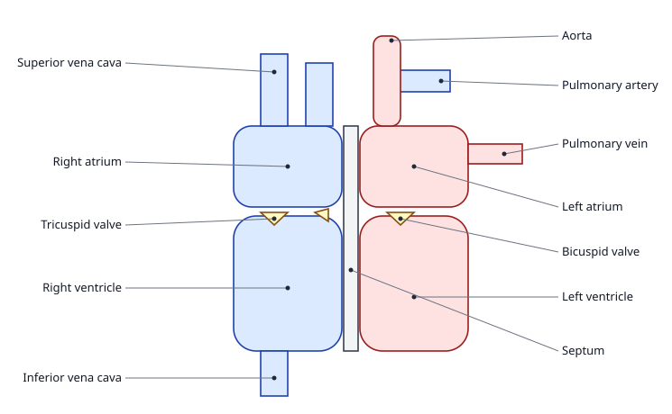

---

## SC11-07: Acids, bases and salts

<!-- meta {"type":"chapter_notes","id":"SC11-07","grade":11,"chapter":7,"discipline":"CHE"} -->

*Grade 11 · Chapter 7 · Chemistry*

Acids give H⁺ ions in water and bases (alkalis) give OH⁻ ions. In neutralisation they give salt and water.

### Learning objectives

- Define acid and base
- Distinguish strong and weak acids
- Use pH and indicators
- Neutralisation, preparation of salts

### Key concepts

- Acid (Arrhenius): gives H⁺ in water; HCl → H⁺ + Cl⁻.
- A strong acid ionises completely (HCl, H₂SO₄, HNO₃); a weak acid partially (CH₃COOH).
- Base: gives OH⁻ in water (NaOH, KOH); soluble bases are alkalis.
- pH scale 0–14: < 7 acid, 7 neutral, > 7 alkaline. At the same concentration a strong acid has a lower pH (2019 Paper I Q20).
- Indicators: litmus (red in acid, blue in alkali), phenolphthalein (pink in alkali, colourless in acid), methyl orange.
- Neutralisation: acid + base → salt + water; H⁺ + OH⁻ → H₂O; heat is released.
- Acid + metal → salt + H₂; acid + carbonate → salt + CO₂ + H₂O.
- Uses: antacids (Mg(OH)₂ — stomach acid), lime for acidic soil (2019 Paper II Q6B).

### Definitions

- **Acid:** A substance that gives H⁺ ions in aqueous solution.
- **Base:** A substance that reacts with an acid to give salt and water; an alkali gives OH⁻ in water.
- **Neutralisation:** An acid and a base reacting to give salt and water.

### Comparison table

| Indicator | Acid | Alkali |
|---|---|---|
| Litmus | Red | Blue |
| Phenolphthalein | Colourless | Pink |
| Methyl orange | Red | Yellow |

### Everyday connections

- Bee sting (acid) — soap/baking soda.
- Antacid for heartburn.

### Common misconceptions

- ⚠️ All bases dissolve in water — wrong; only the soluble ones are alkalis.
- ⚠️ Weak acid = dilute acid — wrong; strength depends on ionisation, concentration on the amount in solution.

### Exam focus

- Acid + carbonate → CO₂ test (limewater).
- Neutralisation equations; naming the salt (File 7).

### Related resources

- Diagram CHE-D03 — Preparing hydrogen — downward displacement of water ([labelled](science_assets/chemistry/CHE-D03_labelled.svg))
- Experiment EXP-11 — Neutralisation — using an indicator (File 8)
- Experiment EXP-12 — Preparing and testing hydrogen (File 8)
- Equations EQ-025, EQ-026, EQ-027, EQ-028, EQ-029, EQ-030, EQ-031, EQ-032 … (File 7)

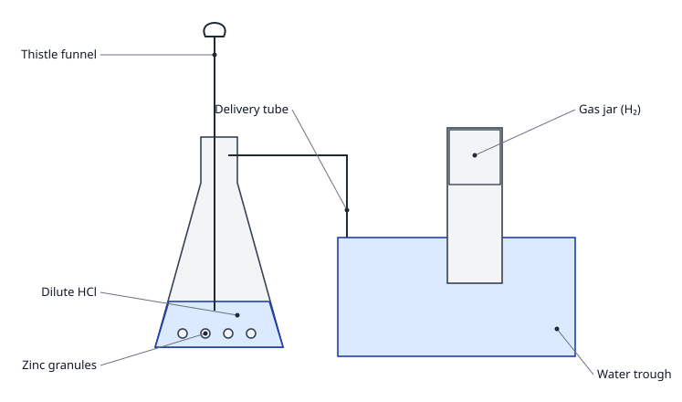

---

## SC11-08: Heat changes associated with chemical reactions

<!-- meta {"type":"chapter_notes","id":"SC11-08","grade":11,"chapter":8,"discipline":"CHE"} -->

*Grade 11 · Chapter 8 · Chemistry*

During chemical reactions, energy can be released as heat (exothermic) or absorbed (endothermic).

### Learning objectives

- Distinguish exothermic and endothermic reactions
- Draw energy level diagrams
- Calculate the heat of reaction

### Key concepts

- Exothermic reaction: heat is released; the temperature of the surroundings rises; ΔH negative (combustion, neutralisation, respiration).
- Endothermic reaction: heat is absorbed; ΔH positive (decomposition of CaCO₃, photosynthesis, dissolving NH₄Cl).
- Breaking bonds absorbs energy; forming bonds releases energy.
- Energy level diagram: in an exothermic reaction the products are below the reactants (2019 Paper I Q31).
- Heat in an equation: C₂H₄ + 3O₂ → 2CO₂ + 2H₂O, ΔH = −1400 kJ mol⁻¹ (approximately).
- Calculating heat change: $Q = mc\Delta\theta$ (link with SC11-09).

### Definitions

- **Exothermic reaction:** A reaction that releases heat to the surroundings.
- **Endothermic reaction:** A reaction that absorbs heat from the surroundings.
- **Enthalpy change (ΔH):** The heat change associated with a reaction at constant pressure.

### Comparison table

| Feature | Exothermic | Endothermic |
|---|---|---|
| Heat | Released | Absorbed |
| Temperature of surroundings | Rises | Falls |
| ΔH | Negative | Positive |
| Example | Combustion, neutralisation | Decomposition of CaCO₃, photosynthesis |

### Everyday connections

- Instant cold pack (dissolving NH₄NO₃) — endothermic.
- Gas cooker — combustion, exothermic.

### Common misconceptions

- ⚠️ Combustion needs initial heat, so it is endothermic — wrong; overall heat is released.
- ⚠️ ΔH is positive in an exothermic reaction — wrong; it is negative.

### Exam focus

- Identifying/drawing energy level diagrams.
- Heat for a given mass from a given ΔH (File 5).

### Related resources

- Diagram GR-D05 — Energy level diagram of an exothermic reaction ([labelled](science_assets/graphs/GR-D05_labelled.svg))
- Experiment EXP-17 — Heat change of neutralisation (File 8)
- Calculation CL-ENTH — Heat of reaction (File 5)
- Equations EQ-048, EQ-050 (File 7)

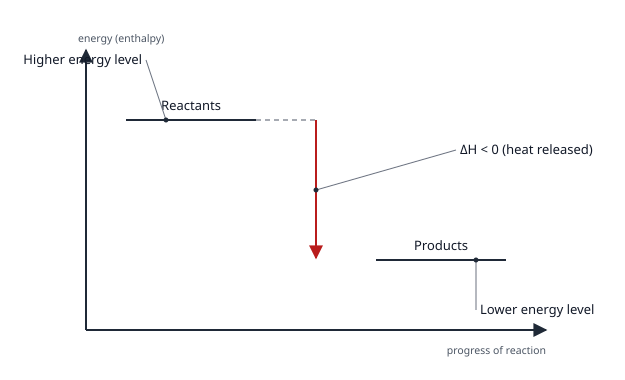

---

## SC11-09: Heat

<!-- meta {"type":"chapter_notes","id":"SC11-09","grade":11,"chapter":9,"discipline":"PHY"} -->

*Grade 11 · Chapter 9 · Physics*

Heat is energy that flows because of a temperature difference. Specific heat capacity, latent heat and methods of heat transfer are in this chapter.

### Learning objectives

- Distinguish heat and temperature
- Use Q = mcθ and Q = mL
- Explain changes of state
- Conduction, convection, radiation

### Key concepts

- Temperature: a measure of hotness/coldness (°C, K); K = °C + 273. Heat: energy that flows (J).
- Specific heat capacity (c): heat needed to raise the temperature of 1 kg of a substance by 1 °C; $Q = mc\theta$ (water c = 4200 J kg⁻¹ °C⁻¹).
- Liquids with high c are good coolants (2019 Paper II Q8B).
- Latent heat (L): heat needed to change state without a change in temperature; $Q = mL$.
- Evaporation: at any temperature, at the surface, causes cooling; boiling: at a fixed temperature, throughout the liquid (2019 Paper I Q39).
- Conduction (solids), convection (fluids — change in density), radiation (also in a vacuum; black surfaces are good absorbers/emitters).
- Thermal expansion: most things expand on heating; gaps in railway lines; anomalous expansion of water (0–4 °C).

### Definitions

- **Specific heat capacity:** The heat needed to raise the temperature of 1 kg by 1 K.
- **Specific latent heat:** The heat needed to change the state of 1 kg without changing its temperature.
- **Temperature:** A measure of how hot or cold an object is.

### Comparison table

| Feature | Evaporation | Boiling |
|---|---|---|
| Temperature | At any temperature | Only at the boiling point |
| Where | At the surface | Throughout the liquid |
| Bubbles | None | Present |
| Effect | Cools | Temperature does not change |

### Everyday connections

- Sea breeze — difference in c of land and water.
- Water cools in a clay pot — evaporation.
- Water in a vehicle radiator.

### Common misconceptions

- ⚠️ Heat and temperature are the same — wrong.
- ⚠️ Giving more heat to boiling water raises its temperature — wrong; it is used for the change of state.

### Exam focus

- Q = mcθ, Q = mL calculations (File 5).
- Heating curve (File 6).

### Related resources

- Diagram GR-D02 — Heating curve of water ([labelled](science_assets/graphs/GR-D02_labelled.svg))
- Diagram EXP-D03 — Measuring specific heat capacity (metal block) ([labelled](science_assets/experiments/EXP-D03_labelled.svg))
- Experiment EXP-24 — Specific heat capacity of a metal block (File 8)
- Calculation CL-HEAT — Specific heat capacity and latent heat (File 5)
- Calculation CL-TEMP — Converting temperature scales (File 5)

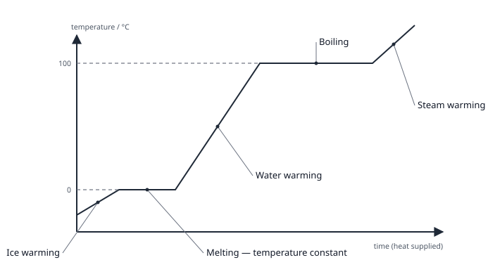

---

## SC11-10: Power and energy of electric appliances

<!-- meta {"type":"chapter_notes","id":"SC11-10","grade":11,"chapter":10,"discipline":"PHY"} -->

*Grade 11 · Chapter 10 · Physics*

Electrical appliances convert electrical energy into other forms. Power, energy consumption, kWh, electricity bills and safety are in this chapter.

### Learning objectives

- Use P = VI and E = Pt
- Calculate kWh and electricity bills
- Compare the efficiency of appliances
- Electrical safety at home

### Key concepts

- Power $P = VI = I^2R = \frac{V^2}{R}$ (W).
- Energy $E = Pt$ (J, t in seconds); commercial unit kWh = kW × hours; 1 kWh = 3.6 × 10⁶ J.
- Electricity bill = units (kWh) × price per unit.
- An LED bulb is more efficient than a filament bulb — less power for the same light (2019 Paper II Q7B).
- Fuse: melts at high current and breaks the circuit; connected in the live wire. Earthing: carries leakage current through the metal casing to the earth.
- Wire colours (Sri Lankan standard): live — brown, neutral — blue, earth — green/yellow (teacher to confirm).
- Circuit breaker (MCB), residual current breaker (RCCB/ELCB).

### Definitions

- **Electric power:** The rate at which electrical energy is converted.
- **Kilowatt-hour (kWh):** The energy used by a 1 kW appliance in 1 hour.
- **Fuse:** A thin wire that melts at high current and breaks the circuit.

### Comparison table

| Quantity | Formula | Unit |
|---|---|---|
| Power | P = VI | W |
| Energy | E = Pt | J or kWh |
| Cost | kWh × price | Rs. |

### Everyday connections

- A 2000 W kettle for 30 minutes = 1 kWh.
- On an electricity bill, 'units' = kWh.

### Common misconceptions

- ⚠️ An appliance with higher power always costs more — wrong; the time of use also matters.
- ⚠️ A fuse can be connected in the neutral wire — wrong; in the live wire.

### Exam focus

- kWh, cost and efficiency calculations (File 5).
- Choosing a fuse: a value slightly greater than I = P/V.

### Related resources

- Calculation CL-EPOWER — Electric power, energy, cost (File 5)

---

## SC11-11: Electronics

<!-- meta {"type":"chapter_notes","id":"SC11-11","grade":11,"chapter":11,"discipline":"PHY"} -->

*Grade 11 · Chapter 11 · Physics*

Electronics studies semiconductor devices such as the diode, LED and transistor and their uses.

### Learning objectives

- Explain semiconductors and doping
- Forward and reverse bias of a diode
- Rectification
- Using a transistor as a switch and an amplifier

### Key concepts

- Semiconductors (Si, Ge): conductivity between that of a conductor and an insulator; conductivity increases with temperature.
- n-type: impurity with valency 5 (P, As) — extra electrons; p-type: impurity with valency 3 (B, Al, Ga) — holes (2025 term test question type).
- p–n junction diode: conducts in forward bias (p → +); does not conduct in reverse bias.
- Rectification: converting AC into DC — half-wave (one diode), full-wave (bridge — 4 diodes).
- LED: emits light in forward bias; low power.
- Transistor (npn/pnp): emitter (E), base (B), collector (C); a small base current controls a large collector current — amplifier, switch.
- Public address system: microphone (sound → electrical), amplifier, loudspeaker (electrical → sound) (2019 Paper II Q9B).
- LDR (light-dependent resistor): resistance decreases as light increases — automatic street lamp.

### Definitions

- **Semiconductor:** A material with conductivity between that of a conductor and an insulator.
- **Doping:** Adding a small amount of impurity to a semiconductor to change its conductivity.
- **Rectification:** Converting alternating current into direct current.

### Comparison table

| Impurity | Valency | Type | Majority carriers |
|---|---|---|---|
| P, As | 5 | n-type | Electrons |
| B, Al | 3 | p-type | Holes |

### Everyday connections

- A rectifier in a mobile phone charger.
- Automatic street lamp — LDR + transistor switch.

### Common misconceptions

- ⚠️ A diode conducts in both directions — wrong.
- ⚠️ A transistor creates energy — wrong; it controls energy from the power supply.

### Exam focus

- Predicting which bulb lights in a diode circuit.
- Transistor terminals, amplifier system (File 6).

### Related resources

- Diagram PHY-D08 — Public address system (block diagram) ([labelled](science_assets/physics/PHY-D08_labelled.svg))
- Diagram PHY-D09 — npn transistor symbol ([labelled](science_assets/physics/PHY-D09_labelled.svg))

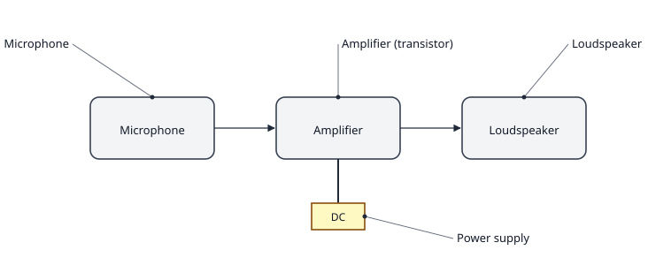

---

## SC11-12: Electrochemistry

<!-- meta {"type":"chapter_notes","id":"SC11-12","grade":11,"chapter":12,"discipline":"CHE"} -->

*Grade 11 · Chapter 12 · Chemistry*

Electrochemistry studies conversions between chemical and electrical energy: electrochemical cells produce electricity; electrolysis uses electricity to drive reactions.

### Learning objectives

- Explain a simple electrochemical cell
- Write electrode reactions in electrolysis
- Electroplating, extraction of metals
- Explain corrosion and its prevention

### Key concepts

- Electrochemical cell: the more reactive metal is the negative electrode (anode, oxidation) — Zn → Zn²⁺ + 2e⁻; the less reactive is the positive electrode — Cu²⁺ + 2e⁻ → Cu.
- Electrolysis: decomposition of an electrolyte (molten/dissolved ionic compound) by an electric current. Oxidation at the anode (+); reduction at the cathode (−).
- Molten NaCl: cathode Na⁺ + e⁻ → Na; anode 2Cl⁻ → Cl₂ + 2e⁻ (Downs cell).
- Aqueous NaCl (concentrated): H₂ at the cathode (the solution becomes alkaline and phenolphthalein turns pink), Cl₂ at the anode (2019 Paper II Q9A).
- Electroplating: the object to be plated is the cathode; the plating metal is the anode; a solution of its salt is the electrolyte.
- Rusting of iron needs O₂ and water; prevention: paint, grease, galvanizing, sacrificial anode (Mg/Zn).

### Definitions

- **Electrolysis:** Decomposition of an electrolyte by an electric current.
- **Oxidation:** Loss of electrons.
- **Reduction:** Gain of electrons.
- **Corrosion:** Destruction of a metal by reaction with its surroundings.

### Comparison table

| Electrolyte | Cathode (−) | Anode (+) |
|---|---|---|
| Molten NaCl | Na | Cl₂ |
| Aqueous NaCl (concentrated) | H₂ | Cl₂ |
| CuSO₄ (Cu electrodes) | Cu deposited | Cu dissolves |

### Everyday connections

- Silver-plated spoons.
- Zn blocks on ship hulls — sacrificial protection.

### Common misconceptions

- ⚠️ Electrons travel through the solution in a cell — wrong; they travel through the external circuit; ions move in the solution.
- ⚠️ The anode is always positive — positive in electrolysis, negative in an electrochemical cell; general definition: the electrode where oxidation takes place.

### Exam focus

- Electrode reactions and observations (File 7).
- Rusting experiment (File 8).

### Related resources

- Diagram CHE-D02 — Electrolytic cell ([labelled](science_assets/chemistry/CHE-D02_labelled.svg))
- Diagram CHE-D06 — Simple cell (Zn–Cu) ([labelled](science_assets/chemistry/CHE-D06_labelled.svg))
- Experiment EXP-15 — Electrolysis of copper sulfate solution / copper plating (File 8)
- Experiment EXP-16 — Conditions for rusting of iron (File 8)
- Equations EQ-046, EQ-047 (File 7)

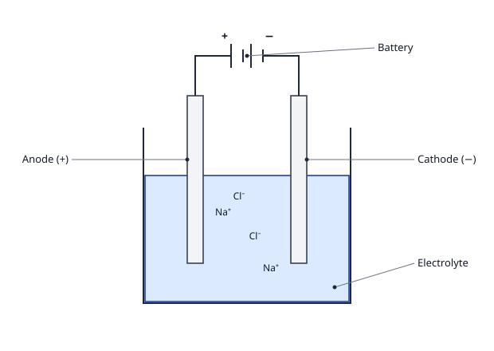

---

## SC11-13: Electromagnetism and electromagnetic induction

<!-- meta {"type":"chapter_notes","id":"SC11-13","grade":11,"chapter":13,"discipline":"PHY"} -->

*Grade 11 · Chapter 13 · Physics*

Electric current produces a magnetic field; a magnetic field exerts a force on a current-carrying conductor; a changing magnetic field induces electricity. These are the basis of motors, generators and transformers.

### Learning objectives

- Draw magnetic field lines
- Magnetic effect of current — right-hand grip rule
- Force on a conductor — Fleming's left-hand rule, motor
- Electromagnetic induction — generator, transformer

### Key concepts

- Magnetic field lines go from the north pole to the south pole; close lines = strong field.
- A circular field around a straight conductor — right-hand grip rule (thumb current, fingers field). Solenoid — a field like a bar magnet; soft-iron core — electromagnet.
- Force on a current-carrying conductor in a magnetic field — Fleming's left-hand rule (thumb — force/motion, first finger — field, second finger — current) (2019 Paper I Q28). DC motor, loudspeaker.
- Electromagnetic induction (Faraday): an e.m.f. is induced when the magnetic flux through a conductor changes; moving the magnet faster, more turns, a stronger magnet — larger induced e.m.f.
- Generator: mechanical energy → electrical energy.
- Transformer: works on AC only; $\frac{V_s}{V_p} = \frac{N_s}{N_p}$; in the ideal case $V_pI_p = V_sI_s$; step-up, step-down. Efficiency = (Ps/Pp) × 100% (2019 Paper I Q23).

### Definitions

- **Electromagnetic induction:** Inducing an e.m.f. in a conductor by a changing magnetic flux.
- **Transformer:** A device that increases/decreases AC voltage.
- **Electromagnet:** A coil with a soft-iron core that becomes a magnet only when current flows.

### Comparison table

| Device | Energy change | Principle |
|---|---|---|
| Motor | Electrical → mechanical | Force on a conductor |
| Generator | Mechanical → electrical | Electromagnetic induction |
| Transformer | AC voltage change | Mutual induction |
| Loudspeaker | Electrical → sound | Force on a conductor |

### Everyday connections

- Electromagnets in cranes.
- High-voltage transmission in power distribution — step-up transformers, step-down transformers for homes.
- Electric fan — motor.

### Common misconceptions

- ⚠️ A transformer works on DC — wrong; a changing flux is needed.
- ⚠️ A step-up transformer increases energy — wrong; voltage increases, current decreases.

### Exam focus

- Transformer calculations (File 5).
- Magnetic field line diagrams (File 6).

### Related resources

- Diagram PHY-D04 — Magnetic field lines of a bar magnet ([labelled](science_assets/physics/PHY-D04_labelled.svg))
- Diagram PHY-D07 — Transformer ([labelled](science_assets/physics/PHY-D07_labelled.svg))
- Diagram PHY-D12 — Solenoid and electromagnet ([labelled](science_assets/physics/PHY-D12_labelled.svg))
- Experiment EXP-26 — Electromagnetic induction (magnet + coil) (File 8)
- Calculation CL-TRANS — Transformer (File 5)

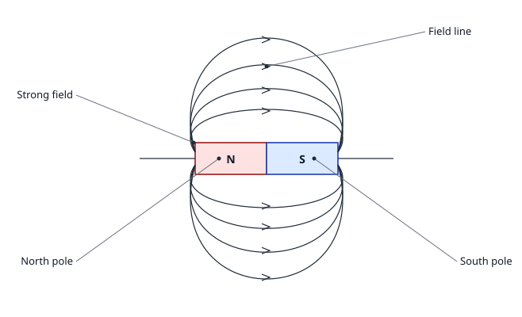

---

## SC11-14: Hydrocarbons and their derivatives

<!-- meta {"type":"chapter_notes","id":"SC11-14","grade":11,"chapter":14,"discipline":"CHE"} -->

*Grade 11 · Chapter 14 · Chemistry*

Hydrocarbons are compounds containing only C and H. Their derivatives — alcohols, carboxylic acids and polymers — are important in daily life.

### Learning objectives

- Distinguish the alkane, alkene and alkyne series
- Name simple compounds
- Write combustion and addition reactions
- Explain polymers and their environmental impact

### Key concepts

- Alkanes CₙH₂ₙ₊₂ (single bonds; saturated): methane CH₄, ethane C₂H₆, propane C₃H₈, butane C₄H₁₀.
- Alkenes CₙH₂ₙ (C=C; unsaturated): ethene C₂H₄, propene C₃H₆. Alkynes CₙH₂ₙ₋₂ (C≡C): ethyne C₂H₂.
- Complete combustion: CH₄ + 2O₂ → CO₂ + 2H₂O; incomplete combustion forms CO / C (soot).
- Test for unsaturation: bromine water (orange) becomes colourless with an alkene.
- Addition polymerisation: n CH₂=CH₂ → —(CH₂—CH₂)ₙ— (polythene); PVC, polystyrene. Natural polymers: rubber, protein, cellulose (2019 Paper I Q27).
- Alcohol functional group –OH (ethanol C₂H₅OH); carboxylic acid –COOH (acetic acid CH₃COOH).
- Fractional distillation of crude oil: LP gas, petrol, kerosene, diesel, lubricating oil, tar.
- Plastic waste does not decompose — 4R, recycling.

### Definitions

- **Hydrocarbon:** A compound containing only carbon and hydrogen.
- **Homologous series:** A series of compounds with the same general formula and similar chemical properties, in which successive members differ by CH₂.
- **Polymerisation:** Many monomers joining to form a polymer.

### Comparison table

| Series | General formula | Bond | First member |
|---|---|---|---|
| Alkane | CₙH₂ₙ₊₂ | C–C | CH₄ |
| Alkene | CₙH₂ₙ | C=C | C₂H₄ |
| Alkyne | CₙH₂ₙ₋₂ | C≡C | C₂H₂ |

### Everyday connections

- LP gas — propane + butane.
- Ethene to ripen fruit.
- Vinegar — dilute acetic acid.

### Common misconceptions

- ⚠️ Polythene contains C=C double bonds — wrong; they open up during polymerisation.
- ⚠️ Ethanol is a hydrocarbon — wrong; it contains O, so it is a derivative.

### Exam focus

- Identifying homologous series from structural formulae.
- Balancing combustion equations (File 7).

### Related resources

- Equations EQ-034, EQ-035, EQ-036, EQ-037, EQ-038, EQ-039, EQ-040 (File 7)

---

## SC11-15: Biosphere (Grade 11)

<!-- meta {"type":"chapter_notes","id":"SC11-15","grade":11,"chapter":15,"discipline":"BIO"} -->

*Grade 11 · Chapter 15 · Biology*

Maintaining the balance of the biosphere, pollution, global environmental problems and sustainable development are covered in this chapter.

### Learning objectives

- Explain the types and effects of pollution
- Explain the greenhouse effect, ozone depletion and acid rain
- Propose methods of sustainable development

### Key concepts

- Air pollution: CO, SO₂, NOₓ, particulates; SO₂ and NO₂ cause acid rain.
- Greenhouse gases: CO₂, CH₄, N₂O, CFCs, water vapour — global warming.
- The ozone layer (O₃) absorbs UV rays; CFCs destroy ozone (2019 Paper I Q35).
- Water pollution: fertiliser run-off → eutrophication → algal bloom → less O₂ → fish die.
- Heavy metals (Pb, Hg, Cd, As) bioaccumulate through the food chain.
- Photochemical smog: NOₓ + hydrocarbons + sunlight.
- 4R: Reduce, Reuse, Recycle, Refuse; reducing food mileage — less CO₂ released.
- Sustainable development: meeting today's needs without harming the needs of future generations.

### Definitions

- **Greenhouse effect:** Atmospheric gases trapping heat radiation leaving the Earth.
- **Eutrophication:** Increase of nutrients in water bodies causing algal bloom.
- **Sustainable development:** Development that does not harm future needs.

### Comparison table

| Problem | Cause | Effect |
|---|---|---|
| Acid rain | SO₂, NO₂ | Damage to buildings, forests, water bodies |
| Global warming | CO₂, CH₄ | Sea level rise, climate change |
| Ozone depletion | CFCs | More UV, skin cancer |
| Eutrophication | Fertiliser, sewage | Less O₂, fish die |

### Everyday connections

- Buying local products reduces food mileage (2019 Paper I Q40).
- Biogas — CH₄ from organic waste (2019 Paper II Q1).

### Common misconceptions

- ⚠️ The ozone hole is the main cause of global warming — wrong; they are separate problems.
- ⚠️ CO₂ is a problem because it is poisonous — wrong; the problem is the greenhouse effect.

### Exam focus

- Pollutant — effect — solution table.
- Primary and secondary pollutants (SO₂ → H₂SO₄).
---

## Limitations

- The notes were not prepared by reading the NIE syllabus document or the textbooks directly; only the chapter titles were checked on e-thaksalawa. Teacher review is recommended.
- Some terms may differ from textbook usage (e.g. some biological names) — teachers should confirm.
- Apart from the 2019 notes in 'Exam focus', papers from other years were not analysed in this edition.
