# StudyBuddy — Practical Experiments

> All experiments are **only for the school laboratory, under teacher supervision**. They must not be done at home. Dangerous home experiments are not included.
> The 'expected observation' sections are not real measurements. The virtual experiment specifications are for website developers — this Markdown file does not run simulations.


---

## EXP-01: Tests for starch, sugar, protein and lipid in food

<!-- meta {"type":"experiment","id":"EXP-01","chapter_id":"SC10-01","discipline":"BIO","diagram":null,"teacher_demo_only":false,"has_virtual":false} -->

*Chemical basis of life*

**Aim:** Identifying biological molecules in food samples.

**Apparatus:** Test tubes, Water bath, Dropper, Filter paper

**Chemicals/materials:** Iodine solution, Benedict's solution, Biuret reagent (NaOH + CuSO₄), Sudan III

**Safety:** Wear safety goggles; do this only in the school laboratory under teacher supervision; do not do it at home. Do the Benedict's test in a hot-water bath.

| Variable type | Details |
|---|---|
| Independent variable | Type of food sample |
| Dependent variable | Colour change |
| Controlled variables | Amount of sample, amount of reagent, temperature |

**Method:**

1. Grind the samples with water to make an extract.
2. Starch: a few drops of iodine — blue-black.
3. Reducing sugar: an equal volume of Benedict's, 3–5 minutes in hot water — brick-red precipitate.
4. Protein: NaOH then drops of dilute CuSO₄ — purple.
5. Lipid: Sudan III — red layer; or a translucent spot on paper.

**Expected observation:** Rice extract + iodine → blue-black; egg white + biuret → purple (expected results).

**Conclusion:** Each test is specific to a particular molecule.

**Sources of error:** No control tube (water only); Not enough heating

**Exam-style questions (original):** Why is sucrose negative in the Benedict's test? · What is the purpose of the control test?

---

## EXP-02: Onion skin cells under a microscope

<!-- meta {"type":"experiment","id":"EXP-02","chapter_id":"SC10-06","discipline":"BIO","diagram":"BIO-D01","teacher_demo_only":false,"has_virtual":false} -->

*Structure and functions of plant and animal cells*

**Aim:** Observing plant cell structures.

**Apparatus:** Compound microscope, Slide, Cover slip, Needle, Blade

**Chemicals/materials:** Iodine solution or methylene blue, Water

**Safety:** Handle the blade carefully; glass slides can break.

| Variable type | Details |
|---|---|
| Independent variable | Magnification (×40 / ×100 / ×400) |
| Dependent variable | Structures that can be observed |
| Controlled variables | Thickness of the specimen, stain |

**Method:**

1. Peel the inner skin from an onion scale leaf.
2. Spread it in a drop of water on the slide; add one drop of iodine.
3. Lower the cover slip at 45° without bubbles.
4. Focus at low magnification, then high magnification.
5. Draw and label the cells (File 6: BIO-D01).

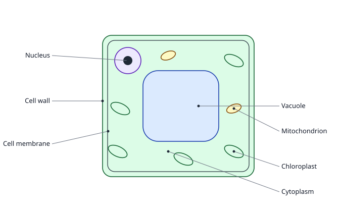

**Expected observation:** Rectangular cells, cell wall and nucleus clear; no chloroplasts.

**Conclusion:** Onion skin does not carry out photosynthesis, so it has no chloroplasts.

**Sources of error:** Air bubbles; Specimen too thick

**Exam-style questions (original):** Why were no chloroplasts seen? · Calculate the total magnification (×10 × ×40).

---

## EXP-03: Light is necessary for photosynthesis (starch test)

<!-- meta {"type":"experiment","id":"EXP-03","chapter_id":"SC11-02","discipline":"BIO","diagram":"EXP-D01","teacher_demo_only":false,"has_virtual":false} -->

*Photosynthesis*

**Aim:** Showing that starch does not form in a leaf without light.

**Apparatus:** Potted plant, Black paper/aluminium foil, Beaker, Boiling tube, Water bath

**Chemicals/materials:** Alcohol (ethanol), Iodine solution

**Safety:** Alcohol catches fire easily — do not heat it over a naked flame; use a hot-water bath only.

| Variable type | Details |
|---|---|
| Independent variable | Light (covered / uncovered part) |
| Dependent variable | Colour with iodine |
| Controlled variables | Plant, leaf, time, temperature |

**Method:**

1. Destarch the plant by keeping it in the dark for 48 hours.
2. Cover part of a leaf with black paper.
3. Keep it in sunlight for 4–6 hours.
4. Treat the leaf in the steps boiling water, hot alcohol, warm water (EXP-D01).
5. Add iodine.

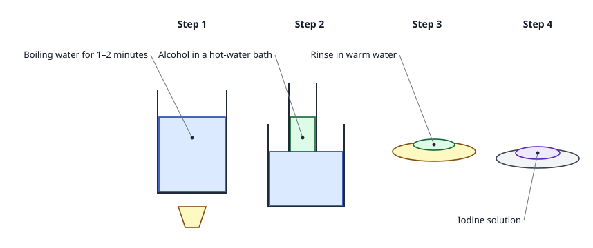

**Expected observation:** Uncovered part blue-black; covered part brown/yellow.

**Conclusion:** Light is necessary for starch to form.

**Sources of error:** Starch not completely removed; Light leaking in at the edges of the cover

**Exam-style questions (original):** Why destarch? · What is the role of alcohol?

---

## EXP-04: Light intensity and rate of photosynthesis (Hydrilla)

<!-- meta {"type":"experiment","id":"EXP-04","chapter_id":"SC11-02","discipline":"BIO","diagram":"EXP-D02","teacher_demo_only":false,"has_virtual":true} -->

*Photosynthesis*

**Aim:** Investigating how the rate of O₂ bubbles changes with the distance of the light source.

**Apparatus:** Hydrilla, Beaker, Funnel, Test tube, Lamp, Metre rule, Stopwatch

**Chemicals/materials:** NaHCO₃ solution (dilute)

**Safety:** Keep the electric lamp away from water; do not touch electrical equipment with wet hands.

| Variable type | Details |
|---|---|
| Independent variable | Lamp distance d |
| Dependent variable | Number of bubbles per minute |
| Controlled variables | Plant, water temperature, CO₂ (NaHCO₃) concentration |

**Method:**

1. Set up the apparatus as in EXP-D02.
2. Place the lamp at 10 cm and let it settle for 5 minutes.
3. Count the bubbles in 1 minute; three times.
4. Repeat at 20, 30 and 40 cm.
5. Plot rate against 1/d².

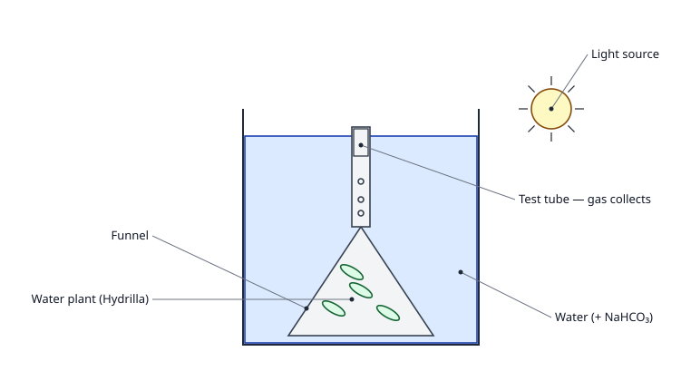

**Expected observation:** As distance increases, the bubble rate decreases (sample data — model calculation only).

**Conclusion:** As light intensity increases, the rate of photosynthesis increases — until another factor limits it.

**Sources of error:** Heat from the lamp changing the water temperature — use a water screen as a heat shield; Unequal bubble sizes

**Exam-style questions (original):** What is a limiting factor? · What is the purpose of adding NaHCO₃?

<details><summary>Virtual experiment specification (for developers)</summary>

```json
{
 "inputs": [
  {
   "symbol": "d",
   "name": "Lamp distance",
   "unit": "cm",
   "min": 10,
   "max": 50
  }
 ],
 "outputs": [
  {
   "symbol": "rate",
   "name": "Bubbles/minute"
  }
 ],
 "model": "rate = min(Rmax, k / d²); k = 6000, Rmax = 40 (teaching model)",
 "test_cases": [
  [
   10,
   40
  ],
  [
   20,
   15
  ],
  [
   30,
   6.666666666666667
  ]
 ],
 "note": "The sample numbers are for teaching; they are not real measurements."
}
```

Test cases were checked in Python against the model equation.

</details>

---

## EXP-05: Effect of temperature on the activity of the enzyme amylase

<!-- meta {"type":"experiment","id":"EXP-05","chapter_id":"SC10-01","discipline":"BIO","diagram":null,"teacher_demo_only":false,"has_virtual":false} -->

*Chemical basis of life*

**Aim:** Finding the optimum temperature.

**Apparatus:** Test tubes, Water baths (0, 20, 37, 60 °C), White tile, Stopwatch

**Chemicals/materials:** 1% starch solution, Amylase (or diluted saliva — with teacher permission), Iodine

**Safety:** Wear safety goggles; do this only in the school laboratory under teacher supervision; do not do it at home.

| Variable type | Details |
|---|---|
| Independent variable | Temperature |
| Dependent variable | Time until iodine no longer gives blue-black |
| Controlled variables | Amount of starch/enzyme, pH |

**Method:**

1. At each temperature keep the starch and the enzyme separately for 5 minutes.
2. Mix and start timing.
3. Every 30 s test one drop with iodine.
4. Record the time when blue-black no longer appears.

**Expected observation:** Fast at 37 °C; very slow at 0 °C; denatured at 60 °C — no reaction.

**Conclusion:** An enzyme has an optimum temperature.

**Sources of error:** Sampling interval too long; Temperature changing

**Exam-style questions (original):** What happens to an enzyme at a high temperature?

---

## EXP-06: Comparing CO₂ in inhaled and exhaled air

<!-- meta {"type":"experiment","id":"EXP-06","chapter_id":"SC11-06","discipline":"BIO","diagram":null,"teacher_demo_only":false,"has_virtual":false} -->

*Biological processes in the human body*

**Aim:** Showing that exhaled air contains more CO₂.

**Apparatus:** Two boiling tubes, Bent tubes, Stoppers

**Chemicals/materials:** Clear lime water

**Safety:** Do not suck through the tube — blow/breathe in only through the correct tube; use your own tube.

| Variable type | Details |
|---|---|
| Independent variable | Type of air |
| Dependent variable | Time for lime water to turn milky |
| Controlled variables | Amount of lime water, number of breaths |

**Method:**

1. Equal amounts of lime water in both tubes.
2. Breathe in slowly through one tube and breathe out through the other.
3. An equal number of breaths.
4. Compare the milkiness.

**Expected observation:** The exhaled-air tube turns milky faster.

**Conclusion:** Exhaled air contains more CO₂.

**Sources of error:** Difference in depth of breathing

**Exam-style questions (original):** Write the equation for Ca(OH)₂ + CO₂ (File 7: EQ-033).

---

## EXP-07: Conditions for seed germination

<!-- meta {"type":"experiment","id":"EXP-07","chapter_id":"SC10-14","discipline":"BIO","diagram":null,"teacher_demo_only":false,"has_virtual":false} -->

*Continuity of life*

**Aim:** Showing that water, oxygen and a suitable temperature are necessary.

**Apparatus:** 4 test tubes, Cotton wool, Green gram seeds, Refrigerator

**Chemicals/materials:** Boiled and cooled water, Oil

**Safety:** Use the refrigerator with teacher permission.

| Variable type | Details |
|---|---|
| Independent variable | Condition (water / O₂ / temperature) |
| Dependent variable | Germination (yes/no) |
| Controlled variables | Type and number of seeds |

**Method:**

1. A: damp cotton wool, room temperature (control).
2. B: dry cotton wool.
3. C: submerged in boiled and cooled water with a layer of oil on top (no O₂).
4. D: damp cotton wool, refrigerator.
5. Observe for 3–4 days.

**Expected observation:** Only A germinates.

**Conclusion:** Germination needs water, O₂ and a suitable temperature.

**Sources of error:** Seeds being dead

**Exam-style questions (original):** Why boiled water? · What is the role of the oil layer?

---

## EXP-08: Flame test

<!-- meta {"type":"experiment","id":"EXP-08","chapter_id":"SC10-03","discipline":"CHE","diagram":null,"teacher_demo_only":true,"has_virtual":false} -->

*Structure of matter* · ⚠️ **Teacher demonstration only**

**Aim:** Identifying metal ions by flame colour.

**Apparatus:** Nichrome wire / damp wooden splint, Bunsen burner, Watch glass

**Chemicals/materials:** NaCl, KCl, CaCl₂, CuCl₂ (small amounts), Dilute HCl (to clean the wire)

**Safety:** Wear safety goggles; do this only in the school laboratory under teacher supervision; do not do it at home. It is best done as a teacher demonstration.

| Variable type | Details |
|---|---|
| Independent variable | Type of salt |
| Dependent variable | Flame colour |
| Controlled variables | Type of flame (blue flame), cleanliness of the wire |

**Method:**

1. Dip the wire in HCl and clean it in the flame until it gives no colour.
2. Touch the salt and hold it in the blue flame.
3. Record the colour.
4. Clean the wire between each salt.

**Expected observation:** Na — golden yellow; K — lilac; Ca — brick red; Cu — blue-green.

**Conclusion:** Characteristic colours because electrons jump between energy levels.

**Sources of error:** Contaminated wire — the yellow of Na hides other colours

**Exam-style questions (original):** Why use cobalt blue glass to see the colour of K?

---

## EXP-09: Temperature and rate of reaction (sodium thiosulfate + HCl)

<!-- meta {"type":"experiment","id":"EXP-09","chapter_id":"SC10-17","discipline":"CHE","diagram":"GR-D03","teacher_demo_only":false,"has_virtual":true} -->

*Rate of reactions*

**Aim:** Showing that the rate of reaction increases as temperature increases.

**Apparatus:** Conical flask, Measuring cylinder, Thermometer, Stopwatch, White paper marked 'X'

**Chemicals/materials:** Na₂S₂O₃ solution, Dilute HCl

**Safety:** Wear safety goggles; do this only in the school laboratory under teacher supervision; do not do it at home. SO₂ is released — use a well-ventilated place; take care if you have asthma.

| Variable type | Details |
|---|---|
| Independent variable | Temperature |
| Dependent variable | Time t for the 'X' to disappear |
| Controlled variables | Concentrations, volumes, flask |

**Method:**

1. Warm the thiosulfate to 20, 30, 40, 50 °C.
2. Flask over the 'X'; add HCl and start timing.
3. Record the time when the 'X' can no longer be seen.
4. Graph of 1/t against temperature.

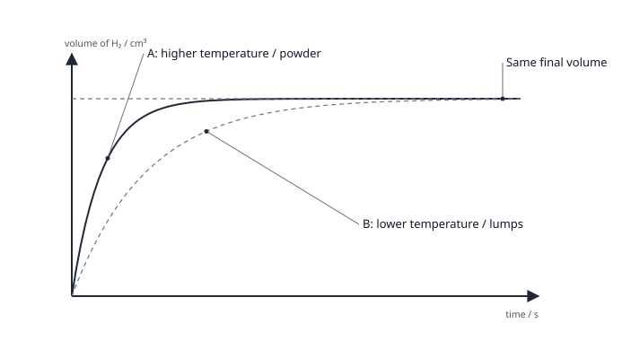

**Expected observation:** As temperature increases t decreases; 1/t increases (sample model).

**Conclusion:** As temperature increases, the kinetic energy of the particles and the number of effective collisions increase.

**Sources of error:** Subjectivity in judging when the 'X' disappears

**Exam-style questions (original):** Why is 1/t a measure of rate?

<details><summary>Virtual experiment specification (for developers)</summary>

```json
{
 "inputs": [
  {
   "symbol": "T",
   "name": "Temperature",
   "unit": "°C",
   "min": 20,
   "max": 60
  }
 ],
 "outputs": [
  {
   "symbol": "t",
   "name": "Time (s)"
  }
 ],
 "model": "t = 120 / 2^((T − 20)/10) (teaching model — the rate doubles for every 10 °C)",
 "test_cases": [
  [
   20,
   120
  ],
  [
   30,
   60
  ],
  [
   40,
   30
  ]
 ],
 "note": "An approximate 'doubling rule' — not real data."
}
```

Test cases were checked in Python against the model equation.

</details>

---

## EXP-10: Surface area and rate of reaction (CaCO₃ + HCl)

<!-- meta {"type":"experiment","id":"EXP-10","chapter_id":"SC10-17","discipline":"CHE","diagram":"GR-D03","teacher_demo_only":false,"has_virtual":false} -->

*Rate of reactions*

**Aim:** Showing that powdered CaCO₃ reacts faster.

**Apparatus:** Conical flask, Balance, Cotton wool plug, Stopwatch

**Chemicals/materials:** Limestone lumps and powder, Dilute HCl

**Safety:** Wear safety goggles; do this only in the school laboratory under teacher supervision; do not do it at home.

| Variable type | Details |
|---|---|
| Independent variable | Particle size |
| Dependent variable | Mass lost / time |
| Controlled variables | Mass of CaCO₃, amount of acid, concentration, temperature |

**Method:**

1. Acid + cotton wool in the flask; place on the balance.
2. Add the CaCO₃ lumps and record the mass every 30 s.
3. Repeat with powder.
4. Plot mass lost against time.


**Expected observation:** The powder curve is steeper; the final mass lost is the same.

**Conclusion:** As surface area increases, the collision frequency increases.

**Sources of error:** Loss of water vapour with the CO₂

**Exam-style questions (original):** What is the role of the cotton wool plug? · Equation: EQ-029

---

## EXP-11: Neutralisation — using an indicator

<!-- meta {"type":"experiment","id":"EXP-11","chapter_id":"SC11-07","discipline":"CHE","diagram":null,"teacher_demo_only":false,"has_virtual":true} -->

*Acids, bases and salts*

**Aim:** Finding the amount of base needed to neutralise an acid.

**Apparatus:** Burette, Pipette, Conical flask, White tile

**Chemicals/materials:** Dilute HCl, Dilute NaOH, Phenolphthalein

**Safety:** Wear safety goggles; do this only in the school laboratory under teacher supervision; do not do it at home. NaOH corrodes skin — wash with water immediately.

| Variable type | Details |
|---|---|
| Independent variable | Volume of NaOH added |
| Dependent variable | Indicator colour |
| Controlled variables | Volume of acid, concentrations |

**Method:**

1. 25.0 cm³ of HCl in the flask; 2 drops of phenolphthalein.
2. Add NaOH from the burette while swirling.
3. Stop when a permanent pink colour appears.
4. Repeat until readings agree.

**Expected observation:** Colourless → pink (end point).

**Conclusion:** H⁺ + OH⁻ → H₂O.

**Sources of error:** Overshooting the end point; Reading the meniscus

**Exam-style questions (original):** How do antacids work?

<details><summary>Virtual experiment specification (for developers)</summary>

```json
{
 "inputs": [
  {
   "symbol": "Va",
   "name": "Volume of acid",
   "unit": "cm³",
   "min": 10,
   "max": 50
  },
  {
   "symbol": "Ca",
   "name": "Concentration of acid",
   "unit": "mol dm⁻³",
   "min": 0.05,
   "max": 1
  },
  {
   "symbol": "Cb",
   "name": "Concentration of base",
   "unit": "mol dm⁻³",
   "min": 0.05,
   "max": 1
  }
 ],
 "outputs": [
  {
   "symbol": "Vb",
   "name": "End-point volume (cm³)"
  }
 ],
 "model": "Vb = Ca·Va / Cb (1:1 ratio)",
 "test_cases": [
  [
   25,
   0.1,
   0.1,
   25
  ],
  [
   25,
   0.2,
   0.1,
   50
  ],
  [
   20,
   0.1,
   0.2,
   10
  ]
 ],
 "note": "HCl–NaOH 1:1."
}
```

Test cases were checked in Python against the model equation.

</details>

---

## EXP-12: Preparing and testing hydrogen

<!-- meta {"type":"experiment","id":"EXP-12","chapter_id":"SC11-07","discipline":"CHE","diagram":"CHE-D03","teacher_demo_only":false,"has_virtual":false} -->

*Acids, bases and salts*

**Aim:** Preparing H₂ from Zn + HCl.

**Apparatus:** Conical flask, Thistle funnel, Delivery tube, Water trough, Gas jars

**Chemicals/materials:** Zinc granules, Dilute HCl

**Safety:** Wear safety goggles; do this only in the school laboratory under teacher supervision; do not do it at home. An H₂–air mixture explodes: let the first jars escape; keep flames away.

| Variable type | Details |
|---|---|
| Independent variable | — |
| Dependent variable | Properties of the gas |
| Controlled variables | — |

**Method:**

1. Apparatus CHE-D03.
2. Add the acid through the thistle funnel.
3. Let the air mixture in the first 1–2 jars escape.
4. Collect by downward displacement of water.
5. Bring the test tube near a burning splint — 'pop'.

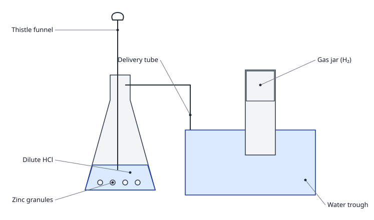

**Expected observation:** Effervescence; 'pop' sound.

**Conclusion:** Zn + 2HCl → ZnCl₂ + H₂ (EQ-013).

**Sources of error:** Mixing with air

**Exam-style questions (original):** Why is H₂ collected over water?

---

## EXP-13: Pure water from salt water by distillation

<!-- meta {"type":"experiment","id":"EXP-13","chapter_id":"SC11-03","discipline":"CHE","diagram":"CHE-D04","teacher_demo_only":false,"has_virtual":false} -->

*Mixtures*

**Aim:** Separating the solvent from a solution.

**Apparatus:** Distillation flask, Liebig condenser, Thermometer, Beaker, Boiling chips

**Chemicals/materials:** Salt solution

**Safety:** Wear safety goggles; do this only in the school laboratory under teacher supervision; do not do it at home. Add boiling chips; do not heat a closed apparatus.

| Variable type | Details |
|---|---|
| Independent variable | — |
| Dependent variable | Purity of the distillate (boiling point 100 °C) |
| Controlled variables | — |

**Method:**

1. Apparatus CHE-D04.
2. Cold water from bottom to top.
3. Heat gently; thermometer 100 °C.
4. Collect the distillate and test for salty taste/residue on evaporation.

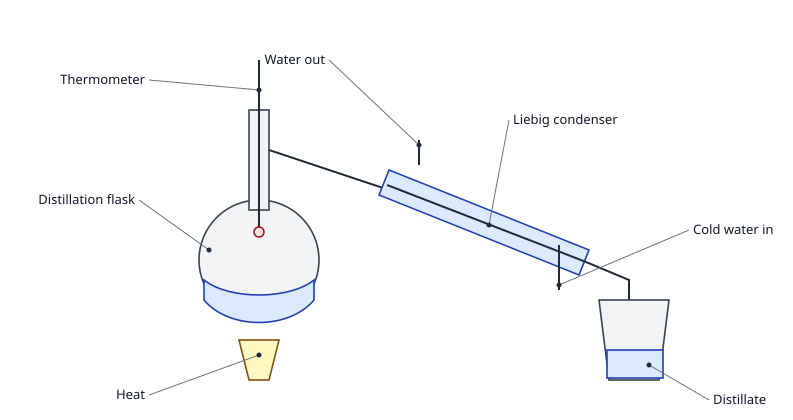

**Expected observation:** The distillate is salt-free; salt remains in the flask.

**Conclusion:** Separation by difference in boiling point.

**Sources of error:** Thermometer bulb in the wrong place

**Exam-style questions (original):** Why does cold water enter from the bottom?

---

## EXP-14: Paper chromatography (ink pigments)

<!-- meta {"type":"experiment","id":"EXP-14","chapter_id":"SC11-03","discipline":"CHE","diagram":null,"teacher_demo_only":false,"has_virtual":true} -->

*Mixtures*

**Aim:** Separating the pigments in ink.

**Apparatus:** Chromatography paper, Beaker, Pencil

**Chemicals/materials:** Water/ethanol, Ink spots

**Safety:** Ethanol catches fire — avoid flames.

| Variable type | Details |
|---|---|
| Independent variable | Type of ink |
| Dependent variable | Pigment spots, Rf |
| Controlled variables | Solvent, paper, time |

**Method:**

1. Base line in pencil.
2. Put the ink spots on it.
3. Hang the paper so that the line is above the solvent.
4. Mark the solvent front; Rf = pigment distance ÷ solvent distance.

**Expected observation:** Black ink separates into several colours.

**Conclusion:** Separation due to differences in solubility and adsorption.

**Sources of error:** Base line drawn in pen

**Exam-style questions (original):** Why is the base line drawn in pencil?

<details><summary>Virtual experiment specification (for developers)</summary>

```json
{
 "inputs": [
  {
   "symbol": "dx",
   "name": "Pigment distance",
   "unit": "cm",
   "min": 0,
   "max": 10
  },
  {
   "symbol": "ds",
   "name": "Solvent distance",
   "unit": "cm",
   "min": 1,
   "max": 12
  }
 ],
 "outputs": [
  {
   "symbol": "Rf",
   "name": "Rf"
  }
 ],
 "model": "Rf = dx / ds",
 "test_cases": [
  [
   4,
   8,
   0.5
  ],
  [
   6,
   10,
   0.6
  ]
 ],
 "note": ""
}
```

Test cases were checked in Python against the model equation.

</details>

---

## EXP-15: Electrolysis of copper sulfate solution / copper plating

<!-- meta {"type":"experiment","id":"EXP-15","chapter_id":"SC11-12","discipline":"CHE","diagram":"CHE-D02","teacher_demo_only":false,"has_virtual":false} -->

*Electrochemistry*

**Aim:** Showing copper being deposited at the cathode.

**Apparatus:** Beaker, Carbon/copper electrodes, 6 V DC, Ammeter, Crocodile clips

**Chemicals/materials:** CuSO₄ solution

**Safety:** Wear safety goggles; do this only in the school laboratory under teacher supervision; do not do it at home. CuSO₄ is harmful — wash your hands.

| Variable type | Details |
|---|---|
| Independent variable | Time / current |
| Dependent variable | Increase in mass of the cathode |
| Controlled variables | Solution concentration, electrode area |

**Method:**

1. The object to be plated as the cathode (−).
2. A copper plate as the anode (+).
3. Pass current for 10 minutes.
4. Wash, dry and weigh.

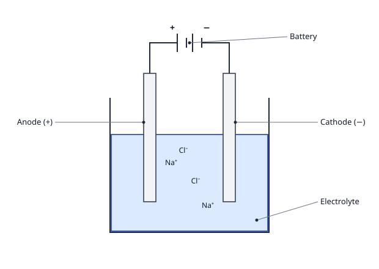

**Expected observation:** A reddish-brown layer on the cathode.

**Conclusion:** Cu²⁺ + 2e⁻ → Cu (HE-03).

**Sources of error:** Not cleaning the cathode properly

**Exam-style questions (original):** Why is the object to be plated the cathode?

---

## EXP-16: Conditions for rusting of iron

<!-- meta {"type":"experiment","id":"EXP-16","chapter_id":"SC11-12","discipline":"CHE","diagram":null,"teacher_demo_only":false,"has_virtual":false} -->

*Electrochemistry*

**Aim:** Showing that water and oxygen are both necessary.

**Apparatus:** 3 test tubes, Nails, Stoppers

**Chemicals/materials:** Boiled and cooled water, Oil, Anhydrous CaCl₂

**Safety:** Wear safety goggles; do this only in the school laboratory under teacher supervision; do not do it at home.

| Variable type | Details |
|---|---|
| Independent variable | Condition |
| Dependent variable | Appearance of rust |
| Controlled variables | Type of nail, time |

**Method:**

1. A: tap water (with air).
2. B: boiled and cooled water + oil layer.
3. C: sealed dry air with anhydrous CaCl₂.
4. Observe for a week.

**Expected observation:** Only A rusts.

**Conclusion:** Rusting needs water and O₂.

**Sources of error:** Leaking stopper

**Exam-style questions (original):** How does galvanising protect iron?

---

## EXP-17: Heat change of neutralisation

<!-- meta {"type":"experiment","id":"EXP-17","chapter_id":"SC11-08","discipline":"CHE","diagram":"GR-D05","teacher_demo_only":false,"has_virtual":true} -->

*Heat changes associated with chemical reactions*

**Aim:** Measuring an exothermic reaction.

**Apparatus:** Polystyrene cup, Thermometer, Measuring cylinder

**Chemicals/materials:** 1 mol dm⁻³ HCl, NaOH

**Safety:** Wear safety goggles; do this only in the school laboratory under teacher supervision; do not do it at home.

| Variable type | Details |
|---|---|
| Independent variable | Volume of NaOH added |
| Dependent variable | Temperature rise |
| Controlled variables | Volumes, concentrations, cup |

**Method:**

1. Record the temperature of 50 cm³ of HCl.
2. Add 50 cm³ of NaOH (at the same temperature).
3. Stir and record the highest temperature.
4. Calculate using Q = mcΔθ (File 5: CL-ENTH).

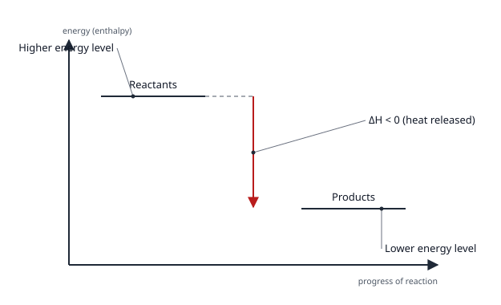

**Expected observation:** ≈ 6–7 °C rise (expected).

**Conclusion:** Neutralisation is exothermic.

**Sources of error:** Heat loss through the cup

**Exam-style questions (original):** Why polystyrene?

<details><summary>Virtual experiment specification (for developers)</summary>

```json
{
 "inputs": [
  {
   "symbol": "n",
   "name": "Moles of water formed",
   "unit": "mol",
   "min": 0.01,
   "max": 0.1
  },
  {
   "symbol": "m",
   "name": "Mass of solution",
   "unit": "kg",
   "min": 0.05,
   "max": 0.2
  }
 ],
 "outputs": [
  {
   "symbol": "dT",
   "name": "Temperature rise (°C)"
  }
 ],
 "model": "Δθ = n × 57000 / (m × 4200)",
 "test_cases": [
  [
   0.05,
   0.1,
   6.785714285714286
  ]
 ],
 "note": "ΔH ≈ −57 kJ mol⁻¹ assumed."
}
```

Test cases were checked in Python against the model equation.

</details>

---

## EXP-18: Average speed and acceleration with ticker tape / a ruler

<!-- meta {"type":"experiment","id":"EXP-18","chapter_id":"SC10-02","discipline":"PHY","diagram":"GR-D01","teacher_demo_only":false,"has_virtual":true} -->

*Motion in a straight line*

**Aim:** Finding the acceleration of a trolley rolling down a ramp.

**Apparatus:** Ramp, Trolley, Metre rule, Stopwatch (or ticker timer)

**Chemicals/materials:** —

**Safety:** A catcher at the end of the ramp; take care that heavy objects do not fall on feet.

| Variable type | Details |
|---|---|
| Independent variable | Angle / height of the slope |
| Dependent variable | Time for a given distance |
| Controlled variables | Trolley, surface, distance |

**Method:**

1. Mark a distance of 1.0 m.
2. Release from rest and measure the time (3 times).
3. From s = ½at², a = 2s/t².
4. Change the height and repeat.

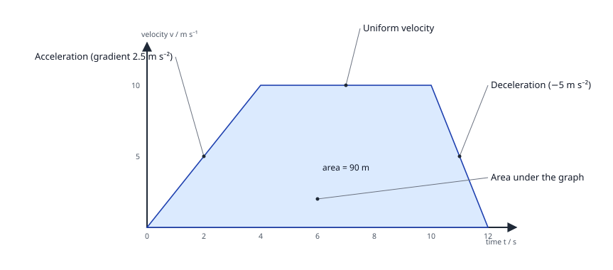

**Expected observation:** As height increases, time decreases; a increases.

**Conclusion:** As slope increases, acceleration increases.

**Sources of error:** Human reaction time

**Exam-style questions (original):** Distance from a v–t graph?

<details><summary>Virtual experiment specification (for developers)</summary>

```json
{
 "inputs": [
  {
   "symbol": "s",
   "name": "Distance",
   "unit": "m",
   "min": 0.5,
   "max": 2
  },
  {
   "symbol": "t",
   "name": "Time",
   "unit": "s",
   "min": 0.5,
   "max": 5
  }
 ],
 "outputs": [
  {
   "symbol": "a",
   "name": "Acceleration (m s⁻²)"
  }
 ],
 "model": "a = 2s / t²",
 "test_cases": [
  [
   1,
   1,
   2
  ],
  [
   1,
   2,
   0.5
  ]
 ],
 "note": "From rest, uniform acceleration."
}
```

Test cases were checked in Python against the model equation.

</details>

---

## EXP-19: Limiting friction and normal reaction

<!-- meta {"type":"experiment","id":"EXP-19","chapter_id":"SC10-05","discipline":"PHY","diagram":"PHY-D06","teacher_demo_only":false,"has_virtual":true} -->

*Friction*

**Aim:** Showing that friction increases with the normal reaction.

**Apparatus:** Wooden block, Spring balance, Masses (100 g)

**Chemicals/materials:** —

**Safety:** Take care that the masses do not fall.

| Variable type | Details |
|---|---|
| Independent variable | Mass on the block (R) |
| Dependent variable | Spring balance reading when it starts to move (F) |
| Controlled variables | Surface, direction of pull (horizontal) |

**Method:**

1. Pull the block slowly and horizontally with the spring balance.
2. Record the reading at the moment it starts to move.
3. Add 100 g masses and repeat.
4. Graph of F against R.

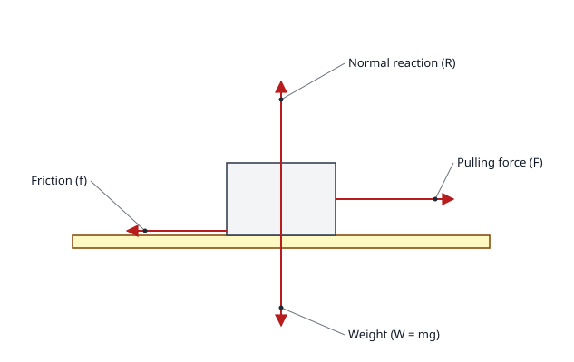

**Expected observation:** Straight line — F ∝ R (sample).

**Conclusion:** Limiting friction is proportional to the normal reaction.

**Sources of error:** Pulling speed not steady

**Exam-style questions (original):** What if the surface area is changed (the block placed on its side)?

<details><summary>Virtual experiment specification (for developers)</summary>

```json
{
 "inputs": [
  {
   "symbol": "R",
   "name": "Normal reaction",
   "unit": "N",
   "min": 1,
   "max": 20
  },
  {
   "symbol": "mu",
   "name": "Coefficient of friction",
   "unit": "—",
   "min": 0.1,
   "max": 0.8
  }
 ],
 "outputs": [
  {
   "symbol": "F",
   "name": "Limiting friction (N)"
  }
 ],
 "model": "F = μR (notation beyond O/L — only to show proportionality)",
 "test_cases": [
  [
   10,
   0.4,
   4.0
  ]
 ],
 "note": ""
}
```

Test cases were checked in Python against the model equation.

</details>

---

## EXP-20: Verifying the principle of moments (metre rule)

<!-- meta {"type":"experiment","id":"EXP-20","chapter_id":"SC10-11","discipline":"PHY","diagram":"PHY-D11","teacher_demo_only":false,"has_virtual":true} -->

*Turning effect of a force*

**Aim:** Showing that clockwise = anticlockwise at equilibrium.

**Apparatus:** Metre rule, Knife-edge support, Threads, Known weights

**Chemicals/materials:** —

**Safety:** Take care that the weights do not fall.

| Variable type | Details |
|---|---|
| Independent variable | W₁, d₁ |
| Dependent variable | d₂ for balance |
| Controlled variables | Support at the rule's centre of gravity |

**Method:**

1. Balance the rule at 50 cm.
2. W₁ on one side at d₁.
3. Move W₂ on the other side until balanced and measure d₂.
4. Compare W₁d₁ and W₂d₂.

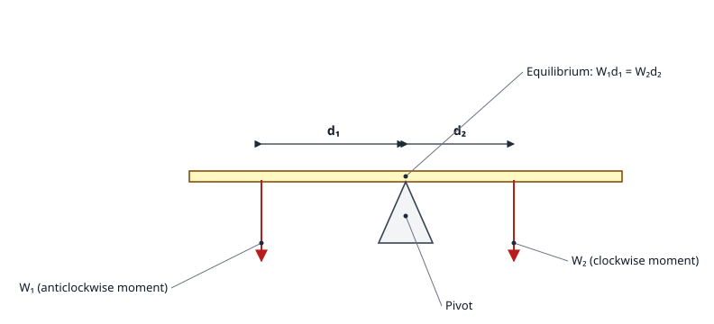

**Expected observation:** W₁d₁ ≈ W₂d₂.

**Conclusion:** The principle of moments is confirmed.

**Sources of error:** Thickness of the thread; Non-uniform rule

**Exam-style questions (original):** When must the rule's weight be considered? (CL-MOMENT challenge)

<details><summary>Virtual experiment specification (for developers)</summary>

```json
{
 "inputs": [
  {
   "symbol": "W1",
   "name": "W₁",
   "unit": "N",
   "min": 0.5,
   "max": 5
  },
  {
   "symbol": "d1",
   "name": "d₁",
   "unit": "cm",
   "min": 5,
   "max": 50
  },
  {
   "symbol": "W2",
   "name": "W₂",
   "unit": "N",
   "min": 0.5,
   "max": 5
  }
 ],
 "outputs": [
  {
   "symbol": "d2",
   "name": "d₂ (cm)"
  }
 ],
 "model": "d₂ = W₁d₁ / W₂",
 "test_cases": [
  [
   2,
   30,
   3,
   20
  ]
 ],
 "note": ""
}
```

Test cases were checked in Python against the model equation.

</details>

---

## EXP-21: Liquid pressure with depth

<!-- meta {"type":"experiment","id":"EXP-21","chapter_id":"SC10-15","discipline":"PHY","diagram":"PHY-D10","teacher_demo_only":false,"has_virtual":true} -->

*Hydrostatic pressure and its applications*

**Aim:** Showing that pressure increases with depth.

**Apparatus:** Plastic bottle with holes, Water, Ruler

**Chemicals/materials:** —

**Safety:** Spilt water is slippery — do it on a tray.

| Variable type | Details |
|---|---|
| Independent variable | Depth of the hole |
| Dependent variable | Horizontal distance of the water jet |
| Controlled variables | Hole size, water level (keep refilling) |

**Method:**

1. Holes of equal size at three heights.
2. Fill the bottle and keep the level constant.
3. Compare the jet distances.

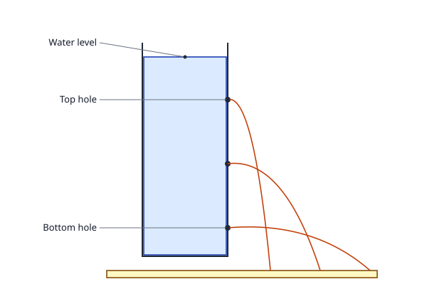

**Expected observation:** The jet from the bottom hole goes furthest.

**Conclusion:** P = hρg — pressure increases with depth.

**Sources of error:** Water level falling

**Exam-style questions (original):** Why is the base of a dam thick?

<details><summary>Virtual experiment specification (for developers)</summary>

```json
{
 "inputs": [
  {
   "symbol": "h",
   "name": "Depth",
   "unit": "m",
   "min": 0,
   "max": 10
  },
  {
   "symbol": "rho",
   "name": "Density",
   "unit": "kg m⁻³",
   "min": 700,
   "max": 1300
  }
 ],
 "outputs": [
  {
   "symbol": "P",
   "name": "Liquid pressure (Pa)"
  }
 ],
 "model": "P = hρg, g = 10",
 "test_cases": [
  [
   5,
   1000,
   50000
  ],
  [
   2,
   800,
   16000
  ]
 ],
 "note": ""
}
```

Test cases were checked in Python against the model equation.

</details>

---

## EXP-22: Ohm's law

<!-- meta {"type":"experiment","id":"EXP-22","chapter_id":"SC10-19","discipline":"PHY","diagram":"GR-D04","teacher_demo_only":false,"has_virtual":true} -->

*Current electricity*

**Aim:** Finding the V–I relationship of a conductor.

**Apparatus:** Cells, Rheostat, Resistor, Ammeter, Voltmeter, Switch, Connecting wires

**Chemicals/materials:** —

**Safety:** Avoid short circuits; open the switch after readings to stop the wire heating.

| Variable type | Details |
|---|---|
| Independent variable | Current (with the rheostat) |
| Dependent variable | Potential difference |
| Controlled variables | Temperature, conductor |

**Method:**

1. Circuit PHY-D01.
2. Change the rheostat and record 5–6 (I, V) pairs.
3. Graph of V against I.
4. Gradient = R.

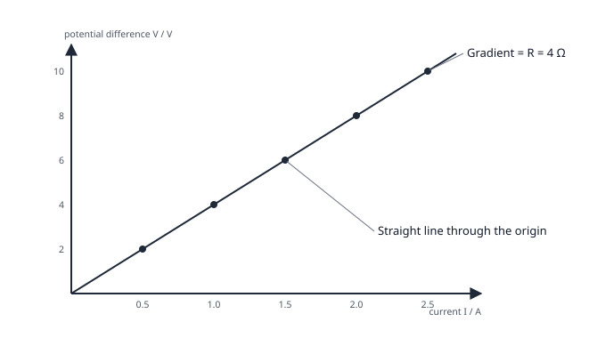

**Expected observation:** Straight line through the origin (sample: R = 4 Ω).

**Conclusion:** V ∝ I — Ohm's law.

**Sources of error:** Wire heating up; Meter zero error

**Exam-style questions (original):** Why does the graph curve for a filament lamp?

<details><summary>Virtual experiment specification (for developers)</summary>

```json
{
 "inputs": [
  {
   "symbol": "V",
   "name": "Voltage",
   "unit": "V",
   "min": 0,
   "max": 12
  },
  {
   "symbol": "R",
   "name": "Resistance",
   "unit": "Ω",
   "min": 1,
   "max": 100
  }
 ],
 "outputs": [
  {
   "symbol": "I",
   "name": "Current (A)"
  }
 ],
 "model": "I = V / R",
 "test_cases": [
  [
   12,
   4,
   3
  ],
  [
   6,
   3,
   2
  ]
 ],
 "note": ""
}
```

Test cases were checked in Python against the model equation.

</details>

---

## EXP-23: Length of a wire and resistance

<!-- meta {"type":"experiment","id":"EXP-23","chapter_id":"SC10-19","discipline":"PHY","diagram":null,"teacher_demo_only":false,"has_virtual":true} -->

*Current electricity*

**Aim:** Showing that resistance increases with length (2019 Paper I Q18 type).

**Apparatus:** Nichrome wire, Metre rule, Ammeter, Voltmeter, Cell, Crocodile clips

**Chemicals/materials:** —

**Safety:** The wire may get hot — pass current for a short time only.

| Variable type | Details |
|---|---|
| Independent variable | Length l |
| Dependent variable | Resistance R = V/I |
| Controlled variables | Wire thickness, material, temperature |

**Method:**

1. Connect for lengths of 20, 40, 60, 80 cm.
2. Record V and I.
3. Calculate R and plot R against l.

**Expected observation:** Straight line — R ∝ l.

**Conclusion:** Resistance is directly proportional to length.

**Sources of error:** Contact resistance

**Exam-style questions (original):** What if the thickness is doubled?

<details><summary>Virtual experiment specification (for developers)</summary>

```json
{
 "inputs": [
  {
   "symbol": "l",
   "name": "Length",
   "unit": "m",
   "min": 0.1,
   "max": 1
  },
  {
   "symbol": "k",
   "name": "Resistance per unit length",
   "unit": "Ω m⁻¹",
   "min": 1,
   "max": 20
  }
 ],
 "outputs": [
  {
   "symbol": "R",
   "name": "Resistance (Ω)"
  }
 ],
 "model": "R = k·l",
 "test_cases": [
  [
   0.5,
   10,
   5
  ]
 ],
 "note": ""
}
```

Test cases were checked in Python against the model equation.

</details>

---

## EXP-24: Specific heat capacity of a metal block

<!-- meta {"type":"experiment","id":"EXP-24","chapter_id":"SC11-09","discipline":"PHY","diagram":"EXP-D03","teacher_demo_only":false,"has_virtual":true} -->

*Heat*

**Aim:** Measuring c.

**Apparatus:** 1 kg metal block, Immersion heater, Thermometer, Joulemeter or V and I meters, Stopwatch, Insulation

**Chemicals/materials:** —

**Safety:** The heater and block get very hot — do not touch; put a drop of oil in the thermometer hole.

| Variable type | Details |
|---|---|
| Independent variable | Energy supplied (time) |
| Dependent variable | Temperature rise |
| Controlled variables | Mass, insulation |

**Method:**

1. Initial temperature θ₁.
2. Record V and I and heat for 10 minutes.
3. Highest temperature θ₂.
4. c = VIt / (m(θ₂ − θ₁)).

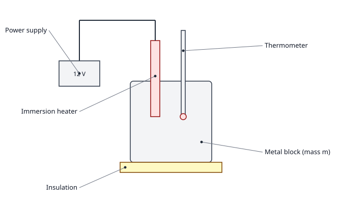

**Expected observation:** About 900 J kg⁻¹ °C⁻¹ for aluminium (a slightly higher value may be obtained because of heat loss).

**Conclusion:** Q = mcΔθ.

**Sources of error:** Heat loss — c overestimated

**Exam-style questions (original):** How does heat loss affect the value of c?

<details><summary>Virtual experiment specification (for developers)</summary>

```json
{
 "inputs": [
  {
   "symbol": "P",
   "name": "Power",
   "unit": "W",
   "min": 10,
   "max": 100
  },
  {
   "symbol": "t",
   "name": "Time",
   "unit": "s",
   "min": 60,
   "max": 1200
  },
  {
   "symbol": "m",
   "name": "Mass",
   "unit": "kg",
   "min": 0.5,
   "max": 2
  },
  {
   "symbol": "c",
   "name": "c",
   "unit": "J kg⁻¹ °C⁻¹",
   "min": 380,
   "max": 4200
  }
 ],
 "outputs": [
  {
   "symbol": "dT",
   "name": "Temperature rise (°C)"
  }
 ],
 "model": "Δθ = Pt / (mc) (no heat loss)",
 "test_cases": [
  [
   50,
   600,
   1,
   900,
   33.333333333333336
  ]
 ],
 "note": ""
}
```

Test cases were checked in Python against the model equation.

</details>

---

## EXP-25: Focal length of a convex lens (approximate)

<!-- meta {"type":"experiment","id":"EXP-25","chapter_id":"SC11-05","discipline":"PHY","diagram":"EXP-D04","teacher_demo_only":false,"has_virtual":true} -->

*Geometrical optics*

**Aim:** Finding f by the distant object method (2019 Paper II Q7A type).

**Apparatus:** Convex lens, Lens holder, Screen, Metre rule

**Chemicals/materials:** —

**Safety:** Do not look at the Sun directly through the lens; do not focus sunlight to start a fire.

| Variable type | Details |
|---|---|
| Independent variable | — |
| Dependent variable | Lens–screen distance |
| Controlled variables | — |

**Method:**

1. Point the lens at a distant window/tree.
2. Move the screen until the image is sharp.
3. Lens–screen distance ≈ f.
4. Average of three readings.

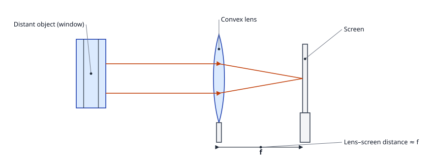

**Expected observation:** Small, inverted, real image.

**Conclusion:** Rays from a distant object are parallel — the image forms at the focus.

**Sources of error:** Object not far enough away

**Exam-style questions (original):** Three properties of the image?

<details><summary>Virtual experiment specification (for developers)</summary>

```json
{
 "inputs": [
  {
   "symbol": "f",
   "name": "Focal length",
   "unit": "cm",
   "min": 5,
   "max": 30
  },
  {
   "symbol": "u",
   "name": "Object distance",
   "unit": "cm",
   "min": 6,
   "max": 200
  }
 ],
 "outputs": [
  {
   "symbol": "v",
   "name": "Image distance (cm)"
  }
 ],
 "model": "1/v = 1/f − 1/u (u > f; magnitude form)",
 "test_cases": [
  [
   10,
   30,
   15
  ],
  [
   10,
   20,
   20
  ]
 ],
 "note": "If u ≤ f the image is virtual — the simulator must show a warning."
}
```

Test cases were checked in Python against the model equation.

</details>

---

## EXP-26: Electromagnetic induction (magnet + coil)

<!-- meta {"type":"experiment","id":"EXP-26","chapter_id":"SC11-13","discipline":"PHY","diagram":"PHY-D12","teacher_demo_only":false,"has_virtual":false} -->

*Electromagnetism and electromagnetic induction*

**Aim:** Showing that a changing magnetic flux induces a current.

**Apparatus:** Coil, Bar magnet, Microammeter / galvanometer

**Chemicals/materials:** —

**Safety:** Keep magnets away from electronic devices.

| Variable type | Details |
|---|---|
| Independent variable | Speed of magnet movement, turns |
| Dependent variable | Galvanometer deflection |
| Controlled variables | Magnet strength |

**Method:**

1. Push the magnet into the coil — deflection.
2. Hold it still — no deflection.
3. Pull it out — opposite direction.
4. Move it quickly — larger deflection.

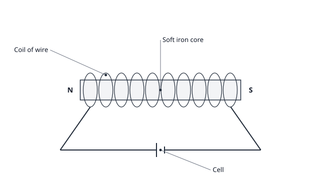

**Expected observation:** Deflection only while moving.

**Conclusion:** A changing flux induces an e.m.f.

**Sources of error:** Low galvanometer sensitivity

**Exam-style questions (original):** Connection with a generator?
---

## Limitations

- 26 experiments; 13 with a virtual specification.
- Not compared with the textbook's official activity list — teachers should match them.
- Some virtual models (photosynthesis, rate of reaction) are teaching approximations, not real data.
