# StudyBuddy — Chapter Quizzes (MCQ)

> All questions are **ORIGINAL** questions written for this edition. There are no past-paper questions here — their summary references are marked `PAST_PAPER_REFERENCE` in File 4.
> Answers to calculation questions were computed and checked in Python; equation questions were checked by atom count. Each question has 4 options and one correct answer.

## SC10-01: Chemical basis of life

*Grade 10 · Chapter 1 · Biology · 26 questions*

<!-- meta {"type":"mcq","id":"SCQ-10-01-001","grade":10,"chapter_id":"SC10-01","discipline":"BIO","difficulty":1,"qtype":"recall","answer":2,"origin":"ORIGINAL","source_ref":"chapter","image":null} -->
**SCQ-10-01-001** · Basic · Recall · `ORIGINAL`

Which solution is used to identify starch?

1. Benedict's solution
2. Iodine solution
3. Biuret solution
4. Sudan III

Answer and explanation

**Answer: (2) Iodine solution**

Iodine gives a blue–black colour with starch.

<!-- meta {"type":"mcq","id":"SCQ-10-01-002","grade":10,"chapter_id":"SC10-01","discipline":"BIO","difficulty":1,"qtype":"concept","answer":3,"origin":"ORIGINAL","source_ref":"chapter","image":null} -->
**SCQ-10-01-002** · Basic · Concept · `ORIGINAL`

Which element is always present in proteins but absent in carbohydrates?

1. Carbon
2. Oxygen
3. Nitrogen
4. Hydrogen

Answer and explanation

**Answer: (3) Nitrogen**

Carbohydrates contain only C, H, O; proteins also contain N.

<!-- meta {"type":"mcq","id":"SCQ-10-01-003","grade":10,"chapter_id":"SC10-01","discipline":"BIO","difficulty":1,"qtype":"experiment","answer":2,"origin":"ORIGINAL","source_ref":"chapter","image":null} -->
**SCQ-10-01-003** · Basic · Experiment · `ORIGINAL`

Which condition is essential to get a positive Benedict's test?

1. Cooling
2. Heating
3. Adding acid
4. Keeping in light

Answer and explanation

**Answer: (2) Heating**

The Benedict's test gives a brick-red precipitate only when heated in a water bath.

<!-- meta {"type":"mcq","id":"SCQ-10-01-004","grade":10,"chapter_id":"SC10-01","discipline":"BIO","difficulty":1,"qtype":"recall","answer":3,"origin":"ORIGINAL","source_ref":"chapter","image":null} -->
**SCQ-10-01-004** · Basic · Recall · `ORIGINAL`

In which form are carbohydrates stored in animals?

1. Starch
2. Cellulose
3. Glycogen
4. Sucrose

Answer and explanation

**Answer: (3) Glycogen**

Stored as glycogen in the liver and muscles.

<!-- meta {"type":"mcq","id":"SCQ-10-01-005","grade":10,"chapter_id":"SC10-01","discipline":"BIO","difficulty":2,"qtype":"reasoning","answer":2,"origin":"ORIGINAL","source_ref":"chapter","image":null} -->
**SCQ-10-01-005** · Intermediate · Reasoning · `ORIGINAL`

Why does an enzyme's activity drop after heating it to 80 °C?

1. The enzyme evaporates
2. The enzyme protein is denatured
3. The substrate increases
4. The pH increases

Answer and explanation

**Answer: (2) The enzyme protein is denatured**

High temperature changes the protein structure (denaturation).

<!-- meta {"type":"mcq","id":"SCQ-10-01-006","grade":10,"chapter_id":"SC10-01","discipline":"BIO","difficulty":2,"qtype":"concept","answer":3,"origin":"ORIGINAL","source_ref":"chapter","image":null} -->
**SCQ-10-01-006** · Intermediate · Concept · `ORIGINAL`

Which of the following is not a polymer?

1. Starch
2. Protein
3. Glucose
4. DNA

Answer and explanation

**Answer: (3) Glucose**

Glucose is a monosaccharide (a monomer).

<!-- meta {"type":"mcq","id":"SCQ-10-01-007","grade":10,"chapter_id":"SC10-01","discipline":"BIO","difficulty":2,"qtype":"experiment","answer":2,"origin":"ORIGINAL","source_ref":"chapter","image":null} -->
**SCQ-10-01-007** · Intermediate · Experiment · `ORIGINAL`

A food sample gave purple with Biuret and brown with iodine. The sample contains?

1. Starch only
2. Protein only
3. Protein and starch
4. Lipid only

Answer and explanation

**Answer: (2) Protein only**

Purple → protein present; iodine did not change colour → no starch.

<!-- meta {"type":"mcq","id":"SCQ-10-01-008","grade":10,"chapter_id":"SC10-01","discipline":"BIO","difficulty":1,"qtype":"concept","answer":2,"origin":"ORIGINAL","source_ref":"chapter","image":null} -->
**SCQ-10-01-008** · Basic · Concept · `ORIGINAL`

Biological importance of water being a good solvent?

1. It cools the body
2. It helps transport substances and acts as a medium for reactions
3. It stores energy
4. It destroys enzymes

Answer and explanation

**Answer: (2) It helps transport substances and acts as a medium for reactions**

Substances are transported and react in dissolved form.

<!-- meta {"type":"mcq","id":"SCQ-10-01-009","grade":10,"chapter_id":"SC10-01","discipline":"BIO","difficulty":2,"qtype":"concept","answer":1,"origin":"ORIGINAL","source_ref":"chapter","image":null} -->
**SCQ-10-01-009** · Intermediate · Concept · `ORIGINAL`

Since fats are insoluble in water, they are important as?

1. A component of the cell membrane
2. An enzyme
3. A hormone only
4. Hereditary material

Answer and explanation

**Answer: (1) A component of the cell membrane**

Lipids are a major component of membranes.

<!-- meta {"type":"mcq","id":"SCQ-10-01-010","grade":10,"chapter_id":"SC10-01","discipline":"BIO","difficulty":2,"qtype":"recall","answer":2,"origin":"ORIGINAL","source_ref":"chapter","image":null} -->
**SCQ-10-01-010** · Intermediate · Recall · `ORIGINAL`

Salivary amylase in humans converts starch into?

1. Glucose
2. Maltose
3. Sucrose
4. Glycogen

Answer and explanation

**Answer: (2) Maltose**

Amylase converts starch into maltose (a disaccharide).

<!-- meta {"type":"mcq","id":"SCQ-10-01-011","grade":10,"chapter_id":"SC10-01","discipline":"BIO","difficulty":2,"qtype":"equation","answer":2,"origin":"ORIGINAL","source_ref":"EQ-042","image":null} -->
**SCQ-10-01-011** · Intermediate · Equation · `ORIGINAL`

C₆H₁₂O₆ + O₂ → CO₂ + H₂O — when this equation is balanced with the smallest whole-number coefficients, the coefficient of O₂?

1. 7
2. 6
3. 12
4. 5

Answer and explanation

**Answer: (2) 6**

C₆H₁₂O₆ + 6O₂ → 6CO₂ + 6H₂O (atom count checked; File 7: EQ-042).

<!-- meta {"type":"mcq","id":"SCQ-10-01-012","grade":10,"chapter_id":"SC10-01","discipline":"BIO","difficulty":1,"qtype":"recall","answer":1,"origin":"ORIGINAL","source_ref":"extra-SC10-01-1","image":null} -->
**SCQ-10-01-012** · Basic · Recall · `ORIGINAL`

The compound present in the largest amount in the body?

1. Water
2. Fat
3. Glucose
4. Protein

Answer and explanation

**Answer: (1) Water**

About 60–70% of body mass is water.

<!-- meta {"type":"mcq","id":"SCQ-10-01-013","grade":10,"chapter_id":"SC10-01","discipline":"BIO","difficulty":1,"qtype":"recall","answer":1,"origin":"ORIGINAL","source_ref":"extra-SC10-01-2","image":null} -->
**SCQ-10-01-013** · Basic · Recall · `ORIGINAL`

Structural unit of proteins?

1. Amino acid
2. Fatty acid
3. Glucose
4. Nucleotide

Answer and explanation

**Answer: (1) Amino acid**

Amino acids are joined by peptide bonds.

<!-- meta {"type":"mcq","id":"SCQ-10-01-014","grade":10,"chapter_id":"SC10-01","discipline":"BIO","difficulty":2,"qtype":"concept","answer":4,"origin":"ORIGINAL","source_ref":"extra-SC10-01-3","image":null} -->
**SCQ-10-01-014** · Intermediate · Concept · `ORIGINAL`

What is obtained when lipids are hydrolysed?

1. Amino acids
2. Glucose only
3. Urea
4. Fatty acids and glycerol

Answer and explanation

**Answer: (4) Fatty acids and glycerol**

Lipase breaks down lipids.

<!-- meta {"type":"mcq","id":"SCQ-10-01-015","grade":10,"chapter_id":"SC10-01","discipline":"BIO","difficulty":1,"qtype":"recall","answer":2,"origin":"ORIGINAL","source_ref":"extra-SC10-01-4","image":null} -->
**SCQ-10-01-015** · Basic · Recall · `ORIGINAL`

DNA and RNA are which type of biological molecule?

1. Proteins
2. Nucleic acids
3. Lipids
4. Carbohydrates

Answer and explanation

**Answer: (2) Nucleic acids**

Polymers made of nucleotides.

<!-- meta {"type":"mcq","id":"SCQ-10-01-016","grade":10,"chapter_id":"SC10-01","discipline":"BIO","difficulty":1,"qtype":"experiment","answer":3,"origin":"ORIGINAL","source_ref":"extra-SC10-01-5","image":null} -->
**SCQ-10-01-016** · Basic · Experiment · `ORIGINAL`

The reagent that turns starch blue-black?

1. Biuret
2. Benedict's solution
3. Iodine solution
4. Sudan III

Answer and explanation

**Answer: (3) Iodine solution**

Iodine — starch test.

<!-- meta {"type":"mcq","id":"SCQ-10-01-017","grade":10,"chapter_id":"SC10-01","discipline":"BIO","difficulty":3,"qtype":"reasoning","answer":4,"origin":"ORIGINAL","source_ref":"extra-SC10-01-6","image":null} -->
**SCQ-10-01-017** · Hard · Reasoning · `ORIGINAL`

Which does not give a positive Benedict's test?

1. Maltose
2. Fructose
3. Glucose
4. Sucrose

Answer and explanation

**Answer: (4) Sucrose**

Sucrose is a non-reducing sugar.

<!-- meta {"type":"mcq","id":"SCQ-10-01-018","grade":10,"chapter_id":"SC10-01","discipline":"BIO","difficulty":2,"qtype":"recall","answer":2,"origin":"ORIGINAL","source_ref":"extra-SC10-01-7","image":null} -->
**SCQ-10-01-018** · Intermediate · Recall · `ORIGINAL`

Storage polysaccharide in animals?

1. Starch
2. Glycogen
3. Sucrose
4. Cellulose

Answer and explanation

**Answer: (2) Glycogen**

Glycogen in the liver and muscles.

<!-- meta {"type":"mcq","id":"SCQ-10-01-019","grade":10,"chapter_id":"SC10-01","discipline":"BIO","difficulty":1,"qtype":"recall","answer":2,"origin":"ORIGINAL","source_ref":"extra-SC10-01-8","image":null} -->
**SCQ-10-01-019** · Basic · Recall · `ORIGINAL`

Enzymes are which type of molecule?

1. Minerals
2. Proteins
3. Carbohydrates
4. Lipids

Answer and explanation

**Answer: (2) Proteins**

Biological catalysts — proteins.

<!-- meta {"type":"mcq","id":"SCQ-10-01-020","grade":10,"chapter_id":"SC10-01","discipline":"BIO","difficulty":2,"qtype":"application","answer":2,"origin":"ORIGINAL","source_ref":"extra-SC10-01-9","image":null} -->
**SCQ-10-01-020** · Intermediate · Application · `ORIGINAL`

What can calcium deficiency cause in children?

1. Anaemia
2. Weak bones and teeth (linked to rickets)
3. Goitre
4. Scurvy

Answer and explanation

**Answer: (2) Weak bones and teeth (linked to rickets)**

Ca and vitamin D for bone formation.

<!-- meta {"type":"mcq","id":"SCQ-10-01-021","grade":10,"chapter_id":"SC10-01","discipline":"BIO","difficulty":1,"qtype":"recall","answer":1,"origin":"ORIGINAL","source_ref":"extra-SC10-01-10","image":null} -->
**SCQ-10-01-021** · Basic · Recall · `ORIGINAL`

Disease caused by iodine deficiency?

1. Goitre
2. Night blindness
3. Beriberi
4. Scurvy

Answer and explanation

**Answer: (1) Goitre**

Iodine for thyroxine production.

<!-- meta {"type":"mcq","id":"SCQ-10-01-022","grade":10,"chapter_id":"SC10-01","discipline":"BIO","difficulty":1,"qtype":"recall","answer":3,"origin":"ORIGINAL","source_ref":"extra-SC10-01-11","image":null} -->
**SCQ-10-01-022** · Basic · Recall · `ORIGINAL`

A symptom of vitamin A deficiency?

1. Blood does not clot
2. Bleeding gums
3. Night blindness
4. Rickets

Answer and explanation

**Answer: (3) Night blindness**

Vitamin A for the retinal pigment.

<!-- meta {"type":"mcq","id":"SCQ-10-01-023","grade":10,"chapter_id":"SC10-01","discipline":"BIO","difficulty":2,"qtype":"concept","answer":4,"origin":"ORIGINAL","source_ref":"extra-SC10-01-12","image":null} -->
**SCQ-10-01-023** · Intermediate · Concept · `ORIGINAL`

Food component that gives the most energy per unit mass?

1. Protein
2. Water
3. Carbohydrate
4. Lipid

Answer and explanation

**Answer: (4) Lipid**

Lipids give about twice the energy.

<!-- meta {"type":"mcq","id":"SCQ-10-01-024","grade":10,"chapter_id":"SC10-01","discipline":"BIO","difficulty":2,"qtype":"concept","answer":1,"origin":"ORIGINAL","source_ref":"extra-SC10-01-13","image":null} -->
**SCQ-10-01-024** · Intermediate · Concept · `ORIGINAL`

Why does an enzyme stop working at high temperature?

1. Because of denaturation
2. Because it freezes
3. Because it multiplies
4. Because it dissolves

Answer and explanation

**Answer: (1) Because of denaturation**

Its three-dimensional shape is destroyed.

<!-- meta {"type":"mcq","id":"SCQ-10-01-025","grade":10,"chapter_id":"SC10-01","discipline":"BIO","difficulty":2,"qtype":"reasoning","answer":1,"origin":"ORIGINAL","source_ref":"extra-SC10-01-14","image":null} -->
**SCQ-10-01-025** · Intermediate · Reasoning · `ORIGINAL`

Which is not a biological importance of water?

1. Main source of energy
2. Temperature regulation
3. Solvent
4. Medium of transport

Answer and explanation

**Answer: (1) Main source of energy**

Water does not provide energy.

<!-- meta {"type":"mcq","id":"SCQ-10-01-026","grade":10,"chapter_id":"SC10-01","discipline":"BIO","difficulty":1,"qtype":"experiment","answer":4,"origin":"ORIGINAL","source_ref":"extra-SC10-01-15","image":null} -->
**SCQ-10-01-026** · Basic · Experiment · `ORIGINAL`

A positive Biuret test shows?

1. Starch is present
2. Glucose is present
3. Lipid is present
4. Protein is present

Answer and explanation

**Answer: (4) Protein is present**

Purple colour — peptide bonds.

## SC10-02: Motion in a straight line

*Grade 10 · Chapter 2 · Physics · 25 questions*

<!-- meta {"type":"mcq","id":"SCQ-10-02-001","grade":10,"chapter_id":"SC10-02","discipline":"PHY","difficulty":1,"qtype":"recall","answer":3,"origin":"ORIGINAL","source_ref":"chapter","image":null} -->
**SCQ-10-02-001** · Basic · Recall · `ORIGINAL`

Which of the following is a vector quantity?

1. Speed
2. Mass
3. Displacement
4. Time

Answer and explanation

**Answer: (3) Displacement**

Displacement has direction.

<!-- meta {"type":"mcq","id":"SCQ-10-02-002","grade":10,"chapter_id":"SC10-02","discipline":"PHY","difficulty":1,"qtype":"calculation","answer":1,"origin":"ORIGINAL","source_ref":"chapter","image":null} -->
**SCQ-10-02-002** · Basic · Calculation · `ORIGINAL`

A car accelerates from 0 to 20 m s⁻¹ in 5 s. Acceleration?

1. 4 m s⁻²
2. 100 m s⁻²
3. 0.25 m s⁻²
4. 25 m s⁻²

Answer and explanation

**Answer: (1) 4 m s⁻²**

a = (20 − 0)/5 = 4 m s⁻².

<!-- meta {"type":"mcq","id":"SCQ-10-02-003","grade":10,"chapter_id":"SC10-02","discipline":"PHY","difficulty":2,"qtype":"graph","answer":2,"origin":"ORIGINAL","source_ref":"chapter","image":null} -->
**SCQ-10-02-003** · Intermediate · Graph · `ORIGINAL`

On a v–t graph, velocity increases uniformly from 0 to 10 m s⁻¹ in 0–10 s. Displacement?

1. 100 m
2. 50 m
3. 10 m
4. 1 m

Answer and explanation

**Answer: (2) 50 m**

Triangle area = ½ × 10 × 10 = 50 m.

<!-- meta {"type":"mcq","id":"SCQ-10-02-004","grade":10,"chapter_id":"SC10-02","discipline":"PHY","difficulty":1,"qtype":"graph","answer":2,"origin":"ORIGINAL","source_ref":"chapter","image":null} -->
**SCQ-10-02-004** · Basic · Graph · `ORIGINAL`

If an s–t graph is horizontal, the object is?

1. At constant velocity
2. At rest
3. Accelerating
4. Decelerating

Answer and explanation

**Answer: (2) At rest**

Displacement does not change.

<!-- meta {"type":"mcq","id":"SCQ-10-02-005","grade":10,"chapter_id":"SC10-02","discipline":"PHY","difficulty":2,"qtype":"calculation","answer":2,"origin":"ORIGINAL","source_ref":"chapter","image":null} -->
**SCQ-10-02-005** · Intermediate · Calculation · `ORIGINAL`

A person walked 3 km east, then 4 km north. Magnitude of displacement?

1. 7 km
2. 5 km
3. 1 km
4. 12 km

Answer and explanation

**Answer: (2) 5 km**

√(3² + 4²) = 5 km.

<!-- meta {"type":"mcq","id":"SCQ-10-02-006","grade":10,"chapter_id":"SC10-02","discipline":"PHY","difficulty":2,"qtype":"calculation","answer":2,"origin":"ORIGINAL","source_ref":"chapter","image":null} -->
**SCQ-10-02-006** · Intermediate · Calculation · `ORIGINAL`

A car moving at 20 m s⁻¹ stops in 4 s. Deceleration?

1. 5 m s⁻²
2. −5 m s⁻²
3. 80 m s⁻²
4. 0.2 m s⁻²

Answer and explanation

**Answer: (2) −5 m s⁻²**

a = (0 − 20)/4 = −5 m s⁻².

<!-- meta {"type":"mcq","id":"SCQ-10-02-007","grade":10,"chapter_id":"SC10-02","discipline":"PHY","difficulty":1,"qtype":"graph","answer":2,"origin":"ORIGINAL","source_ref":"chapter","image":null} -->
**SCQ-10-02-007** · Basic · Graph · `ORIGINAL`

If the gradient of a v–t graph is negative?

1. Acceleration
2. Deceleration
3. Constant velocity
4. Rest

Answer and explanation

**Answer: (2) Deceleration**

Velocity is decreasing.

<!-- meta {"type":"mcq","id":"SCQ-10-02-008","grade":10,"chapter_id":"SC10-02","discipline":"PHY","difficulty":2,"qtype":"calculation","answer":3,"origin":"ORIGINAL","source_ref":"chapter","image":null} -->
**SCQ-10-02-008** · Intermediate · Calculation · `ORIGINAL`

Velocity of a freely falling object after 3 s? (g = 10 m s⁻², from rest)

1. 3 m s⁻¹
2. 10 m s⁻¹
3. 30 m s⁻¹
4. 90 m s⁻¹

Answer and explanation

**Answer: (3) 30 m s⁻¹**

v = u + gt = 0 + 10 × 3.

<!-- meta {"type":"mcq","id":"SCQ-10-02-009","grade":10,"chapter_id":"SC10-02","discipline":"PHY","difficulty":1,"qtype":"recall","answer":4,"origin":"ORIGINAL","source_ref":"chapter","image":null} -->
**SCQ-10-02-009** · Basic · Recall · `ORIGINAL`

Which of the following is a scalar quantity?

1. Force
2. Velocity
3. Acceleration
4. Speed

Answer and explanation

**Answer: (4) Speed**

Speed has no direction.

<!-- meta {"type":"mcq","id":"SCQ-10-02-010","grade":10,"chapter_id":"SC10-02","discipline":"PHY","difficulty":2,"qtype":"calculation","answer":1,"origin":"ORIGINAL","source_ref":"chapter","image":null} -->
**SCQ-10-02-010** · Intermediate · Calculation · `ORIGINAL`

Average speed when running one lap of a 400 m track in 50 s?

1. 8 m s⁻¹
2. 0 m s⁻¹
3. 20 000 m s⁻¹
4. 0.125 m s⁻¹

Answer and explanation

**Answer: (1) 8 m s⁻¹**

400/50 = 8 m s⁻¹ (average velocity 0).

<!-- meta {"type":"mcq","id":"SCQ-10-02-011","grade":10,"chapter_id":"SC10-02","discipline":"PHY","difficulty":1,"qtype":"calculation","answer":4,"origin":"ORIGINAL","source_ref":"CL-ACCEL-1","image":null} -->
**SCQ-10-02-011** · Basic · Calculation · `ORIGINAL`

A car starting from rest reaches a velocity of 18 m s⁻¹ in 6 s. Acceleration?

1. 30 m s⁻²
2. 6 m s⁻²
3. 1.5 m s⁻²
4. 3 m s⁻²

Answer and explanation

**Answer: (4) 3 m s⁻²**

The correct answer is 3 m s⁻². See the eight-step solution of CL-ACCEL (Basic) in File 5.

<!-- meta {"type":"mcq","id":"SCQ-10-02-012","grade":10,"chapter_id":"SC10-02","discipline":"PHY","difficulty":2,"qtype":"calculation","answer":4,"origin":"ORIGINAL","source_ref":"CL-ACCEL-3","image":null} -->
**SCQ-10-02-012** · Intermediate · Calculation · `ORIGINAL`

An object moving at 4 m s⁻¹ accelerates at 2.5 m s⁻² for 8 s. Final velocity?

1. 240 m s⁻¹
2. 12 m s⁻¹
3. 48 m s⁻¹
4. 24 m s⁻¹

Answer and explanation

**Answer: (4) 24 m s⁻¹**

The correct answer is 24 m s⁻¹. See the eight-step solution of CL-ACCEL (Exam level) in File 5.

<!-- meta {"type":"mcq","id":"SCQ-10-02-013","grade":10,"chapter_id":"SC10-02","discipline":"PHY","difficulty":1,"qtype":"calculation","answer":1,"origin":"ORIGINAL","source_ref":"param-SC10-02-1","image":null} -->
**SCQ-10-02-013** · Basic · Calculation · `ORIGINAL`

An object covers 150 m in 30 s. Average speed?

1. 5 m s⁻¹
2. 10 m s⁻¹
3. 0.2 m s⁻¹
4. 4500 m s⁻¹

Answer and explanation

**Answer: (1) 5 m s⁻¹**

v = s/t = 150/30 = 5 m s⁻¹.

<!-- meta {"type":"mcq","id":"SCQ-10-02-014","grade":10,"chapter_id":"SC10-02","discipline":"PHY","difficulty":1,"qtype":"calculation","answer":1,"origin":"ORIGINAL","source_ref":"param-SC10-02-2","image":null} -->
**SCQ-10-02-014** · Basic · Calculation · `ORIGINAL`

An object covers 240 m in 16 s. Average speed?

1. 15 m s⁻¹
2. 3840 m s⁻¹
3. 30 m s⁻¹
4. 0.0667 m s⁻¹

Answer and explanation

**Answer: (1) 15 m s⁻¹**

v = s/t = 240/16 = 15 m s⁻¹.

<!-- meta {"type":"mcq","id":"SCQ-10-02-015","grade":10,"chapter_id":"SC10-02","discipline":"PHY","difficulty":1,"qtype":"calculation","answer":2,"origin":"ORIGINAL","source_ref":"param-SC10-02-3","image":null} -->
**SCQ-10-02-015** · Basic · Calculation · `ORIGINAL`

An object covers 90 m in 18 s. Average speed?

1. 1620 m s⁻¹
2. 5 m s⁻¹
3. 0.2 m s⁻¹
4. 10 m s⁻¹

Answer and explanation

**Answer: (2) 5 m s⁻¹**

v = s/t = 90/18 = 5 m s⁻¹.

<!-- meta {"type":"mcq","id":"SCQ-10-02-016","grade":10,"chapter_id":"SC10-02","discipline":"PHY","difficulty":1,"qtype":"calculation","answer":1,"origin":"ORIGINAL","source_ref":"param-SC10-02-4","image":null} -->
**SCQ-10-02-016** · Basic · Calculation · `ORIGINAL`

An object covers 420 m in 35 s. Average speed?

1. 12 m s⁻¹
2. 0.0833 m s⁻¹
3. 24 m s⁻¹
4. 14700 m s⁻¹

Answer and explanation

**Answer: (1) 12 m s⁻¹**

v = s/t = 420/35 = 12 m s⁻¹.

<!-- meta {"type":"mcq","id":"SCQ-10-02-017","grade":10,"chapter_id":"SC10-02","discipline":"PHY","difficulty":1,"qtype":"calculation","answer":1,"origin":"ORIGINAL","source_ref":"param-SC10-02-5","image":null} -->
**SCQ-10-02-017** · Basic · Calculation · `ORIGINAL`

An object covers 75 m in 5 s. Average speed?

1. 15 m s⁻¹
2. 0.0667 m s⁻¹
3. 30 m s⁻¹
4. 375 m s⁻¹

Answer and explanation

**Answer: (1) 15 m s⁻¹**

v = s/t = 75/5 = 15 m s⁻¹.

<!-- meta {"type":"mcq","id":"SCQ-10-02-018","grade":10,"chapter_id":"SC10-02","discipline":"PHY","difficulty":2,"qtype":"calculation","answer":4,"origin":"ORIGINAL","source_ref":"param-SC10-02-6","image":null} -->
**SCQ-10-02-018** · Intermediate · Calculation · `ORIGINAL`

In 4 s, a vehicle's velocity changes from 5 m s⁻¹ to 25 m s⁻¹. Acceleration?

1. 6.25 m s⁻²
2. 7.5 m s⁻²
3. 80 m s⁻²
4. 5 m s⁻²

Answer and explanation

**Answer: (4) 5 m s⁻²**

a = (v − u)/t = (25 − 5)/4 = 5 m s⁻².

<!-- meta {"type":"mcq","id":"SCQ-10-02-019","grade":10,"chapter_id":"SC10-02","discipline":"PHY","difficulty":2,"qtype":"calculation","answer":3,"origin":"ORIGINAL","source_ref":"param-SC10-02-7","image":null} -->
**SCQ-10-02-019** · Intermediate · Calculation · `ORIGINAL`

In 6 s, a vehicle's velocity changes from 0 m s⁻¹ to 30 m s⁻¹. Acceleration?

1. 2.5 m s⁻²
2. 10 m s⁻²
3. 5 m s⁻²
4. 180 m s⁻²

Answer and explanation

**Answer: (3) 5 m s⁻²**

a = (v − u)/t = (30 − 0)/6 = 5 m s⁻².

<!-- meta {"type":"mcq","id":"SCQ-10-02-020","grade":10,"chapter_id":"SC10-02","discipline":"PHY","difficulty":2,"qtype":"calculation","answer":3,"origin":"ORIGINAL","source_ref":"param-SC10-02-8","image":null} -->
**SCQ-10-02-020** · Intermediate · Calculation · `ORIGINAL`

In 2 s, a vehicle's velocity changes from 12 m s⁻¹ to 4 m s⁻¹. Acceleration?

1. 8 m s⁻²
2. -16 m s⁻²
3. -4 m s⁻²
4. 2 m s⁻²

Answer and explanation

**Answer: (3) -4 m s⁻²**

a = (v − u)/t = (4 − 12)/2 = -4 m s⁻².

<!-- meta {"type":"mcq","id":"SCQ-10-02-021","grade":10,"chapter_id":"SC10-02","discipline":"PHY","difficulty":2,"qtype":"calculation","answer":4,"origin":"ORIGINAL","source_ref":"param-SC10-02-9","image":null} -->
**SCQ-10-02-021** · Intermediate · Calculation · `ORIGINAL`

In 3 s, a vehicle's velocity changes from 8 m s⁻¹ to 20 m s⁻¹. Acceleration?

1. 6.6667 m s⁻²
2. 9.3333 m s⁻²
3. 36 m s⁻²
4. 4 m s⁻²

Answer and explanation

**Answer: (4) 4 m s⁻²**

a = (v − u)/t = (20 − 8)/3 = 4 m s⁻².

<!-- meta {"type":"mcq","id":"SCQ-10-02-022","grade":10,"chapter_id":"SC10-02","discipline":"PHY","difficulty":1,"qtype":"calculation","answer":1,"origin":"ORIGINAL","source_ref":"param-SC10-02-10","image":null} -->
**SCQ-10-02-022** · Basic · Calculation · `ORIGINAL`

36 km h⁻¹ is equal to how many m s⁻¹?

1. 10 m s⁻¹
2. 600 m s⁻¹
3. 129.6 m s⁻¹
4. 0.6 m s⁻¹

Answer and explanation

**Answer: (1) 10 m s⁻¹**

36 × 1000/3600 = 10.

<!-- meta {"type":"mcq","id":"SCQ-10-02-023","grade":10,"chapter_id":"SC10-02","discipline":"PHY","difficulty":1,"qtype":"calculation","answer":4,"origin":"ORIGINAL","source_ref":"param-SC10-02-11","image":null} -->
**SCQ-10-02-023** · Basic · Calculation · `ORIGINAL`

90 km h⁻¹ is equal to how many m s⁻¹?

1. 1.5 m s⁻¹
2. 1500 m s⁻¹
3. 324 m s⁻¹
4. 25 m s⁻¹

Answer and explanation

**Answer: (4) 25 m s⁻¹**

90 × 1000/3600 = 25.

<!-- meta {"type":"mcq","id":"SCQ-10-02-024","grade":10,"chapter_id":"SC10-02","discipline":"PHY","difficulty":1,"qtype":"calculation","answer":2,"origin":"ORIGINAL","source_ref":"param-SC10-02-12","image":null} -->
**SCQ-10-02-024** · Basic · Calculation · `ORIGINAL`

108 km h⁻¹ is equal to how many m s⁻¹?

1. 388.8 m s⁻¹
2. 30 m s⁻¹
3. 1.8 m s⁻¹
4. 1800 m s⁻¹

Answer and explanation

**Answer: (2) 30 m s⁻¹**

108 × 1000/3600 = 30.

<!-- meta {"type":"mcq","id":"SCQ-10-02-025","grade":10,"chapter_id":"SC10-02","discipline":"PHY","difficulty":1,"qtype":"calculation","answer":1,"origin":"ORIGINAL","source_ref":"param-SC10-02-13","image":null} -->
**SCQ-10-02-025** · Basic · Calculation · `ORIGINAL`

18 km h⁻¹ is equal to how many m s⁻¹?

1. 5 m s⁻¹
2. 300 m s⁻¹
3. 0.3 m s⁻¹
4. 64.8 m s⁻¹

Answer and explanation

**Answer: (1) 5 m s⁻¹**

18 × 1000/3600 = 5.

## SC10-03: Structure of matter

*Grade 10 · Chapter 3 · Chemistry · 28 questions*

<!-- meta {"type":"mcq","id":"SCQ-10-03-001","grade":10,"chapter_id":"SC10-03","discipline":"CHE","difficulty":1,"qtype":"calculation","answer":2,"origin":"ORIGINAL","source_ref":"chapter","image":null} -->
**SCQ-10-03-001** · Basic · Calculation · `ORIGINAL`

$^{37}_{17}Cl$: number of neutrons in the atom?

1. 17
2. 20
3. 37
4. 54

Answer and explanation

**Answer: (2) 20**

37 − 17 = 20.

<!-- meta {"type":"mcq","id":"SCQ-10-03-002","grade":10,"chapter_id":"SC10-03","discipline":"CHE","difficulty":2,"qtype":"reasoning","answer":2,"origin":"ORIGINAL","source_ref":"chapter","image":null} -->
**SCQ-10-03-002** · Intermediate · Reasoning · `ORIGINAL`

An atom has the electronic configuration 2, 8, 3. Which group and period does it belong to?

1. Group 3, period 2
2. Group 13, period 3
3. Group 3, period 3
4. Group 13, period 2

Answer and explanation

**Answer: (2) Group 13, period 3**

3 outer electrons → group 13 (Al); 3 levels → period 3.

<!-- meta {"type":"mcq","id":"SCQ-10-03-003","grade":10,"chapter_id":"SC10-03","discipline":"CHE","difficulty":1,"qtype":"recall","answer":3,"origin":"ORIGINAL","source_ref":"chapter","image":null} -->
**SCQ-10-03-003** · Basic · Recall · `ORIGINAL`

Isotopes differ in?

1. Number of protons
2. Number of electrons
3. Number of neutrons
4. Atomic number

Answer and explanation

**Answer: (3) Number of neutrons**

Same Z; neutrons differ.

<!-- meta {"type":"mcq","id":"SCQ-10-03-004","grade":10,"chapter_id":"SC10-03","discipline":"CHE","difficulty":1,"qtype":"concept","answer":2,"origin":"ORIGINAL","source_ref":"chapter","image":null} -->
**SCQ-10-03-004** · Basic · Concept · `ORIGINAL`

Where is most of the mass of an atom concentrated?

1. Electron cloud
2. Nucleus
3. Energy level
4. Spread evenly

Answer and explanation

**Answer: (2) Nucleus**

Protons and neutrons are in the nucleus.

<!-- meta {"type":"mcq","id":"SCQ-10-03-005","grade":10,"chapter_id":"SC10-03","discipline":"CHE","difficulty":2,"qtype":"concept","answer":2,"origin":"ORIGINAL","source_ref":"chapter","image":null} -->
**SCQ-10-03-005** · Intermediate · Concept · `ORIGINAL`

Moving from left to right across period 2, generally?

1. Atomic radius increases
2. Electronegativity increases
3. Metallic character increases
4. Ionisation energy decreases

Answer and explanation

**Answer: (2) Electronegativity increases**

Nuclear charge increases, so electrons are attracted more.

<!-- meta {"type":"mcq","id":"SCQ-10-03-006","grade":10,"chapter_id":"SC10-03","discipline":"CHE","difficulty":2,"qtype":"reasoning","answer":2,"origin":"ORIGINAL","source_ref":"chapter","image":null} -->
**SCQ-10-03-006** · Intermediate · Reasoning · `ORIGINAL`

Electronic configuration of the Mg²⁺ ion?

1. 2, 8, 2
2. 2, 8
3. 2, 8, 8
4. 2, 6

Answer and explanation

**Answer: (2) 2, 8**

Mg (2,8,2) loses two electrons → 2,8.

<!-- meta {"type":"mcq","id":"SCQ-10-03-007","grade":10,"chapter_id":"SC10-03","discipline":"CHE","difficulty":3,"qtype":"reasoning","answer":2,"origin":"ORIGINAL","source_ref":"chapter","image":null} -->
**SCQ-10-03-007** · Hard · Reasoning · `ORIGINAL`

$^{24}_{12}Mg$ and $^{26}_{12}Mg$ show the same chemical properties because?

1. Same mass number
2. Same electronic configuration
3. Same number of neutrons
4. Same density

Answer and explanation

**Answer: (2) Same electronic configuration**

Chemical properties depend on electrons.

<!-- meta {"type":"mcq","id":"SCQ-10-03-008","grade":10,"chapter_id":"SC10-03","discipline":"CHE","difficulty":1,"qtype":"recall","answer":4,"origin":"ORIGINAL","source_ref":"chapter","image":null} -->
**SCQ-10-03-008** · Basic · Recall · `ORIGINAL`

Which is not a group 18 element?

1. He
2. Ne
3. Ar
4. N

Answer and explanation

**Answer: (4) N**

N is in group 15.

<!-- meta {"type":"mcq","id":"SCQ-10-03-009","grade":10,"chapter_id":"SC10-03","discipline":"CHE","difficulty":2,"qtype":"calculation","answer":1,"origin":"ORIGINAL","source_ref":"chapter","image":null} -->
**SCQ-10-03-009** · Intermediate · Calculation · `ORIGINAL`

Outer electrons of the element with atomic number 19?

1. 1
2. 2
3. 7
4. 9

Answer and explanation

**Answer: (1) 1**

K: 2, 8, 8, 1.

<!-- meta {"type":"mcq","id":"SCQ-10-03-010","grade":10,"chapter_id":"SC10-03","discipline":"CHE","difficulty":3,"qtype":"graph","answer":1,"origin":"ORIGINAL","source_ref":"chapter","image":null} -->
**SCQ-10-03-010** · Hard · Graph · `ORIGINAL`

Why does the first ionisation energy drop sharply from Ne to Na?

1. Na's outer electron is in a new (farther) level
2. Na has fewer protons
3. Na is a gas
4. Ne is a metal

Answer and explanation

**Answer: (1) Na's outer electron is in a new (farther) level**

A new energy level — farther from the nucleus.

<!-- meta {"type":"mcq","id":"SCQ-10-03-011","grade":10,"chapter_id":"SC10-03","discipline":"CHE","difficulty":1,"qtype":"diagram","answer":4,"origin":"ORIGINAL","source_ref":"CHE-D01","image":"science_assets/chemistry/CHE-D01_labelled.svg"} -->
**SCQ-10-03-011** · Basic · Diagram · `ORIGINAL`

In the Electronic configuration of a sodium atom (2,8,1) diagram, what is the function of the 'Nucleus'?

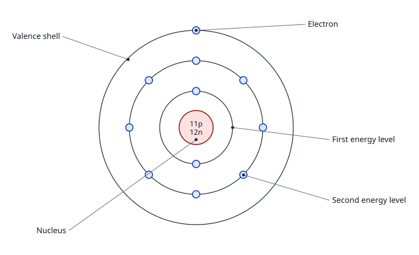

1. Maximum 8
2. Negative charge; in shells
3. Maximum 2 electrons
4. Protons and neutrons

Answer and explanation

**Answer: (4) Protons and neutrons**

Nucleus: Protons and neutrons (File 6: CHE-D01).

<!-- meta {"type":"mcq","id":"SCQ-10-03-012","grade":10,"chapter_id":"SC10-03","discipline":"CHE","difficulty":1,"qtype":"diagram","answer":2,"origin":"ORIGINAL","source_ref":"CHE-D01","image":"science_assets/chemistry/CHE-D01_labelled.svg"} -->
**SCQ-10-03-012** · Basic · Diagram · `ORIGINAL`

In the Electronic configuration of a sodium atom (2,8,1) diagram, what is the function of the 'Electron'?

1. Maximum 2 electrons
2. Negative charge; in shells
3. Protons and neutrons
4. Maximum 8

Answer and explanation

**Answer: (2) Negative charge; in shells**

Electron: Negative charge; in shells (File 6: CHE-D01).

<!-- meta {"type":"mcq","id":"SCQ-10-03-013","grade":10,"chapter_id":"SC10-03","discipline":"CHE","difficulty":1,"qtype":"diagram","answer":2,"origin":"ORIGINAL","source_ref":"CHE-D01","image":"science_assets/chemistry/CHE-D01_labelled.svg"} -->
**SCQ-10-03-013** · Basic · Diagram · `ORIGINAL`

In the Electronic configuration of a sodium atom (2,8,1) diagram, what is the function of the 'First energy level'?

1. Protons and neutrons
2. Maximum 2 electrons
3. Maximum 8
4. Negative charge; in shells

Answer and explanation

**Answer: (2) Maximum 2 electrons**

First energy level: Maximum 2 electrons (File 6: CHE-D01).

<!-- meta {"type":"mcq","id":"SCQ-10-03-014","grade":10,"chapter_id":"SC10-03","discipline":"CHE","difficulty":1,"qtype":"calculation","answer":1,"origin":"ORIGINAL","source_ref":"param-SC10-03-1","image":null} -->
**SCQ-10-03-014** · Basic · Calculation · `ORIGINAL`

Number of neutrons in a 23Na atom (atomic number 11)?

1. 12
2. 23
3. 11
4. 34

Answer and explanation

**Answer: (1) 12**

Neutrons = mass number − atomic number = 23 − 11.

<!-- meta {"type":"mcq","id":"SCQ-10-03-015","grade":10,"chapter_id":"SC10-03","discipline":"CHE","difficulty":1,"qtype":"calculation","answer":1,"origin":"ORIGINAL","source_ref":"param-SC10-03-2","image":null} -->
**SCQ-10-03-015** · Basic · Calculation · `ORIGINAL`

Number of neutrons in a 27Al atom (atomic number 13)?

1. 14
2. 27
3. 13
4. 40

Answer and explanation

**Answer: (1) 14**

Neutrons = mass number − atomic number = 27 − 13.

<!-- meta {"type":"mcq","id":"SCQ-10-03-016","grade":10,"chapter_id":"SC10-03","discipline":"CHE","difficulty":1,"qtype":"calculation","answer":4,"origin":"ORIGINAL","source_ref":"param-SC10-03-3","image":null} -->
**SCQ-10-03-016** · Basic · Calculation · `ORIGINAL`

Number of neutrons in a 35Cl atom (atomic number 17)?

1. 52
2. 17
3. 35
4. 18

Answer and explanation

**Answer: (4) 18**

Neutrons = mass number − atomic number = 35 − 17.

<!-- meta {"type":"mcq","id":"SCQ-10-03-017","grade":10,"chapter_id":"SC10-03","discipline":"CHE","difficulty":1,"qtype":"calculation","answer":2,"origin":"ORIGINAL","source_ref":"param-SC10-03-4","image":null} -->
**SCQ-10-03-017** · Basic · Calculation · `ORIGINAL`

Number of neutrons in a 39K atom (atomic number 19)?

1. 39
2. 20
3. 19
4. 58

Answer and explanation

**Answer: (2) 20**

Neutrons = mass number − atomic number = 39 − 19.

<!-- meta {"type":"mcq","id":"SCQ-10-03-018","grade":10,"chapter_id":"SC10-03","discipline":"CHE","difficulty":1,"qtype":"calculation","answer":3,"origin":"ORIGINAL","source_ref":"param-SC10-03-5","image":null} -->
**SCQ-10-03-018** · Basic · Calculation · `ORIGINAL`

Number of neutrons in a 40Ca atom (atomic number 20)?

1. 10
2. 60
3. 20
4. 40

Answer and explanation

**Answer: (3) 20**

Neutrons = mass number − atomic number = 40 − 20.

<!-- meta {"type":"mcq","id":"SCQ-10-03-019","grade":10,"chapter_id":"SC10-03","discipline":"CHE","difficulty":1,"qtype":"calculation","answer":4,"origin":"ORIGINAL","source_ref":"param-SC10-03-6","image":null} -->
**SCQ-10-03-019** · Basic · Calculation · `ORIGINAL`

Number of neutrons in a 31P atom (atomic number 15)?

1. 31
2. 15
3. 46
4. 16

Answer and explanation

**Answer: (4) 16**

Neutrons = mass number − atomic number = 31 − 15.

<!-- meta {"type":"mcq","id":"SCQ-10-03-020","grade":10,"chapter_id":"SC10-03","discipline":"CHE","difficulty":2,"qtype":"concept","answer":4,"origin":"ORIGINAL","source_ref":"param-SC10-03-7","image":null} -->
**SCQ-10-03-020** · Intermediate · Concept · `ORIGINAL`

Electronic configuration of N (atomic number 7)?

1. 5,2
2. 7
3. 1,2,4
4. 2,5

Answer and explanation

**Answer: (4) 2,5**

The shells fill as 2, 8, 8 → 2,5.

<!-- meta {"type":"mcq","id":"SCQ-10-03-021","grade":10,"chapter_id":"SC10-03","discipline":"CHE","difficulty":2,"qtype":"concept","answer":4,"origin":"ORIGINAL","source_ref":"param-SC10-03-8","image":null} -->
**SCQ-10-03-021** · Intermediate · Concept · `ORIGINAL`

Electronic configuration of Al (atomic number 13)?

1. 2,6,5
2. 1,2,8,2
3. 11,2
4. 2,8,3

Answer and explanation

**Answer: (4) 2,8,3**

The shells fill as 2, 8, 8 → 2,8,3.

<!-- meta {"type":"mcq","id":"SCQ-10-03-022","grade":10,"chapter_id":"SC10-03","discipline":"CHE","difficulty":2,"qtype":"concept","answer":4,"origin":"ORIGINAL","source_ref":"param-SC10-03-9","image":null} -->
**SCQ-10-03-022** · Intermediate · Concept · `ORIGINAL`

Electronic configuration of S (atomic number 16)?

1. 14,2
2. 2,6,8
3. 1,2,8,5
4. 2,8,6

Answer and explanation

**Answer: (4) 2,8,6**

The shells fill as 2, 8, 8 → 2,8,6.

<!-- meta {"type":"mcq","id":"SCQ-10-03-023","grade":10,"chapter_id":"SC10-03","discipline":"CHE","difficulty":2,"qtype":"concept","answer":2,"origin":"ORIGINAL","source_ref":"param-SC10-03-10","image":null} -->
**SCQ-10-03-023** · Intermediate · Concept · `ORIGINAL`

Electronic configuration of K (atomic number 19)?

1. 8,2,8,1
2. 2,8,8,1
3. 2,6,11
4. 17,2

Answer and explanation

**Answer: (2) 2,8,8,1**

The shells fill as 2, 8, 8 → 2,8,8,1.

<!-- meta {"type":"mcq","id":"SCQ-10-03-024","grade":10,"chapter_id":"SC10-03","discipline":"CHE","difficulty":2,"qtype":"concept","answer":3,"origin":"ORIGINAL","source_ref":"param-SC10-03-11","image":null} -->
**SCQ-10-03-024** · Intermediate · Concept · `ORIGINAL`

Electronic configuration of Ca (atomic number 20)?

1. 2,6,12
2. 18,2
3. 2,8,8,2
4. 8,2,8,2

Answer and explanation

**Answer: (3) 2,8,8,2**

The shells fill as 2, 8, 8 → 2,8,8,2.

<!-- meta {"type":"mcq","id":"SCQ-10-03-025","grade":10,"chapter_id":"SC10-03","discipline":"CHE","difficulty":2,"qtype":"concept","answer":3,"origin":"ORIGINAL","source_ref":"param-SC10-03-12","image":null} -->
**SCQ-10-03-025** · Intermediate · Concept · `ORIGINAL`

Electronic configuration of Ne (atomic number 10)?

1. 8,2
2. 2,8,2
3. 2,8
4. 1,2,7

Answer and explanation

**Answer: (3) 2,8**

The shells fill as 2, 8, 8 → 2,8.

<!-- meta {"type":"mcq","id":"SCQ-10-03-026","grade":10,"chapter_id":"SC10-03","discipline":"CHE","difficulty":2,"qtype":"reasoning","answer":4,"origin":"ORIGINAL","source_ref":"param-SC10-03-13","image":null} -->
**SCQ-10-03-026** · Intermediate · Reasoning · `ORIGINAL`

Number of electrons in the Mg²⁺ ion? (atomic number 12)

1. 14
2. 12
3. 18
4. 10

Answer and explanation

**Answer: (4) 10**

Electrons are lost/gained according to the ion's charge.

<!-- meta {"type":"mcq","id":"SCQ-10-03-027","grade":10,"chapter_id":"SC10-03","discipline":"CHE","difficulty":2,"qtype":"reasoning","answer":3,"origin":"ORIGINAL","source_ref":"param-SC10-03-14","image":null} -->
**SCQ-10-03-027** · Intermediate · Reasoning · `ORIGINAL`

Number of electrons in the Cl⁻ ion? (atomic number 17)

1. 26
2. 15
3. 18
4. 17

Answer and explanation

**Answer: (3) 18**

Electrons are lost/gained according to the ion's charge.

<!-- meta {"type":"mcq","id":"SCQ-10-03-028","grade":10,"chapter_id":"SC10-03","discipline":"CHE","difficulty":2,"qtype":"reasoning","answer":2,"origin":"ORIGINAL","source_ref":"param-SC10-03-15","image":null} -->
**SCQ-10-03-028** · Intermediate · Reasoning · `ORIGINAL`

Number of electrons in the O²⁻ ion? (atomic number 8)

1. 8
2. 10
3. 18
4. 6

Answer and explanation

**Answer: (2) 10**

Electrons are lost/gained according to the ion's charge.

## SC10-04: Newton's laws of motion

*Grade 10 · Chapter 4 · Physics · 27 questions*

<!-- meta {"type":"mcq","id":"SCQ-10-04-001","grade":10,"chapter_id":"SC10-04","discipline":"PHY","difficulty":1,"qtype":"calculation","answer":3,"origin":"ORIGINAL","source_ref":"chapter","image":null} -->
**SCQ-10-04-001** · Basic · Calculation · `ORIGINAL`

Force needed to give a 2 kg object an acceleration of 3 m s⁻²?

1. 1.5 N
2. 5 N
3. 6 N
4. 0.67 N

Answer and explanation

**Answer: (3) 6 N**

F = 2 × 3 = 6 N.

<!-- meta {"type":"mcq","id":"SCQ-10-04-002","grade":10,"chapter_id":"SC10-04","discipline":"PHY","difficulty":1,"qtype":"application","answer":1,"origin":"ORIGINAL","source_ref":"chapter","image":null} -->
**SCQ-10-04-002** · Basic · Application · `ORIGINAL`

What explains passengers leaning forward when a bus stops suddenly?

1. First law
2. Second law
3. Third law
4. Law of gravitation

Answer and explanation

**Answer: (1) First law**

Inertia.

<!-- meta {"type":"mcq","id":"SCQ-10-04-003","grade":10,"chapter_id":"SC10-04","discipline":"PHY","difficulty":1,"qtype":"calculation","answer":3,"origin":"ORIGINAL","source_ref":"chapter","image":null} -->
**SCQ-10-04-003** · Basic · Calculation · `ORIGINAL`

Weight of an object of mass 5 kg? (g = 10 m s⁻²)

1. 0.5 N
2. 5 N
3. 50 N
4. 15 N

Answer and explanation

**Answer: (3) 50 N**

W = mg = 50 N.

<!-- meta {"type":"mcq","id":"SCQ-10-04-004","grade":10,"chapter_id":"SC10-04","discipline":"PHY","difficulty":1,"qtype":"calculation","answer":2,"origin":"ORIGINAL","source_ref":"chapter","image":null} -->
**SCQ-10-04-004** · Basic · Calculation · `ORIGINAL`

A 1000 kg car moves at 20 m s⁻¹. Momentum?

1. 50 kg m s⁻¹
2. 20 000 kg m s⁻¹
3. 1020 kg m s⁻¹
4. 200 kg m s⁻¹

Answer and explanation

**Answer: (2) 20 000 kg m s⁻¹**

p = 1000 × 20.

<!-- meta {"type":"mcq","id":"SCQ-10-04-005","grade":10,"chapter_id":"SC10-04","discipline":"PHY","difficulty":2,"qtype":"application","answer":2,"origin":"ORIGINAL","source_ref":"chapter","image":null} -->
**SCQ-10-04-005** · Intermediate · Application · `ORIGINAL`

What explains a gun recoiling when fired?

1. First law
2. Third law
3. Second law only
4. Archimedes

Answer and explanation

**Answer: (2) Third law**

Action — reaction.

<!-- meta {"type":"mcq","id":"SCQ-10-04-006","grade":10,"chapter_id":"SC10-04","discipline":"PHY","difficulty":2,"qtype":"concept","answer":1,"origin":"ORIGINAL","source_ref":"chapter","image":null} -->
**SCQ-10-04-006** · Intermediate · Concept · `ORIGINAL`

Mass of a 60 kg astronaut on the Moon (g = 1.6 m s⁻²)?

1. 60 kg
2. 96 kg
3. 10 kg
4. 600 kg

Answer and explanation

**Answer: (1) 60 kg**

Mass does not depend on location.

<!-- meta {"type":"mcq","id":"SCQ-10-04-007","grade":10,"chapter_id":"SC10-04","discipline":"PHY","difficulty":2,"qtype":"reasoning","answer":2,"origin":"ORIGINAL","source_ref":"chapter","image":null} -->
**SCQ-10-04-007** · Intermediate · Reasoning · `ORIGINAL`

If the same force acts on two objects (2 kg, 4 kg), the acceleration of the 2 kg object?

1. Half
2. Double
3. Equal
4. Four times

Answer and explanation

**Answer: (2) Double**

a = F/m; the mass is half.

<!-- meta {"type":"mcq","id":"SCQ-10-04-008","grade":10,"chapter_id":"SC10-04","discipline":"PHY","difficulty":3,"qtype":"reasoning","answer":2,"origin":"ORIGINAL","source_ref":"chapter","image":null} -->
**SCQ-10-04-008** · Hard · Reasoning · `ORIGINAL`

A book rests on a table. The reaction to the book's weight is?

1. The normal force of the table on the book
2. The force of the book pulling the Earth
3. Friction
4. Air pressure

Answer and explanation

**Answer: (2) The force of the book pulling the Earth**

Earth → book (weight); book → Earth (reaction).

<!-- meta {"type":"mcq","id":"SCQ-10-04-009","grade":10,"chapter_id":"SC10-04","discipline":"PHY","difficulty":2,"qtype":"concept","answer":2,"origin":"ORIGINAL","source_ref":"chapter","image":null} -->
**SCQ-10-04-009** · Intermediate · Concept · `ORIGINAL`

Net force on an object moving at constant velocity?

1. Its weight
2. Zero
3. In the direction of motion
4. In the opposite direction

Answer and explanation

**Answer: (2) Zero**

First law.

<!-- meta {"type":"mcq","id":"SCQ-10-04-010","grade":10,"chapter_id":"SC10-04","discipline":"PHY","difficulty":1,"qtype":"calculation","answer":2,"origin":"ORIGINAL","source_ref":"chapter","image":null} -->
**SCQ-10-04-010** · Basic · Calculation · `ORIGINAL`

Mass of a person whose weight is 600 N? (g = 10)

1. 6000 kg
2. 60 kg
3. 6 kg
4. 600 kg

Answer and explanation

**Answer: (2) 60 kg**

m = W/g.

<!-- meta {"type":"mcq","id":"SCQ-10-04-011","grade":10,"chapter_id":"SC10-04","discipline":"PHY","difficulty":1,"qtype":"calculation","answer":3,"origin":"ORIGINAL","source_ref":"CL-WMOM-1","image":null} -->
**SCQ-10-04-011** · Basic · Calculation · `ORIGINAL`

Weight of a 45 kg student? (g = 10 m s⁻²)

1. 900 N
2. 4500 N
3. 450 N
4. 225 N

Answer and explanation

**Answer: (3) 450 N**

The correct answer is 450 N. See the eight-step solution of CL-WMOM (Basic) in File 5.

<!-- meta {"type":"mcq","id":"SCQ-10-04-012","grade":10,"chapter_id":"SC10-04","discipline":"PHY","difficulty":1,"qtype":"calculation","answer":3,"origin":"ORIGINAL","source_ref":"CL-FMA-1","image":null} -->
**SCQ-10-04-012** · Basic · Calculation · `ORIGINAL`

Resultant force needed for a 1200 kg car to accelerate at 2 m s⁻²?

1. 24000 N
2. 4800 N
3. 2400 N
4. 1200 N

Answer and explanation

**Answer: (3) 2400 N**

The correct answer is 2400 N. See the eight-step solution of CL-FMA (Basic) in File 5.

<!-- meta {"type":"mcq","id":"SCQ-10-04-013","grade":10,"chapter_id":"SC10-04","discipline":"PHY","difficulty":2,"qtype":"calculation","answer":4,"origin":"ORIGINAL","source_ref":"CL-WMOM-2","image":null} -->
**SCQ-10-04-013** · Intermediate · Calculation · `ORIGINAL`

A 0.15 kg cricket ball moves at 40 m s⁻¹. Momentum?

1. 12 kg m s⁻¹
2. 60 kg m s⁻¹
3. 3 kg m s⁻¹
4. 6 kg m s⁻¹

Answer and explanation

**Answer: (4) 6 kg m s⁻¹**

The correct answer is 6 kg m s⁻¹. See the eight-step solution of CL-WMOM (Intermediate) in File 5.

<!-- meta {"type":"mcq","id":"SCQ-10-04-014","grade":10,"chapter_id":"SC10-04","discipline":"PHY","difficulty":2,"qtype":"calculation","answer":3,"origin":"ORIGINAL","source_ref":"CL-FMA-3","image":null} -->
**SCQ-10-04-014** · Intermediate · Calculation · `ORIGINAL`

A 50 kg box is pulled with a force of 300 N; friction is 100 N. Acceleration?

1. 2 m s⁻²
2. 40 m s⁻²
3. 4 m s⁻²
4. 8 m s⁻²

Answer and explanation

**Answer: (3) 4 m s⁻²**

The correct answer is 4 m s⁻². See the eight-step solution of CL-FMA (Exam level) in File 5.

<!-- meta {"type":"mcq","id":"SCQ-10-04-015","grade":10,"chapter_id":"SC10-04","discipline":"PHY","difficulty":1,"qtype":"calculation","answer":3,"origin":"ORIGINAL","source_ref":"param-SC10-04-1","image":null} -->
**SCQ-10-04-015** · Basic · Calculation · `ORIGINAL`

Resultant force needed to give a 3 kg object an acceleration of 4 m s⁻²?

1. 24 N
2. 0.75 N
3. 12 N
4. 7 N

Answer and explanation

**Answer: (3) 12 N**

F = ma = 3 × 4.

<!-- meta {"type":"mcq","id":"SCQ-10-04-016","grade":10,"chapter_id":"SC10-04","discipline":"PHY","difficulty":1,"qtype":"calculation","answer":4,"origin":"ORIGINAL","source_ref":"param-SC10-04-2","image":null} -->
**SCQ-10-04-016** · Basic · Calculation · `ORIGINAL`

Resultant force needed to give a 1500 kg object an acceleration of 2 m s⁻²?

1. 6000 N
2. 750 N
3. 1502 N
4. 3000 N

Answer and explanation

**Answer: (4) 3000 N**

F = ma = 1500 × 2.

<!-- meta {"type":"mcq","id":"SCQ-10-04-017","grade":10,"chapter_id":"SC10-04","discipline":"PHY","difficulty":1,"qtype":"calculation","answer":2,"origin":"ORIGINAL","source_ref":"param-SC10-04-3","image":null} -->
**SCQ-10-04-017** · Basic · Calculation · `ORIGINAL`

Resultant force needed to give a 0.5 kg object an acceleration of 8 m s⁻²?

1. 8.5 N
2. 4 N
3. 0.0625 N
4. 8 N

Answer and explanation

**Answer: (2) 4 N**

F = ma = 0.5 × 8.

<!-- meta {"type":"mcq","id":"SCQ-10-04-018","grade":10,"chapter_id":"SC10-04","discipline":"PHY","difficulty":1,"qtype":"calculation","answer":2,"origin":"ORIGINAL","source_ref":"param-SC10-04-4","image":null} -->
**SCQ-10-04-018** · Basic · Calculation · `ORIGINAL`

Resultant force needed to give a 70 kg object an acceleration of 1.5 m s⁻²?

1. 46.6667 N
2. 105 N
3. 71.5 N
4. 210 N

Answer and explanation

**Answer: (2) 105 N**

F = ma = 70 × 1.5.

<!-- meta {"type":"mcq","id":"SCQ-10-04-019","grade":10,"chapter_id":"SC10-04","discipline":"PHY","difficulty":1,"qtype":"calculation","answer":3,"origin":"ORIGINAL","source_ref":"param-SC10-04-5","image":null} -->
**SCQ-10-04-019** · Basic · Calculation · `ORIGINAL`

A resultant force of 36 N acts on a 12 kg object. Acceleration?

1. 0.3333 m s⁻²
2. 6 m s⁻²
3. 3 m s⁻²
4. 432 m s⁻²

Answer and explanation

**Answer: (3) 3 m s⁻²**

a = F/m = 3.

<!-- meta {"type":"mcq","id":"SCQ-10-04-020","grade":10,"chapter_id":"SC10-04","discipline":"PHY","difficulty":1,"qtype":"calculation","answer":1,"origin":"ORIGINAL","source_ref":"param-SC10-04-6","image":null} -->
**SCQ-10-04-020** · Basic · Calculation · `ORIGINAL`

A resultant force of 250 N acts on a 50 kg object. Acceleration?

1. 5 m s⁻²
2. 12500 m s⁻²
3. 10 m s⁻²
4. 0.2 m s⁻²

Answer and explanation

**Answer: (1) 5 m s⁻²**

a = F/m = 5.

<!-- meta {"type":"mcq","id":"SCQ-10-04-021","grade":10,"chapter_id":"SC10-04","discipline":"PHY","difficulty":1,"qtype":"calculation","answer":3,"origin":"ORIGINAL","source_ref":"param-SC10-04-7","image":null} -->
**SCQ-10-04-021** · Basic · Calculation · `ORIGINAL`

A resultant force of 9 N acts on a 0.3 kg object. Acceleration?

1. 0.0333 m s⁻²
2. 60 m s⁻²
3. 30 m s⁻²
4. 2.7 m s⁻²

Answer and explanation

**Answer: (3) 30 m s⁻²**

a = F/m = 30.

<!-- meta {"type":"mcq","id":"SCQ-10-04-022","grade":10,"chapter_id":"SC10-04","discipline":"PHY","difficulty":1,"qtype":"calculation","answer":2,"origin":"ORIGINAL","source_ref":"param-SC10-04-8","image":null} -->
**SCQ-10-04-022** · Basic · Calculation · `ORIGINAL`

A 0.2 kg object moves at 15 m s⁻¹. Momentum?

1. 6 kg m s⁻¹
2. 3 kg m s⁻¹
3. 22.5 kg m s⁻¹
4. 0.0133 kg m s⁻¹

Answer and explanation

**Answer: (2) 3 kg m s⁻¹**

p = mv = 3.

<!-- meta {"type":"mcq","id":"SCQ-10-04-023","grade":10,"chapter_id":"SC10-04","discipline":"PHY","difficulty":1,"qtype":"calculation","answer":1,"origin":"ORIGINAL","source_ref":"param-SC10-04-9","image":null} -->
**SCQ-10-04-023** · Basic · Calculation · `ORIGINAL`

A 60 kg object moves at 5 m s⁻¹. Momentum?

1. 300 kg m s⁻¹
2. 600 kg m s⁻¹
3. 12 kg m s⁻¹
4. 750 kg m s⁻¹

Answer and explanation

**Answer: (1) 300 kg m s⁻¹**

p = mv = 300.

<!-- meta {"type":"mcq","id":"SCQ-10-04-024","grade":10,"chapter_id":"SC10-04","discipline":"PHY","difficulty":1,"qtype":"calculation","answer":2,"origin":"ORIGINAL","source_ref":"param-SC10-04-10","image":null} -->
**SCQ-10-04-024** · Basic · Calculation · `ORIGINAL`

A 2000 kg object moves at 25 m s⁻¹. Momentum?

1. 100000 kg m s⁻¹
2. 50000 kg m s⁻¹
3. 80 kg m s⁻¹
4. 625000 kg m s⁻¹

Answer and explanation

**Answer: (2) 50000 kg m s⁻¹**

p = mv = 50000.

<!-- meta {"type":"mcq","id":"SCQ-10-04-025","grade":10,"chapter_id":"SC10-04","discipline":"PHY","difficulty":1,"qtype":"calculation","answer":1,"origin":"ORIGINAL","source_ref":"param-SC10-04-11","image":null} -->
**SCQ-10-04-025** · Basic · Calculation · `ORIGINAL`

Mass of an object whose weight is 450 N? (g = 10 m s⁻²)

1. 45 kg
2. 90 kg
3. 4500 kg
4. 450 kg

Answer and explanation

**Answer: (1) 45 kg**

m = W/g = 45 kg.

<!-- meta {"type":"mcq","id":"SCQ-10-04-026","grade":10,"chapter_id":"SC10-04","discipline":"PHY","difficulty":1,"qtype":"calculation","answer":1,"origin":"ORIGINAL","source_ref":"param-SC10-04-12","image":null} -->
**SCQ-10-04-026** · Basic · Calculation · `ORIGINAL`

Mass of an object whose weight is 80 N? (g = 10 m s⁻²)

1. 8 kg
2. 800 kg
3. 80 kg
4. 16 kg

Answer and explanation

**Answer: (1) 8 kg**

m = W/g = 8 kg.

<!-- meta {"type":"mcq","id":"SCQ-10-04-027","grade":10,"chapter_id":"SC10-04","discipline":"PHY","difficulty":1,"qtype":"calculation","answer":2,"origin":"ORIGINAL","source_ref":"param-SC10-04-13","image":null} -->
**SCQ-10-04-027** · Basic · Calculation · `ORIGINAL`

Mass of an object whose weight is 1200 N? (g = 10 m s⁻²)

1. 1200 kg
2. 120 kg
3. 12000 kg
4. 240 kg

Answer and explanation

**Answer: (2) 120 kg**

m = W/g = 120 kg.

## SC10-05: Friction

*Grade 10 · Chapter 5 · Physics · 25 questions*

<!-- meta {"type":"mcq","id":"SCQ-10-05-001","grade":10,"chapter_id":"SC10-05","discipline":"PHY","difficulty":2,"qtype":"reasoning","answer":2,"origin":"ORIGINAL","source_ref":"chapter","image":null} -->
**SCQ-10-05-001** · Intermediate · Reasoning · `ORIGINAL`

A box on a table did not move when pushed with a force of 5 N. Static friction?

1. 0 N
2. 5 N
3. More than 5 N
4. 10 N

Answer and explanation

**Answer: (2) 5 N**

Equilibrium: friction = applied force.

<!-- meta {"type":"mcq","id":"SCQ-10-05-002","grade":10,"chapter_id":"SC10-05","discipline":"PHY","difficulty":1,"qtype":"concept","answer":3,"origin":"ORIGINAL","source_ref":"chapter","image":null} -->
**SCQ-10-05-002** · Basic · Concept · `ORIGINAL`

Which is not a way of reducing friction?

1. Lubricant
2. Ball bearings
3. Making the surface rough
4. Polishing

Answer and explanation

**Answer: (3) Making the surface rough**

Roughening increases friction.

<!-- meta {"type":"mcq","id":"SCQ-10-05-003","grade":10,"chapter_id":"SC10-05","discipline":"PHY","difficulty":2,"qtype":"reasoning","answer":1,"origin":"ORIGINAL","source_ref":"chapter","image":null} -->
**SCQ-10-05-003** · Intermediate · Reasoning · `ORIGINAL`

The force needed to pull a moving object is less than that needed to start it moving. Why?

1. Kinetic friction is less than limiting friction
2. The mass decreases
3. Gravity decreases
4. Air helps

Answer and explanation

**Answer: (1) Kinetic friction is less than limiting friction**

Kinetic friction < limiting friction.

<!-- meta {"type":"mcq","id":"SCQ-10-05-004","grade":10,"chapter_id":"SC10-05","discipline":"PHY","difficulty":1,"qtype":"application","answer":2,"origin":"ORIGINAL","source_ref":"chapter","image":null} -->
**SCQ-10-05-004** · Basic · Application · `ORIGINAL`

Why does a vehicle skid on a rainy day?

1. Friction increases
2. Friction decreases
3. Mass increases
4. Speed decreases

Answer and explanation

**Answer: (2) Friction decreases**

A layer of water acts as a lubricant.

<!-- meta {"type":"mcq","id":"SCQ-10-05-005","grade":10,"chapter_id":"SC10-05","discipline":"PHY","difficulty":2,"qtype":"reasoning","answer":2,"origin":"ORIGINAL","source_ref":"chapter","image":null} -->
**SCQ-10-05-005** · Intermediate · Reasoning · `ORIGINAL`

If another box is placed on top of a box, friction?

1. Decreases
2. Increases
3. Does not change
4. 0

Answer and explanation

**Answer: (2) Increases**

The normal reaction increases.

<!-- meta {"type":"mcq","id":"SCQ-10-05-006","grade":10,"chapter_id":"SC10-05","discipline":"PHY","difficulty":1,"qtype":"application","answer":1,"origin":"ORIGINAL","source_ref":"chapter","image":null} -->
**SCQ-10-05-006** · Basic · Application · `ORIGINAL`

Purpose of the streamlined shape of aircraft?

1. Reducing air resistance
2. Increasing weight
3. Increasing friction
4. For beauty

Answer and explanation

**Answer: (1) Reducing air resistance**

Air resistance decreases.

<!-- meta {"type":"mcq","id":"SCQ-10-05-007","grade":10,"chapter_id":"SC10-05","discipline":"PHY","difficulty":2,"qtype":"graph","answer":2,"origin":"ORIGINAL","source_ref":"chapter","image":null} -->
**SCQ-10-05-007** · Intermediate · Graph · `ORIGINAL`

The peak point on an applied force–friction graph?

1. Kinetic friction
2. Limiting friction
3. Static 0
4. Weight

Answer and explanation

**Answer: (2) Limiting friction**

The moment of starting to move.

<!-- meta {"type":"mcq","id":"SCQ-10-05-008","grade":10,"chapter_id":"SC10-05","discipline":"PHY","difficulty":3,"qtype":"reasoning","answer":1,"origin":"ORIGINAL","source_ref":"chapter","image":null} -->
**SCQ-10-05-008** · Hard · Reasoning · `ORIGINAL`

The force that pushes you forward when walking?

1. The frictional reaction (forwards) to the foot pushing the ground backwards
2. Air pressure
3. Weight
4. Magnetism

Answer and explanation

**Answer: (1) The frictional reaction (forwards) to the foot pushing the ground backwards**

Without friction you cannot walk.

<!-- meta {"type":"mcq","id":"SCQ-10-05-009","grade":10,"chapter_id":"SC10-05","discipline":"PHY","difficulty":2,"qtype":"concept","answer":1,"origin":"ORIGINAL","source_ref":"chapter","image":null} -->
**SCQ-10-05-009** · Intermediate · Concept · `ORIGINAL`

How do ball bearings reduce friction?

1. Change sliding friction into rolling friction
2. By reducing mass
3. By increasing heat
4. By magnetism

Answer and explanation

**Answer: (1) Change sliding friction into rolling friction**

Rolling friction is less.

<!-- meta {"type":"mcq","id":"SCQ-10-05-010","grade":10,"chapter_id":"SC10-05","discipline":"PHY","difficulty":1,"qtype":"concept","answer":2,"origin":"ORIGINAL","source_ref":"chapter","image":null} -->
**SCQ-10-05-010** · Basic · Concept · `ORIGINAL`

What is energy mostly converted into by friction?

1. Sound only
2. Heat
3. Light
4. Electricity

Answer and explanation

**Answer: (2) Heat**

Rubbing produces heat.

<!-- meta {"type":"mcq","id":"SCQ-10-05-011","grade":10,"chapter_id":"SC10-05","discipline":"PHY","difficulty":2,"qtype":"reasoning","answer":1,"origin":"ORIGINAL","source_ref":"extra-SC10-05-1","image":null} -->
**SCQ-10-05-011** · Intermediate · Reasoning · `ORIGINAL`

What could happen in a world without friction?

1. We could not walk
2. Vehicles would stop easily
3. We could write
4. Nails would hold tightly

Answer and explanation

**Answer: (1) We could not walk**

No grip.

<!-- meta {"type":"mcq","id":"SCQ-10-05-012","grade":10,"chapter_id":"SC10-05","discipline":"PHY","difficulty":1,"qtype":"application","answer":1,"origin":"ORIGINAL","source_ref":"extra-SC10-05-2","image":null} -->
**SCQ-10-05-012** · Basic · Application · `ORIGINAL`

Why is it easy to slide on ice?

1. Very low friction
2. No air
3. High friction
4. No gravity

Answer and explanation

**Answer: (1) Very low friction**

Smooth surface, layer of water.

<!-- meta {"type":"mcq","id":"SCQ-10-05-013","grade":10,"chapter_id":"SC10-05","discipline":"PHY","difficulty":1,"qtype":"application","answer":4,"origin":"ORIGINAL","source_ref":"extra-SC10-05-3","image":null} -->
**SCQ-10-05-013** · Basic · Application · `ORIGINAL`

Purpose of lubricating oil in a vehicle engine?

1. Reducing speed
2. Colour
3. Fuel
4. Reducing wear and heat

Answer and explanation

**Answer: (4) Reducing wear and heat**

A layer between the parts.

<!-- meta {"type":"mcq","id":"SCQ-10-05-014","grade":10,"chapter_id":"SC10-05","discipline":"PHY","difficulty":1,"qtype":"application","answer":4,"origin":"ORIGINAL","source_ref":"extra-SC10-05-4","image":null} -->
**SCQ-10-05-014** · Basic · Application · `ORIGINAL`

Spikes under sports shoes?

1. For beauty
2. To reduce speed
3. To reduce weight
4. To increase grip

Answer and explanation

**Answer: (4) To increase grip**

Friction increases.

<!-- meta {"type":"mcq","id":"SCQ-10-05-015","grade":10,"chapter_id":"SC10-05","discipline":"PHY","difficulty":2,"qtype":"concept","answer":4,"origin":"ORIGINAL","source_ref":"extra-SC10-05-5","image":null} -->
**SCQ-10-05-015** · Intermediate · Concept · `ORIGINAL`

The resistance felt by a swimmer in water?

1. Floating only
2. Static friction
3. Magnetic force
4. Fluid friction (drag)

Answer and explanation

**Answer: (4) Fluid friction (drag)**

Friction also occurs in fluids.

<!-- meta {"type":"mcq","id":"SCQ-10-05-016","grade":10,"chapter_id":"SC10-05","discipline":"PHY","difficulty":2,"qtype":"reasoning","answer":4,"origin":"ORIGINAL","source_ref":"extra-SC10-05-6","image":null} -->
**SCQ-10-05-016** · Intermediate · Reasoning · `ORIGINAL`

Why does a spacecraft heat up when it re-enters the atmosphere?

1. The Sun
2. Nuclear energy
3. Magnetism
4. Friction with the air

Answer and explanation

**Answer: (4) Friction with the air**

Kinetic energy becomes heat.

<!-- meta {"type":"mcq","id":"SCQ-10-05-017","grade":10,"chapter_id":"SC10-05","discipline":"PHY","difficulty":3,"qtype":"concept","answer":3,"origin":"ORIGINAL","source_ref":"extra-SC10-05-7","image":null} -->
**SCQ-10-05-017** · Hard · Concept · `ORIGINAL`

The magnitude of kinetic friction generally?

1. Is inversely proportional to weight
2. Doubles with speed
3. Does not depend much on speed (in a moderate range)
4. Is always 0

Answer and explanation

**Answer: (3) Does not depend much on speed (in a moderate range)**

Approximately constant at O/L level.

<!-- meta {"type":"mcq","id":"SCQ-10-05-018","grade":10,"chapter_id":"SC10-05","discipline":"PHY","difficulty":1,"qtype":"application","answer":3,"origin":"ORIGINAL","source_ref":"extra-SC10-05-8","image":null} -->
**SCQ-10-05-018** · Basic · Application · `ORIGINAL`

What makes a match light?

1. Magnetism
2. Electricity
3. Heat produced by friction
4. Light

Answer and explanation

**Answer: (3) Heat produced by friction**

Frictional heat starts combustion.

<!-- meta {"type":"mcq","id":"SCQ-10-05-019","grade":10,"chapter_id":"SC10-05","discipline":"PHY","difficulty":2,"qtype":"calculation","answer":2,"origin":"ORIGINAL","source_ref":"param-SC10-05-1","image":null} -->
**SCQ-10-05-019** · Intermediate · Calculation · `ORIGINAL`

A 10 kg box is pulled with a horizontal force of 50 N; kinetic friction is 20 N. Acceleration?

1. 300 m s⁻²
2. 3 m s⁻²
3. 7 m s⁻²
4. 5 m s⁻²

Answer and explanation

**Answer: (2) 3 m s⁻²**

a = (F − f)/m = (50 − 20)/10 = 3.

<!-- meta {"type":"mcq","id":"SCQ-10-05-020","grade":10,"chapter_id":"SC10-05","discipline":"PHY","difficulty":2,"qtype":"calculation","answer":4,"origin":"ORIGINAL","source_ref":"param-SC10-05-2","image":null} -->
**SCQ-10-05-020** · Intermediate · Calculation · `ORIGINAL`

A 4 kg box is pulled with a horizontal force of 30 N; kinetic friction is 6 N. Acceleration?

1. 96 m s⁻²
2. 9 m s⁻²
3. 7.5 m s⁻²
4. 6 m s⁻²

Answer and explanation

**Answer: (4) 6 m s⁻²**

a = (F − f)/m = (30 − 6)/4 = 6.

<!-- meta {"type":"mcq","id":"SCQ-10-05-021","grade":10,"chapter_id":"SC10-05","discipline":"PHY","difficulty":2,"qtype":"calculation","answer":4,"origin":"ORIGINAL","source_ref":"param-SC10-05-3","image":null} -->
**SCQ-10-05-021** · Intermediate · Calculation · `ORIGINAL`

A 25 kg box is pulled with a horizontal force of 200 N; kinetic friction is 75 N. Acceleration?

1. 8 m s⁻²
2. 3125 m s⁻²
3. 11 m s⁻²
4. 5 m s⁻²

Answer and explanation

**Answer: (4) 5 m s⁻²**

a = (F − f)/m = (200 − 75)/25 = 5.

<!-- meta {"type":"mcq","id":"SCQ-10-05-022","grade":10,"chapter_id":"SC10-05","discipline":"PHY","difficulty":2,"qtype":"calculation","answer":4,"origin":"ORIGINAL","source_ref":"param-SC10-05-4","image":null} -->
**SCQ-10-05-022** · Intermediate · Calculation · `ORIGINAL`

A 8 kg box is pulled with a horizontal force of 40 N; kinetic friction is 40 N. Acceleration?

1. 10 m s⁻²
2. 5 m s⁻²
3. 1 m s⁻²
4. 0 m s⁻²

Answer and explanation

**Answer: (4) 0 m s⁻²**

a = (F − f)/m = (40 − 40)/8 = 0.

<!-- meta {"type":"mcq","id":"SCQ-10-05-023","grade":10,"chapter_id":"SC10-05","discipline":"PHY","difficulty":2,"qtype":"reasoning","answer":4,"origin":"ORIGINAL","source_ref":"param-SC10-05-5","image":null} -->
**SCQ-10-05-023** · Intermediate · Reasoning · `ORIGINAL`

A heavy box does not move when pushed with 15 N. Magnitude of the static friction?

1. 0 N
2. 7.5 N
3. 30 N
4. 15 N

Answer and explanation

**Answer: (4) 15 N**

Equilibrium: friction = applied force.

<!-- meta {"type":"mcq","id":"SCQ-10-05-024","grade":10,"chapter_id":"SC10-05","discipline":"PHY","difficulty":2,"qtype":"reasoning","answer":4,"origin":"ORIGINAL","source_ref":"param-SC10-05-6","image":null} -->
**SCQ-10-05-024** · Intermediate · Reasoning · `ORIGINAL`

A heavy box does not move when pushed with 35 N. Magnitude of the static friction?

1. 0 N
2. 17.5 N
3. 70 N
4. 35 N

Answer and explanation

**Answer: (4) 35 N**

Equilibrium: friction = applied force.

<!-- meta {"type":"mcq","id":"SCQ-10-05-025","grade":10,"chapter_id":"SC10-05","discipline":"PHY","difficulty":2,"qtype":"reasoning","answer":2,"origin":"ORIGINAL","source_ref":"param-SC10-05-7","image":null} -->
**SCQ-10-05-025** · Intermediate · Reasoning · `ORIGINAL`

A heavy box does not move when pushed with 60 N. Magnitude of the static friction?

1. 120 N
2. 60 N
3. 0 N
4. 30 N

Answer and explanation

**Answer: (2) 60 N**

Equilibrium: friction = applied force.

## SC10-06: Structure and functions of plant and animal cells

*Grade 10 · Chapter 6 · Biology · 28 questions*

<!-- meta {"type":"mcq","id":"SCQ-10-06-001","grade":10,"chapter_id":"SC10-06","discipline":"BIO","difficulty":1,"qtype":"recall","answer":2,"origin":"ORIGINAL","source_ref":"chapter","image":null} -->
**SCQ-10-06-001** · Basic · Recall · `ORIGINAL`

Two parts found in plant cells but not in animal cells?

1. Nucleus, mitochondrion
2. Cell wall, chloroplast
3. Cell membrane, ribosome
4. Cytoplasm, nucleus

Answer and explanation

**Answer: (2) Cell wall, chloroplast**

The cell wall and chloroplasts are distinctive to plant cells.

<!-- meta {"type":"mcq","id":"SCQ-10-06-002","grade":10,"chapter_id":"SC10-06","discipline":"BIO","difficulty":1,"qtype":"recall","answer":3,"origin":"ORIGINAL","source_ref":"chapter","image":null} -->
**SCQ-10-06-002** · Basic · Recall · `ORIGINAL`

Main site of ATP production?

1. Nucleus
2. Ribosome
3. Mitochondrion
4. Cell wall

Answer and explanation

**Answer: (3) Mitochondrion**

Aerobic respiration takes place in the mitochondria, producing ATP.

<!-- meta {"type":"mcq","id":"SCQ-10-06-003","grade":10,"chapter_id":"SC10-06","discipline":"BIO","difficulty":1,"qtype":"concept","answer":2,"origin":"ORIGINAL","source_ref":"chapter","image":null} -->
**SCQ-10-06-003** · Basic · Concept · `ORIGINAL`

What controls the substances entering the cell?

1. Cell wall
2. Cell membrane
3. Vacuole
4. Nucleus

Answer and explanation

**Answer: (2) Cell membrane**

The cell membrane is selectively permeable.

<!-- meta {"type":"mcq","id":"SCQ-10-06-004","grade":10,"chapter_id":"SC10-06","discipline":"BIO","difficulty":1,"qtype":"recall","answer":2,"origin":"ORIGINAL","source_ref":"chapter","image":null} -->
**SCQ-10-06-004** · Basic · Recall · `ORIGINAL`

Function of ribosomes?

1. Lipid synthesis
2. Protein synthesis
3. Photosynthesis
4. Respiration

Answer and explanation

**Answer: (2) Protein synthesis**

Ribosomes join amino acids to synthesise proteins.

<!-- meta {"type":"mcq","id":"SCQ-10-06-005","grade":10,"chapter_id":"SC10-06","discipline":"BIO","difficulty":2,"qtype":"reasoning","answer":2,"origin":"ORIGINAL","source_ref":"chapter","image":null} -->
**SCQ-10-06-005** · Intermediate · Reasoning · `ORIGINAL`

Why do muscle cells have many mitochondria?

1. The cell is large
2. They need a lot of energy
3. For photosynthesis
4. To store water

Answer and explanation

**Answer: (2) They need a lot of energy**

Muscle contraction needs a lot of ATP.

<!-- meta {"type":"mcq","id":"SCQ-10-06-006","grade":10,"chapter_id":"SC10-06","discipline":"BIO","difficulty":2,"qtype":"reasoning","answer":1,"origin":"ORIGINAL","source_ref":"chapter","image":null} -->
**SCQ-10-06-006** · Intermediate · Reasoning · `ORIGINAL`

Why do root cells lack chloroplasts?

1. No light reaches them, so photosynthesis is not needed
2. Because there is no water
3. Because there is no cell wall
4. Because there is no nucleus

Answer and explanation

**Answer: (1) No light reaches them, so photosynthesis is not needed**

There is no light under the soil; chloroplasts are not needed.

<!-- meta {"type":"mcq","id":"SCQ-10-06-007","grade":10,"chapter_id":"SC10-06","discipline":"BIO","difficulty":2,"qtype":"concept","answer":2,"origin":"ORIGINAL","source_ref":"chapter","image":null} -->
**SCQ-10-06-007** · Intermediate · Concept · `ORIGINAL`

Cell wall and cell membrane — the correct statement?

1. Both are selectively permeable
2. The cell wall is fully permeable; the cell membrane is selectively permeable
3. The cell wall is selectively permeable
4. Neither is permeable

Answer and explanation

**Answer: (2) The cell wall is fully permeable; the cell membrane is selectively permeable**

The cell wall is a mesh of cellulose — fully permeable.

<!-- meta {"type":"mcq","id":"SCQ-10-06-008","grade":10,"chapter_id":"SC10-06","discipline":"BIO","difficulty":2,"qtype":"recall","answer":1,"origin":"ORIGINAL","source_ref":"chapter","image":null} -->
**SCQ-10-06-008** · Intermediate · Recall · `ORIGINAL`

Which of the following belongs only to animal cells?

1. Centriole
2. Cell wall
3. Chloroplast
4. Large central vacuole

Answer and explanation

**Answer: (1) Centriole**

Centrioles help in cell division; usually absent in higher plants.

<!-- meta {"type":"mcq","id":"SCQ-10-06-009","grade":10,"chapter_id":"SC10-06","discipline":"BIO","difficulty":3,"qtype":"application","answer":1,"origin":"ORIGINAL","source_ref":"chapter","image":null} -->
**SCQ-10-06-009** · Hard · Application · `ORIGINAL`

Well developed in secretory cells (e.g. enzyme-secreting cells)?

1. Golgi apparatus
2. Chloroplast
3. Cell wall
4. Vacuole

Answer and explanation

**Answer: (1) Golgi apparatus**

The Golgi apparatus packages and secretes.

<!-- meta {"type":"mcq","id":"SCQ-10-06-010","grade":10,"chapter_id":"SC10-06","discipline":"BIO","difficulty":3,"qtype":"experiment","answer":3,"origin":"ORIGINAL","source_ref":"chapter","image":null} -->
**SCQ-10-06-010** · Hard · Experiment · `ORIGINAL`

Which is not clearly visible when onion epidermal cells are viewed under a light microscope?

1. Cell wall
2. Nucleus (after staining)
3. Ribosome
4. Cytoplasm

Answer and explanation

**Answer: (3) Ribosome**

Ribosomes are very small; an electron microscope is needed.

<!-- meta {"type":"mcq","id":"SCQ-10-06-011","grade":10,"chapter_id":"SC10-06","discipline":"BIO","difficulty":1,"qtype":"diagram","answer":3,"origin":"ORIGINAL","source_ref":"BIO-D01","image":"science_assets/biology/BIO-D01_labelled.svg"} -->
**SCQ-10-06-011** · Basic · Diagram · `ORIGINAL`

In the Plant cell diagram, what is the function of the 'Cell wall'?

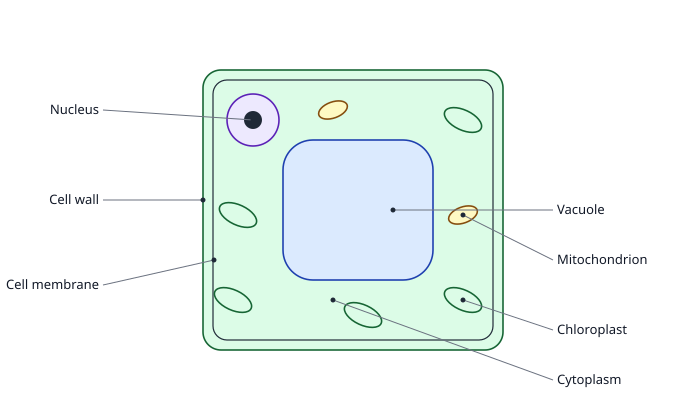

1. Controls cell activities; DNA
2. Controls the entry and exit of substances
3. Mechanical support, shape
4. Stores cell sap; maintains turgor

Answer and explanation

**Answer: (3) Mechanical support, shape**

Cell wall: Mechanical support, shape (File 6: BIO-D01).

<!-- meta {"type":"mcq","id":"SCQ-10-06-012","grade":10,"chapter_id":"SC10-06","discipline":"BIO","difficulty":1,"qtype":"diagram","answer":2,"origin":"ORIGINAL","source_ref":"BIO-D01","image":"science_assets/biology/BIO-D01_labelled.svg"} -->
**SCQ-10-06-012** · Basic · Diagram · `ORIGINAL`

In the Plant cell diagram, what is the function of the 'Cell membrane'?

1. Controls cell activities; DNA
2. Controls the entry and exit of substances
3. Stores cell sap; maintains turgor
4. Mechanical support, shape

Answer and explanation

**Answer: (2) Controls the entry and exit of substances**

Cell membrane: Controls the entry and exit of substances (File 6: BIO-D01).

<!-- meta {"type":"mcq","id":"SCQ-10-06-013","grade":10,"chapter_id":"SC10-06","discipline":"BIO","difficulty":1,"qtype":"diagram","answer":3,"origin":"ORIGINAL","source_ref":"BIO-D01","image":"science_assets/biology/BIO-D01_labelled.svg"} -->
**SCQ-10-06-013** · Basic · Diagram · `ORIGINAL`

In the Plant cell diagram, what is the function of the 'Nucleus'?

1. Stores cell sap; maintains turgor
2. Controls the entry and exit of substances
3. Controls cell activities; DNA
4. Mechanical support, shape

Answer and explanation

**Answer: (3) Controls cell activities; DNA**

Nucleus: Controls cell activities; DNA (File 6: BIO-D01).

<!-- meta {"type":"mcq","id":"SCQ-10-06-014","grade":10,"chapter_id":"SC10-06","discipline":"BIO","difficulty":1,"qtype":"diagram","answer":2,"origin":"ORIGINAL","source_ref":"BIO-D02","image":"science_assets/biology/BIO-D02_labelled.svg"} -->
**SCQ-10-06-014** · Basic · Diagram · `ORIGINAL`

In the Animal cell diagram, what is the function of the 'Cell membrane'?

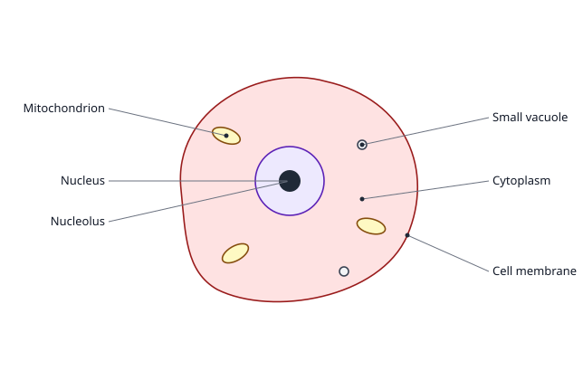

1. Control centre
2. Controls entry and exit
3. Makes ribosomes
4. Produces energy (ATP)

Answer and explanation

**Answer: (2) Controls entry and exit**

Cell membrane: Controls entry and exit (File 6: BIO-D02).

<!-- meta {"type":"mcq","id":"SCQ-10-06-015","grade":10,"chapter_id":"SC10-06","discipline":"BIO","difficulty":1,"qtype":"diagram","answer":1,"origin":"ORIGINAL","source_ref":"BIO-D02","image":"science_assets/biology/BIO-D02_labelled.svg"} -->
**SCQ-10-06-015** · Basic · Diagram · `ORIGINAL`

In the Animal cell diagram, what is the function of the 'Nucleus'?

1. Control centre
2. Produces energy (ATP)
3. Makes ribosomes
4. Controls entry and exit

Answer and explanation

**Answer: (1) Control centre**

Nucleus: Control centre (File 6: BIO-D02).

<!-- meta {"type":"mcq","id":"SCQ-10-06-016","grade":10,"chapter_id":"SC10-06","discipline":"BIO","difficulty":1,"qtype":"diagram","answer":1,"origin":"ORIGINAL","source_ref":"BIO-D02","image":"science_assets/biology/BIO-D02_labelled.svg"} -->
**SCQ-10-06-016** · Basic · Diagram · `ORIGINAL`

In the Animal cell diagram, what is the function of the 'Nucleolus'?

1. Makes ribosomes
2. Produces energy (ATP)
3. Control centre
4. Controls entry and exit

Answer and explanation

**Answer: (1) Makes ribosomes**

Nucleolus: Makes ribosomes (File 6: BIO-D02).

<!-- meta {"type":"mcq","id":"SCQ-10-06-017","grade":10,"chapter_id":"SC10-06","discipline":"BIO","difficulty":1,"qtype":"recall","answer":1,"origin":"ORIGINAL","source_ref":"extra-SC10-06-1","image":null} -->
**SCQ-10-06-017** · Basic · Recall · `ORIGINAL`

Function of the ribosome?

1. Protein synthesis
2. Excretion
3. Respiration
4. Photosynthesis

Answer and explanation

**Answer: (1) Protein synthesis**

Ribosomes make proteins.

<!-- meta {"type":"mcq","id":"SCQ-10-06-018","grade":10,"chapter_id":"SC10-06","discipline":"BIO","difficulty":1,"qtype":"concept","answer":3,"origin":"ORIGINAL","source_ref":"extra-SC10-06-2","image":null} -->
**SCQ-10-06-018** · Basic · Concept · `ORIGINAL`

Movement of water through the cell membrane?

1. Contact
2. Division
3. Osmosis
4. Condensation

Answer and explanation

**Answer: (3) Osmosis**

Movement of water through a partially permeable membrane.

<!-- meta {"type":"mcq","id":"SCQ-10-06-019","grade":10,"chapter_id":"SC10-06","discipline":"BIO","difficulty":1,"qtype":"concept","answer":3,"origin":"ORIGINAL","source_ref":"extra-SC10-06-3","image":null} -->
**SCQ-10-06-019** · Basic · Concept · `ORIGINAL`

Movement of particles from a region of higher concentration to a region of lower concentration?

1. Osmosis only
2. Active transport
3. Diffusion
4. Evaporation

Answer and explanation

**Answer: (3) Diffusion**

Diffusion needs no energy.

<!-- meta {"type":"mcq","id":"SCQ-10-06-020","grade":10,"chapter_id":"SC10-06","discipline":"BIO","difficulty":2,"qtype":"concept","answer":1,"origin":"ORIGINAL","source_ref":"extra-SC10-06-4","image":null} -->
**SCQ-10-06-020** · Intermediate · Concept · `ORIGINAL`

A process that needs ATP to move substances against a concentration gradient?

1. Active transport
2. Osmosis
3. Diffusion
4. Filtration

Answer and explanation

**Answer: (1) Active transport**

Transport that uses energy.

<!-- meta {"type":"mcq","id":"SCQ-10-06-021","grade":10,"chapter_id":"SC10-06","discipline":"BIO","difficulty":3,"qtype":"reasoning","answer":2,"origin":"ORIGINAL","source_ref":"extra-SC10-06-5","image":null} -->
**SCQ-10-06-021** · Hard · Reasoning · `ORIGINAL`

If a red blood cell is placed in water?

1. It divides
2. Water enters and it bursts
3. No change
4. It shrinks

Answer and explanation

**Answer: (2) Water enters and it bursts**

No cell wall — it swells and bursts by osmosis.

<!-- meta {"type":"mcq","id":"SCQ-10-06-022","grade":10,"chapter_id":"SC10-06","discipline":"BIO","difficulty":2,"qtype":"recall","answer":4,"origin":"ORIGINAL","source_ref":"extra-SC10-06-6","image":null} -->
**SCQ-10-06-022** · Intermediate · Recall · `ORIGINAL`

Function of the Golgi body?

1. Storing DNA
2. Cell division
3. Photosynthesis
4. Packaging and secreting substances

Answer and explanation

**Answer: (4) Packaging and secreting substances**

Processing secretions.

<!-- meta {"type":"mcq","id":"SCQ-10-06-023","grade":10,"chapter_id":"SC10-06","discipline":"BIO","difficulty":2,"qtype":"calculation","answer":1,"origin":"ORIGINAL","source_ref":"param-SC10-06-1","image":null} -->
**SCQ-10-06-023** · Intermediate · Calculation · `ORIGINAL`

At ×300 magnification the image of a cell is 6 mm long. Actual length (µm)?

1. 20 µm
2. 1800 µm
3. 1.8 µm
4. 0.02 µm

Answer and explanation

**Answer: (1) 20 µm**

Actual = image ÷ M; mm → µm ×1000.

<!-- meta {"type":"mcq","id":"SCQ-10-06-024","grade":10,"chapter_id":"SC10-06","discipline":"BIO","difficulty":2,"qtype":"calculation","answer":1,"origin":"ORIGINAL","source_ref":"param-SC10-06-2","image":null} -->
**SCQ-10-06-024** · Intermediate · Calculation · `ORIGINAL`

At ×1000 magnification the image of a cell is 20 mm long. Actual length (µm)?

1. 20 µm
2. 0.02 µm
3. 40 µm
4. 20000 µm

Answer and explanation

**Answer: (1) 20 µm**

Actual = image ÷ M; mm → µm ×1000.

<!-- meta {"type":"mcq","id":"SCQ-10-06-025","grade":10,"chapter_id":"SC10-06","discipline":"BIO","difficulty":2,"qtype":"calculation","answer":4,"origin":"ORIGINAL","source_ref":"param-SC10-06-3","image":null} -->
**SCQ-10-06-025** · Intermediate · Calculation · `ORIGINAL`

At ×450 magnification the image of a cell is 9 mm long. Actual length (µm)?

1. 0.02 µm
2. 4.05 µm
3. 4050 µm
4. 20 µm

Answer and explanation

**Answer: (4) 20 µm**

Actual = image ÷ M; mm → µm ×1000.

<!-- meta {"type":"mcq","id":"SCQ-10-06-026","grade":10,"chapter_id":"SC10-06","discipline":"BIO","difficulty":1,"qtype":"calculation","answer":4,"origin":"ORIGINAL","source_ref":"param-SC10-06-4","image":null} -->
**SCQ-10-06-026** · Basic · Calculation · `ORIGINAL`

Eyepiece ×10, objective ×10. Total magnification?

1. 1 times
2. 20 times
3. 200 times
4. 100 times

Answer and explanation

**Answer: (4) 100 times**

M = Mₑ × Mₒ.

<!-- meta {"type":"mcq","id":"SCQ-10-06-027","grade":10,"chapter_id":"SC10-06","discipline":"BIO","difficulty":1,"qtype":"calculation","answer":1,"origin":"ORIGINAL","source_ref":"param-SC10-06-5","image":null} -->
**SCQ-10-06-027** · Basic · Calculation · `ORIGINAL`

Eyepiece ×15, objective ×40. Total magnification?

1. 600 times
2. 55 times
3. 2.6667 times
4. 1200 times

Answer and explanation

**Answer: (1) 600 times**

M = Mₑ × Mₒ.

<!-- meta {"type":"mcq","id":"SCQ-10-06-028","grade":10,"chapter_id":"SC10-06","discipline":"BIO","difficulty":1,"qtype":"calculation","answer":4,"origin":"ORIGINAL","source_ref":"param-SC10-06-6","image":null} -->
**SCQ-10-06-028** · Basic · Calculation · `ORIGINAL`

Eyepiece ×5, objective ×100. Total magnification?

1. 20 times
2. 105 times
3. 1000 times
4. 500 times

Answer and explanation

**Answer: (4) 500 times**

M = Mₑ × Mₒ.

## SC10-07: Quantification of elements and compounds

*Grade 10 · Chapter 7 · Chemistry · 25 questions*

<!-- meta {"type":"mcq","id":"SCQ-10-07-001","grade":10,"chapter_id":"SC10-07","discipline":"CHE","difficulty":1,"qtype":"calculation","answer":2,"origin":"ORIGINAL","source_ref":"chapter","image":null} -->
**SCQ-10-07-001** · Basic · Calculation · `ORIGINAL`

Relative molecular mass of H₂SO₄? (H=1, S=32, O=16)

1. 49
2. 98
3. 96
4. 50

Answer and explanation

**Answer: (2) 98**

2(1) + 32 + 4(16) = 98.

<!-- meta {"type":"mcq","id":"SCQ-10-07-002","grade":10,"chapter_id":"SC10-07","discipline":"CHE","difficulty":1,"qtype":"calculation","answer":2,"origin":"ORIGINAL","source_ref":"chapter","image":null} -->
**SCQ-10-07-002** · Basic · Calculation · `ORIGINAL`

Number of moles in 88 g CO₂? (C=12, O=16)

1. 1
2. 2
3. 0.5
4. 4

Answer and explanation

**Answer: (2) 2**

M = 44; n = 88/44 = 2 mol.

<!-- meta {"type":"mcq","id":"SCQ-10-07-003","grade":10,"chapter_id":"SC10-07","discipline":"CHE","difficulty":2,"qtype":"calculation","answer":1,"origin":"ORIGINAL","source_ref":"chapter","image":null} -->
**SCQ-10-07-003** · Intermediate · Calculation · `ORIGINAL`

Number of molecules in 0.5 mol of water?

1. 3.011 × 10²³
2. 6.022 × 10²³
3. 1.2044 × 10²⁴
4. 0.5

Answer and explanation

**Answer: (1) 3.011 × 10²³**

0.5 × 6.022 × 10²³ = 3.011 × 10²³.

<!-- meta {"type":"mcq","id":"SCQ-10-07-004","grade":10,"chapter_id":"SC10-07","discipline":"CHE","difficulty":2,"qtype":"calculation","answer":2,"origin":"ORIGINAL","source_ref":"chapter","image":null} -->
**SCQ-10-07-004** · Intermediate · Calculation · `ORIGINAL`

250 cm³ of solution contains 0.1 mol NaCl. Concentration?

1. 0.025 mol dm⁻³
2. 0.4 mol dm⁻³
3. 0.1 mol dm⁻³
4. 25 mol dm⁻³

Answer and explanation

**Answer: (2) 0.4 mol dm⁻³**

V = 0.25 dm³; C = 0.1/0.25 = 0.4.

<!-- meta {"type":"mcq","id":"SCQ-10-07-005","grade":10,"chapter_id":"SC10-07","discipline":"CHE","difficulty":2,"qtype":"concept","answer":2,"origin":"ORIGINAL","source_ref":"chapter","image":null} -->
**SCQ-10-07-005** · Intermediate · Concept · `ORIGINAL`

1 mol N₂ and 1 mol O₂ — what is equal?

1. Mass
2. Number of molecules
3. Atomic mass
4. Density

Answer and explanation

**Answer: (2) Number of molecules**

Both contain 6.022 × 10²³ molecules.

<!-- meta {"type":"mcq","id":"SCQ-10-07-006","grade":10,"chapter_id":"SC10-07","discipline":"CHE","difficulty":2,"qtype":"calculation","answer":2,"origin":"ORIGINAL","source_ref":"chapter","image":null} -->
**SCQ-10-07-006** · Intermediate · Calculation · `ORIGINAL`

Mass of NaOH needed to prepare 500 cm³ of 1 mol dm⁻³ NaOH solution? (NaOH = 40)

1. 40 g
2. 20 g
3. 10 g
4. 80 g

Answer and explanation

**Answer: (2) 20 g**

n = 1 × 0.5 = 0.5 mol; m = 0.5 × 40 = 20 g.

<!-- meta {"type":"mcq","id":"SCQ-10-07-007","grade":10,"chapter_id":"SC10-07","discipline":"CHE","difficulty":2,"qtype":"equation","answer":1,"origin":"ORIGINAL","source_ref":"chapter","image":null} -->
**SCQ-10-07-007** · Intermediate · Equation · `ORIGINAL`

2KMnO₄ → K₂MnO₄ + MnO₂ + O₂. Moles of O₂ formed from 2 mol KMnO₄?

1. 1
2. 2
3. 0.5
4. 4

Answer and explanation

**Answer: (1) 1**

Mole ratio 2 : 1.

<!-- meta {"type":"mcq","id":"SCQ-10-07-008","grade":10,"chapter_id":"SC10-07","discipline":"CHE","difficulty":3,"qtype":"calculation","answer":2,"origin":"ORIGINAL","source_ref":"chapter","image":null} -->
**SCQ-10-07-008** · Hard · Calculation · `ORIGINAL`

C₂H₄ + 3O₂ → 2CO₂ + 2H₂O. Mass of water formed when 28 g of ethene burns completely? (C=12,H=1,O=16)

1. 18 g
2. 36 g
3. 9 g
4. 28 g

Answer and explanation

**Answer: (2) 36 g**

28 g = 1 mol C₂H₄ → 2 mol H₂O = 36 g.

<!-- meta {"type":"mcq","id":"SCQ-10-07-009","grade":10,"chapter_id":"SC10-07","discipline":"CHE","difficulty":2,"qtype":"concept","answer":3,"origin":"ORIGINAL","source_ref":"chapter","image":null} -->
**SCQ-10-07-009** · Intermediate · Concept · `ORIGINAL`

Unit of relative atomic mass?

1. g
2. g mol⁻¹
3. No unit
4. kg

Answer and explanation

**Answer: (3) No unit**

It is a comparative ratio.

<!-- meta {"type":"mcq","id":"SCQ-10-07-010","grade":10,"chapter_id":"SC10-07","discipline":"CHE","difficulty":1,"qtype":"calculation","answer":1,"origin":"ORIGINAL","source_ref":"chapter","image":null} -->
**SCQ-10-07-010** · Basic · Calculation · `ORIGINAL`

Mass of 6.022 × 10²³ Na atoms? (Na = 23)

1. 23 g
2. 6.022 g
3. 1 g
4. 11 g

Answer and explanation

**Answer: (1) 23 g**

1 mol Na = 23 g.

<!-- meta {"type":"mcq","id":"SCQ-10-07-011","grade":10,"chapter_id":"SC10-07","discipline":"CHE","difficulty":1,"qtype":"calculation","answer":3,"origin":"ORIGINAL","source_ref":"CL-MOLE-1","image":null} -->
**SCQ-10-07-011** · Basic · Calculation · `ORIGINAL`

Number of moles in 36 g of water? (H₂O = 18 g mol⁻¹)

1. 1 mol
2. 20 mol
3. 2 mol
4. 4 mol

Answer and explanation

**Answer: (3) 2 mol**

The correct answer is 2 mol. See the eight-step solution of CL-MOLE (Basic) in File 5.

<!-- meta {"type":"mcq","id":"SCQ-10-07-012","grade":10,"chapter_id":"SC10-07","discipline":"CHE","difficulty":2,"qtype":"calculation","answer":3,"origin":"ORIGINAL","source_ref":"param-SC10-07-1","image":null} -->
**SCQ-10-07-012** · Intermediate · Calculation · `ORIGINAL`

Relative molecular mass of NaOH? (H 1, C 12, N 14, O 16, Na 23, Mg 24, Al 27, S 32, Cl 35.5, Ca 40)

1. 39
2. 80
3. 40
4. 56

Answer and explanation

**Answer: (3) 40**

Sum of the atomic masses = 40.

<!-- meta {"type":"mcq","id":"SCQ-10-07-013","grade":10,"chapter_id":"SC10-07","discipline":"CHE","difficulty":2,"qtype":"calculation","answer":3,"origin":"ORIGINAL","source_ref":"param-SC10-07-2","image":null} -->
**SCQ-10-07-013** · Intermediate · Calculation · `ORIGINAL`

Relative molecular mass of H₂SO₄? (H 1, C 12, N 14, O 16, Na 23, Mg 24, Al 27, S 32, Cl 35.5, Ca 40)

1. 114
2. 82
3. 98
4. 49

Answer and explanation

**Answer: (3) 98**

Sum of the atomic masses = 98.

<!-- meta {"type":"mcq","id":"SCQ-10-07-014","grade":10,"chapter_id":"SC10-07","discipline":"CHE","difficulty":2,"qtype":"calculation","answer":2,"origin":"ORIGINAL","source_ref":"param-SC10-07-3","image":null} -->
**SCQ-10-07-014** · Intermediate · Calculation · `ORIGINAL`

Relative molecular mass of CaCO₃? (H 1, C 12, N 14, O 16, Na 23, Mg 24, Al 27, S 32, Cl 35.5, Ca 40)

1. 84
2. 100
3. 116
4. 68

Answer and explanation

**Answer: (2) 100**

Sum of the atomic masses = 100.

<!-- meta {"type":"mcq","id":"SCQ-10-07-015","grade":10,"chapter_id":"SC10-07","discipline":"CHE","difficulty":2,"qtype":"calculation","answer":1,"origin":"ORIGINAL","source_ref":"param-SC10-07-4","image":null} -->
**SCQ-10-07-015** · Intermediate · Calculation · `ORIGINAL`

Relative molecular mass of Mg(OH)₂? (H 1, C 12, N 14, O 16, Na 23, Mg 24, Al 27, S 32, Cl 35.5, Ca 40)

1. 58
2. 74
3. 41
4. 57

Answer and explanation

**Answer: (1) 58**

Sum of the atomic masses = 58.

<!-- meta {"type":"mcq","id":"SCQ-10-07-016","grade":10,"chapter_id":"SC10-07","discipline":"CHE","difficulty":2,"qtype":"calculation","answer":1,"origin":"ORIGINAL","source_ref":"param-SC10-07-5","image":null} -->
**SCQ-10-07-016** · Intermediate · Calculation · `ORIGINAL`

Relative molecular mass of NH₄Cl? (H 1, C 12, N 14, O 16, Na 23, Mg 24, Al 27, S 32, Cl 35.5, Ca 40)

1. 53.5
2. 50.5
3. 18
4. 69.5

Answer and explanation

**Answer: (1) 53.5**

Sum of the atomic masses = 53.5.

<!-- meta {"type":"mcq","id":"SCQ-10-07-017","grade":10,"chapter_id":"SC10-07","discipline":"CHE","difficulty":2,"qtype":"calculation","answer":1,"origin":"ORIGINAL","source_ref":"param-SC10-07-6","image":null} -->
**SCQ-10-07-017** · Intermediate · Calculation · `ORIGINAL`

Relative molecular mass of Al₂O₃? (H 1, C 12, N 14, O 16, Na 23, Mg 24, Al 27, S 32, Cl 35.5, Ca 40)

1. 102
2. 118
3. 86
4. 43

Answer and explanation

**Answer: (1) 102**

Sum of the atomic masses = 102.

<!-- meta {"type":"mcq","id":"SCQ-10-07-018","grade":10,"chapter_id":"SC10-07","discipline":"CHE","difficulty":2,"qtype":"calculation","answer":2,"origin":"ORIGINAL","source_ref":"param-SC10-07-7","image":null} -->
**SCQ-10-07-018** · Intermediate · Calculation · `ORIGINAL`

Relative molecular mass of C₆H₁₂O₆? (H 1, C 12, N 14, O 16, Na 23, Mg 24, Al 27, S 32, Cl 35.5, Ca 40)

1. 29
2. 180
3. 196
4. 164

Answer and explanation

**Answer: (2) 180**

Sum of the atomic masses = 180.

<!-- meta {"type":"mcq","id":"SCQ-10-07-019","grade":10,"chapter_id":"SC10-07","discipline":"CHE","difficulty":1,"qtype":"calculation","answer":1,"origin":"ORIGINAL","source_ref":"param-SC10-07-8","image":null} -->
**SCQ-10-07-019** · Basic · Calculation · `ORIGINAL`

Moles in 10 g of NaOH? (molar mass 40 g mol⁻¹)

1. 0.25 mol
2. 0.5 mol
3. 4 mol
4. 400 mol

Answer and explanation

**Answer: (1) 0.25 mol**

n = m/M.

<!-- meta {"type":"mcq","id":"SCQ-10-07-020","grade":10,"chapter_id":"SC10-07","discipline":"CHE","difficulty":1,"qtype":"calculation","answer":4,"origin":"ORIGINAL","source_ref":"param-SC10-07-9","image":null} -->
**SCQ-10-07-020** · Basic · Calculation · `ORIGINAL`

Moles in 88 g of CO₂? (molar mass 44 g mol⁻¹)

1. 3872 mol
2. 4 mol
3. 0.5 mol
4. 2 mol

Answer and explanation

**Answer: (4) 2 mol**

n = m/M.

<!-- meta {"type":"mcq","id":"SCQ-10-07-021","grade":10,"chapter_id":"SC10-07","discipline":"CHE","difficulty":1,"qtype":"calculation","answer":4,"origin":"ORIGINAL","source_ref":"param-SC10-07-10","image":null} -->
**SCQ-10-07-021** · Basic · Calculation · `ORIGINAL`

Moles in 9 g of H₂O? (molar mass 18 g mol⁻¹)

1. 2 mol
2. 162 mol
3. 1 mol
4. 0.5 mol

Answer and explanation

**Answer: (4) 0.5 mol**

n = m/M.

<!-- meta {"type":"mcq","id":"SCQ-10-07-022","grade":10,"chapter_id":"SC10-07","discipline":"CHE","difficulty":1,"qtype":"calculation","answer":3,"origin":"ORIGINAL","source_ref":"param-SC10-07-11","image":null} -->
**SCQ-10-07-022** · Basic · Calculation · `ORIGINAL`

Moles in 250 g of CaCO₃? (molar mass 100 g mol⁻¹)

1. 5 mol
2. 25000 mol
3. 2.5 mol
4. 0.4 mol

Answer and explanation

**Answer: (3) 2.5 mol**

n = m/M.

<!-- meta {"type":"mcq","id":"SCQ-10-07-023","grade":10,"chapter_id":"SC10-07","discipline":"CHE","difficulty":1,"qtype":"calculation","answer":1,"origin":"ORIGINAL","source_ref":"param-SC10-07-12","image":null} -->
**SCQ-10-07-023** · Basic · Calculation · `ORIGINAL`

Mass of 0.25 mol of O₂? (M = 32 g mol⁻¹)

1. 8 g
2. 128 g
3. 16 g
4. 0.0078 g

Answer and explanation

**Answer: (1) 8 g**

m = nM.

<!-- meta {"type":"mcq","id":"SCQ-10-07-024","grade":10,"chapter_id":"SC10-07","discipline":"CHE","difficulty":1,"qtype":"calculation","answer":1,"origin":"ORIGINAL","source_ref":"param-SC10-07-13","image":null} -->
**SCQ-10-07-024** · Basic · Calculation · `ORIGINAL`

Mass of 2 mol of NaCl? (M = 58.5 g mol⁻¹)

1. 117 g
2. 29.25 g
3. 234 g
4. 0.0342 g

Answer and explanation

**Answer: (1) 117 g**

m = nM.

<!-- meta {"type":"mcq","id":"SCQ-10-07-025","grade":10,"chapter_id":"SC10-07","discipline":"CHE","difficulty":1,"qtype":"calculation","answer":4,"origin":"ORIGINAL","source_ref":"param-SC10-07-14","image":null} -->
**SCQ-10-07-025** · Basic · Calculation · `ORIGINAL`

Mass of 0.1 mol of H₂SO₄? (M = 98 g mol⁻¹)

1. 980 g
2. 19.6 g
3. 0.001 g
4. 9.8 g

Answer and explanation

**Answer: (4) 9.8 g**

m = nM.

## SC10-08: Characteristics of living organisms

*Grade 10 · Chapter 8 · Biology · 25 questions*

<!-- meta {"type":"mcq","id":"SCQ-10-08-001","grade":10,"chapter_id":"SC10-08","discipline":"BIO","difficulty":1,"qtype":"recall","answer":2,"origin":"ORIGINAL","source_ref":"chapter","image":null} -->
**SCQ-10-08-001** · Basic · Recall · `ORIGINAL`

Which shows binomial nomenclature written correctly?

1. homo Sapiens
2. Homo sapiens
3. Homo Sapiens
4. homo sapiens

Answer and explanation

**Answer: (2) Homo sapiens**

The genus name with a capital letter, the species name with a small letter.

<!-- meta {"type":"mcq","id":"SCQ-10-08-002","grade":10,"chapter_id":"SC10-08","discipline":"BIO","difficulty":1,"qtype":"recall","answer":2,"origin":"ORIGINAL","source_ref":"chapter","image":null} -->
**SCQ-10-08-002** · Basic · Recall · `ORIGINAL`

Which phylum does the earthworm belong to?

1. Mollusca
2. Annelida
3. Arthropoda
4. Cnidaria

Answer and explanation

**Answer: (2) Annelida**

Body divided into segments — Annelida.

<!-- meta {"type":"mcq","id":"SCQ-10-08-003","grade":10,"chapter_id":"SC10-08","discipline":"BIO","difficulty":2,"qtype":"concept","answer":2,"origin":"ORIGINAL","source_ref":"chapter","image":null} -->
**SCQ-10-08-003** · Intermediate · Concept · `ORIGINAL`

What distinguishes bacteria from Eukarya?

1. Presence of a cell wall
2. Absence of a membrane-bound nucleus
3. Presence of DNA
4. Presence of ribosomes

Answer and explanation

**Answer: (2) Absence of a membrane-bound nucleus**

Bacteria are prokaryotes — no true nucleus.

<!-- meta {"type":"mcq","id":"SCQ-10-08-004","grade":10,"chapter_id":"SC10-08","discipline":"BIO","difficulty":1,"qtype":"concept","answer":2,"origin":"ORIGINAL","source_ref":"chapter","image":null} -->
**SCQ-10-08-004** · Basic · Concept · `ORIGINAL`

Crab, spider, insect — common feature?

1. Soft body
2. Jointed legs
3. Tube feet
4. Stinging cells

Answer and explanation

**Answer: (2) Jointed legs**

Arthropoda: jointed legs, exoskeleton.

<!-- meta {"type":"mcq","id":"SCQ-10-08-005","grade":10,"chapter_id":"SC10-08","discipline":"BIO","difficulty":2,"qtype":"concept","answer":2,"origin":"ORIGINAL","source_ref":"chapter","image":null} -->
**SCQ-10-08-005** · Intermediate · Concept · `ORIGINAL`

Which phylum does the starfish belong to?

1. Fish
2. Echinodermata
3. Mollusca
4. Cnidaria

Answer and explanation

**Answer: (2) Echinodermata**

Although its name contains 'fish' it is an echinoderm.

<!-- meta {"type":"mcq","id":"SCQ-10-08-006","grade":10,"chapter_id":"SC10-08","discipline":"BIO","difficulty":1,"qtype":"concept","answer":3,"origin":"ORIGINAL","source_ref":"chapter","image":null} -->
**SCQ-10-08-006** · Basic · Concept · `ORIGINAL`

Which is not a characteristic of organisms?

1. Reproduction
2. Respiration
3. Crystallisation
4. Excretion

Answer and explanation

**Answer: (3) Crystallisation**

Crystallisation also occurs in non-living things.

<!-- meta {"type":"mcq","id":"SCQ-10-08-007","grade":10,"chapter_id":"SC10-08","discipline":"BIO","difficulty":2,"qtype":"concept","answer":2,"origin":"ORIGINAL","source_ref":"chapter","image":null} -->
**SCQ-10-08-007** · Intermediate · Concept · `ORIGINAL`

How do fungi differ from plants?

1. No cell wall
2. No chlorophyll, so they are heterotrophic
3. No nucleus
4. They do not respire

Answer and explanation

**Answer: (2) No chlorophyll, so they are heterotrophic**

Fungi do not photosynthesise; they are saprophytes.

<!-- meta {"type":"mcq","id":"SCQ-10-08-008","grade":10,"chapter_id":"SC10-08","discipline":"BIO","difficulty":3,"qtype":"reasoning","answer":2,"origin":"ORIGINAL","source_ref":"chapter","image":null} -->
**SCQ-10-08-008** · Hard · Reasoning · `ORIGINAL`

Two organisms of the same genus must belong to the same …

1. Species
2. Family
3. Binomial name
4. Both species and family

Answer and explanation

**Answer: (2) Family**

A genus falls within a family; the species may differ.

<!-- meta {"type":"mcq","id":"SCQ-10-08-009","grade":10,"chapter_id":"SC10-08","discipline":"BIO","difficulty":2,"qtype":"reasoning","answer":2,"origin":"ORIGINAL","source_ref":"chapter","image":null} -->
**SCQ-10-08-009** · Intermediate · Reasoning · `ORIGINAL`

Why is a bat said to be a mammal, not a bird?

1. It has wings
2. It gives birth, feeds milk and has hair
3. It lays eggs
4. It has scales

Answer and explanation

**Answer: (2) It gives birth, feeds milk and has hair**

Distinctive features of mammals.

<!-- meta {"type":"mcq","id":"SCQ-10-08-010","grade":10,"chapter_id":"SC10-08","discipline":"BIO","difficulty":1,"qtype":"application","answer":2,"origin":"ORIGINAL","source_ref":"chapter","image":null} -->
**SCQ-10-08-010** · Basic · Application · `ORIGINAL`

Feature shown by a touch-me-not leaf closing?

1. Growth
2. Irritability
3. Respiration
4. Excretion

Answer and explanation

**Answer: (2) Irritability**

Response to a touch stimulus.

<!-- meta {"type":"mcq","id":"SCQ-10-08-011","grade":10,"chapter_id":"SC10-08","discipline":"BIO","difficulty":1,"qtype":"recall","answer":3,"origin":"ORIGINAL","source_ref":"extra-SC10-08-1","image":null} -->
**SCQ-10-08-011** · Basic · Recall · `ORIGINAL`

Who introduced binomial nomenclature?

1. Louis Pasteur
2. Charles Darwin
3. Carolus Linnaeus
4. Gregor Mendel

Answer and explanation

**Answer: (3) Carolus Linnaeus**

Linnaeus — genus + species.

<!-- meta {"type":"mcq","id":"SCQ-10-08-012","grade":10,"chapter_id":"SC10-08","discipline":"BIO","difficulty":2,"qtype":"concept","answer":4,"origin":"ORIGINAL","source_ref":"extra-SC10-08-2","image":null} -->
**SCQ-10-08-012** · Intermediate · Concept · `ORIGINAL`

The correct way to write a scientific name?

1. Homo Sapiens
2. homo Sapiens
3. HOMO SAPIENS
4. Homo sapiens

Answer and explanation

**Answer: (4) Homo sapiens**

The genus begins with a capital letter; the species with a small letter; in italics.

<!-- meta {"type":"mcq","id":"SCQ-10-08-013","grade":10,"chapter_id":"SC10-08","discipline":"BIO","difficulty":1,"qtype":"recall","answer":2,"origin":"ORIGINAL","source_ref":"extra-SC10-08-3","image":null} -->
**SCQ-10-08-013** · Basic · Recall · `ORIGINAL`

The smallest unit of classification?

1. Family
2. Species
3. Phylum
4. Genus

Answer and explanation

**Answer: (2) Species**

A group that interbreeds and produces fertile offspring.

<!-- meta {"type":"mcq","id":"SCQ-10-08-014","grade":10,"chapter_id":"SC10-08","discipline":"BIO","difficulty":1,"qtype":"concept","answer":2,"origin":"ORIGINAL","source_ref":"extra-SC10-08-4","image":null} -->
**SCQ-10-08-014** · Basic · Concept · `ORIGINAL`

Which of the following is an invertebrate?

1. Snake
2. Snail
3. Bat
4. Frog

Answer and explanation

**Answer: (2) Snail**

A snail is a mollusc.

<!-- meta {"type":"mcq","id":"SCQ-10-08-015","grade":10,"chapter_id":"SC10-08","discipline":"BIO","difficulty":1,"qtype":"recall","answer":1,"origin":"ORIGINAL","source_ref":"extra-SC10-08-5","image":null} -->
**SCQ-10-08-015** · Basic · Recall · `ORIGINAL`

A feature of amphibians?

1. Moist skin without scales
2. Feathers
3. Mammary glands
4. Dry scales

Answer and explanation

**Answer: (1) Moist skin without scales**

Gas exchange also through the skin.

<!-- meta {"type":"mcq","id":"SCQ-10-08-016","grade":10,"chapter_id":"SC10-08","discipline":"BIO","difficulty":1,"qtype":"recall","answer":3,"origin":"ORIGINAL","source_ref":"extra-SC10-08-6","image":null} -->
**SCQ-10-08-016** · Basic · Recall · `ORIGINAL`

A feature special to mammals?

1. Gills only
2. Flowers
3. Mammary glands and hair
4. Scales

Answer and explanation

**Answer: (3) Mammary glands and hair**

Feeding the young with milk.

<!-- meta {"type":"mcq","id":"SCQ-10-08-017","grade":10,"chapter_id":"SC10-08","discipline":"BIO","difficulty":2,"qtype":"concept","answer":2,"origin":"ORIGINAL","source_ref":"extra-SC10-08-7","image":null} -->
**SCQ-10-08-017** · Intermediate · Concept · `ORIGINAL`

The plant group that does not flower and has exposed seeds?

1. Mosses
2. Gymnosperms
3. Flowering plants
4. Ferns

Answer and explanation

**Answer: (2) Gymnosperms**

e.g. Cycas, Pinus.

<!-- meta {"type":"mcq","id":"SCQ-10-08-018","grade":10,"chapter_id":"SC10-08","discipline":"BIO","difficulty":2,"qtype":"concept","answer":1,"origin":"ORIGINAL","source_ref":"extra-SC10-08-8","image":null} -->
**SCQ-10-08-018** · Intermediate · Concept · `ORIGINAL`

A plant with net-veined leaves and a tap root?

1. Dicotyledonous plant
2. Fern
3. Moss
4. Monocotyledonous plant

Answer and explanation

**Answer: (1) Dicotyledonous plant**

Dicot features.

<!-- meta {"type":"mcq","id":"SCQ-10-08-019","grade":10,"chapter_id":"SC10-08","discipline":"BIO","difficulty":1,"qtype":"application","answer":4,"origin":"ORIGINAL","source_ref":"extra-SC10-08-9","image":null} -->
**SCQ-10-08-019** · Basic · Application · `ORIGINAL`

An example of a monocotyledonous plant?

1. Bean
2. Jak
3. Mango
4. Rice

Answer and explanation

**Answer: (4) Rice**

Rice — grass family.

<!-- meta {"type":"mcq","id":"SCQ-10-08-020","grade":10,"chapter_id":"SC10-08","discipline":"BIO","difficulty":1,"qtype":"recall","answer":2,"origin":"ORIGINAL","source_ref":"extra-SC10-08-10","image":null} -->
**SCQ-10-08-020** · Basic · Recall · `ORIGINAL`

Number of legs in insects?

1. 4
2. 6
3. 8
4. 10

Answer and explanation

**Answer: (2) 6**

Three pairs of legs.

<!-- meta {"type":"mcq","id":"SCQ-10-08-021","grade":10,"chapter_id":"SC10-08","discipline":"BIO","difficulty":2,"qtype":"reasoning","answer":4,"origin":"ORIGINAL","source_ref":"extra-SC10-08-11","image":null} -->
**SCQ-10-08-021** · Intermediate · Reasoning · `ORIGINAL`

Why is a spider not an insect?

1. It has gills
2. It has wings
3. It has a backbone
4. 8 legs, two body parts

Answer and explanation

**Answer: (4) 8 legs, two body parts**

Spider — Arachnida.

<!-- meta {"type":"mcq","id":"SCQ-10-08-022","grade":10,"chapter_id":"SC10-08","discipline":"BIO","difficulty":1,"qtype":"application","answer":1,"origin":"ORIGINAL","source_ref":"extra-SC10-08-12","image":null} -->
**SCQ-10-08-022** · Basic · Application · `ORIGINAL`

An example of the characteristic of sensitivity?

1. Leaves of touch-me-not closing
2. Fruit ripening
3. Leaf fall
4. Seeds drying

Answer and explanation

**Answer: (1) Leaves of touch-me-not closing**

Response to a stimulus.

<!-- meta {"type":"mcq","id":"SCQ-10-08-023","grade":10,"chapter_id":"SC10-08","discipline":"BIO","difficulty":3,"qtype":"reasoning","answer":2,"origin":"ORIGINAL","source_ref":"extra-SC10-08-13","image":null} -->
**SCQ-10-08-023** · Hard · Reasoning · `ORIGINAL`

One reason why viruses cannot be called living?

1. They have no DNA/RNA
2. They cannot reproduce outside a host cell
3. They have chlorophyll
4. They are very large

Answer and explanation

**Answer: (2) They cannot reproduce outside a host cell**

Obligate parasites.

<!-- meta {"type":"mcq","id":"SCQ-10-08-024","grade":10,"chapter_id":"SC10-08","discipline":"BIO","difficulty":3,"qtype":"concept","answer":4,"origin":"ORIGINAL","source_ref":"extra-SC10-08-14","image":null} -->
**SCQ-10-08-024** · Hard · Concept · `ORIGINAL`

The type of worm with bilateral symmetry and segments?

1. Tapeworm
2. Cnidaria
3. Sponge
4. Annelida (earthworm)

Answer and explanation

**Answer: (4) Annelida (earthworm)**

Ringed worms.

<!-- meta {"type":"mcq","id":"SCQ-10-08-025","grade":10,"chapter_id":"SC10-08","discipline":"BIO","difficulty":2,"qtype":"application","answer":1,"origin":"ORIGINAL","source_ref":"extra-SC10-08-15","image":null} -->
**SCQ-10-08-025** · Intermediate · Application · `ORIGINAL`

Purpose of a dichotomous key?

1. Identifying organisms
2. Finding weight
3. Reading DNA
4. Finding age

Answer and explanation

**Answer: (1) Identifying organisms**

Dividing step by step into two choices.

## SC10-09: Resultant force

*Grade 10 · Chapter 9 · Physics · 25 questions*

<!-- meta {"type":"mcq","id":"SCQ-10-09-001","grade":10,"chapter_id":"SC10-09","discipline":"PHY","difficulty":1,"qtype":"calculation","answer":2,"origin":"ORIGINAL","source_ref":"chapter","image":null} -->
**SCQ-10-09-001** · Basic · Calculation · `ORIGINAL`

Resultant of 8 N to the right and 5 N to the left?

1. 13 N right
2. 3 N right
3. 3 N left
4. 40 N

Answer and explanation

**Answer: (2) 3 N right**

8 − 5 = 3 N, in the direction of the larger force.

<!-- meta {"type":"mcq","id":"SCQ-10-09-002","grade":10,"chapter_id":"SC10-09","discipline":"PHY","difficulty":2,"qtype":"calculation","answer":3,"origin":"ORIGINAL","source_ref":"chapter","image":null} -->
**SCQ-10-09-002** · Intermediate · Calculation · `ORIGINAL`

Forces of 6 N and 8 N act perpendicularly. Resultant?

1. 14 N
2. 2 N
3. 10 N
4. 48 N

Answer and explanation

**Answer: (3) 10 N**

√(36 + 64) = 10 N.

<!-- meta {"type":"mcq","id":"SCQ-10-09-003","grade":10,"chapter_id":"SC10-09","discipline":"PHY","difficulty":2,"qtype":"calculation","answer":2,"origin":"ORIGINAL","source_ref":"chapter","image":null} -->
**SCQ-10-09-003** · Intermediate · Calculation · `ORIGINAL`

10 N to the right and 4 N to the left act on a 2 kg object. Acceleration?

1. 7 m s⁻²
2. 3 m s⁻²
3. 5 m s⁻²
4. 2 m s⁻²

Answer and explanation

**Answer: (2) 3 m s⁻²**

Resultant 6 N; a = 6/2 = 3.

<!-- meta {"type":"mcq","id":"SCQ-10-09-004","grade":10,"chapter_id":"SC10-09","discipline":"PHY","difficulty":3,"qtype":"reasoning","answer":4,"origin":"ORIGINAL","source_ref":"chapter","image":null} -->
**SCQ-10-09-004** · Hard · Reasoning · `ORIGINAL`

Which cannot be the resultant of 5 N and 12 N?

1. 7 N
2. 13 N
3. 17 N
4. 20 N

Answer and explanation

**Answer: (4) 20 N**

The range is from 7 N to 17 N.

<!-- meta {"type":"mcq","id":"SCQ-10-09-005","grade":10,"chapter_id":"SC10-09","discipline":"PHY","difficulty":2,"qtype":"concept","answer":2,"origin":"ORIGINAL","source_ref":"chapter","image":null} -->
**SCQ-10-09-005** · Intermediate · Concept · `ORIGINAL`

What represents the resultant in the parallelogram rule?

1. One side
2. The diagonal from the common point
3. The other diagonal
4. The perimeter

Answer and explanation

**Answer: (2) The diagonal from the common point**

Parallelogram rule.

<!-- meta {"type":"mcq","id":"SCQ-10-09-006","grade":10,"chapter_id":"SC10-09","discipline":"PHY","difficulty":1,"qtype":"concept","answer":2,"origin":"ORIGINAL","source_ref":"chapter","image":null} -->
**SCQ-10-09-006** · Basic · Concept · `ORIGINAL`

The resultant force on an object is zero. The object?

1. Accelerates
2. Is at rest or moving at constant velocity
3. Decelerates
4. Rotates

Answer and explanation

**Answer: (2) Is at rest or moving at constant velocity**

First law.

<!-- meta {"type":"mcq","id":"SCQ-10-09-007","grade":10,"chapter_id":"SC10-09","discipline":"PHY","difficulty":3,"qtype":"calculation","answer":2,"origin":"ORIGINAL","source_ref":"chapter","image":null} -->
**SCQ-10-09-007** · Hard · Calculation · `ORIGINAL`

Two equal 10 N forces at 90°. Approximate magnitude of the resultant?

1. 20 N
2. 14.1 N
3. 10 N
4. 0 N

Answer and explanation

**Answer: (2) 14.1 N**

√200 ≈ 14.1 N.

<!-- meta {"type":"mcq","id":"SCQ-10-09-008","grade":10,"chapter_id":"SC10-09","discipline":"PHY","difficulty":1,"qtype":"calculation","answer":2,"origin":"ORIGINAL","source_ref":"chapter","image":null} -->
**SCQ-10-09-008** · Basic · Calculation · `ORIGINAL`

In a tug-of-war team A pulls 500 N, team B 450 N. Resultant?

1. 950 N towards A
2. 50 N towards A
3. 50 N towards B
4. 0

Answer and explanation

**Answer: (2) 50 N towards A**

500 − 450.

<!-- meta {"type":"mcq","id":"SCQ-10-09-009","grade":10,"chapter_id":"SC10-09","discipline":"PHY","difficulty":2,"qtype":"calculation","answer":1,"origin":"ORIGINAL","source_ref":"chapter","image":null} -->
**SCQ-10-09-009** · Intermediate · Calculation · `ORIGINAL`

Scale 1 cm : 5 N. The resultant is 6.4 cm. Force?

1. 32 N
2. 6.4 N
3. 1.28 N
4. 11.4 N

Answer and explanation

**Answer: (1) 32 N**

6.4 × 5 = 32 N.

<!-- meta {"type":"mcq","id":"SCQ-10-09-010","grade":10,"chapter_id":"SC10-09","discipline":"PHY","difficulty":1,"qtype":"concept","answer":1,"origin":"ORIGINAL","source_ref":"chapter","image":null} -->
**SCQ-10-09-010** · Basic · Concept · `ORIGINAL`

Because force is a vector quantity?

1. Direction must be considered when adding
2. They can always be added
3. Direction does not matter
4. It has no unit

Answer and explanation

**Answer: (1) Direction must be considered when adding**

Vector addition.

<!-- meta {"type":"mcq","id":"SCQ-10-09-011","grade":10,"chapter_id":"SC10-09","discipline":"PHY","difficulty":2,"qtype":"calculation","answer":4,"origin":"ORIGINAL","source_ref":"CL-RESULT-2","image":null} -->
**SCQ-10-09-011** · Intermediate · Calculation · `ORIGINAL`

9 N and 12 N act perpendicular to each other. Resultant?

1. 30 N
2. 7.5 N
3. 150 N
4. 15 N

Answer and explanation

**Answer: (4) 15 N**

The correct answer is 15 N. See the eight-step solution of CL-RESULT (Intermediate) in File 5.

<!-- meta {"type":"mcq","id":"SCQ-10-09-012","grade":10,"chapter_id":"SC10-09","discipline":"PHY","difficulty":2,"qtype":"calculation","answer":3,"origin":"ORIGINAL","source_ref":"param-SC10-09-1","image":null} -->
**SCQ-10-09-012** · Intermediate · Calculation · `ORIGINAL`

Forces of 5 N and 12 N act perpendicular to each other. Magnitude of the resultant?

1. 17 N
2. 60 N
3. 13 N
4. 7 N

Answer and explanation

**Answer: (3) 13 N**

√(5² + 12²) = 13 N.

<!-- meta {"type":"mcq","id":"SCQ-10-09-013","grade":10,"chapter_id":"SC10-09","discipline":"PHY","difficulty":2,"qtype":"calculation","answer":3,"origin":"ORIGINAL","source_ref":"param-SC10-09-2","image":null} -->
**SCQ-10-09-013** · Intermediate · Calculation · `ORIGINAL`

Forces of 8 N and 15 N act perpendicular to each other. Magnitude of the resultant?

1. 7 N
2. 23 N
3. 17 N
4. 120 N

Answer and explanation

**Answer: (3) 17 N**

√(8² + 15²) = 17 N.

<!-- meta {"type":"mcq","id":"SCQ-10-09-014","grade":10,"chapter_id":"SC10-09","discipline":"PHY","difficulty":2,"qtype":"calculation","answer":3,"origin":"ORIGINAL","source_ref":"param-SC10-09-3","image":null} -->
**SCQ-10-09-014** · Intermediate · Calculation · `ORIGINAL`

Forces of 7 N and 24 N act perpendicular to each other. Magnitude of the resultant?

1. 17 N
2. 31 N
3. 25 N
4. 168 N

Answer and explanation

**Answer: (3) 25 N**

√(7² + 24²) = 25 N.

<!-- meta {"type":"mcq","id":"SCQ-10-09-015","grade":10,"chapter_id":"SC10-09","discipline":"PHY","difficulty":2,"qtype":"calculation","answer":4,"origin":"ORIGINAL","source_ref":"param-SC10-09-4","image":null} -->
**SCQ-10-09-015** · Intermediate · Calculation · `ORIGINAL`

Forces of 20 N and 21 N act perpendicular to each other. Magnitude of the resultant?

1. 420 N
2. 41 N
3. 1 N
4. 29 N

Answer and explanation

**Answer: (4) 29 N**

√(20² + 21²) = 29 N.

<!-- meta {"type":"mcq","id":"SCQ-10-09-016","grade":10,"chapter_id":"SC10-09","discipline":"PHY","difficulty":1,"qtype":"calculation","answer":3,"origin":"ORIGINAL","source_ref":"param-SC10-09-5","image":null} -->
**SCQ-10-09-016** · Basic · Calculation · `ORIGINAL`

Magnitude of the resultant of 14 N to the right and 9 N to the left?

1. 16.6433 N
2. 23 N
3. 5 N
4. 12.5 N

Answer and explanation

**Answer: (3) 5 N**

Opposite directions — the difference.

<!-- meta {"type":"mcq","id":"SCQ-10-09-017","grade":10,"chapter_id":"SC10-09","discipline":"PHY","difficulty":1,"qtype":"calculation","answer":2,"origin":"ORIGINAL","source_ref":"param-SC10-09-6","image":null} -->
**SCQ-10-09-017** · Basic · Calculation · `ORIGINAL`

Magnitude of the resultant of 30 N to the right and 45 N to the left?

1. 38.5 N
2. 15 N
3. 54.0833 N
4. 75 N

Answer and explanation

**Answer: (2) 15 N**

Opposite directions — the difference.

<!-- meta {"type":"mcq","id":"SCQ-10-09-018","grade":10,"chapter_id":"SC10-09","discipline":"PHY","difficulty":1,"qtype":"calculation","answer":2,"origin":"ORIGINAL","source_ref":"param-SC10-09-7","image":null} -->
**SCQ-10-09-018** · Basic · Calculation · `ORIGINAL`

Magnitude of the resultant of 6 N to the right and 6 N to the left?

1. 13 N
2. 0 N
3. 7 N
4. 12 N

Answer and explanation

**Answer: (2) 0 N**

Opposite directions — the difference.

<!-- meta {"type":"mcq","id":"SCQ-10-09-019","grade":10,"chapter_id":"SC10-09","discipline":"PHY","difficulty":2,"qtype":"calculation","answer":2,"origin":"ORIGINAL","source_ref":"param-SC10-09-8","image":null} -->
**SCQ-10-09-019** · Intermediate · Calculation · `ORIGINAL`

On a 5 kg object, 30 N acts in one direction and 10 N in the opposite direction. Acceleration?

1. 6 m s⁻²
2. 4 m s⁻²
3. 100 m s⁻²
4. 8 m s⁻²

Answer and explanation

**Answer: (2) 4 m s⁻²**

(30 − 10)/5.

<!-- meta {"type":"mcq","id":"SCQ-10-09-020","grade":10,"chapter_id":"SC10-09","discipline":"PHY","difficulty":2,"qtype":"calculation","answer":4,"origin":"ORIGINAL","source_ref":"param-SC10-09-9","image":null} -->
**SCQ-10-09-020** · Intermediate · Calculation · `ORIGINAL`

On a 2 kg object, 8 N acts in one direction and 3 N in the opposite direction. Acceleration?

1. 5.5 m s⁻²
2. 4 m s⁻²
3. 10 m s⁻²
4. 2.5 m s⁻²

Answer and explanation

**Answer: (4) 2.5 m s⁻²**

(8 − 3)/2.

<!-- meta {"type":"mcq","id":"SCQ-10-09-021","grade":10,"chapter_id":"SC10-09","discipline":"PHY","difficulty":2,"qtype":"calculation","answer":3,"origin":"ORIGINAL","source_ref":"param-SC10-09-10","image":null} -->
**SCQ-10-09-021** · Intermediate · Calculation · `ORIGINAL`

On a 10 kg object, 45 N acts in one direction and 15 N in the opposite direction. Acceleration?

1. 6 m s⁻²
2. 300 m s⁻²
3. 3 m s⁻²
4. 4.5 m s⁻²

Answer and explanation

**Answer: (3) 3 m s⁻²**

(45 − 15)/10.

<!-- meta {"type":"mcq","id":"SCQ-10-09-022","grade":10,"chapter_id":"SC10-09","discipline":"PHY","difficulty":2,"qtype":"calculation","answer":2,"origin":"ORIGINAL","source_ref":"param-SC10-09-11","image":null} -->
**SCQ-10-09-022** · Intermediate · Calculation · `ORIGINAL`

A boat is pushed 9 N east and the wind pushes it 40 N north. Magnitude of the resultant force?

1. 31 N
2. 41 N
3. 24.5 N
4. 49 N

Answer and explanation

**Answer: (2) 41 N**

Perpendicular forces — Pythagoras.

<!-- meta {"type":"mcq","id":"SCQ-10-09-023","grade":10,"chapter_id":"SC10-09","discipline":"PHY","difficulty":2,"qtype":"calculation","answer":2,"origin":"ORIGINAL","source_ref":"param-SC10-09-12","image":null} -->
**SCQ-10-09-023** · Intermediate · Calculation · `ORIGINAL`

A boat is pushed 12 N east and the wind pushes it 35 N north. Magnitude of the resultant force?

1. 47 N
2. 37 N
3. 23.5 N
4. 23 N

Answer and explanation

**Answer: (2) 37 N**

Perpendicular forces — Pythagoras.

<!-- meta {"type":"mcq","id":"SCQ-10-09-024","grade":10,"chapter_id":"SC10-09","discipline":"PHY","difficulty":2,"qtype":"calculation","answer":2,"origin":"ORIGINAL","source_ref":"param-SC10-09-13","image":null} -->
**SCQ-10-09-024** · Intermediate · Calculation · `ORIGINAL`

A boat is pushed 16 N east and the wind pushes it 30 N north. Magnitude of the resultant force?

1. 46 N
2. 34 N
3. 23 N
4. 14 N

Answer and explanation

**Answer: (2) 34 N**

Perpendicular forces — Pythagoras.

<!-- meta {"type":"mcq","id":"SCQ-10-09-025","grade":10,"chapter_id":"SC10-09","discipline":"PHY","difficulty":2,"qtype":"calculation","answer":3,"origin":"ORIGINAL","source_ref":"param-SC10-09-14","image":null} -->
**SCQ-10-09-025** · Intermediate · Calculation · `ORIGINAL`

A boat is pushed 24 N east and the wind pushes it 7 N north. Magnitude of the resultant force?

1. 31 N
2. -17 N
3. 25 N
4. 15.5 N

Answer and explanation

**Answer: (3) 25 N**

Perpendicular forces — Pythagoras.

## SC10-10: Chemical bonds

*Grade 10 · Chapter 10 · Chemistry · 25 questions*

<!-- meta {"type":"mcq","id":"SCQ-10-10-001","grade":10,"chapter_id":"SC10-10","discipline":"CHE","difficulty":1,"qtype":"concept","answer":3,"origin":"ORIGINAL","source_ref":"chapter","image":null} -->
**SCQ-10-10-001** · Basic · Concept · `ORIGINAL`

Which of the following is an ionic compound?

1. CH₄
2. HCl
3. MgCl₂
4. CO₂

Answer and explanation

**Answer: (3) MgCl₂**

Metal (Mg) + non-metal (Cl).

<!-- meta {"type":"mcq","id":"SCQ-10-10-002","grade":10,"chapter_id":"SC10-10","discipline":"CHE","difficulty":1,"qtype":"recall","answer":3,"origin":"ORIGINAL","source_ref":"chapter","image":null} -->
**SCQ-10-10-002** · Basic · Recall · `ORIGINAL`

Covalent bonds in an NH₃ molecule?

1. 1
2. 2
3. 3
4. 4

Answer and explanation

**Answer: (3) 3**

N forms single bonds with three H.

<!-- meta {"type":"mcq","id":"SCQ-10-10-003","grade":10,"chapter_id":"SC10-10","discipline":"CHE","difficulty":2,"qtype":"reasoning","answer":2,"origin":"ORIGINAL","source_ref":"chapter","image":null} -->
**SCQ-10-10-003** · Intermediate · Reasoning · `ORIGINAL`

Why does molten NaCl conduct electricity?

1. Free electrons
2. Mobile ions
3. Molecules
4. Water

Answer and explanation

**Answer: (2) Mobile ions**

When molten, the ions can move.

<!-- meta {"type":"mcq","id":"SCQ-10-10-004","grade":10,"chapter_id":"SC10-10","discipline":"CHE","difficulty":2,"qtype":"recall","answer":3,"origin":"ORIGINAL","source_ref":"chapter","image":null} -->
**SCQ-10-10-004** · Intermediate · Recall · `ORIGINAL`

Type of bond in an N₂ molecule?

1. Single
2. Double
3. Triple
4. Ionic

Answer and explanation

**Answer: (3) Triple**

Each N shares 3 electrons.

<!-- meta {"type":"mcq","id":"SCQ-10-10-005","grade":10,"chapter_id":"SC10-10","discipline":"CHE","difficulty":2,"qtype":"reasoning","answer":1,"origin":"ORIGINAL","source_ref":"chapter","image":null} -->
**SCQ-10-10-005** · Intermediate · Reasoning · `ORIGINAL`

Why does the O atom in H₂O carry a partial negative charge (δ−)?

1. O is more electronegative than H
2. O has more protons
3. H is a metal
4. O is an ion

Answer and explanation

**Answer: (1) O is more electronegative than H**

The bonding electrons are pulled towards O.

<!-- meta {"type":"mcq","id":"SCQ-10-10-006","grade":10,"chapter_id":"SC10-10","discipline":"CHE","difficulty":1,"qtype":"concept","answer":2,"origin":"ORIGINAL","source_ref":"chapter","image":null} -->
**SCQ-10-10-006** · Basic · Concept · `ORIGINAL`

When Na and Cl combine to form NaCl?

1. Na gains an electron
2. Na gives one electron to Cl
3. They share electrons
4. A proton is transferred

Answer and explanation

**Answer: (2) Na gives one electron to Cl**

Na → Na⁺ + e⁻; Cl + e⁻ → Cl⁻.

<!-- meta {"type":"mcq","id":"SCQ-10-10-007","grade":10,"chapter_id":"SC10-10","discipline":"CHE","difficulty":2,"qtype":"equation","answer":2,"origin":"ORIGINAL","source_ref":"chapter","image":null} -->
**SCQ-10-10-007** · Intermediate · Equation · `ORIGINAL`

Formula of aluminium oxide (Al³⁺, O²⁻)?

1. AlO
2. Al₂O₃
3. Al₃O₂
4. AlO₃

Answer and explanation

**Answer: (2) Al₂O₃**

To balance the charges: 2(+3) + 3(−2) = 0.

<!-- meta {"type":"mcq","id":"SCQ-10-10-008","grade":10,"chapter_id":"SC10-10","discipline":"CHE","difficulty":2,"qtype":"reasoning","answer":1,"origin":"ORIGINAL","source_ref":"chapter","image":null} -->
**SCQ-10-10-008** · Intermediate · Reasoning · `ORIGINAL`

Why does sugar solution not conduct electricity?

1. Sugar is a covalent molecule — no ions
2. Sugar is a metal
3. Water does not conduct
4. Sugar does not dissolve

Answer and explanation

**Answer: (1) Sugar is a covalent molecule — no ions**

No ionisation takes place.

<!-- meta {"type":"mcq","id":"SCQ-10-10-009","grade":10,"chapter_id":"SC10-10","discipline":"CHE","difficulty":3,"qtype":"reasoning","answer":2,"origin":"ORIGINAL","source_ref":"chapter","image":null} -->
**SCQ-10-10-009** · Hard · Reasoning · `ORIGINAL`

Total shared electron pairs in CO₂?

1. 2
2. 4
3. 6
4. 8

Answer and explanation

**Answer: (2) 4**

O=C=O: two double bonds = 4 pairs.

<!-- meta {"type":"mcq","id":"SCQ-10-10-010","grade":10,"chapter_id":"SC10-10","discipline":"CHE","difficulty":1,"qtype":"concept","answer":2,"origin":"ORIGINAL","source_ref":"chapter","image":null} -->
**SCQ-10-10-010** · Basic · Concept · `ORIGINAL`

Why do metals conduct electricity?

1. Because ions move
2. Delocalised electrons
3. Molecules
4. Movement of protons

Answer and explanation

**Answer: (2) Delocalised electrons**

A sea of electrons.

<!-- meta {"type":"mcq","id":"SCQ-10-10-011","grade":10,"chapter_id":"SC10-10","discipline":"CHE","difficulty":2,"qtype":"equation","answer":2,"origin":"ORIGINAL","source_ref":"VAL-02","image":null} -->
**SCQ-10-10-011** · Intermediate · Equation · `ORIGINAL`

Formula of the compound formed by Mg²⁺ and Cl⁻?

1. Mg₂Cl
2. MgCl₂
3. MgCl
4. Mg₂Cl₃

Answer and explanation

**Answer: (2) MgCl₂**

Valencies 2, 1; total positive charge = total negative charge → MgCl₂.

<!-- meta {"type":"mcq","id":"SCQ-10-10-012","grade":10,"chapter_id":"SC10-10","discipline":"CHE","difficulty":2,"qtype":"equation","answer":4,"origin":"ORIGINAL","source_ref":"VAL-03","image":null} -->
**SCQ-10-10-012** · Intermediate · Equation · `ORIGINAL`

Formula of the compound formed by Al³⁺ and O²⁻?

1. Al₃O₂
2. AlO
3. Al₂O
4. Al₂O₃

Answer and explanation

**Answer: (4) Al₂O₃**

Valencies 3, 2; total positive charge = total negative charge → Al₂O₃.

<!-- meta {"type":"mcq","id":"SCQ-10-10-013","grade":10,"chapter_id":"SC10-10","discipline":"CHE","difficulty":2,"qtype":"equation","answer":3,"origin":"ORIGINAL","source_ref":"VAL-04","image":null} -->
**SCQ-10-10-013** · Intermediate · Equation · `ORIGINAL`

Formula of the compound formed by Ca²⁺ and SO₄²⁻?

1. Ca₂(SO₄)₂
2. Ca₂(SO₄)₃
3. CaSO₄
4. Ca₃(SO₄)₂

Answer and explanation

**Answer: (3) CaSO₄**

Valencies 2, 2; total positive charge = total negative charge → CaSO₄.

<!-- meta {"type":"mcq","id":"SCQ-10-10-014","grade":10,"chapter_id":"SC10-10","discipline":"CHE","difficulty":2,"qtype":"equation","answer":1,"origin":"ORIGINAL","source_ref":"VAL-05","image":null} -->
**SCQ-10-10-014** · Intermediate · Equation · `ORIGINAL`

Formula of the compound formed by Al³⁺ and SO₄²⁻?

1. Al₂(SO₄)₃
2. Al₃(SO₄)₂
3. AlSO₄
4. Al₂SO₄

Answer and explanation

**Answer: (1) Al₂(SO₄)₃**

Valencies 3, 2; total positive charge = total negative charge → Al₂(SO₄)₃.

<!-- meta {"type":"mcq","id":"SCQ-10-10-015","grade":10,"chapter_id":"SC10-10","discipline":"CHE","difficulty":2,"qtype":"equation","answer":3,"origin":"ORIGINAL","source_ref":"VAL-06","image":null} -->
**SCQ-10-10-015** · Intermediate · Equation · `ORIGINAL`

Formula of the compound formed by Fe³⁺ and OH⁻?

1. Fe₃OH
2. FeOH
3. Fe(OH)₃
4. Fe₂(OH)₃

Answer and explanation

**Answer: (3) Fe(OH)₃**

Valencies 3, 1; total positive charge = total negative charge → Fe(OH)₃.

<!-- meta {"type":"mcq","id":"SCQ-10-10-016","grade":10,"chapter_id":"SC10-10","discipline":"CHE","difficulty":2,"qtype":"equation","answer":1,"origin":"ORIGINAL","source_ref":"VAL-07","image":null} -->
**SCQ-10-10-016** · Intermediate · Equation · `ORIGINAL`

Formula of the compound formed by Cu²⁺ and SO₄²⁻?

1. CuSO₄
2. Cu₂(SO₄)₃
3. Cu₂(SO₄)₂
4. Cu₃(SO₄)₂

Answer and explanation

**Answer: (1) CuSO₄**

Valencies 2, 2; total positive charge = total negative charge → CuSO₄.

<!-- meta {"type":"mcq","id":"SCQ-10-10-017","grade":10,"chapter_id":"SC10-10","discipline":"CHE","difficulty":2,"qtype":"equation","answer":4,"origin":"ORIGINAL","source_ref":"VAL-09","image":null} -->
**SCQ-10-10-017** · Intermediate · Equation · `ORIGINAL`

Formula of the compound formed by Mg²⁺ and CO₃²⁻?

1. Mg₂(CO₃)₂
2. Mg₃(CO₃)₂
3. Mg₂(CO₃)₃
4. MgCO₃

Answer and explanation

**Answer: (4) MgCO₃**

Valencies 2, 2; total positive charge = total negative charge → MgCO₃.

<!-- meta {"type":"mcq","id":"SCQ-10-10-018","grade":10,"chapter_id":"SC10-10","discipline":"CHE","difficulty":2,"qtype":"equation","answer":2,"origin":"ORIGINAL","source_ref":"VAL-10","image":null} -->
**SCQ-10-10-018** · Intermediate · Equation · `ORIGINAL`

Formula of the compound formed by Al³⁺ and PO₄³⁻?

1. Al₂(PO₄)₃
2. AlPO₄
3. Al₃(PO₄)₃
4. Al₃(PO₄)₂

Answer and explanation

**Answer: (2) AlPO₄**

Valencies 3, 3; total positive charge = total negative charge → AlPO₄.

<!-- meta {"type":"mcq","id":"SCQ-10-10-019","grade":10,"chapter_id":"SC10-10","discipline":"CHE","difficulty":2,"qtype":"equation","answer":3,"origin":"ORIGINAL","source_ref":"VAL-11","image":null} -->
**SCQ-10-10-019** · Intermediate · Equation · `ORIGINAL`

Formula of the compound formed by NH₄⁺ and SO₄²⁻?

1. NH₄SO₄
2. (NH₄)₂(SO₄)₃
3. (NH₄)₂SO₄
4. NH₄(SO₄)₂

Answer and explanation

**Answer: (3) (NH₄)₂SO₄**

Valencies 1, 2; total positive charge = total negative charge → (NH₄)₂SO₄.

<!-- meta {"type":"mcq","id":"SCQ-10-10-020","grade":10,"chapter_id":"SC10-10","discipline":"CHE","difficulty":2,"qtype":"equation","answer":2,"origin":"ORIGINAL","source_ref":"VAL-12","image":null} -->
**SCQ-10-10-020** · Intermediate · Equation · `ORIGINAL`

Formula of the compound formed by Ca²⁺ and S²⁻?

1. Ca₃S₂
2. CaS
3. Ca₂S₃
4. Ca₂S₂

Answer and explanation

**Answer: (2) CaS**

Valencies 2, 2; total positive charge = total negative charge → CaS.

<!-- meta {"type":"mcq","id":"SCQ-10-10-021","grade":10,"chapter_id":"SC10-10","discipline":"CHE","difficulty":2,"qtype":"equation","answer":2,"origin":"ORIGINAL","source_ref":"VAL-13","image":null} -->
**SCQ-10-10-021** · Intermediate · Equation · `ORIGINAL`

Formula of the compound formed by Na⁺ and PO₄³⁻?

1. Na₂(PO₄)₃
2. Na₃PO₄
3. Na(PO₄)₃
4. NaPO₄

Answer and explanation

**Answer: (2) Na₃PO₄**

Valencies 1, 3; total positive charge = total negative charge → Na₃PO₄.

<!-- meta {"type":"mcq","id":"SCQ-10-10-022","grade":10,"chapter_id":"SC10-10","discipline":"CHE","difficulty":2,"qtype":"equation","answer":3,"origin":"ORIGINAL","source_ref":"VAL-14","image":null} -->
**SCQ-10-10-022** · Intermediate · Equation · `ORIGINAL`

Formula of the compound formed by Fe³⁺ and NO₃⁻?

1. Fe₃NO₃
2. Fe₂(NO₃)₃
3. Fe(NO₃)₃
4. FeNO₃

Answer and explanation

**Answer: (3) Fe(NO₃)₃**

Valencies 3, 1; total positive charge = total negative charge → Fe(NO₃)₃.

<!-- meta {"type":"mcq","id":"SCQ-10-10-023","grade":10,"chapter_id":"SC10-10","discipline":"CHE","difficulty":2,"qtype":"equation","answer":2,"origin":"ORIGINAL","source_ref":"VAL-15","image":null} -->
**SCQ-10-10-023** · Intermediate · Equation · `ORIGINAL`

Formula of the compound formed by NH₄⁺ and CO₃²⁻?

1. NH₄CO₃
2. (NH₄)₂CO₃
3. NH₄(CO₃)₂
4. (NH₄)₂(CO₃)₃

Answer and explanation

**Answer: (2) (NH₄)₂CO₃**

Valencies 1, 2; total positive charge = total negative charge → (NH₄)₂CO₃.

<!-- meta {"type":"mcq","id":"SCQ-10-10-024","grade":10,"chapter_id":"SC10-10","discipline":"CHE","difficulty":2,"qtype":"equation","answer":4,"origin":"ORIGINAL","source_ref":"VAL-16","image":null} -->
**SCQ-10-10-024** · Intermediate · Equation · `ORIGINAL`

Formula of the compound formed by Zn²⁺ and O²⁻?

1. Zn₂O₃
2. Zn₂O₂
3. Zn₃O₂
4. ZnO

Answer and explanation

**Answer: (4) ZnO**

Valencies 2, 2; total positive charge = total negative charge → ZnO.

<!-- meta {"type":"mcq","id":"SCQ-10-10-025","grade":10,"chapter_id":"SC10-10","discipline":"CHE","difficulty":2,"qtype":"equation","answer":4,"origin":"ORIGINAL","source_ref":"VAL-17","image":null} -->
**SCQ-10-10-025** · Intermediate · Equation · `ORIGINAL`

Formula of the compound formed by Mg²⁺ and OH⁻?

1. Mg₂(OH)₃
2. MgOH
3. Mg₂OH
4. Mg(OH)₂

Answer and explanation

**Answer: (4) Mg(OH)₂**

Valencies 2, 1; total positive charge = total negative charge → Mg(OH)₂.

## SC10-11: Turning effect of a force

*Grade 10 · Chapter 11 · Physics · 25 questions*

<!-- meta {"type":"mcq","id":"SCQ-10-11-001","grade":10,"chapter_id":"SC10-11","discipline":"PHY","difficulty":1,"qtype":"calculation","answer":1,"origin":"ORIGINAL","source_ref":"chapter","image":null} -->
**SCQ-10-11-001** · Basic · Calculation · `ORIGINAL`

A 20 N force acts perpendicularly 0.3 m from the pivot. Moment?

1. 6 N m
2. 66.7 N m
3. 20.3 N m
4. 0.015 N m

Answer and explanation

**Answer: (1) 6 N m**

20 × 0.3 = 6 N m.

<!-- meta {"type":"mcq","id":"SCQ-10-11-002","grade":10,"chapter_id":"SC10-11","discipline":"PHY","difficulty":2,"qtype":"calculation","answer":1,"origin":"ORIGINAL","source_ref":"chapter","image":null} -->
**SCQ-10-11-002** · Intermediate · Calculation · `ORIGINAL`

On a see-saw a 400 N child sits 1.5 m from the centre. Where must a 600 N child sit to balance?

1. 1 m
2. 2.25 m
3. 1.5 m
4. 0.67 m

Answer and explanation

**Answer: (1) 1 m**

400 × 1.5 = 600 × d → d = 1 m.

<!-- meta {"type":"mcq","id":"SCQ-10-11-003","grade":10,"chapter_id":"SC10-11","discipline":"PHY","difficulty":1,"qtype":"reasoning","answer":1,"origin":"ORIGINAL","source_ref":"chapter","image":null} -->
**SCQ-10-11-003** · Basic · Reasoning · `ORIGINAL`

It is hard to push a door near its hinge. Why?

1. d is small — more force is needed
2. The door is heavy
3. Friction
4. Air

Answer and explanation

**Answer: (1) d is small — more force is needed**

M = F × d.

<!-- meta {"type":"mcq","id":"SCQ-10-11-004","grade":10,"chapter_id":"SC10-11","discipline":"PHY","difficulty":2,"qtype":"concept","answer":2,"origin":"ORIGINAL","source_ref":"chapter","image":null} -->
**SCQ-10-11-004** · Intermediate · Concept · `ORIGINAL`

Property of a couple?

1. Moves the object in a straight line
2. Gives rotation only
3. Has a resultant force
4. Only one force

Answer and explanation

**Answer: (2) Gives rotation only**

The resultant force is 0.

<!-- meta {"type":"mcq","id":"SCQ-10-11-005","grade":10,"chapter_id":"SC10-11","discipline":"PHY","difficulty":2,"qtype":"concept","answer":2,"origin":"ORIGINAL","source_ref":"chapter","image":null} -->
**SCQ-10-11-005** · Intermediate · Concept · `ORIGINAL`

Moment of a force passing through the pivot?

1. Maximum
2. Zero
3. Equal to the force
4. Negative

Answer and explanation

**Answer: (2) Zero**

d = 0.

<!-- meta {"type":"mcq","id":"SCQ-10-11-006","grade":10,"chapter_id":"SC10-11","discipline":"PHY","difficulty":2,"qtype":"calculation","answer":1,"origin":"ORIGINAL","source_ref":"chapter","image":null} -->
**SCQ-10-11-006** · Intermediate · Calculation · `ORIGINAL`

A metre rule balances at 50 cm. 3 N at the 20 cm mark. Force needed at the 80 cm mark?

1. 3 N
2. 2 N
3. 6 N
4. 1.5 N

Answer and explanation

**Answer: (1) 3 N**

3 × 30 = F × 30 → 3 N.

<!-- meta {"type":"mcq","id":"SCQ-10-11-007","grade":10,"chapter_id":"SC10-11","discipline":"PHY","difficulty":1,"qtype":"application","answer":1,"origin":"ORIGINAL","source_ref":"chapter","image":null} -->
**SCQ-10-11-007** · Basic · Application · `ORIGINAL`

Why does a long spanner help to loosen a nut?

1. The moment increases
2. The force decreases
3. Friction decreases
4. Weight increases

Answer and explanation

**Answer: (1) The moment increases**

Larger d gives larger M.

<!-- meta {"type":"mcq","id":"SCQ-10-11-008","grade":10,"chapter_id":"SC10-11","discipline":"PHY","difficulty":3,"qtype":"calculation","answer":1,"origin":"ORIGINAL","source_ref":"chapter","image":null} -->
**SCQ-10-11-008** · Hard · Calculation · `ORIGINAL`

Couple forces of 10 N, 0.4 m apart. Moment of the couple?

1. 4 N m
2. 8 N m
3. 2 N m
4. 25 N m

Answer and explanation

**Answer: (1) 4 N m**

F × separation = 10 × 0.4.

<!-- meta {"type":"mcq","id":"SCQ-10-11-009","grade":10,"chapter_id":"SC10-11","discipline":"PHY","difficulty":1,"qtype":"recall","answer":2,"origin":"ORIGINAL","source_ref":"chapter","image":null} -->
**SCQ-10-11-009** · Basic · Recall · `ORIGINAL`

Unit of moment?

1. N
2. N m
3. N m⁻¹
4. J s

Answer and explanation

**Answer: (2) N m**

Force × distance.

<!-- meta {"type":"mcq","id":"SCQ-10-11-010","grade":10,"chapter_id":"SC10-11","discipline":"PHY","difficulty":1,"qtype":"reasoning","answer":1,"origin":"ORIGINAL","source_ref":"chapter","image":null} -->
**SCQ-10-11-010** · Basic · Reasoning · `ORIGINAL`

For balance on a see-saw, the heavier child should?

1. Sit nearer the centre
2. Sit at the end
3. Anywhere
4. Stand

Answer and explanation

**Answer: (1) Sit nearer the centre**

A small d compensates for a large F.

<!-- meta {"type":"mcq","id":"SCQ-10-11-011","grade":10,"chapter_id":"SC10-11","discipline":"PHY","difficulty":2,"qtype":"calculation","answer":2,"origin":"ORIGINAL","source_ref":"CL-MOMENT-3","image":null} -->
**SCQ-10-11-011** · Intermediate · Calculation · `ORIGINAL`

On a see-saw a 300 N child sits 2 m from the centre. Where must a 400 N child sit to balance?

1. 3 m
2. 1.5 m
3. 0.75 m
4. 15 m

Answer and explanation

**Answer: (2) 1.5 m**

The correct answer is 1.5 m. See the eight-step solution of CL-MOMENT (Exam level) in File 5.

<!-- meta {"type":"mcq","id":"SCQ-10-11-012","grade":10,"chapter_id":"SC10-11","discipline":"PHY","difficulty":1,"qtype":"calculation","answer":4,"origin":"ORIGINAL","source_ref":"param-SC10-11-1","image":null} -->
**SCQ-10-11-012** · Basic · Calculation · `ORIGINAL`

A 15 N force acts perpendicularly 0.4 m from the pivot. Moment?

1. 12 N m
2. 15.4 N m
3. 37.5 N m
4. 6 N m

Answer and explanation

**Answer: (4) 6 N m**

M = Fd = 6 N m.

<!-- meta {"type":"mcq","id":"SCQ-10-11-013","grade":10,"chapter_id":"SC10-11","discipline":"PHY","difficulty":1,"qtype":"calculation","answer":3,"origin":"ORIGINAL","source_ref":"param-SC10-11-2","image":null} -->
**SCQ-10-11-013** · Basic · Calculation · `ORIGINAL`

A 60 N force acts perpendicularly 0.25 m from the pivot. Moment?

1. 30 N m
2. 60.25 N m
3. 15 N m
4. 240 N m

Answer and explanation

**Answer: (3) 15 N m**

M = Fd = 15 N m.

<!-- meta {"type":"mcq","id":"SCQ-10-11-014","grade":10,"chapter_id":"SC10-11","discipline":"PHY","difficulty":1,"qtype":"calculation","answer":1,"origin":"ORIGINAL","source_ref":"param-SC10-11-3","image":null} -->
**SCQ-10-11-014** · Basic · Calculation · `ORIGINAL`

A 8 N force acts perpendicularly 1.5 m from the pivot. Moment?

1. 12 N m
2. 5.3333 N m
3. 9.5 N m
4. 24 N m

Answer and explanation

**Answer: (1) 12 N m**

M = Fd = 12 N m.

<!-- meta {"type":"mcq","id":"SCQ-10-11-015","grade":10,"chapter_id":"SC10-11","discipline":"PHY","difficulty":1,"qtype":"calculation","answer":2,"origin":"ORIGINAL","source_ref":"param-SC10-11-4","image":null} -->
**SCQ-10-11-015** · Basic · Calculation · `ORIGINAL`

A 120 N force acts perpendicularly 0.05 m from the pivot. Moment?

1. 2400 N m
2. 6 N m
3. 120.05 N m
4. 12 N m

Answer and explanation

**Answer: (2) 6 N m**

M = Fd = 6 N m.

<!-- meta {"type":"mcq","id":"SCQ-10-11-016","grade":10,"chapter_id":"SC10-11","discipline":"PHY","difficulty":2,"qtype":"calculation","answer":4,"origin":"ORIGINAL","source_ref":"param-SC10-11-5","image":null} -->
**SCQ-10-11-016** · Intermediate · Calculation · `ORIGINAL`

On a see-saw a 200 N child sits 1.5 m from the centre. How far from the centre must a 300 N child sit to balance?

1. 1.5 m
2. 40000 m
3. 2.25 m
4. 1 m

Answer and explanation

**Answer: (4) 1 m**

d₂ = W₁d₁/W₂ = 1 m.

<!-- meta {"type":"mcq","id":"SCQ-10-11-017","grade":10,"chapter_id":"SC10-11","discipline":"PHY","difficulty":2,"qtype":"calculation","answer":1,"origin":"ORIGINAL","source_ref":"param-SC10-11-6","image":null} -->
**SCQ-10-11-017** · Intermediate · Calculation · `ORIGINAL`

On a see-saw a 450 N child sits 0.8 m from the centre. How far from the centre must a 600 N child sit to balance?

1. 0.6 m
2. 337500 m
3. 0.8 m
4. 1.0667 m

Answer and explanation

**Answer: (1) 0.6 m**

d₂ = W₁d₁/W₂ = 0.6 m.

<!-- meta {"type":"mcq","id":"SCQ-10-11-018","grade":10,"chapter_id":"SC10-11","discipline":"PHY","difficulty":2,"qtype":"calculation","answer":1,"origin":"ORIGINAL","source_ref":"param-SC10-11-7","image":null} -->
**SCQ-10-11-018** · Intermediate · Calculation · `ORIGINAL`

On a see-saw a 40 N child sits 30 m from the centre. How far from the centre must a 60 N child sit to balance?

1. 20 m
2. 30 m
3. 80 m
4. 45 m

Answer and explanation

**Answer: (1) 20 m**

d₂ = W₁d₁/W₂ = 20 m.

<!-- meta {"type":"mcq","id":"SCQ-10-11-019","grade":10,"chapter_id":"SC10-11","discipline":"PHY","difficulty":2,"qtype":"calculation","answer":1,"origin":"ORIGINAL","source_ref":"param-SC10-11-8","image":null} -->
**SCQ-10-11-019** · Intermediate · Calculation · `ORIGINAL`

On a see-saw a 250 N child sits 2 m from the centre. How far from the centre must a 500 N child sit to balance?

1. 1 m
2. 2 m
3. 4 m
4. 62500 m

Answer and explanation

**Answer: (1) 1 m**

d₂ = W₁d₁/W₂ = 1 m.

<!-- meta {"type":"mcq","id":"SCQ-10-11-020","grade":10,"chapter_id":"SC10-11","discipline":"PHY","difficulty":2,"qtype":"calculation","answer":1,"origin":"ORIGINAL","source_ref":"param-SC10-11-9","image":null} -->
**SCQ-10-11-020** · Intermediate · Calculation · `ORIGINAL`

Perpendicular force needed 0.6 m from the pivot to produce a moment of 30 N m?

1. 50 N
2. 0.02 N
3. 100 N
4. 18 N

Answer and explanation

**Answer: (1) 50 N**

F = M/d.

<!-- meta {"type":"mcq","id":"SCQ-10-11-021","grade":10,"chapter_id":"SC10-11","discipline":"PHY","difficulty":2,"qtype":"calculation","answer":1,"origin":"ORIGINAL","source_ref":"param-SC10-11-10","image":null} -->
**SCQ-10-11-021** · Intermediate · Calculation · `ORIGINAL`

Perpendicular force needed 0.15 m from the pivot to produce a moment of 12 N m?

1. 80 N
2. 160 N
3. 0.0125 N
4. 1.8 N

Answer and explanation

**Answer: (1) 80 N**

F = M/d.

<!-- meta {"type":"mcq","id":"SCQ-10-11-022","grade":10,"chapter_id":"SC10-11","discipline":"PHY","difficulty":2,"qtype":"calculation","answer":3,"origin":"ORIGINAL","source_ref":"param-SC10-11-11","image":null} -->
**SCQ-10-11-022** · Intermediate · Calculation · `ORIGINAL`

Perpendicular force needed 2.5 m from the pivot to produce a moment of 50 N m?

1. 0.05 N
2. 125 N
3. 20 N
4. 40 N

Answer and explanation

**Answer: (3) 20 N**

F = M/d.

<!-- meta {"type":"mcq","id":"SCQ-10-11-023","grade":10,"chapter_id":"SC10-11","discipline":"PHY","difficulty":1,"qtype":"calculation","answer":3,"origin":"ORIGINAL","source_ref":"param-SC10-11-12","image":null} -->
**SCQ-10-11-023** · Basic · Calculation · `ORIGINAL`

A door handle is 0.12 m from the hinge. Moment produced by a 250 N perpendicular force?

1. 2083.3333 N m
2. 60 N m
3. 30 N m
4. 250.12 N m

Answer and explanation

**Answer: (3) 30 N m**

M = Fd.

<!-- meta {"type":"mcq","id":"SCQ-10-11-024","grade":10,"chapter_id":"SC10-11","discipline":"PHY","difficulty":1,"qtype":"calculation","answer":4,"origin":"ORIGINAL","source_ref":"param-SC10-11-13","image":null} -->
**SCQ-10-11-024** · Basic · Calculation · `ORIGINAL`

A door handle is 0.9 m from the hinge. Moment produced by a 18 N perpendicular force?

1. 20 N m
2. 32.4 N m
3. 18.9 N m
4. 16.2 N m

Answer and explanation

**Answer: (4) 16.2 N m**

M = Fd.

<!-- meta {"type":"mcq","id":"SCQ-10-11-025","grade":10,"chapter_id":"SC10-11","discipline":"PHY","difficulty":1,"qtype":"calculation","answer":3,"origin":"ORIGINAL","source_ref":"param-SC10-11-14","image":null} -->
**SCQ-10-11-025** · Basic · Calculation · `ORIGINAL`

A door handle is 0.6 m from the hinge. Moment produced by a 75 N perpendicular force?

1. 75.6 N m
2. 90 N m
3. 45 N m
4. 125 N m

Answer and explanation

**Answer: (3) 45 N m**

M = Fd.

## SC10-12: Equilibrium of forces

*Grade 10 · Chapter 12 · Physics · 25 questions*

<!-- meta {"type":"mcq","id":"SCQ-10-12-001","grade":10,"chapter_id":"SC10-12","discipline":"PHY","difficulty":1,"qtype":"concept","answer":4,"origin":"ORIGINAL","source_ref":"chapter","image":null} -->
**SCQ-10-12-001** · Basic · Concept · `ORIGINAL`

Which condition is not needed for two forces to keep an object in equilibrium?

1. Equal magnitude
2. Opposite direction
3. Same line of action
4. Same direction

Answer and explanation

**Answer: (4) Same direction**

If in the same direction, the resultant is not 0.

<!-- meta {"type":"mcq","id":"SCQ-10-12-002","grade":10,"chapter_id":"SC10-12","discipline":"PHY","difficulty":2,"qtype":"concept","answer":2,"origin":"ORIGINAL","source_ref":"chapter","image":null} -->
**SCQ-10-12-002** · Intermediate · Concept · `ORIGINAL`

For three forces to be in equilibrium they must?

1. Be parallel
2. Meet at one point (be concurrent)
3. Be equal
4. Be perpendicular

Answer and explanation

**Answer: (2) Meet at one point (be concurrent)**

The concurrency condition (for non-parallel forces).

<!-- meta {"type":"mcq","id":"SCQ-10-12-003","grade":10,"chapter_id":"SC10-12","discipline":"PHY","difficulty":1,"qtype":"experiment","answer":2,"origin":"ORIGINAL","source_ref":"chapter","image":null} -->
**SCQ-10-12-003** · Basic · Experiment · `ORIGINAL`

To find the centre of gravity of an irregular card lamina?

1. Measuring with a ruler
2. Hang it from two points; where the plumb lines cross
3. Weighing it
4. Putting it in water

Answer and explanation

**Answer: (2) Hang it from two points; where the plumb lines cross**

Plumb line method.

<!-- meta {"type":"mcq","id":"SCQ-10-12-004","grade":10,"chapter_id":"SC10-12","discipline":"PHY","difficulty":2,"qtype":"application","answer":1,"origin":"ORIGINAL","source_ref":"chapter","image":null} -->
**SCQ-10-12-004** · Intermediate · Application · `ORIGINAL`

Why is it dangerous to put heavy loads on the roof of a bus?

1. The centre of gravity rises and stability decreases
2. Friction increases
3. Speed decreases
4. Fuel use increases

Answer and explanation

**Answer: (1) The centre of gravity rises and stability decreases**

Risk of toppling.

<!-- meta {"type":"mcq","id":"SCQ-10-12-005","grade":10,"chapter_id":"SC10-12","discipline":"PHY","difficulty":1,"qtype":"concept","answer":2,"origin":"ORIGINAL","source_ref":"chapter","image":null} -->
**SCQ-10-12-005** · Basic · Concept · `ORIGINAL`

On an object in equilibrium?

1. There are no forces
2. The resultant force and net moment are zero
3. There is no weight
4. Only one force

Answer and explanation

**Answer: (2) The resultant force and net moment are zero**

Definition of equilibrium.

<!-- meta {"type":"mcq","id":"SCQ-10-12-006","grade":10,"chapter_id":"SC10-12","discipline":"PHY","difficulty":1,"qtype":"application","answer":2,"origin":"ORIGINAL","source_ref":"chapter","image":null} -->
**SCQ-10-12-006** · Basic · Application · `ORIGINAL`

Why is the base of a table lamp made heavy and wide?

1. For beauty
2. For stability — low centre of gravity
3. For electricity
4. For heat

Answer and explanation

**Answer: (2) For stability — low centre of gravity**

Increasing stability.

<!-- meta {"type":"mcq","id":"SCQ-10-12-007","grade":10,"chapter_id":"SC10-12","discipline":"PHY","difficulty":3,"qtype":"reasoning","answer":1,"origin":"ORIGINAL","source_ref":"chapter","image":null} -->
**SCQ-10-12-007** · Hard · Reasoning · `ORIGINAL`

Forces of 5 N and 5 N act at 120°; the third force for equilibrium?

1. 5 N
2. 10 N
3. 0 N
4. 8.7 N

Answer and explanation

**Answer: (1) 5 N**

At 120°, two equal forces have a resultant of the same magnitude.

<!-- meta {"type":"mcq","id":"SCQ-10-12-008","grade":10,"chapter_id":"SC10-12","discipline":"PHY","difficulty":2,"qtype":"concept","answer":2,"origin":"ORIGINAL","source_ref":"chapter","image":null} -->
**SCQ-10-12-008** · Intermediate · Concept · `ORIGINAL`

Type of equilibrium of a cone balanced on its tip?

1. Stable
2. Unstable
3. Neutral
4. None

Answer and explanation

**Answer: (2) Unstable**

It topples with a small displacement.

<!-- meta {"type":"mcq","id":"SCQ-10-12-009","grade":10,"chapter_id":"SC10-12","discipline":"PHY","difficulty":2,"qtype":"concept","answer":2,"origin":"ORIGINAL","source_ref":"chapter","image":null} -->
**SCQ-10-12-009** · Intermediate · Concept · `ORIGINAL`

Centre of gravity of a ring?

1. On the ring
2. Outside the ring, at the centre
3. None
4. At the bottom

Answer and explanation

**Answer: (2) Outside the ring, at the centre**

It can be outside the object.

<!-- meta {"type":"mcq","id":"SCQ-10-12-010","grade":10,"chapter_id":"SC10-12","discipline":"PHY","difficulty":3,"qtype":"application","answer":1,"origin":"ORIGINAL","source_ref":"chapter","image":null} -->
**SCQ-10-12-010** · Hard · Application · `ORIGINAL`

Three forces acting on a ladder leaning against a wall?

1. Weight, reaction of the wall, reaction of the ground
2. Weight only
3. Friction only
4. Air pressure

Answer and explanation

**Answer: (1) Weight, reaction of the wall, reaction of the ground**

Three-force equilibrium.

<!-- meta {"type":"mcq","id":"SCQ-10-12-011","grade":10,"chapter_id":"SC10-12","discipline":"PHY","difficulty":1,"qtype":"concept","answer":2,"origin":"ORIGINAL","source_ref":"extra-SC10-12-1","image":null} -->
**SCQ-10-12-011** · Basic · Concept · `ORIGINAL`

Acceleration of an object in equilibrium?

1. g
2. Zero
3. Equal to the force
4. Infinite

Answer and explanation

**Answer: (2) Zero**

Resultant force 0.

<!-- meta {"type":"mcq","id":"SCQ-10-12-012","grade":10,"chapter_id":"SC10-12","discipline":"PHY","difficulty":2,"qtype":"reasoning","answer":3,"origin":"ORIGINAL","source_ref":"extra-SC10-12-2","image":null} -->
**SCQ-10-12-012** · Intermediate · Reasoning · `ORIGINAL`

An object moves in a straight line at constant velocity. It is?

1. At rest
2. Accelerating
3. In dynamic equilibrium
4. Not in equilibrium

Answer and explanation

**Answer: (3) In dynamic equilibrium**

Resultant force 0.

<!-- meta {"type":"mcq","id":"SCQ-10-12-013","grade":10,"chapter_id":"SC10-12","discipline":"PHY","difficulty":1,"qtype":"application","answer":2,"origin":"ORIGINAL","source_ref":"extra-SC10-12-3","image":null} -->
**SCQ-10-12-013** · Basic · Application · `ORIGINAL`

Two forces acting on a ball hanging from a string?

1. Tension and momentum
2. Weight and tension
3. Magnetism and weight
4. Weight and friction

Answer and explanation

**Answer: (2) Weight and tension**

They are equal and opposite.

<!-- meta {"type":"mcq","id":"SCQ-10-12-014","grade":10,"chapter_id":"SC10-12","discipline":"PHY","difficulty":1,"qtype":"calculation","answer":1,"origin":"ORIGINAL","source_ref":"extra-SC10-12-4","image":null} -->
**SCQ-10-12-014** · Basic · Calculation · `ORIGINAL`

Tension in the string of a 20 N lamp hanging at rest?

1. 20 N
2. 10 N
3. 0 N
4. 40 N

Answer and explanation

**Answer: (1) 20 N**

Two-force equilibrium.

<!-- meta {"type":"mcq","id":"SCQ-10-12-015","grade":10,"chapter_id":"SC10-12","discipline":"PHY","difficulty":2,"qtype":"concept","answer":3,"origin":"ORIGINAL","source_ref":"extra-SC10-12-5","image":null} -->
**SCQ-10-12-015** · Intermediate · Concept · `ORIGINAL`

A table lamp tilted slightly from its base returns upright. This is?

1. Not equilibrium
2. Unstable equilibrium
3. Stable equilibrium
4. Neutral equilibrium

Answer and explanation

**Answer: (3) Stable equilibrium**

A restoring moment.

<!-- meta {"type":"mcq","id":"SCQ-10-12-016","grade":10,"chapter_id":"SC10-12","discipline":"PHY","difficulty":3,"qtype":"application","answer":2,"origin":"ORIGINAL","source_ref":"extra-SC10-12-6","image":null} -->
**SCQ-10-12-016** · Hard · Application · `ORIGINAL`

Why does a tightrope walker hold a long pole?

1. Beauty
2. To control the centre of gravity and stay stable
3. To increase speed
4. To reduce weight

Answer and explanation

**Answer: (2) To control the centre of gravity and stay stable**

Moment of inertia increases; balancing is easier.

<!-- meta {"type":"mcq","id":"SCQ-10-12-017","grade":10,"chapter_id":"SC10-12","discipline":"PHY","difficulty":3,"qtype":"reasoning","answer":3,"origin":"ORIGINAL","source_ref":"extra-SC10-12-7","image":null} -->
**SCQ-10-12-017** · Hard · Reasoning · `ORIGINAL`

Two forces are equal and opposite but not in the same line. Effect?

1. Linear acceleration
2. None
3. Rotation (a couple)
4. Equilibrium

Answer and explanation

**Answer: (3) Rotation (a couple)**

A couple is formed.

<!-- meta {"type":"mcq","id":"SCQ-10-12-018","grade":10,"chapter_id":"SC10-12","discipline":"PHY","difficulty":2,"qtype":"application","answer":1,"origin":"ORIGINAL","source_ref":"extra-SC10-12-8","image":null} -->
**SCQ-10-12-018** · Intermediate · Application · `ORIGINAL`

Purpose of heavy ballast at the bottom of a ship?

1. Lowering the centre of gravity
2. Speed
3. Direction
4. Reducing buoyancy

Answer and explanation

**Answer: (1) Lowering the centre of gravity**

Stability.

<!-- meta {"type":"mcq","id":"SCQ-10-12-019","grade":10,"chapter_id":"SC10-12","discipline":"PHY","difficulty":2,"qtype":"calculation","answer":2,"origin":"ORIGINAL","source_ref":"param-SC10-12-1","image":null} -->
**SCQ-10-12-019** · Intermediate · Calculation · `ORIGINAL`

Forces of 6 N and 8 N act perpendicularly at a point. Magnitude of the third force needed for equilibrium?

1. 4.8 N
2. 10 N
3. 2 N
4. 14 N

Answer and explanation

**Answer: (2) 10 N**

The balancing force = magnitude of the resultant, in the opposite direction.

<!-- meta {"type":"mcq","id":"SCQ-10-12-020","grade":10,"chapter_id":"SC10-12","discipline":"PHY","difficulty":2,"qtype":"calculation","answer":3,"origin":"ORIGINAL","source_ref":"param-SC10-12-2","image":null} -->
**SCQ-10-12-020** · Intermediate · Calculation · `ORIGINAL`

Forces of 9 N and 12 N act perpendicularly at a point. Magnitude of the third force needed for equilibrium?

1. 10.8 N
2. 3 N
3. 15 N
4. 21 N

Answer and explanation

**Answer: (3) 15 N**

The balancing force = magnitude of the resultant, in the opposite direction.

<!-- meta {"type":"mcq","id":"SCQ-10-12-021","grade":10,"chapter_id":"SC10-12","discipline":"PHY","difficulty":2,"qtype":"calculation","answer":1,"origin":"ORIGINAL","source_ref":"param-SC10-12-3","image":null} -->
**SCQ-10-12-021** · Intermediate · Calculation · `ORIGINAL`

Forces of 15 N and 20 N act perpendicularly at a point. Magnitude of the third force needed for equilibrium?

1. 25 N
2. 5 N
3. 30 N
4. 35 N

Answer and explanation

**Answer: (1) 25 N**

The balancing force = magnitude of the resultant, in the opposite direction.

<!-- meta {"type":"mcq","id":"SCQ-10-12-022","grade":10,"chapter_id":"SC10-12","discipline":"PHY","difficulty":2,"qtype":"calculation","answer":2,"origin":"ORIGINAL","source_ref":"param-SC10-12-4","image":null} -->
**SCQ-10-12-022** · Intermediate · Calculation · `ORIGINAL`

Forces of 5 N and 12 N act perpendicularly at a point. Magnitude of the third force needed for equilibrium?

1. 7 N
2. 13 N
3. 6 N
4. 17 N

Answer and explanation

**Answer: (2) 13 N**

The balancing force = magnitude of the resultant, in the opposite direction.

<!-- meta {"type":"mcq","id":"SCQ-10-12-023","grade":10,"chapter_id":"SC10-12","discipline":"PHY","difficulty":2,"qtype":"calculation","answer":2,"origin":"ORIGINAL","source_ref":"param-SC10-12-5","image":null} -->
**SCQ-10-12-023** · Intermediate · Calculation · `ORIGINAL`

On an object, 25 N acts east and 10 N west. Magnitude of the extra force needed for equilibrium (along the east–west line)?

1. 17.5 N
2. 15 N
3. 35 N
4. 25 N

Answer and explanation

**Answer: (2) 15 N**

25 − 10; towards the west.

<!-- meta {"type":"mcq","id":"SCQ-10-12-024","grade":10,"chapter_id":"SC10-12","discipline":"PHY","difficulty":2,"qtype":"calculation","answer":1,"origin":"ORIGINAL","source_ref":"param-SC10-12-6","image":null} -->
**SCQ-10-12-024** · Intermediate · Calculation · `ORIGINAL`

On an object, 40 N acts east and 15 N west. Magnitude of the extra force needed for equilibrium (along the east–west line)?

1. 25 N
2. 55 N
3. 27.5 N
4. 40 N

Answer and explanation

**Answer: (1) 25 N**

40 − 15; towards the west.

<!-- meta {"type":"mcq","id":"SCQ-10-12-025","grade":10,"chapter_id":"SC10-12","discipline":"PHY","difficulty":2,"qtype":"calculation","answer":3,"origin":"ORIGINAL","source_ref":"param-SC10-12-7","image":null} -->
**SCQ-10-12-025** · Intermediate · Calculation · `ORIGINAL`

On an object, 18 N acts east and 18 N west. Magnitude of the extra force needed for equilibrium (along the east–west line)?

1. 36 N
2. 1 N
3. 0 N
4. 18 N

Answer and explanation

**Answer: (3) 0 N**

18 − 18; towards the west.

## SC10-13: Biosphere

*Grade 10 · Chapter 13 · Biology · 25 questions*

<!-- meta {"type":"mcq","id":"SCQ-10-13-001","grade":10,"chapter_id":"SC10-13","discipline":"BIO","difficulty":1,"qtype":"concept","answer":3,"origin":"ORIGINAL","source_ref":"chapter","image":null} -->
**SCQ-10-13-001** · Basic · Concept · `ORIGINAL`

Grass → grasshopper → frog → snake. The secondary consumer?

1. Grass
2. Grasshopper
3. Frog
4. Snake

Answer and explanation

**Answer: (3) Frog**

Grasshopper is primary; frog is secondary.

<!-- meta {"type":"mcq","id":"SCQ-10-13-002","grade":10,"chapter_id":"SC10-13","discipline":"BIO","difficulty":1,"qtype":"concept","answer":2,"origin":"ORIGINAL","source_ref":"chapter","image":null} -->
**SCQ-10-13-002** · Basic · Concept · `ORIGINAL`

What does the arrow in a food chain show?

1. From the eater to the eaten
2. Direction of energy flow
3. Size of the organism
4. Flow of water

Answer and explanation

**Answer: (2) Direction of energy flow**

Energy passes from the eaten to the eater.

<!-- meta {"type":"mcq","id":"SCQ-10-13-003","grade":10,"chapter_id":"SC10-13","discipline":"BIO","difficulty":2,"qtype":"calculation","answer":2,"origin":"ORIGINAL","source_ref":"chapter","image":null} -->
**SCQ-10-13-003** · Intermediate · Calculation · `ORIGINAL`

If the producer has 10 000 kJ of energy, how much reaches the secondary consumer by the 10% rule?

1. 1000 kJ
2. 100 kJ
3. 10 kJ
4. 5000 kJ

Answer and explanation

**Answer: (2) 100 kJ**

10 000 × 0.1 = 1000 (primary); 1000 × 0.1 = 100 kJ.

<!-- meta {"type":"mcq","id":"SCQ-10-13-004","grade":10,"chapter_id":"SC10-13","discipline":"BIO","difficulty":2,"qtype":"recall","answer":1,"origin":"ORIGINAL","source_ref":"chapter","image":null} -->
**SCQ-10-13-004** · Intermediate · Recall · `ORIGINAL`

What converts atmospheric N₂ into a form plants can use?

1. Nitrogen fixation
2. Denitrification
3. Respiration
4. Transpiration

Answer and explanation

**Answer: (1) Nitrogen fixation**

Organisms such as Rhizobium fix N₂.

<!-- meta {"type":"mcq","id":"SCQ-10-13-005","grade":10,"chapter_id":"SC10-13","discipline":"BIO","difficulty":1,"qtype":"concept","answer":2,"origin":"ORIGINAL","source_ref":"chapter","image":null} -->
**SCQ-10-13-005** · Basic · Concept · `ORIGINAL`

Which of the following is a non-living component of an ecosystem?

1. Fungi
2. Soil pH
3. Grass
4. Earthworm

Answer and explanation

**Answer: (2) Soil pH**

pH is a physico-chemical factor.

<!-- meta {"type":"mcq","id":"SCQ-10-13-006","grade":10,"chapter_id":"SC10-13","discipline":"BIO","difficulty":2,"qtype":"reasoning","answer":1,"origin":"ORIGINAL","source_ref":"chapter","image":null} -->
**SCQ-10-13-006** · Intermediate · Reasoning · `ORIGINAL`

What happens if there are no decomposers?

1. Nutrients are not recycled
2. Photosynthesis increases
3. Energy increases
4. Rainfall decreases

Answer and explanation

**Answer: (1) Nutrients are not recycled**

Decomposers return minerals to the soil.

<!-- meta {"type":"mcq","id":"SCQ-10-13-007","grade":10,"chapter_id":"SC10-13","discipline":"BIO","difficulty":2,"qtype":"application","answer":2,"origin":"ORIGINAL","source_ref":"chapter","image":null} -->
**SCQ-10-13-007** · Intermediate · Application · `ORIGINAL`

The relationship between a cow and the cellulose-digesting bacteria in its stomach?

1. Parasitism
2. Mutualism
3. Predation
4. Competition

Answer and explanation

**Answer: (2) Mutualism**

Both benefit.

<!-- meta {"type":"mcq","id":"SCQ-10-13-008","grade":10,"chapter_id":"SC10-13","discipline":"BIO","difficulty":1,"qtype":"concept","answer":2,"origin":"ORIGINAL","source_ref":"chapter","image":null} -->
**SCQ-10-13-008** · Basic · Concept · `ORIGINAL`

Which does not add CO₂ to the air in the carbon cycle?

1. Respiration
2. Photosynthesis
3. Combustion
4. Decomposition

Answer and explanation

**Answer: (2) Photosynthesis**

Photosynthesis takes in CO₂.

<!-- meta {"type":"mcq","id":"SCQ-10-13-009","grade":10,"chapter_id":"SC10-13","discipline":"BIO","difficulty":3,"qtype":"reasoning","answer":2,"origin":"ORIGINAL","source_ref":"chapter","image":null} -->
**SCQ-10-13-009** · Hard · Reasoning · `ORIGINAL`

Why does a food chain usually have no more than 4–5 levels?

1. Lack of space
2. Energy loss at each level
3. Lack of water
4. Low light

Answer and explanation

**Answer: (2) Energy loss at each level**

There is not enough energy for the higher levels.

<!-- meta {"type":"mcq","id":"SCQ-10-13-010","grade":10,"chapter_id":"SC10-13","discipline":"BIO","difficulty":1,"qtype":"application","answer":2,"origin":"ORIGINAL","source_ref":"chapter","image":null} -->
**SCQ-10-13-010** · Basic · Application · `ORIGINAL`

Gas released by aquatic plants in a pond during the day?

1. CO₂
2. O₂
3. N₂
4. CH₄

Answer and explanation

**Answer: (2) O₂**

O₂ is released by photosynthesis.

<!-- meta {"type":"mcq","id":"SCQ-10-13-011","grade":10,"chapter_id":"SC10-13","discipline":"BIO","difficulty":1,"qtype":"recall","answer":4,"origin":"ORIGINAL","source_ref":"extra-SC10-13-1","image":null} -->
**SCQ-10-13-011** · Basic · Recall · `ORIGINAL`

The primary source of energy in an ecosystem?

1. Water
2. Wind
3. Soil
4. The Sun

Answer and explanation

**Answer: (4) The Sun**

Producers absorb light energy.

<!-- meta {"type":"mcq","id":"SCQ-10-13-012","grade":10,"chapter_id":"SC10-13","discipline":"BIO","difficulty":1,"qtype":"application","answer":1,"origin":"ORIGINAL","source_ref":"extra-SC10-13-2","image":null} -->
**SCQ-10-13-012** · Basic · Application · `ORIGINAL`

An example of a carnivore?

1. Leopard
2. Rabbit
3. Deer
4. Grasshopper

Answer and explanation

**Answer: (1) Leopard**

It eats other animals.

<!-- meta {"type":"mcq","id":"SCQ-10-13-013","grade":10,"chapter_id":"SC10-13","discipline":"BIO","difficulty":2,"qtype":"concept","answer":2,"origin":"ORIGINAL","source_ref":"extra-SC10-13-3","image":null} -->
**SCQ-10-13-013** · Intermediate · Concept · `ORIGINAL`

A group of organisms of the same species living in the same place?

1. Ecosystem
2. Population
3. Biosphere
4. Community

Answer and explanation

**Answer: (2) Population**

Definition of a population.

<!-- meta {"type":"mcq","id":"SCQ-10-13-014","grade":10,"chapter_id":"SC10-13","discipline":"BIO","difficulty":3,"qtype":"reasoning","answer":2,"origin":"ORIGINAL","source_ref":"extra-SC10-13-4","image":null} -->
**SCQ-10-13-014** · Hard · Reasoning · `ORIGINAL`

Why is a pyramid of energy always upright (wide base)?

1. Because water circulates
2. Because energy is lost at each level
3. Producers are small
4. There are many carnivores

Answer and explanation

**Answer: (2) Because energy is lost at each level**

~90% loss.

<!-- meta {"type":"mcq","id":"SCQ-10-13-015","grade":10,"chapter_id":"SC10-13","discipline":"BIO","difficulty":2,"qtype":"concept","answer":3,"origin":"ORIGINAL","source_ref":"extra-SC10-13-5","image":null} -->
**SCQ-10-13-015** · Intermediate · Concept · `ORIGINAL`

A relationship in which both benefit?

1. Parasitism
2. Predation
3. Mutualism
4. Competition

Answer and explanation

**Answer: (3) Mutualism**

e.g. root-nodule bacteria and beans.

<!-- meta {"type":"mcq","id":"SCQ-10-13-016","grade":10,"chapter_id":"SC10-13","discipline":"BIO","difficulty":1,"qtype":"application","answer":1,"origin":"ORIGINAL","source_ref":"extra-SC10-13-6","image":null} -->
**SCQ-10-13-016** · Basic · Application · `ORIGINAL`

Relationship between a tapeworm and a human?

1. Parasitism
2. Mutualism
3. Commensalism
4. Competition

Answer and explanation

**Answer: (1) Parasitism**

One benefits, the other is harmed.

<!-- meta {"type":"mcq","id":"SCQ-10-13-017","grade":10,"chapter_id":"SC10-13","discipline":"BIO","difficulty":3,"qtype":"reasoning","answer":3,"origin":"ORIGINAL","source_ref":"extra-SC10-13-7","image":null} -->
**SCQ-10-13-017** · Hard · Reasoning · `ORIGINAL`

Which does not carry out nitrogen fixation?

1. Root-nodule bacteria
2. The industrial (Haber) process
3. Denitrifying bacteria
4. Lightning

Answer and explanation

**Answer: (3) Denitrifying bacteria**

Denitrifiers release N₂.

<!-- meta {"type":"mcq","id":"SCQ-10-13-018","grade":10,"chapter_id":"SC10-13","discipline":"BIO","difficulty":3,"qtype":"concept","answer":3,"origin":"ORIGINAL","source_ref":"extra-SC10-13-8","image":null} -->
**SCQ-10-13-018** · Hard · Concept · `ORIGINAL`

In biomagnification, what increases up the food chain?

1. Energy
2. Water
3. Concentration of non-degradable toxic substances
4. Number of organisms

Answer and explanation

**Answer: (3) Concentration of non-degradable toxic substances**

Substances such as DDT and mercury.

<!-- meta {"type":"mcq","id":"SCQ-10-13-019","grade":10,"chapter_id":"SC10-13","discipline":"BIO","difficulty":1,"qtype":"recall","answer":2,"origin":"ORIGINAL","source_ref":"extra-SC10-13-9","image":null} -->
**SCQ-10-13-019** · Basic · Recall · `ORIGINAL`

Contribution of plants to the water cycle?

1. Sedimentation
2. Transpiration
3. Condensation
4. Freezing

Answer and explanation

**Answer: (2) Transpiration**

Water vapour through the leaves.

<!-- meta {"type":"mcq","id":"SCQ-10-13-020","grade":10,"chapter_id":"SC10-13","discipline":"BIO","difficulty":1,"qtype":"recall","answer":1,"origin":"ORIGINAL","source_ref":"extra-SC10-13-10","image":null} -->
**SCQ-10-13-020** · Basic · Recall · `ORIGINAL`

A non-living component of an ecosystem?

1. Temperature
2. Bacteria
3. Grass
4. Fungi

Answer and explanation

**Answer: (1) Temperature**

Non-living factors.

<!-- meta {"type":"mcq","id":"SCQ-10-13-021","grade":10,"chapter_id":"SC10-13","discipline":"BIO","difficulty":2,"qtype":"calculation","answer":4,"origin":"ORIGINAL","source_ref":"param-SC10-13-1","image":null} -->
**SCQ-10-13-021** · Intermediate · Calculation · `ORIGINAL`

The producer has 80000 kJ of energy. By the 10% rule, energy reaching the level-2 consumer?

1. 64800 kJ
2. 8000 kJ
3. 80 kJ
4. 800 kJ

Answer and explanation

**Answer: (4) 800 kJ**

× 0.1, 2 times.

<!-- meta {"type":"mcq","id":"SCQ-10-13-022","grade":10,"chapter_id":"SC10-13","discipline":"BIO","difficulty":2,"qtype":"calculation","answer":2,"origin":"ORIGINAL","source_ref":"param-SC10-13-2","image":null} -->
**SCQ-10-13-022** · Intermediate · Calculation · `ORIGINAL`

The producer has 10000 kJ of energy. By the 10% rule, energy reaching the level-3 consumer?

1. 100 kJ
2. 10 kJ
3. 7290 kJ
4. 1 kJ

Answer and explanation

**Answer: (2) 10 kJ**

× 0.1, 3 times.

<!-- meta {"type":"mcq","id":"SCQ-10-13-023","grade":10,"chapter_id":"SC10-13","discipline":"BIO","difficulty":2,"qtype":"calculation","answer":1,"origin":"ORIGINAL","source_ref":"param-SC10-13-3","image":null} -->
**SCQ-10-13-023** · Intermediate · Calculation · `ORIGINAL`

The producer has 5000 kJ of energy. By the 10% rule, energy reaching the level-1 consumer?

1. 500 kJ
2. 50 kJ
3. 4500 kJ
4. 1000 kJ

Answer and explanation

**Answer: (1) 500 kJ**

× 0.1, 1 times.

<!-- meta {"type":"mcq","id":"SCQ-10-13-024","grade":10,"chapter_id":"SC10-13","discipline":"BIO","difficulty":2,"qtype":"calculation","answer":4,"origin":"ORIGINAL","source_ref":"param-SC10-13-4","image":null} -->
**SCQ-10-13-024** · Intermediate · Calculation · `ORIGINAL`

The producer has 600000 kJ of energy. By the 10% rule, energy reaching the level-3 consumer?

1. 6000 kJ
2. 437400 kJ
3. 60 kJ
4. 600 kJ

Answer and explanation

**Answer: (4) 600 kJ**

× 0.1, 3 times.

<!-- meta {"type":"mcq","id":"SCQ-10-13-025","grade":10,"chapter_id":"SC10-13","discipline":"BIO","difficulty":3,"qtype":"calculation","answer":1,"origin":"ORIGINAL","source_ref":"param-SC10-13-5","image":null} -->
**SCQ-10-13-025** · Hard · Calculation · `ORIGINAL`

The secondary consumer receives 60 kJ. By the 10% rule, energy the producer had?

1. 6000 kJ
2. 600 kJ
3. 6 kJ
4. 60000 kJ

Answer and explanation

**Answer: (1) 6000 kJ**

60 ÷ 0.1 ÷ 0.1.

## SC10-14: Continuity of life

*Grade 10 · Chapter 14 · Biology · 25 questions*

<!-- meta {"type":"mcq","id":"SCQ-10-14-001","grade":10,"chapter_id":"SC10-14","discipline":"BIO","difficulty":1,"qtype":"recall","answer":2,"origin":"ORIGINAL","source_ref":"chapter","image":null} -->
**SCQ-10-14-001** · Basic · Recall · `ORIGINAL`

Chromosome number in a human sperm cell?

1. 46
2. 23
3. 92
4. 22

Answer and explanation

**Answer: (2) 23**

Gametes are haploid: 46 ÷ 2 = 23.

<!-- meta {"type":"mcq","id":"SCQ-10-14-002","grade":10,"chapter_id":"SC10-14","discipline":"BIO","difficulty":1,"qtype":"concept","answer":2,"origin":"ORIGINAL","source_ref":"chapter","image":null} -->
**SCQ-10-14-002** · Basic · Concept · `ORIGINAL`

Result of meiosis?

1. 2 identical diploid cells
2. 4 different haploid cells
3. 4 diploid cells
4. 2 haploid cells

Answer and explanation

**Answer: (2) 4 different haploid cells**

Chromosome number halved; 4 cells; variation.

<!-- meta {"type":"mcq","id":"SCQ-10-14-003","grade":10,"chapter_id":"SC10-14","discipline":"BIO","difficulty":1,"qtype":"application","answer":2,"origin":"ORIGINAL","source_ref":"chapter","image":null} -->
**SCQ-10-14-003** · Basic · Application · `ORIGINAL`

Cell division that helps wound healing?

1. Meiosis
2. Mitosis
3. Both
4. Neither

Answer and explanation

**Answer: (2) Mitosis**

Repair and growth are by mitosis.

<!-- meta {"type":"mcq","id":"SCQ-10-14-004","grade":10,"chapter_id":"SC10-14","discipline":"BIO","difficulty":1,"qtype":"recall","answer":3,"origin":"ORIGINAL","source_ref":"chapter","image":null} -->
**SCQ-10-14-004** · Basic · Recall · `ORIGINAL`

Where does human fertilisation usually take place?

1. Uterus
2. Ovary
3. Fallopian tube
4. Vagina

Answer and explanation

**Answer: (3) Fallopian tube**

The ovum fuses with the sperm in the fallopian tube.

<!-- meta {"type":"mcq","id":"SCQ-10-14-005","grade":10,"chapter_id":"SC10-14","discipline":"BIO","difficulty":1,"qtype":"recall","answer":2,"origin":"ORIGINAL","source_ref":"chapter","image":null} -->
**SCQ-10-14-005** · Basic · Recall · `ORIGINAL`

Part of a flower that receives pollen grains?

1. Anther
2. Stigma
3. Ovary
4. Petal

Answer and explanation

**Answer: (2) Stigma**

The stigma is sticky.

<!-- meta {"type":"mcq","id":"SCQ-10-14-006","grade":10,"chapter_id":"SC10-14","discipline":"BIO","difficulty":2,"qtype":"reasoning","answer":2,"origin":"ORIGINAL","source_ref":"chapter","image":null} -->
**SCQ-10-14-006** · Intermediate · Reasoning · `ORIGINAL`

Feature of wind-pollinated flowers?

1. Bright petals, nectar
2. Small, dull flowers, lots of light pollen
3. Fragrance
4. Large sticky pollen

Answer and explanation

**Answer: (2) Small, dull flowers, lots of light pollen**

Adaptation for wind pollination.

<!-- meta {"type":"mcq","id":"SCQ-10-14-007","grade":10,"chapter_id":"SC10-14","discipline":"BIO","difficulty":2,"qtype":"application","answer":2,"origin":"ORIGINAL","source_ref":"chapter","image":null} -->
**SCQ-10-14-007** · Intermediate · Application · `ORIGINAL`

What does a gardener use to keep the good features of a mango unchanged?

1. Planting seeds
2. Grafting
3. Pollination
4. Fertilisation

Answer and explanation

**Answer: (2) Grafting**

Asexual methods preserve the parent's features.

<!-- meta {"type":"mcq","id":"SCQ-10-14-008","grade":10,"chapter_id":"SC10-14","discipline":"BIO","difficulty":2,"qtype":"concept","answer":3,"origin":"ORIGINAL","source_ref":"chapter","image":null} -->
**SCQ-10-14-008** · Intermediate · Concept · `ORIGINAL`

Main advantage of sexual reproduction?

1. It is fast
2. One parent is enough
3. Variation among offspring
4. Less energy

Answer and explanation

**Answer: (3) Variation among offspring**

Variation helps adapt to environmental change.

<!-- meta {"type":"mcq","id":"SCQ-10-14-009","grade":10,"chapter_id":"SC10-14","discipline":"BIO","difficulty":2,"qtype":"recall","answer":3,"origin":"ORIGINAL","source_ref":"chapter","image":null} -->
**SCQ-10-14-009** · Intermediate · Recall · `ORIGINAL`

In a 28-day menstrual cycle, ovulation occurs at about?

1. Day 1
2. Day 7
3. Day 14
4. Day 28

Answer and explanation

**Answer: (3) Day 14**

The middle of the cycle.

<!-- meta {"type":"mcq","id":"SCQ-10-14-010","grade":10,"chapter_id":"SC10-14","discipline":"BIO","difficulty":3,"qtype":"concept","answer":2,"origin":"ORIGINAL","source_ref":"chapter","image":null} -->
**SCQ-10-14-010** · Hard · Concept · `ORIGINAL`

What happens in both mitosis and meiosis?

1. Halving of chromosome number
2. DNA replication
3. 4 cells
4. Gamete formation

Answer and explanation

**Answer: (2) DNA replication**

DNA replicates before both.

<!-- meta {"type":"mcq","id":"SCQ-10-14-011","grade":10,"chapter_id":"SC10-14","discipline":"BIO","difficulty":1,"qtype":"diagram","answer":4,"origin":"ORIGINAL","source_ref":"BIO-D08","image":"science_assets/biology/BIO-D08_labelled.svg"} -->
**SCQ-10-14-011** · Basic · Diagram · `ORIGINAL`

In the Longitudinal section of a flower diagram, what is the function of the 'Stigma'?

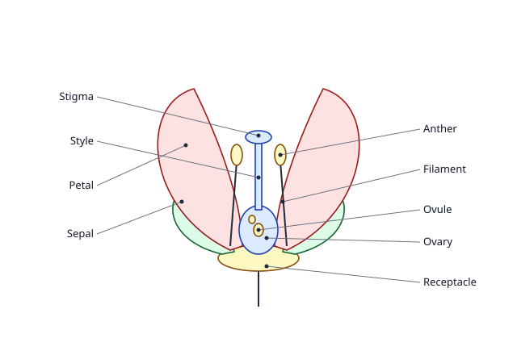

1. Becomes the seed after fertilisation
2. Path along which the pollen tube grows
3. Contains ovules; becomes the fruit
4. Receives pollen grains

Answer and explanation

**Answer: (4) Receives pollen grains**

Stigma: Receives pollen grains (File 6: BIO-D08).

<!-- meta {"type":"mcq","id":"SCQ-10-14-012","grade":10,"chapter_id":"SC10-14","discipline":"BIO","difficulty":1,"qtype":"diagram","answer":3,"origin":"ORIGINAL","source_ref":"BIO-D08","image":"science_assets/biology/BIO-D08_labelled.svg"} -->
**SCQ-10-14-012** · Basic · Diagram · `ORIGINAL`

In the Longitudinal section of a flower diagram, what is the function of the 'Style'?

1. Becomes the seed after fertilisation
2. Receives pollen grains
3. Path along which the pollen tube grows
4. Contains ovules; becomes the fruit

Answer and explanation

**Answer: (3) Path along which the pollen tube grows**

Style: Path along which the pollen tube grows (File 6: BIO-D08).

<!-- meta {"type":"mcq","id":"SCQ-10-14-013","grade":10,"chapter_id":"SC10-14","discipline":"BIO","difficulty":1,"qtype":"diagram","answer":2,"origin":"ORIGINAL","source_ref":"BIO-D08","image":"science_assets/biology/BIO-D08_labelled.svg"} -->
**SCQ-10-14-013** · Basic · Diagram · `ORIGINAL`

In the Longitudinal section of a flower diagram, what is the function of the 'Ovary'?

1. Path along which the pollen tube grows
2. Contains ovules; becomes the fruit
3. Becomes the seed after fertilisation
4. Receives pollen grains

Answer and explanation

**Answer: (2) Contains ovules; becomes the fruit**

Ovary: Contains ovules; becomes the fruit (File 6: BIO-D08).

<!-- meta {"type":"mcq","id":"SCQ-10-14-014","grade":10,"chapter_id":"SC10-14","discipline":"BIO","difficulty":1,"qtype":"concept","answer":1,"origin":"ORIGINAL","source_ref":"extra-SC10-14-1","image":null} -->
**SCQ-10-14-014** · Basic · Concept · `ORIGINAL`

Result of mitosis?

1. Two daughter cells identical to the parent cell
2. One cell
3. Four gametes
4. Chromosome number halved

Answer and explanation

**Answer: (1) Two daughter cells identical to the parent cell**

Growth, repair.

<!-- meta {"type":"mcq","id":"SCQ-10-14-015","grade":10,"chapter_id":"SC10-14","discipline":"BIO","difficulty":1,"qtype":"recall","answer":4,"origin":"ORIGINAL","source_ref":"extra-SC10-14-2","image":null} -->
**SCQ-10-14-015** · Basic · Recall · `ORIGINAL`

Where does meiosis take place (humans)?

1. Liver
2. Skin
3. Bone marrow
4. Ovary, testis

Answer and explanation

**Answer: (4) Ovary, testis**

Gamete formation.

<!-- meta {"type":"mcq","id":"SCQ-10-14-016","grade":10,"chapter_id":"SC10-14","discipline":"BIO","difficulty":1,"qtype":"recall","answer":1,"origin":"ORIGINAL","source_ref":"extra-SC10-14-3","image":null} -->
**SCQ-10-14-016** · Basic · Recall · `ORIGINAL`

Chromosomes in a human sperm?

1. 23
2. 22
3. 92
4. 46

Answer and explanation

**Answer: (1) 23**

A haploid gamete.

<!-- meta {"type":"mcq","id":"SCQ-10-14-017","grade":10,"chapter_id":"SC10-14","discipline":"BIO","difficulty":2,"qtype":"recall","answer":1,"origin":"ORIGINAL","source_ref":"extra-SC10-14-4","image":null} -->
**SCQ-10-14-017** · Intermediate · Recall · `ORIGINAL`

On about which day of a 28-day menstrual cycle does ovulation occur?

1. Day 14
2. Day 1
3. Day 7
4. Day 28

Answer and explanation

**Answer: (1) Day 14**

The middle of the cycle.

<!-- meta {"type":"mcq","id":"SCQ-10-14-018","grade":10,"chapter_id":"SC10-14","discipline":"BIO","difficulty":1,"qtype":"recall","answer":3,"origin":"ORIGINAL","source_ref":"extra-SC10-14-5","image":null} -->
**SCQ-10-14-018** · Basic · Recall · `ORIGINAL`

The structure where substances are exchanged between the foetus and the mother?

1. Ovary
2. Cervix
3. Placenta
4. Fallopian tube

Answer and explanation

**Answer: (3) Placenta**

O₂ and nutrients in; CO₂ and waste out.

<!-- meta {"type":"mcq","id":"SCQ-10-14-019","grade":10,"chapter_id":"SC10-14","discipline":"BIO","difficulty":2,"qtype":"concept","answer":3,"origin":"ORIGINAL","source_ref":"extra-SC10-14-6","image":null} -->
**SCQ-10-14-019** · Intermediate · Concept · `ORIGINAL`

A feature of wind-pollinated flowers?

1. Large coloured petals
2. Nectar
3. Large numbers of light pollen grains
4. Scented petals

Answer and explanation

**Answer: (3) Large numbers of light pollen grains**

e.g. grass, rice.

<!-- meta {"type":"mcq","id":"SCQ-10-14-020","grade":10,"chapter_id":"SC10-14","discipline":"BIO","difficulty":1,"qtype":"recall","answer":2,"origin":"ORIGINAL","source_ref":"extra-SC10-14-7","image":null} -->
**SCQ-10-14-020** · Basic · Recall · `ORIGINAL`

What does the ovary develop into after fertilisation?

1. Leaf
2. Fruit
3. Root
4. Seed

Answer and explanation

**Answer: (2) Fruit**

Ovule → seed; ovary → fruit.

<!-- meta {"type":"mcq","id":"SCQ-10-14-021","grade":10,"chapter_id":"SC10-14","discipline":"BIO","difficulty":2,"qtype":"application","answer":1,"origin":"ORIGINAL","source_ref":"extra-SC10-14-8","image":null} -->
**SCQ-10-14-021** · Intermediate · Application · `ORIGINAL`

Advantage of tissue culture?

1. Many identical plants in a short time
2. Only that no soil is needed
3. New characteristics
4. Seed formation

Answer and explanation

**Answer: (1) Many identical plants in a short time**

Genetically identical.

<!-- meta {"type":"mcq","id":"SCQ-10-14-022","grade":10,"chapter_id":"SC10-14","discipline":"BIO","difficulty":2,"qtype":"concept","answer":2,"origin":"ORIGINAL","source_ref":"extra-SC10-14-9","image":null} -->
**SCQ-10-14-022** · Intermediate · Concept · `ORIGINAL`

In grafting, the part that provides the root system?

1. Leaf
2. Stock
3. Bud
4. Scion

Answer and explanation

**Answer: (2) Stock**

The scion gives the desired features.

<!-- meta {"type":"mcq","id":"SCQ-10-14-023","grade":10,"chapter_id":"SC10-14","discipline":"BIO","difficulty":2,"qtype":"reasoning","answer":2,"origin":"ORIGINAL","source_ref":"extra-SC10-14-10","image":null} -->
**SCQ-10-14-023** · Intermediate · Reasoning · `ORIGINAL`

Advantage of sexual reproduction?

1. It is fast
2. Variation is produced
3. One parent is enough
4. Identical offspring

Answer and explanation

**Answer: (2) Variation is produced**

Adaptation to environmental change.

<!-- meta {"type":"mcq","id":"SCQ-10-14-024","grade":10,"chapter_id":"SC10-14","discipline":"BIO","difficulty":2,"qtype":"recall","answer":3,"origin":"ORIGINAL","source_ref":"extra-SC10-14-11","image":null} -->
**SCQ-10-14-024** · Intermediate · Recall · `ORIGINAL`

The hormone that controls secondary sexual characteristics in boys at puberty?

1. Insulin
2. Adrenaline
3. Testosterone
4. Oestrogen

Answer and explanation

**Answer: (3) Testosterone**

Secreted by the testes.

<!-- meta {"type":"mcq","id":"SCQ-10-14-025","grade":10,"chapter_id":"SC10-14","discipline":"BIO","difficulty":1,"qtype":"recall","answer":2,"origin":"ORIGINAL","source_ref":"extra-SC10-14-12","image":null} -->
**SCQ-10-14-025** · Basic · Recall · `ORIGINAL`

A sexually transmitted disease?

1. Tuberculosis
2. Gonorrhoea
3. Dengue
4. Malaria

Answer and explanation

**Answer: (2) Gonorrhoea**

STDs — safe practices are essential.

## SC10-15: Hydrostatic pressure and its applications

*Grade 10 · Chapter 15 · Physics · 25 questions*

<!-- meta {"type":"mcq","id":"SCQ-10-15-001","grade":10,"chapter_id":"SC10-15","discipline":"PHY","difficulty":1,"qtype":"calculation","answer":2,"origin":"ORIGINAL","source_ref":"chapter","image":null} -->
**SCQ-10-15-001** · Basic · Calculation · `ORIGINAL`

Liquid pressure at a depth of 5 m in water? (ρ = 1000 kg m⁻³, g = 10)

1. 5000 Pa
2. 50 000 Pa
3. 500 Pa
4. 2000 Pa

Answer and explanation

**Answer: (2) 50 000 Pa**

P = 5 × 1000 × 10.

<!-- meta {"type":"mcq","id":"SCQ-10-15-002","grade":10,"chapter_id":"SC10-15","discipline":"PHY","difficulty":1,"qtype":"calculation","answer":2,"origin":"ORIGINAL","source_ref":"chapter","image":null} -->
**SCQ-10-15-002** · Basic · Calculation · `ORIGINAL`

A person of weight 600 N stands on an area of 0.03 m². Pressure?

1. 18 Pa
2. 20 000 Pa
3. 600 Pa
4. 200 Pa

Answer and explanation

**Answer: (2) 20 000 Pa**

600/0.03 = 20 000 Pa.

<!-- meta {"type":"mcq","id":"SCQ-10-15-003","grade":10,"chapter_id":"SC10-15","discipline":"PHY","difficulty":2,"qtype":"calculation","answer":2,"origin":"ORIGINAL","source_ref":"chapter","image":null} -->
**SCQ-10-15-003** · Intermediate · Calculation · `ORIGINAL`

In a hydraulic press A₁ = 0.01 m², A₂ = 0.5 m², F₁ = 100 N. F₂?

1. 2 N
2. 5000 N
3. 50 N
4. 500 N

Answer and explanation

**Answer: (2) 5000 N**

F₂ = 100 × 0.5/0.01.

<!-- meta {"type":"mcq","id":"SCQ-10-15-004","grade":10,"chapter_id":"SC10-15","discipline":"PHY","difficulty":2,"qtype":"concept","answer":3,"origin":"ORIGINAL","source_ref":"chapter","image":null} -->
**SCQ-10-15-004** · Intermediate · Concept · `ORIGINAL`

Water to the same height in containers of different shapes. Pressure at the bottom?

1. Greater in the wide one
2. Greater in the narrow one
3. Equal in all
4. Depends on the volume

Answer and explanation

**Answer: (3) Equal in all**

P = hρg; independent of shape.

<!-- meta {"type":"mcq","id":"SCQ-10-15-005","grade":10,"chapter_id":"SC10-15","discipline":"PHY","difficulty":2,"qtype":"application","answer":1,"origin":"ORIGINAL","source_ref":"chapter","image":null} -->
**SCQ-10-15-005** · Intermediate · Application · `ORIGINAL`

Why do the ears feel uncomfortable when travelling up a high mountain?

1. The outside air pressure decreases
2. Temperature
3. Sound
4. Humidity

Answer and explanation

**Answer: (1) The outside air pressure decreases**

Pressure difference on the two sides of the eardrum.

<!-- meta {"type":"mcq","id":"SCQ-10-15-006","grade":10,"chapter_id":"SC10-15","discipline":"PHY","difficulty":2,"qtype":"reasoning","answer":2,"origin":"ORIGINAL","source_ref":"chapter","image":null} -->
**SCQ-10-15-006** · Intermediate · Reasoning · `ORIGINAL`

Why does an iron ship float?

1. Iron is light
2. It displaces a lot of water, so the upthrust equals its weight
3. Because air pushes it
4. Magnetism

Answer and explanation

**Answer: (2) It displaces a lot of water, so the upthrust equals its weight**

The hollow shape displaces a large volume.

<!-- meta {"type":"mcq","id":"SCQ-10-15-007","grade":10,"chapter_id":"SC10-15","discipline":"PHY","difficulty":1,"qtype":"recall","answer":2,"origin":"ORIGINAL","source_ref":"chapter","image":null} -->
**SCQ-10-15-007** · Basic · Recall · `ORIGINAL`

Unit of pressure?

1. N
2. N m⁻²
3. N m
4. kg m⁻³

Answer and explanation

**Answer: (2) N m⁻²**

Pa = N m⁻².

<!-- meta {"type":"mcq","id":"SCQ-10-15-008","grade":10,"chapter_id":"SC10-15","discipline":"PHY","difficulty":2,"qtype":"calculation","answer":1,"origin":"ORIGINAL","source_ref":"chapter","image":null} -->
**SCQ-10-15-008** · Intermediate · Calculation · `ORIGINAL`

Liquid pressure at a depth of 10 m in sea water (ρ = 1030 kg m⁻³)? (g = 10)

1. 103 000 Pa
2. 10 300 Pa
3. 1030 Pa
4. 100 000 Pa

Answer and explanation

**Answer: (1) 103 000 Pa**

10 × 1030 × 10.

<!-- meta {"type":"mcq","id":"SCQ-10-15-009","grade":10,"chapter_id":"SC10-15","discipline":"PHY","difficulty":1,"qtype":"application","answer":2,"origin":"ORIGINAL","source_ref":"chapter","image":null} -->
**SCQ-10-15-009** · Basic · Application · `ORIGINAL`

The principle behind vehicle hydraulic brakes?

1. Archimedes
2. Pascal
3. Newton's first law
4. Ohm's law

Answer and explanation

**Answer: (2) Pascal**

Transmission of pressure.

<!-- meta {"type":"mcq","id":"SCQ-10-15-010","grade":10,"chapter_id":"SC10-15","discipline":"PHY","difficulty":1,"qtype":"application","answer":1,"origin":"ORIGINAL","source_ref":"chapter","image":null} -->
**SCQ-10-15-010** · Basic · Application · `ORIGINAL`

An elephant's feet are wide; the advantage?

1. Less pressure, so it does not sink
2. More pressure
3. Velocity
4. Less weight

Answer and explanation

**Answer: (1) Less pressure, so it does not sink**

Larger area gives less pressure.

<!-- meta {"type":"mcq","id":"SCQ-10-15-011","grade":10,"chapter_id":"SC10-15","discipline":"PHY","difficulty":1,"qtype":"calculation","answer":3,"origin":"ORIGINAL","source_ref":"param-SC10-15-1","image":null} -->
**SCQ-10-15-011** · Basic · Calculation · `ORIGINAL`

A 500 N force acts perpendicularly on an area of 0.25 m². Pressure?

1. 5 × 10⁻⁴ Pa
2. 125 Pa
3. 2000 Pa
4. 4000 Pa

Answer and explanation

**Answer: (3) 2000 Pa**

P = F/A = 2000 Pa.

<!-- meta {"type":"mcq","id":"SCQ-10-15-012","grade":10,"chapter_id":"SC10-15","discipline":"PHY","difficulty":1,"qtype":"calculation","answer":1,"origin":"ORIGINAL","source_ref":"param-SC10-15-2","image":null} -->
**SCQ-10-15-012** · Basic · Calculation · `ORIGINAL`

A 120 N force acts perpendicularly on an area of 0.004 m². Pressure?

1. 30000 Pa
2. 0.48 Pa
3. 60000 Pa
4. 3.333 × 10⁻⁵ Pa

Answer and explanation

**Answer: (1) 30000 Pa**

P = F/A = 30000 Pa.

<!-- meta {"type":"mcq","id":"SCQ-10-15-013","grade":10,"chapter_id":"SC10-15","discipline":"PHY","difficulty":1,"qtype":"calculation","answer":2,"origin":"ORIGINAL","source_ref":"param-SC10-15-3","image":null} -->
**SCQ-10-15-013** · Basic · Calculation · `ORIGINAL`

A 2000 N force acts perpendicularly on an area of 0.5 m². Pressure?

1. 8000 Pa
2. 4000 Pa
3. 2.5 × 10⁻⁴ Pa
4. 1000 Pa

Answer and explanation

**Answer: (2) 4000 Pa**

P = F/A = 4000 Pa.

<!-- meta {"type":"mcq","id":"SCQ-10-15-014","grade":10,"chapter_id":"SC10-15","discipline":"PHY","difficulty":1,"qtype":"calculation","answer":3,"origin":"ORIGINAL","source_ref":"param-SC10-15-4","image":null} -->
**SCQ-10-15-014** · Basic · Calculation · `ORIGINAL`

A 36 N force acts perpendicularly on an area of 0.012 m². Pressure?

1. 3.333 × 10⁻⁴ Pa
2. 0.432 Pa
3. 3000 Pa
4. 6000 Pa

Answer and explanation

**Answer: (3) 3000 Pa**

P = F/A = 3000 Pa.

<!-- meta {"type":"mcq","id":"SCQ-10-15-015","grade":10,"chapter_id":"SC10-15","discipline":"PHY","difficulty":2,"qtype":"calculation","answer":1,"origin":"ORIGINAL","source_ref":"param-SC10-15-5","image":null} -->
**SCQ-10-15-015** · Intermediate · Calculation · `ORIGINAL`

Liquid pressure at a depth of 3 m in a liquid of density 1000 kg m⁻³? (g = 10)

1. 30000 Pa
2. 30 Pa
3. 3333.3333 Pa
4. 3000 Pa

Answer and explanation

**Answer: (1) 30000 Pa**

hρg = 30000 Pa.

<!-- meta {"type":"mcq","id":"SCQ-10-15-016","grade":10,"chapter_id":"SC10-15","discipline":"PHY","difficulty":2,"qtype":"calculation","answer":2,"origin":"ORIGINAL","source_ref":"param-SC10-15-6","image":null} -->
**SCQ-10-15-016** · Intermediate · Calculation · `ORIGINAL`

Liquid pressure at a depth of 20 m in a liquid of density 1000 kg m⁻³? (g = 10)

1. 500 Pa
2. 200000 Pa
3. 200 Pa
4. 20000 Pa

Answer and explanation

**Answer: (2) 200000 Pa**

hρg = 200000 Pa.

<!-- meta {"type":"mcq","id":"SCQ-10-15-017","grade":10,"chapter_id":"SC10-15","discipline":"PHY","difficulty":2,"qtype":"calculation","answer":3,"origin":"ORIGINAL","source_ref":"param-SC10-15-7","image":null} -->
**SCQ-10-15-017** · Intermediate · Calculation · `ORIGINAL`

Liquid pressure at a depth of 0.5 m in a liquid of density 13600 kg m⁻³? (g = 10)

1. 5 Pa
2. 272000 Pa
3. 68000 Pa
4. 6800 Pa

Answer and explanation

**Answer: (3) 68000 Pa**

hρg = 68000 Pa.

<!-- meta {"type":"mcq","id":"SCQ-10-15-018","grade":10,"chapter_id":"SC10-15","discipline":"PHY","difficulty":2,"qtype":"calculation","answer":1,"origin":"ORIGINAL","source_ref":"param-SC10-15-8","image":null} -->
**SCQ-10-15-018** · Intermediate · Calculation · `ORIGINAL`

Liquid pressure at a depth of 4 m in a liquid of density 800 kg m⁻³? (g = 10)

1. 32000 Pa
2. 2000 Pa
3. 3200 Pa
4. 40 Pa

Answer and explanation

**Answer: (1) 32000 Pa**

hρg = 32000 Pa.

<!-- meta {"type":"mcq","id":"SCQ-10-15-019","grade":10,"chapter_id":"SC10-15","discipline":"PHY","difficulty":2,"qtype":"calculation","answer":2,"origin":"ORIGINAL","source_ref":"param-SC10-15-9","image":null} -->
**SCQ-10-15-019** · Intermediate · Calculation · `ORIGINAL`

Liquid pressure at a depth of 15 m in a liquid of density 1030 kg m⁻³? (g = 10)

1. 686.6667 Pa
2. 154500 Pa
3. 150 Pa
4. 15450 Pa

Answer and explanation

**Answer: (2) 154500 Pa**

hρg = 154500 Pa.

<!-- meta {"type":"mcq","id":"SCQ-10-15-020","grade":10,"chapter_id":"SC10-15","discipline":"PHY","difficulty":2,"qtype":"calculation","answer":1,"origin":"ORIGINAL","source_ref":"param-SC10-15-10","image":null} -->
**SCQ-10-15-020** · Intermediate · Calculation · `ORIGINAL`

In a hydraulic press the small piston is 4 cm² and the large one 200 cm². 20 N is applied to the small one. Force on the large one?

1. 1000 N
2. 20 N
3. 0.4 N
4. 4000 N

Answer and explanation

**Answer: (1) 1000 N**

F₂ = F₁ × A₂/A₁ (Pascal).

<!-- meta {"type":"mcq","id":"SCQ-10-15-021","grade":10,"chapter_id":"SC10-15","discipline":"PHY","difficulty":2,"qtype":"calculation","answer":2,"origin":"ORIGINAL","source_ref":"param-SC10-15-11","image":null} -->
**SCQ-10-15-021** · Intermediate · Calculation · `ORIGINAL`

In a hydraulic press the small piston is 10 cm² and the large one 300 cm². 100 N is applied to the small one. Force on the large one?

1. 30000 N
2. 3000 N
3. 100 N
4. 3.3333 N

Answer and explanation

**Answer: (2) 3000 N**

F₂ = F₁ × A₂/A₁ (Pascal).

<!-- meta {"type":"mcq","id":"SCQ-10-15-022","grade":10,"chapter_id":"SC10-15","discipline":"PHY","difficulty":2,"qtype":"calculation","answer":1,"origin":"ORIGINAL","source_ref":"param-SC10-15-12","image":null} -->
**SCQ-10-15-022** · Intermediate · Calculation · `ORIGINAL`

In a hydraulic press the small piston is 2 cm² and the large one 50 cm². 40 N is applied to the small one. Force on the large one?

1. 1000 N
2. 2000 N
3. 1.6 N
4. 40 N

Answer and explanation

**Answer: (1) 1000 N**

F₂ = F₁ × A₂/A₁ (Pascal).

<!-- meta {"type":"mcq","id":"SCQ-10-15-023","grade":10,"chapter_id":"SC10-15","discipline":"PHY","difficulty":1,"qtype":"calculation","answer":2,"origin":"ORIGINAL","source_ref":"param-SC10-15-13","image":null} -->
**SCQ-10-15-023** · Basic · Calculation · `ORIGINAL`

An object weighs 15 N in air and 9 N when fully immersed in water. Upthrust?

1. 24 N
2. 6 N
3. 15 N
4. 9 N

Answer and explanation

**Answer: (2) 6 N**

Upthrust = loss in weight.

<!-- meta {"type":"mcq","id":"SCQ-10-15-024","grade":10,"chapter_id":"SC10-15","discipline":"PHY","difficulty":1,"qtype":"calculation","answer":3,"origin":"ORIGINAL","source_ref":"param-SC10-15-14","image":null} -->
**SCQ-10-15-024** · Basic · Calculation · `ORIGINAL`

An object weighs 4.5 N in air and 3 N when fully immersed in water. Upthrust?

1. 3 N
2. 4.5 N
3. 1.5 N
4. 7.5 N

Answer and explanation

**Answer: (3) 1.5 N**

Upthrust = loss in weight.

<!-- meta {"type":"mcq","id":"SCQ-10-15-025","grade":10,"chapter_id":"SC10-15","discipline":"PHY","difficulty":1,"qtype":"calculation","answer":4,"origin":"ORIGINAL","source_ref":"param-SC10-15-15","image":null} -->
**SCQ-10-15-025** · Basic · Calculation · `ORIGINAL`

An object weighs 30 N in air and 22 N when fully immersed in water. Upthrust?

1. 52 N
2. 22 N
3. 30 N
4. 8 N

Answer and explanation

**Answer: (4) 8 N**

Upthrust = loss in weight.

## SC10-16: Changes in matter

*Grade 10 · Chapter 16 · Chemistry · 30 questions*

<!-- meta {"type":"mcq","id":"SCQ-10-16-001","grade":10,"chapter_id":"SC10-16","discipline":"CHE","difficulty":1,"qtype":"concept","answer":3,"origin":"ORIGINAL","source_ref":"chapter","image":null} -->
**SCQ-10-16-001** · Basic · Concept · `ORIGINAL`

Which of the following is a chemical change?

1. Melting wax
2. Dissolving sugar
3. Rusting of iron
4. Evaporation of water

Answer and explanation

**Answer: (3) Rusting of iron**

A new substance, Fe₂O₃·xH₂O.

<!-- meta {"type":"mcq","id":"SCQ-10-16-002","grade":10,"chapter_id":"SC10-16","discipline":"CHE","difficulty":2,"qtype":"experiment","answer":2,"origin":"ORIGINAL","source_ref":"chapter","image":null} -->
**SCQ-10-16-002** · Intermediate · Experiment · `ORIGINAL`

Observation when a piece of Zn is placed in CuSO₄ solution?

1. No change
2. Blue colour fades and a reddish-brown deposit forms
3. H₂ bubbles
4. The solution turns green

Answer and explanation

**Answer: (2) Blue colour fades and a reddish-brown deposit forms**

Zn > Cu; Cu is displaced.

<!-- meta {"type":"mcq","id":"SCQ-10-16-003","grade":10,"chapter_id":"SC10-16","discipline":"CHE","difficulty":1,"qtype":"recall","answer":4,"origin":"ORIGINAL","source_ref":"chapter","image":null} -->
**SCQ-10-16-003** · Basic · Recall · `ORIGINAL`

A metal that does not react with dilute HCl?

1. Mg
2. Zn
3. Fe
4. Cu

Answer and explanation

**Answer: (4) Cu**

Cu is below H in the reactivity series.

<!-- meta {"type":"mcq","id":"SCQ-10-16-004","grade":10,"chapter_id":"SC10-16","discipline":"CHE","difficulty":1,"qtype":"concept","answer":2,"origin":"ORIGINAL","source_ref":"chapter","image":null} -->
**SCQ-10-16-004** · Basic · Concept · `ORIGINAL`

Reaction type of 2H₂O₂ → 2H₂O + O₂?

1. Combination
2. Decomposition
3. Displacement
4. Neutralisation

Answer and explanation

**Answer: (2) Decomposition**

One substance decomposes into two.

<!-- meta {"type":"mcq","id":"SCQ-10-16-005","grade":10,"chapter_id":"SC10-16","discipline":"CHE","difficulty":2,"qtype":"recall","answer":2,"origin":"ORIGINAL","source_ref":"chapter","image":null} -->
**SCQ-10-16-005** · Intermediate · Recall · `ORIGINAL`

Purpose of adding limestone to the blast furnace?

1. To reduce iron
2. To remove silica impurities
3. As a fuel
4. To give CO₂

Answer and explanation

**Answer: (2) To remove silica impurities**

CaO + SiO₂ → CaSiO₃ (slag).

<!-- meta {"type":"mcq","id":"SCQ-10-16-006","grade":10,"chapter_id":"SC10-16","discipline":"CHE","difficulty":2,"qtype":"recall","answer":1,"origin":"ORIGINAL","source_ref":"chapter","image":null} -->
**SCQ-10-16-006** · Intermediate · Recall · `ORIGINAL`

Mg, Zn, Cu, Fe in decreasing order of reactivity?

1. Mg > Zn > Fe > Cu
2. Cu > Fe > Zn > Mg
3. Zn > Mg > Fe > Cu
4. Mg > Fe > Zn > Cu

Answer and explanation

**Answer: (1) Mg > Zn > Fe > Cu**

Reactivity series.

<!-- meta {"type":"mcq","id":"SCQ-10-16-007","grade":10,"chapter_id":"SC10-16","discipline":"CHE","difficulty":2,"qtype":"concept","answer":2,"origin":"ORIGINAL","source_ref":"chapter","image":null} -->
**SCQ-10-16-007** · Intermediate · Concept · `ORIGINAL`

Reaction type of AgNO₃(aq) + NaCl(aq) → AgCl(s) + NaNO₃(aq)?

1. Single displacement
2. Double displacement
3. Decomposition
4. Combination

Answer and explanation

**Answer: (2) Double displacement**

Exchange of ions; white precipitate.

<!-- meta {"type":"mcq","id":"SCQ-10-16-008","grade":10,"chapter_id":"SC10-16","discipline":"CHE","difficulty":2,"qtype":"application","answer":1,"origin":"ORIGINAL","source_ref":"chapter","image":null} -->
**SCQ-10-16-008** · Intermediate · Application · `ORIGINAL`

Why is Na stored in kerosene?

1. Because it reacts vigorously with water and O₂
2. Because it evaporates
3. Because it dissolves
4. Because it changes colour

Answer and explanation

**Answer: (1) Because it reacts vigorously with water and O₂**

Na is very reactive.

<!-- meta {"type":"mcq","id":"SCQ-10-16-009","grade":10,"chapter_id":"SC10-16","discipline":"CHE","difficulty":2,"qtype":"reasoning","answer":2,"origin":"ORIGINAL","source_ref":"chapter","image":null} -->
**SCQ-10-16-009** · Intermediate · Reasoning · `ORIGINAL`

If a piece of Cu is placed in ZnSO₄ solution?

1. Zn is deposited
2. No reaction
3. H₂ is released
4. The solution turns blue

Answer and explanation

**Answer: (2) No reaction**

Cu is less reactive than Zn.

<!-- meta {"type":"mcq","id":"SCQ-10-16-010","grade":10,"chapter_id":"SC10-16","discipline":"CHE","difficulty":3,"qtype":"concept","answer":2,"origin":"ORIGINAL","source_ref":"chapter","image":null} -->
**SCQ-10-16-010** · Hard · Concept · `ORIGINAL`

What happens to Fe₂O₃ in Fe₂O₃ + 3CO → 2Fe + 3CO₂?

1. Oxidation
2. Reduction
3. Neutralisation
4. Dissolving

Answer and explanation

**Answer: (2) Reduction**

Oxygen is lost.

<!-- meta {"type":"mcq","id":"SCQ-10-16-011","grade":10,"chapter_id":"SC10-16","discipline":"CHE","difficulty":2,"qtype":"equation","answer":3,"origin":"ORIGINAL","source_ref":"EQ-001","image":null} -->
**SCQ-10-16-011** · Intermediate · Equation · `ORIGINAL`

Mg + O₂ → MgO — when this equation is balanced with the smallest whole-number coefficients, the coefficient of Mg?

1. 3
2. 4
3. 2
4. 7

Answer and explanation

**Answer: (3) 2**

2Mg + O₂ → 2MgO (atom count checked; File 7: EQ-001).

<!-- meta {"type":"mcq","id":"SCQ-10-16-012","grade":10,"chapter_id":"SC10-16","discipline":"CHE","difficulty":2,"qtype":"equation","answer":2,"origin":"ORIGINAL","source_ref":"EQ-002","image":null} -->
**SCQ-10-16-012** · Intermediate · Equation · `ORIGINAL`

H₂ + O₂ → H₂O — when this equation is balanced with the smallest whole-number coefficients, the coefficient of H₂?

1. 4
2. 2
3. 3
4. 7

Answer and explanation

**Answer: (2) 2**

2H₂ + O₂ → 2H₂O (atom count checked; File 7: EQ-002).

<!-- meta {"type":"mcq","id":"SCQ-10-16-013","grade":10,"chapter_id":"SC10-16","discipline":"CHE","difficulty":2,"qtype":"equation","answer":1,"origin":"ORIGINAL","source_ref":"EQ-005","image":null} -->
**SCQ-10-16-013** · Intermediate · Equation · `ORIGINAL`

Fe + O₂ → Fe₂O₃ — when this equation is balanced with the smallest whole-number coefficients, the coefficient of Fe?

1. 4
2. 8
3. 5
4. 3

Answer and explanation

**Answer: (1) 4**

4Fe + 3O₂ → 2Fe₂O₃ (atom count checked; File 7: EQ-005).

<!-- meta {"type":"mcq","id":"SCQ-10-16-014","grade":10,"chapter_id":"SC10-16","discipline":"CHE","difficulty":2,"qtype":"equation","answer":1,"origin":"ORIGINAL","source_ref":"EQ-006","image":null} -->
**SCQ-10-16-014** · Intermediate · Equation · `ORIGINAL`

Na + Cl₂ → NaCl — when this equation is balanced with the smallest whole-number coefficients, the coefficient of Na?

1. 2
2. 4
3. 7
4. 3

Answer and explanation

**Answer: (1) 2**

2Na + Cl₂ → 2NaCl (atom count checked; File 7: EQ-006).

<!-- meta {"type":"mcq","id":"SCQ-10-16-015","grade":10,"chapter_id":"SC10-16","discipline":"CHE","difficulty":2,"qtype":"equation","answer":4,"origin":"ORIGINAL","source_ref":"EQ-009","image":null} -->
**SCQ-10-16-015** · Intermediate · Equation · `ORIGINAL`

H₂O₂ → H₂O + O₂ — when this equation is balanced with the smallest whole-number coefficients, the coefficient of H₂O₂?

1. 3
2. 4
3. 7
4. 2

Answer and explanation

**Answer: (4) 2**

2H₂O₂ → 2H₂O + O₂ (atom count checked; File 7: EQ-009).

<!-- meta {"type":"mcq","id":"SCQ-10-16-016","grade":10,"chapter_id":"SC10-16","discipline":"CHE","difficulty":2,"qtype":"equation","answer":1,"origin":"ORIGINAL","source_ref":"EQ-010","image":null} -->
**SCQ-10-16-016** · Intermediate · Equation · `ORIGINAL`

KClO₃ → KCl + O₂ — when this equation is balanced with the smallest whole-number coefficients, the coefficient of O₂?

1. 3
2. 4
3. 6
4. 2

Answer and explanation

**Answer: (1) 3**

2KClO₃ → 2KCl + 3O₂ (atom count checked; File 7: EQ-010).

<!-- meta {"type":"mcq","id":"SCQ-10-16-017","grade":10,"chapter_id":"SC10-16","discipline":"CHE","difficulty":2,"qtype":"equation","answer":2,"origin":"ORIGINAL","source_ref":"EQ-012","image":null} -->
**SCQ-10-16-017** · Intermediate · Equation · `ORIGINAL`

NaHCO₃ → Na₂CO₃ + H₂O + CO₂ — when this equation is balanced with the smallest whole-number coefficients, the coefficient of NaHCO₃?

1. 4
2. 2
3. 3
4. 7

Answer and explanation

**Answer: (2) 2**

2NaHCO₃ → Na₂CO₃ + H₂O + CO₂ (atom count checked; File 7: EQ-012).

<!-- meta {"type":"mcq","id":"SCQ-10-16-018","grade":10,"chapter_id":"SC10-16","discipline":"CHE","difficulty":2,"qtype":"equation","answer":3,"origin":"ORIGINAL","source_ref":"EQ-013","image":null} -->
**SCQ-10-16-018** · Intermediate · Equation · `ORIGINAL`

Zn + HCl → ZnCl₂ + H₂ — when this equation is balanced with the smallest whole-number coefficients, the coefficient of HCl?

1. 7
2. 3
3. 2
4. 4

Answer and explanation

**Answer: (3) 2**

Zn + 2HCl → ZnCl₂ + H₂ (atom count checked; File 7: EQ-013).

<!-- meta {"type":"mcq","id":"SCQ-10-16-019","grade":10,"chapter_id":"SC10-16","discipline":"CHE","difficulty":2,"qtype":"equation","answer":3,"origin":"ORIGINAL","source_ref":"EQ-014","image":null} -->
**SCQ-10-16-019** · Intermediate · Equation · `ORIGINAL`

Mg + HCl → MgCl₂ + H₂ — when this equation is balanced with the smallest whole-number coefficients, the coefficient of HCl?

1. 4
2. 3
3. 2
4. 7

Answer and explanation

**Answer: (3) 2**

Mg + 2HCl → MgCl₂ + H₂ (atom count checked; File 7: EQ-014).

<!-- meta {"type":"mcq","id":"SCQ-10-16-020","grade":10,"chapter_id":"SC10-16","discipline":"CHE","difficulty":2,"qtype":"equation","answer":3,"origin":"ORIGINAL","source_ref":"EQ-018","image":null} -->
**SCQ-10-16-020** · Intermediate · Equation · `ORIGINAL`

Na + H₂O → NaOH + H₂ — when this equation is balanced with the smallest whole-number coefficients, the coefficient of Na?

1. 3
2. 4
3. 2
4. 7

Answer and explanation

**Answer: (3) 2**

2Na + 2H₂O → 2NaOH + H₂ (atom count checked; File 7: EQ-018).

<!-- meta {"type":"mcq","id":"SCQ-10-16-021","grade":10,"chapter_id":"SC10-16","discipline":"CHE","difficulty":2,"qtype":"equation","answer":2,"origin":"ORIGINAL","source_ref":"EQ-019","image":null} -->
**SCQ-10-16-021** · Intermediate · Equation · `ORIGINAL`

Mg + H₂O → Mg(OH)₂ + H₂ — when this equation is balanced with the smallest whole-number coefficients, the coefficient of H₂O?

1. 4
2. 2
3. 3
4. 7

Answer and explanation

**Answer: (2) 2**

Mg + 2H₂O → Mg(OH)₂ + H₂ (atom count checked; File 7: EQ-019).

<!-- meta {"type":"mcq","id":"SCQ-10-16-022","grade":10,"chapter_id":"SC10-16","discipline":"CHE","difficulty":2,"qtype":"equation","answer":1,"origin":"ORIGINAL","source_ref":"EQ-020","image":null} -->
**SCQ-10-16-022** · Intermediate · Equation · `ORIGINAL`

Cl₂ + KBr → KCl + Br₂ — when this equation is balanced with the smallest whole-number coefficients, the coefficient of KBr?

1. 2
2. 4
3. 3
4. 7

Answer and explanation

**Answer: (1) 2**

Cl₂ + 2KBr → 2KCl + Br₂ (atom count checked; File 7: EQ-020).

<!-- meta {"type":"mcq","id":"SCQ-10-16-023","grade":10,"chapter_id":"SC10-16","discipline":"CHE","difficulty":2,"qtype":"equation","answer":4,"origin":"ORIGINAL","source_ref":"EQ-022","image":null} -->
**SCQ-10-16-023** · Intermediate · Equation · `ORIGINAL`

BaCl₂ + Na₂SO₄ → BaSO₄ + NaCl — when this equation is balanced with the smallest whole-number coefficients, the coefficient of NaCl?

1. 7
2. 3
3. 4
4. 2

Answer and explanation

**Answer: (4) 2**

BaCl₂ + Na₂SO₄ → BaSO₄ + 2NaCl (atom count checked; File 7: EQ-022).

<!-- meta {"type":"mcq","id":"SCQ-10-16-024","grade":10,"chapter_id":"SC10-16","discipline":"CHE","difficulty":2,"qtype":"equation","answer":4,"origin":"ORIGINAL","source_ref":"EQ-023","image":null} -->
**SCQ-10-16-024** · Intermediate · Equation · `ORIGINAL`

Pb(NO₃)₂ + KI → PbI₂ + KNO₃ — when this equation is balanced with the smallest whole-number coefficients, the coefficient of KI?

1. 7
2. 3
3. 4
4. 2

Answer and explanation

**Answer: (4) 2**

Pb(NO₃)₂ + 2KI → PbI₂ + 2KNO₃ (atom count checked; File 7: EQ-023).

<!-- meta {"type":"mcq","id":"SCQ-10-16-025","grade":10,"chapter_id":"SC10-16","discipline":"CHE","difficulty":2,"qtype":"equation","answer":3,"origin":"ORIGINAL","source_ref":"EQ-024","image":null} -->
**SCQ-10-16-025** · Intermediate · Equation · `ORIGINAL`

CuSO₄ + NaOH → Cu(OH)₂ + Na₂SO₄ — when this equation is balanced with the smallest whole-number coefficients, the coefficient of NaOH?

1. 3
2. 7
3. 2
4. 4

Answer and explanation

**Answer: (3) 2**

CuSO₄ + 2NaOH → Cu(OH)₂ + Na₂SO₄ (atom count checked; File 7: EQ-024).

<!-- meta {"type":"mcq","id":"SCQ-10-16-026","grade":10,"chapter_id":"SC10-16","discipline":"CHE","difficulty":2,"qtype":"equation","answer":1,"origin":"ORIGINAL","source_ref":"EQ-043","image":null} -->
**SCQ-10-16-026** · Intermediate · Equation · `ORIGINAL`

Fe₂O₃ + CO → Fe + CO₂ — when this equation is balanced with the smallest whole-number coefficients, the coefficient of CO?

1. 3
2. 2
3. 6
4. 4

Answer and explanation

**Answer: (1) 3**

Fe₂O₃ + 3CO → 2Fe + 3CO₂ (atom count checked; File 7: EQ-043).

<!-- meta {"type":"mcq","id":"SCQ-10-16-027","grade":10,"chapter_id":"SC10-16","discipline":"CHE","difficulty":2,"qtype":"equation","answer":4,"origin":"ORIGINAL","source_ref":"EQ-045","image":null} -->
**SCQ-10-16-027** · Intermediate · Equation · `ORIGINAL`

CuO + C → Cu + CO₂ — when this equation is balanced with the smallest whole-number coefficients, the coefficient of CuO?

1. 3
2. 4
3. 7
4. 2

Answer and explanation

**Answer: (4) 2**

2CuO + C → 2Cu + CO₂ (atom count checked; File 7: EQ-045).

<!-- meta {"type":"mcq","id":"SCQ-10-16-028","grade":10,"chapter_id":"SC10-16","discipline":"CHE","difficulty":1,"qtype":"diagram","answer":2,"origin":"ORIGINAL","source_ref":"CHE-D05","image":"science_assets/chemistry/CHE-D05_labelled.svg"} -->
**SCQ-10-16-028** · Basic · Diagram · `ORIGINAL`

In the Blast furnace (schematic) diagram, what is the function of the 'Hot air'?

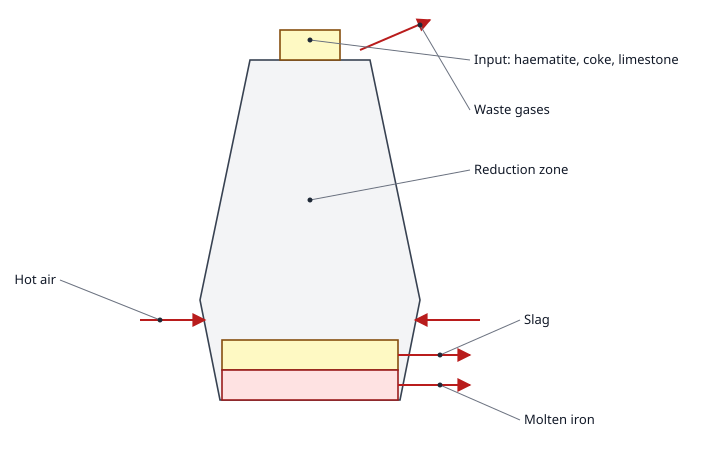

1. Removes impurities; floats on the molten iron
2. C + O₂ → CO₂ — a lot of heat
3. Collected at the bottom
4. Fe₂O₃ + 3CO → 2Fe + 3CO₂

Answer and explanation

**Answer: (2) C + O₂ → CO₂ — a lot of heat**

Hot air: C + O₂ → CO₂ — a lot of heat (File 6: CHE-D05).

<!-- meta {"type":"mcq","id":"SCQ-10-16-029","grade":10,"chapter_id":"SC10-16","discipline":"CHE","difficulty":1,"qtype":"diagram","answer":3,"origin":"ORIGINAL","source_ref":"CHE-D05","image":"science_assets/chemistry/CHE-D05_labelled.svg"} -->
**SCQ-10-16-029** · Basic · Diagram · `ORIGINAL`

In the Blast furnace (schematic) diagram, what is the function of the 'Reduction zone'?

1. Removes impurities; floats on the molten iron
2. C + O₂ → CO₂ — a lot of heat
3. Fe₂O₃ + 3CO → 2Fe + 3CO₂
4. Collected at the bottom

Answer and explanation

**Answer: (3) Fe₂O₃ + 3CO → 2Fe + 3CO₂**

Reduction zone: Fe₂O₃ + 3CO → 2Fe + 3CO₂ (File 6: CHE-D05).

<!-- meta {"type":"mcq","id":"SCQ-10-16-030","grade":10,"chapter_id":"SC10-16","discipline":"CHE","difficulty":1,"qtype":"diagram","answer":3,"origin":"ORIGINAL","source_ref":"CHE-D05","image":"science_assets/chemistry/CHE-D05_labelled.svg"} -->
**SCQ-10-16-030** · Basic · Diagram · `ORIGINAL`

In the Blast furnace (schematic) diagram, what is the function of the 'Slag'?

1. C + O₂ → CO₂ — a lot of heat
2. Collected at the bottom
3. Removes impurities; floats on the molten iron
4. Fe₂O₃ + 3CO → 2Fe + 3CO₂

Answer and explanation

**Answer: (3) Removes impurities; floats on the molten iron**

Slag: Removes impurities; floats on the molten iron (File 6: CHE-D05).

## SC10-17: Rate of reactions

*Grade 10 · Chapter 17 · Chemistry · 25 questions*

<!-- meta {"type":"mcq","id":"SCQ-10-17-001","grade":10,"chapter_id":"SC10-17","discipline":"CHE","difficulty":1,"qtype":"concept","answer":2,"origin":"ORIGINAL","source_ref":"chapter","image":null} -->
**SCQ-10-17-001** · Basic · Concept · `ORIGINAL`

If CaCO₃ powder is used instead of pieces, the rate of reaction with HCl?

1. Decreases
2. Increases
3. Does not change
4. Stops

Answer and explanation

**Answer: (2) Increases**

Surface area increases.

<!-- meta {"type":"mcq","id":"SCQ-10-17-002","grade":10,"chapter_id":"SC10-17","discipline":"CHE","difficulty":1,"qtype":"recall","answer":2,"origin":"ORIGINAL","source_ref":"chapter","image":null} -->
**SCQ-10-17-002** · Basic · Recall · `ORIGINAL`

Role of MnO₂ in the decomposition of H₂O₂?

1. Reactant
2. Catalyst
3. Product
4. Indicator

Answer and explanation

**Answer: (2) Catalyst**

MnO₂ increases the rate without changing.

<!-- meta {"type":"mcq","id":"SCQ-10-17-003","grade":10,"chapter_id":"SC10-17","discipline":"CHE","difficulty":2,"qtype":"reasoning","answer":2,"origin":"ORIGINAL","source_ref":"chapter","image":null} -->
**SCQ-10-17-003** · Intermediate · Reasoning · `ORIGINAL`

The correct explanation of why the rate increases with temperature?

1. Because particles get bigger
2. Because particles gain kinetic energy and effective collisions increase
3. Because concentration decreases
4. Because a catalyst forms

Answer and explanation

**Answer: (2) Because particles gain kinetic energy and effective collisions increase**

Collision theory.

<!-- meta {"type":"mcq","id":"SCQ-10-17-004","grade":10,"chapter_id":"SC10-17","discipline":"CHE","difficulty":2,"qtype":"graph","answer":1,"origin":"ORIGINAL","source_ref":"chapter","image":null} -->
**SCQ-10-17-004** · Intermediate · Graph · `ORIGINAL`

Why is the gradient steepest at the start of a gas volume–time graph?

1. The concentration of reactants is highest at the start
2. The temperature is low
3. There is no catalyst
4. There is more product

Answer and explanation

**Answer: (1) The concentration of reactants is highest at the start**

Reactants decrease over time.

<!-- meta {"type":"mcq","id":"SCQ-10-17-005","grade":10,"chapter_id":"SC10-17","discipline":"CHE","difficulty":2,"qtype":"reasoning","answer":4,"origin":"ORIGINAL","source_ref":"chapter","image":null} -->
**SCQ-10-17-005** · Intermediate · Reasoning · `ORIGINAL`

Which does not increase the rate of Mg + HCl?

1. Increasing the HCl concentration
2. Heating
3. Cutting the Mg ribbon into small pieces
4. Adding more water

Answer and explanation

**Answer: (4) Adding more water**

Adding water lowers the concentration.

<!-- meta {"type":"mcq","id":"SCQ-10-17-006","grade":10,"chapter_id":"SC10-17","discipline":"CHE","difficulty":3,"qtype":"reasoning","answer":2,"origin":"ORIGINAL","source_ref":"chapter","image":null} -->
**SCQ-10-17-006** · Hard · Reasoning · `ORIGINAL`

The same amount of Mg with 1 mol dm⁻³ and 2 mol dm⁻³ HCl (in excess). The final volume of H₂ formed?

1. Double with 2 mol dm⁻³
2. Equal
3. More with 1 mol dm⁻³
4. 0

Answer and explanation

**Answer: (2) Equal**

Mg is the limiting reactant; the amount is the same, only the rate differs.

<!-- meta {"type":"mcq","id":"SCQ-10-17-007","grade":10,"chapter_id":"SC10-17","discipline":"CHE","difficulty":2,"qtype":"concept","answer":3,"origin":"ORIGINAL","source_ref":"chapter","image":null} -->
**SCQ-10-17-007** · Intermediate · Concept · `ORIGINAL`

The correct statement about a catalyst?

1. It is used up in the reaction
2. It increases the amount of product
3. It remains unchanged at the end of the reaction
4. It raises the temperature

Answer and explanation

**Answer: (3) It remains unchanged at the end of the reaction**

It is not changed chemically.

<!-- meta {"type":"mcq","id":"SCQ-10-17-008","grade":10,"chapter_id":"SC10-17","discipline":"CHE","difficulty":3,"qtype":"experiment","answer":1,"origin":"ORIGINAL","source_ref":"chapter","image":null} -->
**SCQ-10-17-008** · Hard · Experiment · `ORIGINAL`

In the Na₂S₂O₃ + HCl reaction, why is the time for the 'X' mark to disappear used to measure the rate?

1. The sulfur precipitate makes the mixture cloudy
2. The colour changes
3. A gas is released
4. Heat

Answer and explanation

**Answer: (1) The sulfur precipitate makes the mixture cloudy**

As the precipitate increases, the mark disappears.

<!-- meta {"type":"mcq","id":"SCQ-10-17-009","grade":10,"chapter_id":"SC10-17","discipline":"CHE","difficulty":1,"qtype":"application","answer":2,"origin":"ORIGINAL","source_ref":"chapter","image":null} -->
**SCQ-10-17-009** · Basic · Application · `ORIGINAL`

Which factor does keeping food in a refrigerator use?

1. Concentration
2. Temperature
3. Catalyst
4. Pressure

Answer and explanation

**Answer: (2) Temperature**

Low temperature — lower reaction rate.

<!-- meta {"type":"mcq","id":"SCQ-10-17-010","grade":10,"chapter_id":"SC10-17","discipline":"CHE","difficulty":1,"qtype":"calculation","answer":1,"origin":"ORIGINAL","source_ref":"chapter","image":null} -->
**SCQ-10-17-010** · Basic · Calculation · `ORIGINAL`

30 cm³ of gas was released in 60 s. Average rate?

1. 0.5 cm³ s⁻¹
2. 2 cm³ s⁻¹
3. 30 cm³ s⁻¹
4. 1800 cm³ s⁻¹

Answer and explanation

**Answer: (1) 0.5 cm³ s⁻¹**

30/60 = 0.5 cm³ s⁻¹.

<!-- meta {"type":"mcq","id":"SCQ-10-17-011","grade":10,"chapter_id":"SC10-17","discipline":"CHE","difficulty":3,"qtype":"calculation","answer":3,"origin":"ORIGINAL","source_ref":"CL-RATE-4","image":null} -->
**SCQ-10-17-011** · Hard · Calculation · `ORIGINAL`

Volume of the 0.60 g of CO₂ released above (1 mol of gas = 24 000 cm³ at room temperature)? (CO₂ = 44)

1. 163.636 cm³
2. 654.545 cm³
3. 327.273 cm³
4. 3272.727 cm³

Answer and explanation

**Answer: (3) 327.273 cm³**

The correct answer is 327.273 cm³. See the eight-step solution of CL-RATE (Challenge) in File 5.

<!-- meta {"type":"mcq","id":"SCQ-10-17-012","grade":10,"chapter_id":"SC10-17","discipline":"CHE","difficulty":1,"qtype":"calculation","answer":1,"origin":"ORIGINAL","source_ref":"param-SC10-17-1","image":null} -->
**SCQ-10-17-012** · Basic · Calculation · `ORIGINAL`

A reaction gives 60 cm³ of gas in 120 s. Average rate?

1. 0.5 cm³ s⁻¹
2. 7200 cm³ s⁻¹
3. 1 cm³ s⁻¹
4. 2 cm³ s⁻¹

Answer and explanation

**Answer: (1) 0.5 cm³ s⁻¹**

Rate = volume/time.

<!-- meta {"type":"mcq","id":"SCQ-10-17-013","grade":10,"chapter_id":"SC10-17","discipline":"CHE","difficulty":1,"qtype":"calculation","answer":4,"origin":"ORIGINAL","source_ref":"param-SC10-17-2","image":null} -->
**SCQ-10-17-013** · Basic · Calculation · `ORIGINAL`

A reaction gives 45 cm³ of gas in 30 s. Average rate?

1. 1350 cm³ s⁻¹
2. 3 cm³ s⁻¹
3. 0.6667 cm³ s⁻¹
4. 1.5 cm³ s⁻¹

Answer and explanation

**Answer: (4) 1.5 cm³ s⁻¹**

Rate = volume/time.

<!-- meta {"type":"mcq","id":"SCQ-10-17-014","grade":10,"chapter_id":"SC10-17","discipline":"CHE","difficulty":1,"qtype":"calculation","answer":4,"origin":"ORIGINAL","source_ref":"param-SC10-17-3","image":null} -->
**SCQ-10-17-014** · Basic · Calculation · `ORIGINAL`

A reaction gives 90 cm³ of gas in 300 s. Average rate?

1. 3.3333 cm³ s⁻¹
2. 0.6 cm³ s⁻¹
3. 27000 cm³ s⁻¹
4. 0.3 cm³ s⁻¹

Answer and explanation

**Answer: (4) 0.3 cm³ s⁻¹**

Rate = volume/time.

<!-- meta {"type":"mcq","id":"SCQ-10-17-015","grade":10,"chapter_id":"SC10-17","discipline":"CHE","difficulty":2,"qtype":"calculation","answer":4,"origin":"ORIGINAL","source_ref":"param-SC10-17-4","image":null} -->
**SCQ-10-17-015** · Intermediate · Calculation · `ORIGINAL`

The mass of an open flask decreased from 80.5 g to 79.9 g in 60 s. Average rate at which gas escaped (g s⁻¹)?

1. 1.3417 g s⁻¹
2. 36 g s⁻¹
3. 0.6 g s⁻¹
4. 0.01 g s⁻¹

Answer and explanation

**Answer: (4) 0.01 g s⁻¹**

Mass lost/time.

<!-- meta {"type":"mcq","id":"SCQ-10-17-016","grade":10,"chapter_id":"SC10-17","discipline":"CHE","difficulty":2,"qtype":"calculation","answer":1,"origin":"ORIGINAL","source_ref":"param-SC10-17-5","image":null} -->
**SCQ-10-17-016** · Intermediate · Calculation · `ORIGINAL`

The mass of an open flask decreased from 102 g to 100.8 g in 240 s. Average rate at which gas escaped (g s⁻¹)?

1. 0.005 g s⁻¹
2. 0.3 g s⁻¹
3. 0.425 g s⁻¹
4. 288 g s⁻¹

Answer and explanation

**Answer: (1) 0.005 g s⁻¹**

Mass lost/time.

<!-- meta {"type":"mcq","id":"SCQ-10-17-017","grade":10,"chapter_id":"SC10-17","discipline":"CHE","difficulty":2,"qtype":"calculation","answer":4,"origin":"ORIGINAL","source_ref":"param-SC10-17-6","image":null} -->
**SCQ-10-17-017** · Intermediate · Calculation · `ORIGINAL`

The mass of an open flask decreased from 55.25 g to 55 g in 50 s. Average rate at which gas escaped (g s⁻¹)?

1. 1.105 g s⁻¹
2. 12.5 g s⁻¹
3. 0.3 g s⁻¹
4. 0.005 g s⁻¹

Answer and explanation

**Answer: (4) 0.005 g s⁻¹**

Mass lost/time.

<!-- meta {"type":"mcq","id":"SCQ-10-17-018","grade":10,"chapter_id":"SC10-17","discipline":"CHE","difficulty":3,"qtype":"reasoning","answer":1,"origin":"ORIGINAL","source_ref":"param-SC10-17-7","image":null} -->
**SCQ-10-17-018** · Hard · Reasoning · `ORIGINAL`

Assume the rate doubles for every 10 °C rise. At 20 °C a reaction takes 80 s. Time taken at 40 °C?

1. 20 s
2. 40 s
3. 320 s
4. 160 s

Answer and explanation

**Answer: (1) 20 s**

20 °C rise → rate ×4 → time ÷4.

<!-- meta {"type":"mcq","id":"SCQ-10-17-019","grade":10,"chapter_id":"SC10-17","discipline":"CHE","difficulty":3,"qtype":"reasoning","answer":2,"origin":"ORIGINAL","source_ref":"param-SC10-17-8","image":null} -->
**SCQ-10-17-019** · Hard · Reasoning · `ORIGINAL`

Assume the rate doubles for every 10 °C rise. At 30 °C a reaction takes 80 s. Time taken at 50 °C?

1. 160 s
2. 20 s
3. 40 s
4. 320 s

Answer and explanation

**Answer: (2) 20 s**

20 °C rise → rate ×4 → time ÷4.

<!-- meta {"type":"mcq","id":"SCQ-10-17-020","grade":10,"chapter_id":"SC10-17","discipline":"CHE","difficulty":3,"qtype":"reasoning","answer":1,"origin":"ORIGINAL","source_ref":"param-SC10-17-9","image":null} -->
**SCQ-10-17-020** · Hard · Reasoning · `ORIGINAL`

Assume the rate doubles for every 10 °C rise. At 40 °C a reaction takes 80 s. Time taken at 60 °C?

1. 20 s
2. 160 s
3. 40 s
4. 320 s

Answer and explanation

**Answer: (1) 20 s**

20 °C rise → rate ×4 → time ÷4.

<!-- meta {"type":"mcq","id":"SCQ-10-17-021","grade":10,"chapter_id":"SC10-17","discipline":"CHE","difficulty":2,"qtype":"calculation","answer":4,"origin":"ORIGINAL","source_ref":"param-SC10-17-10","image":null} -->
**SCQ-10-17-021** · Intermediate · Calculation · `ORIGINAL`

The concentration of a reactant fell by 0.5 mol dm⁻³ in 30 s. Average rate (mol dm⁻³ s⁻¹)?

1. 15 mol dm⁻³ s⁻¹
2. 1 mol dm⁻³ s⁻¹
3. 60 mol dm⁻³ s⁻¹
4. 0.0167 mol dm⁻³ s⁻¹

Answer and explanation

**Answer: (4) 0.0167 mol dm⁻³ s⁻¹**

Change in concentration ÷ time.

<!-- meta {"type":"mcq","id":"SCQ-10-17-022","grade":10,"chapter_id":"SC10-17","discipline":"CHE","difficulty":2,"qtype":"calculation","answer":1,"origin":"ORIGINAL","source_ref":"param-SC10-17-11","image":null} -->
**SCQ-10-17-022** · Intermediate · Calculation · `ORIGINAL`

The concentration of a reactant fell by 1.2 mol dm⁻³ in 60 s. Average rate (mol dm⁻³ s⁻¹)?

1. 0.02 mol dm⁻³ s⁻¹
2. 50 mol dm⁻³ s⁻¹
3. 1.2 mol dm⁻³ s⁻¹
4. 72 mol dm⁻³ s⁻¹

Answer and explanation

**Answer: (1) 0.02 mol dm⁻³ s⁻¹**

Change in concentration ÷ time.

<!-- meta {"type":"mcq","id":"SCQ-10-17-023","grade":10,"chapter_id":"SC10-17","discipline":"CHE","difficulty":2,"qtype":"calculation","answer":1,"origin":"ORIGINAL","source_ref":"param-SC10-17-12","image":null} -->
**SCQ-10-17-023** · Intermediate · Calculation · `ORIGINAL`

The concentration of a reactant fell by 0.25 mol dm⁻³ in 40 s. Average rate (mol dm⁻³ s⁻¹)?

1. 0.0063 mol dm⁻³ s⁻¹
2. 0.375 mol dm⁻³ s⁻¹
3. 160 mol dm⁻³ s⁻¹
4. 10 mol dm⁻³ s⁻¹

Answer and explanation

**Answer: (1) 0.0063 mol dm⁻³ s⁻¹**

Change in concentration ÷ time.

<!-- meta {"type":"mcq","id":"SCQ-10-17-024","grade":10,"chapter_id":"SC10-17","discipline":"CHE","difficulty":2,"qtype":"calculation","answer":2,"origin":"ORIGINAL","source_ref":"param-SC10-17-13","image":null} -->
**SCQ-10-17-024** · Intermediate · Calculation · `ORIGINAL`

The concentration of a reactant fell by 2 mol dm⁻³ in 80 s. Average rate (mol dm⁻³ s⁻¹)?

1. 1.5 mol dm⁻³ s⁻¹
2. 0.025 mol dm⁻³ s⁻¹
3. 160 mol dm⁻³ s⁻¹
4. 40 mol dm⁻³ s⁻¹

Answer and explanation

**Answer: (2) 0.025 mol dm⁻³ s⁻¹**

Change in concentration ÷ time.

<!-- meta {"type":"mcq","id":"SCQ-10-17-025","grade":10,"chapter_id":"SC10-17","discipline":"CHE","difficulty":2,"qtype":"calculation","answer":4,"origin":"ORIGINAL","source_ref":"param-SC10-17-14","image":null} -->
**SCQ-10-17-025** · Intermediate · Calculation · `ORIGINAL`

The concentration of a reactant fell by 0.8 mol dm⁻³ in 16 s. Average rate (mol dm⁻³ s⁻¹)?

1. 3 mol dm⁻³ s⁻¹
2. 20 mol dm⁻³ s⁻¹
3. 12.8 mol dm⁻³ s⁻¹
4. 0.05 mol dm⁻³ s⁻¹

Answer and explanation

**Answer: (4) 0.05 mol dm⁻³ s⁻¹**

Change in concentration ÷ time.

## SC10-18: Work, energy and power

*Grade 10 · Chapter 18 · Physics · 27 questions*

<!-- meta {"type":"mcq","id":"SCQ-10-18-001","grade":10,"chapter_id":"SC10-18","discipline":"PHY","difficulty":1,"qtype":"calculation","answer":2,"origin":"ORIGINAL","source_ref":"chapter","image":null} -->
**SCQ-10-18-001** · Basic · Calculation · `ORIGINAL`

Work done moving a box 4 m with a force of 50 N?

1. 12.5 J
2. 200 J
3. 54 J
4. 46 J

Answer and explanation

**Answer: (2) 200 J**

W = 50 × 4.

<!-- meta {"type":"mcq","id":"SCQ-10-18-002","grade":10,"chapter_id":"SC10-18","discipline":"PHY","difficulty":1,"qtype":"calculation","answer":3,"origin":"ORIGINAL","source_ref":"chapter","image":null} -->
**SCQ-10-18-002** · Basic · Calculation · `ORIGINAL`

A 2 kg object at 3 m s⁻¹ — kinetic energy?

1. 3 J
2. 6 J
3. 9 J
4. 18 J

Answer and explanation

**Answer: (3) 9 J**

½ × 2 × 9 = 9 J.

<!-- meta {"type":"mcq","id":"SCQ-10-18-003","grade":10,"chapter_id":"SC10-18","discipline":"PHY","difficulty":1,"qtype":"calculation","answer":2,"origin":"ORIGINAL","source_ref":"chapter","image":null} -->
**SCQ-10-18-003** · Basic · Calculation · `ORIGINAL`

A 5 kg object at a height of 4 m — potential energy? (g = 10)

1. 20 J
2. 200 J
3. 9 J
4. 50 J

Answer and explanation

**Answer: (2) 200 J**

5 × 10 × 4.

<!-- meta {"type":"mcq","id":"SCQ-10-18-004","grade":10,"chapter_id":"SC10-18","discipline":"PHY","difficulty":1,"qtype":"calculation","answer":1,"origin":"ORIGINAL","source_ref":"chapter","image":null} -->
**SCQ-10-18-004** · Basic · Calculation · `ORIGINAL`

Power if 600 J of work is done in 20 s?

1. 30 W
2. 12 000 W
3. 580 W
4. 0.03 W

Answer and explanation

**Answer: (1) 30 W**

600/20.

<!-- meta {"type":"mcq","id":"SCQ-10-18-005","grade":10,"chapter_id":"SC10-18","discipline":"PHY","difficulty":3,"qtype":"calculation","answer":2,"origin":"ORIGINAL","source_ref":"chapter","image":null} -->
**SCQ-10-18-005** · Hard · Calculation · `ORIGINAL`

Speed at which an object falling from 5 m without friction reaches the ground? (g = 10)

1. 5 m s⁻¹
2. 10 m s⁻¹
3. 50 m s⁻¹
4. 25 m s⁻¹

Answer and explanation

**Answer: (2) 10 m s⁻¹**

mgh = ½mv² → v = √(2gh) = √100.

<!-- meta {"type":"mcq","id":"SCQ-10-18-006","grade":10,"chapter_id":"SC10-18","discipline":"PHY","difficulty":2,"qtype":"calculation","answer":1,"origin":"ORIGINAL","source_ref":"chapter","image":null} -->
**SCQ-10-18-006** · Intermediate · Calculation · `ORIGINAL`

A motor gives 750 J of mechanical work from 1000 J of electrical energy. Efficiency?

1. 75%
2. 25%
3. 133%
4. 750%

Answer and explanation

**Answer: (1) 75%**

750/1000 × 100.

<!-- meta {"type":"mcq","id":"SCQ-10-18-007","grade":10,"chapter_id":"SC10-18","discipline":"PHY","difficulty":2,"qtype":"concept","answer":2,"origin":"ORIGINAL","source_ref":"chapter","image":null} -->
**SCQ-10-18-007** · Intermediate · Concept · `ORIGINAL`

Work done on a load if you stand still holding it?

1. A lot
2. Zero
3. Equal to its weight
4. Negative

Answer and explanation

**Answer: (2) Zero**

Displacement 0.

<!-- meta {"type":"mcq","id":"SCQ-10-18-008","grade":10,"chapter_id":"SC10-18","discipline":"PHY","difficulty":2,"qtype":"reasoning","answer":2,"origin":"ORIGINAL","source_ref":"chapter","image":null} -->
**SCQ-10-18-008** · Intermediate · Reasoning · `ORIGINAL`

Kinetic energy if the speed doubles?

1. Double
2. Four times
3. Half
4. Does not change

Answer and explanation

**Answer: (2) Four times**

Ek ∝ v².

<!-- meta {"type":"mcq","id":"SCQ-10-18-009","grade":10,"chapter_id":"SC10-18","discipline":"PHY","difficulty":1,"qtype":"recall","answer":1,"origin":"ORIGINAL","source_ref":"chapter","image":null} -->
**SCQ-10-18-009** · Basic · Recall · `ORIGINAL`

Energy change in a solar cell?

1. Light → electrical
2. Electrical → light
3. Heat → sound
4. Chemical → light

Answer and explanation

**Answer: (1) Light → electrical**

Photoelectric conversion.

<!-- meta {"type":"mcq","id":"SCQ-10-18-010","grade":10,"chapter_id":"SC10-18","discipline":"PHY","difficulty":1,"qtype":"recall","answer":3,"origin":"ORIGINAL","source_ref":"chapter","image":null} -->
**SCQ-10-18-010** · Basic · Recall · `ORIGINAL`

A non-renewable energy source?

1. The Sun
2. Wind
3. Coal
4. Water

Answer and explanation

**Answer: (3) Coal**

Fossil fuel.

<!-- meta {"type":"mcq","id":"SCQ-10-18-011","grade":10,"chapter_id":"SC10-18","discipline":"PHY","difficulty":2,"qtype":"calculation","answer":1,"origin":"ORIGINAL","source_ref":"CL-WORK-3","image":null} -->
**SCQ-10-18-011** · Intermediate · Calculation · `ORIGINAL`

A stone falls from rest from a height of 20 m (ignore air resistance). Speed on reaching the ground?

1. 20 m s⁻¹
2. 40 m s⁻¹
3. 200 m s⁻¹
4. 10 m s⁻¹

Answer and explanation

**Answer: (1) 20 m s⁻¹**

The correct answer is 20 m s⁻¹. See the eight-step solution of CL-WORK (Exam level) in File 5.

<!-- meta {"type":"mcq","id":"SCQ-10-18-012","grade":10,"chapter_id":"SC10-18","discipline":"PHY","difficulty":3,"qtype":"calculation","answer":4,"origin":"ORIGINAL","source_ref":"CL-WORK-4","image":null} -->
**SCQ-10-18-012** · Hard · Calculation · `ORIGINAL`

A water pump lifts 200 kg of water to a height of 15 m in 60 s. If its efficiency is 75%, the input power of the pump?

1. 1333.333 W
2. 333.333 W
3. 6666.667 W
4. 666.667 W

Answer and explanation

**Answer: (4) 666.667 W**

The correct answer is 666.667 W. See the eight-step solution of CL-WORK (Challenge) in File 5.

<!-- meta {"type":"mcq","id":"SCQ-10-18-013","grade":10,"chapter_id":"SC10-18","discipline":"PHY","difficulty":1,"qtype":"calculation","answer":1,"origin":"ORIGINAL","source_ref":"param-SC10-18-1","image":null} -->
**SCQ-10-18-013** · Basic · Calculation · `ORIGINAL`

A 25 N force moves an object 8 m in the direction of the force. Work done?

1. 200 J
2. 3.125 J
3. 33 J
4. 400 J

Answer and explanation

**Answer: (1) 200 J**

W = Fs.

<!-- meta {"type":"mcq","id":"SCQ-10-18-014","grade":10,"chapter_id":"SC10-18","discipline":"PHY","difficulty":1,"qtype":"calculation","answer":1,"origin":"ORIGINAL","source_ref":"param-SC10-18-2","image":null} -->
**SCQ-10-18-014** · Basic · Calculation · `ORIGINAL`

A 300 N force moves an object 2.5 m in the direction of the force. Work done?

1. 750 J
2. 1500 J
3. 302.5 J
4. 120 J

Answer and explanation

**Answer: (1) 750 J**

W = Fs.

<!-- meta {"type":"mcq","id":"SCQ-10-18-015","grade":10,"chapter_id":"SC10-18","discipline":"PHY","difficulty":1,"qtype":"calculation","answer":1,"origin":"ORIGINAL","source_ref":"param-SC10-18-3","image":null} -->
**SCQ-10-18-015** · Basic · Calculation · `ORIGINAL`

A 12 N force moves an object 40 m in the direction of the force. Work done?

1. 480 J
2. 52 J
3. 960 J
4. 0.3 J

Answer and explanation

**Answer: (1) 480 J**

W = Fs.

<!-- meta {"type":"mcq","id":"SCQ-10-18-016","grade":10,"chapter_id":"SC10-18","discipline":"PHY","difficulty":2,"qtype":"calculation","answer":3,"origin":"ORIGINAL","source_ref":"param-SC10-18-4","image":null} -->
**SCQ-10-18-016** · Intermediate · Calculation · `ORIGINAL`

A 4 kg object at 5 m s⁻¹ — kinetic energy?

1. 20 J
2. 10 J
3. 50 J
4. 100 J

Answer and explanation

**Answer: (3) 50 J**

Eₖ = ½mv².

<!-- meta {"type":"mcq","id":"SCQ-10-18-017","grade":10,"chapter_id":"SC10-18","discipline":"PHY","difficulty":2,"qtype":"calculation","answer":2,"origin":"ORIGINAL","source_ref":"param-SC10-18-5","image":null} -->
**SCQ-10-18-017** · Intermediate · Calculation · `ORIGINAL`

A 0.1 kg object at 30 m s⁻¹ — kinetic energy?

1. 1.5 J
2. 45 J
3. 3 J
4. 90 J

Answer and explanation

**Answer: (2) 45 J**

Eₖ = ½mv².

<!-- meta {"type":"mcq","id":"SCQ-10-18-018","grade":10,"chapter_id":"SC10-18","discipline":"PHY","difficulty":2,"qtype":"calculation","answer":4,"origin":"ORIGINAL","source_ref":"param-SC10-18-6","image":null} -->
**SCQ-10-18-018** · Intermediate · Calculation · `ORIGINAL`

A 1200 kg object at 10 m s⁻¹ — kinetic energy?

1. 6000 J
2. 120000 J
3. 12000 J
4. 60000 J

Answer and explanation

**Answer: (4) 60000 J**

Eₖ = ½mv².

<!-- meta {"type":"mcq","id":"SCQ-10-18-019","grade":10,"chapter_id":"SC10-18","discipline":"PHY","difficulty":1,"qtype":"calculation","answer":3,"origin":"ORIGINAL","source_ref":"param-SC10-18-7","image":null} -->
**SCQ-10-18-019** · Basic · Calculation · `ORIGINAL`

A 3 kg object is raised 12 m. Increase in potential energy? (g = 10)

1. 36 J
2. 180 J
3. 360 J
4. 2.5 J

Answer and explanation

**Answer: (3) 360 J**

Eₚ = mgh.

<!-- meta {"type":"mcq","id":"SCQ-10-18-020","grade":10,"chapter_id":"SC10-18","discipline":"PHY","difficulty":1,"qtype":"calculation","answer":4,"origin":"ORIGINAL","source_ref":"param-SC10-18-8","image":null} -->
**SCQ-10-18-020** · Basic · Calculation · `ORIGINAL`

A 50 kg object is raised 2 m. Increase in potential energy? (g = 10)

1. 500 J
2. 250 J
3. 100 J
4. 1000 J

Answer and explanation

**Answer: (4) 1000 J**

Eₚ = mgh.

<!-- meta {"type":"mcq","id":"SCQ-10-18-021","grade":10,"chapter_id":"SC10-18","discipline":"PHY","difficulty":1,"qtype":"calculation","answer":1,"origin":"ORIGINAL","source_ref":"param-SC10-18-9","image":null} -->
**SCQ-10-18-021** · Basic · Calculation · `ORIGINAL`

A 0.5 kg object is raised 80 m. Increase in potential energy? (g = 10)

1. 400 J
2. 0.0625 J
3. 40 J
4. 200 J

Answer and explanation

**Answer: (1) 400 J**

Eₚ = mgh.

<!-- meta {"type":"mcq","id":"SCQ-10-18-022","grade":10,"chapter_id":"SC10-18","discipline":"PHY","difficulty":1,"qtype":"calculation","answer":4,"origin":"ORIGINAL","source_ref":"param-SC10-18-10","image":null} -->
**SCQ-10-18-022** · Basic · Calculation · `ORIGINAL`

3000 J of work is done in 60 s. Power?

1. 100 W
2. 0.02 W
3. 180000 W
4. 50 W

Answer and explanation

**Answer: (4) 50 W**

P = W/t.

<!-- meta {"type":"mcq","id":"SCQ-10-18-023","grade":10,"chapter_id":"SC10-18","discipline":"PHY","difficulty":1,"qtype":"calculation","answer":2,"origin":"ORIGINAL","source_ref":"param-SC10-18-11","image":null} -->
**SCQ-10-18-023** · Basic · Calculation · `ORIGINAL`

450 J of work is done in 15 s. Power?

1. 0.0333 W
2. 30 W
3. 60 W
4. 6750 W

Answer and explanation

**Answer: (2) 30 W**

P = W/t.

<!-- meta {"type":"mcq","id":"SCQ-10-18-024","grade":10,"chapter_id":"SC10-18","discipline":"PHY","difficulty":1,"qtype":"calculation","answer":3,"origin":"ORIGINAL","source_ref":"param-SC10-18-12","image":null} -->
**SCQ-10-18-024** · Basic · Calculation · `ORIGINAL`

72000 J of work is done in 3600 s. Power?

1. 2.592 × 10⁸ W
2. 0.05 W
3. 20 W
4. 40 W

Answer and explanation

**Answer: (3) 20 W**

P = W/t.

<!-- meta {"type":"mcq","id":"SCQ-10-18-025","grade":10,"chapter_id":"SC10-18","discipline":"PHY","difficulty":2,"qtype":"calculation","answer":2,"origin":"ORIGINAL","source_ref":"param-SC10-18-13","image":null} -->
**SCQ-10-18-025** · Intermediate · Calculation · `ORIGINAL`

A machine gives 300 J of useful output from 400 J of input. Efficiency?

1. 150 %
2. 75 %
3. 25 %
4. 133.3333 %

Answer and explanation

**Answer: (2) 75 %**

Output/input × 100.

<!-- meta {"type":"mcq","id":"SCQ-10-18-026","grade":10,"chapter_id":"SC10-18","discipline":"PHY","difficulty":2,"qtype":"calculation","answer":1,"origin":"ORIGINAL","source_ref":"param-SC10-18-14","image":null} -->
**SCQ-10-18-026** · Intermediate · Calculation · `ORIGINAL`

A machine gives 90 J of useful output from 150 J of input. Efficiency?

1. 60 %
2. 120 %
3. 40 %
4. 166.6667 %

Answer and explanation

**Answer: (1) 60 %**

Output/input × 100.

<!-- meta {"type":"mcq","id":"SCQ-10-18-027","grade":10,"chapter_id":"SC10-18","discipline":"PHY","difficulty":2,"qtype":"calculation","answer":1,"origin":"ORIGINAL","source_ref":"param-SC10-18-15","image":null} -->
**SCQ-10-18-027** · Intermediate · Calculation · `ORIGINAL`

A machine gives 720 J of useful output from 900 J of input. Efficiency?

1. 80 %
2. 160 %
3. 20 %
4. 125 %

Answer and explanation

**Answer: (1) 80 %**

Output/input × 100.

## SC10-19: Current electricity

*Grade 10 · Chapter 19 · Physics · 27 questions*

<!-- meta {"type":"mcq","id":"SCQ-10-19-001","grade":10,"chapter_id":"SC10-19","discipline":"PHY","difficulty":1,"qtype":"calculation","answer":2,"origin":"ORIGINAL","source_ref":"chapter","image":null} -->
**SCQ-10-19-001** · Basic · Calculation · `ORIGINAL`

A 4 Ω resistor with a 12 V battery. Current?

1. 48 A
2. 3 A
3. 0.33 A
4. 16 A

Answer and explanation

**Answer: (2) 3 A**

I = 12/4.

<!-- meta {"type":"mcq","id":"SCQ-10-19-002","grade":10,"chapter_id":"SC10-19","discipline":"PHY","difficulty":1,"qtype":"calculation","answer":1,"origin":"ORIGINAL","source_ref":"chapter","image":null} -->
**SCQ-10-19-002** · Basic · Calculation · `ORIGINAL`

2 Ω, 3 Ω and 5 Ω in series. Total resistance?

1. 10 Ω
2. 0.97 Ω
3. 30 Ω
4. 5 Ω

Answer and explanation

**Answer: (1) 10 Ω**

2 + 3 + 5.

<!-- meta {"type":"mcq","id":"SCQ-10-19-003","grade":10,"chapter_id":"SC10-19","discipline":"PHY","difficulty":2,"qtype":"calculation","answer":2,"origin":"ORIGINAL","source_ref":"chapter","image":null} -->
**SCQ-10-19-003** · Intermediate · Calculation · `ORIGINAL`

6 Ω and 3 Ω in parallel. Total resistance?

1. 9 Ω
2. 2 Ω
3. 18 Ω
4. 4.5 Ω

Answer and explanation

**Answer: (2) 2 Ω**

1/R = 1/6 + 1/3 = 1/2.

<!-- meta {"type":"mcq","id":"SCQ-10-19-004","grade":10,"chapter_id":"SC10-19","discipline":"PHY","difficulty":2,"qtype":"reasoning","answer":2,"origin":"ORIGINAL","source_ref":"chapter","image":null} -->
**SCQ-10-19-004** · Intermediate · Reasoning · `ORIGINAL`

Resistance if the length of a wire is doubled?

1. Half
2. Double
3. Four times
4. Does not change

Answer and explanation

**Answer: (2) Double**

R ∝ l.

<!-- meta {"type":"mcq","id":"SCQ-10-19-005","grade":10,"chapter_id":"SC10-19","discipline":"PHY","difficulty":1,"qtype":"recall","answer":2,"origin":"ORIGINAL","source_ref":"chapter","image":null} -->
**SCQ-10-19-005** · Basic · Recall · `ORIGINAL`

A voltmeter is correctly connected?

1. In series
2. In parallel with the component
3. Inside the cell
4. Anywhere

Answer and explanation

**Answer: (2) In parallel with the component**

To measure potential difference.

<!-- meta {"type":"mcq","id":"SCQ-10-19-006","grade":10,"chapter_id":"SC10-19","discipline":"PHY","difficulty":1,"qtype":"application","answer":2,"origin":"ORIGINAL","source_ref":"chapter","image":null} -->
**SCQ-10-19-006** · Basic · Application · `ORIGINAL`

Why do the other bulbs at home stay on even if one fails?

1. Series circuit
2. Parallel circuit
3. High resistance
4. AC

Answer and explanation

**Answer: (2) Parallel circuit**

Each branch is a separate path.

<!-- meta {"type":"mcq","id":"SCQ-10-19-007","grade":10,"chapter_id":"SC10-19","discipline":"PHY","difficulty":2,"qtype":"graph","answer":2,"origin":"ORIGINAL","source_ref":"chapter","image":null} -->
**SCQ-10-19-007** · Intermediate · Graph · `ORIGINAL`

The V–I graph is a straight line through the origin; at V = 6 V, I = 0.5 A. Resistance?

1. 3 Ω
2. 12 Ω
3. 6.5 Ω
4. 0.083 Ω

Answer and explanation

**Answer: (2) 12 Ω**

R = 6/0.5.

<!-- meta {"type":"mcq","id":"SCQ-10-19-008","grade":10,"chapter_id":"SC10-19","discipline":"PHY","difficulty":3,"qtype":"calculation","answer":2,"origin":"ORIGINAL","source_ref":"chapter","image":null} -->
**SCQ-10-19-008** · Hard · Calculation · `ORIGINAL`

A series circuit with 2 Ω, 4 Ω and a 12 V battery. Potential difference across the 4 Ω?

1. 4 V
2. 8 V
3. 12 V
4. 6 V

Answer and explanation

**Answer: (2) 8 V**

I = 12/6 = 2 A; V = 2 × 4.

<!-- meta {"type":"mcq","id":"SCQ-10-19-009","grade":10,"chapter_id":"SC10-19","discipline":"PHY","difficulty":2,"qtype":"reasoning","answer":2,"origin":"ORIGINAL","source_ref":"chapter","image":null} -->
**SCQ-10-19-009** · Intermediate · Reasoning · `ORIGINAL`

Two equal resistances R in parallel. Total?

1. 2R
2. R/2
3. R
4. R²

Answer and explanation

**Answer: (2) R/2**

1/R + 1/R = 2/R.

<!-- meta {"type":"mcq","id":"SCQ-10-19-010","grade":10,"chapter_id":"SC10-19","discipline":"PHY","difficulty":1,"qtype":"concept","answer":4,"origin":"ORIGINAL","source_ref":"chapter","image":null} -->
**SCQ-10-19-010** · Basic · Concept · `ORIGINAL`

What does resistance not depend on?

1. Length
2. Area
3. Material
4. Colour of the wire

Answer and explanation

**Answer: (4) Colour of the wire**

Colour does not affect resistance.

<!-- meta {"type":"mcq","id":"SCQ-10-19-011","grade":10,"chapter_id":"SC10-19","discipline":"PHY","difficulty":1,"qtype":"diagram","answer":3,"origin":"ORIGINAL","source_ref":"PHY-D01","image":"science_assets/physics/PHY-D01_labelled.svg"} -->
**SCQ-10-19-011** · Basic · Diagram · `ORIGINAL`

In the Series circuit (ammeter, voltmeter) diagram, what is the function of the 'Cell'?

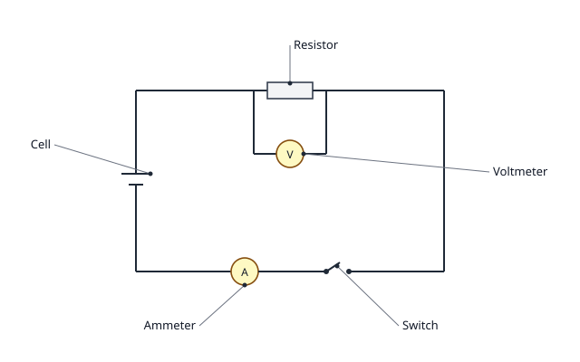

1. Opposes the current
2. In series — measures current
3. Provides the e.m.f.
4. In parallel — potential difference

Answer and explanation

**Answer: (3) Provides the e.m.f.**

Cell: Provides the e.m.f. (File 6: PHY-D01).

<!-- meta {"type":"mcq","id":"SCQ-10-19-012","grade":10,"chapter_id":"SC10-19","discipline":"PHY","difficulty":1,"qtype":"diagram","answer":2,"origin":"ORIGINAL","source_ref":"PHY-D01","image":"science_assets/physics/PHY-D01_labelled.svg"} -->
**SCQ-10-19-012** · Basic · Diagram · `ORIGINAL`

In the Series circuit (ammeter, voltmeter) diagram, what is the function of the 'Resistor'?

1. In parallel — potential difference
2. Opposes the current
3. Provides the e.m.f.
4. In series — measures current

Answer and explanation

**Answer: (2) Opposes the current**

Resistor: Opposes the current (File 6: PHY-D01).

<!-- meta {"type":"mcq","id":"SCQ-10-19-013","grade":10,"chapter_id":"SC10-19","discipline":"PHY","difficulty":1,"qtype":"diagram","answer":1,"origin":"ORIGINAL","source_ref":"PHY-D01","image":"science_assets/physics/PHY-D01_labelled.svg"} -->
**SCQ-10-19-013** · Basic · Diagram · `ORIGINAL`

In the Series circuit (ammeter, voltmeter) diagram, what is the function of the 'Ammeter'?

1. In series — measures current
2. Provides the e.m.f.
3. In parallel — potential difference
4. Opposes the current

Answer and explanation

**Answer: (1) In series — measures current**

Ammeter: In series — measures current (File 6: PHY-D01).

<!-- meta {"type":"mcq","id":"SCQ-10-19-014","grade":10,"chapter_id":"SC10-19","discipline":"PHY","difficulty":1,"qtype":"diagram","answer":4,"origin":"ORIGINAL","source_ref":"PHY-D02","image":"science_assets/physics/PHY-D02_labelled.svg"} -->
**SCQ-10-19-014** · Basic · Diagram · `ORIGINAL`

In the Parallel circuit diagram, what is the function of the 'Branch 1 (R₁)'?

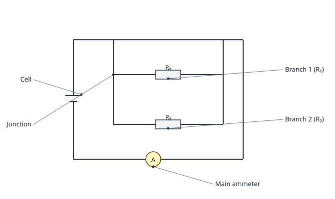

1. Sum of branch currents = total
2. Point where the current splits/joins
3. Total current
4. Potential difference equals that of the cell

Answer and explanation

**Answer: (4) Potential difference equals that of the cell**

Branch 1 (R₁): Potential difference equals that of the cell (File 6: PHY-D02).

<!-- meta {"type":"mcq","id":"SCQ-10-19-015","grade":10,"chapter_id":"SC10-19","discipline":"PHY","difficulty":1,"qtype":"diagram","answer":4,"origin":"ORIGINAL","source_ref":"PHY-D02","image":"science_assets/physics/PHY-D02_labelled.svg"} -->
**SCQ-10-19-015** · Basic · Diagram · `ORIGINAL`

In the Parallel circuit diagram, what is the function of the 'Branch 2 (R₂)'?

1. Total current
2. Potential difference equals that of the cell
3. Point where the current splits/joins
4. Sum of branch currents = total

Answer and explanation

**Answer: (4) Sum of branch currents = total**

Branch 2 (R₂): Sum of branch currents = total (File 6: PHY-D02).

<!-- meta {"type":"mcq","id":"SCQ-10-19-016","grade":10,"chapter_id":"SC10-19","discipline":"PHY","difficulty":1,"qtype":"diagram","answer":4,"origin":"ORIGINAL","source_ref":"PHY-D02","image":"science_assets/physics/PHY-D02_labelled.svg"} -->
**SCQ-10-19-016** · Basic · Diagram · `ORIGINAL`

In the Parallel circuit diagram, what is the function of the 'Junction'?

1. Potential difference equals that of the cell
2. Sum of branch currents = total
3. Total current
4. Point where the current splits/joins

Answer and explanation

**Answer: (4) Point where the current splits/joins**

Junction: Point where the current splits/joins (File 6: PHY-D02).

<!-- meta {"type":"mcq","id":"SCQ-10-19-017","grade":10,"chapter_id":"SC10-19","discipline":"PHY","difficulty":1,"qtype":"calculation","answer":3,"origin":"ORIGINAL","source_ref":"param-SC10-19-1","image":null} -->
**SCQ-10-19-017** · Basic · Calculation · `ORIGINAL`

Current through a 2 Ω resistor with a potential difference of 6 V?

1. 6 A
2. 0.3333 A
3. 3 A
4. 12 A

Answer and explanation

**Answer: (3) 3 A**

I = V/R.

<!-- meta {"type":"mcq","id":"SCQ-10-19-018","grade":10,"chapter_id":"SC10-19","discipline":"PHY","difficulty":1,"qtype":"calculation","answer":2,"origin":"ORIGINAL","source_ref":"param-SC10-19-2","image":null} -->
**SCQ-10-19-018** · Basic · Calculation · `ORIGINAL`

Current through a 46 Ω resistor with a potential difference of 230 V?

1. 0.2 A
2. 5 A
3. 10 A
4. 10580 A

Answer and explanation

**Answer: (2) 5 A**

I = V/R.

<!-- meta {"type":"mcq","id":"SCQ-10-19-019","grade":10,"chapter_id":"SC10-19","discipline":"PHY","difficulty":1,"qtype":"calculation","answer":1,"origin":"ORIGINAL","source_ref":"param-SC10-19-3","image":null} -->
**SCQ-10-19-019** · Basic · Calculation · `ORIGINAL`

Current through a 18 Ω resistor with a potential difference of 9 V?

1. 0.5 A
2. 1 A
3. 2 A
4. 162 A

Answer and explanation

**Answer: (1) 0.5 A**

I = V/R.

<!-- meta {"type":"mcq","id":"SCQ-10-19-020","grade":10,"chapter_id":"SC10-19","discipline":"PHY","difficulty":1,"qtype":"calculation","answer":2,"origin":"ORIGINAL","source_ref":"param-SC10-19-4","image":null} -->
**SCQ-10-19-020** · Basic · Calculation · `ORIGINAL`

Current through a 0.5 Ω resistor with a potential difference of 1.5 V?

1. 6 A
2. 3 A
3. 0.75 A
4. 0.3333 A

Answer and explanation

**Answer: (2) 3 A**

I = V/R.

<!-- meta {"type":"mcq","id":"SCQ-10-19-021","grade":10,"chapter_id":"SC10-19","discipline":"PHY","difficulty":2,"qtype":"calculation","answer":1,"origin":"ORIGINAL","source_ref":"param-SC10-19-5","image":null} -->
**SCQ-10-19-021** · Intermediate · Calculation · `ORIGINAL`

4 Ω and 12 Ω in parallel. Effective resistance?

1. 3 Ω
2. 6 Ω
3. 16 Ω
4. 8 Ω

Answer and explanation

**Answer: (1) 3 Ω**

R = R₁R₂/(R₁ + R₂).

<!-- meta {"type":"mcq","id":"SCQ-10-19-022","grade":10,"chapter_id":"SC10-19","discipline":"PHY","difficulty":2,"qtype":"calculation","answer":1,"origin":"ORIGINAL","source_ref":"param-SC10-19-6","image":null} -->
**SCQ-10-19-022** · Intermediate · Calculation · `ORIGINAL`

10 Ω and 10 Ω in parallel. Effective resistance?

1. 5 Ω
2. 10 Ω
3. 20 Ω
4. 2.5 Ω

Answer and explanation

**Answer: (1) 5 Ω**

R = R₁R₂/(R₁ + R₂).

<!-- meta {"type":"mcq","id":"SCQ-10-19-023","grade":10,"chapter_id":"SC10-19","discipline":"PHY","difficulty":2,"qtype":"calculation","answer":4,"origin":"ORIGINAL","source_ref":"param-SC10-19-7","image":null} -->
**SCQ-10-19-023** · Intermediate · Calculation · `ORIGINAL`

20 Ω and 30 Ω in parallel. Effective resistance?

1. 50 Ω
2. 25 Ω
3. 10 Ω
4. 12 Ω

Answer and explanation

**Answer: (4) 12 Ω**

R = R₁R₂/(R₁ + R₂).

<!-- meta {"type":"mcq","id":"SCQ-10-19-024","grade":10,"chapter_id":"SC10-19","discipline":"PHY","difficulty":2,"qtype":"calculation","answer":3,"origin":"ORIGINAL","source_ref":"param-SC10-19-8","image":null} -->
**SCQ-10-19-024** · Intermediate · Calculation · `ORIGINAL`

2 Ω and 3 Ω in parallel. Effective resistance?

1. 2.5 Ω
2. 5 Ω
3. 1.2 Ω
4. 1 Ω

Answer and explanation

**Answer: (3) 1.2 Ω**

R = R₁R₂/(R₁ + R₂).

<!-- meta {"type":"mcq","id":"SCQ-10-19-025","grade":10,"chapter_id":"SC10-19","discipline":"PHY","difficulty":1,"qtype":"calculation","answer":2,"origin":"ORIGINAL","source_ref":"param-SC10-19-9","image":null} -->
**SCQ-10-19-025** · Basic · Calculation · `ORIGINAL`

0.5 A flows through a 24 Ω resistor. Potential difference?

1. 24 V
2. 12 V
3. 0.0208 V
4. 48 V

Answer and explanation

**Answer: (2) 12 V**

V = IR.

<!-- meta {"type":"mcq","id":"SCQ-10-19-026","grade":10,"chapter_id":"SC10-19","discipline":"PHY","difficulty":1,"qtype":"calculation","answer":3,"origin":"ORIGINAL","source_ref":"param-SC10-19-10","image":null} -->
**SCQ-10-19-026** · Basic · Calculation · `ORIGINAL`

2 A flows through a 115 Ω resistor. Potential difference?

1. 0.0174 V
2. 57.5 V
3. 230 V
4. 460 V

Answer and explanation

**Answer: (3) 230 V**

V = IR.

<!-- meta {"type":"mcq","id":"SCQ-10-19-027","grade":10,"chapter_id":"SC10-19","discipline":"PHY","difficulty":1,"qtype":"calculation","answer":1,"origin":"ORIGINAL","source_ref":"param-SC10-19-11","image":null} -->
**SCQ-10-19-027** · Basic · Calculation · `ORIGINAL`

0.02 A flows through a 1000 Ω resistor. Potential difference?

1. 20 V
2. 40 V
3. 50000 V
4. 2 × 10⁻⁵ V

Answer and explanation

**Answer: (1) 20 V**

V = IR.

## SC10-20: Inheritance

*Grade 10 · Chapter 20 · Biology · 27 questions*

<!-- meta {"type":"mcq","id":"SCQ-10-20-001","grade":10,"chapter_id":"SC10-20","discipline":"BIO","difficulty":1,"qtype":"concept","answer":2,"origin":"ORIGINAL","source_ref":"chapter","image":null} -->
**SCQ-10-20-001** · Basic · Concept · `ORIGINAL`

If a tall (TT) plant is crossed with a dwarf (tt) plant, F1?

1. All TT
2. All Tt — tall
3. 1:1
4. 3:1

Answer and explanation

**Answer: (2) All Tt — tall**

All offspring are Tt; tall because T is dominant.

<!-- meta {"type":"mcq","id":"SCQ-10-20-002","grade":10,"chapter_id":"SC10-20","discipline":"BIO","difficulty":1,"qtype":"calculation","answer":1,"origin":"ORIGINAL","source_ref":"chapter","image":null} -->
**SCQ-10-20-002** · Basic · Calculation · `ORIGINAL`

Proportion of dwarf plants in a Tt × Tt cross?

1. ¼
2. ½
3. ¾
4. 0

Answer and explanation

**Answer: (1) ¼**

Only tt is dwarf: 1 in 4.

<!-- meta {"type":"mcq","id":"SCQ-10-20-003","grade":10,"chapter_id":"SC10-20","discipline":"BIO","difficulty":2,"qtype":"calculation","answer":3,"origin":"ORIGINAL","source_ref":"chapter","image":null} -->
**SCQ-10-20-003** · Intermediate · Calculation · `ORIGINAL`

400 plants from Tt × Tt. Expected number of tall plants?

1. 100
2. 200
3. 300
4. 400

Answer and explanation

**Answer: (3) 300**

¾ × 400 = 300.

<!-- meta {"type":"mcq","id":"SCQ-10-20-004","grade":10,"chapter_id":"SC10-20","discipline":"BIO","difficulty":1,"qtype":"recall","answer":3,"origin":"ORIGINAL","source_ref":"chapter","image":null} -->
**SCQ-10-20-004** · Basic · Recall · `ORIGINAL`

Heterozygous genotype?

1. TT
2. tt
3. Tt
4. T

Answer and explanation

**Answer: (3) Tt**

Two different alleles.

<!-- meta {"type":"mcq","id":"SCQ-10-20-005","grade":10,"chapter_id":"SC10-20","discipline":"BIO","difficulty":1,"qtype":"concept","answer":2,"origin":"ORIGINAL","source_ref":"chapter","image":null} -->
**SCQ-10-20-005** · Basic · Concept · `ORIGINAL`

Which chromosome of the father gives a baby boy?

1. X
2. Y
3. XX
4. Mother's X

Answer and explanation

**Answer: (2) Y**

A Y-carrying sperm → XY.

<!-- meta {"type":"mcq","id":"SCQ-10-20-006","grade":10,"chapter_id":"SC10-20","discipline":"BIO","difficulty":3,"qtype":"reasoning","answer":3,"origin":"ORIGINAL","source_ref":"chapter","image":null} -->
**SCQ-10-20-006** · Hard · Reasoning · `ORIGINAL`

To find whether a tall plant is TT or Tt, it should be crossed with?

1. TT
2. Tt
3. tt
4. Neither

Answer and explanation

**Answer: (3) tt**

Test cross: with tt; if dwarf offspring appear, it is Tt.

<!-- meta {"type":"mcq","id":"SCQ-10-20-007","grade":10,"chapter_id":"SC10-20","discipline":"BIO","difficulty":2,"qtype":"calculation","answer":2,"origin":"ORIGINAL","source_ref":"chapter","image":null} -->
**SCQ-10-20-007** · Intermediate · Calculation · `ORIGINAL`

Tt × tt phenotype ratio (tall : dwarf)?

1. 3:1
2. 1:1
3. 1:2:1
4. All tall

Answer and explanation

**Answer: (2) 1:1**

Tt, Tt, tt, tt → 1:1.

<!-- meta {"type":"mcq","id":"SCQ-10-20-008","grade":10,"chapter_id":"SC10-20","discipline":"BIO","difficulty":3,"qtype":"reasoning","answer":2,"origin":"ORIGINAL","source_ref":"chapter","image":null} -->
**SCQ-10-20-008** · Hard · Reasoning · `ORIGINAL`

Why is colour blindness more common in males?

1. A gene on the Y
2. An X-linked recessive gene; males have only one X
3. Mother's age
4. Environment

Answer and explanation

**Answer: (2) An X-linked recessive gene; males have only one X**

One recessive allele is enough in a male.

<!-- meta {"type":"mcq","id":"SCQ-10-20-009","grade":10,"chapter_id":"SC10-20","discipline":"BIO","difficulty":3,"qtype":"concept","answer":2,"origin":"ORIGINAL","source_ref":"chapter","image":null} -->
**SCQ-10-20-009** · Hard · Concept · `ORIGINAL`

Phenotype is determined by?

1. Genotype only
2. Genotype and environment
3. Environment only
4. Sex only

Answer and explanation

**Answer: (2) Genotype and environment**

Both contribute.

<!-- meta {"type":"mcq","id":"SCQ-10-20-010","grade":10,"chapter_id":"SC10-20","discipline":"BIO","difficulty":3,"qtype":"calculation","answer":2,"origin":"ORIGINAL","source_ref":"chapter","image":null} -->
**SCQ-10-20-010** · Hard · Calculation · `ORIGINAL`

Two thalassaemia carriers (Tt). Probability the child is a carrier?

1. ¼
2. ½
3. ¾
4. 1

Answer and explanation

**Answer: (2) ½**

Tt × Tt → Tt = 2/4 = ½.

<!-- meta {"type":"mcq","id":"SCQ-10-20-011","grade":10,"chapter_id":"SC10-20","discipline":"BIO","difficulty":1,"qtype":"calculation","answer":1,"origin":"ORIGINAL","source_ref":"CL-GENE-1","image":null} -->
**SCQ-10-20-011** · Basic · Calculation · `ORIGINAL`

800 plants from a Tt × Tt cross. Expected tall plants?

1. 600 plants
2. 300 plants
3. 6000 plants
4. 1200 plants

Answer and explanation

**Answer: (1) 600 plants**

The correct answer is 600 plants. See the eight-step solution of CL-GENE (Basic) in File 5.

<!-- meta {"type":"mcq","id":"SCQ-10-20-012","grade":10,"chapter_id":"SC10-20","discipline":"BIO","difficulty":3,"qtype":"calculation","answer":1,"origin":"ORIGINAL","source_ref":"CL-GENE-4","image":null} -->
**SCQ-10-20-012** · Hard · Calculation · `ORIGINAL`

Two thalassaemia carriers (Tt). Probability that the next child is a boy with the disease (tt)?

1. 0.125 
2. 0.062 
3. 0.25 
4. 1.25 

Answer and explanation

**Answer: (1) 0.125 **

The correct answer is 0.125 . See the eight-step solution of CL-GENE (Challenge) in File 5.

<!-- meta {"type":"mcq","id":"SCQ-10-20-013","grade":10,"chapter_id":"SC10-20","discipline":"BIO","difficulty":1,"qtype":"concept","answer":1,"origin":"ORIGINAL","source_ref":"extra-SC10-20-1","image":null} -->
**SCQ-10-20-013** · Basic · Concept · `ORIGINAL`

What is a genotype?

1. The gene combination of an organism
2. Height only
3. Outward appearance
4. Environment

Answer and explanation

**Answer: (1) The gene combination of an organism**

e.g. Tt.

<!-- meta {"type":"mcq","id":"SCQ-10-20-014","grade":10,"chapter_id":"SC10-20","discipline":"BIO","difficulty":1,"qtype":"recall","answer":1,"origin":"ORIGINAL","source_ref":"extra-SC10-20-2","image":null} -->
**SCQ-10-20-014** · Basic · Recall · `ORIGINAL`

Alternative forms of a gene?

1. Alleles
2. Gametes
3. Chromosomes
4. Nuclei

Answer and explanation

**Answer: (1) Alleles**

T, t.

<!-- meta {"type":"mcq","id":"SCQ-10-20-015","grade":10,"chapter_id":"SC10-20","discipline":"BIO","difficulty":1,"qtype":"recall","answer":3,"origin":"ORIGINAL","source_ref":"extra-SC10-20-3","image":null} -->
**SCQ-10-20-015** · Basic · Recall · `ORIGINAL`

The plant Mendel used for his experiments?

1. Maize
2. Rice
3. Pea
4. Bean

Answer and explanation

**Answer: (3) Pea**

Pisum sativum.

<!-- meta {"type":"mcq","id":"SCQ-10-20-016","grade":10,"chapter_id":"SC10-20","discipline":"BIO","difficulty":3,"qtype":"reasoning","answer":3,"origin":"ORIGINAL","source_ref":"extra-SC10-20-4","image":null} -->
**SCQ-10-20-016** · Hard · Reasoning · `ORIGINAL`

The test cross used to find the genotype of a tall plant?

1. Crossing with a tall (TT) plant
2. Self-pollination only
3. Crossing with a dwarf (tt) plant
4. With Tt

Answer and explanation

**Answer: (3) Crossing with a dwarf (tt) plant**

If dwarf offspring appear, it is Tt.

<!-- meta {"type":"mcq","id":"SCQ-10-20-017","grade":10,"chapter_id":"SC10-20","discipline":"BIO","difficulty":2,"qtype":"reasoning","answer":1,"origin":"ORIGINAL","source_ref":"extra-SC10-20-5","image":null} -->
**SCQ-10-20-017** · Intermediate · Reasoning · `ORIGINAL`

What determines sex in humans?

1. The father's sperm (X or Y)
2. Environment
3. Food
4. The mother's egg

Answer and explanation

**Answer: (1) The father's sperm (X or Y)**

The egg always carries X.

<!-- meta {"type":"mcq","id":"SCQ-10-20-018","grade":10,"chapter_id":"SC10-20","discipline":"BIO","difficulty":3,"qtype":"reasoning","answer":4,"origin":"ORIGINAL","source_ref":"extra-SC10-20-6","image":null} -->
**SCQ-10-20-018** · Hard · Reasoning · `ORIGINAL`

Why are X-linked recessive traits such as colour blindness more common in males?

1. Y is larger
2. Environment
3. They have two X
4. Males have only one X

Answer and explanation

**Answer: (4) Males have only one X**

One allele is enough.

<!-- meta {"type":"mcq","id":"SCQ-10-20-019","grade":10,"chapter_id":"SC10-20","discipline":"BIO","difficulty":2,"qtype":"recall","answer":4,"origin":"ORIGINAL","source_ref":"extra-SC10-20-7","image":null} -->
**SCQ-10-20-019** · Intermediate · Recall · `ORIGINAL`

Who proposed the double-helix model of DNA?

1. Mendel, Darwin
2. Linnaeus, Hooke
3. Faraday, Newton
4. Watson, Crick

Answer and explanation

**Answer: (4) Watson, Crick**

1953.

<!-- meta {"type":"mcq","id":"SCQ-10-20-020","grade":10,"chapter_id":"SC10-20","discipline":"BIO","difficulty":1,"qtype":"concept","answer":3,"origin":"ORIGINAL","source_ref":"extra-SC10-20-8","image":null} -->
**SCQ-10-20-020** · Basic · Concept · `ORIGINAL`

Which is not an inherited disease?

1. Haemophilia
2. Colour blindness
3. Dengue
4. Thalassaemia

Answer and explanation

**Answer: (3) Dengue**

Dengue is a viral disease.

<!-- meta {"type":"mcq","id":"SCQ-10-20-021","grade":10,"chapter_id":"SC10-20","discipline":"BIO","difficulty":2,"qtype":"calculation","answer":2,"origin":"ORIGINAL","source_ref":"param-SC10-20-1","image":null} -->
**SCQ-10-20-021** · Intermediate · Calculation · `ORIGINAL`

1200 offspring from a Tt × Tt cross. Expected number with the recessive phenotype?

1. 900
2. 300
3. 600
4. 400

Answer and explanation

**Answer: (2) 300**

tt = ¼.

<!-- meta {"type":"mcq","id":"SCQ-10-20-022","grade":10,"chapter_id":"SC10-20","discipline":"BIO","difficulty":2,"qtype":"calculation","answer":4,"origin":"ORIGINAL","source_ref":"param-SC10-20-2","image":null} -->
**SCQ-10-20-022** · Intermediate · Calculation · `ORIGINAL`

360 offspring from a Tt × Tt cross. Expected number with the recessive phenotype?

1. 270
2. 120
3. 180
4. 90

Answer and explanation

**Answer: (4) 90**

tt = ¼.

<!-- meta {"type":"mcq","id":"SCQ-10-20-023","grade":10,"chapter_id":"SC10-20","discipline":"BIO","difficulty":2,"qtype":"calculation","answer":2,"origin":"ORIGINAL","source_ref":"param-SC10-20-3","image":null} -->
**SCQ-10-20-023** · Intermediate · Calculation · `ORIGINAL`

840 offspring from a Tt × Tt cross. Expected number with the recessive phenotype?

1. 280
2. 210
3. 420
4. 630

Answer and explanation

**Answer: (2) 210**

tt = ¼.

<!-- meta {"type":"mcq","id":"SCQ-10-20-024","grade":10,"chapter_id":"SC10-20","discipline":"BIO","difficulty":2,"qtype":"calculation","answer":2,"origin":"ORIGINAL","source_ref":"param-SC10-20-4","image":null} -->
**SCQ-10-20-024** · Intermediate · Calculation · `ORIGINAL`

500 offspring from a Tt × tt cross. Expected number of heterozygous offspring?

1. 375
2. 250
3. 500
4. 125

Answer and explanation

**Answer: (2) 250**

Tt × tt → 1 Tt : 1 tt.

<!-- meta {"type":"mcq","id":"SCQ-10-20-025","grade":10,"chapter_id":"SC10-20","discipline":"BIO","difficulty":2,"qtype":"calculation","answer":1,"origin":"ORIGINAL","source_ref":"param-SC10-20-5","image":null} -->
**SCQ-10-20-025** · Intermediate · Calculation · `ORIGINAL`

250 offspring from a Tt × tt cross. Expected number of heterozygous offspring?

1. 125
2. 62.5
3. 250
4. 187.5

Answer and explanation

**Answer: (1) 125**

Tt × tt → 1 Tt : 1 tt.

<!-- meta {"type":"mcq","id":"SCQ-10-20-026","grade":10,"chapter_id":"SC10-20","discipline":"BIO","difficulty":3,"qtype":"reasoning","answer":2,"origin":"ORIGINAL","source_ref":"param-SC10-20-6","image":null} -->
**SCQ-10-20-026** · Hard · Reasoning · `ORIGINAL`

400 offspring from a TT × tt cross. Number with the dwarf phenotype?

1. 200
2. 0
3. 400
4. 100

Answer and explanation

**Answer: (2) 0**

All offspring are Tt — tall.

<!-- meta {"type":"mcq","id":"SCQ-10-20-027","grade":10,"chapter_id":"SC10-20","discipline":"BIO","difficulty":3,"qtype":"reasoning","answer":3,"origin":"ORIGINAL","source_ref":"param-SC10-20-7","image":null} -->
**SCQ-10-20-027** · Hard · Reasoning · `ORIGINAL`

160 offspring from a TT × tt cross. Number with the dwarf phenotype?

1. 80
2. 160
3. 0
4. 40

Answer and explanation

**Answer: (3) 0**

All offspring are Tt — tall.

## SC11-01: Living tissues

*Grade 11 · Chapter 1 · Biology · 25 questions*

<!-- meta {"type":"mcq","id":"SCQ-11-01-001","grade":11,"chapter_id":"SC11-01","discipline":"BIO","difficulty":1,"qtype":"recall","answer":2,"origin":"ORIGINAL","source_ref":"chapter","image":null} -->
**SCQ-11-01-001** · Basic · Recall · `ORIGINAL`

What transports water and minerals from the root to the leaf?

1. Phloem
2. Xylem
3. Parenchyma
4. Meristematic tissue

Answer and explanation

**Answer: (2) Xylem**

Xylem vessels carry water upwards.

<!-- meta {"type":"mcq","id":"SCQ-11-01-002","grade":11,"chapter_id":"SC11-01","discipline":"BIO","difficulty":1,"qtype":"recall","answer":2,"origin":"ORIGINAL","source_ref":"chapter","image":null} -->
**SCQ-11-01-002** · Basic · Recall · `ORIGINAL`

Special feature of cardiac muscle?

1. Voluntary
2. Contracts throughout life without fatiguing
3. Attached to bones
4. No branches

Answer and explanation

**Answer: (2) Contracts throughout life without fatiguing**

Cardiac muscle contracts continuously.

<!-- meta {"type":"mcq","id":"SCQ-11-01-003","grade":11,"chapter_id":"SC11-01","discipline":"BIO","difficulty":2,"qtype":"recall","answer":2,"origin":"ORIGINAL","source_ref":"chapter","image":null} -->
**SCQ-11-01-003** · Intermediate · Recall · `ORIGINAL`

An example of multinucleate cells?

1. Red blood cell
2. Skeletal muscle cell
3. Neuron
4. Epithelial cell

Answer and explanation

**Answer: (2) Skeletal muscle cell**

Skeletal muscle fibres have many nuclei.

<!-- meta {"type":"mcq","id":"SCQ-11-01-004","grade":11,"chapter_id":"SC11-01","discipline":"BIO","difficulty":1,"qtype":"concept","answer":1,"origin":"ORIGINAL","source_ref":"chapter","image":null} -->
**SCQ-11-01-004** · Basic · Concept · `ORIGINAL`

Tissue responsible for growth in length at the tip of a plant stem?

1. Apical meristem
2. Xylem
3. Phloem
4. Collenchyma

Answer and explanation

**Answer: (1) Apical meristem**

The apical meristem gives growth in length.

<!-- meta {"type":"mcq","id":"SCQ-11-01-005","grade":11,"chapter_id":"SC11-01","discipline":"BIO","difficulty":2,"qtype":"experiment","answer":2,"origin":"ORIGINAL","source_ref":"chapter","image":null} -->
**SCQ-11-01-005** · Intermediate · Experiment · `ORIGINAL`

Why did the petals turn red after a white flower stalk was placed in red dye solution?

1. Phloem carried the dye
2. Xylem carried the dye with water
3. Osmosis
4. Photosynthesis

Answer and explanation

**Answer: (2) Xylem carried the dye with water**

Xylem carries water upwards.

<!-- meta {"type":"mcq","id":"SCQ-11-01-006","grade":11,"chapter_id":"SC11-01","discipline":"BIO","difficulty":3,"qtype":"concept","answer":1,"origin":"ORIGINAL","source_ref":"chapter","image":null} -->
**SCQ-11-01-006** · Hard · Concept · `ORIGINAL`

Why is blood considered a connective tissue?

1. Its cells are in a liquid medium (plasma)
2. Because it contracts
3. Because it conducts impulses
4. Because it covers surfaces

Answer and explanation

**Answer: (1) Its cells are in a liquid medium (plasma)**

Connective tissue: cells + intercellular material.

<!-- meta {"type":"mcq","id":"SCQ-11-01-007","grade":11,"chapter_id":"SC11-01","discipline":"BIO","difficulty":2,"qtype":"application","answer":3,"origin":"ORIGINAL","source_ref":"chapter","image":null} -->
**SCQ-11-01-007** · Intermediate · Application · `ORIGINAL`

Muscle responsible for peristalsis in the alimentary canal?

1. Skeletal muscle
2. Cardiac muscle
3. Smooth muscle
4. Neither

Answer and explanation

**Answer: (3) Smooth muscle**

Smooth muscle contracts involuntarily.

<!-- meta {"type":"mcq","id":"SCQ-11-01-008","grade":11,"chapter_id":"SC11-01","discipline":"BIO","difficulty":3,"qtype":"recall","answer":1,"origin":"ORIGINAL","source_ref":"chapter","image":null} -->
**SCQ-11-01-008** · Hard · Recall · `ORIGINAL`

Cells that supply energy to the sieve tubes of phloem?

1. Companion cells
2. Xylem vessels
3. Parenchyma cells
4. Guard cells

Answer and explanation

**Answer: (1) Companion cells**

Sieve tubes have no nucleus; companion cells help them.

<!-- meta {"type":"mcq","id":"SCQ-11-01-009","grade":11,"chapter_id":"SC11-01","discipline":"BIO","difficulty":2,"qtype":"concept","answer":2,"origin":"ORIGINAL","source_ref":"chapter","image":null} -->
**SCQ-11-01-009** · Intermediate · Concept · `ORIGINAL`

Feature of xylem cells?

1. Living
2. Dead, with lignified walls
3. Have chloroplasts
4. Have a nucleus

Answer and explanation

**Answer: (2) Dead, with lignified walls**

Mature xylem vessels are dead.

<!-- meta {"type":"mcq","id":"SCQ-11-01-010","grade":11,"chapter_id":"SC11-01","discipline":"BIO","difficulty":1,"qtype":"recall","answer":1,"origin":"ORIGINAL","source_ref":"chapter","image":null} -->
**SCQ-11-01-010** · Basic · Recall · `ORIGINAL`

Tissue covering the surface of the skin and lining the alimentary canal?

1. Epithelium
2. Nervous
3. Muscle
4. Bone

Answer and explanation

**Answer: (1) Epithelium**

Epithelial tissue covers and protects.

<!-- meta {"type":"mcq","id":"SCQ-11-01-011","grade":11,"chapter_id":"SC11-01","discipline":"BIO","difficulty":1,"qtype":"recall","answer":3,"origin":"ORIGINAL","source_ref":"extra-SC11-01-1","image":null} -->
**SCQ-11-01-011** · Basic · Recall · `ORIGINAL`

Tissue where cell division takes place at the tips of plant roots and stems?

1. Parenchyma
2. Xylem
3. Apical meristem
4. Epidermis

Answer and explanation

**Answer: (3) Apical meristem**

Growth in length.

<!-- meta {"type":"mcq","id":"SCQ-11-01-012","grade":11,"chapter_id":"SC11-01","discipline":"BIO","difficulty":2,"qtype":"concept","answer":4,"origin":"ORIGINAL","source_ref":"extra-SC11-01-2","image":null} -->
**SCQ-11-01-012** · Intermediate · Concept · `ORIGINAL`

Dead cells with thick lignin walls that give plants strength?

1. Meristem
2. Phloem
3. Parenchyma
4. Sclerenchyma

Answer and explanation

**Answer: (4) Sclerenchyma**

Fibres, stone cells.

<!-- meta {"type":"mcq","id":"SCQ-11-01-013","grade":11,"chapter_id":"SC11-01","discipline":"BIO","difficulty":2,"qtype":"recall","answer":3,"origin":"ORIGINAL","source_ref":"extra-SC11-01-3","image":null} -->
**SCQ-11-01-013** · Intermediate · Recall · `ORIGINAL`

Cells that transport food in phloem?

1. Vessels
2. Tracheids
3. Sieve tubes
4. Guard cells

Answer and explanation

**Answer: (3) Sieve tubes**

With companion cells.

<!-- meta {"type":"mcq","id":"SCQ-11-01-014","grade":11,"chapter_id":"SC11-01","discipline":"BIO","difficulty":2,"qtype":"application","answer":2,"origin":"ORIGINAL","source_ref":"extra-SC11-01-4","image":null} -->
**SCQ-11-01-014** · Intermediate · Application · `ORIGINAL`

Tissue that removes dust in the respiratory tract?

1. Bone
2. Ciliated epithelium
3. Squamous epithelium
4. Cartilage

Answer and explanation

**Answer: (2) Ciliated epithelium**

Cilia move the mucus.

<!-- meta {"type":"mcq","id":"SCQ-11-01-015","grade":11,"chapter_id":"SC11-01","discipline":"BIO","difficulty":1,"qtype":"concept","answer":2,"origin":"ORIGINAL","source_ref":"extra-SC11-01-5","image":null} -->
**SCQ-11-01-015** · Basic · Concept · `ORIGINAL`

Muscle that works involuntarily and does not tire?

1. Skeletal muscle
2. Cardiac muscle
3. Neck muscle
4. Biceps

Answer and explanation

**Answer: (2) Cardiac muscle**

Continuous contraction.

<!-- meta {"type":"mcq","id":"SCQ-11-01-016","grade":11,"chapter_id":"SC11-01","discipline":"BIO","difficulty":2,"qtype":"application","answer":1,"origin":"ORIGINAL","source_ref":"extra-SC11-01-6","image":null} -->
**SCQ-11-01-016** · Intermediate · Application · `ORIGINAL`

Muscle responsible for peristalsis in the wall of the alimentary canal?

1. Smooth muscle
2. Connective tissue
3. Cardiac muscle
4. Skeletal muscle

Answer and explanation

**Answer: (1) Smooth muscle**

Involuntary muscle.

<!-- meta {"type":"mcq","id":"SCQ-11-01-017","grade":11,"chapter_id":"SC11-01","discipline":"BIO","difficulty":2,"qtype":"recall","answer":1,"origin":"ORIGINAL","source_ref":"extra-SC11-01-7","image":null} -->
**SCQ-11-01-017** · Intermediate · Recall · `ORIGINAL`

Connective tissue that joins bones?

1. Ligament
2. Cartilage only
3. Adipose tissue
4. Tendon

Answer and explanation

**Answer: (1) Ligament**

A tendon joins muscle to bone.

<!-- meta {"type":"mcq","id":"SCQ-11-01-018","grade":11,"chapter_id":"SC11-01","discipline":"BIO","difficulty":2,"qtype":"concept","answer":1,"origin":"ORIGINAL","source_ref":"extra-SC11-01-8","image":null} -->
**SCQ-11-01-018** · Intermediate · Concept · `ORIGINAL`

The part that carries nerve impulses away from the cell body?

1. Axon
2. Only the part without myelin
3. Dendrite
4. Nucleus

Answer and explanation

**Answer: (1) Axon**

The impulse travels outwards.

<!-- meta {"type":"mcq","id":"SCQ-11-01-019","grade":11,"chapter_id":"SC11-01","discipline":"BIO","difficulty":3,"qtype":"concept","answer":3,"origin":"ORIGINAL","source_ref":"extra-SC11-01-9","image":null} -->
**SCQ-11-01-019** · Hard · Concept · `ORIGINAL`

Role of the myelin sheath?

1. Blood supply
2. Contraction
3. Speeding up impulse conduction
4. Food storage

Answer and explanation

**Answer: (3) Speeding up impulse conduction**

It acts as an insulator.

<!-- meta {"type":"mcq","id":"SCQ-11-01-020","grade":11,"chapter_id":"SC11-01","discipline":"BIO","difficulty":1,"qtype":"recall","answer":1,"origin":"ORIGINAL","source_ref":"extra-SC11-01-10","image":null} -->
**SCQ-11-01-020** · Basic · Recall · `ORIGINAL`

A function of adipose tissue?

1. Heat insulation and energy storage
2. Impulse conduction
3. Photosynthesis
4. Blood clotting

Answer and explanation

**Answer: (1) Heat insulation and energy storage**

Under the skin.

<!-- meta {"type":"mcq","id":"SCQ-11-01-021","grade":11,"chapter_id":"SC11-01","discipline":"BIO","difficulty":3,"qtype":"reasoning","answer":2,"origin":"ORIGINAL","source_ref":"extra-SC11-01-11","image":null} -->
**SCQ-11-01-021** · Hard · Reasoning · `ORIGINAL`

Why is blood called a fluid connective tissue?

1. Because it joins muscles
2. Its cells are in a liquid matrix (plasma)
3. Because it contains nerves
4. Because it is solid

Answer and explanation

**Answer: (2) Its cells are in a liquid matrix (plasma)**

Plasma = matrix.

<!-- meta {"type":"mcq","id":"SCQ-11-01-022","grade":11,"chapter_id":"SC11-01","discipline":"BIO","difficulty":1,"qtype":"recall","answer":1,"origin":"ORIGINAL","source_ref":"extra-SC11-01-12","image":null} -->
**SCQ-11-01-022** · Basic · Recall · `ORIGINAL`

Function of the plant epidermis?

1. Protection, reducing water loss
2. Cell division
3. Food transport
4. Mainly photosynthesis

Answer and explanation

**Answer: (1) Protection, reducing water loss**

Together with the cuticle.

<!-- meta {"type":"mcq","id":"SCQ-11-01-023","grade":11,"chapter_id":"SC11-01","discipline":"BIO","difficulty":2,"qtype":"recall","answer":1,"origin":"ORIGINAL","source_ref":"extra-SC11-01-13","image":null} -->
**SCQ-11-01-023** · Intermediate · Recall · `ORIGINAL`

Substance deposited in the walls of xylem vessels?

1. Lignin
2. Suberin only
3. Cellulose only
4. Chitin

Answer and explanation

**Answer: (1) Lignin**

Strength and waterproofing.

<!-- meta {"type":"mcq","id":"SCQ-11-01-024","grade":11,"chapter_id":"SC11-01","discipline":"BIO","difficulty":3,"qtype":"concept","answer":2,"origin":"ORIGINAL","source_ref":"extra-SC11-01-14","image":null} -->
**SCQ-11-01-024** · Hard · Concept · `ORIGINAL`

Where is collenchyma found?

1. Root tip
2. Under the epidermis of young stems
3. Xylem
4. Seed

Answer and explanation

**Answer: (2) Under the epidermis of young stems**

Flexible support.

<!-- meta {"type":"mcq","id":"SCQ-11-01-025","grade":11,"chapter_id":"SC11-01","discipline":"BIO","difficulty":2,"qtype":"recall","answer":4,"origin":"ORIGINAL","source_ref":"extra-SC11-01-15","image":null} -->
**SCQ-11-01-025** · Intermediate · Recall · `ORIGINAL`

Epithelium found on the surface of the skin?

1. Columnar epithelium
2. Ciliated epithelium
3. Cuboidal epithelium
4. Stratified squamous epithelium

Answer and explanation

**Answer: (4) Stratified squamous epithelium**

Many layers — protection.

## SC11-02: Photosynthesis

*Grade 11 · Chapter 2 · Biology · 25 questions*

<!-- meta {"type":"mcq","id":"SCQ-11-02-001","grade":11,"chapter_id":"SC11-02","discipline":"BIO","difficulty":1,"qtype":"recall","answer":2,"origin":"ORIGINAL","source_ref":"chapter","image":null} -->
**SCQ-11-02-001** · Basic · Recall · `ORIGINAL`

Products of photosynthesis?

1. CO₂, water
2. Glucose, O₂
3. Starch, CO₂
4. O₂, CO₂

Answer and explanation

**Answer: (2) Glucose, O₂**

C₆H₁₂O₆ and O₂ are formed.

<!-- meta {"type":"mcq","id":"SCQ-11-02-002","grade":11,"chapter_id":"SC11-02","discipline":"BIO","difficulty":2,"qtype":"experiment","answer":2,"origin":"ORIGINAL","source_ref":"chapter","image":null} -->
**SCQ-11-02-002** · Intermediate · Experiment · `ORIGINAL`

Purpose of placing the leaf in boiling water before the starch test?

1. To remove chlorophyll
2. To kill the cells, stop enzyme action and soften the leaf
3. To give colour
4. To increase starch

Answer and explanation

**Answer: (2) To kill the cells, stop enzyme action and soften the leaf**

The cells die, membranes break and iodine can enter.

<!-- meta {"type":"mcq","id":"SCQ-11-02-003","grade":11,"chapter_id":"SC11-02","discipline":"BIO","difficulty":2,"qtype":"experiment","answer":2,"origin":"ORIGINAL","source_ref":"chapter","image":null} -->
**SCQ-11-02-003** · Intermediate · Experiment · `ORIGINAL`

Role of KOH in the experiment to show CO₂ is needed?

1. Removing O₂
2. Absorbing CO₂
3. Absorbing water
4. Blocking light

Answer and explanation

**Answer: (2) Absorbing CO₂**

KOH absorbs CO₂.

<!-- meta {"type":"mcq","id":"SCQ-11-02-004","grade":11,"chapter_id":"SC11-02","discipline":"BIO","difficulty":1,"qtype":"experiment","answer":2,"origin":"ORIGINAL","source_ref":"chapter","image":null} -->
**SCQ-11-02-004** · Basic · Experiment · `ORIGINAL`

Which part of a variegated leaf turns blue-black after the iodine test?

1. The white part
2. The green part
3. Both
4. Neither

Answer and explanation

**Answer: (2) The green part**

Starch only in the part with chlorophyll.

<!-- meta {"type":"mcq","id":"SCQ-11-02-005","grade":11,"chapter_id":"SC11-02","discipline":"BIO","difficulty":3,"qtype":"graph","answer":2,"origin":"ORIGINAL","source_ref":"chapter","image":null} -->
**SCQ-11-02-005** · Hard · Graph · `ORIGINAL`

Why does the rate of photosynthesis stop rising at some point as light intensity increases?

1. Too much light
2. Another factor (CO₂/temperature) is limiting
3. The plant has died
4. Too much water

Answer and explanation

**Answer: (2) Another factor (CO₂/temperature) is limiting**

The limiting factor changes.

<!-- meta {"type":"mcq","id":"SCQ-11-02-006","grade":11,"chapter_id":"SC11-02","discipline":"BIO","difficulty":2,"qtype":"reasoning","answer":1,"origin":"ORIGINAL","source_ref":"chapter","image":null} -->
**SCQ-11-02-006** · Intermediate · Reasoning · `ORIGINAL`

Advantage of palisade cells being near the upper surface of the leaf?

1. To receive more light
2. To store water
3. To release CO₂
4. To transport food

Answer and explanation

**Answer: (1) To receive more light**

Many chloroplasts receive light.

<!-- meta {"type":"mcq","id":"SCQ-11-02-007","grade":11,"chapter_id":"SC11-02","discipline":"BIO","difficulty":3,"qtype":"concept","answer":2,"origin":"ORIGINAL","source_ref":"chapter","image":null} -->
**SCQ-11-02-007** · Hard · Concept · `ORIGINAL`

Source of the O₂ released in photosynthesis?

1. CO₂
2. Water
3. Glucose
4. Soil

Answer and explanation

**Answer: (2) Water**

Water molecules are split and O₂ is released.

<!-- meta {"type":"mcq","id":"SCQ-11-02-008","grade":11,"chapter_id":"SC11-02","discipline":"BIO","difficulty":2,"qtype":"experiment","answer":1,"origin":"ORIGINAL","source_ref":"chapter","image":null} -->
**SCQ-11-02-008** · Intermediate · Experiment · `ORIGINAL`

Why is ethanol heated in a water bath to remove chlorophyll?

1. Ethanol catches fire easily
2. Water gives more heat
3. Ethanol freezes
4. To increase speed

Answer and explanation

**Answer: (1) Ethanol catches fire easily**

Safety — kept away from a naked flame.

<!-- meta {"type":"mcq","id":"SCQ-11-02-009","grade":11,"chapter_id":"SC11-02","discipline":"BIO","difficulty":2,"qtype":"application","answer":2,"origin":"ORIGINAL","source_ref":"chapter","image":null} -->
**SCQ-11-02-009** · Intermediate · Application · `ORIGINAL`

Effect of increasing CO₂ concentration in a greenhouse?

1. Yield decreases
2. Rate of photosynthesis increases and yield rises
3. Respiration stops
4. Leaves wilt

Answer and explanation

**Answer: (2) Rate of photosynthesis increases and yield rises**

If CO₂ is the limiting factor.

<!-- meta {"type":"mcq","id":"SCQ-11-02-010","grade":11,"chapter_id":"SC11-02","discipline":"BIO","difficulty":2,"qtype":"calculation","answer":1,"origin":"ORIGINAL","source_ref":"chapter","image":null} -->
**SCQ-11-02-010** · Intermediate · Calculation · `ORIGINAL`

Molecules of glucose formed when 6 CO₂ molecules are used?

1. 1
2. 6
3. 12
4. 3

Answer and explanation

**Answer: (1) 1**

According to the equation 6CO₂ → 1 C₆H₁₂O₆.

<!-- meta {"type":"mcq","id":"SCQ-11-02-011","grade":11,"chapter_id":"SC11-02","discipline":"BIO","difficulty":2,"qtype":"equation","answer":1,"origin":"ORIGINAL","source_ref":"EQ-041","image":null} -->
**SCQ-11-02-011** · Intermediate · Equation · `ORIGINAL`

CO₂ + H₂O → C₆H₁₂O₆ + O₂ — when this equation is balanced with the smallest whole-number coefficients, the coefficient of CO₂?

1. 6
2. 5
3. 7
4. 12

Answer and explanation

**Answer: (1) 6**

6CO₂ + 6H₂O → C₆H₁₂O₆ + 6O₂ (atom count checked; File 7: EQ-041).

<!-- meta {"type":"mcq","id":"SCQ-11-02-012","grade":11,"chapter_id":"SC11-02","discipline":"BIO","difficulty":1,"qtype":"diagram","answer":4,"origin":"ORIGINAL","source_ref":"BIO-D03","image":"science_assets/biology/BIO-D03_labelled.svg"} -->
**SCQ-11-02-012** · Basic · Diagram · `ORIGINAL`

In the Cross-section of a leaf diagram, what is the function of the 'Cuticle'?

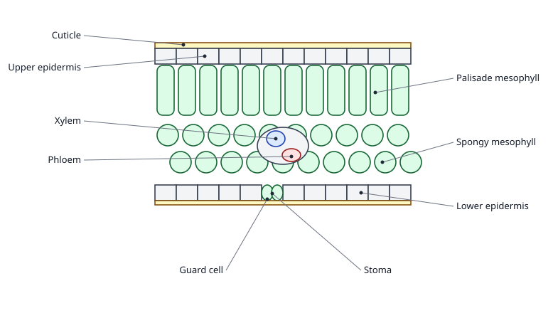

1. Protection; lets light through
2. Gas exchange — air spaces
3. Main site of photosynthesis
4. Reduces water loss

Answer and explanation

**Answer: (4) Reduces water loss**

Cuticle: Reduces water loss (File 6: BIO-D03).

<!-- meta {"type":"mcq","id":"SCQ-11-02-013","grade":11,"chapter_id":"SC11-02","discipline":"BIO","difficulty":1,"qtype":"diagram","answer":3,"origin":"ORIGINAL","source_ref":"BIO-D03","image":"science_assets/biology/BIO-D03_labelled.svg"} -->
**SCQ-11-02-013** · Basic · Diagram · `ORIGINAL`

In the Cross-section of a leaf diagram, what is the function of the 'Upper epidermis'?

1. Main site of photosynthesis
2. Gas exchange — air spaces
3. Protection; lets light through
4. Reduces water loss

Answer and explanation

**Answer: (3) Protection; lets light through**

Upper epidermis: Protection; lets light through (File 6: BIO-D03).

<!-- meta {"type":"mcq","id":"SCQ-11-02-014","grade":11,"chapter_id":"SC11-02","discipline":"BIO","difficulty":1,"qtype":"diagram","answer":2,"origin":"ORIGINAL","source_ref":"BIO-D03","image":"science_assets/biology/BIO-D03_labelled.svg"} -->
**SCQ-11-02-014** · Basic · Diagram · `ORIGINAL`

In the Cross-section of a leaf diagram, what is the function of the 'Palisade mesophyll'?

1. Protection; lets light through
2. Main site of photosynthesis
3. Reduces water loss
4. Gas exchange — air spaces

Answer and explanation

**Answer: (2) Main site of photosynthesis**

Palisade mesophyll: Main site of photosynthesis (File 6: BIO-D03).

<!-- meta {"type":"mcq","id":"SCQ-11-02-015","grade":11,"chapter_id":"SC11-02","discipline":"BIO","difficulty":1,"qtype":"diagram","answer":2,"origin":"ORIGINAL","source_ref":"EXP-D01","image":"science_assets/experiments/EXP-D01_labelled.svg"} -->
**SCQ-11-02-015** · Basic · Diagram · `ORIGINAL`

In the Testing a leaf for starch diagram, what is the function of the 'Boiling water for 1–2 minutes'?

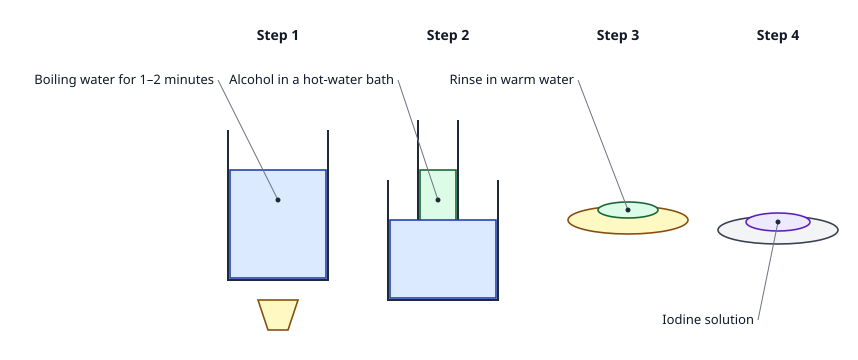

1. Blue-black if starch is present
2. Kills the cells, inactivates enzymes
3. Softens the leaf
4. Removes chlorophyll — avoid a naked flame

Answer and explanation

**Answer: (2) Kills the cells, inactivates enzymes**

Boiling water for 1–2 minutes: Kills the cells, inactivates enzymes (File 6: EXP-D01).

<!-- meta {"type":"mcq","id":"SCQ-11-02-016","grade":11,"chapter_id":"SC11-02","discipline":"BIO","difficulty":1,"qtype":"diagram","answer":1,"origin":"ORIGINAL","source_ref":"EXP-D01","image":"science_assets/experiments/EXP-D01_labelled.svg"} -->
**SCQ-11-02-016** · Basic · Diagram · `ORIGINAL`

In the Testing a leaf for starch diagram, what is the function of the 'Alcohol in a hot-water bath'?

1. Removes chlorophyll — avoid a naked flame
2. Blue-black if starch is present
3. Kills the cells, inactivates enzymes
4. Softens the leaf

Answer and explanation

**Answer: (1) Removes chlorophyll — avoid a naked flame**

Alcohol in a hot-water bath: Removes chlorophyll — avoid a naked flame (File 6: EXP-D01).

<!-- meta {"type":"mcq","id":"SCQ-11-02-017","grade":11,"chapter_id":"SC11-02","discipline":"BIO","difficulty":1,"qtype":"diagram","answer":2,"origin":"ORIGINAL","source_ref":"EXP-D01","image":"science_assets/experiments/EXP-D01_labelled.svg"} -->
**SCQ-11-02-017** · Basic · Diagram · `ORIGINAL`

In the Testing a leaf for starch diagram, what is the function of the 'Rinse in warm water'?

1. Blue-black if starch is present
2. Softens the leaf
3. Removes chlorophyll — avoid a naked flame
4. Kills the cells, inactivates enzymes

Answer and explanation

**Answer: (2) Softens the leaf**

Rinse in warm water: Softens the leaf (File 6: EXP-D01).

<!-- meta {"type":"mcq","id":"SCQ-11-02-018","grade":11,"chapter_id":"SC11-02","discipline":"BIO","difficulty":2,"qtype":"concept","answer":4,"origin":"ORIGINAL","source_ref":"extra-SC11-02-1","image":null} -->
**SCQ-11-02-018** · Intermediate · Concept · `ORIGINAL`

What is released from the water split in photosynthesis?

1. Hydrogen gas
2. Nitrogen
3. Carbon dioxide
4. Oxygen

Answer and explanation

**Answer: (4) Oxygen**

Photolysis of water.

<!-- meta {"type":"mcq","id":"SCQ-11-02-019","grade":11,"chapter_id":"SC11-02","discipline":"BIO","difficulty":3,"qtype":"recall","answer":2,"origin":"ORIGINAL","source_ref":"extra-SC11-02-2","image":null} -->
**SCQ-11-02-019** · Hard · Recall · `ORIGINAL`

An example of a C₄ plant?

1. Mango
2. Maize
3. Rice
4. Bean

Answer and explanation

**Answer: (2) Maize**

Tropical plants.

<!-- meta {"type":"mcq","id":"SCQ-11-02-020","grade":11,"chapter_id":"SC11-02","discipline":"BIO","difficulty":2,"qtype":"reasoning","answer":1,"origin":"ORIGINAL","source_ref":"extra-SC11-02-3","image":null} -->
**SCQ-11-02-020** · Intermediate · Reasoning · `ORIGINAL`

Advantage of a leaf being broad and thin?

1. More light absorption, short diffusion distance
2. Less weight
3. To attract insects
4. Water storage

Answer and explanation

**Answer: (1) More light absorption, short diffusion distance**

An adaptation for photosynthesis.

<!-- meta {"type":"mcq","id":"SCQ-11-02-021","grade":11,"chapter_id":"SC11-02","discipline":"BIO","difficulty":2,"qtype":"concept","answer":4,"origin":"ORIGINAL","source_ref":"extra-SC11-02-4","image":null} -->
**SCQ-11-02-021** · Intermediate · Concept · `ORIGINAL`

Light mainly absorbed by chlorophyll?

1. Green
2. Ultraviolet only
3. Infrared only
4. Red, blue

Answer and explanation

**Answer: (4) Red, blue**

Green is reflected, so the leaf looks green.

<!-- meta {"type":"mcq","id":"SCQ-11-02-022","grade":11,"chapter_id":"SC11-02","discipline":"BIO","difficulty":3,"qtype":"experiment","answer":3,"origin":"ORIGINAL","source_ref":"extra-SC11-02-5","image":null} -->
**SCQ-11-02-022** · Hard · Experiment · `ORIGINAL`

What is placed around a leaf to show that CO₂ is needed for photosynthesis?

1. Sugar
2. Water
3. KOH (CO₂ absorber)
4. Iodine

Answer and explanation

**Answer: (3) KOH (CO₂ absorber)**

KOH removes CO₂.

<!-- meta {"type":"mcq","id":"SCQ-11-02-023","grade":11,"chapter_id":"SC11-02","discipline":"BIO","difficulty":3,"qtype":"graph","answer":1,"origin":"ORIGINAL","source_ref":"extra-SC11-02-6","image":null} -->
**SCQ-11-02-023** · Hard · Graph · `ORIGINAL`

The limiting factor when the rate does not rise even though light intensity increases?

1. CO₂ concentration or temperature
2. Light
3. Soil
4. Leaf colour

Answer and explanation

**Answer: (1) CO₂ concentration or temperature**

Limiting factor.

<!-- meta {"type":"mcq","id":"SCQ-11-02-024","grade":11,"chapter_id":"SC11-02","discipline":"BIO","difficulty":3,"qtype":"reasoning","answer":4,"origin":"ORIGINAL","source_ref":"extra-SC11-02-7","image":null} -->
**SCQ-11-02-024** · Hard · Reasoning · `ORIGINAL`

Why is glucose converted into starch for storage?

1. It is sweet
2. It is light
3. Colour
4. It is insoluble — it does not affect osmosis

Answer and explanation

**Answer: (4) It is insoluble — it does not affect osmosis**

Insoluble storage.

<!-- meta {"type":"mcq","id":"SCQ-11-02-025","grade":11,"chapter_id":"SC11-02","discipline":"BIO","difficulty":1,"qtype":"recall","answer":3,"origin":"ORIGINAL","source_ref":"extra-SC11-02-8","image":null} -->
**SCQ-11-02-025** · Basic · Recall · `ORIGINAL`

Organelle where photosynthesis takes place?

1. Ribosome
2. Mitochondrion
3. Chloroplast
4. Nucleus

Answer and explanation

**Answer: (3) Chloroplast**

It contains chlorophyll.

## SC11-03: Mixtures

*Grade 11 · Chapter 3 · Chemistry · 25 questions*

<!-- meta {"type":"mcq","id":"SCQ-11-03-001","grade":11,"chapter_id":"SC11-03","discipline":"CHE","difficulty":1,"qtype":"concept","answer":2,"origin":"ORIGINAL","source_ref":"chapter","image":null} -->
**SCQ-11-03-001** · Basic · Concept · `ORIGINAL`

Best method to get pure water from salt solution?

1. Filtration
2. Distillation
3. Chromatography
4. Separating funnel

Answer and explanation

**Answer: (2) Distillation**

Water evaporates and condenses; salt remains.

<!-- meta {"type":"mcq","id":"SCQ-11-03-002","grade":11,"chapter_id":"SC11-03","discipline":"CHE","difficulty":1,"qtype":"calculation","answer":1,"origin":"ORIGINAL","source_ref":"chapter","image":null} -->
**SCQ-11-03-002** · Basic · Calculation · `ORIGINAL`

200 g of solution contains 10 g of sugar. Mass fraction (%)?

1. 5%
2. 10%
3. 20%
4. 2%

Answer and explanation

**Answer: (1) 5%**

10/200 × 100 = 5%.

<!-- meta {"type":"mcq","id":"SCQ-11-03-003","grade":11,"chapter_id":"SC11-03","discipline":"CHE","difficulty":2,"qtype":"calculation","answer":1,"origin":"ORIGINAL","source_ref":"chapter","image":null} -->
**SCQ-11-03-003** · Intermediate · Calculation · `ORIGINAL`

Mass of 500 cm³ of vinegar of density 1.05 g cm⁻³?

1. 525 g
2. 476 g
3. 500 g
4. 1050 g

Answer and explanation

**Answer: (1) 525 g**

m = ρV = 1.05 × 500 = 525 g.

<!-- meta {"type":"mcq","id":"SCQ-11-03-004","grade":11,"chapter_id":"SC11-03","discipline":"CHE","difficulty":2,"qtype":"recall","answer":2,"origin":"ORIGINAL","source_ref":"chapter","image":null} -->
**SCQ-11-03-004** · Intermediate · Recall · `ORIGINAL`

What is used to extract cinnamon leaf oil?

1. Fractional distillation
2. Steam distillation
3. Filtration
4. Evaporation

Answer and explanation

**Answer: (2) Steam distillation**

Volatile oils that can be damaged by heat.

<!-- meta {"type":"mcq","id":"SCQ-11-03-005","grade":11,"chapter_id":"SC11-03","discipline":"CHE","difficulty":2,"qtype":"application","answer":1,"origin":"ORIGINAL","source_ref":"chapter","image":null} -->
**SCQ-11-03-005** · Intermediate · Application · `ORIGINAL`

Why do bubbles escape as soon as a cold soda is opened?

1. Pressure falls, so CO₂ solubility decreases
2. Temperature rises
3. Evaporation of water
4. A reaction

Answer and explanation

**Answer: (1) Pressure falls, so CO₂ solubility decreases**

Gas solubility decreases as pressure falls.

<!-- meta {"type":"mcq","id":"SCQ-11-03-006","grade":11,"chapter_id":"SC11-03","discipline":"CHE","difficulty":1,"qtype":"concept","answer":2,"origin":"ORIGINAL","source_ref":"chapter","image":null} -->
**SCQ-11-03-006** · Basic · Concept · `ORIGINAL`

Basis of the method used to separate a mixture of ethanol (78 °C) and water (100 °C)?

1. Density
2. Difference in boiling point
3. Solubility
4. Colour

Answer and explanation

**Answer: (2) Difference in boiling point**

Fractional distillation.

<!-- meta {"type":"mcq","id":"SCQ-11-03-007","grade":11,"chapter_id":"SC11-03","discipline":"CHE","difficulty":1,"qtype":"concept","answer":3,"origin":"ORIGINAL","source_ref":"chapter","image":null} -->
**SCQ-11-03-007** · Basic · Concept · `ORIGINAL`

Which of the following is a heterogeneous mixture?

1. Air
2. Salt solution
3. Water mixed with sand
4. Brass

Answer and explanation

**Answer: (3) Water mixed with sand**

Two phases are visible.

<!-- meta {"type":"mcq","id":"SCQ-11-03-008","grade":11,"chapter_id":"SC11-03","discipline":"CHE","difficulty":2,"qtype":"calculation","answer":1,"origin":"ORIGINAL","source_ref":"chapter","image":null} -->
**SCQ-11-03-008** · Intermediate · Calculation · `ORIGINAL`

0.2 mol of solute in 400 cm³ of solution — concentration?

1. 0.5 mol dm⁻³
2. 0.05 mol dm⁻³
3. 80 mol dm⁻³
4. 2 mol dm⁻³

Answer and explanation

**Answer: (1) 0.5 mol dm⁻³**

0.2/0.4 = 0.5.

<!-- meta {"type":"mcq","id":"SCQ-11-03-009","grade":11,"chapter_id":"SC11-03","discipline":"CHE","difficulty":3,"qtype":"reasoning","answer":2,"origin":"ORIGINAL","source_ref":"chapter","image":null} -->
**SCQ-11-03-009** · Hard · Reasoning · `ORIGINAL`

Why do components travel different distances in chromatography?

1. Colour
2. They differ in solubility in the solvent and attraction to the paper
3. Mass
4. Boiling point

Answer and explanation

**Answer: (2) They differ in solubility in the solvent and attraction to the paper**

Difference in movement.

<!-- meta {"type":"mcq","id":"SCQ-11-03-010","grade":11,"chapter_id":"SC11-03","discipline":"CHE","difficulty":2,"qtype":"application","answer":1,"origin":"ORIGINAL","source_ref":"chapter","image":null} -->
**SCQ-11-03-010** · Intermediate · Application · `ORIGINAL`

Why do fish suffer from lack of O₂ in warm water?

1. O₂ solubility decreases as temperature increases
2. O₂ increases
3. pH changes
4. Algae die

Answer and explanation

**Answer: (1) O₂ solubility decreases as temperature increases**

Gas solubility decreases with heat.

<!-- meta {"type":"mcq","id":"SCQ-11-03-011","grade":11,"chapter_id":"SC11-03","discipline":"CHE","difficulty":2,"qtype":"calculation","answer":3,"origin":"ORIGINAL","source_ref":"CL-CONC-2","image":null} -->
**SCQ-11-03-011** · Intermediate · Calculation · `ORIGINAL`

Mass of NaOH needed to prepare 250 cm³ of 0.5 mol dm⁻³ NaOH solution? (NaOH = 40)

1. 2.5 g
2. 10 g
3. 5 g
4. 50 g

Answer and explanation

**Answer: (3) 5 g**

The correct answer is 5 g. See the eight-step solution of CL-CONC (Intermediate) in File 5.

<!-- meta {"type":"mcq","id":"SCQ-11-03-012","grade":11,"chapter_id":"SC11-03","discipline":"CHE","difficulty":1,"qtype":"diagram","answer":2,"origin":"ORIGINAL","source_ref":"CHE-D04","image":"science_assets/chemistry/CHE-D04_labelled.svg"} -->
**SCQ-11-03-012** · Basic · Diagram · `ORIGINAL`

In the Distillation diagram, what is the function of the 'Distillation flask'?

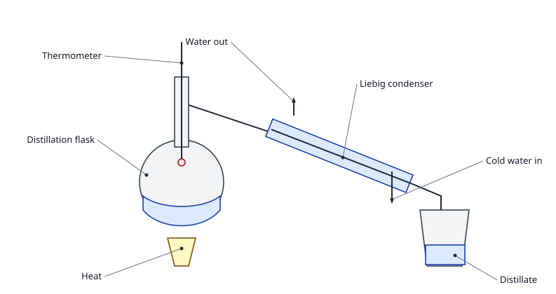

1. From bottom to top
2. Heats the mixture
3. Bulb at the side-arm level — boiling point of the vapour
4. Cools and condenses the vapour

Answer and explanation

**Answer: (2) Heats the mixture**

Distillation flask: Heats the mixture (File 6: CHE-D04).

<!-- meta {"type":"mcq","id":"SCQ-11-03-013","grade":11,"chapter_id":"SC11-03","discipline":"CHE","difficulty":1,"qtype":"diagram","answer":2,"origin":"ORIGINAL","source_ref":"CHE-D04","image":"science_assets/chemistry/CHE-D04_labelled.svg"} -->
**SCQ-11-03-013** · Basic · Diagram · `ORIGINAL`

In the Distillation diagram, what is the function of the 'Thermometer'?

1. Heats the mixture
2. Bulb at the side-arm level — boiling point of the vapour
3. From bottom to top
4. Cools and condenses the vapour

Answer and explanation

**Answer: (2) Bulb at the side-arm level — boiling point of the vapour**

Thermometer: Bulb at the side-arm level — boiling point of the vapour (File 6: CHE-D04).

<!-- meta {"type":"mcq","id":"SCQ-11-03-014","grade":11,"chapter_id":"SC11-03","discipline":"CHE","difficulty":1,"qtype":"diagram","answer":1,"origin":"ORIGINAL","source_ref":"CHE-D04","image":"science_assets/chemistry/CHE-D04_labelled.svg"} -->
**SCQ-11-03-014** · Basic · Diagram · `ORIGINAL`

In the Distillation diagram, what is the function of the 'Liebig condenser'?

1. Cools and condenses the vapour
2. From bottom to top
3. Bulb at the side-arm level — boiling point of the vapour
4. Heats the mixture

Answer and explanation

**Answer: (1) Cools and condenses the vapour**

Liebig condenser: Cools and condenses the vapour (File 6: CHE-D04).

<!-- meta {"type":"mcq","id":"SCQ-11-03-015","grade":11,"chapter_id":"SC11-03","discipline":"CHE","difficulty":2,"qtype":"calculation","answer":2,"origin":"ORIGINAL","source_ref":"param-SC11-03-1","image":null} -->
**SCQ-11-03-015** · Intermediate · Calculation · `ORIGINAL`

0.1 mol of solute in 250 cm³ of solution. Concentration (mol dm⁻³)?

1. 4 × 10⁻⁴ mol dm⁻³
2. 0.4 mol dm⁻³
3. 25 mol dm⁻³
4. 0.025 mol dm⁻³

Answer and explanation

**Answer: (2) 0.4 mol dm⁻³**

C = n/V (dm³).

<!-- meta {"type":"mcq","id":"SCQ-11-03-016","grade":11,"chapter_id":"SC11-03","discipline":"CHE","difficulty":2,"qtype":"calculation","answer":4,"origin":"ORIGINAL","source_ref":"param-SC11-03-2","image":null} -->
**SCQ-11-03-016** · Intermediate · Calculation · `ORIGINAL`

0.5 mol of solute in 2000 cm³ of solution. Concentration (mol dm⁻³)?

1. 2.5 × 10⁻⁴ mol dm⁻³
2. 1000 mol dm⁻³
3. 1 mol dm⁻³
4. 0.25 mol dm⁻³

Answer and explanation

**Answer: (4) 0.25 mol dm⁻³**

C = n/V (dm³).

<!-- meta {"type":"mcq","id":"SCQ-11-03-017","grade":11,"chapter_id":"SC11-03","discipline":"CHE","difficulty":2,"qtype":"calculation","answer":2,"origin":"ORIGINAL","source_ref":"param-SC11-03-3","image":null} -->
**SCQ-11-03-017** · Intermediate · Calculation · `ORIGINAL`

0.02 mol of solute in 100 cm³ of solution. Concentration (mol dm⁻³)?

1. 0.002 mol dm⁻³
2. 0.2 mol dm⁻³
3. 2 mol dm⁻³
4. 2 × 10⁻⁴ mol dm⁻³

Answer and explanation

**Answer: (2) 0.2 mol dm⁻³**

C = n/V (dm³).

<!-- meta {"type":"mcq","id":"SCQ-11-03-018","grade":11,"chapter_id":"SC11-03","discipline":"CHE","difficulty":3,"qtype":"calculation","answer":3,"origin":"ORIGINAL","source_ref":"param-SC11-03-4","image":null} -->
**SCQ-11-03-018** · Hard · Calculation · `ORIGINAL`

Mass needed to prepare 500 cm³ of 0.2 mol dm⁻³ NaCl solution? (M = 58.5)

1. 5850 g
2. 11.7 g
3. 5.85 g
4. 0.1 g

Answer and explanation

**Answer: (3) 5.85 g**

m = CVM.

<!-- meta {"type":"mcq","id":"SCQ-11-03-019","grade":11,"chapter_id":"SC11-03","discipline":"CHE","difficulty":3,"qtype":"calculation","answer":3,"origin":"ORIGINAL","source_ref":"param-SC11-03-5","image":null} -->
**SCQ-11-03-019** · Hard · Calculation · `ORIGINAL`

Mass needed to prepare 100 cm³ of 1 mol dm⁻³ NaOH solution? (M = 40)

1. 0.1 g
2. 40 g
3. 4 g
4. 4000 g

Answer and explanation

**Answer: (3) 4 g**

m = CVM.

<!-- meta {"type":"mcq","id":"SCQ-11-03-020","grade":11,"chapter_id":"SC11-03","discipline":"CHE","difficulty":3,"qtype":"calculation","answer":3,"origin":"ORIGINAL","source_ref":"param-SC11-03-6","image":null} -->
**SCQ-11-03-020** · Hard · Calculation · `ORIGINAL`

Mass needed to prepare 250 cm³ of 0.05 mol dm⁻³ KMnO₄ solution? (M = 158)

1. 0.0125 g
2. 1975 g
3. 1.975 g
4. 7.9 g

Answer and explanation

**Answer: (3) 1.975 g**

m = CVM.

<!-- meta {"type":"mcq","id":"SCQ-11-03-021","grade":11,"chapter_id":"SC11-03","discipline":"CHE","difficulty":2,"qtype":"calculation","answer":4,"origin":"ORIGINAL","source_ref":"param-SC11-03-7","image":null} -->
**SCQ-11-03-021** · Intermediate · Calculation · `ORIGINAL`

20 g of solute was dissolved in 180 g of water. Mass fraction %?

1. 11.1111 %
2. 20 %
3. 90 %
4. 10 %

Answer and explanation

**Answer: (4) 10 %**

Solute/solution × 100.

<!-- meta {"type":"mcq","id":"SCQ-11-03-022","grade":11,"chapter_id":"SC11-03","discipline":"CHE","difficulty":2,"qtype":"calculation","answer":1,"origin":"ORIGINAL","source_ref":"param-SC11-03-8","image":null} -->
**SCQ-11-03-022** · Intermediate · Calculation · `ORIGINAL`

5 g of solute was dissolved in 45 g of water. Mass fraction %?

1. 10 %
2. 90 %
3. 11.1111 %
4. 20 %

Answer and explanation

**Answer: (1) 10 %**

Solute/solution × 100.

<!-- meta {"type":"mcq","id":"SCQ-11-03-023","grade":11,"chapter_id":"SC11-03","discipline":"CHE","difficulty":2,"qtype":"calculation","answer":4,"origin":"ORIGINAL","source_ref":"param-SC11-03-9","image":null} -->
**SCQ-11-03-023** · Intermediate · Calculation · `ORIGINAL`

30 g of solute was dissolved in 120 g of water. Mass fraction %?

1. 25 %
2. 40 %
3. 80 %
4. 20 %

Answer and explanation

**Answer: (4) 20 %**

Solute/solution × 100.

<!-- meta {"type":"mcq","id":"SCQ-11-03-024","grade":11,"chapter_id":"SC11-03","discipline":"CHE","difficulty":3,"qtype":"calculation","answer":4,"origin":"ORIGINAL","source_ref":"param-SC11-03-10","image":null} -->
**SCQ-11-03-024** · Hard · Calculation · `ORIGINAL`

New concentration if 50 cm³ of 2 mol dm⁻³ solution is diluted with water to 200 cm³?

1. 8 mol dm⁻³
2. 2 mol dm⁻³
3. 100 mol dm⁻³
4. 0.5 mol dm⁻³

Answer and explanation

**Answer: (4) 0.5 mol dm⁻³**

C₁V₁ = C₂V₂.

<!-- meta {"type":"mcq","id":"SCQ-11-03-025","grade":11,"chapter_id":"SC11-03","discipline":"CHE","difficulty":3,"qtype":"calculation","answer":3,"origin":"ORIGINAL","source_ref":"param-SC11-03-11","image":null} -->
**SCQ-11-03-025** · Hard · Calculation · `ORIGINAL`

New concentration if 25 cm³ of 1 mol dm⁻³ solution is diluted with water to 250 cm³?

1. 10 mol dm⁻³
2. 25 mol dm⁻³
3. 0.1 mol dm⁻³
4. 1 mol dm⁻³

Answer and explanation

**Answer: (3) 0.1 mol dm⁻³**

C₁V₁ = C₂V₂.

## SC11-04: Waves and their applications

*Grade 11 · Chapter 4 · Physics · 25 questions*

<!-- meta {"type":"mcq","id":"SCQ-11-04-001","grade":11,"chapter_id":"SC11-04","discipline":"PHY","difficulty":1,"qtype":"calculation","answer":2,"origin":"ORIGINAL","source_ref":"chapter","image":null} -->
**SCQ-11-04-001** · Basic · Calculation · `ORIGINAL`

A wave has frequency 50 Hz and wavelength 2 m. Speed?

1. 25 m s⁻¹
2. 100 m s⁻¹
3. 52 m s⁻¹
4. 0.04 m s⁻¹

Answer and explanation

**Answer: (2) 100 m s⁻¹**

v = 50 × 2.

<!-- meta {"type":"mcq","id":"SCQ-11-04-002","grade":11,"chapter_id":"SC11-04","discipline":"PHY","difficulty":1,"qtype":"concept","answer":1,"origin":"ORIGINAL","source_ref":"chapter","image":null} -->
**SCQ-11-04-002** · Basic · Concept · `ORIGINAL`

What does it mean that sound is a longitudinal wave?

1. Particles vibrate parallel to the direction of travel
2. They vibrate perpendicularly
3. They do not vibrate
4. It travels in a vacuum

Answer and explanation

**Answer: (1) Particles vibrate parallel to the direction of travel**

Compressions, rarefactions.

<!-- meta {"type":"mcq","id":"SCQ-11-04-003","grade":11,"chapter_id":"SC11-04","discipline":"PHY","difficulty":2,"qtype":"calculation","answer":1,"origin":"ORIGINAL","source_ref":"chapter","image":null} -->
**SCQ-11-04-003** · Intermediate · Calculation · `ORIGINAL`

Sound in air at 340 m s⁻¹, 680 Hz. Wavelength?

1. 0.5 m
2. 2 m
3. 1020 m
4. 231 200 m

Answer and explanation

**Answer: (1) 0.5 m**

λ = 340/680.

<!-- meta {"type":"mcq","id":"SCQ-11-04-004","grade":11,"chapter_id":"SC11-04","discipline":"PHY","difficulty":2,"qtype":"calculation","answer":2,"origin":"ORIGINAL","source_ref":"chapter","image":null} -->
**SCQ-11-04-004** · Intermediate · Calculation · `ORIGINAL`

Thunder was heard 3 s after lightning was seen. Approximate distance? (sound 340 m s⁻¹)

1. 113 m
2. 1020 m
3. 340 m
4. 3 m

Answer and explanation

**Answer: (2) 1020 m**

s = 340 × 3.

<!-- meta {"type":"mcq","id":"SCQ-11-04-005","grade":11,"chapter_id":"SC11-04","discipline":"PHY","difficulty":1,"qtype":"application","answer":1,"origin":"ORIGINAL","source_ref":"chapter","image":null} -->
**SCQ-11-04-005** · Basic · Application · `ORIGINAL`

Why cannot astronauts on the Moon hear each other speak directly?

1. Vacuum — no medium for sound
2. Cold
3. No light
4. Gravity

Answer and explanation

**Answer: (1) Vacuum — no medium for sound**

Sound needs a medium.

<!-- meta {"type":"mcq","id":"SCQ-11-04-006","grade":11,"chapter_id":"SC11-04","discipline":"PHY","difficulty":2,"qtype":"concept","answer":2,"origin":"ORIGINAL","source_ref":"chapter","image":null} -->
**SCQ-11-04-006** · Intermediate · Concept · `ORIGINAL`

The difference between a loud sound and a soft sound?

1. Frequency
2. Amplitude
3. Velocity
4. Wavelength

Answer and explanation

**Answer: (2) Amplitude**

Loudness depends on amplitude.

<!-- meta {"type":"mcq","id":"SCQ-11-04-007","grade":11,"chapter_id":"SC11-04","discipline":"PHY","difficulty":1,"qtype":"application","answer":2,"origin":"ORIGINAL","source_ref":"chapter","image":null} -->
**SCQ-11-04-007** · Basic · Application · `ORIGINAL`

What is used to see a foetus in the uterus?

1. X-rays
2. Ultrasound
3. Gamma
4. Microwaves

Answer and explanation

**Answer: (2) Ultrasound**

Ultrasound is safe.

<!-- meta {"type":"mcq","id":"SCQ-11-04-008","grade":11,"chapter_id":"SC11-04","discipline":"PHY","difficulty":1,"qtype":"concept","answer":1,"origin":"ORIGINAL","source_ref":"chapter","image":null} -->
**SCQ-11-04-008** · Basic · Concept · `ORIGINAL`

A sound with high pitch?

1. High frequency
2. High amplitude
3. Low frequency
4. Low speed

Answer and explanation

**Answer: (1) High frequency**

Pitch ∝ frequency.

<!-- meta {"type":"mcq","id":"SCQ-11-04-009","grade":11,"chapter_id":"SC11-04","discipline":"PHY","difficulty":1,"qtype":"concept","answer":3,"origin":"ORIGINAL","source_ref":"chapter","image":null} -->
**SCQ-11-04-009** · Basic · Concept · `ORIGINAL`

Which is not an electromagnetic wave?

1. Light
2. X-rays
3. Sound
4. Radio wave

Answer and explanation

**Answer: (3) Sound**

Sound is a mechanical wave.

<!-- meta {"type":"mcq","id":"SCQ-11-04-010","grade":11,"chapter_id":"SC11-04","discipline":"PHY","difficulty":2,"qtype":"calculation","answer":2,"origin":"ORIGINAL","source_ref":"chapter","image":null} -->
**SCQ-11-04-010** · Intermediate · Calculation · `ORIGINAL`

The period of a wave is 0.02 s. Frequency?

1. 0.02 Hz
2. 50 Hz
3. 20 Hz
4. 2 Hz

Answer and explanation

**Answer: (2) 50 Hz**

f = 1/T.

<!-- meta {"type":"mcq","id":"SCQ-11-04-011","grade":11,"chapter_id":"SC11-04","discipline":"PHY","difficulty":1,"qtype":"diagram","answer":1,"origin":"ORIGINAL","source_ref":"PHY-D05","image":"science_assets/physics/PHY-D05_labelled.svg"} -->
**SCQ-11-04-011** · Basic · Diagram · `ORIGINAL`

In the Transverse wave diagram, what is the function of the 'Crest'?

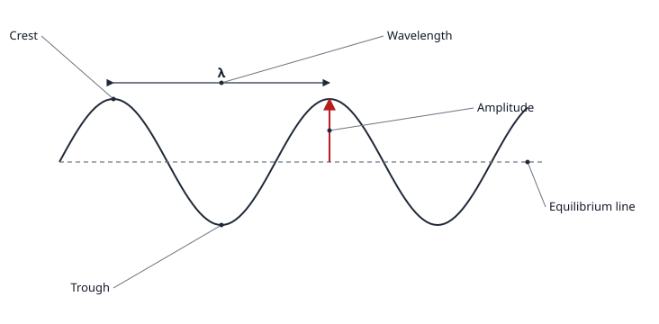

1. Maximum upward displacement
2. Maximum displacement from equilibrium
3. Distance between two successive crests
4. Maximum downward displacement

Answer and explanation

**Answer: (1) Maximum upward displacement**

Crest: Maximum upward displacement (File 6: PHY-D05).

<!-- meta {"type":"mcq","id":"SCQ-11-04-012","grade":11,"chapter_id":"SC11-04","discipline":"PHY","difficulty":1,"qtype":"diagram","answer":4,"origin":"ORIGINAL","source_ref":"PHY-D05","image":"science_assets/physics/PHY-D05_labelled.svg"} -->
**SCQ-11-04-012** · Basic · Diagram · `ORIGINAL`

In the Transverse wave diagram, what is the function of the 'Trough'?

1. Maximum displacement from equilibrium
2. Distance between two successive crests
3. Maximum upward displacement
4. Maximum downward displacement

Answer and explanation

**Answer: (4) Maximum downward displacement**

Trough: Maximum downward displacement (File 6: PHY-D05).

<!-- meta {"type":"mcq","id":"SCQ-11-04-013","grade":11,"chapter_id":"SC11-04","discipline":"PHY","difficulty":1,"qtype":"diagram","answer":2,"origin":"ORIGINAL","source_ref":"PHY-D05","image":"science_assets/physics/PHY-D05_labelled.svg"} -->
**SCQ-11-04-013** · Basic · Diagram · `ORIGINAL`

In the Transverse wave diagram, what is the function of the 'Wavelength'?

1. Maximum upward displacement
2. Distance between two successive crests
3. Maximum downward displacement
4. Maximum displacement from equilibrium

Answer and explanation

**Answer: (2) Distance between two successive crests**

Wavelength: Distance between two successive crests (File 6: PHY-D05).

<!-- meta {"type":"mcq","id":"SCQ-11-04-014","grade":11,"chapter_id":"SC11-04","discipline":"PHY","difficulty":1,"qtype":"calculation","answer":3,"origin":"ORIGINAL","source_ref":"param-SC11-04-1","image":null} -->
**SCQ-11-04-014** · Basic · Calculation · `ORIGINAL`

Speed of a wave of frequency 200 Hz and wavelength 1.7 m?

1. 680 m s⁻¹
2. 0.0085 m s⁻¹
3. 340 m s⁻¹
4. 117.6471 m s⁻¹

Answer and explanation

**Answer: (3) 340 m s⁻¹**

v = fλ.

<!-- meta {"type":"mcq","id":"SCQ-11-04-015","grade":11,"chapter_id":"SC11-04","discipline":"PHY","difficulty":1,"qtype":"calculation","answer":2,"origin":"ORIGINAL","source_ref":"param-SC11-04-2","image":null} -->
**SCQ-11-04-015** · Basic · Calculation · `ORIGINAL`

Speed of a wave of frequency 50 Hz and wavelength 0.4 m?

1. 40 m s⁻¹
2. 20 m s⁻¹
3. 0.008 m s⁻¹
4. 125 m s⁻¹

Answer and explanation

**Answer: (2) 20 m s⁻¹**

v = fλ.

<!-- meta {"type":"mcq","id":"SCQ-11-04-016","grade":11,"chapter_id":"SC11-04","discipline":"PHY","difficulty":1,"qtype":"calculation","answer":4,"origin":"ORIGINAL","source_ref":"param-SC11-04-3","image":null} -->
**SCQ-11-04-016** · Basic · Calculation · `ORIGINAL`

Speed of a wave of frequency 1000 Hz and wavelength 0.34 m?

1. 2941.1765 m s⁻¹
2. 680 m s⁻¹
3. 3.4 × 10⁻⁴ m s⁻¹
4. 340 m s⁻¹

Answer and explanation

**Answer: (4) 340 m s⁻¹**

v = fλ.

<!-- meta {"type":"mcq","id":"SCQ-11-04-017","grade":11,"chapter_id":"SC11-04","discipline":"PHY","difficulty":2,"qtype":"calculation","answer":3,"origin":"ORIGINAL","source_ref":"param-SC11-04-4","image":null} -->
**SCQ-11-04-017** · Intermediate · Calculation · `ORIGINAL`

Speed 340 m s⁻¹, frequency 170 Hz. Wavelength?

1. 57800 m
2. 0.5 m
3. 2 m
4. 4 m

Answer and explanation

**Answer: (3) 2 m**

λ = v/f.

<!-- meta {"type":"mcq","id":"SCQ-11-04-018","grade":11,"chapter_id":"SC11-04","discipline":"PHY","difficulty":2,"qtype":"calculation","answer":2,"origin":"ORIGINAL","source_ref":"param-SC11-04-5","image":null} -->
**SCQ-11-04-018** · Intermediate · Calculation · `ORIGINAL`

Speed 1500 m s⁻¹, frequency 3000 Hz. Wavelength?

1. 2 m
2. 0.5 m
3. 1 m
4. 4.5 × 10⁶ m

Answer and explanation

**Answer: (2) 0.5 m**

λ = v/f.

<!-- meta {"type":"mcq","id":"SCQ-11-04-019","grade":11,"chapter_id":"SC11-04","discipline":"PHY","difficulty":2,"qtype":"calculation","answer":4,"origin":"ORIGINAL","source_ref":"param-SC11-04-6","image":null} -->
**SCQ-11-04-019** · Intermediate · Calculation · `ORIGINAL`

Speed 340 m s⁻¹, frequency 1360 Hz. Wavelength?

1. 0.5 m
2. 462400 m
3. 4 m
4. 0.25 m

Answer and explanation

**Answer: (4) 0.25 m**

λ = v/f.

<!-- meta {"type":"mcq","id":"SCQ-11-04-020","grade":11,"chapter_id":"SC11-04","discipline":"PHY","difficulty":2,"qtype":"calculation","answer":2,"origin":"ORIGINAL","source_ref":"param-SC11-04-7","image":null} -->
**SCQ-11-04-020** · Intermediate · Calculation · `ORIGINAL`

The period of a wave is 0.04 s. Frequency?

1. 50 Hz
2. 25 Hz
3. 4 Hz
4. 0.04 Hz

Answer and explanation

**Answer: (2) 25 Hz**

f = 1/T.

<!-- meta {"type":"mcq","id":"SCQ-11-04-021","grade":11,"chapter_id":"SC11-04","discipline":"PHY","difficulty":2,"qtype":"calculation","answer":1,"origin":"ORIGINAL","source_ref":"param-SC11-04-8","image":null} -->
**SCQ-11-04-021** · Intermediate · Calculation · `ORIGINAL`

The period of a wave is 0.5 s. Frequency?

1. 2 Hz
2. 0.5 Hz
3. 4 Hz
4. 50 Hz

Answer and explanation

**Answer: (1) 2 Hz**

f = 1/T.

<!-- meta {"type":"mcq","id":"SCQ-11-04-022","grade":11,"chapter_id":"SC11-04","discipline":"PHY","difficulty":2,"qtype":"calculation","answer":1,"origin":"ORIGINAL","source_ref":"param-SC11-04-9","image":null} -->
**SCQ-11-04-022** · Intermediate · Calculation · `ORIGINAL`

The period of a wave is 0.002 s. Frequency?

1. 500 Hz
2. 1000 Hz
3. 0.2 Hz
4. 0.002 Hz

Answer and explanation

**Answer: (1) 500 Hz**

f = 1/T.

<!-- meta {"type":"mcq","id":"SCQ-11-04-023","grade":11,"chapter_id":"SC11-04","discipline":"PHY","difficulty":2,"qtype":"calculation","answer":2,"origin":"ORIGINAL","source_ref":"param-SC11-04-10","image":null} -->
**SCQ-11-04-023** · Intermediate · Calculation · `ORIGINAL`

A person shouts towards a cliff and hears the echo after 1.2 s (sound 340 m s⁻¹). Distance to the cliff?

1. 283.3333 m
2. 204 m
3. 408 m
4. 102 m

Answer and explanation

**Answer: (2) 204 m**

d = vt/2 (there and back).

<!-- meta {"type":"mcq","id":"SCQ-11-04-024","grade":11,"chapter_id":"SC11-04","discipline":"PHY","difficulty":2,"qtype":"calculation","answer":4,"origin":"ORIGINAL","source_ref":"param-SC11-04-11","image":null} -->
**SCQ-11-04-024** · Intermediate · Calculation · `ORIGINAL`

A person shouts towards a cliff and hears the echo after 0.4 s (sound 340 m s⁻¹). Distance to the cliff?

1. 850 m
2. 34 m
3. 136 m
4. 68 m

Answer and explanation

**Answer: (4) 68 m**

d = vt/2 (there and back).

<!-- meta {"type":"mcq","id":"SCQ-11-04-025","grade":11,"chapter_id":"SC11-04","discipline":"PHY","difficulty":2,"qtype":"calculation","answer":1,"origin":"ORIGINAL","source_ref":"param-SC11-04-12","image":null} -->
**SCQ-11-04-025** · Intermediate · Calculation · `ORIGINAL`

A person shouts towards a cliff and hears the echo after 2 s (sound 340 m s⁻¹). Distance to the cliff?

1. 340 m
2. 680 m
3. 170 m
4. 3400 m

Answer and explanation

**Answer: (1) 340 m**

d = vt/2 (there and back).

## SC11-05: Geometrical optics

*Grade 11 · Chapter 5 · Physics · 28 questions*

<!-- meta {"type":"mcq","id":"SCQ-11-05-001","grade":11,"chapter_id":"SC11-05","discipline":"PHY","difficulty":1,"qtype":"recall","answer":2,"origin":"ORIGINAL","source_ref":"chapter","image":null} -->
**SCQ-11-05-001** · Basic · Recall · `ORIGINAL`

If the angle of incidence is 35°, the angle of reflection?

1. 55°
2. 35°
3. 70°
4. 90°

Answer and explanation

**Answer: (2) 35°**

Law of reflection.

<!-- meta {"type":"mcq","id":"SCQ-11-05-002","grade":11,"chapter_id":"SC11-05","discipline":"PHY","difficulty":2,"qtype":"concept","answer":2,"origin":"ORIGINAL","source_ref":"chapter","image":null} -->
**SCQ-11-05-002** · Intermediate · Concept · `ORIGINAL`

Object beyond 2F of a convex lens. Image?

1. Virtual, upright, magnified
2. Real, inverted, diminished
3. Real, upright, magnified
4. No image

Answer and explanation

**Answer: (2) Real, inverted, diminished**

A diminished image between F and 2F.

<!-- meta {"type":"mcq","id":"SCQ-11-05-003","grade":11,"chapter_id":"SC11-05","discipline":"PHY","difficulty":2,"qtype":"application","answer":3,"origin":"ORIGINAL","source_ref":"chapter","image":null} -->
**SCQ-11-05-003** · Intermediate · Application · `ORIGINAL`

To use a convex lens as a magnifying glass, the object is placed?

1. Beyond 2F
2. At 2F
3. Between F and the lens
4. At F

Answer and explanation

**Answer: (3) Between F and the lens**

A virtual, upright, magnified image.

<!-- meta {"type":"mcq","id":"SCQ-11-05-004","grade":11,"chapter_id":"SC11-05","discipline":"PHY","difficulty":1,"qtype":"concept","answer":2,"origin":"ORIGINAL","source_ref":"chapter","image":null} -->
**SCQ-11-05-004** · Basic · Concept · `ORIGINAL`

When light passes from air into glass?

1. It bends away from the normal
2. It bends towards the normal
3. It does not bend
4. It only reflects

Answer and explanation

**Answer: (2) It bends towards the normal**

The speed decreases in a denser medium.

<!-- meta {"type":"mcq","id":"SCQ-11-05-005","grade":11,"chapter_id":"SC11-05","discipline":"PHY","difficulty":2,"qtype":"application","answer":2,"origin":"ORIGINAL","source_ref":"chapter","image":null} -->
**SCQ-11-05-005** · Intermediate · Application · `ORIGINAL`

To correct short sight?

1. Convex lens
2. Concave lens
3. Plane mirror
4. Prism

Answer and explanation

**Answer: (2) Concave lens**

A diverging lens corrects the image falling in front of the retina.

<!-- meta {"type":"mcq","id":"SCQ-11-05-006","grade":11,"chapter_id":"SC11-05","discipline":"PHY","difficulty":2,"qtype":"concept","answer":2,"origin":"ORIGINAL","source_ref":"chapter","image":null} -->
**SCQ-11-05-006** · Intermediate · Concept · `ORIGINAL`

For total internal reflection, light must travel?

1. From less dense to denser
2. From denser to less dense, beyond the critical angle
3. In any direction
4. In a vacuum

Answer and explanation

**Answer: (2) From denser to less dense, beyond the critical angle**

Two conditions.

<!-- meta {"type":"mcq","id":"SCQ-11-05-007","grade":11,"chapter_id":"SC11-05","discipline":"PHY","difficulty":3,"qtype":"calculation","answer":1,"origin":"ORIGINAL","source_ref":"chapter","image":null} -->
**SCQ-11-05-007** · Hard · Calculation · `ORIGINAL`

i = 60°, r = 35° (sin 60 = 0.866, sin 35 = 0.574). Approximate refractive index?

1. 1.51
2. 0.66
3. 1.71
4. 25

Answer and explanation

**Answer: (1) 1.51**

0.866/0.574 ≈ 1.51.

<!-- meta {"type":"mcq","id":"SCQ-11-05-008","grade":11,"chapter_id":"SC11-05","discipline":"PHY","difficulty":1,"qtype":"recall","answer":2,"origin":"ORIGINAL","source_ref":"chapter","image":null} -->
**SCQ-11-05-008** · Basic · Recall · `ORIGINAL`

The image of a concave lens is always?

1. Real, inverted
2. Virtual, upright, diminished
3. Virtual, magnified
4. Real, magnified

Answer and explanation

**Answer: (2) Virtual, upright, diminished**

A diverging lens.

<!-- meta {"type":"mcq","id":"SCQ-11-05-009","grade":11,"chapter_id":"SC11-05","discipline":"PHY","difficulty":2,"qtype":"experiment","answer":1,"origin":"ORIGINAL","source_ref":"chapter","image":null} -->
**SCQ-11-05-009** · Intermediate · Experiment · `ORIGINAL`

A simple way to find the focal length of a convex lens approximately?

1. Get a sharp image of a distant object (window) on a screen and measure the lens–screen distance
2. Weighing the lens
3. Putting it in water
4. Heating it

Answer and explanation

**Answer: (1) Get a sharp image of a distant object (window) on a screen and measure the lens–screen distance**

The image of a distant object is at the focus (2019 Paper II Q7A type).

<!-- meta {"type":"mcq","id":"SCQ-11-05-010","grade":11,"chapter_id":"SC11-05","discipline":"PHY","difficulty":3,"qtype":"calculation","answer":1,"origin":"ORIGINAL","source_ref":"chapter","image":null} -->
**SCQ-11-05-010** · Hard · Calculation · `ORIGINAL`

Convex lens f = 10 cm; object at 30 cm. Image distance?

1. 15 cm
2. 20 cm
3. 7.5 cm
4. 30 cm

Answer and explanation

**Answer: (1) 15 cm**

1/v = 1/10 − 1/30 = 2/30 → v = 15 cm (real).

<!-- meta {"type":"mcq","id":"SCQ-11-05-011","grade":11,"chapter_id":"SC11-05","discipline":"PHY","difficulty":1,"qtype":"calculation","answer":2,"origin":"ORIGINAL","source_ref":"CL-OPTICS-1","image":null} -->
**SCQ-11-05-011** · Basic · Calculation · `ORIGINAL`

Light passes from air into glass at an angle of incidence of 50° and is refracted at 30°. Refractive index? (sin 50° = 0.766, sin 30° = 0.5)

1. 3.064
2. 1.532
3. 15.32
4. 0.766

Answer and explanation

**Answer: (2) 1.532**

The correct answer is 1.532. See the eight-step solution of CL-OPTICS (Basic) in File 5.

<!-- meta {"type":"mcq","id":"SCQ-11-05-012","grade":11,"chapter_id":"SC11-05","discipline":"PHY","difficulty":1,"qtype":"diagram","answer":1,"origin":"ORIGINAL","source_ref":"BIO-D11","image":"science_assets/biology/BIO-D11_labelled.svg"} -->
**SCQ-11-05-012** · Basic · Diagram · `ORIGINAL`

In the Human eye (schematic) diagram, what is the function of the 'Cornea'?

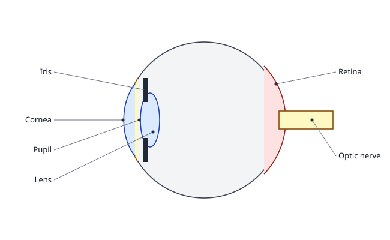

1. Refracts light — most of it
2. Opening through which light enters
3. Adjusts the focal length
4. Controls the size of the pupil

Answer and explanation

**Answer: (1) Refracts light — most of it**

Cornea: Refracts light — most of it (File 6: BIO-D11).

<!-- meta {"type":"mcq","id":"SCQ-11-05-013","grade":11,"chapter_id":"SC11-05","discipline":"PHY","difficulty":1,"qtype":"diagram","answer":3,"origin":"ORIGINAL","source_ref":"BIO-D11","image":"science_assets/biology/BIO-D11_labelled.svg"} -->
**SCQ-11-05-013** · Basic · Diagram · `ORIGINAL`

In the Human eye (schematic) diagram, what is the function of the 'Iris'?

1. Opening through which light enters
2. Adjusts the focal length
3. Controls the size of the pupil
4. Refracts light — most of it

Answer and explanation

**Answer: (3) Controls the size of the pupil**

Iris: Controls the size of the pupil (File 6: BIO-D11).

<!-- meta {"type":"mcq","id":"SCQ-11-05-014","grade":11,"chapter_id":"SC11-05","discipline":"PHY","difficulty":1,"qtype":"diagram","answer":1,"origin":"ORIGINAL","source_ref":"BIO-D11","image":"science_assets/biology/BIO-D11_labelled.svg"} -->
**SCQ-11-05-014** · Basic · Diagram · `ORIGINAL`

In the Human eye (schematic) diagram, what is the function of the 'Pupil'?

1. Opening through which light enters
2. Adjusts the focal length
3. Controls the size of the pupil
4. Refracts light — most of it

Answer and explanation

**Answer: (1) Opening through which light enters**

Pupil: Opening through which light enters (File 6: BIO-D11).

<!-- meta {"type":"mcq","id":"SCQ-11-05-015","grade":11,"chapter_id":"SC11-05","discipline":"PHY","difficulty":1,"qtype":"diagram","answer":2,"origin":"ORIGINAL","source_ref":"PHY-D03","image":"science_assets/physics/PHY-D03_labelled.svg"} -->
**SCQ-11-05-015** · Basic · Diagram · `ORIGINAL`

In the Convex lens: object beyond 2F diagram, what is the function of the 'Object'?

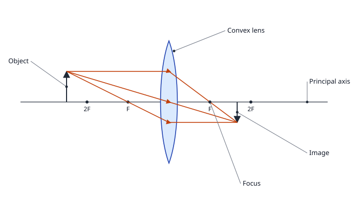

1. Real, inverted, diminished; between F and 2F
2. Beyond 2F
3. Converging
4. Point where parallel rays meet

Answer and explanation

**Answer: (2) Beyond 2F**

Object: Beyond 2F (File 6: PHY-D03).

<!-- meta {"type":"mcq","id":"SCQ-11-05-016","grade":11,"chapter_id":"SC11-05","discipline":"PHY","difficulty":1,"qtype":"diagram","answer":2,"origin":"ORIGINAL","source_ref":"PHY-D03","image":"science_assets/physics/PHY-D03_labelled.svg"} -->
**SCQ-11-05-016** · Basic · Diagram · `ORIGINAL`

In the Convex lens: object beyond 2F diagram, what is the function of the 'Image'?

1. Converging
2. Real, inverted, diminished; between F and 2F
3. Point where parallel rays meet
4. Beyond 2F

Answer and explanation

**Answer: (2) Real, inverted, diminished; between F and 2F**

Image: Real, inverted, diminished; between F and 2F (File 6: PHY-D03).

<!-- meta {"type":"mcq","id":"SCQ-11-05-017","grade":11,"chapter_id":"SC11-05","discipline":"PHY","difficulty":1,"qtype":"diagram","answer":3,"origin":"ORIGINAL","source_ref":"PHY-D03","image":"science_assets/physics/PHY-D03_labelled.svg"} -->
**SCQ-11-05-017** · Basic · Diagram · `ORIGINAL`

In the Convex lens: object beyond 2F diagram, what is the function of the 'Convex lens'?

1. Point where parallel rays meet
2. Real, inverted, diminished; between F and 2F
3. Converging
4. Beyond 2F

Answer and explanation

**Answer: (3) Converging**

Convex lens: Converging (File 6: PHY-D03).

<!-- meta {"type":"mcq","id":"SCQ-11-05-018","grade":11,"chapter_id":"SC11-05","discipline":"PHY","difficulty":1,"qtype":"recall","answer":1,"origin":"ORIGINAL","source_ref":"extra-SC11-05-1","image":null} -->
**SCQ-11-05-018** · Basic · Recall · `ORIGINAL`

Image in a plane mirror?

1. Virtual, upright, same size, laterally inverted
2. Real, magnified
3. Virtual, diminished
4. Real, inverted

Answer and explanation

**Answer: (1) Virtual, upright, same size, laterally inverted**

Properties of a plane mirror.

<!-- meta {"type":"mcq","id":"SCQ-11-05-019","grade":11,"chapter_id":"SC11-05","discipline":"PHY","difficulty":2,"qtype":"concept","answer":1,"origin":"ORIGINAL","source_ref":"extra-SC11-05-2","image":null} -->
**SCQ-11-05-019** · Intermediate · Concept · `ORIGINAL`

The process by which a rainbow forms?

1. Refraction and dispersion in water droplets
2. Absorption
3. Reflection only
4. Total internal reflection only

Answer and explanation

**Answer: (1) Refraction and dispersion in water droplets**

White light is split.

<!-- meta {"type":"mcq","id":"SCQ-11-05-020","grade":11,"chapter_id":"SC11-05","discipline":"PHY","difficulty":2,"qtype":"application","answer":4,"origin":"ORIGINAL","source_ref":"extra-SC11-05-3","image":null} -->
**SCQ-11-05-020** · Intermediate · Application · `ORIGINAL`

What can be used in a periscope?

1. Screen
2. Convex lens only
3. Concave lens
4. 45° prisms or plane mirrors

Answer and explanation

**Answer: (4) 45° prisms or plane mirrors**

Total internal reflection prisms.

<!-- meta {"type":"mcq","id":"SCQ-11-05-021","grade":11,"chapter_id":"SC11-05","discipline":"PHY","difficulty":2,"qtype":"concept","answer":3,"origin":"ORIGINAL","source_ref":"extra-SC11-05-4","image":null} -->
**SCQ-11-05-021** · Intermediate · Concept · `ORIGINAL`

Where does the image fall in long sight?

1. In front of the retina
2. On the lens
3. Behind the retina
4. On the retina

Answer and explanation

**Answer: (3) Behind the retina**

Corrected with a convex lens.

<!-- meta {"type":"mcq","id":"SCQ-11-05-022","grade":11,"chapter_id":"SC11-05","discipline":"PHY","difficulty":2,"qtype":"calculation","answer":1,"origin":"ORIGINAL","source_ref":"param-SC11-05-1","image":null} -->
**SCQ-11-05-022** · Intermediate · Calculation · `ORIGINAL`

Speed of light in a medium of refractive index 1.33? (c = 3 × 10⁸ m s⁻¹)

1. 2.256 × 10⁸ m s⁻¹
2. 4.511 × 10⁸ m s⁻¹
3. 3 × 10⁸ m s⁻¹
4. 3.99 × 10⁸ m s⁻¹

Answer and explanation

**Answer: (1) 2.256 × 10⁸ m s⁻¹**

v = c/n.

<!-- meta {"type":"mcq","id":"SCQ-11-05-023","grade":11,"chapter_id":"SC11-05","discipline":"PHY","difficulty":2,"qtype":"calculation","answer":4,"origin":"ORIGINAL","source_ref":"param-SC11-05-2","image":null} -->
**SCQ-11-05-023** · Intermediate · Calculation · `ORIGINAL`

Speed of light in a medium of refractive index 2? (c = 3 × 10⁸ m s⁻¹)

1. 7.5 × 10⁷ m s⁻¹
2. 3 × 10⁸ m s⁻¹
3. 6 × 10⁸ m s⁻¹
4. 1.5 × 10⁸ m s⁻¹

Answer and explanation

**Answer: (4) 1.5 × 10⁸ m s⁻¹**

v = c/n.

<!-- meta {"type":"mcq","id":"SCQ-11-05-024","grade":11,"chapter_id":"SC11-05","discipline":"PHY","difficulty":2,"qtype":"calculation","answer":3,"origin":"ORIGINAL","source_ref":"param-SC11-05-3","image":null} -->
**SCQ-11-05-024** · Intermediate · Calculation · `ORIGINAL`

Speed of light in a medium of refractive index 1.25? (c = 3 × 10⁸ m s⁻¹)

1. 3 × 10⁸ m s⁻¹
2. 3.75 × 10⁸ m s⁻¹
3. 2.4 × 10⁸ m s⁻¹
4. 4.8 × 10⁸ m s⁻¹

Answer and explanation

**Answer: (3) 2.4 × 10⁸ m s⁻¹**

v = c/n.

<!-- meta {"type":"mcq","id":"SCQ-11-05-025","grade":11,"chapter_id":"SC11-05","discipline":"PHY","difficulty":3,"qtype":"calculation","answer":4,"origin":"ORIGINAL","source_ref":"param-SC11-05-4","image":null} -->
**SCQ-11-05-025** · Hard · Calculation · `ORIGINAL`

An object is placed 20 cm in front of a convex lens of focal length 10 cm. Distance of the real image? (1/f = 1/u + 1/v)

1. 6.6667 cm
2. 10 cm
3. 30 cm
4. 20 cm

Answer and explanation

**Answer: (4) 20 cm**

1/v = 1/10 − 1/20 → v = 20 cm.

<!-- meta {"type":"mcq","id":"SCQ-11-05-026","grade":11,"chapter_id":"SC11-05","discipline":"PHY","difficulty":3,"qtype":"calculation","answer":4,"origin":"ORIGINAL","source_ref":"param-SC11-05-5","image":null} -->
**SCQ-11-05-026** · Hard · Calculation · `ORIGINAL`

An object is placed 60 cm in front of a convex lens of focal length 20 cm. Distance of the real image? (1/f = 1/u + 1/v)

1. 40 cm
2. 15 cm
3. 80 cm
4. 30 cm

Answer and explanation

**Answer: (4) 30 cm**

1/v = 1/20 − 1/60 → v = 30 cm.

<!-- meta {"type":"mcq","id":"SCQ-11-05-027","grade":11,"chapter_id":"SC11-05","discipline":"PHY","difficulty":3,"qtype":"calculation","answer":3,"origin":"ORIGINAL","source_ref":"param-SC11-05-6","image":null} -->
**SCQ-11-05-027** · Hard · Calculation · `ORIGINAL`

An object is placed 15 cm in front of a convex lens of focal length 5 cm. Distance of the real image? (1/f = 1/u + 1/v)

1. 10 cm
2. 3.75 cm
3. 7.5 cm
4. 20 cm

Answer and explanation

**Answer: (3) 7.5 cm**

1/v = 1/5 − 1/15 → v = 7.5 cm.

<!-- meta {"type":"mcq","id":"SCQ-11-05-028","grade":11,"chapter_id":"SC11-05","discipline":"PHY","difficulty":3,"qtype":"calculation","answer":4,"origin":"ORIGINAL","source_ref":"param-SC11-05-7","image":null} -->
**SCQ-11-05-028** · Hard · Calculation · `ORIGINAL`

An object is placed 36 cm in front of a convex lens of focal length 12 cm. Distance of the real image? (1/f = 1/u + 1/v)

1. 9 cm
2. 24 cm
3. 48 cm
4. 18 cm

Answer and explanation

**Answer: (4) 18 cm**

1/v = 1/12 − 1/36 → v = 18 cm.

## SC11-06: Biological processes in the human body

*Grade 11 · Chapter 6 · Biology · 26 questions*

<!-- meta {"type":"mcq","id":"SCQ-11-06-001","grade":11,"chapter_id":"SC11-06","discipline":"BIO","difficulty":1,"qtype":"recall","answer":4,"origin":"ORIGINAL","source_ref":"chapter","image":null} -->
**SCQ-11-06-001** · Basic · Recall · `ORIGINAL`

Which chamber of the heart pumps blood to the whole body?

1. Right atrium
2. Right ventricle
3. Left atrium
4. Left ventricle

Answer and explanation

**Answer: (4) Left ventricle**

The thick-walled left ventricle pumps blood into the systemic circulation.

<!-- meta {"type":"mcq","id":"SCQ-11-06-002","grade":11,"chapter_id":"SC11-06","discipline":"BIO","difficulty":2,"qtype":"reasoning","answer":3,"origin":"ORIGINAL","source_ref":"chapter","image":null} -->
**SCQ-11-06-002** · Intermediate · Reasoning · `ORIGINAL`

Which is not an adaptation of the small intestine for absorption?

1. Villi
2. Thin epithelium
3. Only a thick muscle wall
4. Many capillaries

Answer and explanation

**Answer: (3) Only a thick muscle wall**

Absorption depends on surface area, thin walls and blood supply.

<!-- meta {"type":"mcq","id":"SCQ-11-06-003","grade":11,"chapter_id":"SC11-06","discipline":"BIO","difficulty":2,"qtype":"concept","answer":2,"origin":"ORIGINAL","source_ref":"chapter","image":null} -->
**SCQ-11-06-003** · Intermediate · Concept · `ORIGINAL`

Best conditions for pepsin to work?

1. Alkaline medium
2. Acidic medium (HCl)
3. Neutral
4. Any pH

Answer and explanation

**Answer: (2) Acidic medium (HCl)**

The HCl in the stomach gives an acidic pH.

<!-- meta {"type":"mcq","id":"SCQ-11-06-004","grade":11,"chapter_id":"SC11-06","discipline":"BIO","difficulty":2,"qtype":"reasoning","answer":2,"origin":"ORIGINAL","source_ref":"chapter","image":null} -->
**SCQ-11-06-004** · Intermediate · Reasoning · `ORIGINAL`

Why are alveoli suited to gas exchange?

1. Thick walls
2. Large surface area, thin moist walls, network of capillaries
3. No blood
4. Small surface area

Answer and explanation

**Answer: (2) Large surface area, thin moist walls, network of capillaries**

Features suitable for diffusion.

<!-- meta {"type":"mcq","id":"SCQ-11-06-005","grade":11,"chapter_id":"SC11-06","discipline":"BIO","difficulty":2,"qtype":"application","answer":2,"origin":"ORIGINAL","source_ref":"chapter","image":null} -->
**SCQ-11-06-005** · Intermediate · Application · `ORIGINAL`

Cause of muscle cramp after a hard run?

1. Increase in CO₂
2. Build-up of lactic acid
3. Increase in glucose
4. Too much water

Answer and explanation

**Answer: (2) Build-up of lactic acid**

Anaerobic respiration when O₂ is short.

<!-- meta {"type":"mcq","id":"SCQ-11-06-006","grade":11,"chapter_id":"SC11-06","discipline":"BIO","difficulty":2,"qtype":"application","answer":1,"origin":"ORIGINAL","source_ref":"chapter","image":null} -->
**SCQ-11-06-006** · Intermediate · Application · `ORIGINAL`

A deficiency that can lead to anaemia?

1. Iron
2. Calcium
3. Iodine
4. Sodium

Answer and explanation

**Answer: (1) Iron**

Iron is needed to make haemoglobin.

<!-- meta {"type":"mcq","id":"SCQ-11-06-007","grade":11,"chapter_id":"SC11-06","discipline":"BIO","difficulty":2,"qtype":"recall","answer":1,"origin":"ORIGINAL","source_ref":"chapter","image":null} -->
**SCQ-11-06-007** · Intermediate · Recall · `ORIGINAL`

Where does filtration take place in the nephron?

1. Glomerulus
2. Collecting duct
3. Ureter
4. Urinary bladder

Answer and explanation

**Answer: (1) Glomerulus**

Filtration under high pressure.

<!-- meta {"type":"mcq","id":"SCQ-11-06-008","grade":11,"chapter_id":"SC11-06","discipline":"BIO","difficulty":3,"qtype":"concept","answer":2,"origin":"ORIGINAL","source_ref":"chapter","image":null} -->
**SCQ-11-06-008** · Hard · Concept · `ORIGINAL`

Blood carried by the pulmonary vein?

1. Deoxygenated, from the heart
2. Oxygenated, to the heart
3. Deoxygenated, to the heart
4. Oxygenated, from the heart

Answer and explanation

**Answer: (2) Oxygenated, to the heart**

Oxygenated blood from the lungs to the left atrium.

<!-- meta {"type":"mcq","id":"SCQ-11-06-009","grade":11,"chapter_id":"SC11-06","discipline":"BIO","difficulty":1,"qtype":"application","answer":2,"origin":"ORIGINAL","source_ref":"chapter","image":null} -->
**SCQ-11-06-009** · Basic · Application · `ORIGINAL`

Pulling the hand away at once after touching a hot object is?

1. A voluntary action
2. A reflex action
3. A hormonal response
4. Learned behaviour

Answer and explanation

**Answer: (2) A reflex action**

A reflex through the spinal cord.

<!-- meta {"type":"mcq","id":"SCQ-11-06-010","grade":11,"chapter_id":"SC11-06","discipline":"BIO","difficulty":2,"qtype":"recall","answer":2,"origin":"ORIGINAL","source_ref":"chapter","image":null} -->
**SCQ-11-06-010** · Intermediate · Recall · `ORIGINAL`

Part of the brain that controls balance and muscle coordination?

1. Cerebrum
2. Cerebellum
3. Medulla oblongata
4. Hypothalamus

Answer and explanation

**Answer: (2) Cerebellum**

The cerebellum coordinates balance and movement.

<!-- meta {"type":"mcq","id":"SCQ-11-06-011","grade":11,"chapter_id":"SC11-06","discipline":"BIO","difficulty":1,"qtype":"diagram","answer":4,"origin":"ORIGINAL","source_ref":"BIO-D04","image":"science_assets/biology/BIO-D04_labelled.svg"} -->
**SCQ-11-06-011** · Basic · Diagram · `ORIGINAL`

In the Human heart (schematic) diagram, what is the function of the 'Right atrium'?

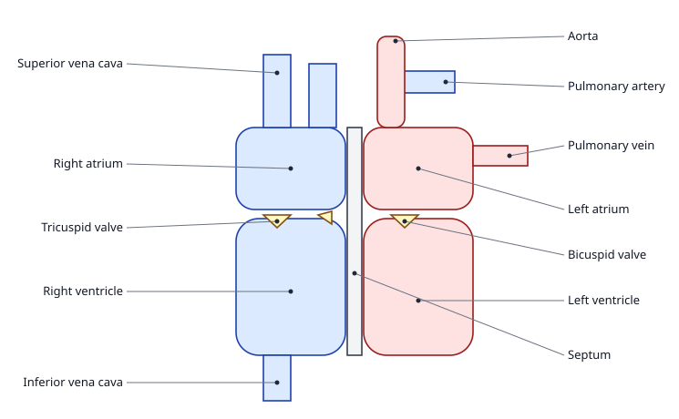

1. Pumps to the body — thick wall
2. Pumps blood to the lungs
3. Oxygenated blood from the lungs
4. Receives deoxygenated blood from the body

Answer and explanation

**Answer: (4) Receives deoxygenated blood from the body**

Right atrium: Receives deoxygenated blood from the body (File 6: BIO-D04).

<!-- meta {"type":"mcq","id":"SCQ-11-06-012","grade":11,"chapter_id":"SC11-06","discipline":"BIO","difficulty":1,"qtype":"diagram","answer":2,"origin":"ORIGINAL","source_ref":"BIO-D04","image":"science_assets/biology/BIO-D04_labelled.svg"} -->
**SCQ-11-06-012** · Basic · Diagram · `ORIGINAL`

In the Human heart (schematic) diagram, what is the function of the 'Right ventricle'?

1. Receives deoxygenated blood from the body
2. Pumps blood to the lungs
3. Oxygenated blood from the lungs
4. Pumps to the body — thick wall

Answer and explanation

**Answer: (2) Pumps blood to the lungs**

Right ventricle: Pumps blood to the lungs (File 6: BIO-D04).

<!-- meta {"type":"mcq","id":"SCQ-11-06-013","grade":11,"chapter_id":"SC11-06","discipline":"BIO","difficulty":1,"qtype":"diagram","answer":3,"origin":"ORIGINAL","source_ref":"BIO-D04","image":"science_assets/biology/BIO-D04_labelled.svg"} -->
**SCQ-11-06-013** · Basic · Diagram · `ORIGINAL`

In the Human heart (schematic) diagram, what is the function of the 'Left atrium'?

1. Pumps blood to the lungs
2. Receives deoxygenated blood from the body
3. Oxygenated blood from the lungs
4. Pumps to the body — thick wall

Answer and explanation

**Answer: (3) Oxygenated blood from the lungs**

Left atrium: Oxygenated blood from the lungs (File 6: BIO-D04).

<!-- meta {"type":"mcq","id":"SCQ-11-06-014","grade":11,"chapter_id":"SC11-06","discipline":"BIO","difficulty":1,"qtype":"diagram","answer":3,"origin":"ORIGINAL","source_ref":"BIO-D05","image":"science_assets/biology/BIO-D05_labelled.svg"} -->
**SCQ-11-06-014** · Basic · Diagram · `ORIGINAL`

In the Digestive system (schematic) diagram, what is the function of the 'Mouth cavity'?

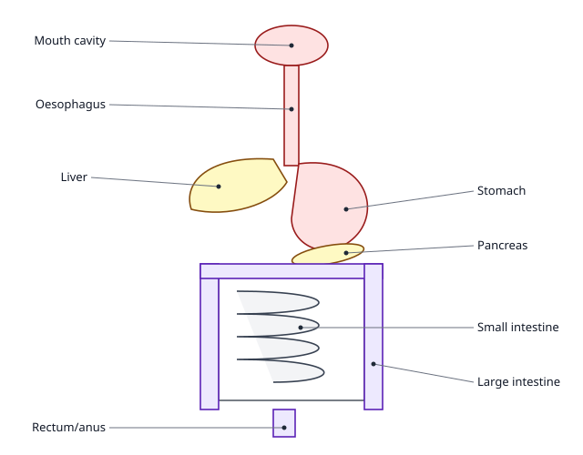

1. Pepsin, HCl — protein digestion
2. Produces bile
3. Chewing; salivary amylase
4. Moves food by peristalsis

Answer and explanation

**Answer: (3) Chewing; salivary amylase**

Mouth cavity: Chewing; salivary amylase (File 6: BIO-D05).

<!-- meta {"type":"mcq","id":"SCQ-11-06-015","grade":11,"chapter_id":"SC11-06","discipline":"BIO","difficulty":1,"qtype":"diagram","answer":3,"origin":"ORIGINAL","source_ref":"BIO-D05","image":"science_assets/biology/BIO-D05_labelled.svg"} -->
**SCQ-11-06-015** · Basic · Diagram · `ORIGINAL`

In the Digestive system (schematic) diagram, what is the function of the 'Oesophagus'?

1. Pepsin, HCl — protein digestion
2. Produces bile
3. Moves food by peristalsis
4. Chewing; salivary amylase

Answer and explanation

**Answer: (3) Moves food by peristalsis**

Oesophagus: Moves food by peristalsis (File 6: BIO-D05).

<!-- meta {"type":"mcq","id":"SCQ-11-06-016","grade":11,"chapter_id":"SC11-06","discipline":"BIO","difficulty":1,"qtype":"diagram","answer":4,"origin":"ORIGINAL","source_ref":"BIO-D05","image":"science_assets/biology/BIO-D05_labelled.svg"} -->
**SCQ-11-06-016** · Basic · Diagram · `ORIGINAL`

In the Digestive system (schematic) diagram, what is the function of the 'Liver'?

1. Chewing; salivary amylase
2. Pepsin, HCl — protein digestion
3. Moves food by peristalsis
4. Produces bile

Answer and explanation

**Answer: (4) Produces bile**

Liver: Produces bile (File 6: BIO-D05).

<!-- meta {"type":"mcq","id":"SCQ-11-06-017","grade":11,"chapter_id":"SC11-06","discipline":"BIO","difficulty":1,"qtype":"diagram","answer":3,"origin":"ORIGINAL","source_ref":"BIO-D06","image":"science_assets/biology/BIO-D06_labelled.svg"} -->
**SCQ-11-06-017** · Basic · Diagram · `ORIGINAL`

In the Respiratory system diagram, what is the function of the 'Trachea'?

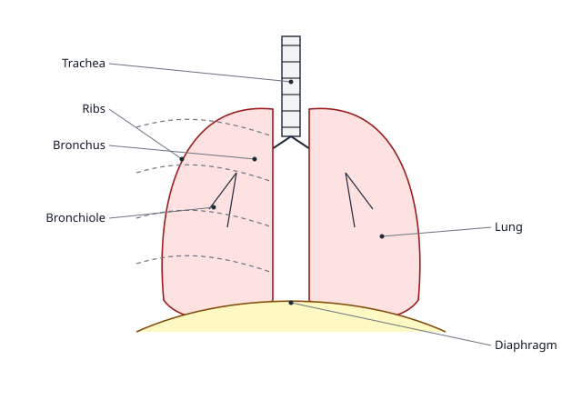

1. Gas exchange (alveoli)
2. Air to the alveoli
3. C-shaped cartilage rings — keep it open
4. Carries air to the lungs

Answer and explanation

**Answer: (3) C-shaped cartilage rings — keep it open**

Trachea: C-shaped cartilage rings — keep it open (File 6: BIO-D06).

<!-- meta {"type":"mcq","id":"SCQ-11-06-018","grade":11,"chapter_id":"SC11-06","discipline":"BIO","difficulty":1,"qtype":"diagram","answer":1,"origin":"ORIGINAL","source_ref":"BIO-D06","image":"science_assets/biology/BIO-D06_labelled.svg"} -->
**SCQ-11-06-018** · Basic · Diagram · `ORIGINAL`

In the Respiratory system diagram, what is the function of the 'Bronchus'?

1. Carries air to the lungs
2. Air to the alveoli
3. Gas exchange (alveoli)
4. C-shaped cartilage rings — keep it open

Answer and explanation

**Answer: (1) Carries air to the lungs**

Bronchus: Carries air to the lungs (File 6: BIO-D06).

<!-- meta {"type":"mcq","id":"SCQ-11-06-019","grade":11,"chapter_id":"SC11-06","discipline":"BIO","difficulty":1,"qtype":"diagram","answer":4,"origin":"ORIGINAL","source_ref":"BIO-D06","image":"science_assets/biology/BIO-D06_labelled.svg"} -->
**SCQ-11-06-019** · Basic · Diagram · `ORIGINAL`

In the Respiratory system diagram, what is the function of the 'Bronchiole'?

1. Carries air to the lungs
2. C-shaped cartilage rings — keep it open
3. Gas exchange (alveoli)
4. Air to the alveoli

Answer and explanation

**Answer: (4) Air to the alveoli**

Bronchiole: Air to the alveoli (File 6: BIO-D06).

<!-- meta {"type":"mcq","id":"SCQ-11-06-020","grade":11,"chapter_id":"SC11-06","discipline":"BIO","difficulty":1,"qtype":"diagram","answer":4,"origin":"ORIGINAL","source_ref":"BIO-D07","image":"science_assets/biology/BIO-D07_labelled.svg"} -->
**SCQ-11-06-020** · Basic · Diagram · `ORIGINAL`

In the Nephron (schematic) diagram, what is the function of the 'Glomerulus'?

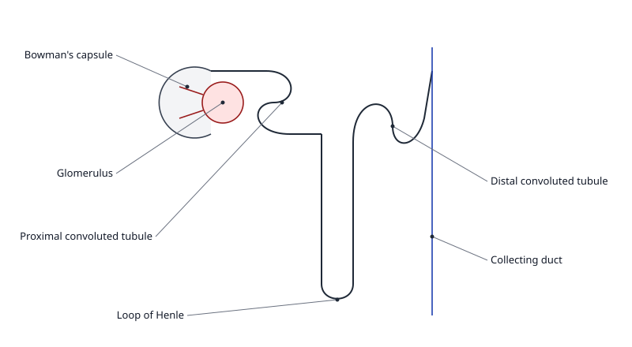

1. Reabsorbs water and salt
2. Reabsorbs glucose and amino acids
3. Collects the filtrate
4. Pressure filtration (ultrafiltration)

Answer and explanation

**Answer: (4) Pressure filtration (ultrafiltration)**

Glomerulus: Pressure filtration (ultrafiltration) (File 6: BIO-D07).

<!-- meta {"type":"mcq","id":"SCQ-11-06-021","grade":11,"chapter_id":"SC11-06","discipline":"BIO","difficulty":1,"qtype":"diagram","answer":2,"origin":"ORIGINAL","source_ref":"BIO-D07","image":"science_assets/biology/BIO-D07_labelled.svg"} -->
**SCQ-11-06-021** · Basic · Diagram · `ORIGINAL`

In the Nephron (schematic) diagram, what is the function of the 'Bowman's capsule'?

1. Reabsorbs water and salt
2. Collects the filtrate
3. Pressure filtration (ultrafiltration)
4. Reabsorbs glucose and amino acids

Answer and explanation

**Answer: (2) Collects the filtrate**

Bowman's capsule: Collects the filtrate (File 6: BIO-D07).

<!-- meta {"type":"mcq","id":"SCQ-11-06-022","grade":11,"chapter_id":"SC11-06","discipline":"BIO","difficulty":1,"qtype":"diagram","answer":4,"origin":"ORIGINAL","source_ref":"BIO-D07","image":"science_assets/biology/BIO-D07_labelled.svg"} -->
**SCQ-11-06-022** · Basic · Diagram · `ORIGINAL`

In the Nephron (schematic) diagram, what is the function of the 'Proximal convoluted tubule'?

1. Reabsorbs water and salt
2. Collects the filtrate
3. Pressure filtration (ultrafiltration)
4. Reabsorbs glucose and amino acids

Answer and explanation

**Answer: (4) Reabsorbs glucose and amino acids**

Proximal convoluted tubule: Reabsorbs glucose and amino acids (File 6: BIO-D07).

<!-- meta {"type":"mcq","id":"SCQ-11-06-023","grade":11,"chapter_id":"SC11-06","discipline":"BIO","difficulty":1,"qtype":"recall","answer":1,"origin":"ORIGINAL","source_ref":"extra-SC11-06-1","image":null} -->
**SCQ-11-06-023** · Basic · Recall · `ORIGINAL`

Gland that secretes insulin?

1. Pancreas
2. Adrenal
3. Pituitary gland
4. Liver

Answer and explanation

**Answer: (1) Pancreas**

It lowers blood glucose.

<!-- meta {"type":"mcq","id":"SCQ-11-06-024","grade":11,"chapter_id":"SC11-06","discipline":"BIO","difficulty":1,"qtype":"recall","answer":4,"origin":"ORIGINAL","source_ref":"extra-SC11-06-2","image":null} -->
**SCQ-11-06-024** · Basic · Recall · `ORIGINAL`

'Fight or flight' hormone?

1. Insulin
2. Thyroxine
3. Oestrogen
4. Adrenaline

Answer and explanation

**Answer: (4) Adrenaline**

Adrenal gland.

<!-- meta {"type":"mcq","id":"SCQ-11-06-025","grade":11,"chapter_id":"SC11-06","discipline":"BIO","difficulty":1,"qtype":"recall","answer":2,"origin":"ORIGINAL","source_ref":"extra-SC11-06-3","image":null} -->
**SCQ-11-06-025** · Basic · Recall · `ORIGINAL`

Structures of the small intestine where digested food is absorbed?

1. Alveoli
2. Villi
3. Nephrons
4. Stomata

Answer and explanation

**Answer: (2) Villi**

They increase the surface area.

<!-- meta {"type":"mcq","id":"SCQ-11-06-026","grade":11,"chapter_id":"SC11-06","discipline":"BIO","difficulty":2,"qtype":"concept","answer":4,"origin":"ORIGINAL","source_ref":"extra-SC11-06-4","image":null} -->
**SCQ-11-06-026** · Intermediate · Concept · `ORIGINAL`

How does O₂ pass into the blood in the alveoli?

1. Active transport
2. Filtration
3. Osmosis
4. Diffusion

Answer and explanation

**Answer: (4) Diffusion**

Concentration gradient.

## SC11-07: Acids, bases and salts

*Grade 11 · Chapter 7 · Chemistry · 25 questions*

<!-- meta {"type":"mcq","id":"SCQ-11-07-001","grade":11,"chapter_id":"SC11-07","discipline":"CHE","difficulty":1,"qtype":"recall","answer":2,"origin":"ORIGINAL","source_ref":"chapter","image":null} -->
**SCQ-11-07-001** · Basic · Recall · `ORIGINAL`

A solution with pH 2?

1. Strong alkali
2. Strong acid
3. Neutral
4. Weak alkali

Answer and explanation

**Answer: (2) Strong acid**

Very low pH.

<!-- meta {"type":"mcq","id":"SCQ-11-07-002","grade":11,"chapter_id":"SC11-07","discipline":"CHE","difficulty":1,"qtype":"equation","answer":2,"origin":"ORIGINAL","source_ref":"chapter","image":null} -->
**SCQ-11-07-002** · Basic · Equation · `ORIGINAL`

What do HCl and NaOH form when they react?

1. NaCl + H₂
2. NaCl + H₂O
3. NaOH + Cl₂
4. NaH + HCl

Answer and explanation

**Answer: (2) NaCl + H₂O**

Neutralisation.

<!-- meta {"type":"mcq","id":"SCQ-11-07-003","grade":11,"chapter_id":"SC11-07","discipline":"CHE","difficulty":2,"qtype":"reasoning","answer":1,"origin":"ORIGINAL","source_ref":"chapter","image":null} -->
**SCQ-11-07-003** · Intermediate · Reasoning · `ORIGINAL`

At the same concentration, why does HCl have a lower pH than CH₃COOH?

1. HCl ionises completely, so the H⁺ concentration is higher
2. Because HCl evaporates
3. CH₃COOH is an alkali
4. HCl has more mass

Answer and explanation

**Answer: (1) HCl ionises completely, so the H⁺ concentration is higher**

Strong acid.

<!-- meta {"type":"mcq","id":"SCQ-11-07-004","grade":11,"chapter_id":"SC11-07","discipline":"CHE","difficulty":1,"qtype":"experiment","answer":1,"origin":"ORIGINAL","source_ref":"chapter","image":null} -->
**SCQ-11-07-004** · Basic · Experiment · `ORIGINAL`

If the gas released when HCl is added to Na₂CO₃ solution is passed through limewater?

1. It turns milky
2. Green colour
3. No change
4. Blue colour

Answer and explanation

**Answer: (1) It turns milky**

CO₂ turns limewater milky.

<!-- meta {"type":"mcq","id":"SCQ-11-07-005","grade":11,"chapter_id":"SC11-07","discipline":"CHE","difficulty":2,"qtype":"equation","answer":2,"origin":"ORIGINAL","source_ref":"chapter","image":null} -->
**SCQ-11-07-005** · Intermediate · Equation · `ORIGINAL`

Mg(OH)₂ + 2HCl → MgCl₂ + 2H₂O. Water from 1 mol Mg(OH)₂?

1. 1 mol
2. 2 mol
3. 0.5 mol
4. 3 mol

Answer and explanation

**Answer: (2) 2 mol**

Coefficient 2.

<!-- meta {"type":"mcq","id":"SCQ-11-07-006","grade":11,"chapter_id":"SC11-07","discipline":"CHE","difficulty":2,"qtype":"experiment","answer":1,"origin":"ORIGINAL","source_ref":"chapter","image":null} -->
**SCQ-11-07-006** · Intermediate · Experiment · `ORIGINAL`

When HCl is slowly added to NaOH solution containing phenolphthalein, at the neutral point?

1. Pink → colourless
2. Colourless → pink
3. Blue → red
4. No change

Answer and explanation

**Answer: (1) Pink → colourless**

The colour disappears as the alkali is neutralised.

<!-- meta {"type":"mcq","id":"SCQ-11-07-007","grade":11,"chapter_id":"SC11-07","discipline":"CHE","difficulty":2,"qtype":"application","answer":3,"origin":"ORIGINAL","source_ref":"chapter","image":null} -->
**SCQ-11-07-007** · Intermediate · Application · `ORIGINAL`

Suitable first aid for a bee sting (acid)?

1. Vinegar
2. Lime juice
3. Baking soda (NaHCO₃)
4. HCl

Answer and explanation

**Answer: (3) Baking soda (NaHCO₃)**

A weak base neutralises the acid.

<!-- meta {"type":"mcq","id":"SCQ-11-07-008","grade":11,"chapter_id":"SC11-07","discipline":"CHE","difficulty":1,"qtype":"recall","answer":1,"origin":"ORIGINAL","source_ref":"chapter","image":null} -->
**SCQ-11-07-008** · Basic · Recall · `ORIGINAL`

An alkali is?

1. A base that dissolves in water
2. Any acid
3. A salt
4. A neutral substance

Answer and explanation

**Answer: (1) A base that dissolves in water**

e.g. NaOH, KOH.

<!-- meta {"type":"mcq","id":"SCQ-11-07-009","grade":11,"chapter_id":"SC11-07","discipline":"CHE","difficulty":2,"qtype":"equation","answer":1,"origin":"ORIGINAL","source_ref":"chapter","image":null} -->
**SCQ-11-07-009** · Intermediate · Equation · `ORIGINAL`

H₂SO₄ + 2NaOH → ?

1. Na₂SO₄ + 2H₂O
2. NaSO₄ + H₂O
3. Na₂SO₄ + H₂
4. NaHSO₄ + O₂

Answer and explanation

**Answer: (1) Na₂SO₄ + 2H₂O**

Balanced neutralisation.

<!-- meta {"type":"mcq","id":"SCQ-11-07-010","grade":11,"chapter_id":"SC11-07","discipline":"CHE","difficulty":2,"qtype":"concept","answer":2,"origin":"ORIGINAL","source_ref":"chapter","image":null} -->
**SCQ-11-07-010** · Intermediate · Concept · `ORIGINAL`

Temperature of the solution during neutralisation?

1. Decreases
2. Increases
3. Does not change
4. Becomes 0 °C

Answer and explanation

**Answer: (2) Increases**

An exothermic reaction (SC11-08).

<!-- meta {"type":"mcq","id":"SCQ-11-07-011","grade":11,"chapter_id":"SC11-07","discipline":"CHE","difficulty":2,"qtype":"equation","answer":1,"origin":"ORIGINAL","source_ref":"EQ-026","image":null} -->
**SCQ-11-07-011** · Intermediate · Equation · `ORIGINAL`

H₂SO₄ + NaOH → Na₂SO₄ + H₂O — when this equation is balanced with the smallest whole-number coefficients, the coefficient of NaOH?

1. 2
2. 4
3. 7
4. 3

Answer and explanation

**Answer: (1) 2**

H₂SO₄ + 2NaOH → Na₂SO₄ + 2H₂O (atom count checked; File 7: EQ-026).

<!-- meta {"type":"mcq","id":"SCQ-11-07-012","grade":11,"chapter_id":"SC11-07","discipline":"CHE","difficulty":2,"qtype":"equation","answer":4,"origin":"ORIGINAL","source_ref":"EQ-027","image":null} -->
**SCQ-11-07-012** · Intermediate · Equation · `ORIGINAL`

HCl + Mg(OH)₂ → MgCl₂ + H₂O — when this equation is balanced with the smallest whole-number coefficients, the coefficient of HCl?

1. 3
2. 4
3. 7
4. 2

Answer and explanation

**Answer: (4) 2**

2HCl + Mg(OH)₂ → MgCl₂ + 2H₂O (atom count checked; File 7: EQ-027).

<!-- meta {"type":"mcq","id":"SCQ-11-07-013","grade":11,"chapter_id":"SC11-07","discipline":"CHE","difficulty":2,"qtype":"equation","answer":2,"origin":"ORIGINAL","source_ref":"EQ-029","image":null} -->
**SCQ-11-07-013** · Intermediate · Equation · `ORIGINAL`

CaCO₃ + HCl → CaCl₂ + H₂O + CO₂ — when this equation is balanced with the smallest whole-number coefficients, the coefficient of HCl?

1. 4
2. 2
3. 3
4. 7

Answer and explanation

**Answer: (2) 2**

CaCO₃ + 2HCl → CaCl₂ + H₂O + CO₂ (atom count checked; File 7: EQ-029).

<!-- meta {"type":"mcq","id":"SCQ-11-07-014","grade":11,"chapter_id":"SC11-07","discipline":"CHE","difficulty":2,"qtype":"equation","answer":4,"origin":"ORIGINAL","source_ref":"EQ-030","image":null} -->
**SCQ-11-07-014** · Intermediate · Equation · `ORIGINAL`

Na₂CO₃ + HCl → NaCl + H₂O + CO₂ — when this equation is balanced with the smallest whole-number coefficients, the coefficient of HCl?

1. 3
2. 4
3. 7
4. 2

Answer and explanation

**Answer: (4) 2**

Na₂CO₃ + 2HCl → 2NaCl + H₂O + CO₂ (atom count checked; File 7: EQ-030).

<!-- meta {"type":"mcq","id":"SCQ-11-07-015","grade":11,"chapter_id":"SC11-07","discipline":"CHE","difficulty":1,"qtype":"diagram","answer":1,"origin":"ORIGINAL","source_ref":"CHE-D03","image":"science_assets/chemistry/CHE-D03_labelled.svg"} -->
**SCQ-11-07-015** · Basic · Diagram · `ORIGINAL`

In the Preparing hydrogen — downward displacement of water diagram, what is the function of the 'Thistle funnel'?

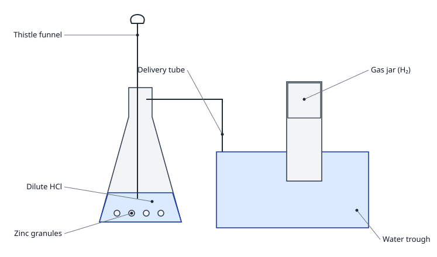

1. Adding the acid
2. Carries the gas
3. Reactant
4. Zn + 2HCl → ZnCl₂ + H₂

Answer and explanation

**Answer: (1) Adding the acid**

Thistle funnel: Adding the acid (File 6: CHE-D03).

<!-- meta {"type":"mcq","id":"SCQ-11-07-016","grade":11,"chapter_id":"SC11-07","discipline":"CHE","difficulty":1,"qtype":"diagram","answer":3,"origin":"ORIGINAL","source_ref":"CHE-D03","image":"science_assets/chemistry/CHE-D03_labelled.svg"} -->
**SCQ-11-07-016** · Basic · Diagram · `ORIGINAL`

In the Preparing hydrogen — downward displacement of water diagram, what is the function of the 'Dilute HCl'?

1. Carries the gas
2. Zn + 2HCl → ZnCl₂ + H₂
3. Reactant
4. Adding the acid

Answer and explanation

**Answer: (3) Reactant**

Dilute HCl: Reactant (File 6: CHE-D03).

<!-- meta {"type":"mcq","id":"SCQ-11-07-017","grade":11,"chapter_id":"SC11-07","discipline":"CHE","difficulty":1,"qtype":"diagram","answer":4,"origin":"ORIGINAL","source_ref":"CHE-D03","image":"science_assets/chemistry/CHE-D03_labelled.svg"} -->
**SCQ-11-07-017** · Basic · Diagram · `ORIGINAL`

In the Preparing hydrogen — downward displacement of water diagram, what is the function of the 'Zinc granules'?

1. Carries the gas
2. Adding the acid
3. Reactant
4. Zn + 2HCl → ZnCl₂ + H₂

Answer and explanation

**Answer: (4) Zn + 2HCl → ZnCl₂ + H₂**

Zinc granules: Zn + 2HCl → ZnCl₂ + H₂ (File 6: CHE-D03).

<!-- meta {"type":"mcq","id":"SCQ-11-07-018","grade":11,"chapter_id":"SC11-07","discipline":"CHE","difficulty":1,"qtype":"recall","answer":3,"origin":"ORIGINAL","source_ref":"extra-SC11-07-1","image":null} -->
**SCQ-11-07-018** · Basic · Recall · `ORIGINAL`

Colour of phenolphthalein in an alkaline solution?

1. Blue
2. Colourless
3. Pink
4. Yellow

Answer and explanation

**Answer: (3) Pink**

Colourless in acid.

<!-- meta {"type":"mcq","id":"SCQ-11-07-019","grade":11,"chapter_id":"SC11-07","discipline":"CHE","difficulty":2,"qtype":"recall","answer":1,"origin":"ORIGINAL","source_ref":"extra-SC11-07-2","image":null} -->
**SCQ-11-07-019** · Intermediate · Recall · `ORIGINAL`

Colour of methyl orange in acid?

1. Red
2. Green
3. Yellow
4. Blue

Answer and explanation

**Answer: (1) Red**

Yellow in alkali.

<!-- meta {"type":"mcq","id":"SCQ-11-07-020","grade":11,"chapter_id":"SC11-07","discipline":"CHE","difficulty":2,"qtype":"concept","answer":2,"origin":"ORIGINAL","source_ref":"extra-SC11-07-3","image":null} -->
**SCQ-11-07-020** · Intermediate · Concept · `ORIGINAL`

Metal oxides are generally?

1. Gases
2. Basic
3. Acidic
4. Always neutral

Answer and explanation

**Answer: (2) Basic**

e.g. CaO, MgO.

<!-- meta {"type":"mcq","id":"SCQ-11-07-021","grade":11,"chapter_id":"SC11-07","discipline":"CHE","difficulty":2,"qtype":"concept","answer":1,"origin":"ORIGINAL","source_ref":"extra-SC11-07-4","image":null} -->
**SCQ-11-07-021** · Intermediate · Concept · `ORIGINAL`

Non-metal oxides dissolve in water to?

1. Give an acidic solution
2. Always neutral
3. Become solid
4. Give an alkaline solution

Answer and explanation

**Answer: (1) Give an acidic solution**

e.g. CO₂ → H₂CO₃.

<!-- meta {"type":"mcq","id":"SCQ-11-07-022","grade":11,"chapter_id":"SC11-07","discipline":"CHE","difficulty":2,"qtype":"application","answer":4,"origin":"ORIGINAL","source_ref":"extra-SC11-07-5","image":null} -->
**SCQ-11-07-022** · Intermediate · Application · `ORIGINAL`

Safe way to dilute concentrated sulfuric acid?

1. Pouring water into the acid
2. Heating and pouring
3. Both at the same time
4. Pouring the acid slowly into water

Answer and explanation

**Answer: (4) Pouring the acid slowly into water**

A lot of heat — avoid splashing.

<!-- meta {"type":"mcq","id":"SCQ-11-07-023","grade":11,"chapter_id":"SC11-07","discipline":"CHE","difficulty":2,"qtype":"concept","answer":4,"origin":"ORIGINAL","source_ref":"extra-SC11-07-6","image":null} -->
**SCQ-11-07-023** · Intermediate · Concept · `ORIGINAL`

A strong acid?

1. Citric acid
2. CH₃COOH
3. H₂CO₃
4. HCl

Answer and explanation

**Answer: (4) HCl**

It ionises completely.

<!-- meta {"type":"mcq","id":"SCQ-11-07-024","grade":11,"chapter_id":"SC11-07","discipline":"CHE","difficulty":1,"qtype":"application","answer":4,"origin":"ORIGINAL","source_ref":"extra-SC11-07-7","image":null} -->
**SCQ-11-07-024** · Basic · Application · `ORIGINAL`

The pH of a soap solution is usually?

1. Less than 7
2. 0
3. 7
4. More than 7

Answer and explanation

**Answer: (4) More than 7**

Basic nature.

<!-- meta {"type":"mcq","id":"SCQ-11-07-025","grade":11,"chapter_id":"SC11-07","discipline":"CHE","difficulty":1,"qtype":"recall","answer":3,"origin":"ORIGINAL","source_ref":"extra-SC11-07-8","image":null} -->
**SCQ-11-07-025** · Basic · Recall · `ORIGINAL`

Acid makes blue litmus paper?

1. Turn green
2. Turn white
3. Turn red
4. Stay blue

Answer and explanation

**Answer: (3) Turn red**

An acid indicator.

## SC11-08: Heat changes associated with chemical reactions

*Grade 11 · Chapter 8 · Chemistry · 25 questions*

<!-- meta {"type":"mcq","id":"SCQ-11-08-001","grade":11,"chapter_id":"SC11-08","discipline":"CHE","difficulty":1,"qtype":"concept","answer":3,"origin":"ORIGINAL","source_ref":"chapter","image":null} -->
**SCQ-11-08-001** · Basic · Concept · `ORIGINAL`

Which of the following is an endothermic reaction?

1. Combustion of methane
2. HCl + NaOH
3. Thermal decomposition of CaCO₃
4. Mg + O₂

Answer and explanation

**Answer: (3) Thermal decomposition of CaCO₃**

Heat is absorbed.

<!-- meta {"type":"mcq","id":"SCQ-11-08-002","grade":11,"chapter_id":"SC11-08","discipline":"CHE","difficulty":1,"qtype":"experiment","answer":2,"origin":"ORIGINAL","source_ref":"chapter","image":null} -->
**SCQ-11-08-002** · Basic · Experiment · `ORIGINAL`

A test tube became cold during a reaction. The reaction is?

1. Exothermic
2. Endothermic
3. Neutral
4. Combustion

Answer and explanation

**Answer: (2) Endothermic**

Heat was absorbed from the surroundings.

<!-- meta {"type":"mcq","id":"SCQ-11-08-003","grade":11,"chapter_id":"SC11-08","discipline":"CHE","difficulty":2,"qtype":"graph","answer":2,"origin":"ORIGINAL","source_ref":"chapter","image":null} -->
**SCQ-11-08-003** · Intermediate · Graph · `ORIGINAL`

In the energy level diagram of an exothermic reaction?

1. Products at a higher level
2. Products at a lower level
3. Both equal
4. ΔH positive

Answer and explanation

**Answer: (2) Products at a lower level**

Because energy was released.

<!-- meta {"type":"mcq","id":"SCQ-11-08-004","grade":11,"chapter_id":"SC11-08","discipline":"CHE","difficulty":2,"qtype":"calculation","answer":2,"origin":"ORIGINAL","source_ref":"chapter","image":null} -->
**SCQ-11-08-004** · Intermediate · Calculation · `ORIGINAL`

C₂H₄ + 3O₂ → 2CO₂ + 2H₂O; ΔH = −1400 kJ mol⁻¹. Heat released when 14 g of ethene (M = 28) burns?

1. 1400 kJ
2. 700 kJ
3. 2800 kJ
4. 350 kJ

Answer and explanation

**Answer: (2) 700 kJ**

14/28 = 0.5 mol; 0.5 × 1400 = 700 kJ.

<!-- meta {"type":"mcq","id":"SCQ-11-08-005","grade":11,"chapter_id":"SC11-08","discipline":"CHE","difficulty":3,"qtype":"reasoning","answer":2,"origin":"ORIGINAL","source_ref":"chapter","image":null} -->
**SCQ-11-08-005** · Hard · Reasoning · `ORIGINAL`

If the energy released by forming bonds is greater than that needed to break bonds, the reaction is?

1. Endothermic
2. Exothermic
3. Neutral
4. Nothing

Answer and explanation

**Answer: (2) Exothermic**

Net energy is released.

<!-- meta {"type":"mcq","id":"SCQ-11-08-006","grade":11,"chapter_id":"SC11-08","discipline":"CHE","difficulty":2,"qtype":"application","answer":1,"origin":"ORIGINAL","source_ref":"chapter","image":null} -->
**SCQ-11-08-006** · Intermediate · Application · `ORIGINAL`

Process used in an instant cold pack?

1. Dissolving ammonium nitrate (endothermic)
2. Combustion
3. Neutralisation
4. Rusting

Answer and explanation

**Answer: (1) Dissolving ammonium nitrate (endothermic)**

Absorbing heat from the surroundings.

<!-- meta {"type":"mcq","id":"SCQ-11-08-007","grade":11,"chapter_id":"SC11-08","discipline":"CHE","difficulty":1,"qtype":"concept","answer":2,"origin":"ORIGINAL","source_ref":"chapter","image":null} -->
**SCQ-11-08-007** · Basic · Concept · `ORIGINAL`

A reaction with ΔH = +178 kJ mol⁻¹?

1. Releases heat
2. Absorbs heat
3. No energy change
4. Releases light

Answer and explanation

**Answer: (2) Absorbs heat**

Positive ΔH → endothermic.

<!-- meta {"type":"mcq","id":"SCQ-11-08-008","grade":11,"chapter_id":"SC11-08","discipline":"CHE","difficulty":3,"qtype":"calculation","answer":1,"origin":"ORIGINAL","source_ref":"chapter","image":null} -->
**SCQ-11-08-008** · Hard · Calculation · `ORIGINAL`

The temperature of 50 g of water rose by 6 °C due to neutralisation. Heat released? (c = 4200 J kg⁻¹ °C⁻¹)

1. 1260 J
2. 12 600 J
3. 126 J
4. 1 260 000 J

Answer and explanation

**Answer: (1) 1260 J**

Q = 0.05 × 4200 × 6 = 1260 J.

<!-- meta {"type":"mcq","id":"SCQ-11-08-009","grade":11,"chapter_id":"SC11-08","discipline":"CHE","difficulty":2,"qtype":"application","answer":1,"origin":"ORIGINAL","source_ref":"chapter","image":null} -->
**SCQ-11-08-009** · Intermediate · Application · `ORIGINAL`

Importance of respiration being exothermic?

1. To maintain body temperature
2. To produce O₂
3. To absorb water
4. To make glucose

Answer and explanation

**Answer: (1) To maintain body temperature**

The energy released becomes body heat.

<!-- meta {"type":"mcq","id":"SCQ-11-08-010","grade":11,"chapter_id":"SC11-08","discipline":"CHE","difficulty":3,"qtype":"reasoning","answer":3,"origin":"ORIGINAL","source_ref":"chapter","image":null} -->
**SCQ-11-08-010** · Hard · Reasoning · `ORIGINAL`

Which of the following is exothermic?

1. Melting of ice
2. Evaporation of water
3. Condensation of steam
4. Dissolving NH₄Cl

Answer and explanation

**Answer: (3) Condensation of steam**

Latent heat is released on condensation.

<!-- meta {"type":"mcq","id":"SCQ-11-08-011","grade":11,"chapter_id":"SC11-08","discipline":"CHE","difficulty":2,"qtype":"equation","answer":3,"origin":"ORIGINAL","source_ref":"EQ-048","image":null} -->
**SCQ-11-08-011** · Intermediate · Equation · `ORIGINAL`

N₂ + H₂ → NH₃ — when this equation is balanced with the smallest whole-number coefficients, the coefficient of H₂?

1. 4
2. 2
3. 3
4. 6

Answer and explanation

**Answer: (3) 3**

N₂ + 3H₂ → 2NH₃ (atom count checked; File 7: EQ-048).

<!-- meta {"type":"mcq","id":"SCQ-11-08-012","grade":11,"chapter_id":"SC11-08","discipline":"CHE","difficulty":2,"qtype":"equation","answer":1,"origin":"ORIGINAL","source_ref":"EQ-050","image":null} -->
**SCQ-11-08-012** · Intermediate · Equation · `ORIGINAL`

SO₂ + O₂ → SO₃ — when this equation is balanced with the smallest whole-number coefficients, the coefficient of SO₂?

1. 2
2. 7
3. 4
4. 3

Answer and explanation

**Answer: (1) 2**

2SO₂ + O₂ → 2SO₃ (atom count checked; File 7: EQ-050).

<!-- meta {"type":"mcq","id":"SCQ-11-08-013","grade":11,"chapter_id":"SC11-08","discipline":"CHE","difficulty":2,"qtype":"calculation","answer":4,"origin":"ORIGINAL","source_ref":"param-SC11-08-1","image":null} -->
**SCQ-11-08-013** · Intermediate · Calculation · `ORIGINAL`

Heat released when 0.5 mol burns in a combustion with ΔH = −890 kJ mol⁻¹?

1. 1780 kJ
2. 222.5 kJ
3. 890 kJ
4. 445 kJ

Answer and explanation

**Answer: (4) 445 kJ**

q = n|ΔH|.

<!-- meta {"type":"mcq","id":"SCQ-11-08-014","grade":11,"chapter_id":"SC11-08","discipline":"CHE","difficulty":2,"qtype":"calculation","answer":1,"origin":"ORIGINAL","source_ref":"param-SC11-08-2","image":null} -->
**SCQ-11-08-014** · Intermediate · Calculation · `ORIGINAL`

Heat released when 3 mol burns in a combustion with ΔH = −286 kJ mol⁻¹?

1. 858 kJ
2. 1716 kJ
3. 286 kJ
4. 95.3333 kJ

Answer and explanation

**Answer: (1) 858 kJ**

q = n|ΔH|.

<!-- meta {"type":"mcq","id":"SCQ-11-08-015","grade":11,"chapter_id":"SC11-08","discipline":"CHE","difficulty":2,"qtype":"calculation","answer":2,"origin":"ORIGINAL","source_ref":"param-SC11-08-3","image":null} -->
**SCQ-11-08-015** · Intermediate · Calculation · `ORIGINAL`

Heat released when 0.25 mol burns in a combustion with ΔH = −1400 kJ mol⁻¹?

1. 1400 kJ
2. 350 kJ
3. 700 kJ
4. 5600 kJ

Answer and explanation

**Answer: (2) 350 kJ**

q = n|ΔH|.

<!-- meta {"type":"mcq","id":"SCQ-11-08-016","grade":11,"chapter_id":"SC11-08","discipline":"CHE","difficulty":2,"qtype":"calculation","answer":1,"origin":"ORIGINAL","source_ref":"param-SC11-08-4","image":null} -->
**SCQ-11-08-016** · Intermediate · Calculation · `ORIGINAL`

The temperature of 0.05 kg of solution rose by 8 °C due to a reaction (c = 4200). Heat released?

1. 1680 J
2. 210 J
3. 33600 J
4. 0.4 J

Answer and explanation

**Answer: (1) 1680 J**

Q = mcΔθ.

<!-- meta {"type":"mcq","id":"SCQ-11-08-017","grade":11,"chapter_id":"SC11-08","discipline":"CHE","difficulty":2,"qtype":"calculation","answer":2,"origin":"ORIGINAL","source_ref":"param-SC11-08-5","image":null} -->
**SCQ-11-08-017** · Intermediate · Calculation · `ORIGINAL`

The temperature of 0.2 kg of solution rose by 3.5 °C due to a reaction (c = 4200). Heat released?

1. 0.7 J
2. 2940 J
3. 840 J
4. 14700 J

Answer and explanation

**Answer: (2) 2940 J**

Q = mcΔθ.

<!-- meta {"type":"mcq","id":"SCQ-11-08-018","grade":11,"chapter_id":"SC11-08","discipline":"CHE","difficulty":2,"qtype":"calculation","answer":1,"origin":"ORIGINAL","source_ref":"param-SC11-08-6","image":null} -->
**SCQ-11-08-018** · Intermediate · Calculation · `ORIGINAL`

The temperature of 0.1 kg of solution rose by 12 °C due to a reaction (c = 4200). Heat released?

1. 5040 J
2. 420 J
3. 50400 J
4. 1.2 J

Answer and explanation

**Answer: (1) 5040 J**

Q = mcΔθ.

<!-- meta {"type":"mcq","id":"SCQ-11-08-019","grade":11,"chapter_id":"SC11-08","discipline":"CHE","difficulty":3,"qtype":"calculation","answer":4,"origin":"ORIGINAL","source_ref":"param-SC11-08-7","image":null} -->
**SCQ-11-08-019** · Hard · Calculation · `ORIGINAL`

Heat released 5.7 kJ, water formed 0.1 mol. Magnitude of the enthalpy change of neutralisation (kJ mol⁻¹)?

1. 0.57 kJ mol⁻¹
2. 114 kJ mol⁻¹
3. 0.0175 kJ mol⁻¹
4. 57 kJ mol⁻¹

Answer and explanation

**Answer: (4) 57 kJ mol⁻¹**

|ΔH| = q/n.

<!-- meta {"type":"mcq","id":"SCQ-11-08-020","grade":11,"chapter_id":"SC11-08","discipline":"CHE","difficulty":3,"qtype":"calculation","answer":4,"origin":"ORIGINAL","source_ref":"param-SC11-08-8","image":null} -->
**SCQ-11-08-020** · Hard · Calculation · `ORIGINAL`

Heat released 28.5 kJ, water formed 0.5 mol. Magnitude of the enthalpy change of neutralisation (kJ mol⁻¹)?

1. 114 kJ mol⁻¹
2. 14.25 kJ mol⁻¹
3. 0.0175 kJ mol⁻¹
4. 57 kJ mol⁻¹

Answer and explanation

**Answer: (4) 57 kJ mol⁻¹**

|ΔH| = q/n.

<!-- meta {"type":"mcq","id":"SCQ-11-08-021","grade":11,"chapter_id":"SC11-08","discipline":"CHE","difficulty":3,"qtype":"calculation","answer":4,"origin":"ORIGINAL","source_ref":"param-SC11-08-9","image":null} -->
**SCQ-11-08-021** · Hard · Calculation · `ORIGINAL`

Molar mass 16 g mol⁻¹, ΔH of combustion = −890 kJ mol⁻¹. Heat released when 4 g burns?

1. 445 kJ
2. 111.25 kJ
3. 3560 kJ
4. 222.5 kJ

Answer and explanation

**Answer: (4) 222.5 kJ**

n = m/M; q = n|ΔH|.

<!-- meta {"type":"mcq","id":"SCQ-11-08-022","grade":11,"chapter_id":"SC11-08","discipline":"CHE","difficulty":3,"qtype":"calculation","answer":1,"origin":"ORIGINAL","source_ref":"param-SC11-08-10","image":null} -->
**SCQ-11-08-022** · Hard · Calculation · `ORIGINAL`

Molar mass 46 g mol⁻¹, ΔH of combustion = −1370 kJ mol⁻¹. Heat released when 23 g burns?

1. 685 kJ
2. 59.5652 kJ
3. 2740 kJ
4. 31510 kJ

Answer and explanation

**Answer: (1) 685 kJ**

n = m/M; q = n|ΔH|.

<!-- meta {"type":"mcq","id":"SCQ-11-08-023","grade":11,"chapter_id":"SC11-08","discipline":"CHE","difficulty":3,"qtype":"calculation","answer":3,"origin":"ORIGINAL","source_ref":"param-SC11-08-11","image":null} -->
**SCQ-11-08-023** · Hard · Calculation · `ORIGINAL`

Molar mass 44 g mol⁻¹, ΔH of combustion = −2220 kJ mol⁻¹. Heat released when 11 g burns?

1. 24420 kJ
2. 8880 kJ
3. 555 kJ
4. 201.8182 kJ

Answer and explanation

**Answer: (3) 555 kJ**

n = m/M; q = n|ΔH|.

<!-- meta {"type":"mcq","id":"SCQ-11-08-024","grade":11,"chapter_id":"SC11-08","discipline":"CHE","difficulty":3,"qtype":"calculation","answer":3,"origin":"ORIGINAL","source_ref":"param-SC11-08-12","image":null} -->
**SCQ-11-08-024** · Hard · Calculation · `ORIGINAL`

Molar mass 2 g mol⁻¹, ΔH of combustion = −286 kJ mol⁻¹. Heat released when 2 g burns?

1. 572 kJ
2. 2860 kJ
3. 286 kJ
4. 143 kJ

Answer and explanation

**Answer: (3) 286 kJ**

n = m/M; q = n|ΔH|.

<!-- meta {"type":"mcq","id":"SCQ-11-08-025","grade":11,"chapter_id":"SC11-08","discipline":"CHE","difficulty":3,"qtype":"calculation","answer":2,"origin":"ORIGINAL","source_ref":"param-SC11-08-13","image":null} -->
**SCQ-11-08-025** · Hard · Calculation · `ORIGINAL`

Molar mass 28 g mol⁻¹, ΔH of combustion = −1410 kJ mol⁻¹. Heat released when 7 g burns?

1. 9870 kJ
2. 352.5 kJ
3. 5640 kJ
4. 201.4286 kJ

Answer and explanation

**Answer: (2) 352.5 kJ**

n = m/M; q = n|ΔH|.

## SC11-09: Heat

*Grade 11 · Chapter 9 · Physics · 25 questions*

<!-- meta {"type":"mcq","id":"SCQ-11-09-001","grade":11,"chapter_id":"SC11-09","discipline":"PHY","difficulty":1,"qtype":"calculation","answer":2,"origin":"ORIGINAL","source_ref":"chapter","image":null} -->
**SCQ-11-09-001** · Basic · Calculation · `ORIGINAL`

Heat needed to raise the temperature of 2 kg of water by 10 °C? (c = 4200)

1. 8400 J
2. 84 000 J
3. 42 000 J
4. 840 J

Answer and explanation

**Answer: (2) 84 000 J**

2 × 4200 × 10.

<!-- meta {"type":"mcq","id":"SCQ-11-09-002","grade":11,"chapter_id":"SC11-09","discipline":"PHY","difficulty":1,"qtype":"calculation","answer":2,"origin":"ORIGINAL","source_ref":"chapter","image":null} -->
**SCQ-11-09-002** · Basic · Calculation · `ORIGINAL`

27 °C in kelvin?

1. 246 K
2. 300 K
3. 27 K
4. 273 K

Answer and explanation

**Answer: (2) 300 K**

27 + 273.

<!-- meta {"type":"mcq","id":"SCQ-11-09-003","grade":11,"chapter_id":"SC11-09","discipline":"PHY","difficulty":1,"qtype":"concept","answer":3,"origin":"ORIGINAL","source_ref":"chapter","image":null} -->
**SCQ-11-09-003** · Basic · Concept · `ORIGINAL`

Temperature if heat is continuously supplied to boiling water?

1. Increases
2. Decreases
3. Does not change
4. Becomes 0

Answer and explanation

**Answer: (3) Does not change**

Latent heat is used for the change of state.

<!-- meta {"type":"mcq","id":"SCQ-11-09-004","grade":11,"chapter_id":"SC11-09","discipline":"PHY","difficulty":2,"qtype":"reasoning","answer":1,"origin":"ORIGINAL","source_ref":"chapter","image":null} -->
**SCQ-11-09-004** · Intermediate · Reasoning · `ORIGINAL`

Liquids A (c = 2000) and B (c = 4000) of equal mass receive the same heat. Which rises more in temperature?

1. A
2. B
3. Equal
4. Cannot be decided

Answer and explanation

**Answer: (1) A**

θ = Q/(mc); the one with lower c rises more.

<!-- meta {"type":"mcq","id":"SCQ-11-09-005","grade":11,"chapter_id":"SC11-09","discipline":"PHY","difficulty":2,"qtype":"application","answer":1,"origin":"ORIGINAL","source_ref":"chapter","image":null} -->
**SCQ-11-09-005** · Intermediate · Application · `ORIGINAL`

Why is water a good coolant for a vehicle engine?

1. High specific heat capacity
2. Low boiling point
3. Colour
4. Low density

Answer and explanation

**Answer: (1) High specific heat capacity**

It absorbs a lot of heat.

<!-- meta {"type":"mcq","id":"SCQ-11-09-006","grade":11,"chapter_id":"SC11-09","discipline":"PHY","difficulty":2,"qtype":"calculation","answer":1,"origin":"ORIGINAL","source_ref":"chapter","image":null} -->
**SCQ-11-09-006** · Intermediate · Calculation · `ORIGINAL`

Heat needed to melt 0.5 kg of ice at 0 °C? (L = 336 000 J kg⁻¹)

1. 168 000 J
2. 672 000 J
3. 336 000 J
4. 84 000 J

Answer and explanation

**Answer: (1) 168 000 J**

Q = 0.5 × 336 000.

<!-- meta {"type":"mcq","id":"SCQ-11-09-007","grade":11,"chapter_id":"SC11-09","discipline":"PHY","difficulty":1,"qtype":"application","answer":1,"origin":"ORIGINAL","source_ref":"chapter","image":null} -->
**SCQ-11-09-007** · Basic · Application · `ORIGINAL`

How does sweat cool the body?

1. Evaporation takes latent heat
2. Conduction
3. Radiation
4. Convection

Answer and explanation

**Answer: (1) Evaporation takes latent heat**

Evaporation cools.

<!-- meta {"type":"mcq","id":"SCQ-11-09-008","grade":11,"chapter_id":"SC11-09","discipline":"PHY","difficulty":1,"qtype":"concept","answer":3,"origin":"ORIGINAL","source_ref":"chapter","image":null} -->
**SCQ-11-09-008** · Basic · Concept · `ORIGINAL`

How does heat reach the Earth from the Sun?

1. Conduction
2. Convection
3. Radiation
4. Evaporation

Answer and explanation

**Answer: (3) Radiation**

Through a vacuum.

<!-- meta {"type":"mcq","id":"SCQ-11-09-009","grade":11,"chapter_id":"SC11-09","discipline":"PHY","difficulty":3,"qtype":"reasoning","answer":1,"origin":"ORIGINAL","source_ref":"chapter","image":null} -->
**SCQ-11-09-009** · Hard · Reasoning · `ORIGINAL`

Why does wind blow from the sea to the land in the daytime?

1. The land heats quickly and the air above it rises (convection)
2. The sea heats up
3. Gravity
4. The Moon

Answer and explanation

**Answer: (1) The land heats quickly and the air above it rises (convection)**

Land has lower c.

<!-- meta {"type":"mcq","id":"SCQ-11-09-010","grade":11,"chapter_id":"SC11-09","discipline":"PHY","difficulty":2,"qtype":"concept","answer":2,"origin":"ORIGINAL","source_ref":"chapter","image":null} -->
**SCQ-11-09-010** · Intermediate · Concept · `ORIGINAL`

The correct statement about evaporation?

1. Only at the boiling point
2. At the surface at any temperature
3. Bubbles form
4. The temperature rises

Answer and explanation

**Answer: (2) At the surface at any temperature**

A surface process.

<!-- meta {"type":"mcq","id":"SCQ-11-09-011","grade":11,"chapter_id":"SC11-09","discipline":"PHY","difficulty":1,"qtype":"calculation","answer":3,"origin":"ORIGINAL","source_ref":"CL-TEMP-1","image":null} -->
**SCQ-11-09-011** · Basic · Calculation · `ORIGINAL`

Human body temperature 37 °C in kelvin?

1. 155 K
2. 620 K
3. 310 K
4. 3100 K

Answer and explanation

**Answer: (3) 310 K**

The correct answer is 310 K. See the eight-step solution of CL-TEMP (Basic) in File 5.

<!-- meta {"type":"mcq","id":"SCQ-11-09-012","grade":11,"chapter_id":"SC11-09","discipline":"PHY","difficulty":1,"qtype":"calculation","answer":2,"origin":"ORIGINAL","source_ref":"param-SC11-09-1","image":null} -->
**SCQ-11-09-012** · Basic · Calculation · `ORIGINAL`

Heat needed to raise the temperature of 0.25 kg of a substance (c = 4200 J kg⁻¹ °C⁻¹) by 40 °C?

1. 10 J
2. 42000 J
3. 1050 J
4. 168000 J

Answer and explanation

**Answer: (2) 42000 J**

Q = mcΔθ.

<!-- meta {"type":"mcq","id":"SCQ-11-09-013","grade":11,"chapter_id":"SC11-09","discipline":"PHY","difficulty":1,"qtype":"calculation","answer":3,"origin":"ORIGINAL","source_ref":"param-SC11-09-2","image":null} -->
**SCQ-11-09-013** · Basic · Calculation · `ORIGINAL`

Heat needed to raise the temperature of 2 kg of a substance (c = 900 J kg⁻¹ °C⁻¹) by 15 °C?

1. 30 J
2. 1800 J
3. 27000 J
4. 13500 J

Answer and explanation

**Answer: (3) 27000 J**

Q = mcΔθ.

<!-- meta {"type":"mcq","id":"SCQ-11-09-014","grade":11,"chapter_id":"SC11-09","discipline":"PHY","difficulty":1,"qtype":"calculation","answer":1,"origin":"ORIGINAL","source_ref":"param-SC11-09-3","image":null} -->
**SCQ-11-09-014** · Basic · Calculation · `ORIGINAL`

Heat needed to raise the temperature of 0.5 kg of a substance (c = 380 J kg⁻¹ °C⁻¹) by 100 °C?

1. 19000 J
2. 50 J
3. 38000 J
4. 190 J

Answer and explanation

**Answer: (1) 19000 J**

Q = mcΔθ.

<!-- meta {"type":"mcq","id":"SCQ-11-09-015","grade":11,"chapter_id":"SC11-09","discipline":"PHY","difficulty":1,"qtype":"calculation","answer":1,"origin":"ORIGINAL","source_ref":"param-SC11-09-4","image":null} -->
**SCQ-11-09-015** · Basic · Calculation · `ORIGINAL`

Heat needed to raise the temperature of 3 kg of a substance (c = 4200 J kg⁻¹ °C⁻¹) by 5 °C?

1. 63000 J
2. 21000 J
3. 15 J
4. 12600 J

Answer and explanation

**Answer: (1) 63000 J**

Q = mcΔθ.

<!-- meta {"type":"mcq","id":"SCQ-11-09-016","grade":11,"chapter_id":"SC11-09","discipline":"PHY","difficulty":2,"qtype":"calculation","answer":1,"origin":"ORIGINAL","source_ref":"param-SC11-09-5","image":null} -->
**SCQ-11-09-016** · Intermediate · Calculation · `ORIGINAL`

Heat needed to change the state of 0.2 kg of a substance without changing its temperature (L = 336000 J kg⁻¹)?

1. 67200 J
2. 1.68 × 10⁶ J
3. 134400 J
4. 336000 J

Answer and explanation

**Answer: (1) 67200 J**

Q = mL.

<!-- meta {"type":"mcq","id":"SCQ-11-09-017","grade":11,"chapter_id":"SC11-09","discipline":"PHY","difficulty":2,"qtype":"calculation","answer":4,"origin":"ORIGINAL","source_ref":"param-SC11-09-6","image":null} -->
**SCQ-11-09-017** · Intermediate · Calculation · `ORIGINAL`

Heat needed to change the state of 0.05 kg of a substance without changing its temperature (L = 2260000 J kg⁻¹)?

1. 226000 J
2. 2.26 × 10⁶ J
3. 4.52 × 10⁷ J
4. 113000 J

Answer and explanation

**Answer: (4) 113000 J**

Q = mL.

<!-- meta {"type":"mcq","id":"SCQ-11-09-018","grade":11,"chapter_id":"SC11-09","discipline":"PHY","difficulty":2,"qtype":"calculation","answer":3,"origin":"ORIGINAL","source_ref":"param-SC11-09-7","image":null} -->
**SCQ-11-09-018** · Intermediate · Calculation · `ORIGINAL`

Heat needed to change the state of 1.5 kg of a substance without changing its temperature (L = 336000 J kg⁻¹)?

1. 1.008 × 10⁶ J
2. 224000 J
3. 504000 J
4. 336000 J

Answer and explanation

**Answer: (3) 504000 J**

Q = mL.

<!-- meta {"type":"mcq","id":"SCQ-11-09-019","grade":11,"chapter_id":"SC11-09","discipline":"PHY","difficulty":1,"qtype":"calculation","answer":4,"origin":"ORIGINAL","source_ref":"param-SC11-09-8","image":null} -->
**SCQ-11-09-019** · Basic · Calculation · `ORIGINAL`

-23 °C in kelvin?

1. -296 K
2. 296 K
3. 500 K
4. 250 K

Answer and explanation

**Answer: (4) 250 K**

T = θ + 273.

<!-- meta {"type":"mcq","id":"SCQ-11-09-020","grade":11,"chapter_id":"SC11-09","discipline":"PHY","difficulty":1,"qtype":"calculation","answer":4,"origin":"ORIGINAL","source_ref":"param-SC11-09-9","image":null} -->
**SCQ-11-09-020** · Basic · Calculation · `ORIGINAL`

100 °C in kelvin?

1. -173 K
2. 173 K
3. 746 K
4. 373 K

Answer and explanation

**Answer: (4) 373 K**

T = θ + 273.

<!-- meta {"type":"mcq","id":"SCQ-11-09-021","grade":11,"chapter_id":"SC11-09","discipline":"PHY","difficulty":1,"qtype":"calculation","answer":4,"origin":"ORIGINAL","source_ref":"param-SC11-09-10","image":null} -->
**SCQ-11-09-021** · Basic · Calculation · `ORIGINAL`

57 °C in kelvin?

1. 660 K
2. 216 K
3. -216 K
4. 330 K

Answer and explanation

**Answer: (4) 330 K**

T = θ + 273.

<!-- meta {"type":"mcq","id":"SCQ-11-09-022","grade":11,"chapter_id":"SC11-09","discipline":"PHY","difficulty":2,"qtype":"calculation","answer":2,"origin":"ORIGINAL","source_ref":"param-SC11-09-11","image":null} -->
**SCQ-11-09-022** · Intermediate · Calculation · `ORIGINAL`

When 13500 J of heat was given to a 0.5 kg object, its temperature rose by 30 °C. Specific heat capacity?

1. 27000 J kg⁻¹ °C⁻¹
2. 900 J kg⁻¹ °C⁻¹
3. 450 J kg⁻¹ °C⁻¹
4. 202500 J kg⁻¹ °C⁻¹

Answer and explanation

**Answer: (2) 900 J kg⁻¹ °C⁻¹**

c = Q/(mΔθ).

<!-- meta {"type":"mcq","id":"SCQ-11-09-023","grade":11,"chapter_id":"SC11-09","discipline":"PHY","difficulty":2,"qtype":"calculation","answer":4,"origin":"ORIGINAL","source_ref":"param-SC11-09-12","image":null} -->
**SCQ-11-09-023** · Intermediate · Calculation · `ORIGINAL`

When 8400 J of heat was given to a 0.2 kg object, its temperature rose by 10 °C. Specific heat capacity?

1. 840 J kg⁻¹ °C⁻¹
2. 42000 J kg⁻¹ °C⁻¹
3. 16800 J kg⁻¹ °C⁻¹
4. 4200 J kg⁻¹ °C⁻¹

Answer and explanation

**Answer: (4) 4200 J kg⁻¹ °C⁻¹**

c = Q/(mΔθ).

<!-- meta {"type":"mcq","id":"SCQ-11-09-024","grade":11,"chapter_id":"SC11-09","discipline":"PHY","difficulty":2,"qtype":"calculation","answer":4,"origin":"ORIGINAL","source_ref":"param-SC11-09-13","image":null} -->
**SCQ-11-09-024** · Intermediate · Calculation · `ORIGINAL`

Heat needed to change 0.4 kg of water at 100 °C into steam at 100 °C? (L = 2260000 J kg⁻¹)

1. 5.65 × 10⁶ J
2. 2.26 × 10⁶ J
3. 1.808 × 10⁶ J
4. 904000 J

Answer and explanation

**Answer: (4) 904000 J**

Q = mL.

<!-- meta {"type":"mcq","id":"SCQ-11-09-025","grade":11,"chapter_id":"SC11-09","discipline":"PHY","difficulty":2,"qtype":"calculation","answer":3,"origin":"ORIGINAL","source_ref":"param-SC11-09-14","image":null} -->
**SCQ-11-09-025** · Intermediate · Calculation · `ORIGINAL`

Heat needed to change 2 kg of ice at 0 °C into water at 0 °C? (L = 336000 J kg⁻¹)

1. 168000 J
2. 336000 J
3. 672000 J
4. 1.344 × 10⁶ J

Answer and explanation

**Answer: (3) 672000 J**

Q = mL.

## SC11-10: Power and energy of electric appliances

*Grade 11 · Chapter 10 · Physics · 25 questions*

<!-- meta {"type":"mcq","id":"SCQ-11-10-001","grade":11,"chapter_id":"SC11-10","discipline":"PHY","difficulty":1,"qtype":"calculation","answer":2,"origin":"ORIGINAL","source_ref":"chapter","image":null} -->
**SCQ-11-10-001** · Basic · Calculation · `ORIGINAL`

Power of an appliance taking 2 A at 230 V?

1. 115 W
2. 460 W
3. 232 W
4. 0.0087 W

Answer and explanation

**Answer: (2) 460 W**

P = 230 × 2.

<!-- meta {"type":"mcq","id":"SCQ-11-10-002","grade":11,"chapter_id":"SC11-10","discipline":"PHY","difficulty":1,"qtype":"calculation","answer":2,"origin":"ORIGINAL","source_ref":"chapter","image":null} -->
**SCQ-11-10-002** · Basic · Calculation · `ORIGINAL`

Energy used if a 100 W bulb is on for 10 hours?

1. 1000 kWh
2. 1 kWh
3. 10 kWh
4. 0.1 kWh

Answer and explanation

**Answer: (2) 1 kWh**

0.1 kW × 10 h.

<!-- meta {"type":"mcq","id":"SCQ-11-10-003","grade":11,"chapter_id":"SC11-10","discipline":"PHY","difficulty":2,"qtype":"calculation","answer":2,"origin":"ORIGINAL","source_ref":"chapter","image":null} -->
**SCQ-11-10-003** · Intermediate · Calculation · `ORIGINAL`

If one unit costs Rs. 30, the cost of a 2 kW heater running for 3 hours?

1. Rs. 60
2. Rs. 180
3. Rs. 90
4. Rs. 6

Answer and explanation

**Answer: (2) Rs. 180**

6 kWh × 30.

<!-- meta {"type":"mcq","id":"SCQ-11-10-004","grade":11,"chapter_id":"SC11-10","discipline":"PHY","difficulty":2,"qtype":"calculation","answer":3,"origin":"ORIGINAL","source_ref":"chapter","image":null} -->
**SCQ-11-10-004** · Intermediate · Calculation · `ORIGINAL`

Joules in 1 kWh?

1. 1000 J
2. 3600 J
3. 3.6 × 10⁶ J
4. 60 000 J

Answer and explanation

**Answer: (3) 3.6 × 10⁶ J**

1000 W × 3600 s.

<!-- meta {"type":"mcq","id":"SCQ-11-10-005","grade":11,"chapter_id":"SC11-10","discipline":"PHY","difficulty":3,"qtype":"application","answer":3,"origin":"ORIGINAL","source_ref":"chapter","image":null} -->
**SCQ-11-10-005** · Hard · Application · `ORIGINAL`

Suitable fuse for a 230 V, 1150 W kettle?

1. 1 A
2. 3 A
3. 6 A
4. 30 A

Answer and explanation

**Answer: (3) 6 A**

I = 5 A; slightly higher, 6 A.

<!-- meta {"type":"mcq","id":"SCQ-11-10-006","grade":11,"chapter_id":"SC11-10","discipline":"PHY","difficulty":1,"qtype":"application","answer":1,"origin":"ORIGINAL","source_ref":"chapter","image":null} -->
**SCQ-11-10-006** · Basic · Application · `ORIGINAL`

Why is earthing essential for appliances with a metal casing?

1. To prevent electric shock
2. To increase power
3. To reduce cost
4. To increase light

Answer and explanation

**Answer: (1) To prevent electric shock**

Leakage current goes to earth.

<!-- meta {"type":"mcq","id":"SCQ-11-10-007","grade":11,"chapter_id":"SC11-10","discipline":"PHY","difficulty":3,"qtype":"calculation","answer":1,"origin":"ORIGINAL","source_ref":"chapter","image":null} -->
**SCQ-11-10-007** · Hard · Calculation · `ORIGINAL`

A 60 W filament bulb or a 9 W LED gives the same light. Energy saved by the LED in 1000 hours?

1. 51 kWh
2. 60 kWh
3. 9 kWh
4. 51 000 kWh

Answer and explanation

**Answer: (1) 51 kWh**

(60 − 9) W × 1000 h = 51 kWh.

<!-- meta {"type":"mcq","id":"SCQ-11-10-008","grade":11,"chapter_id":"SC11-10","discipline":"PHY","difficulty":2,"qtype":"reasoning","answer":1,"origin":"ORIGINAL","source_ref":"chapter","image":null} -->
**SCQ-11-10-008** · Intermediate · Reasoning · `ORIGINAL`

Why is the efficiency of a filament bulb low?

1. Because most of the energy is lost as heat
2. Too much light
3. Low voltage
4. Because there is an LED

Answer and explanation

**Answer: (1) Because most of the energy is lost as heat**

Heating effect.

<!-- meta {"type":"mcq","id":"SCQ-11-10-009","grade":11,"chapter_id":"SC11-10","discipline":"PHY","difficulty":3,"qtype":"calculation","answer":1,"origin":"ORIGINAL","source_ref":"chapter","image":null} -->
**SCQ-11-10-009** · Hard · Calculation · `ORIGINAL`

P = V²/R. Power of a 230 V, 46 Ω heater?

1. 1150 W
2. 5 W
3. 10 580 W
4. 276 W

Answer and explanation

**Answer: (1) 1150 W**

52 900/46 = 1150 W.

<!-- meta {"type":"mcq","id":"SCQ-11-10-010","grade":11,"chapter_id":"SC11-10","discipline":"PHY","difficulty":3,"qtype":"reasoning","answer":1,"origin":"ORIGINAL","source_ref":"chapter","image":null} -->
**SCQ-11-10-010** · Hard · Reasoning · `ORIGINAL`

Why is the fuse connected in the live wire?

1. So that the appliance is disconnected from high potential after the fuse melts
2. For beauty
3. Because the neutral gets hot
4. Earth protection

Answer and explanation

**Answer: (1) So that the appliance is disconnected from high potential after the fuse melts**

Safety.

<!-- meta {"type":"mcq","id":"SCQ-11-10-011","grade":11,"chapter_id":"SC11-10","discipline":"PHY","difficulty":1,"qtype":"calculation","answer":4,"origin":"ORIGINAL","source_ref":"param-SC11-10-1","image":null} -->
**SCQ-11-10-011** · Basic · Calculation · `ORIGINAL`

Power of an appliance taking 0.5 A at 230 V?

1. 230 W
2. 0.0022 W
3. 460 W
4. 115 W

Answer and explanation

**Answer: (4) 115 W**

P = VI.

<!-- meta {"type":"mcq","id":"SCQ-11-10-012","grade":11,"chapter_id":"SC11-10","discipline":"PHY","difficulty":1,"qtype":"calculation","answer":2,"origin":"ORIGINAL","source_ref":"param-SC11-10-2","image":null} -->
**SCQ-11-10-012** · Basic · Calculation · `ORIGINAL`

Power of an appliance taking 3 A at 12 V?

1. 72 W
2. 36 W
3. 4 W
4. 0.25 W

Answer and explanation

**Answer: (2) 36 W**

P = VI.

<!-- meta {"type":"mcq","id":"SCQ-11-10-013","grade":11,"chapter_id":"SC11-10","discipline":"PHY","difficulty":1,"qtype":"calculation","answer":3,"origin":"ORIGINAL","source_ref":"param-SC11-10-3","image":null} -->
**SCQ-11-10-013** · Basic · Calculation · `ORIGINAL`

Power of an appliance taking 8 A at 230 V?

1. 28.75 W
2. 0.0348 W
3. 1840 W
4. 3680 W

Answer and explanation

**Answer: (3) 1840 W**

P = VI.

<!-- meta {"type":"mcq","id":"SCQ-11-10-014","grade":11,"chapter_id":"SC11-10","discipline":"PHY","difficulty":1,"qtype":"calculation","answer":4,"origin":"ORIGINAL","source_ref":"param-SC11-10-4","image":null} -->
**SCQ-11-10-014** · Basic · Calculation · `ORIGINAL`

Current of a 230 V, 2300 W appliance?

1. 529000 A
2. 0.1 A
3. 20 A
4. 10 A

Answer and explanation

**Answer: (4) 10 A**

I = P/V.

<!-- meta {"type":"mcq","id":"SCQ-11-10-015","grade":11,"chapter_id":"SC11-10","discipline":"PHY","difficulty":1,"qtype":"calculation","answer":3,"origin":"ORIGINAL","source_ref":"param-SC11-10-5","image":null} -->
**SCQ-11-10-015** · Basic · Calculation · `ORIGINAL`

Current of a 12 V, 60 W appliance?

1. 720 A
2. 0.2 A
3. 5 A
4. 10 A

Answer and explanation

**Answer: (3) 5 A**

I = P/V.

<!-- meta {"type":"mcq","id":"SCQ-11-10-016","grade":11,"chapter_id":"SC11-10","discipline":"PHY","difficulty":1,"qtype":"calculation","answer":4,"origin":"ORIGINAL","source_ref":"param-SC11-10-6","image":null} -->
**SCQ-11-10-016** · Basic · Calculation · `ORIGINAL`

Current of a 230 V, 690 W appliance?

1. 6 A
2. 158700 A
3. 0.3333 A
4. 3 A

Answer and explanation

**Answer: (4) 3 A**

I = P/V.

<!-- meta {"type":"mcq","id":"SCQ-11-10-017","grade":11,"chapter_id":"SC11-10","discipline":"PHY","difficulty":2,"qtype":"calculation","answer":4,"origin":"ORIGINAL","source_ref":"param-SC11-10-7","image":null} -->
**SCQ-11-10-017** · Intermediate · Calculation · `ORIGINAL`

Energy used (kWh) if a 1500 W appliance runs for 4 hours?

1. 1.5 kWh
2. 6000 kWh
3. 0.375 kWh
4. 6 kWh

Answer and explanation

**Answer: (4) 6 kWh**

kWh = kW × h.

<!-- meta {"type":"mcq","id":"SCQ-11-10-018","grade":11,"chapter_id":"SC11-10","discipline":"PHY","difficulty":2,"qtype":"calculation","answer":3,"origin":"ORIGINAL","source_ref":"param-SC11-10-8","image":null} -->
**SCQ-11-10-018** · Intermediate · Calculation · `ORIGINAL`

Energy used (kWh) if a 40 W appliance runs for 25 hours?

1. 0.0016 kWh
2. 1000 kWh
3. 1 kWh
4. 0.04 kWh

Answer and explanation

**Answer: (3) 1 kWh**

kWh = kW × h.

<!-- meta {"type":"mcq","id":"SCQ-11-10-019","grade":11,"chapter_id":"SC11-10","discipline":"PHY","difficulty":2,"qtype":"calculation","answer":3,"origin":"ORIGINAL","source_ref":"param-SC11-10-9","image":null} -->
**SCQ-11-10-019** · Intermediate · Calculation · `ORIGINAL`

Energy used (kWh) if a 750 W appliance runs for 2 hours?

1. 1500 kWh
2. 0.75 kWh
3. 1.5 kWh
4. 0.375 kWh

Answer and explanation

**Answer: (3) 1.5 kWh**

kWh = kW × h.

<!-- meta {"type":"mcq","id":"SCQ-11-10-020","grade":11,"chapter_id":"SC11-10","discipline":"PHY","difficulty":2,"qtype":"calculation","answer":1,"origin":"ORIGINAL","source_ref":"param-SC11-10-10","image":null} -->
**SCQ-11-10-020** · Intermediate · Calculation · `ORIGINAL`

Energy used (kWh) if a 2000 W appliance runs for 0.5 hours?

1. 1 kWh
2. 4 kWh
3. 1000 kWh
4. 2 kWh

Answer and explanation

**Answer: (1) 1 kWh**

kWh = kW × h.

<!-- meta {"type":"mcq","id":"SCQ-11-10-021","grade":11,"chapter_id":"SC11-10","discipline":"PHY","difficulty":1,"qtype":"calculation","answer":2,"origin":"ORIGINAL","source_ref":"param-SC11-10-11","image":null} -->
**SCQ-11-10-021** · Basic · Calculation · `ORIGINAL`

85 units in a month at Rs. 30 per unit. Bill (Rs.)?

1. 5100
2. 2550
3. 255
4. 115

Answer and explanation

**Answer: (2) 2550**

Units × price.

<!-- meta {"type":"mcq","id":"SCQ-11-10-022","grade":11,"chapter_id":"SC11-10","discipline":"PHY","difficulty":1,"qtype":"calculation","answer":3,"origin":"ORIGINAL","source_ref":"param-SC11-10-12","image":null} -->
**SCQ-11-10-022** · Basic · Calculation · `ORIGINAL`

140 units in a month at Rs. 25 per unit. Bill (Rs.)?

1. 350
2. 165
3. 3500
4. 7000

Answer and explanation

**Answer: (3) 3500**

Units × price.

<!-- meta {"type":"mcq","id":"SCQ-11-10-023","grade":11,"chapter_id":"SC11-10","discipline":"PHY","difficulty":1,"qtype":"calculation","answer":1,"origin":"ORIGINAL","source_ref":"param-SC11-10-13","image":null} -->
**SCQ-11-10-023** · Basic · Calculation · `ORIGINAL`

60 units in a month at Rs. 42 per unit. Bill (Rs.)?

1. 2520
2. 102
3. 252
4. 5040

Answer and explanation

**Answer: (1) 2520**

Units × price.

<!-- meta {"type":"mcq","id":"SCQ-11-10-024","grade":11,"chapter_id":"SC11-10","discipline":"PHY","difficulty":1,"qtype":"calculation","answer":2,"origin":"ORIGINAL","source_ref":"param-SC11-10-14","image":null} -->
**SCQ-11-10-024** · Basic · Calculation · `ORIGINAL`

Energy converted by a 100 W appliance in 60 s?

1. 1.6667 J
2. 6000 J
3. 6 J
4. 12000 J

Answer and explanation

**Answer: (2) 6000 J**

E = Pt.

<!-- meta {"type":"mcq","id":"SCQ-11-10-025","grade":11,"chapter_id":"SC11-10","discipline":"PHY","difficulty":1,"qtype":"calculation","answer":3,"origin":"ORIGINAL","source_ref":"param-SC11-10-15","image":null} -->
**SCQ-11-10-025** · Basic · Calculation · `ORIGINAL`

Energy converted by a 2000 W appliance in 30 s?

1. 60 J
2. 120000 J
3. 60000 J
4. 66.6667 J

Answer and explanation

**Answer: (3) 60000 J**

E = Pt.

## SC11-11: Electronics

*Grade 11 · Chapter 11 · Physics · 25 questions*

<!-- meta {"type":"mcq","id":"SCQ-11-11-001","grade":11,"chapter_id":"SC11-11","discipline":"PHY","difficulty":2,"qtype":"recall","answer":2,"origin":"ORIGINAL","source_ref":"chapter","image":null} -->
**SCQ-11-11-001** · Intermediate · Recall · `ORIGINAL`

What is added to silicon to make an n-type semiconductor?

1. Boron
2. Phosphorus
3. Aluminium
4. Gallium

Answer and explanation

**Answer: (2) Phosphorus**

Valency 5 → extra electron.

<!-- meta {"type":"mcq","id":"SCQ-11-11-002","grade":11,"chapter_id":"SC11-11","discipline":"PHY","difficulty":1,"qtype":"concept","answer":1,"origin":"ORIGINAL","source_ref":"chapter","image":null} -->
**SCQ-11-11-002** · Basic · Concept · `ORIGINAL`

A diode is connected in forward bias when?

1. The p side is connected to the positive terminal
2. The n side is connected to the positive terminal
3. Both to negative
4. None

Answer and explanation

**Answer: (1) The p side is connected to the positive terminal**

p → +, n → −.

<!-- meta {"type":"mcq","id":"SCQ-11-11-003","grade":11,"chapter_id":"SC11-11","discipline":"PHY","difficulty":1,"qtype":"recall","answer":2,"origin":"ORIGINAL","source_ref":"chapter","image":null} -->
**SCQ-11-11-003** · Basic · Recall · `ORIGINAL`

The process that converts AC into DC?

1. Amplification
2. Rectification
3. Induction
4. Doping

Answer and explanation

**Answer: (2) Rectification**

Rectification by diodes.

<!-- meta {"type":"mcq","id":"SCQ-11-11-004","grade":11,"chapter_id":"SC11-11","discipline":"PHY","difficulty":2,"qtype":"concept","answer":1,"origin":"ORIGINAL","source_ref":"chapter","image":null} -->
**SCQ-11-11-004** · Intermediate · Concept · `ORIGINAL`

Effect of a small base current in a transistor amplifier?

1. It controls a large collector current
2. It stops the current
3. It gives AC
4. Heat only

Answer and explanation

**Answer: (1) It controls a large collector current**

Current amplification.

<!-- meta {"type":"mcq","id":"SCQ-11-11-005","grade":11,"chapter_id":"SC11-11","discipline":"PHY","difficulty":2,"qtype":"application","answer":1,"origin":"ORIGINAL","source_ref":"chapter","image":null} -->
**SCQ-11-11-005** · Intermediate · Application · `ORIGINAL`

The sensor that makes an automatic street lamp switch on when it gets dark?

1. LDR
2. LED
3. Diode
4. Fuse

Answer and explanation

**Answer: (1) LDR**

In the dark the LDR's resistance increases.

<!-- meta {"type":"mcq","id":"SCQ-11-11-006","grade":11,"chapter_id":"SC11-11","discipline":"PHY","difficulty":1,"qtype":"concept","answer":2,"origin":"ORIGINAL","source_ref":"chapter","image":null} -->
**SCQ-11-11-006** · Basic · Concept · `ORIGINAL`

Correct order of a public address system?

1. Loudspeaker → amplifier → microphone
2. Microphone → amplifier → loudspeaker
3. Amplifier → microphone → loudspeaker
4. Microphone → loudspeaker → amplifier

Answer and explanation

**Answer: (2) Microphone → amplifier → loudspeaker**

Sound → electrical → amplified → sound.

<!-- meta {"type":"mcq","id":"SCQ-11-11-007","grade":11,"chapter_id":"SC11-11","discipline":"PHY","difficulty":2,"qtype":"recall","answer":3,"origin":"ORIGINAL","source_ref":"chapter","image":null} -->
**SCQ-11-11-007** · Intermediate · Recall · `ORIGINAL`

Number of diodes in a bridge rectifier?

1. 1
2. 2
3. 4
4. 6

Answer and explanation

**Answer: (3) 4**

Full-wave rectification.

<!-- meta {"type":"mcq","id":"SCQ-11-11-008","grade":11,"chapter_id":"SC11-11","discipline":"PHY","difficulty":2,"qtype":"concept","answer":2,"origin":"ORIGINAL","source_ref":"chapter","image":null} -->
**SCQ-11-11-008** · Intermediate · Concept · `ORIGINAL`

Majority carriers in a p-type semiconductor?

1. Electrons
2. Holes
3. Ions
4. Protons

Answer and explanation

**Answer: (2) Holes**

Valency-3 impurity — holes.

<!-- meta {"type":"mcq","id":"SCQ-11-11-009","grade":11,"chapter_id":"SC11-11","discipline":"PHY","difficulty":1,"qtype":"reasoning","answer":2,"origin":"ORIGINAL","source_ref":"chapter","image":null} -->
**SCQ-11-11-009** · Basic · Reasoning · `ORIGINAL`

A bulb with a diode in reverse bias?

1. Lights brightly
2. Does not light
3. Dimly
4. Explodes

Answer and explanation

**Answer: (2) Does not light**

No current.

<!-- meta {"type":"mcq","id":"SCQ-11-11-010","grade":11,"chapter_id":"SC11-11","discipline":"PHY","difficulty":3,"qtype":"graph","answer":2,"origin":"ORIGINAL","source_ref":"chapter","image":null} -->
**SCQ-11-11-010** · Hard · Graph · `ORIGINAL`

Output of a half-wave rectifier?

1. Continuous direct current
2. One-way pulses (half cycles only)
3. Alternating current
4. Zero

Answer and explanation

**Answer: (2) One-way pulses (half cycles only)**

One half cycle is blocked.

<!-- meta {"type":"mcq","id":"SCQ-11-11-011","grade":11,"chapter_id":"SC11-11","discipline":"PHY","difficulty":1,"qtype":"diagram","answer":4,"origin":"ORIGINAL","source_ref":"PHY-D08","image":"science_assets/physics/PHY-D08_labelled.svg"} -->
**SCQ-11-11-011** · Basic · Diagram · `ORIGINAL`

In the Public address system (block diagram) diagram, what is the function of the 'Microphone'?

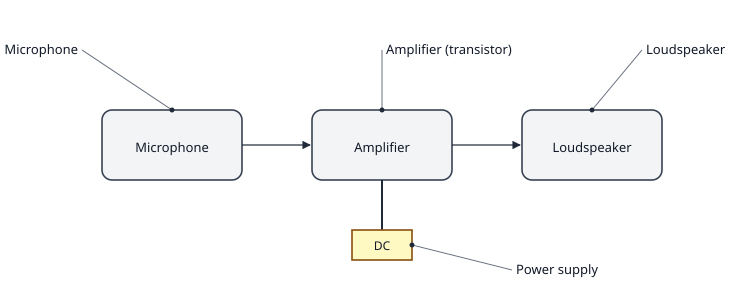

1. Increases the signal amplitude
2. Energy for amplification
3. Electrical → sound
4. Sound → electrical signal

Answer and explanation

**Answer: (4) Sound → electrical signal**

Microphone: Sound → electrical signal (File 6: PHY-D08).

<!-- meta {"type":"mcq","id":"SCQ-11-11-012","grade":11,"chapter_id":"SC11-11","discipline":"PHY","difficulty":1,"qtype":"diagram","answer":1,"origin":"ORIGINAL","source_ref":"PHY-D08","image":"science_assets/physics/PHY-D08_labelled.svg"} -->
**SCQ-11-11-012** · Basic · Diagram · `ORIGINAL`

In the Public address system (block diagram) diagram, what is the function of the 'Amplifier (transistor)'?

1. Increases the signal amplitude
2. Electrical → sound
3. Energy for amplification
4. Sound → electrical signal

Answer and explanation

**Answer: (1) Increases the signal amplitude**

Amplifier (transistor): Increases the signal amplitude (File 6: PHY-D08).

<!-- meta {"type":"mcq","id":"SCQ-11-11-013","grade":11,"chapter_id":"SC11-11","discipline":"PHY","difficulty":1,"qtype":"diagram","answer":4,"origin":"ORIGINAL","source_ref":"PHY-D08","image":"science_assets/physics/PHY-D08_labelled.svg"} -->
**SCQ-11-11-013** · Basic · Diagram · `ORIGINAL`

In the Public address system (block diagram) diagram, what is the function of the 'Loudspeaker'?

1. Increases the signal amplitude
2. Sound → electrical signal
3. Energy for amplification
4. Electrical → sound

Answer and explanation

**Answer: (4) Electrical → sound**

Loudspeaker: Electrical → sound (File 6: PHY-D08).

<!-- meta {"type":"mcq","id":"SCQ-11-11-014","grade":11,"chapter_id":"SC11-11","discipline":"PHY","difficulty":1,"qtype":"recall","answer":2,"origin":"ORIGINAL","source_ref":"extra-SC11-11-1","image":null} -->
**SCQ-11-11-014** · Basic · Recall · `ORIGINAL`

Valence electrons of silicon?

1. 2
2. 4
3. 3
4. 5

Answer and explanation

**Answer: (2) 4**

Group 14.

<!-- meta {"type":"mcq","id":"SCQ-11-11-015","grade":11,"chapter_id":"SC11-11","discipline":"PHY","difficulty":2,"qtype":"concept","answer":4,"origin":"ORIGINAL","source_ref":"extra-SC11-11-2","image":null} -->
**SCQ-11-11-015** · Intermediate · Concept · `ORIGINAL`

Pure semiconductor?

1. p-type
2. Insulator
3. n-type
4. Intrinsic semiconductor

Answer and explanation

**Answer: (4) Intrinsic semiconductor**

Without impurities.

<!-- meta {"type":"mcq","id":"SCQ-11-11-016","grade":11,"chapter_id":"SC11-11","discipline":"PHY","difficulty":3,"qtype":"concept","answer":1,"origin":"ORIGINAL","source_ref":"extra-SC11-11-3","image":null} -->
**SCQ-11-11-016** · Hard · Concept · `ORIGINAL`

The region without carriers formed at a p–n junction?

1. Depletion layer
2. Electrode
3. Collector
4. Base

Answer and explanation

**Answer: (1) Depletion layer**

Electron–hole recombination.

<!-- meta {"type":"mcq","id":"SCQ-11-11-017","grade":11,"chapter_id":"SC11-11","discipline":"PHY","difficulty":2,"qtype":"recall","answer":4,"origin":"ORIGINAL","source_ref":"extra-SC11-11-4","image":null} -->
**SCQ-11-11-017** · Intermediate · Recall · `ORIGINAL`

The longer leg of an LED is usually?

1. Earth
2. Cathode (−)
3. Base
4. Anode (+)

Answer and explanation

**Answer: (4) Anode (+)**

Connect to + for forward bias.

<!-- meta {"type":"mcq","id":"SCQ-11-11-018","grade":11,"chapter_id":"SC11-11","discipline":"PHY","difficulty":2,"qtype":"concept","answer":4,"origin":"ORIGINAL","source_ref":"extra-SC11-11-5","image":null} -->
**SCQ-11-11-018** · Intermediate · Concept · `ORIGINAL`

What does the frequency at which a loudspeaker cone vibrates determine?

1. Colour
2. Speed
3. Loudness
4. Pitch of the sound

Answer and explanation

**Answer: (4) Pitch of the sound**

Frequency → pitch.

<!-- meta {"type":"mcq","id":"SCQ-11-11-019","grade":11,"chapter_id":"SC11-11","discipline":"PHY","difficulty":3,"qtype":"reasoning","answer":1,"origin":"ORIGINAL","source_ref":"extra-SC11-11-6","image":null} -->
**SCQ-11-11-019** · Hard · Reasoning · `ORIGINAL`

Energy source for the output power of an amplifier?

1. Power supply (DC)
2. The transistor by itself
3. Loudspeaker
4. Microphone

Answer and explanation

**Answer: (1) Power supply (DC)**

The transistor only controls.

<!-- meta {"type":"mcq","id":"SCQ-11-11-020","grade":11,"chapter_id":"SC11-11","discipline":"PHY","difficulty":3,"qtype":"application","answer":2,"origin":"ORIGINAL","source_ref":"extra-SC11-11-7","image":null} -->
**SCQ-11-11-020** · Hard · Application · `ORIGINAL`

Component used to smooth the output after converting AC into DC?

1. Switch
2. Capacitor
3. LDR
4. Resistor only

Answer and explanation

**Answer: (2) Capacitor**

It reduces ripple (smoothing).

<!-- meta {"type":"mcq","id":"SCQ-11-11-021","grade":11,"chapter_id":"SC11-11","discipline":"PHY","difficulty":2,"qtype":"application","answer":1,"origin":"ORIGINAL","source_ref":"extra-SC11-11-8","image":null} -->
**SCQ-11-11-021** · Intermediate · Application · `ORIGINAL`

What may be found inside a mobile phone charger?

1. A step-down transformer and a rectifier
2. Motor
3. Loudspeaker
4. A step-up transformer only

Answer and explanation

**Answer: (1) A step-down transformer and a rectifier**

230 V AC → low DC.

<!-- meta {"type":"mcq","id":"SCQ-11-11-022","grade":11,"chapter_id":"SC11-11","discipline":"PHY","difficulty":1,"qtype":"application","answer":3,"origin":"ORIGINAL","source_ref":"extra-SC11-11-9","image":null} -->
**SCQ-11-11-022** · Basic · Application · `ORIGINAL`

Why must electronic waste (e-waste) be disposed of properly?

1. They do not burn
2. They smell
3. Toxic substances such as lead and mercury
4. They are heavy

Answer and explanation

**Answer: (3) Toxic substances such as lead and mercury**

Soil and water pollution.

<!-- meta {"type":"mcq","id":"SCQ-11-11-023","grade":11,"chapter_id":"SC11-11","discipline":"PHY","difficulty":2,"qtype":"concept","answer":1,"origin":"ORIGINAL","source_ref":"extra-SC11-11-10","image":null} -->
**SCQ-11-11-023** · Intermediate · Concept · `ORIGINAL`

The change the invention of the transistor brought to electronics?

1. Small, low-power devices
2. No electricity needed
3. More heat
4. Large vacuum tubes

Answer and explanation

**Answer: (1) Small, low-power devices**

It replaced vacuum tubes.

<!-- meta {"type":"mcq","id":"SCQ-11-11-024","grade":11,"chapter_id":"SC11-11","discipline":"PHY","difficulty":2,"qtype":"recall","answer":3,"origin":"ORIGINAL","source_ref":"extra-SC11-11-11","image":null} -->
**SCQ-11-11-024** · Intermediate · Recall · `ORIGINAL`

A semiconductor component used as a temperature sensor?

1. Switch
2. Fuse
3. Thermistor
4. LED

Answer and explanation

**Answer: (3) Thermistor**

Its resistance changes with temperature.

<!-- meta {"type":"mcq","id":"SCQ-11-11-025","grade":11,"chapter_id":"SC11-11","discipline":"PHY","difficulty":2,"qtype":"reasoning","answer":2,"origin":"ORIGINAL","source_ref":"extra-SC11-11-12","image":null} -->
**SCQ-11-11-025** · Intermediate · Reasoning · `ORIGINAL`

In a diode circuit the bulb did not light; it lit when the cell's polarity was reversed. At first the diode was?

1. Short-circuited
2. In reverse bias
3. Faulty
4. In forward bias

Answer and explanation

**Answer: (2) In reverse bias**

Reversing the polarity gave forward bias.

## SC11-12: Electrochemistry

*Grade 11 · Chapter 12 · Chemistry · 25 questions*

<!-- meta {"type":"mcq","id":"SCQ-11-12-001","grade":11,"chapter_id":"SC11-12","discipline":"CHE","difficulty":1,"qtype":"recall","answer":2,"origin":"ORIGINAL","source_ref":"chapter","image":null} -->
**SCQ-11-12-001** · Basic · Recall · `ORIGINAL`

What forms at the cathode in the electrolysis of molten NaCl?

1. Cl₂
2. Na
3. H₂
4. O₂

Answer and explanation

**Answer: (2) Na**

Na⁺ + e⁻ → Na.

<!-- meta {"type":"mcq","id":"SCQ-11-12-002","grade":11,"chapter_id":"SC11-12","discipline":"CHE","difficulty":1,"qtype":"application","answer":2,"origin":"ORIGINAL","source_ref":"chapter","image":null} -->
**SCQ-11-12-002** · Basic · Application · `ORIGINAL`

To silver-plate a spoon, it should be connected as?

1. The anode
2. The cathode
3. In the electrolyte only
4. Nothing

Answer and explanation

**Answer: (2) The cathode**

Ag⁺ is deposited as Ag at the cathode.

<!-- meta {"type":"mcq","id":"SCQ-11-12-003","grade":11,"chapter_id":"SC11-12","discipline":"CHE","difficulty":3,"qtype":"reasoning","answer":2,"origin":"ORIGINAL","source_ref":"chapter","image":null} -->
**SCQ-11-12-003** · Hard · Reasoning · `ORIGINAL`

In the electrolysis of concentrated aqueous NaCl, why does phenolphthalein turn pink near the cathode?

1. Cl₂ forms
2. H₂ is released and the OH⁻ concentration rises
3. Na is deposited
4. An acid forms

Answer and explanation

**Answer: (2) H₂ is released and the OH⁻ concentration rises**

2H₂O + 2e⁻ → H₂ + 2OH⁻.

<!-- meta {"type":"mcq","id":"SCQ-11-12-004","grade":11,"chapter_id":"SC11-12","discipline":"CHE","difficulty":2,"qtype":"concept","answer":2,"origin":"ORIGINAL","source_ref":"chapter","image":null} -->
**SCQ-11-12-004** · Intermediate · Concept · `ORIGINAL`

In a simple cell with Zn and Cu electrodes, electrons flow?

1. From Cu to Zn
2. From Zn to Cu through the external circuit
3. Through the solution
4. They do not flow

Answer and explanation

**Answer: (2) From Zn to Cu through the external circuit**

Zn is more reactive — it loses electrons.

<!-- meta {"type":"mcq","id":"SCQ-11-12-005","grade":11,"chapter_id":"SC11-12","discipline":"CHE","difficulty":2,"qtype":"experiment","answer":2,"origin":"ORIGINAL","source_ref":"chapter","image":null} -->
**SCQ-11-12-005** · Intermediate · Experiment · `ORIGINAL`

Condition in which an iron nail does not rust?

1. Moist air
2. Boiled and cooled water + a layer of oil
3. Sea water
4. Tap water

Answer and explanation

**Answer: (2) Boiled and cooled water + a layer of oil**

O₂ has been removed.

<!-- meta {"type":"mcq","id":"SCQ-11-12-006","grade":11,"chapter_id":"SC11-12","discipline":"CHE","difficulty":3,"qtype":"reasoning","answer":1,"origin":"ORIGINAL","source_ref":"chapter","image":null} -->
**SCQ-11-12-006** · Hard · Reasoning · `ORIGINAL`

Why does galvanized iron not rust even when scratched?

1. Zn is more reactive, so it is oxidised first
2. Zn blocks water
3. Fe does not react
4. Zn is a magnet

Answer and explanation

**Answer: (1) Zn is more reactive, so it is oxidised first**

Sacrificial protection.

<!-- meta {"type":"mcq","id":"SCQ-11-12-007","grade":11,"chapter_id":"SC11-12","discipline":"CHE","difficulty":2,"qtype":"concept","answer":2,"origin":"ORIGINAL","source_ref":"chapter","image":null} -->
**SCQ-11-12-007** · Intermediate · Concept · `ORIGINAL`

2Cl⁻ → Cl₂ + 2e⁻ at the anode — this is?

1. Reduction
2. Oxidation
3. Neutralisation
4. Precipitation

Answer and explanation

**Answer: (2) Oxidation**

Loss of electrons.

<!-- meta {"type":"mcq","id":"SCQ-11-12-008","grade":11,"chapter_id":"SC11-12","discipline":"CHE","difficulty":3,"qtype":"experiment","answer":2,"origin":"ORIGINAL","source_ref":"chapter","image":null} -->
**SCQ-11-12-008** · Hard · Experiment · `ORIGINAL`

In the electrolysis of CuSO₄ with Cu electrodes, the anode?

1. Gains mass
2. Loses mass
3. Does not change
4. Releases O₂

Answer and explanation

**Answer: (2) Loses mass**

Cu → Cu²⁺ + 2e⁻ — the anode dissolves.

<!-- meta {"type":"mcq","id":"SCQ-11-12-009","grade":11,"chapter_id":"SC11-12","discipline":"CHE","difficulty":1,"qtype":"concept","answer":2,"origin":"ORIGINAL","source_ref":"chapter","image":null} -->
**SCQ-11-12-009** · Basic · Concept · `ORIGINAL`

Energy change in an electrochemical cell?

1. Electrical → chemical
2. Chemical → electrical
3. Heat → electrical
4. Light → chemical

Answer and explanation

**Answer: (2) Chemical → electrical**

A spontaneous reaction produces electricity.

<!-- meta {"type":"mcq","id":"SCQ-11-12-010","grade":11,"chapter_id":"SC11-12","discipline":"CHE","difficulty":2,"qtype":"reasoning","answer":1,"origin":"ORIGINAL","source_ref":"chapter","image":null} -->
**SCQ-11-12-010** · Intermediate · Reasoning · `ORIGINAL`

Why cannot solid NaCl be electrolysed?

1. The ions cannot move
2. There are no ions
3. It is a metal
4. There is no water

Answer and explanation

**Answer: (1) The ions cannot move**

Only when molten or dissolved.

<!-- meta {"type":"mcq","id":"SCQ-11-12-011","grade":11,"chapter_id":"SC11-12","discipline":"CHE","difficulty":2,"qtype":"equation","answer":1,"origin":"ORIGINAL","source_ref":"EQ-046","image":null} -->
**SCQ-11-12-011** · Intermediate · Equation · `ORIGINAL`

NaCl → Na + Cl₂ — when this equation is balanced with the smallest whole-number coefficients, the coefficient of NaCl?

1. 2
2. 4
3. 7
4. 3

Answer and explanation

**Answer: (1) 2**

2NaCl → 2Na + Cl₂ (atom count checked; File 7: EQ-046).

<!-- meta {"type":"mcq","id":"SCQ-11-12-012","grade":11,"chapter_id":"SC11-12","discipline":"CHE","difficulty":2,"qtype":"equation","answer":1,"origin":"ORIGINAL","source_ref":"EQ-047","image":null} -->
**SCQ-11-12-012** · Intermediate · Equation · `ORIGINAL`

H₂O → H₂ + O₂ — when this equation is balanced with the smallest whole-number coefficients, the coefficient of H₂O?

1. 2
2. 3
3. 7
4. 4

Answer and explanation

**Answer: (1) 2**

2H₂O → 2H₂ + O₂ (atom count checked; File 7: EQ-047).

<!-- meta {"type":"mcq","id":"SCQ-11-12-013","grade":11,"chapter_id":"SC11-12","discipline":"CHE","difficulty":1,"qtype":"diagram","answer":1,"origin":"ORIGINAL","source_ref":"CHE-D02","image":"science_assets/chemistry/CHE-D02_labelled.svg"} -->
**SCQ-11-12-013** · Basic · Diagram · `ORIGINAL`

In the Electrolytic cell diagram, what is the function of the 'Anode (+)'?

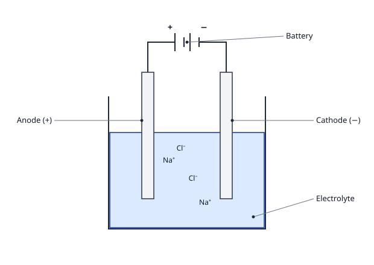

1. Oxidation — anions lose electrons
2. DC power supply
3. Ions move and conduct electricity
4. Reduction — cations gain electrons

Answer and explanation

**Answer: (1) Oxidation — anions lose electrons**

Anode (+): Oxidation — anions lose electrons (File 6: CHE-D02).

<!-- meta {"type":"mcq","id":"SCQ-11-12-014","grade":11,"chapter_id":"SC11-12","discipline":"CHE","difficulty":1,"qtype":"diagram","answer":4,"origin":"ORIGINAL","source_ref":"CHE-D02","image":"science_assets/chemistry/CHE-D02_labelled.svg"} -->
**SCQ-11-12-014** · Basic · Diagram · `ORIGINAL`

In the Electrolytic cell diagram, what is the function of the 'Cathode (−)'?

1. Oxidation — anions lose electrons
2. DC power supply
3. Ions move and conduct electricity
4. Reduction — cations gain electrons

Answer and explanation

**Answer: (4) Reduction — cations gain electrons**

Cathode (−): Reduction — cations gain electrons (File 6: CHE-D02).

<!-- meta {"type":"mcq","id":"SCQ-11-12-015","grade":11,"chapter_id":"SC11-12","discipline":"CHE","difficulty":1,"qtype":"diagram","answer":3,"origin":"ORIGINAL","source_ref":"CHE-D02","image":"science_assets/chemistry/CHE-D02_labelled.svg"} -->
**SCQ-11-12-015** · Basic · Diagram · `ORIGINAL`

In the Electrolytic cell diagram, what is the function of the 'Electrolyte'?

1. Oxidation — anions lose electrons
2. Reduction — cations gain electrons
3. Ions move and conduct electricity
4. DC power supply

Answer and explanation

**Answer: (3) Ions move and conduct electricity**

Electrolyte: Ions move and conduct electricity (File 6: CHE-D02).

<!-- meta {"type":"mcq","id":"SCQ-11-12-016","grade":11,"chapter_id":"SC11-12","discipline":"CHE","difficulty":1,"qtype":"diagram","answer":1,"origin":"ORIGINAL","source_ref":"CHE-D06","image":"science_assets/chemistry/CHE-D06_labelled.svg"} -->
**SCQ-11-12-016** · Basic · Diagram · `ORIGINAL`

In the Simple cell (Zn–Cu) diagram, what is the function of the 'Zinc plate (−)'?

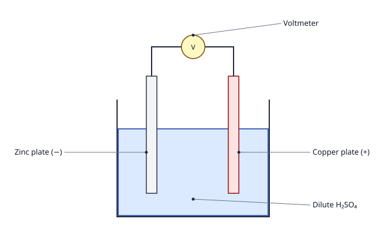

1. Oxidation: Zn → Zn²⁺ + 2e⁻
2. Electrolyte
3. Potential difference
4. Less reactive metal

Answer and explanation

**Answer: (1) Oxidation: Zn → Zn²⁺ + 2e⁻**

Zinc plate (−): Oxidation: Zn → Zn²⁺ + 2e⁻ (File 6: CHE-D06).

<!-- meta {"type":"mcq","id":"SCQ-11-12-017","grade":11,"chapter_id":"SC11-12","discipline":"CHE","difficulty":1,"qtype":"diagram","answer":1,"origin":"ORIGINAL","source_ref":"CHE-D06","image":"science_assets/chemistry/CHE-D06_labelled.svg"} -->
**SCQ-11-12-017** · Basic · Diagram · `ORIGINAL`

In the Simple cell (Zn–Cu) diagram, what is the function of the 'Copper plate (+)'?

1. Less reactive metal
2. Oxidation: Zn → Zn²⁺ + 2e⁻
3. Potential difference
4. Electrolyte

Answer and explanation

**Answer: (1) Less reactive metal**

Copper plate (+): Less reactive metal (File 6: CHE-D06).

<!-- meta {"type":"mcq","id":"SCQ-11-12-018","grade":11,"chapter_id":"SC11-12","discipline":"CHE","difficulty":1,"qtype":"diagram","answer":4,"origin":"ORIGINAL","source_ref":"CHE-D06","image":"science_assets/chemistry/CHE-D06_labelled.svg"} -->
**SCQ-11-12-018** · Basic · Diagram · `ORIGINAL`

In the Simple cell (Zn–Cu) diagram, what is the function of the 'Dilute H₂SO₄'?

1. Potential difference
2. Oxidation: Zn → Zn²⁺ + 2e⁻
3. Less reactive metal
4. Electrolyte

Answer and explanation

**Answer: (4) Electrolyte**

Dilute H₂SO₄: Electrolyte (File 6: CHE-D06).

<!-- meta {"type":"mcq","id":"SCQ-11-12-019","grade":11,"chapter_id":"SC11-12","discipline":"CHE","difficulty":1,"qtype":"concept","answer":4,"origin":"ORIGINAL","source_ref":"extra-SC11-12-1","image":null} -->
**SCQ-11-12-019** · Basic · Concept · `ORIGINAL`

What is an electrolyte?

1. A gas only
2. A solid that does not conduct electricity
3. A metal wire
4. A substance that conducts electricity when molten/dissolved and undergoes chemical change

Answer and explanation

**Answer: (4) A substance that conducts electricity when molten/dissolved and undergoes chemical change**

Ions move.

<!-- meta {"type":"mcq","id":"SCQ-11-12-020","grade":11,"chapter_id":"SC11-12","discipline":"CHE","difficulty":1,"qtype":"concept","answer":4,"origin":"ORIGINAL","source_ref":"extra-SC11-12-2","image":null} -->
**SCQ-11-12-020** · Basic · Concept · `ORIGINAL`

What happens at the anode in electrolysis?

1. Reduction
2. Precipitation
3. Neutralisation
4. Oxidation

Answer and explanation

**Answer: (4) Oxidation**

Loss of electrons.

<!-- meta {"type":"mcq","id":"SCQ-11-12-021","grade":11,"chapter_id":"SC11-12","discipline":"CHE","difficulty":2,"qtype":"reasoning","answer":1,"origin":"ORIGINAL","source_ref":"extra-SC11-12-3","image":null} -->
**SCQ-11-12-021** · Intermediate · Reasoning · `ORIGINAL`

Ratio of gas volumes at cathode : anode in the electrolysis of acidified water?

1. 2 : 1 (H₂ : O₂)
2. 1 : 2
3. 1 : 1
4. 3 : 1

Answer and explanation

**Answer: (1) 2 : 1 (H₂ : O₂)**

2H₂O → 2H₂ + O₂.

<!-- meta {"type":"mcq","id":"SCQ-11-12-022","grade":11,"chapter_id":"SC11-12","discipline":"CHE","difficulty":2,"qtype":"concept","answer":2,"origin":"ORIGINAL","source_ref":"extra-SC11-12-4","image":null} -->
**SCQ-11-12-022** · Intermediate · Concept · `ORIGINAL`

In electrolytic purification of metals, where is the pure metal deposited?

1. Nowhere
2. At the cathode
3. At the anode
4. On top of the solution

Answer and explanation

**Answer: (2) At the cathode**

The impure metal is the anode.

<!-- meta {"type":"mcq","id":"SCQ-11-12-023","grade":11,"chapter_id":"SC11-12","discipline":"CHE","difficulty":2,"qtype":"reasoning","answer":4,"origin":"ORIGINAL","source_ref":"extra-SC11-12-5","image":null} -->
**SCQ-11-12-023** · Intermediate · Reasoning · `ORIGINAL`

Direction of electron flow in the external circuit of a simple cell (Zn–Cu)?

1. Both directions
2. From Cu to Zn
3. No flow
4. From Zn to Cu

Answer and explanation

**Answer: (4) From Zn to Cu**

Zn is the negative electrode.

<!-- meta {"type":"mcq","id":"SCQ-11-12-024","grade":11,"chapter_id":"SC11-12","discipline":"CHE","difficulty":3,"qtype":"reasoning","answer":1,"origin":"ORIGINAL","source_ref":"extra-SC11-12-6","image":null} -->
**SCQ-11-12-024** · Hard · Reasoning · `ORIGINAL`

Pair of metals that gives a larger potential difference in a simple cell?

1. Metals far apart in the reactivity series (e.g. Mg–Cu)
2. Fe–Fe
3. The same metal
4. Cu–Ag

Answer and explanation

**Answer: (1) Metals far apart in the reactivity series (e.g. Mg–Cu)**

Difference in reactivity.

<!-- meta {"type":"mcq","id":"SCQ-11-12-025","grade":11,"chapter_id":"SC11-12","discipline":"CHE","difficulty":3,"qtype":"reasoning","answer":4,"origin":"ORIGINAL","source_ref":"extra-SC11-12-7","image":null} -->
**SCQ-11-12-025** · Hard · Reasoning · `ORIGINAL`

A galvanised iron sheet is scratched. Why does the exposed iron still not rust?

1. There is no water
2. Zinc does not react
3. Iron is more reactive
4. Zinc is oxidised first (sacrificial protection)

Answer and explanation

**Answer: (4) Zinc is oxidised first (sacrificial protection)**

Zn > Fe.

## SC11-13: Electromagnetism and electromagnetic induction

*Grade 11 · Chapter 13 · Physics · 25 questions*

<!-- meta {"type":"mcq","id":"SCQ-11-13-001","grade":11,"chapter_id":"SC11-13","discipline":"PHY","difficulty":1,"qtype":"calculation","answer":1,"origin":"ORIGINAL","source_ref":"chapter","image":null} -->
**SCQ-11-13-001** · Basic · Calculation · `ORIGINAL`

In a transformer Np = 1000, Ns = 50, Vp = 240 V. Vs?

1. 12 V
2. 4800 V
3. 24 V
4. 120 V

Answer and explanation

**Answer: (1) 12 V**

Vs = 240 × 50/1000.

<!-- meta {"type":"mcq","id":"SCQ-11-13-002","grade":11,"chapter_id":"SC11-13","discipline":"PHY","difficulty":2,"qtype":"reasoning","answer":1,"origin":"ORIGINAL","source_ref":"chapter","image":null} -->
**SCQ-11-13-002** · Intermediate · Reasoning · `ORIGINAL`

Why does a transformer not work with a DC supply?

1. No changing magnetic flux is produced
2. DC is dangerous
3. The coil melts
4. There is no core

Answer and explanation

**Answer: (1) No changing magnetic flux is produced**

Induction needs a change of flux.

<!-- meta {"type":"mcq","id":"SCQ-11-13-003","grade":11,"chapter_id":"SC11-13","discipline":"PHY","difficulty":2,"qtype":"experiment","answer":2,"origin":"ORIGINAL","source_ref":"chapter","image":null} -->
**SCQ-11-13-003** · Intermediate · Experiment · `ORIGINAL`

Galvanometer deflection if a magnet is pushed quickly into a coil?

1. Decreases
2. Increases
3. Does not change
4. 0

Answer and explanation

**Answer: (2) Increases**

The rate of change of flux increases.

<!-- meta {"type":"mcq","id":"SCQ-11-13-004","grade":11,"chapter_id":"SC11-13","discipline":"PHY","difficulty":1,"qtype":"concept","answer":1,"origin":"ORIGINAL","source_ref":"chapter","image":null} -->
**SCQ-11-13-004** · Basic · Concept · `ORIGINAL`

Working principle of a DC motor?

1. Force on a current-carrying conductor in a magnetic field
2. Electromagnetic induction only
3. Thermal expansion
4. Refraction

Answer and explanation

**Answer: (1) Force on a current-carrying conductor in a magnetic field**

Left-hand rule.

<!-- meta {"type":"mcq","id":"SCQ-11-13-005","grade":11,"chapter_id":"SC11-13","discipline":"PHY","difficulty":2,"qtype":"concept","answer":1,"origin":"ORIGINAL","source_ref":"chapter","image":null} -->
**SCQ-11-13-005** · Intermediate · Concept · `ORIGINAL`

In a step-up transformer?

1. Vs > Vp, Is < Ip
2. Vs < Vp
3. Is > Ip
4. Energy increases

Answer and explanation

**Answer: (1) Vs > Vp, Is < Ip**

Energy is conserved (ideal).

<!-- meta {"type":"mcq","id":"SCQ-11-13-006","grade":11,"chapter_id":"SC11-13","discipline":"PHY","difficulty":2,"qtype":"calculation","answer":1,"origin":"ORIGINAL","source_ref":"chapter","image":null} -->
**SCQ-11-13-006** · Intermediate · Calculation · `ORIGINAL`

A transformer with 90% efficiency has a primary power of 200 W. Secondary power?

1. 180 W
2. 200 W
3. 222 W
4. 20 W

Answer and explanation

**Answer: (1) 180 W**

0.9 × 200.

<!-- meta {"type":"mcq","id":"SCQ-11-13-007","grade":11,"chapter_id":"SC11-13","discipline":"PHY","difficulty":2,"qtype":"reasoning","answer":1,"origin":"ORIGINAL","source_ref":"chapter","image":null} -->
**SCQ-11-13-007** · Intermediate · Reasoning · `ORIGINAL`

Why is soft iron used as the core of an electromagnet?

1. It magnetises easily and loses its magnetism when the current stops
2. It is heavy
3. Only because it is cheap
4. It does not conduct electricity

Answer and explanation

**Answer: (1) It magnetises easily and loses its magnetism when the current stops**

A temporary magnet.

<!-- meta {"type":"mcq","id":"SCQ-11-13-008","grade":11,"chapter_id":"SC11-13","discipline":"PHY","difficulty":3,"qtype":"reasoning","answer":1,"origin":"ORIGINAL","source_ref":"chapter","image":null} -->
**SCQ-11-13-008** · Hard · Reasoning · `ORIGINAL`

Why is electricity transmitted at high voltage in power distribution?

1. The current decreases, so I²R heat loss decreases
2. Speed increases
3. Safety
4. The wires are lighter

Answer and explanation

**Answer: (1) The current decreases, so I²R heat loss decreases**

Less current → less loss.

<!-- meta {"type":"mcq","id":"SCQ-11-13-009","grade":11,"chapter_id":"SC11-13","discipline":"PHY","difficulty":2,"qtype":"concept","answer":1,"origin":"ORIGINAL","source_ref":"chapter","image":null} -->
**SCQ-11-13-009** · Intermediate · Concept · `ORIGINAL`

The magnetic field of a solenoid resembles?

1. A bar magnet
2. A circle
3. No field
4. Only a U-magnet

Answer and explanation

**Answer: (1) A bar magnet**

It has N and S poles.

<!-- meta {"type":"mcq","id":"SCQ-11-13-010","grade":11,"chapter_id":"SC11-13","discipline":"PHY","difficulty":3,"qtype":"calculation","answer":1,"origin":"ORIGINAL","source_ref":"chapter","image":null} -->
**SCQ-11-13-010** · Hard · Calculation · `ORIGINAL`

Vp = 230 V, Vs = 11.5 V, Ns = 100. Np?

1. 2000
2. 5
3. 1150
4. 200

Answer and explanation

**Answer: (1) 2000**

Np = 100 × 230/11.5.

<!-- meta {"type":"mcq","id":"SCQ-11-13-011","grade":11,"chapter_id":"SC11-13","discipline":"PHY","difficulty":1,"qtype":"diagram","answer":3,"origin":"ORIGINAL","source_ref":"PHY-D04","image":"science_assets/physics/PHY-D04_labelled.svg"} -->
**SCQ-11-13-011** · Basic · Diagram · `ORIGINAL`

In the Magnetic field lines of a bar magnet diagram, what is the function of the 'North pole'?

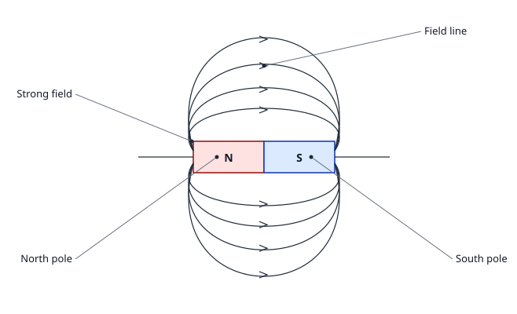

1. From N to S
2. Lines close together — at the poles
3. Field lines leave
4. Field lines enter

Answer and explanation

**Answer: (3) Field lines leave**

North pole: Field lines leave (File 6: PHY-D04).

<!-- meta {"type":"mcq","id":"SCQ-11-13-012","grade":11,"chapter_id":"SC11-13","discipline":"PHY","difficulty":1,"qtype":"diagram","answer":2,"origin":"ORIGINAL","source_ref":"PHY-D04","image":"science_assets/physics/PHY-D04_labelled.svg"} -->
**SCQ-11-13-012** · Basic · Diagram · `ORIGINAL`

In the Magnetic field lines of a bar magnet diagram, what is the function of the 'South pole'?

1. Field lines leave
2. Field lines enter
3. From N to S
4. Lines close together — at the poles

Answer and explanation

**Answer: (2) Field lines enter**

South pole: Field lines enter (File 6: PHY-D04).

<!-- meta {"type":"mcq","id":"SCQ-11-13-013","grade":11,"chapter_id":"SC11-13","discipline":"PHY","difficulty":1,"qtype":"diagram","answer":3,"origin":"ORIGINAL","source_ref":"PHY-D04","image":"science_assets/physics/PHY-D04_labelled.svg"} -->
**SCQ-11-13-013** · Basic · Diagram · `ORIGINAL`

In the Magnetic field lines of a bar magnet diagram, what is the function of the 'Field line'?

1. Field lines leave
2. Field lines enter
3. From N to S
4. Lines close together — at the poles

Answer and explanation

**Answer: (3) From N to S**

Field line: From N to S (File 6: PHY-D04).

<!-- meta {"type":"mcq","id":"SCQ-11-13-014","grade":11,"chapter_id":"SC11-13","discipline":"PHY","difficulty":2,"qtype":"calculation","answer":1,"origin":"ORIGINAL","source_ref":"param-SC11-13-1","image":null} -->
**SCQ-11-13-014** · Intermediate · Calculation · `ORIGINAL`

Transformer: Vp = 240 V, Np = 1200, Ns = 60. Vs?

1. 12 V
2. 14400 V
3. 4800 V
4. 240 V

Answer and explanation

**Answer: (1) 12 V**

Vs = Vp × Ns/Np.

<!-- meta {"type":"mcq","id":"SCQ-11-13-015","grade":11,"chapter_id":"SC11-13","discipline":"PHY","difficulty":2,"qtype":"calculation","answer":3,"origin":"ORIGINAL","source_ref":"param-SC11-13-2","image":null} -->
**SCQ-11-13-015** · Intermediate · Calculation · `ORIGINAL`

Transformer: Vp = 230 V, Np = 500, Ns = 2500. Vs?

1. 575000 V
2. 230 V
3. 1150 V
4. 46 V

Answer and explanation

**Answer: (3) 1150 V**

Vs = Vp × Ns/Np.

<!-- meta {"type":"mcq","id":"SCQ-11-13-016","grade":11,"chapter_id":"SC11-13","discipline":"PHY","difficulty":2,"qtype":"calculation","answer":1,"origin":"ORIGINAL","source_ref":"param-SC11-13-3","image":null} -->
**SCQ-11-13-016** · Intermediate · Calculation · `ORIGINAL`

Transformer: Vp = 11000 V, Np = 5000, Ns = 100. Vs?

1. 220 V
2. 11000 V
3. 550000 V
4. 1.1 × 10⁶ V

Answer and explanation

**Answer: (1) 220 V**

Vs = Vp × Ns/Np.

<!-- meta {"type":"mcq","id":"SCQ-11-13-017","grade":11,"chapter_id":"SC11-13","discipline":"PHY","difficulty":2,"qtype":"calculation","answer":4,"origin":"ORIGINAL","source_ref":"param-SC11-13-4","image":null} -->
**SCQ-11-13-017** · Intermediate · Calculation · `ORIGINAL`

Transformer: Vp = 120 V, Np = 300, Ns = 900. Vs?

1. 120 V
2. 40 V
3. 108000 V
4. 360 V

Answer and explanation

**Answer: (4) 360 V**

Vs = Vp × Ns/Np.

<!-- meta {"type":"mcq","id":"SCQ-11-13-018","grade":11,"chapter_id":"SC11-13","discipline":"PHY","difficulty":3,"qtype":"calculation","answer":4,"origin":"ORIGINAL","source_ref":"param-SC11-13-5","image":null} -->
**SCQ-11-13-018** · Hard · Calculation · `ORIGINAL`

Ideal transformer: Vp = 230 V, Ip = 0.2 A, Vs = 23 V. Is?

1. 10 A
2. 0.02 A
3. 0.2 A
4. 2 A

Answer and explanation

**Answer: (4) 2 A**

VpIp = VsIs.

<!-- meta {"type":"mcq","id":"SCQ-11-13-019","grade":11,"chapter_id":"SC11-13","discipline":"PHY","difficulty":3,"qtype":"calculation","answer":2,"origin":"ORIGINAL","source_ref":"param-SC11-13-6","image":null} -->
**SCQ-11-13-019** · Hard · Calculation · `ORIGINAL`

Ideal transformer: Vp = 120 V, Ip = 1 A, Vs = 12 V. Is?

1. 1 A
2. 10 A
3. 20 A
4. 0.1 A

Answer and explanation

**Answer: (2) 10 A**

VpIp = VsIs.

<!-- meta {"type":"mcq","id":"SCQ-11-13-020","grade":11,"chapter_id":"SC11-13","discipline":"PHY","difficulty":3,"qtype":"calculation","answer":3,"origin":"ORIGINAL","source_ref":"param-SC11-13-7","image":null} -->
**SCQ-11-13-020** · Hard · Calculation · `ORIGINAL`

Ideal transformer: Vp = 240 V, Ip = 0.25 A, Vs = 6 V. Is?

1. 0.25 A
2. 40 A
3. 10 A
4. 0.0063 A

Answer and explanation

**Answer: (3) 10 A**

VpIp = VsIs.

<!-- meta {"type":"mcq","id":"SCQ-11-13-021","grade":11,"chapter_id":"SC11-13","discipline":"PHY","difficulty":2,"qtype":"calculation","answer":3,"origin":"ORIGINAL","source_ref":"param-SC11-13-8","image":null} -->
**SCQ-11-13-021** · Intermediate · Calculation · `ORIGINAL`

A transformer has a primary power of 400 W and an efficiency of 85%. Secondary power?

1. 470.5882 W
2. 680 W
3. 340 W
4. 60 W

Answer and explanation

**Answer: (3) 340 W**

Ps = η × Pp.

<!-- meta {"type":"mcq","id":"SCQ-11-13-022","grade":11,"chapter_id":"SC11-13","discipline":"PHY","difficulty":2,"qtype":"calculation","answer":4,"origin":"ORIGINAL","source_ref":"param-SC11-13-9","image":null} -->
**SCQ-11-13-022** · Intermediate · Calculation · `ORIGINAL`

A transformer has a primary power of 60 W and an efficiency of 90%. Secondary power?

1. 66.6667 W
2. 6 W
3. 108 W
4. 54 W

Answer and explanation

**Answer: (4) 54 W**

Ps = η × Pp.

<!-- meta {"type":"mcq","id":"SCQ-11-13-023","grade":11,"chapter_id":"SC11-13","discipline":"PHY","difficulty":2,"qtype":"calculation","answer":1,"origin":"ORIGINAL","source_ref":"param-SC11-13-10","image":null} -->
**SCQ-11-13-023** · Intermediate · Calculation · `ORIGINAL`

Transformer: Vp = 240 V, Vs = 12 V, Np = 2000. Ns?

1. 100
2. 2000
3. 24000
4. 40000

Answer and explanation

**Answer: (1) 100**

Ns = Np × Vs/Vp.

<!-- meta {"type":"mcq","id":"SCQ-11-13-024","grade":11,"chapter_id":"SC11-13","discipline":"PHY","difficulty":2,"qtype":"calculation","answer":2,"origin":"ORIGINAL","source_ref":"param-SC11-13-11","image":null} -->
**SCQ-11-13-024** · Intermediate · Calculation · `ORIGINAL`

Transformer: Vp = 230 V, Vs = 9 V, Np = 460. Ns?

1. 460
2. 18
3. 4140
4. 11755.5556

Answer and explanation

**Answer: (2) 18**

Ns = Np × Vs/Vp.

<!-- meta {"type":"mcq","id":"SCQ-11-13-025","grade":11,"chapter_id":"SC11-13","discipline":"PHY","difficulty":2,"qtype":"calculation","answer":1,"origin":"ORIGINAL","source_ref":"param-SC11-13-12","image":null} -->
**SCQ-11-13-025** · Intermediate · Calculation · `ORIGINAL`

Transformer: Vp = 110 V, Vs = 220 V, Np = 400. Ns?

1. 800
2. 200
3. 400
4. 88000

Answer and explanation

**Answer: (1) 800**

Ns = Np × Vs/Vp.

## SC11-14: Hydrocarbons and their derivatives

*Grade 11 · Chapter 14 · Chemistry · 25 questions*

<!-- meta {"type":"mcq","id":"SCQ-11-14-001","grade":11,"chapter_id":"SC11-14","discipline":"CHE","difficulty":1,"qtype":"concept","answer":2,"origin":"ORIGINAL","source_ref":"chapter","image":null} -->
**SCQ-11-14-001** · Basic · Concept · `ORIGINAL`

C₃H₆ belongs to which homologous series?

1. Alkane
2. Alkene
3. Alkyne
4. Alcohol

Answer and explanation

**Answer: (2) Alkene**

CₙH₂ₙ (n = 3).

<!-- meta {"type":"mcq","id":"SCQ-11-14-002","grade":11,"chapter_id":"SC11-14","discipline":"CHE","difficulty":1,"qtype":"experiment","answer":3,"origin":"ORIGINAL","source_ref":"chapter","image":null} -->
**SCQ-11-14-002** · Basic · Experiment · `ORIGINAL`

What decolourises bromine water?

1. CH₄
2. C₂H₆
3. C₂H₄
4. C₃H₈

Answer and explanation

**Answer: (3) C₂H₄**

Ethene is unsaturated (C=C).

<!-- meta {"type":"mcq","id":"SCQ-11-14-003","grade":11,"chapter_id":"SC11-14","discipline":"CHE","difficulty":1,"qtype":"recall","answer":2,"origin":"ORIGINAL","source_ref":"chapter","image":null} -->
**SCQ-11-14-003** · Basic · Recall · `ORIGINAL`

Monomer used to make polythene?

1. Methane
2. Ethene
3. Ethanol
4. Ethyne

Answer and explanation

**Answer: (2) Ethene**

Addition polymerisation of ethene.

<!-- meta {"type":"mcq","id":"SCQ-11-14-004","grade":11,"chapter_id":"SC11-14","discipline":"CHE","difficulty":2,"qtype":"concept","answer":2,"origin":"ORIGINAL","source_ref":"chapter","image":null} -->
**SCQ-11-14-004** · Intermediate · Concept · `ORIGINAL`

A polymer containing only C and H?

1. PVC
2. Polythene
3. Nylon
4. Protein

Answer and explanation

**Answer: (2) Polythene**

PVC contains Cl (2019 Paper I Q27 type).

<!-- meta {"type":"mcq","id":"SCQ-11-14-005","grade":11,"chapter_id":"SC11-14","discipline":"CHE","difficulty":2,"qtype":"equation","answer":3,"origin":"ORIGINAL","source_ref":"chapter","image":null} -->
**SCQ-11-14-005** · Intermediate · Equation · `ORIGINAL`

C₃H₈ + 5O₂ → 3CO₂ + 4H₂O. O₂ needed to burn 1 mol of propane?

1. 3 mol
2. 4 mol
3. 5 mol
4. 8 mol

Answer and explanation

**Answer: (3) 5 mol**

From the balanced equation.

<!-- meta {"type":"mcq","id":"SCQ-11-14-006","grade":11,"chapter_id":"SC11-14","discipline":"CHE","difficulty":2,"qtype":"application","answer":1,"origin":"ORIGINAL","source_ref":"chapter","image":null} -->
**SCQ-11-14-006** · Intermediate · Application · `ORIGINAL`

A gas cooker in a closed room — danger of incomplete combustion?

1. CO forms
2. O₂ increases
3. Water forms
4. N₂ forms

Answer and explanation

**Answer: (1) CO forms**

CO is poisonous.

<!-- meta {"type":"mcq","id":"SCQ-11-14-007","grade":11,"chapter_id":"SC11-14","discipline":"CHE","difficulty":2,"qtype":"calculation","answer":2,"origin":"ORIGINAL","source_ref":"chapter","image":null} -->
**SCQ-11-14-007** · Intermediate · Calculation · `ORIGINAL`

The 4th member of the alkanes?

1. C₄H₈
2. C₄H₁₀
3. C₄H₆
4. C₃H₈

Answer and explanation

**Answer: (2) C₄H₁₀**

n = 4: C₄H₁₀ (butane).

<!-- meta {"type":"mcq","id":"SCQ-11-14-008","grade":11,"chapter_id":"SC11-14","discipline":"CHE","difficulty":1,"qtype":"recall","answer":2,"origin":"ORIGINAL","source_ref":"chapter","image":null} -->
**SCQ-11-14-008** · Basic · Recall · `ORIGINAL`

Acid in vinegar?

1. HCl
2. CH₃COOH
3. H₂SO₄
4. C₂H₅OH

Answer and explanation

**Answer: (2) CH₃COOH**

Acetic acid.

<!-- meta {"type":"mcq","id":"SCQ-11-14-009","grade":11,"chapter_id":"SC11-14","discipline":"CHE","difficulty":3,"qtype":"reasoning","answer":1,"origin":"ORIGINAL","source_ref":"chapter","image":null} -->
**SCQ-11-14-009** · Hard · Reasoning · `ORIGINAL`

Why does polythene not decolourise bromine water?

1. No C=C — it is saturated
2. It does not dissolve in water
3. There is no Br
4. It is an alkene

Answer and explanation

**Answer: (1) No C=C — it is saturated**

The double bond opens in polymerisation.

<!-- meta {"type":"mcq","id":"SCQ-11-14-010","grade":11,"chapter_id":"SC11-14","discipline":"CHE","difficulty":2,"qtype":"concept","answer":3,"origin":"ORIGINAL","source_ref":"chapter","image":null} -->
**SCQ-11-14-010** · Intermediate · Concept · `ORIGINAL`

What is obtained at the top in the fractional distillation of crude oil?

1. Tar
2. Diesel
3. LP gas
4. Lubricant

Answer and explanation

**Answer: (3) LP gas**

Low boiling point — at the top.

<!-- meta {"type":"mcq","id":"SCQ-11-14-011","grade":11,"chapter_id":"SC11-14","discipline":"CHE","difficulty":2,"qtype":"equation","answer":1,"origin":"ORIGINAL","source_ref":"EQ-034","image":null} -->
**SCQ-11-14-011** · Intermediate · Equation · `ORIGINAL`

CH₄ + O₂ → CO₂ + H₂O — when this equation is balanced with the smallest whole-number coefficients, the coefficient of O₂?

1. 2
2. 4
3. 7
4. 3

Answer and explanation

**Answer: (1) 2**

CH₄ + 2O₂ → CO₂ + 2H₂O (atom count checked; File 7: EQ-034).

<!-- meta {"type":"mcq","id":"SCQ-11-14-012","grade":11,"chapter_id":"SC11-14","discipline":"CHE","difficulty":2,"qtype":"equation","answer":4,"origin":"ORIGINAL","source_ref":"EQ-035","image":null} -->
**SCQ-11-14-012** · Intermediate · Equation · `ORIGINAL`

C₂H₆ + O₂ → CO₂ + H₂O — when this equation is balanced with the smallest whole-number coefficients, the coefficient of O₂?

1. 8
2. 14
3. 6
4. 7

Answer and explanation

**Answer: (4) 7**

2C₂H₆ + 7O₂ → 4CO₂ + 6H₂O (atom count checked; File 7: EQ-035).

<!-- meta {"type":"mcq","id":"SCQ-11-14-013","grade":11,"chapter_id":"SC11-14","discipline":"CHE","difficulty":2,"qtype":"equation","answer":2,"origin":"ORIGINAL","source_ref":"EQ-036","image":null} -->
**SCQ-11-14-013** · Intermediate · Equation · `ORIGINAL`

C₃H₈ + O₂ → CO₂ + H₂O — when this equation is balanced with the smallest whole-number coefficients, the coefficient of O₂?

1. 6
2. 5
3. 4
4. 10

Answer and explanation

**Answer: (2) 5**

C₃H₈ + 5O₂ → 3CO₂ + 4H₂O (atom count checked; File 7: EQ-036).

<!-- meta {"type":"mcq","id":"SCQ-11-14-014","grade":11,"chapter_id":"SC11-14","discipline":"CHE","difficulty":2,"qtype":"equation","answer":1,"origin":"ORIGINAL","source_ref":"EQ-037","image":null} -->
**SCQ-11-14-014** · Intermediate · Equation · `ORIGINAL`

C₂H₅OH + O₂ → CO₂ + H₂O — when this equation is balanced with the smallest whole-number coefficients, the coefficient of O₂?

1. 3
2. 4
3. 2
4. 6

Answer and explanation

**Answer: (1) 3**

C₂H₅OH + 3O₂ → 2CO₂ + 3H₂O (atom count checked; File 7: EQ-037).

<!-- meta {"type":"mcq","id":"SCQ-11-14-015","grade":11,"chapter_id":"SC11-14","discipline":"CHE","difficulty":2,"qtype":"equation","answer":1,"origin":"ORIGINAL","source_ref":"EQ-040","image":null} -->
**SCQ-11-14-015** · Intermediate · Equation · `ORIGINAL`

C₆H₁₂O₆ → C₂H₅OH + CO₂ — when this equation is balanced with the smallest whole-number coefficients, the coefficient of C₂H₅OH?

1. 2
2. 3
3. 4
4. 7

Answer and explanation

**Answer: (1) 2**

C₆H₁₂O₆ → 2C₂H₅OH + 2CO₂ (atom count checked; File 7: EQ-040).

<!-- meta {"type":"mcq","id":"SCQ-11-14-016","grade":11,"chapter_id":"SC11-14","discipline":"CHE","difficulty":1,"qtype":"concept","answer":1,"origin":"ORIGINAL","source_ref":"param-SC11-14-1","image":null} -->
**SCQ-11-14-016** · Basic · Concept · `ORIGINAL`

Molecular formula of butane (alkane, CₙH₂ₙ₊₂)?

1. C₄H₁₀
2. C₄H₁₂
3. C₄H₈
4. C₄H₆

Answer and explanation

**Answer: (1) C₄H₁₀**

n = 4 → C₄H₁₀.

<!-- meta {"type":"mcq","id":"SCQ-11-14-017","grade":11,"chapter_id":"SC11-14","discipline":"CHE","difficulty":1,"qtype":"concept","answer":3,"origin":"ORIGINAL","source_ref":"param-SC11-14-2","image":null} -->
**SCQ-11-14-017** · Basic · Concept · `ORIGINAL`

Molecular formula of pentane (alkane, CₙH₂ₙ₊₂)?

1. C₅H₁₄
2. C₅H₁₀
3. C₅H₁₂
4. C₅H₈

Answer and explanation

**Answer: (3) C₅H₁₂**

n = 5 → C₅H₁₂.

<!-- meta {"type":"mcq","id":"SCQ-11-14-018","grade":11,"chapter_id":"SC11-14","discipline":"CHE","difficulty":1,"qtype":"concept","answer":1,"origin":"ORIGINAL","source_ref":"param-SC11-14-3","image":null} -->
**SCQ-11-14-018** · Basic · Concept · `ORIGINAL`

Molecular formula of hexane (alkane, CₙH₂ₙ₊₂)?

1. C₆H₁₄
2. C₆H₁₆
3. C₆H₁₀
4. C₆H₁₂

Answer and explanation

**Answer: (1) C₆H₁₄**

n = 6 → C₆H₁₄.

<!-- meta {"type":"mcq","id":"SCQ-11-14-019","grade":11,"chapter_id":"SC11-14","discipline":"CHE","difficulty":1,"qtype":"concept","answer":3,"origin":"ORIGINAL","source_ref":"param-SC11-14-4","image":null} -->
**SCQ-11-14-019** · Basic · Concept · `ORIGINAL`

Molecular formula of ethane (alkane, CₙH₂ₙ₊₂)?

1. C₂H₈
2. C₂H₂
3. C₂H₆
4. C₂H₄

Answer and explanation

**Answer: (3) C₂H₆**

n = 2 → C₂H₆.

<!-- meta {"type":"mcq","id":"SCQ-11-14-020","grade":11,"chapter_id":"SC11-14","discipline":"CHE","difficulty":2,"qtype":"calculation","answer":1,"origin":"ORIGINAL","source_ref":"param-SC11-14-5","image":null} -->
**SCQ-11-14-020** · Intermediate · Calculation · `ORIGINAL`

Relative molecular mass of the alkane with 3 carbon atoms? (C 12, H 1)

1. 44
2. 42
3. 40
4. 39

Answer and explanation

**Answer: (1) 44**

C3H8.

<!-- meta {"type":"mcq","id":"SCQ-11-14-021","grade":11,"chapter_id":"SC11-14","discipline":"CHE","difficulty":2,"qtype":"calculation","answer":3,"origin":"ORIGINAL","source_ref":"param-SC11-14-6","image":null} -->
**SCQ-11-14-021** · Intermediate · Calculation · `ORIGINAL`

Relative molecular mass of the alkane with 4 carbon atoms? (C 12, H 1)

1. 54
2. 52
3. 58
4. 56

Answer and explanation

**Answer: (3) 58**

C4H10.

<!-- meta {"type":"mcq","id":"SCQ-11-14-022","grade":11,"chapter_id":"SC11-14","discipline":"CHE","difficulty":2,"qtype":"calculation","answer":1,"origin":"ORIGINAL","source_ref":"param-SC11-14-7","image":null} -->
**SCQ-11-14-022** · Intermediate · Calculation · `ORIGINAL`

Relative molecular mass of the alkane with 5 carbon atoms? (C 12, H 1)

1. 72
2. 70
3. 68
4. 65

Answer and explanation

**Answer: (1) 72**

C5H12.

<!-- meta {"type":"mcq","id":"SCQ-11-14-023","grade":11,"chapter_id":"SC11-14","discipline":"CHE","difficulty":2,"qtype":"calculation","answer":2,"origin":"ORIGINAL","source_ref":"param-SC11-14-8","image":null} -->
**SCQ-11-14-023** · Intermediate · Calculation · `ORIGINAL`

Moles of CO₂ formed when 1 mol C₂H₆ burns completely?

1. 1 mol
2. 2 mol
3. 4 mol
4. 3 mol

Answer and explanation

**Answer: (2) 2 mol**

Each C gives one CO₂.

<!-- meta {"type":"mcq","id":"SCQ-11-14-024","grade":11,"chapter_id":"SC11-14","discipline":"CHE","difficulty":2,"qtype":"calculation","answer":1,"origin":"ORIGINAL","source_ref":"param-SC11-14-9","image":null} -->
**SCQ-11-14-024** · Intermediate · Calculation · `ORIGINAL`

Moles of CO₂ formed when 1 mol C₃H₈ burns completely?

1. 3 mol
2. 4 mol
3. 6 mol
4. 5 mol

Answer and explanation

**Answer: (1) 3 mol**

Each C gives one CO₂.

<!-- meta {"type":"mcq","id":"SCQ-11-14-025","grade":11,"chapter_id":"SC11-14","discipline":"CHE","difficulty":1,"qtype":"calculation","answer":1,"origin":"ORIGINAL","source_ref":"param-SC11-14-10","image":null} -->
**SCQ-11-14-025** · Basic · Calculation · `ORIGINAL`

Relative molecular mass of ethene (C₂H₄)? (C 12, H 1)

1. 28
2. 24
3. 26
4. 30

Answer and explanation

**Answer: (1) 28**

2 × 12 + 4 = 28.

## SC11-15: Biosphere (Grade 11)

*Grade 11 · Chapter 15 · Biology · 25 questions*

<!-- meta {"type":"mcq","id":"SCQ-11-15-001","grade":11,"chapter_id":"SC11-15","discipline":"BIO","difficulty":1,"qtype":"recall","answer":2,"origin":"ORIGINAL","source_ref":"chapter","image":null} -->
**SCQ-11-15-001** · Basic · Recall · `ORIGINAL`

Main cause of acid rain?

1. CO₂, O₂
2. SO₂, NO₂
3. N₂, O₂
4. CH₄, H₂

Answer and explanation

**Answer: (2) SO₂, NO₂**

SO₂ and NO₂ form acids with water.

<!-- meta {"type":"mcq","id":"SCQ-11-15-002","grade":11,"chapter_id":"SC11-15","discipline":"BIO","difficulty":1,"qtype":"recall","answer":2,"origin":"ORIGINAL","source_ref":"chapter","image":null} -->
**SCQ-11-15-002** · Basic · Recall · `ORIGINAL`

Substance that destroys the ozone layer?

1. CO₂
2. CFC
3. N₂
4. Water vapour

Answer and explanation

**Answer: (2) CFC**

Cl atoms in CFCs break down O₃.

<!-- meta {"type":"mcq","id":"SCQ-11-15-003","grade":11,"chapter_id":"SC11-15","discipline":"BIO","difficulty":2,"qtype":"reasoning","answer":1,"origin":"ORIGINAL","source_ref":"chapter","image":null} -->
**SCQ-11-15-003** · Intermediate · Reasoning · `ORIGINAL`

Correct order of events leading to fish deaths after fertiliser-rich water enters a pond?

1. Algal bloom → decomposers use O₂ → O₂ decreases
2. O₂ increases → algae die
3. pH rises → water evaporates
4. Temperature falls

Answer and explanation

**Answer: (1) Algal bloom → decomposers use O₂ → O₂ decreases**

The sequence of eutrophication.

<!-- meta {"type":"mcq","id":"SCQ-11-15-004","grade":11,"chapter_id":"SC11-15","discipline":"BIO","difficulty":2,"qtype":"concept","answer":1,"origin":"ORIGINAL","source_ref":"chapter","image":null} -->
**SCQ-11-15-004** · Intermediate · Concept · `ORIGINAL`

Why is mercury found at high levels in the top consumers of a food chain?

1. Bioaccumulation
2. Photosynthesis
3. Decomposition
4. Evaporation

Answer and explanation

**Answer: (1) Bioaccumulation**

It is not broken down, so its concentration rises at each level.

<!-- meta {"type":"mcq","id":"SCQ-11-15-005","grade":11,"chapter_id":"SC11-15","discipline":"BIO","difficulty":2,"qtype":"application","answer":2,"origin":"ORIGINAL","source_ref":"chapter","image":null} -->
**SCQ-11-15-005** · Intermediate · Application · `ORIGINAL`

Purpose of reducing food mileage?

1. Raising food prices
2. Reducing CO₂ released by transport
3. Improving taste
4. Increasing exports

Answer and explanation

**Answer: (2) Reducing CO₂ released by transport**

Long-distance transport burns fuel.

<!-- meta {"type":"mcq","id":"SCQ-11-15-006","grade":11,"chapter_id":"SC11-15","discipline":"BIO","difficulty":2,"qtype":"concept","answer":3,"origin":"ORIGINAL","source_ref":"chapter","image":null} -->
**SCQ-11-15-006** · Intermediate · Concept · `ORIGINAL`

Which is not a greenhouse gas?

1. CO₂
2. CH₄
3. N₂
4. N₂O

Answer and explanation

**Answer: (3) N₂**

N₂ does not absorb heat radiation.

<!-- meta {"type":"mcq","id":"SCQ-11-15-007","grade":11,"chapter_id":"SC11-15","discipline":"BIO","difficulty":2,"qtype":"reasoning","answer":2,"origin":"ORIGINAL","source_ref":"chapter","image":null} -->
**SCQ-11-15-007** · Intermediate · Reasoning · `ORIGINAL`

Why is carbon monoxide poisonous?

1. Because it is acidic
2. Because it binds strongly to haemoglobin
3. Because it destroys ozone
4. Because it dissolves in water

Answer and explanation

**Answer: (2) Because it binds strongly to haemoglobin**

O₂ transport is blocked.

<!-- meta {"type":"mcq","id":"SCQ-11-15-008","grade":11,"chapter_id":"SC11-15","discipline":"BIO","difficulty":1,"qtype":"application","answer":2,"origin":"ORIGINAL","source_ref":"chapter","image":null} -->
**SCQ-11-15-008** · Basic · Application · `ORIGINAL`

An example of sustainable development?

1. Deforestation
2. Using solar energy
3. Increasing coal use
4. Burning plastic

Answer and explanation

**Answer: (2) Using solar energy**

Renewable energy.

<!-- meta {"type":"mcq","id":"SCQ-11-15-009","grade":11,"chapter_id":"SC11-15","discipline":"BIO","difficulty":2,"qtype":"concept","answer":2,"origin":"ORIGINAL","source_ref":"chapter","image":null} -->
**SCQ-11-15-009** · Intermediate · Concept · `ORIGINAL`

Condition for CH₄ formation in a biogas tank?

1. Aerobic conditions
2. Bacterial decomposition without air
3. High temperature of 200 °C
4. Light

Answer and explanation

**Answer: (2) Bacterial decomposition without air**

Anaerobic digestion.

<!-- meta {"type":"mcq","id":"SCQ-11-15-010","grade":11,"chapter_id":"SC11-15","discipline":"BIO","difficulty":3,"qtype":"application","answer":2,"origin":"ORIGINAL","source_ref":"chapter","image":null} -->
**SCQ-11-15-010** · Hard · Application · `ORIGINAL`

Photochemical smog occurs most?

1. At night in villages
2. In cities with heavy traffic on sunny days
3. On rainy days
4. At sea

Answer and explanation

**Answer: (2) In cities with heavy traffic on sunny days**

NOₓ + hydrocarbons + sunlight.

<!-- meta {"type":"mcq","id":"SCQ-11-15-011","grade":11,"chapter_id":"SC11-15","discipline":"BIO","difficulty":1,"qtype":"recall","answer":3,"origin":"ORIGINAL","source_ref":"extra-SC11-15-1","image":null} -->
**SCQ-11-15-011** · Basic · Recall · `ORIGINAL`

Sri Lanka's wet-zone rainforest — World Heritage Site?

1. Minneriya
2. Yala
3. Sinharaja Forest
4. Wilpattu

Answer and explanation

**Answer: (3) Sinharaja Forest**

High biodiversity.

<!-- meta {"type":"mcq","id":"SCQ-11-15-012","grade":11,"chapter_id":"SC11-15","discipline":"BIO","difficulty":2,"qtype":"concept","answer":1,"origin":"ORIGINAL","source_ref":"extra-SC11-15-2","image":null} -->
**SCQ-11-15-012** · Intermediate · Concept · `ORIGINAL`

Which of these gases does NOT contribute to the greenhouse effect?

1. Nitrogen (N₂)
2. Water vapour
3. Methane
4. CO₂

Answer and explanation

**Answer: (1) Nitrogen (N₂)**

N₂ does not absorb infrared.

<!-- meta {"type":"mcq","id":"SCQ-11-15-013","grade":11,"chapter_id":"SC11-15","discipline":"BIO","difficulty":1,"qtype":"recall","answer":1,"origin":"ORIGINAL","source_ref":"extra-SC11-15-3","image":null} -->
**SCQ-11-15-013** · Basic · Recall · `ORIGINAL`

Main gases causing acid rain?

1. SO₂, NO₂
2. H₂, CO
3. He, Ne
4. O₂, N₂

Answer and explanation

**Answer: (1) SO₂, NO₂**

They form acids with water.

<!-- meta {"type":"mcq","id":"SCQ-11-15-014","grade":11,"chapter_id":"SC11-15","discipline":"BIO","difficulty":2,"qtype":"application","answer":2,"origin":"ORIGINAL","source_ref":"extra-SC11-15-4","image":null} -->
**SCQ-11-15-014** · Intermediate · Application · `ORIGINAL`

One effect of acid rain?

1. Increase of ozone
2. Erosion of limestone buildings
3. Increase of soil fertility
4. Increase of photosynthesis

Answer and explanation

**Answer: (2) Erosion of limestone buildings**

CaCO₃ reacts with acid.

<!-- meta {"type":"mcq","id":"SCQ-11-15-015","grade":11,"chapter_id":"SC11-15","discipline":"BIO","difficulty":2,"qtype":"reasoning","answer":3,"origin":"ORIGINAL","source_ref":"extra-SC11-15-5","image":null} -->
**SCQ-11-15-015** · Intermediate · Reasoning · `ORIGINAL`

Why is protecting endemic species important?

1. They exist in all countries
2. They are numerous
3. They exist nowhere else in the world — extinction is a permanent loss
4. Only for the economy

Answer and explanation

**Answer: (3) They exist nowhere else in the world — extinction is a permanent loss**

Sri Lanka has many endemic species.

<!-- meta {"type":"mcq","id":"SCQ-11-15-016","grade":11,"chapter_id":"SC11-15","discipline":"BIO","difficulty":2,"qtype":"application","answer":4,"origin":"ORIGINAL","source_ref":"extra-SC11-15-6","image":null} -->
**SCQ-11-15-016** · Intermediate · Application · `ORIGINAL`

An environmental service of mangroves?

1. Desertification
2. Acid rain
3. Ozone depletion
4. Reducing coastal erosion and the impact of tsunamis

Answer and explanation

**Answer: (4) Reducing coastal erosion and the impact of tsunamis**

Also a breeding place for fish.

<!-- meta {"type":"mcq","id":"SCQ-11-15-017","grade":11,"chapter_id":"SC11-15","discipline":"BIO","difficulty":2,"qtype":"application","answer":4,"origin":"ORIGINAL","source_ref":"extra-SC11-15-7","image":null} -->
**SCQ-11-15-017** · Intermediate · Application · `ORIGINAL`

An example of an invasive alien species in Sri Lanka?

1. Coconut
2. Lotus
3. Elephant
4. Water hyacinth

Answer and explanation

**Answer: (4) Water hyacinth**

It covers water bodies.

<!-- meta {"type":"mcq","id":"SCQ-11-15-018","grade":11,"chapter_id":"SC11-15","discipline":"BIO","difficulty":1,"qtype":"concept","answer":3,"origin":"ORIGINAL","source_ref":"extra-SC11-15-8","image":null} -->
**SCQ-11-15-018** · Basic · Concept · `ORIGINAL`

What does burning fossil fuels increase?

1. Ozone
2. Argon
3. Atmospheric CO₂
4. Nitrogen

Answer and explanation

**Answer: (3) Atmospheric CO₂**

Global warming.

<!-- meta {"type":"mcq","id":"SCQ-11-15-019","grade":11,"chapter_id":"SC11-15","discipline":"BIO","difficulty":2,"qtype":"reasoning","answer":4,"origin":"ORIGINAL","source_ref":"extra-SC11-15-9","image":null} -->
**SCQ-11-15-019** · Intermediate · Reasoning · `ORIGINAL`

Direct cause of sea level rise?

1. Less rainfall
2. Acid rain
3. Ozone
4. Melting of glaciers and thermal expansion of water

Answer and explanation

**Answer: (4) Melting of glaciers and thermal expansion of water**

An effect of global warming.

<!-- meta {"type":"mcq","id":"SCQ-11-15-020","grade":11,"chapter_id":"SC11-15","discipline":"BIO","difficulty":1,"qtype":"recall","answer":4,"origin":"ORIGINAL","source_ref":"extra-SC11-15-10","image":null} -->
**SCQ-11-15-020** · Basic · Recall · `ORIGINAL`

The 3R principle?

1. Buy, sell, throw away
2. Plant, cut, burn
3. Burn, bury, throw away
4. Reduce, reuse, recycle

Answer and explanation

**Answer: (4) Reduce, reuse, recycle**

Reduce, Reuse, Recycle.

<!-- meta {"type":"mcq","id":"SCQ-11-15-021","grade":11,"chapter_id":"SC11-15","discipline":"BIO","difficulty":2,"qtype":"application","answer":3,"origin":"ORIGINAL","source_ref":"extra-SC11-15-11","image":null} -->
**SCQ-11-15-021** · Intermediate · Application · `ORIGINAL`

An environmental benefit of organic farming?

1. Yield is always doubled
2. No water needed
3. Less pollution from chemical fertilisers and pesticides
4. No soil needed

Answer and explanation

**Answer: (3) Less pollution from chemical fertilisers and pesticides**

Sustainable agriculture.

<!-- meta {"type":"mcq","id":"SCQ-11-15-022","grade":11,"chapter_id":"SC11-15","discipline":"BIO","difficulty":1,"qtype":"application","answer":2,"origin":"ORIGINAL","source_ref":"extra-SC11-15-12","image":null} -->
**SCQ-11-15-022** · Basic · Application · `ORIGINAL`

A health effect of noise pollution?

1. Anaemia
2. Hearing loss, stress
3. Goitre
4. Skin cancer

Answer and explanation

**Answer: (2) Hearing loss, stress**

Long-term loud noise.

<!-- meta {"type":"mcq","id":"SCQ-11-15-023","grade":11,"chapter_id":"SC11-15","discipline":"BIO","difficulty":2,"qtype":"concept","answer":1,"origin":"ORIGINAL","source_ref":"extra-SC11-15-13","image":null} -->
**SCQ-11-15-023** · Intermediate · Concept · `ORIGINAL`

Pollutants causing eutrophication?

1. Nitrate and phosphate fertilisers
2. Heat
3. Plastic
4. CO₂

Answer and explanation

**Answer: (1) Nitrate and phosphate fertilisers**

Excessive growth of algae.

<!-- meta {"type":"mcq","id":"SCQ-11-15-024","grade":11,"chapter_id":"SC11-15","discipline":"BIO","difficulty":2,"qtype":"application","answer":2,"origin":"ORIGINAL","source_ref":"extra-SC11-15-14","image":null} -->
**SCQ-11-15-024** · Intermediate · Application · `ORIGINAL`

A use of wetlands?

1. Desert
2. Storing and filtering flood water
3. Forming acid rain
4. Volcano

Answer and explanation

**Answer: (2) Storing and filtering flood water**

A natural filter.

<!-- meta {"type":"mcq","id":"SCQ-11-15-025","grade":11,"chapter_id":"SC11-15","discipline":"BIO","difficulty":1,"qtype":"application","answer":3,"origin":"ORIGINAL","source_ref":"extra-SC11-15-15","image":null} -->
**SCQ-11-15-025** · Basic · Application · `ORIGINAL`

One way to reduce your carbon footprint?

1. Eating more meat
2. Flying more
3. Using public transport/a bicycle
4. Leaving lights on all the time

Answer and explanation

**Answer: (3) Using public transport/a bicycle**

Less fuel is burned.

---

## Limitations

- Target 25–40 questions per chapter; actual range 25–30 (total 899).
- In each chapter 4 more original questions are reserved for the mock exams (File 9) — no duplicates.
- Interactive features such as timing, scoring and random order must be built on the website.
