# StudyBuddy — விஞ்ஞான வரிப்படத் தேர்ச்சி

> ஒவ்வொரு வரிப்படமும் இப்பதிப்புக்காக Python இல் வரையப்பட்ட அசல் SVG (பாடநூல் படங்கள் நகலெடுக்கப்படவில்லை). பெயரிட்ட (labelled), பெயரிடாத (unlabelled — இலக்கப் பெட்டிகளுடன்) பதிப்புகள் உண்டு. ஒவ்வொரு பெயரும் SVG இலுள்ள `<g id=…>` இலக்குடன் பொருந்தும்.
> முறைகள்: கற்றல் · இனங்காணல் · பெயரிடல் · தொழில் பொருத்தல் · வரைதல் · பரீட்சை. ஊடாடும் இழுத்து-விடுதல் (drag-and-drop) இணையத்தளத்தில் உருவாக்கப்பட வேண்டும்; தேவையான தரவு meta JSON இல் உள்ளது.

---

## BIO-D01: தாவரக் கலம் (Plant cell)

<!-- meta {"type":"diagram","id":"BIO-D01","chapter_id":"SC10-06","labelled":"science_assets/biology/BIO-D01_labelled.svg","unlabelled":"science_assets/biology/BIO-D01_unlabelled.svg","schematic":true,"labels":[{"label_id":"BIO-D01-L01","svg_target":"BIO-D01-L01-target","key":"wall","ta":"கலச்சுவர்","en":"cell wall","function":"பொறிமுறை ஆதாரம், வடிவம்"},{"label_id":"BIO-D01-L02","svg_target":"BIO-D01-L02-target","key":"membrane","ta":"கலமென்சவ்வு","en":"cell membrane","function":"பதார்த்தங்களின் உட்செல்கை/வெளிச்செல்கையைக் கட்டுப்படுத்தல்"},{"label_id":"BIO-D01-L03","svg_target":"BIO-D01-L03-target","key":"nucleus","ta":"கரு","en":"nucleus","function":"கலத் தொழிற்பாடுகளைக் கட்டுப்படுத்தல்; DNA"},{"label_id":"BIO-D01-L04","svg_target":"BIO-D01-L04-target","key":"vacuole","ta":"புன்வெற்றிடம்","en":"vacuole","function":"கலச்சாறு சேமிப்பு; வீக்கம் பேணல்"},{"label_id":"BIO-D01-L05","svg_target":"BIO-D01-L05-target","key":"chloroplast","ta":"பச்சையவுருமணி","en":"chloroplast","function":"ஒளித்தொகுப்பு"},{"label_id":"BIO-D01-L06","svg_target":"BIO-D01-L06-target","key":"mito","ta":"இழைமணி","en":"mitochondrion","function":"காற்றுச் சுவாசம்; ATP"},{"label_id":"BIO-D01-L07","svg_target":"BIO-D01-L07-target","key":"cyto","ta":"குழியவுரு","en":"cytoplasm","function":"இரசாயனத் தாக்கங்கள் நிகழுமிடம்"}],"provenance":"original-programmatic-svg"} -->

*தாவரக்கலங்களினதும் விலங்குக்கலங்களினதும் கட்டமைப்பும் தொழிற்பாடும் (Structure and functions of plant and animal cells)* · மூலம்: அசல் நிரல்வழி SVG · ⚠️ திட்டப் படம் (schematic) — விகிதங்கள் உண்மையானவை அல்ல; ஆசிரியர் மீளாய்வு

### 1. கற்றல் முறை

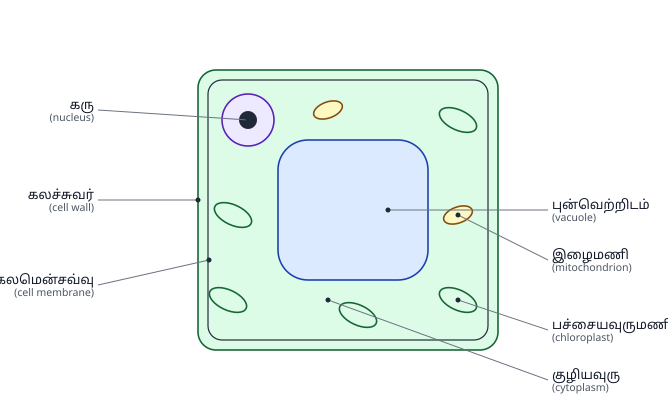

| இல. | பகுதி | English | தொழில் / குறிப்பு | SVG இலக்கு |
|---|---|---|---|---|
| 1 | கலச்சுவர் | cell wall | பொறிமுறை ஆதாரம், வடிவம் | `BIO-D01-L01-target` |
| 2 | கலமென்சவ்வு | cell membrane | பதார்த்தங்களின் உட்செல்கை/வெளிச்செல்கையைக் கட்டுப்படுத்தல் | `BIO-D01-L02-target` |
| 3 | கரு | nucleus | கலத் தொழிற்பாடுகளைக் கட்டுப்படுத்தல்; DNA | `BIO-D01-L03-target` |
| 4 | புன்வெற்றிடம் | vacuole | கலச்சாறு சேமிப்பு; வீக்கம் பேணல் | `BIO-D01-L04-target` |
| 5 | பச்சையவுருமணி | chloroplast | ஒளித்தொகுப்பு | `BIO-D01-L05-target` |
| 6 | இழைமணி | mitochondrion | காற்றுச் சுவாசம்; ATP | `BIO-D01-L06-target` |
| 7 | குழியவுரு | cytoplasm | இரசாயனத் தாக்கங்கள் நிகழுமிடம் | `BIO-D01-L07-target` |

### 2. இனங்காணல் முறை

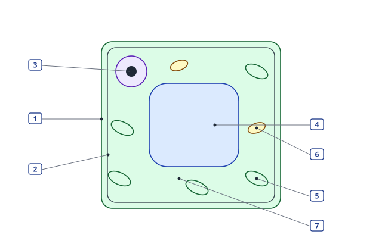

- இலக்கம் 1 இனால் காட்டப்படும் பகுதி எது?
- இலக்கம் 2 இனால் காட்டப்படும் பகுதி எது?
- இலக்கம் 3 இனால் காட்டப்படும் பகுதி எது?
- இலக்கம் 4 இனால் காட்டப்படும் பகுதி எது?
- இலக்கம் 5 இனால் காட்டப்படும் பகுதி எது?
- இலக்கம் 6 இனால் காட்டப்படும் பகுதி எது?
- இலக்கம் 7 இனால் காட்டப்படும் பகுதி எது?

விடைகள்

1. கலச்சுவர் (cell wall)
2. கலமென்சவ்வு (cell membrane)
3. கரு (nucleus)
4. புன்வெற்றிடம் (vacuole)
5. பச்சையவுருமணி (chloroplast)
6. இழைமணி (mitochondrion)
7. குழியவுரு (cytoplasm)

### 3. பெயரிடல் முறை

பின்வரும் பெயர்களைப் பெயரிடாத படத்தின் இலக்கப் பெட்டிகளில் இடுக: இழைமணி · கரு · கலச்சுவர் · கலமென்சவ்வு · குழியவுரு · பச்சையவுருமணி · புன்வெற்றிடம்

### 4. தொழில் பொருத்தல்

| பகுதி | தொழில் (கலக்கப்பட்டது) |
|---|---|
| A. கலச்சுவர் | 1. பதார்த்தங்களின் உட்செல்கை/வெளிச்செல்கையைக் கட்டுப்படுத்தல் |
| B. கலமென்சவ்வு | 2. ஒளித்தொகுப்பு |
| C. கரு | 3. கலச்சாறு சேமிப்பு; வீக்கம் பேணல் |
| D. புன்வெற்றிடம் | 4. இரசாயனத் தாக்கங்கள் நிகழுமிடம் |
| E. பச்சையவுருமணி | 5. கலத் தொழிற்பாடுகளைக் கட்டுப்படுத்தல்; DNA |
| F. இழைமணி | 6. பொறிமுறை ஆதாரம், வடிவம் |
| G. குழியவுரு | 7. காற்றுச் சுவாசம்; ATP |

விடைகள்

- A → 6
- B → 1
- C → 5
- D → 3
- E → 2
- F → 7
- G → 4

### 5. வரைதல் முறை — சரிபார்ப்புப் பட்டியல்

- [ ] தெளிவான, தொடர்ச்சியான பென்சில் கோடுகள்
- [ ] சரியான விகிதங்கள், ஒழுங்கு
- [ ] குறைந்தது 5 பகுதிகள் பெயரிடப்பட்டுள்ளன; பெயர்க் கோடுகள் குறுக்கிடவில்லை
- [ ] தலைப்பு எழுதப்பட்டுள்ளது

### 6. பரீட்சை முறை

பெயரிடாத படத்தில் (i) இலக்கம் 1, 2 இனைப் பெயரிடுக [2] (ii) 'கலச்சுவர்' இன் ஒரு தொழிலைத் தருக [1].

புள்ளித் திட்டம் (அசல்)

(i) 1 — கலச்சுவர்; 2 — கலமென்சவ்வு [தலா 1] (ii) பொறிமுறை ஆதாரம், வடிவம் [1]

---

## BIO-D02: விலங்குக் கலம் (Animal cell)

<!-- meta {"type":"diagram","id":"BIO-D02","chapter_id":"SC10-06","labelled":"science_assets/biology/BIO-D02_labelled.svg","unlabelled":"science_assets/biology/BIO-D02_unlabelled.svg","schematic":true,"labels":[{"label_id":"BIO-D02-L01","svg_target":"BIO-D02-L01-target","key":"membrane","ta":"கலமென்சவ்வு","en":"cell membrane","function":"உட்செல்கை/வெளிச்செல்கைக் கட்டுப்பாடு"},{"label_id":"BIO-D02-L02","svg_target":"BIO-D02-L02-target","key":"nucleus","ta":"கரு","en":"nucleus","function":"கட்டுப்பாட்டு மையம்"},{"label_id":"BIO-D02-L03","svg_target":"BIO-D02-L03-target","key":"nucleolus","ta":"புன்கரு","en":"nucleolus","function":"இறைபோசோம் உருவாக்கம்"},{"label_id":"BIO-D02-L04","svg_target":"BIO-D02-L04-target","key":"mito","ta":"இழைமணி","en":"mitochondrion","function":"சக்தி (ATP) உற்பத்தி"},{"label_id":"BIO-D02-L05","svg_target":"BIO-D02-L05-target","key":"cyto","ta":"குழியவுரு","en":"cytoplasm","function":"அனுசேபத் தாக்கங்கள்"},{"label_id":"BIO-D02-L06","svg_target":"BIO-D02-L06-target","key":"vac","ta":"சிறு புன்வெற்றிடம்","en":"small vacuole","function":"தற்காலிகச் சேமிப்பு"}],"provenance":"original-programmatic-svg"} -->

*தாவரக்கலங்களினதும் விலங்குக்கலங்களினதும் கட்டமைப்பும் தொழிற்பாடும் (Structure and functions of plant and animal cells)* · மூலம்: அசல் நிரல்வழி SVG · ⚠️ திட்டப் படம் (schematic) — விகிதங்கள் உண்மையானவை அல்ல; ஆசிரியர் மீளாய்வு

### 1. கற்றல் முறை

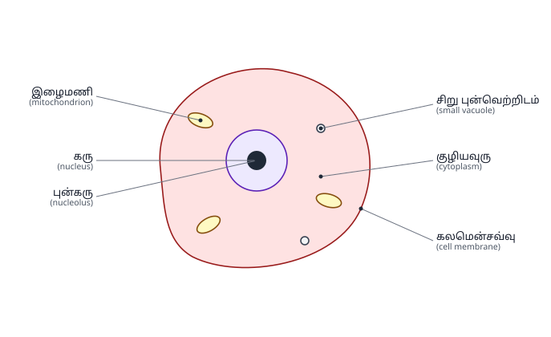

| இல. | பகுதி | English | தொழில் / குறிப்பு | SVG இலக்கு |
|---|---|---|---|---|
| 1 | கலமென்சவ்வு | cell membrane | உட்செல்கை/வெளிச்செல்கைக் கட்டுப்பாடு | `BIO-D02-L01-target` |
| 2 | கரு | nucleus | கட்டுப்பாட்டு மையம் | `BIO-D02-L02-target` |
| 3 | புன்கரு | nucleolus | இறைபோசோம் உருவாக்கம் | `BIO-D02-L03-target` |
| 4 | இழைமணி | mitochondrion | சக்தி (ATP) உற்பத்தி | `BIO-D02-L04-target` |
| 5 | குழியவுரு | cytoplasm | அனுசேபத் தாக்கங்கள் | `BIO-D02-L05-target` |
| 6 | சிறு புன்வெற்றிடம் | small vacuole | தற்காலிகச் சேமிப்பு | `BIO-D02-L06-target` |

### 2. இனங்காணல் முறை

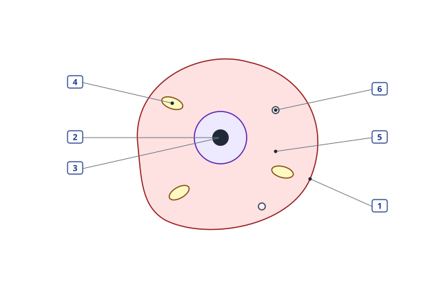

- இலக்கம் 1 இனால் காட்டப்படும் பகுதி எது?
- இலக்கம் 2 இனால் காட்டப்படும் பகுதி எது?
- இலக்கம் 3 இனால் காட்டப்படும் பகுதி எது?
- இலக்கம் 4 இனால் காட்டப்படும் பகுதி எது?
- இலக்கம் 5 இனால் காட்டப்படும் பகுதி எது?
- இலக்கம் 6 இனால் காட்டப்படும் பகுதி எது?

விடைகள்

1. கலமென்சவ்வு (cell membrane)
2. கரு (nucleus)
3. புன்கரு (nucleolus)
4. இழைமணி (mitochondrion)
5. குழியவுரு (cytoplasm)
6. சிறு புன்வெற்றிடம் (small vacuole)

### 3. பெயரிடல் முறை

பின்வரும் பெயர்களைப் பெயரிடாத படத்தின் இலக்கப் பெட்டிகளில் இடுக: இழைமணி · கரு · கலமென்சவ்வு · குழியவுரு · சிறு புன்வெற்றிடம் · புன்கரு

### 4. தொழில் பொருத்தல்

| பகுதி | தொழில் (கலக்கப்பட்டது) |
|---|---|
| A. கலமென்சவ்வு | 1. கட்டுப்பாட்டு மையம் |
| B. கரு | 2. இறைபோசோம் உருவாக்கம் |
| C. புன்கரு | 3. சக்தி (ATP) உற்பத்தி |
| D. இழைமணி | 4. அனுசேபத் தாக்கங்கள் |
| E. குழியவுரு | 5. உட்செல்கை/வெளிச்செல்கைக் கட்டுப்பாடு |
| F. சிறு புன்வெற்றிடம் | 6. தற்காலிகச் சேமிப்பு |

விடைகள்

- A → 5
- B → 1
- C → 2
- D → 3
- E → 4
- F → 6

### 5. வரைதல் முறை — சரிபார்ப்புப் பட்டியல்

- [ ] தெளிவான, தொடர்ச்சியான பென்சில் கோடுகள்
- [ ] சரியான விகிதங்கள், ஒழுங்கு
- [ ] குறைந்தது 5 பகுதிகள் பெயரிடப்பட்டுள்ளன; பெயர்க் கோடுகள் குறுக்கிடவில்லை
- [ ] தலைப்பு எழுதப்பட்டுள்ளது

### 6. பரீட்சை முறை

பெயரிடாத படத்தில் (i) இலக்கம் 1, 2 இனைப் பெயரிடுக [2] (ii) 'கலமென்சவ்வு' இன் ஒரு தொழிலைத் தருக [1].

புள்ளித் திட்டம் (அசல்)

(i) 1 — கலமென்சவ்வு; 2 — கரு [தலா 1] (ii) உட்செல்கை/வெளிச்செல்கைக் கட்டுப்பாடு [1]

---

## BIO-D03: இலையின் குறுக்குவெட்டு (Leaf cross-section)

<!-- meta {"type":"diagram","id":"BIO-D03","chapter_id":"SC11-02","labelled":"science_assets/biology/BIO-D03_labelled.svg","unlabelled":"science_assets/biology/BIO-D03_unlabelled.svg","schematic":true,"labels":[{"label_id":"BIO-D03-L01","svg_target":"BIO-D03-L01-target","key":"cuticle","ta":"புறத்தோல் படை","en":"waxy cuticle","function":"நீரிழப்பைக் குறைத்தல்"},{"label_id":"BIO-D03-L02","svg_target":"BIO-D03-L02-target","key":"uepi","ta":"மேற்புறத்தோல்","en":"upper epidermis","function":"பாதுகாப்பு; ஒளி ஊடுபுகல்"},{"label_id":"BIO-D03-L03","svg_target":"BIO-D03-L03-target","key":"palisade","ta":"வேலிக்காப்பு இழையம்","en":"palisade mesophyll","function":"பிரதான ஒளித்தொகுப்பு"},{"label_id":"BIO-D03-L04","svg_target":"BIO-D03-L04-target","key":"spongy","ta":"கடற்பஞ்சு இழையம்","en":"spongy mesophyll","function":"வாயுப் பரிமாற்றம் — காற்று இடைவெளிகள்"},{"label_id":"BIO-D03-L05","svg_target":"BIO-D03-L05-target","key":"xylem","ta":"காழ்","en":"xylem","function":"நீர், கனியுப்புக் கடத்தல்"},{"label_id":"BIO-D03-L06","svg_target":"BIO-D03-L06-target","key":"phloem","ta":"உரியம்","en":"phloem","function":"உணவு (சுக்குரோசு) கடத்தல்"},{"label_id":"BIO-D03-L07","svg_target":"BIO-D03-L07-target","key":"lepi","ta":"கீழ்ப்புறத்தோல்","en":"lower epidermis","function":"பாதுகாப்பு; இலைவாய்கள்"},{"label_id":"BIO-D03-L08","svg_target":"BIO-D03-L08-target","key":"guard","ta":"காவற்கலம்","en":"guard cell","function":"இலைவாயைத் திறத்தல்/மூடல்"},{"label_id":"BIO-D03-L09","svg_target":"BIO-D03-L09-target","key":"stoma","ta":"இலைவாய்","en":"stoma","function":"CO₂ உள்ளே, O₂/நீராவி வெளியே"}],"provenance":"original-programmatic-svg"} -->

*ஒளித்தொகுப்பு (Photosynthesis)* · மூலம்: அசல் நிரல்வழி SVG · ⚠️ திட்டப் படம் (schematic) — விகிதங்கள் உண்மையானவை அல்ல; ஆசிரியர் மீளாய்வு

### 1. கற்றல் முறை

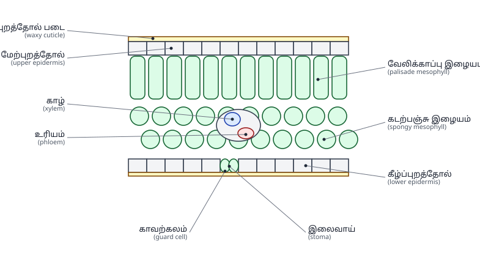

| இல. | பகுதி | English | தொழில் / குறிப்பு | SVG இலக்கு |
|---|---|---|---|---|
| 1 | புறத்தோல் படை | waxy cuticle | நீரிழப்பைக் குறைத்தல் | `BIO-D03-L01-target` |
| 2 | மேற்புறத்தோல் | upper epidermis | பாதுகாப்பு; ஒளி ஊடுபுகல் | `BIO-D03-L02-target` |
| 3 | வேலிக்காப்பு இழையம் | palisade mesophyll | பிரதான ஒளித்தொகுப்பு | `BIO-D03-L03-target` |
| 4 | கடற்பஞ்சு இழையம் | spongy mesophyll | வாயுப் பரிமாற்றம் — காற்று இடைவெளிகள் | `BIO-D03-L04-target` |
| 5 | காழ் | xylem | நீர், கனியுப்புக் கடத்தல் | `BIO-D03-L05-target` |
| 6 | உரியம் | phloem | உணவு (சுக்குரோசு) கடத்தல் | `BIO-D03-L06-target` |
| 7 | கீழ்ப்புறத்தோல் | lower epidermis | பாதுகாப்பு; இலைவாய்கள் | `BIO-D03-L07-target` |
| 8 | காவற்கலம் | guard cell | இலைவாயைத் திறத்தல்/மூடல் | `BIO-D03-L08-target` |
| 9 | இலைவாய் | stoma | CO₂ உள்ளே, O₂/நீராவி வெளியே | `BIO-D03-L09-target` |

### 2. இனங்காணல் முறை

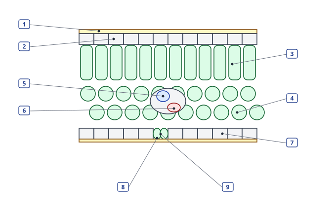

- இலக்கம் 1 இனால் காட்டப்படும் பகுதி எது?
- இலக்கம் 2 இனால் காட்டப்படும் பகுதி எது?
- இலக்கம் 3 இனால் காட்டப்படும் பகுதி எது?
- இலக்கம் 4 இனால் காட்டப்படும் பகுதி எது?
- இலக்கம் 5 இனால் காட்டப்படும் பகுதி எது?
- இலக்கம் 6 இனால் காட்டப்படும் பகுதி எது?
- இலக்கம் 7 இனால் காட்டப்படும் பகுதி எது?
- இலக்கம் 8 இனால் காட்டப்படும் பகுதி எது?
- இலக்கம் 9 இனால் காட்டப்படும் பகுதி எது?

விடைகள்

1. புறத்தோல் படை (waxy cuticle)
2. மேற்புறத்தோல் (upper epidermis)
3. வேலிக்காப்பு இழையம் (palisade mesophyll)
4. கடற்பஞ்சு இழையம் (spongy mesophyll)
5. காழ் (xylem)
6. உரியம் (phloem)
7. கீழ்ப்புறத்தோல் (lower epidermis)
8. காவற்கலம் (guard cell)
9. இலைவாய் (stoma)

### 3. பெயரிடல் முறை

பின்வரும் பெயர்களைப் பெயரிடாத படத்தின் இலக்கப் பெட்டிகளில் இடுக: இலைவாய் · உரியம் · கடற்பஞ்சு இழையம் · காழ் · காவற்கலம் · கீழ்ப்புறத்தோல் · புறத்தோல் படை · மேற்புறத்தோல் · வேலிக்காப்பு இழையம்

### 4. தொழில் பொருத்தல்

| பகுதி | தொழில் (கலக்கப்பட்டது) |
|---|---|
| A. புறத்தோல் படை | 1. நீரிழப்பைக் குறைத்தல் |
| B. மேற்புறத்தோல் | 2. வாயுப் பரிமாற்றம் — காற்று இடைவெளிகள் |
| C. வேலிக்காப்பு இழையம் | 3. பாதுகாப்பு; இலைவாய்கள் |
| D. கடற்பஞ்சு இழையம் | 4. பாதுகாப்பு; ஒளி ஊடுபுகல் |
| E. காழ் | 5. நீர், கனியுப்புக் கடத்தல் |
| F. உரியம் | 6. உணவு (சுக்குரோசு) கடத்தல் |
| G. கீழ்ப்புறத்தோல் | 7. CO₂ உள்ளே, O₂/நீராவி வெளியே |
| H. காவற்கலம் | 8. பிரதான ஒளித்தொகுப்பு |
| I. இலைவாய் | 9. இலைவாயைத் திறத்தல்/மூடல் |

விடைகள்

- A → 1
- B → 4
- C → 8
- D → 2
- E → 5
- F → 6
- G → 3
- H → 9
- I → 7

### 5. வரைதல் முறை — சரிபார்ப்புப் பட்டியல்

- [ ] தெளிவான, தொடர்ச்சியான பென்சில் கோடுகள்
- [ ] சரியான விகிதங்கள், ஒழுங்கு
- [ ] குறைந்தது 5 பகுதிகள் பெயரிடப்பட்டுள்ளன; பெயர்க் கோடுகள் குறுக்கிடவில்லை
- [ ] தலைப்பு எழுதப்பட்டுள்ளது

### 6. பரீட்சை முறை

பெயரிடாத படத்தில் (i) இலக்கம் 1, 2 இனைப் பெயரிடுக [2] (ii) 'புறத்தோல் படை' இன் ஒரு தொழிலைத் தருக [1].

புள்ளித் திட்டம் (அசல்)

(i) 1 — புறத்தோல் படை; 2 — மேற்புறத்தோல் [தலா 1] (ii) நீரிழப்பைக் குறைத்தல் [1]

---

## BIO-D04: மனித இதயம் (திட்டப் படம்) (Human heart (schematic))

<!-- meta {"type":"diagram","id":"BIO-D04","chapter_id":"SC11-06","labelled":"science_assets/biology/BIO-D04_labelled.svg","unlabelled":"science_assets/biology/BIO-D04_unlabelled.svg","schematic":true,"labels":[{"label_id":"BIO-D04-L01","svg_target":"BIO-D04-L01-target","key":"ra","ta":"வலது சோணையறை","en":"right atrium","function":"உடலிலிருந்து ஒட்சிசனற்ற குருதியைப் பெறல்"},{"label_id":"BIO-D04-L02","svg_target":"BIO-D04-L02-target","key":"rv","ta":"வலது இதயவறை","en":"right ventricle","function":"நுரையீரலுக்குக் குருதியைப் பம்புதல்"},{"label_id":"BIO-D04-L03","svg_target":"BIO-D04-L03-target","key":"la","ta":"இடது சோணையறை","en":"left atrium","function":"நுரையீரலிலிருந்து ஒட்சிசனுள்ள குருதி"},{"label_id":"BIO-D04-L04","svg_target":"BIO-D04-L04-target","key":"lv","ta":"இடது இதயவறை","en":"left ventricle","function":"உடலுக்குப் பம்புதல் — தடித்த சுவர்"},{"label_id":"BIO-D04-L05","svg_target":"BIO-D04-L05-target","key":"septum","ta":"இடைச்சுவர்","en":"septum","function":"இருபக்கக் குருதி கலவாமை"},{"label_id":"BIO-D04-L06","svg_target":"BIO-D04-L06-target","key":"svc","ta":"மேற்பெருநாளம்","en":"superior vena cava","function":"மேலுடலிலிருந்து குருதி"},{"label_id":"BIO-D04-L07","svg_target":"BIO-D04-L07-target","key":"ivc","ta":"கீழ்ப்பெருநாளம்","en":"inferior vena cava","function":"கீழுடலிலிருந்து குருதி"},{"label_id":"BIO-D04-L08","svg_target":"BIO-D04-L08-target","key":"aorta","ta":"பெருநாடி","en":"aorta","function":"உடலுக்கு ஒட்சிசனுள்ள குருதி"},{"label_id":"BIO-D04-L09","svg_target":"BIO-D04-L09-target","key":"pa","ta":"நுரையீரல் நாடி","en":"pulmonary artery","function":"நுரையீரலுக்கு ஒட்சிசனற்ற குருதி"},{"label_id":"BIO-D04-L10","svg_target":"BIO-D04-L10-target","key":"pv","ta":"நுரையீரல் நாளம்","en":"pulmonary vein","function":"நுரையீரலிலிருந்து ஒட்சிசனுள்ள குருதி"},{"label_id":"BIO-D04-L11","svg_target":"BIO-D04-L11-target","key":"tricuspid","ta":"மூவிதழ் வால்வு","en":"tricuspid valve","function":"பின்னோட்டத் தடுப்பு"},{"label_id":"BIO-D04-L12","svg_target":"BIO-D04-L12-target","key":"bicuspid","ta":"ஈரிதழ் வால்வு","en":"bicuspid valve","function":"பின்னோட்டத் தடுப்பு"}],"provenance":"original-programmatic-svg"} -->

*மனித உடற் செயன்முறைகள் (Biological processes in the human body)* · மூலம்: அசல் நிரல்வழி SVG · ⚠️ திட்டப் படம் (schematic) — விகிதங்கள் உண்மையானவை அல்ல; ஆசிரியர் மீளாய்வு

### 1. கற்றல் முறை

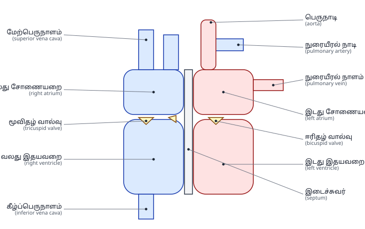

| இல. | பகுதி | English | தொழில் / குறிப்பு | SVG இலக்கு |
|---|---|---|---|---|
| 1 | வலது சோணையறை | right atrium | உடலிலிருந்து ஒட்சிசனற்ற குருதியைப் பெறல் | `BIO-D04-L01-target` |
| 2 | வலது இதயவறை | right ventricle | நுரையீரலுக்குக் குருதியைப் பம்புதல் | `BIO-D04-L02-target` |
| 3 | இடது சோணையறை | left atrium | நுரையீரலிலிருந்து ஒட்சிசனுள்ள குருதி | `BIO-D04-L03-target` |
| 4 | இடது இதயவறை | left ventricle | உடலுக்குப் பம்புதல் — தடித்த சுவர் | `BIO-D04-L04-target` |
| 5 | இடைச்சுவர் | septum | இருபக்கக் குருதி கலவாமை | `BIO-D04-L05-target` |
| 6 | மேற்பெருநாளம் | superior vena cava | மேலுடலிலிருந்து குருதி | `BIO-D04-L06-target` |
| 7 | கீழ்ப்பெருநாளம் | inferior vena cava | கீழுடலிலிருந்து குருதி | `BIO-D04-L07-target` |
| 8 | பெருநாடி | aorta | உடலுக்கு ஒட்சிசனுள்ள குருதி | `BIO-D04-L08-target` |
| 9 | நுரையீரல் நாடி | pulmonary artery | நுரையீரலுக்கு ஒட்சிசனற்ற குருதி | `BIO-D04-L09-target` |
| 10 | நுரையீரல் நாளம் | pulmonary vein | நுரையீரலிலிருந்து ஒட்சிசனுள்ள குருதி | `BIO-D04-L10-target` |
| 11 | மூவிதழ் வால்வு | tricuspid valve | பின்னோட்டத் தடுப்பு | `BIO-D04-L11-target` |
| 12 | ஈரிதழ் வால்வு | bicuspid valve | பின்னோட்டத் தடுப்பு | `BIO-D04-L12-target` |

### 2. இனங்காணல் முறை

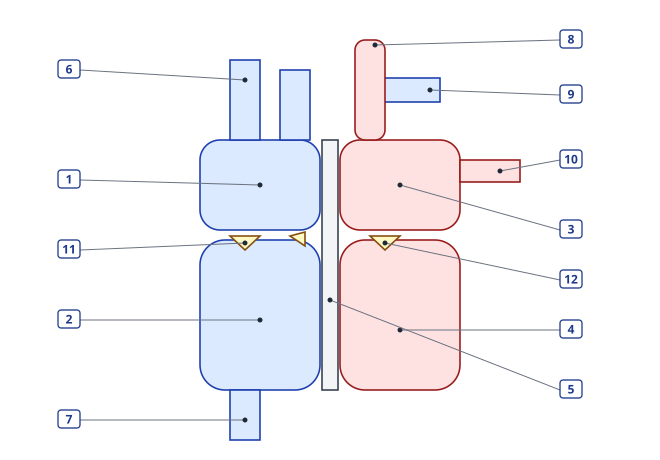

- இலக்கம் 1 இனால் காட்டப்படும் பகுதி எது?
- இலக்கம் 2 இனால் காட்டப்படும் பகுதி எது?
- இலக்கம் 3 இனால் காட்டப்படும் பகுதி எது?
- இலக்கம் 4 இனால் காட்டப்படும் பகுதி எது?
- இலக்கம் 5 இனால் காட்டப்படும் பகுதி எது?
- இலக்கம் 6 இனால் காட்டப்படும் பகுதி எது?
- இலக்கம் 7 இனால் காட்டப்படும் பகுதி எது?
- இலக்கம் 8 இனால் காட்டப்படும் பகுதி எது?
- இலக்கம் 9 இனால் காட்டப்படும் பகுதி எது?
- இலக்கம் 10 இனால் காட்டப்படும் பகுதி எது?
- இலக்கம் 11 இனால் காட்டப்படும் பகுதி எது?
- இலக்கம் 12 இனால் காட்டப்படும் பகுதி எது?

விடைகள்

1. வலது சோணையறை (right atrium)
2. வலது இதயவறை (right ventricle)
3. இடது சோணையறை (left atrium)
4. இடது இதயவறை (left ventricle)
5. இடைச்சுவர் (septum)
6. மேற்பெருநாளம் (superior vena cava)
7. கீழ்ப்பெருநாளம் (inferior vena cava)
8. பெருநாடி (aorta)
9. நுரையீரல் நாடி (pulmonary artery)
10. நுரையீரல் நாளம் (pulmonary vein)
11. மூவிதழ் வால்வு (tricuspid valve)
12. ஈரிதழ் வால்வு (bicuspid valve)

### 3. பெயரிடல் முறை

பின்வரும் பெயர்களைப் பெயரிடாத படத்தின் இலக்கப் பெட்டிகளில் இடுக: இடது இதயவறை · இடது சோணையறை · இடைச்சுவர் · ஈரிதழ் வால்வு · கீழ்ப்பெருநாளம் · நுரையீரல் நாடி · நுரையீரல் நாளம் · பெருநாடி · மூவிதழ் வால்வு · மேற்பெருநாளம் · வலது இதயவறை · வலது சோணையறை

### 4. தொழில் பொருத்தல்

| பகுதி | தொழில் (கலக்கப்பட்டது) |
|---|---|
| A. வலது சோணையறை | 1. இருபக்கக் குருதி கலவாமை |
| B. வலது இதயவறை | 2. நுரையீரலுக்குக் குருதியைப் பம்புதல் |
| C. இடது சோணையறை | 3. மேலுடலிலிருந்து குருதி |
| D. இடது இதயவறை | 4. பின்னோட்டத் தடுப்பு |
| E. இடைச்சுவர் | 5. உடலுக்குப் பம்புதல் — தடித்த சுவர் |
| F. மேற்பெருநாளம் | 6. பின்னோட்டத் தடுப்பு |
| G. கீழ்ப்பெருநாளம் | 7. உடலிலிருந்து ஒட்சிசனற்ற குருதியைப் பெறல் |
| H. பெருநாடி | 8. நுரையீரலிலிருந்து ஒட்சிசனுள்ள குருதி |
| I. நுரையீரல் நாடி | 9. நுரையீரலுக்கு ஒட்சிசனற்ற குருதி |
| J. நுரையீரல் நாளம் | 10. உடலுக்கு ஒட்சிசனுள்ள குருதி |
| K. மூவிதழ் வால்வு | 11. நுரையீரலிலிருந்து ஒட்சிசனுள்ள குருதி |
| L. ஈரிதழ் வால்வு | 12. கீழுடலிலிருந்து குருதி |

விடைகள்

- A → 7
- B → 2
- C → 8
- D → 5
- E → 1
- F → 3
- G → 12
- H → 10
- I → 9
- J → 8
- K → 4
- L → 4

### 5. வரைதல் முறை — சரிபார்ப்புப் பட்டியல்

- [ ] தெளிவான, தொடர்ச்சியான பென்சில் கோடுகள்
- [ ] சரியான விகிதங்கள், ஒழுங்கு
- [ ] குறைந்தது 5 பகுதிகள் பெயரிடப்பட்டுள்ளன; பெயர்க் கோடுகள் குறுக்கிடவில்லை
- [ ] தலைப்பு எழுதப்பட்டுள்ளது

### 6. பரீட்சை முறை

பெயரிடாத படத்தில் (i) இலக்கம் 1, 2 இனைப் பெயரிடுக [2] (ii) 'வலது சோணையறை' இன் ஒரு தொழிலைத் தருக [1].

புள்ளித் திட்டம் (அசல்)

(i) 1 — வலது சோணையறை; 2 — வலது இதயவறை [தலா 1] (ii) உடலிலிருந்து ஒட்சிசனற்ற குருதியைப் பெறல் [1]

---

## BIO-D05: சமிபாட்டுத் தொகுதி (திட்டப் படம்) (Digestive system (schematic))

<!-- meta {"type":"diagram","id":"BIO-D05","chapter_id":"SC11-06","labelled":"science_assets/biology/BIO-D05_labelled.svg","unlabelled":"science_assets/biology/BIO-D05_unlabelled.svg","schematic":true,"labels":[{"label_id":"BIO-D05-L01","svg_target":"BIO-D05-L01-target","key":"mouth","ta":"வாய்க்குழி","en":"buccal cavity","function":"மெல்லுதல்; உமிழ்நீர் அமிலேசு"},{"label_id":"BIO-D05-L02","svg_target":"BIO-D05-L02-target","key":"oes","ta":"களம்","en":"oesophagus","function":"சுற்றுச் சுருக்க அசைவால் உணவு கடத்தல்"},{"label_id":"BIO-D05-L03","svg_target":"BIO-D05-L03-target","key":"liver","ta":"ஈரல்","en":"liver","function":"பித்தம் உற்பத்தி"},{"label_id":"BIO-D05-L04","svg_target":"BIO-D05-L04-target","key":"stomach","ta":"இரைப்பை","en":"stomach","function":"பெப்சின், HCl — புரதச் சமிபாடு"},{"label_id":"BIO-D05-L05","svg_target":"BIO-D05-L05-target","key":"pancreas","ta":"சதையி","en":"pancreas","function":"சதையிச் சாறு (அமிலேசு, திரிப்சின், இலிப்பேசு)"},{"label_id":"BIO-D05-L06","svg_target":"BIO-D05-L06-target","key":"si","ta":"சிறுகுடல்","en":"small intestine","function":"சமிபாடு முடிவு; உறிஞ்சல் (சடைமுளைகள்)"},{"label_id":"BIO-D05-L07","svg_target":"BIO-D05-L07-target","key":"li","ta":"பெருங்குடல்","en":"large intestine","function":"நீர் மீளுறிஞ்சல்"},{"label_id":"BIO-D05-L08","svg_target":"BIO-D05-L08-target","key":"rectum","ta":"நேர்குடல்/குதம்","en":"rectum/anus","function":"மலம் தற்காலிகச் சேமிப்பு, வெளியேற்றம்"}],"provenance":"original-programmatic-svg"} -->

*மனித உடற் செயன்முறைகள் (Biological processes in the human body)* · மூலம்: அசல் நிரல்வழி SVG · ⚠️ திட்டப் படம் (schematic) — விகிதங்கள் உண்மையானவை அல்ல; ஆசிரியர் மீளாய்வு

### 1. கற்றல் முறை

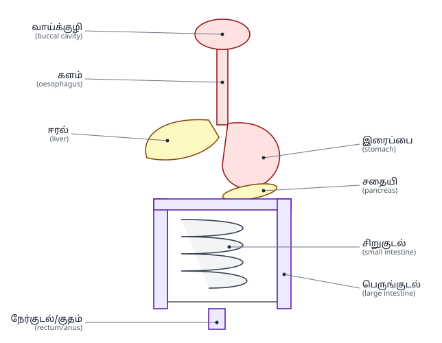

| இல. | பகுதி | English | தொழில் / குறிப்பு | SVG இலக்கு |
|---|---|---|---|---|
| 1 | வாய்க்குழி | buccal cavity | மெல்லுதல்; உமிழ்நீர் அமிலேசு | `BIO-D05-L01-target` |
| 2 | களம் | oesophagus | சுற்றுச் சுருக்க அசைவால் உணவு கடத்தல் | `BIO-D05-L02-target` |
| 3 | ஈரல் | liver | பித்தம் உற்பத்தி | `BIO-D05-L03-target` |
| 4 | இரைப்பை | stomach | பெப்சின், HCl — புரதச் சமிபாடு | `BIO-D05-L04-target` |
| 5 | சதையி | pancreas | சதையிச் சாறு (அமிலேசு, திரிப்சின், இலிப்பேசு) | `BIO-D05-L05-target` |
| 6 | சிறுகுடல் | small intestine | சமிபாடு முடிவு; உறிஞ்சல் (சடைமுளைகள்) | `BIO-D05-L06-target` |
| 7 | பெருங்குடல் | large intestine | நீர் மீளுறிஞ்சல் | `BIO-D05-L07-target` |
| 8 | நேர்குடல்/குதம் | rectum/anus | மலம் தற்காலிகச் சேமிப்பு, வெளியேற்றம் | `BIO-D05-L08-target` |

### 2. இனங்காணல் முறை

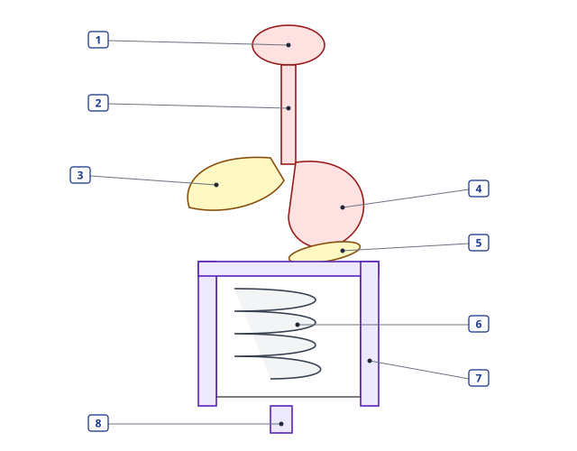

- இலக்கம் 1 இனால் காட்டப்படும் பகுதி எது?
- இலக்கம் 2 இனால் காட்டப்படும் பகுதி எது?
- இலக்கம் 3 இனால் காட்டப்படும் பகுதி எது?
- இலக்கம் 4 இனால் காட்டப்படும் பகுதி எது?
- இலக்கம் 5 இனால் காட்டப்படும் பகுதி எது?
- இலக்கம் 6 இனால் காட்டப்படும் பகுதி எது?
- இலக்கம் 7 இனால் காட்டப்படும் பகுதி எது?
- இலக்கம் 8 இனால் காட்டப்படும் பகுதி எது?

விடைகள்

1. வாய்க்குழி (buccal cavity)
2. களம் (oesophagus)
3. ஈரல் (liver)
4. இரைப்பை (stomach)
5. சதையி (pancreas)
6. சிறுகுடல் (small intestine)
7. பெருங்குடல் (large intestine)
8. நேர்குடல்/குதம் (rectum/anus)

### 3. பெயரிடல் முறை

பின்வரும் பெயர்களைப் பெயரிடாத படத்தின் இலக்கப் பெட்டிகளில் இடுக: இரைப்பை · ஈரல் · களம் · சதையி · சிறுகுடல் · நேர்குடல்/குதம் · பெருங்குடல் · வாய்க்குழி

### 4. தொழில் பொருத்தல்

| பகுதி | தொழில் (கலக்கப்பட்டது) |
|---|---|
| A. வாய்க்குழி | 1. நீர் மீளுறிஞ்சல் |
| B. களம் | 2. சதையிச் சாறு (அமிலேசு, திரிப்சின், இலிப்பேசு) |
| C. ஈரல் | 3. சுற்றுச் சுருக்க அசைவால் உணவு கடத்தல் |
| D. இரைப்பை | 4. சமிபாடு முடிவு; உறிஞ்சல் (சடைமுளைகள்) |
| E. சதையி | 5. மலம் தற்காலிகச் சேமிப்பு, வெளியேற்றம் |
| F. சிறுகுடல் | 6. பித்தம் உற்பத்தி |
| G. பெருங்குடல் | 7. மெல்லுதல்; உமிழ்நீர் அமிலேசு |
| H. நேர்குடல்/குதம் | 8. பெப்சின், HCl — புரதச் சமிபாடு |

விடைகள்

- A → 7
- B → 3
- C → 6
- D → 8
- E → 2
- F → 4
- G → 1
- H → 5

### 5. வரைதல் முறை — சரிபார்ப்புப் பட்டியல்

- [ ] தெளிவான, தொடர்ச்சியான பென்சில் கோடுகள்
- [ ] சரியான விகிதங்கள், ஒழுங்கு
- [ ] குறைந்தது 5 பகுதிகள் பெயரிடப்பட்டுள்ளன; பெயர்க் கோடுகள் குறுக்கிடவில்லை
- [ ] தலைப்பு எழுதப்பட்டுள்ளது

### 6. பரீட்சை முறை

பெயரிடாத படத்தில் (i) இலக்கம் 1, 2 இனைப் பெயரிடுக [2] (ii) 'வாய்க்குழி' இன் ஒரு தொழிலைத் தருக [1].

புள்ளித் திட்டம் (அசல்)

(i) 1 — வாய்க்குழி; 2 — களம் [தலா 1] (ii) மெல்லுதல்; உமிழ்நீர் அமிலேசு [1]

---

## BIO-D06: சுவாசத் தொகுதி (Respiratory system)

<!-- meta {"type":"diagram","id":"BIO-D06","chapter_id":"SC11-06","labelled":"science_assets/biology/BIO-D06_labelled.svg","unlabelled":"science_assets/biology/BIO-D06_unlabelled.svg","schematic":true,"labels":[{"label_id":"BIO-D06-L01","svg_target":"BIO-D06-L01-target","key":"trachea","ta":"வாதனாளி","en":"trachea","function":"C வடிவக் கசியிழை வளையங்கள் — திறந்திருக்கும்"},{"label_id":"BIO-D06-L02","svg_target":"BIO-D06-L02-target","key":"bronchus","ta":"சுவாசப்பை நாளி","en":"bronchus","function":"வளியை நுரையீரலுக்குக் கடத்தல்"},{"label_id":"BIO-D06-L03","svg_target":"BIO-D06-L03-target","key":"bronchiole","ta":"சுவாசச் சிறுகுழாய்","en":"bronchiole","function":"சிற்றறைகளுக்கு வளி"},{"label_id":"BIO-D06-L04","svg_target":"BIO-D06-L04-target","key":"lung","ta":"நுரையீரல்","en":"lung","function":"வாயுப் பரிமாற்றம் (சிற்றறைகள்)"},{"label_id":"BIO-D06-L05","svg_target":"BIO-D06-L05-target","key":"diaphragm","ta":"பிரிமென்றகடு","en":"diaphragm","function":"சுருங்கும்போது தட்டையாகி உட்சுவாசம்"},{"label_id":"BIO-D06-L06","svg_target":"BIO-D06-L06-target","key":"ribs","ta":"விலா என்புகள்","en":"ribs","function":"விலா இடைத்தசைகளுடன் நெஞ்சறைக் கனவளவு மாற்றம்"}],"provenance":"original-programmatic-svg"} -->

*மனித உடற் செயன்முறைகள் (Biological processes in the human body)* · மூலம்: அசல் நிரல்வழி SVG · ⚠️ திட்டப் படம் (schematic) — விகிதங்கள் உண்மையானவை அல்ல; ஆசிரியர் மீளாய்வு

### 1. கற்றல் முறை

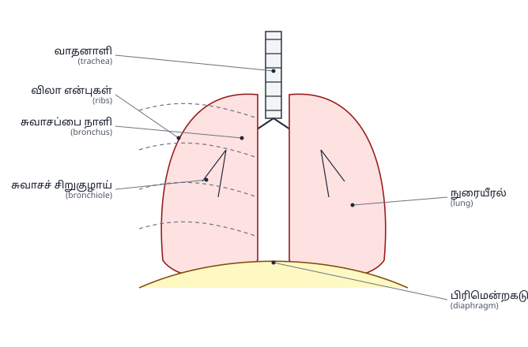

| இல. | பகுதி | English | தொழில் / குறிப்பு | SVG இலக்கு |
|---|---|---|---|---|
| 1 | வாதனாளி | trachea | C வடிவக் கசியிழை வளையங்கள் — திறந்திருக்கும் | `BIO-D06-L01-target` |
| 2 | சுவாசப்பை நாளி | bronchus | வளியை நுரையீரலுக்குக் கடத்தல் | `BIO-D06-L02-target` |
| 3 | சுவாசச் சிறுகுழாய் | bronchiole | சிற்றறைகளுக்கு வளி | `BIO-D06-L03-target` |
| 4 | நுரையீரல் | lung | வாயுப் பரிமாற்றம் (சிற்றறைகள்) | `BIO-D06-L04-target` |
| 5 | பிரிமென்றகடு | diaphragm | சுருங்கும்போது தட்டையாகி உட்சுவாசம் | `BIO-D06-L05-target` |
| 6 | விலா என்புகள் | ribs | விலா இடைத்தசைகளுடன் நெஞ்சறைக் கனவளவு மாற்றம் | `BIO-D06-L06-target` |

### 2. இனங்காணல் முறை

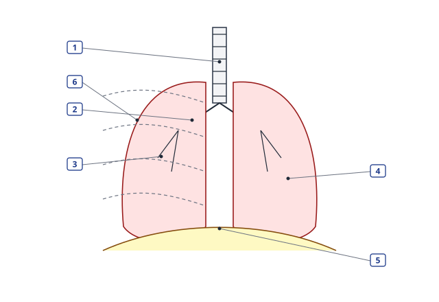

- இலக்கம் 1 இனால் காட்டப்படும் பகுதி எது?
- இலக்கம் 2 இனால் காட்டப்படும் பகுதி எது?
- இலக்கம் 3 இனால் காட்டப்படும் பகுதி எது?
- இலக்கம் 4 இனால் காட்டப்படும் பகுதி எது?
- இலக்கம் 5 இனால் காட்டப்படும் பகுதி எது?
- இலக்கம் 6 இனால் காட்டப்படும் பகுதி எது?

விடைகள்

1. வாதனாளி (trachea)
2. சுவாசப்பை நாளி (bronchus)
3. சுவாசச் சிறுகுழாய் (bronchiole)
4. நுரையீரல் (lung)
5. பிரிமென்றகடு (diaphragm)
6. விலா என்புகள் (ribs)

### 3. பெயரிடல் முறை

பின்வரும் பெயர்களைப் பெயரிடாத படத்தின் இலக்கப் பெட்டிகளில் இடுக: சுவாசச் சிறுகுழாய் · சுவாசப்பை நாளி · நுரையீரல் · பிரிமென்றகடு · வாதனாளி · விலா என்புகள்

### 4. தொழில் பொருத்தல்

| பகுதி | தொழில் (கலக்கப்பட்டது) |
|---|---|
| A. வாதனாளி | 1. விலா இடைத்தசைகளுடன் நெஞ்சறைக் கனவளவு மாற்றம் |
| B. சுவாசப்பை நாளி | 2. சிற்றறைகளுக்கு வளி |
| C. சுவாசச் சிறுகுழாய் | 3. C வடிவக் கசியிழை வளையங்கள் — திறந்திருக்கும் |
| D. நுரையீரல் | 4. சுருங்கும்போது தட்டையாகி உட்சுவாசம் |
| E. பிரிமென்றகடு | 5. வளியை நுரையீரலுக்குக் கடத்தல் |
| F. விலா என்புகள் | 6. வாயுப் பரிமாற்றம் (சிற்றறைகள்) |

விடைகள்

- A → 3
- B → 5
- C → 2
- D → 6
- E → 4
- F → 1

### 5. வரைதல் முறை — சரிபார்ப்புப் பட்டியல்

- [ ] தெளிவான, தொடர்ச்சியான பென்சில் கோடுகள்
- [ ] சரியான விகிதங்கள், ஒழுங்கு
- [ ] குறைந்தது 5 பகுதிகள் பெயரிடப்பட்டுள்ளன; பெயர்க் கோடுகள் குறுக்கிடவில்லை
- [ ] தலைப்பு எழுதப்பட்டுள்ளது

### 6. பரீட்சை முறை

பெயரிடாத படத்தில் (i) இலக்கம் 1, 2 இனைப் பெயரிடுக [2] (ii) 'வாதனாளி' இன் ஒரு தொழிலைத் தருக [1].

புள்ளித் திட்டம் (அசல்)

(i) 1 — வாதனாளி; 2 — சுவாசப்பை நாளி [தலா 1] (ii) C வடிவக் கசியிழை வளையங்கள் — திறந்திருக்கும் [1]

---

## BIO-D07: நெப்பிரோன் (திட்டப் படம்) (Nephron (schematic))

<!-- meta {"type":"diagram","id":"BIO-D07","chapter_id":"SC11-06","labelled":"science_assets/biology/BIO-D07_labelled.svg","unlabelled":"science_assets/biology/BIO-D07_unlabelled.svg","schematic":true,"labels":[{"label_id":"BIO-D07-L01","svg_target":"BIO-D07-L01-target","key":"glom","ta":"கலனுருச்சிறுதிரள்","en":"glomerulus","function":"அமுக்க வடிகட்டல் (மீவடிகட்டல்)"},{"label_id":"BIO-D07-L02","svg_target":"BIO-D07-L02-target","key":"bowman","ta":"போமனின் உறை","en":"Bowman's capsule","function":"வடிதிரவத்தைச் சேகரித்தல்"},{"label_id":"BIO-D07-L03","svg_target":"BIO-D07-L03-target","key":"pct","ta":"அண்மைச் சுருண்ட சிறுகுழாய்","en":"proximal convoluted tubule","function":"குளுக்கோசு, அமினோவமில மீளுறிஞ்சல்"},{"label_id":"BIO-D07-L04","svg_target":"BIO-D07-L04-target","key":"loop","ta":"என்லேயின் தடம்","en":"loop of Henle","function":"நீர், உப்பு மீளுறிஞ்சல்"},{"label_id":"BIO-D07-L05","svg_target":"BIO-D07-L05-target","key":"dct","ta":"சேய்மைச் சுருண்ட சிறுகுழாய்","en":"distal convoluted tubule","function":"அயன் சமநிலை பேணல்"},{"label_id":"BIO-D07-L06","svg_target":"BIO-D07-L06-target","key":"cd","ta":"சேகரிக்கும் கான்","en":"collecting duct","function":"ADH கட்டுப்பாட்டில் நீர் மீளுறிஞ்சல்"}],"provenance":"original-programmatic-svg"} -->

*மனித உடற் செயன்முறைகள் (Biological processes in the human body)* · மூலம்: அசல் நிரல்வழி SVG · ⚠️ திட்டப் படம் (schematic) — விகிதங்கள் உண்மையானவை அல்ல; ஆசிரியர் மீளாய்வு

### 1. கற்றல் முறை

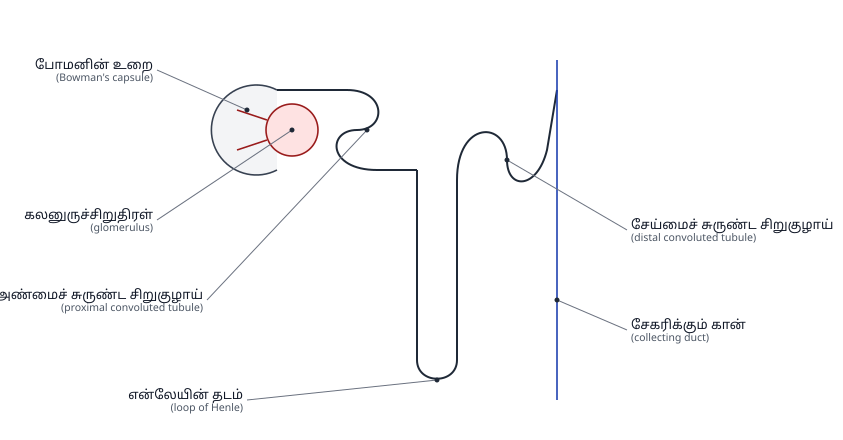

| இல. | பகுதி | English | தொழில் / குறிப்பு | SVG இலக்கு |
|---|---|---|---|---|
| 1 | கலனுருச்சிறுதிரள் | glomerulus | அமுக்க வடிகட்டல் (மீவடிகட்டல்) | `BIO-D07-L01-target` |
| 2 | போமனின் உறை | Bowman's capsule | வடிதிரவத்தைச் சேகரித்தல் | `BIO-D07-L02-target` |
| 3 | அண்மைச் சுருண்ட சிறுகுழாய் | proximal convoluted tubule | குளுக்கோசு, அமினோவமில மீளுறிஞ்சல் | `BIO-D07-L03-target` |
| 4 | என்லேயின் தடம் | loop of Henle | நீர், உப்பு மீளுறிஞ்சல் | `BIO-D07-L04-target` |
| 5 | சேய்மைச் சுருண்ட சிறுகுழாய் | distal convoluted tubule | அயன் சமநிலை பேணல் | `BIO-D07-L05-target` |
| 6 | சேகரிக்கும் கான் | collecting duct | ADH கட்டுப்பாட்டில் நீர் மீளுறிஞ்சல் | `BIO-D07-L06-target` |

### 2. இனங்காணல் முறை

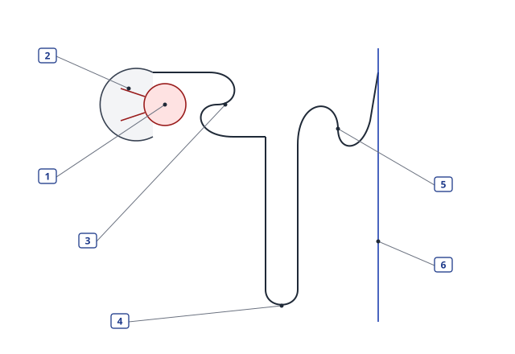

- இலக்கம் 1 இனால் காட்டப்படும் பகுதி எது?
- இலக்கம் 2 இனால் காட்டப்படும் பகுதி எது?
- இலக்கம் 3 இனால் காட்டப்படும் பகுதி எது?
- இலக்கம் 4 இனால் காட்டப்படும் பகுதி எது?
- இலக்கம் 5 இனால் காட்டப்படும் பகுதி எது?
- இலக்கம் 6 இனால் காட்டப்படும் பகுதி எது?

விடைகள்

1. கலனுருச்சிறுதிரள் (glomerulus)
2. போமனின் உறை (Bowman's capsule)
3. அண்மைச் சுருண்ட சிறுகுழாய் (proximal convoluted tubule)
4. என்லேயின் தடம் (loop of Henle)
5. சேய்மைச் சுருண்ட சிறுகுழாய் (distal convoluted tubule)
6. சேகரிக்கும் கான் (collecting duct)

### 3. பெயரிடல் முறை

பின்வரும் பெயர்களைப் பெயரிடாத படத்தின் இலக்கப் பெட்டிகளில் இடுக: அண்மைச் சுருண்ட சிறுகுழாய் · என்லேயின் தடம் · கலனுருச்சிறுதிரள் · சேகரிக்கும் கான் · சேய்மைச் சுருண்ட சிறுகுழாய் · போமனின் உறை

### 4. தொழில் பொருத்தல்

| பகுதி | தொழில் (கலக்கப்பட்டது) |
|---|---|
| A. கலனுருச்சிறுதிரள் | 1. அயன் சமநிலை பேணல் |
| B. போமனின் உறை | 2. ADH கட்டுப்பாட்டில் நீர் மீளுறிஞ்சல் |
| C. அண்மைச் சுருண்ட சிறுகுழாய் | 3. நீர், உப்பு மீளுறிஞ்சல் |
| D. என்லேயின் தடம் | 4. குளுக்கோசு, அமினோவமில மீளுறிஞ்சல் |
| E. சேய்மைச் சுருண்ட சிறுகுழாய் | 5. அமுக்க வடிகட்டல் (மீவடிகட்டல்) |
| F. சேகரிக்கும் கான் | 6. வடிதிரவத்தைச் சேகரித்தல் |

விடைகள்

- A → 5
- B → 6
- C → 4
- D → 3
- E → 1
- F → 2

### 5. வரைதல் முறை — சரிபார்ப்புப் பட்டியல்

- [ ] தெளிவான, தொடர்ச்சியான பென்சில் கோடுகள்
- [ ] சரியான விகிதங்கள், ஒழுங்கு
- [ ] குறைந்தது 5 பகுதிகள் பெயரிடப்பட்டுள்ளன; பெயர்க் கோடுகள் குறுக்கிடவில்லை
- [ ] தலைப்பு எழுதப்பட்டுள்ளது

### 6. பரீட்சை முறை

பெயரிடாத படத்தில் (i) இலக்கம் 1, 2 இனைப் பெயரிடுக [2] (ii) 'கலனுருச்சிறுதிரள்' இன் ஒரு தொழிலைத் தருக [1].

புள்ளித் திட்டம் (அசல்)

(i) 1 — கலனுருச்சிறுதிரள்; 2 — போமனின் உறை [தலா 1] (ii) அமுக்க வடிகட்டல் (மீவடிகட்டல்) [1]

---

## BIO-D08: பூவின் நெடுக்குவெட்டு (Flower L.S.)

<!-- meta {"type":"diagram","id":"BIO-D08","chapter_id":"SC10-14","labelled":"science_assets/biology/BIO-D08_labelled.svg","unlabelled":"science_assets/biology/BIO-D08_unlabelled.svg","schematic":true,"labels":[{"label_id":"BIO-D08-L01","svg_target":"BIO-D08-L01-target","key":"stigma","ta":"சூலகமுடி","en":"stigma","function":"மகரந்தமணிகளைப் பெறல்"},{"label_id":"BIO-D08-L02","svg_target":"BIO-D08-L02-target","key":"style","ta":"சூல்தண்டு","en":"style","function":"மகரந்தக் குழாய் வளரும் பாதை"},{"label_id":"BIO-D08-L03","svg_target":"BIO-D08-L03-target","key":"ovary","ta":"சூலகம்","en":"ovary","function":"சூல்வித்துகளைக் கொண்டது; பழமாகும்"},{"label_id":"BIO-D08-L04","svg_target":"BIO-D08-L04-target","key":"ovule","ta":"சூல்வித்து","en":"ovule","function":"கருக்கட்டலின் பின் வித்தாகும்"},{"label_id":"BIO-D08-L05","svg_target":"BIO-D08-L05-target","key":"anther","ta":"மகரந்தக்கூடு","en":"anther","function":"மகரந்தமணி உற்பத்தி"},{"label_id":"BIO-D08-L06","svg_target":"BIO-D08-L06-target","key":"filament","ta":"இழை","en":"filament","function":"மகரந்தக்கூட்டைத் தாங்கல்"},{"label_id":"BIO-D08-L07","svg_target":"BIO-D08-L07-target","key":"petal","ta":"அல்லியிதழ்","en":"petal","function":"பூச்சிகளைக் கவர்தல்"},{"label_id":"BIO-D08-L08","svg_target":"BIO-D08-L08-target","key":"sepal","ta":"புல்லியிதழ்","en":"sepal","function":"அரும்பைப் பாதுகாத்தல்"},{"label_id":"BIO-D08-L09","svg_target":"BIO-D08-L09-target","key":"recept","ta":"பூத்தளம்","en":"receptacle","function":"பூப்பகுதிகளைத் தாங்கல்"}],"provenance":"original-programmatic-svg"} -->

*உயிரின் தொடர்ச்சி (Continuity of life)* · மூலம்: அசல் நிரல்வழி SVG · ⚠️ திட்டப் படம் (schematic) — விகிதங்கள் உண்மையானவை அல்ல; ஆசிரியர் மீளாய்வு

### 1. கற்றல் முறை

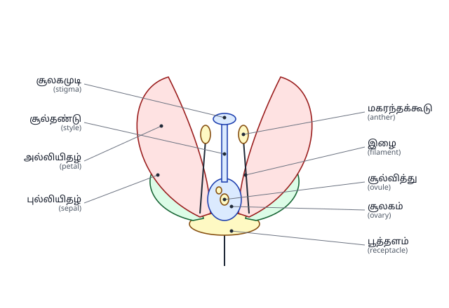

| இல. | பகுதி | English | தொழில் / குறிப்பு | SVG இலக்கு |
|---|---|---|---|---|
| 1 | சூலகமுடி | stigma | மகரந்தமணிகளைப் பெறல் | `BIO-D08-L01-target` |
| 2 | சூல்தண்டு | style | மகரந்தக் குழாய் வளரும் பாதை | `BIO-D08-L02-target` |
| 3 | சூலகம் | ovary | சூல்வித்துகளைக் கொண்டது; பழமாகும் | `BIO-D08-L03-target` |
| 4 | சூல்வித்து | ovule | கருக்கட்டலின் பின் வித்தாகும் | `BIO-D08-L04-target` |
| 5 | மகரந்தக்கூடு | anther | மகரந்தமணி உற்பத்தி | `BIO-D08-L05-target` |
| 6 | இழை | filament | மகரந்தக்கூட்டைத் தாங்கல் | `BIO-D08-L06-target` |
| 7 | அல்லியிதழ் | petal | பூச்சிகளைக் கவர்தல் | `BIO-D08-L07-target` |
| 8 | புல்லியிதழ் | sepal | அரும்பைப் பாதுகாத்தல் | `BIO-D08-L08-target` |
| 9 | பூத்தளம் | receptacle | பூப்பகுதிகளைத் தாங்கல் | `BIO-D08-L09-target` |

### 2. இனங்காணல் முறை

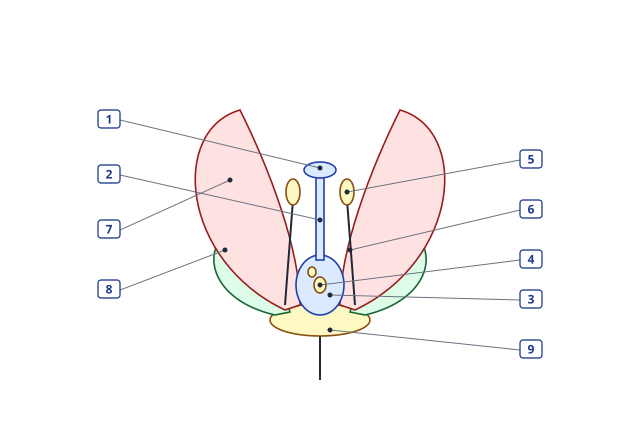

- இலக்கம் 1 இனால் காட்டப்படும் பகுதி எது?
- இலக்கம் 2 இனால் காட்டப்படும் பகுதி எது?
- இலக்கம் 3 இனால் காட்டப்படும் பகுதி எது?
- இலக்கம் 4 இனால் காட்டப்படும் பகுதி எது?
- இலக்கம் 5 இனால் காட்டப்படும் பகுதி எது?
- இலக்கம் 6 இனால் காட்டப்படும் பகுதி எது?
- இலக்கம் 7 இனால் காட்டப்படும் பகுதி எது?
- இலக்கம் 8 இனால் காட்டப்படும் பகுதி எது?
- இலக்கம் 9 இனால் காட்டப்படும் பகுதி எது?

விடைகள்

1. சூலகமுடி (stigma)
2. சூல்தண்டு (style)
3. சூலகம் (ovary)
4. சூல்வித்து (ovule)
5. மகரந்தக்கூடு (anther)
6. இழை (filament)
7. அல்லியிதழ் (petal)
8. புல்லியிதழ் (sepal)
9. பூத்தளம் (receptacle)

### 3. பெயரிடல் முறை

பின்வரும் பெயர்களைப் பெயரிடாத படத்தின் இலக்கப் பெட்டிகளில் இடுக: அல்லியிதழ் · இழை · சூலகமுடி · சூலகம் · சூல்தண்டு · சூல்வித்து · புல்லியிதழ் · பூத்தளம் · மகரந்தக்கூடு

### 4. தொழில் பொருத்தல்

| பகுதி | தொழில் (கலக்கப்பட்டது) |
|---|---|
| A. சூலகமுடி | 1. மகரந்தக் குழாய் வளரும் பாதை |
| B. சூல்தண்டு | 2. மகரந்தமணி உற்பத்தி |
| C. சூலகம் | 3. மகரந்தமணிகளைப் பெறல் |
| D. சூல்வித்து | 4. அரும்பைப் பாதுகாத்தல் |
| E. மகரந்தக்கூடு | 5. பூப்பகுதிகளைத் தாங்கல் |
| F. இழை | 6. கருக்கட்டலின் பின் வித்தாகும் |
| G. அல்லியிதழ் | 7. பூச்சிகளைக் கவர்தல் |
| H. புல்லியிதழ் | 8. சூல்வித்துகளைக் கொண்டது; பழமாகும் |
| I. பூத்தளம் | 9. மகரந்தக்கூட்டைத் தாங்கல் |

விடைகள்

- A → 3
- B → 1
- C → 8
- D → 6
- E → 2
- F → 9
- G → 7
- H → 4
- I → 5

### 5. வரைதல் முறை — சரிபார்ப்புப் பட்டியல்

- [ ] தெளிவான, தொடர்ச்சியான பென்சில் கோடுகள்
- [ ] சரியான விகிதங்கள், ஒழுங்கு
- [ ] குறைந்தது 5 பகுதிகள் பெயரிடப்பட்டுள்ளன; பெயர்க் கோடுகள் குறுக்கிடவில்லை
- [ ] தலைப்பு எழுதப்பட்டுள்ளது

### 6. பரீட்சை முறை

பெயரிடாத படத்தில் (i) இலக்கம் 1, 2 இனைப் பெயரிடுக [2] (ii) 'சூலகமுடி' இன் ஒரு தொழிலைத் தருக [1].

புள்ளித் திட்டம் (அசல்)

(i) 1 — சூலகமுடி; 2 — சூல்தண்டு [தலா 1] (ii) மகரந்தமணிகளைப் பெறல் [1]

---

## BIO-D09: குளச் சூழல் உணவுவலை (மாதிரி) (Pond food web (example))

<!-- meta {"type":"diagram","id":"BIO-D09","chapter_id":"SC10-13","labelled":"science_assets/biology/BIO-D09_labelled.svg","unlabelled":"science_assets/biology/BIO-D09_unlabelled.svg","schematic":true,"labels":[{"label_id":"BIO-D09-L01","svg_target":"BIO-D09-L01-target","key":"alg","ta":"அல்காக்கள்","en":"algae","function":""},{"label_id":"BIO-D09-L02","svg_target":"BIO-D09-L02-target","key":"hyd","ta":"நீர்த்தாவரம்","en":"Hydrilla","function":""},{"label_id":"BIO-D09-L03","svg_target":"BIO-D09-L03-target","key":"zoo","ta":"விலங்கு மிதவைவாழிகள்","en":"zooplankton","function":""},{"label_id":"BIO-D09-L04","svg_target":"BIO-D09-L04-target","key":"snail","ta":"நத்தை","en":"snail","function":""},{"label_id":"BIO-D09-L05","svg_target":"BIO-D09-L05-target","key":"tad","ta":"தலைப்பிரட்டை","en":"tadpole","function":""},{"label_id":"BIO-D09-L06","svg_target":"BIO-D09-L06-target","key":"fish","ta":"சிறுமீன்","en":"small fish","function":""},{"label_id":"BIO-D09-L07","svg_target":"BIO-D09-L07-target","key":"king","ta":"மீன்கொத்தி","en":"kingfisher","function":""}],"provenance":"original-programmatic-svg"} -->

*உயிர்க்கோளம் (Biosphere)* · மூலம்: அசல் நிரல்வழி SVG · ⚠️ திட்டப் படம் (schematic) — விகிதங்கள் உண்மையானவை அல்ல; ஆசிரியர் மீளாய்வு

### 1. கற்றல் முறை

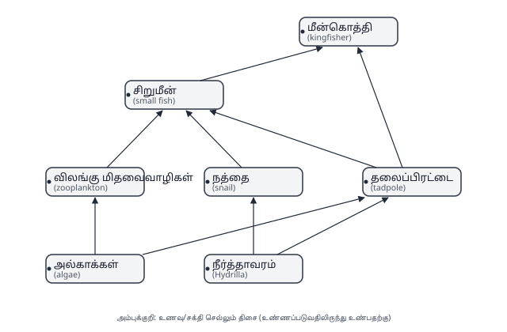

| இல. | பகுதி | English | தொழில் / குறிப்பு | SVG இலக்கு |
|---|---|---|---|---|
| 1 | அல்காக்கள் | algae | — | `BIO-D09-L01-target` |
| 2 | நீர்த்தாவரம் | Hydrilla | — | `BIO-D09-L02-target` |
| 3 | விலங்கு மிதவைவாழிகள் | zooplankton | — | `BIO-D09-L03-target` |
| 4 | நத்தை | snail | — | `BIO-D09-L04-target` |
| 5 | தலைப்பிரட்டை | tadpole | — | `BIO-D09-L05-target` |
| 6 | சிறுமீன் | small fish | — | `BIO-D09-L06-target` |
| 7 | மீன்கொத்தி | kingfisher | — | `BIO-D09-L07-target` |

### 2. இனங்காணல் முறை

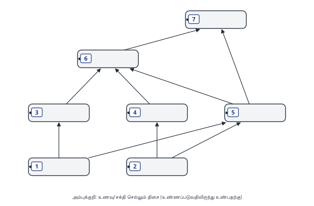

- இலக்கம் 1 இனால் காட்டப்படும் பகுதி எது?
- இலக்கம் 2 இனால் காட்டப்படும் பகுதி எது?
- இலக்கம் 3 இனால் காட்டப்படும் பகுதி எது?
- இலக்கம் 4 இனால் காட்டப்படும் பகுதி எது?
- இலக்கம் 5 இனால் காட்டப்படும் பகுதி எது?
- இலக்கம் 6 இனால் காட்டப்படும் பகுதி எது?
- இலக்கம் 7 இனால் காட்டப்படும் பகுதி எது?

விடைகள்

1. அல்காக்கள் (algae)
2. நீர்த்தாவரம் (Hydrilla)
3. விலங்கு மிதவைவாழிகள் (zooplankton)
4. நத்தை (snail)
5. தலைப்பிரட்டை (tadpole)
6. சிறுமீன் (small fish)
7. மீன்கொத்தி (kingfisher)

### 3. பெயரிடல் முறை

பின்வரும் பெயர்களைப் பெயரிடாத படத்தின் இலக்கப் பெட்டிகளில் இடுக: அல்காக்கள் · சிறுமீன் · தலைப்பிரட்டை · நத்தை · நீர்த்தாவரம் · மீன்கொத்தி · விலங்கு மிதவைவாழிகள்

### 5. வரைதல் முறை — சரிபார்ப்புப் பட்டியல்

- [ ] தெளிவான, தொடர்ச்சியான பென்சில் கோடுகள்
- [ ] சரியான விகிதங்கள், ஒழுங்கு
- [ ] குறைந்தது 5 பகுதிகள் பெயரிடப்பட்டுள்ளன; பெயர்க் கோடுகள் குறுக்கிடவில்லை
- [ ] தலைப்பு எழுதப்பட்டுள்ளது

### 6. பரீட்சை முறை

பெயரிடாத படத்தில் (i) இலக்கம் 1, 2 இனைப் பெயரிடுக [2] (ii) 'அல்காக்கள்' இன் ஒரு தொழிலைத் தருக [1].

புள்ளித் திட்டம் (அசல்)

(i) 1 — அல்காக்கள்; 2 — நீர்த்தாவரம் [தலா 1] (ii) பொருத்தமான தொழில் [1]

---

## BIO-D10: புனெற் சதுரம்: Tt × Tt (Punnett square: Tt × Tt)

<!-- meta {"type":"diagram","id":"BIO-D10","chapter_id":"SC10-20","labelled":"science_assets/biology/BIO-D10_labelled.svg","unlabelled":"science_assets/biology/BIO-D10_unlabelled.svg","schematic":true,"labels":[{"label_id":"BIO-D10-L01","svg_target":"BIO-D10-L01-target","key":"c1","ta":"ஓரினநுக உயரம் (TT)","en":"homozygous tall","function":""},{"label_id":"BIO-D10-L02","svg_target":"BIO-D10-L02-target","key":"c2","ta":"பல்லினநுக உயரம் (Tt)","en":"heterozygous tall","function":""},{"label_id":"BIO-D10-L03","svg_target":"BIO-D10-L03-target","key":"c4","ta":"ஓரினநுகக் குட்டை (tt)","en":"homozygous dwarf","function":"பின்னிடைவு இயல்பு வெளிப்படும்"}],"provenance":"original-programmatic-svg"} -->

*தலைமுறையுரிமை (Inheritance)* · மூலம்: அசல் நிரல்வழி SVG · ⚠️ திட்டப் படம் (schematic) — விகிதங்கள் உண்மையானவை அல்ல; ஆசிரியர் மீளாய்வு

### 1. கற்றல் முறை

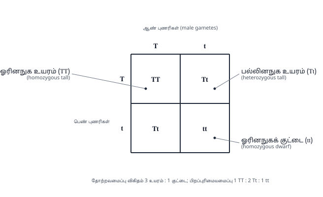

| இல. | பகுதி | English | தொழில் / குறிப்பு | SVG இலக்கு |
|---|---|---|---|---|
| 1 | ஓரினநுக உயரம் (TT) | homozygous tall | — | `BIO-D10-L01-target` |
| 2 | பல்லினநுக உயரம் (Tt) | heterozygous tall | — | `BIO-D10-L02-target` |
| 3 | ஓரினநுகக் குட்டை (tt) | homozygous dwarf | பின்னிடைவு இயல்பு வெளிப்படும் | `BIO-D10-L03-target` |

### 2. இனங்காணல் முறை

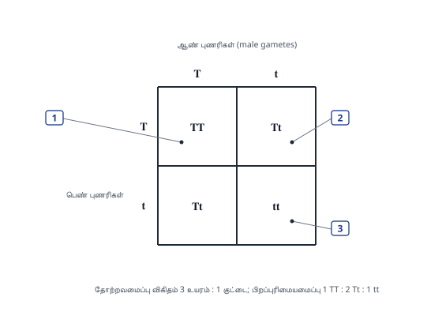

- இலக்கம் 1 இனால் காட்டப்படும் பகுதி எது?
- இலக்கம் 2 இனால் காட்டப்படும் பகுதி எது?
- இலக்கம் 3 இனால் காட்டப்படும் பகுதி எது?

விடைகள்

1. ஓரினநுக உயரம் (TT) (homozygous tall)
2. பல்லினநுக உயரம் (Tt) (heterozygous tall)
3. ஓரினநுகக் குட்டை (tt) (homozygous dwarf)

### 3. பெயரிடல் முறை

பின்வரும் பெயர்களைப் பெயரிடாத படத்தின் இலக்கப் பெட்டிகளில் இடுக: ஓரினநுக உயரம் (TT) · ஓரினநுகக் குட்டை (tt) · பல்லினநுக உயரம் (Tt)

### 5. வரைதல் முறை — சரிபார்ப்புப் பட்டியல்

- [ ] தெளிவான, தொடர்ச்சியான பென்சில் கோடுகள்
- [ ] சரியான விகிதங்கள், ஒழுங்கு
- [ ] குறைந்தது 3 பகுதிகள் பெயரிடப்பட்டுள்ளன; பெயர்க் கோடுகள் குறுக்கிடவில்லை
- [ ] தலைப்பு எழுதப்பட்டுள்ளது

### 6. பரீட்சை முறை

பெயரிடாத படத்தில் (i) இலக்கம் 1, 2 இனைப் பெயரிடுக [2] (ii) 'ஓரினநுக உயரம் (TT)' இன் ஒரு தொழிலைத் தருக [1].

புள்ளித் திட்டம் (அசல்)

(i) 1 — ஓரினநுக உயரம் (TT); 2 — பல்லினநுக உயரம் (Tt) [தலா 1] (ii) பொருத்தமான தொழில் [1]

---

## BIO-D11: மனிதக் கண் (திட்டப் படம்) (Human eye (schematic))

<!-- meta {"type":"diagram","id":"BIO-D11","chapter_id":"SC11-05","labelled":"science_assets/biology/BIO-D11_labelled.svg","unlabelled":"science_assets/biology/BIO-D11_unlabelled.svg","schematic":true,"labels":[{"label_id":"BIO-D11-L01","svg_target":"BIO-D11-L01-target","key":"cornea","ta":"விழிவெண்படலம்","en":"cornea","function":"ஒளியை முறித்தல் — பெரும்பகுதி"},{"label_id":"BIO-D11-L02","svg_target":"BIO-D11-L02-target","key":"iris","ta":"கதிராளி","en":"iris","function":"கண்மணியின் அளவைக் கட்டுப்படுத்தல்"},{"label_id":"BIO-D11-L03","svg_target":"BIO-D11-L03-target","key":"pupil","ta":"கண்மணி","en":"pupil","function":"ஒளி உட்செல்லும் துவாரம்"},{"label_id":"BIO-D11-L04","svg_target":"BIO-D11-L04-target","key":"lens","ta":"வில்லை","en":"lens","function":"குவியத் தூரத்தைச் சீராக்கல்"},{"label_id":"BIO-D11-L05","svg_target":"BIO-D11-L05-target","key":"retina","ta":"விழித்திரை","en":"retina","function":"விம்பம் உருவாகும் ஒளி உணர் படை"},{"label_id":"BIO-D11-L06","svg_target":"BIO-D11-L06-target","key":"nerve","ta":"பார்வை நரம்பு","en":"optic nerve","function":"கணத்தாக்கங்களை மூளைக்கு"}],"provenance":"original-programmatic-svg"} -->

*கேத்திரகணித ஒளியியல் (Geometrical optics)* · மூலம்: அசல் நிரல்வழி SVG · ⚠️ திட்டப் படம் (schematic) — விகிதங்கள் உண்மையானவை அல்ல; ஆசிரியர் மீளாய்வு

### 1. கற்றல் முறை

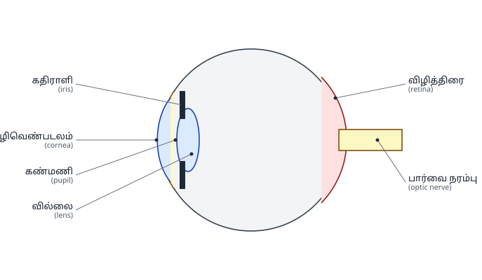

| இல. | பகுதி | English | தொழில் / குறிப்பு | SVG இலக்கு |
|---|---|---|---|---|
| 1 | விழிவெண்படலம் | cornea | ஒளியை முறித்தல் — பெரும்பகுதி | `BIO-D11-L01-target` |
| 2 | கதிராளி | iris | கண்மணியின் அளவைக் கட்டுப்படுத்தல் | `BIO-D11-L02-target` |
| 3 | கண்மணி | pupil | ஒளி உட்செல்லும் துவாரம் | `BIO-D11-L03-target` |
| 4 | வில்லை | lens | குவியத் தூரத்தைச் சீராக்கல் | `BIO-D11-L04-target` |
| 5 | விழித்திரை | retina | விம்பம் உருவாகும் ஒளி உணர் படை | `BIO-D11-L05-target` |
| 6 | பார்வை நரம்பு | optic nerve | கணத்தாக்கங்களை மூளைக்கு | `BIO-D11-L06-target` |

### 2. இனங்காணல் முறை

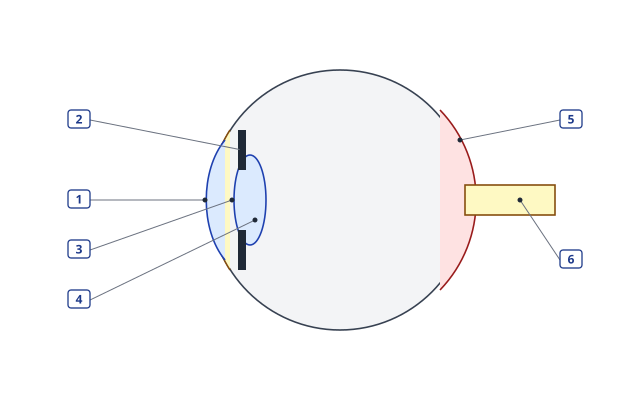

- இலக்கம் 1 இனால் காட்டப்படும் பகுதி எது?
- இலக்கம் 2 இனால் காட்டப்படும் பகுதி எது?
- இலக்கம் 3 இனால் காட்டப்படும் பகுதி எது?
- இலக்கம் 4 இனால் காட்டப்படும் பகுதி எது?
- இலக்கம் 5 இனால் காட்டப்படும் பகுதி எது?
- இலக்கம் 6 இனால் காட்டப்படும் பகுதி எது?

விடைகள்

1. விழிவெண்படலம் (cornea)
2. கதிராளி (iris)
3. கண்மணி (pupil)
4. வில்லை (lens)
5. விழித்திரை (retina)
6. பார்வை நரம்பு (optic nerve)

### 3. பெயரிடல் முறை

பின்வரும் பெயர்களைப் பெயரிடாத படத்தின் இலக்கப் பெட்டிகளில் இடுக: கண்மணி · கதிராளி · பார்வை நரம்பு · வில்லை · விழித்திரை · விழிவெண்படலம்

### 4. தொழில் பொருத்தல்

| பகுதி | தொழில் (கலக்கப்பட்டது) |
|---|---|
| A. விழிவெண்படலம் | 1. ஒளி உட்செல்லும் துவாரம் |
| B. கதிராளி | 2. கண்மணியின் அளவைக் கட்டுப்படுத்தல் |
| C. கண்மணி | 3. குவியத் தூரத்தைச் சீராக்கல் |
| D. வில்லை | 4. கணத்தாக்கங்களை மூளைக்கு |
| E. விழித்திரை | 5. விம்பம் உருவாகும் ஒளி உணர் படை |
| F. பார்வை நரம்பு | 6. ஒளியை முறித்தல் — பெரும்பகுதி |

விடைகள்

- A → 6
- B → 2
- C → 1
- D → 3
- E → 5
- F → 4

### 5. வரைதல் முறை — சரிபார்ப்புப் பட்டியல்

- [ ] தெளிவான, தொடர்ச்சியான பென்சில் கோடுகள்
- [ ] சரியான விகிதங்கள், ஒழுங்கு
- [ ] குறைந்தது 5 பகுதிகள் பெயரிடப்பட்டுள்ளன; பெயர்க் கோடுகள் குறுக்கிடவில்லை
- [ ] தலைப்பு எழுதப்பட்டுள்ளது

### 6. பரீட்சை முறை

பெயரிடாத படத்தில் (i) இலக்கம் 1, 2 இனைப் பெயரிடுக [2] (ii) 'விழிவெண்படலம்' இன் ஒரு தொழிலைத் தருக [1].

புள்ளித் திட்டம் (அசல்)

(i) 1 — விழிவெண்படலம்; 2 — கதிராளி [தலா 1] (ii) ஒளியை முறித்தல் — பெரும்பகுதி [1]

---

## CHE-D01: சோடியம் அணுவின் இலத்திரன் நிலையமைப்பு (2,8,1) (Sodium atom electron arrangement (2,8,1))

<!-- meta {"type":"diagram","id":"CHE-D01","chapter_id":"SC10-03","labelled":"science_assets/chemistry/CHE-D01_labelled.svg","unlabelled":"science_assets/chemistry/CHE-D01_unlabelled.svg","schematic":true,"labels":[{"label_id":"CHE-D01-L01","svg_target":"CHE-D01-L01-target","key":"nucleus","ta":"கரு","en":"nucleus","function":"புரோத்தன்களும் நியூத்திரன்களும்"},{"label_id":"CHE-D01-L02","svg_target":"CHE-D01-L02-target","key":"e","ta":"இலத்திரன்","en":"electron","function":"மறையேற்றம்; ஓடுகளில்"},{"label_id":"CHE-D01-L03","svg_target":"CHE-D01-L03-target","key":"shell1","ta":"முதலாம் சக்தி மட்டம்","en":"first shell (K)","function":"உச்சம் 2 இலத்திரன்கள்"},{"label_id":"CHE-D01-L04","svg_target":"CHE-D01-L04-target","key":"shell2","ta":"இரண்டாம் சக்தி மட்டம்","en":"second shell (L)","function":"உச்சம் 8"},{"label_id":"CHE-D01-L05","svg_target":"CHE-D01-L05-target","key":"valence","ta":"வலுவளவு ஓடு","en":"valence shell","function":"1 இலத்திரன் — கூட்டம் 1"}],"provenance":"original-programmatic-svg"} -->

*சடப்பொருள்களின் கட்டமைப்பு (Structure of matter)* · மூலம்: அசல் நிரல்வழி SVG

### 1. கற்றல் முறை

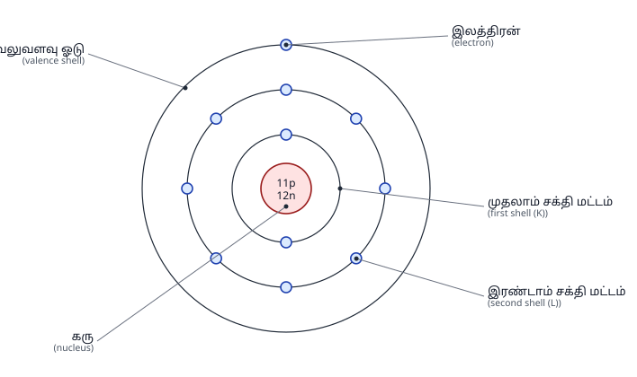

| இல. | பகுதி | English | தொழில் / குறிப்பு | SVG இலக்கு |
|---|---|---|---|---|
| 1 | கரு | nucleus | புரோத்தன்களும் நியூத்திரன்களும் | `CHE-D01-L01-target` |
| 2 | இலத்திரன் | electron | மறையேற்றம்; ஓடுகளில் | `CHE-D01-L02-target` |
| 3 | முதலாம் சக்தி மட்டம் | first shell (K) | உச்சம் 2 இலத்திரன்கள் | `CHE-D01-L03-target` |
| 4 | இரண்டாம் சக்தி மட்டம் | second shell (L) | உச்சம் 8 | `CHE-D01-L04-target` |
| 5 | வலுவளவு ஓடு | valence shell | 1 இலத்திரன் — கூட்டம் 1 | `CHE-D01-L05-target` |

### 2. இனங்காணல் முறை

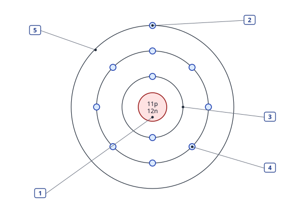

- இலக்கம் 1 இனால் காட்டப்படும் பகுதி எது?
- இலக்கம் 2 இனால் காட்டப்படும் பகுதி எது?
- இலக்கம் 3 இனால் காட்டப்படும் பகுதி எது?
- இலக்கம் 4 இனால் காட்டப்படும் பகுதி எது?
- இலக்கம் 5 இனால் காட்டப்படும் பகுதி எது?

விடைகள்

1. கரு (nucleus)
2. இலத்திரன் (electron)
3. முதலாம் சக்தி மட்டம் (first shell (K))
4. இரண்டாம் சக்தி மட்டம் (second shell (L))
5. வலுவளவு ஓடு (valence shell)

### 3. பெயரிடல் முறை

பின்வரும் பெயர்களைப் பெயரிடாத படத்தின் இலக்கப் பெட்டிகளில் இடுக: இரண்டாம் சக்தி மட்டம் · இலத்திரன் · கரு · முதலாம் சக்தி மட்டம் · வலுவளவு ஓடு

### 4. தொழில் பொருத்தல்

| பகுதி | தொழில் (கலக்கப்பட்டது) |
|---|---|
| A. கரு | 1. 1 இலத்திரன் — கூட்டம் 1 |
| B. இலத்திரன் | 2. புரோத்தன்களும் நியூத்திரன்களும் |
| C. முதலாம் சக்தி மட்டம் | 3. உச்சம் 2 இலத்திரன்கள் |
| D. இரண்டாம் சக்தி மட்டம் | 4. மறையேற்றம்; ஓடுகளில் |
| E. வலுவளவு ஓடு | 5. உச்சம் 8 |

விடைகள்

- A → 2
- B → 4
- C → 3
- D → 5
- E → 1

### 5. வரைதல் முறை — சரிபார்ப்புப் பட்டியல்

- [ ] தெளிவான, தொடர்ச்சியான பென்சில் கோடுகள்
- [ ] சரியான விகிதங்கள், ஒழுங்கு
- [ ] குறைந்தது 5 பகுதிகள் பெயரிடப்பட்டுள்ளன; பெயர்க் கோடுகள் குறுக்கிடவில்லை
- [ ] தலைப்பு எழுதப்பட்டுள்ளது

### 6. பரீட்சை முறை

பெயரிடாத படத்தில் (i) இலக்கம் 1, 2 இனைப் பெயரிடுக [2] (ii) 'கரு' இன் ஒரு தொழிலைத் தருக [1].

புள்ளித் திட்டம் (அசல்)

(i) 1 — கரு; 2 — இலத்திரன் [தலா 1] (ii) புரோத்தன்களும் நியூத்திரன்களும் [1]

---

## CHE-D02: மின்பகுப்புக் கலம் (Electrolytic cell)

<!-- meta {"type":"diagram","id":"CHE-D02","chapter_id":"SC11-12","labelled":"science_assets/chemistry/CHE-D02_labelled.svg","unlabelled":"science_assets/chemistry/CHE-D02_unlabelled.svg","schematic":true,"labels":[{"label_id":"CHE-D02-L01","svg_target":"CHE-D02-L01-target","key":"anode","ta":"அனோட்டு (+)","en":"anode","function":"ஒட்சியேற்றம் — அனயன்கள் இலத்திரன் இழக்கும்"},{"label_id":"CHE-D02-L02","svg_target":"CHE-D02-L02-target","key":"cathode","ta":"கதோட்டு (−)","en":"cathode","function":"தாழ்த்தல் — கற்றயன்கள் இலத்திரன் பெறும்"},{"label_id":"CHE-D02-L03","svg_target":"CHE-D02-L03-target","key":"electrolyte","ta":"மின்பகுபொருள்","en":"electrolyte","function":"அயன்கள் அசைந்து மின் கடத்தும்"},{"label_id":"CHE-D02-L04","svg_target":"CHE-D02-L04-target","key":"battery","ta":"மின்கலவடுக்கு","en":"battery (d.c.)","function":"நேரோட்ட மின்வழங்கல்"}],"provenance":"original-programmatic-svg"} -->

*மின்னிரசாயனம் (Electrochemistry)* · மூலம்: அசல் நிரல்வழி SVG

### 1. கற்றல் முறை

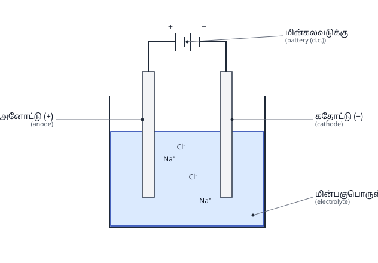

| இல. | பகுதி | English | தொழில் / குறிப்பு | SVG இலக்கு |
|---|---|---|---|---|
| 1 | அனோட்டு (+) | anode | ஒட்சியேற்றம் — அனயன்கள் இலத்திரன் இழக்கும் | `CHE-D02-L01-target` |
| 2 | கதோட்டு (−) | cathode | தாழ்த்தல் — கற்றயன்கள் இலத்திரன் பெறும் | `CHE-D02-L02-target` |
| 3 | மின்பகுபொருள் | electrolyte | அயன்கள் அசைந்து மின் கடத்தும் | `CHE-D02-L03-target` |
| 4 | மின்கலவடுக்கு | battery (d.c.) | நேரோட்ட மின்வழங்கல் | `CHE-D02-L04-target` |

### 2. இனங்காணல் முறை

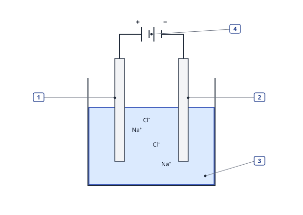

- இலக்கம் 1 இனால் காட்டப்படும் பகுதி எது?
- இலக்கம் 2 இனால் காட்டப்படும் பகுதி எது?
- இலக்கம் 3 இனால் காட்டப்படும் பகுதி எது?
- இலக்கம் 4 இனால் காட்டப்படும் பகுதி எது?

விடைகள்

1. அனோட்டு (+) (anode)
2. கதோட்டு (−) (cathode)
3. மின்பகுபொருள் (electrolyte)
4. மின்கலவடுக்கு (battery (d.c.))

### 3. பெயரிடல் முறை

பின்வரும் பெயர்களைப் பெயரிடாத படத்தின் இலக்கப் பெட்டிகளில் இடுக: அனோட்டு (+) · கதோட்டு (−) · மின்கலவடுக்கு · மின்பகுபொருள்

### 4. தொழில் பொருத்தல்

| பகுதி | தொழில் (கலக்கப்பட்டது) |
|---|---|
| A. அனோட்டு (+) | 1. ஒட்சியேற்றம் — அனயன்கள் இலத்திரன் இழக்கும் |
| B. கதோட்டு (−) | 2. அயன்கள் அசைந்து மின் கடத்தும் |
| C. மின்பகுபொருள் | 3. நேரோட்ட மின்வழங்கல் |
| D. மின்கலவடுக்கு | 4. தாழ்த்தல் — கற்றயன்கள் இலத்திரன் பெறும் |

விடைகள்

- A → 1
- B → 4
- C → 2
- D → 3

### 5. வரைதல் முறை — சரிபார்ப்புப் பட்டியல்

- [ ] தெளிவான, தொடர்ச்சியான பென்சில் கோடுகள்
- [ ] சரியான விகிதங்கள், ஒழுங்கு
- [ ] குறைந்தது 4 பகுதிகள் பெயரிடப்பட்டுள்ளன; பெயர்க் கோடுகள் குறுக்கிடவில்லை
- [ ] தலைப்பு எழுதப்பட்டுள்ளது

### 6. பரீட்சை முறை

பெயரிடாத படத்தில் (i) இலக்கம் 1, 2 இனைப் பெயரிடுக [2] (ii) 'அனோட்டு (+)' இன் ஒரு தொழிலைத் தருக [1].

புள்ளித் திட்டம் (அசல்)

(i) 1 — அனோட்டு (+); 2 — கதோட்டு (−) [தலா 1] (ii) ஒட்சியேற்றம் — அனயன்கள் இலத்திரன் இழக்கும் [1]

---

## CHE-D03: ஐதரசன் தயாரிப்பு — நீரின் கீழ்முக இடப்பெயர்ச்சி (Preparation of hydrogen — collection over water)

<!-- meta {"type":"diagram","id":"CHE-D03","chapter_id":"SC11-07","labelled":"science_assets/chemistry/CHE-D03_labelled.svg","unlabelled":"science_assets/chemistry/CHE-D03_unlabelled.svg","schematic":true,"labels":[{"label_id":"CHE-D03-L01","svg_target":"CHE-D03-L01-target","key":"thistle","ta":"முட்புனல்","en":"thistle funnel","function":"அமிலத்தைச் சேர்த்தல்"},{"label_id":"CHE-D03-L02","svg_target":"CHE-D03-L02-target","key":"acid","ta":"ஐதான HCl","en":"dilute HCl","function":"தாக்கி"},{"label_id":"CHE-D03-L03","svg_target":"CHE-D03-L03-target","key":"zinc","ta":"நாகத் துண்டுகள்","en":"zinc granules","function":"Zn + 2HCl → ZnCl₂ + H₂"},{"label_id":"CHE-D03-L04","svg_target":"CHE-D03-L04-target","key":"tube","ta":"விநியோகக் குழாய்","en":"delivery tube","function":"வாயுவைக் கடத்தல்"},{"label_id":"CHE-D03-L05","svg_target":"CHE-D03-L05-target","key":"jar","ta":"வாயுச் சாடி (H₂)","en":"gas jar","function":"நீரை இடம்பெயர்த்து வாயு சேரும்"},{"label_id":"CHE-D03-L06","svg_target":"CHE-D03-L06-target","key":"trough","ta":"நீர்த் தொட்டி","en":"water trough","function":"H₂ நீரில் அரிதாகக் கரையும்"}],"provenance":"original-programmatic-svg"} -->

*அமிலம், மூலம், உப்பு (Acids, bases and salts)* · மூலம்: அசல் நிரல்வழி SVG

### 1. கற்றல் முறை

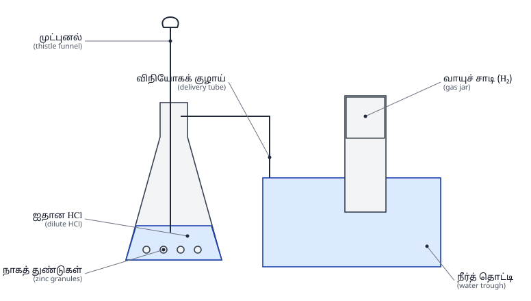

| இல. | பகுதி | English | தொழில் / குறிப்பு | SVG இலக்கு |
|---|---|---|---|---|
| 1 | முட்புனல் | thistle funnel | அமிலத்தைச் சேர்த்தல் | `CHE-D03-L01-target` |
| 2 | ஐதான HCl | dilute HCl | தாக்கி | `CHE-D03-L02-target` |
| 3 | நாகத் துண்டுகள் | zinc granules | Zn + 2HCl → ZnCl₂ + H₂ | `CHE-D03-L03-target` |
| 4 | விநியோகக் குழாய் | delivery tube | வாயுவைக் கடத்தல் | `CHE-D03-L04-target` |
| 5 | வாயுச் சாடி (H₂) | gas jar | நீரை இடம்பெயர்த்து வாயு சேரும் | `CHE-D03-L05-target` |
| 6 | நீர்த் தொட்டி | water trough | H₂ நீரில் அரிதாகக் கரையும் | `CHE-D03-L06-target` |

### 2. இனங்காணல் முறை

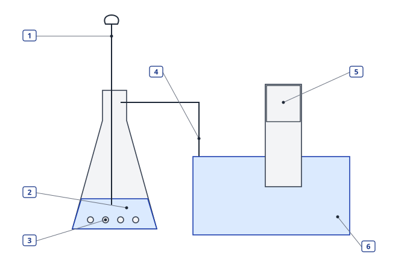

- இலக்கம் 1 இனால் காட்டப்படும் பகுதி எது?
- இலக்கம் 2 இனால் காட்டப்படும் பகுதி எது?
- இலக்கம் 3 இனால் காட்டப்படும் பகுதி எது?
- இலக்கம் 4 இனால் காட்டப்படும் பகுதி எது?
- இலக்கம் 5 இனால் காட்டப்படும் பகுதி எது?
- இலக்கம் 6 இனால் காட்டப்படும் பகுதி எது?

விடைகள்

1. முட்புனல் (thistle funnel)
2. ஐதான HCl (dilute HCl)
3. நாகத் துண்டுகள் (zinc granules)
4. விநியோகக் குழாய் (delivery tube)
5. வாயுச் சாடி (H₂) (gas jar)
6. நீர்த் தொட்டி (water trough)

### 3. பெயரிடல் முறை

பின்வரும் பெயர்களைப் பெயரிடாத படத்தின் இலக்கப் பெட்டிகளில் இடுக: ஐதான HCl · நாகத் துண்டுகள் · நீர்த் தொட்டி · முட்புனல் · வாயுச் சாடி (H₂) · விநியோகக் குழாய்

### 4. தொழில் பொருத்தல்

| பகுதி | தொழில் (கலக்கப்பட்டது) |
|---|---|
| A. முட்புனல் | 1. Zn + 2HCl → ZnCl₂ + H₂ |
| B. ஐதான HCl | 2. H₂ நீரில் அரிதாகக் கரையும் |
| C. நாகத் துண்டுகள் | 3. தாக்கி |
| D. விநியோகக் குழாய் | 4. வாயுவைக் கடத்தல் |
| E. வாயுச் சாடி (H₂) | 5. நீரை இடம்பெயர்த்து வாயு சேரும் |
| F. நீர்த் தொட்டி | 6. அமிலத்தைச் சேர்த்தல் |

விடைகள்

- A → 6
- B → 3
- C → 1
- D → 4
- E → 5
- F → 2

### 5. வரைதல் முறை — சரிபார்ப்புப் பட்டியல்

- [ ] தெளிவான, தொடர்ச்சியான பென்சில் கோடுகள்
- [ ] சரியான விகிதங்கள், ஒழுங்கு
- [ ] குறைந்தது 5 பகுதிகள் பெயரிடப்பட்டுள்ளன; பெயர்க் கோடுகள் குறுக்கிடவில்லை
- [ ] தலைப்பு எழுதப்பட்டுள்ளது

### 6. பரீட்சை முறை

பெயரிடாத படத்தில் (i) இலக்கம் 1, 2 இனைப் பெயரிடுக [2] (ii) 'முட்புனல்' இன் ஒரு தொழிலைத் தருக [1].

புள்ளித் திட்டம் (அசல்)

(i) 1 — முட்புனல்; 2 — ஐதான HCl [தலா 1] (ii) அமிலத்தைச் சேர்த்தல் [1]

---

## CHE-D04: காய்ச்சிவடித்தல் (Distillation)

<!-- meta {"type":"diagram","id":"CHE-D04","chapter_id":"SC11-03","labelled":"science_assets/chemistry/CHE-D04_labelled.svg","unlabelled":"science_assets/chemistry/CHE-D04_unlabelled.svg","schematic":true,"labels":[{"label_id":"CHE-D04-L01","svg_target":"CHE-D04-L01-target","key":"flask","ta":"வடிகுடுவை","en":"distillation flask","function":"கலவையைச் சூடாக்கல்"},{"label_id":"CHE-D04-L02","svg_target":"CHE-D04-L02-target","key":"therm","ta":"வெப்பமானி","en":"thermometer","function":"குமிழ் பக்கக் குழாய் மட்டத்தில் — ஆவியின் கொதிநிலை"},{"label_id":"CHE-D04-L03","svg_target":"CHE-D04-L03-target","key":"cond","ta":"லீபிக் ஒடுக்கி","en":"Liebig condenser","function":"ஆவியைக் குளிர்வித்து ஒடுக்கல்"},{"label_id":"CHE-D04-L04","svg_target":"CHE-D04-L04-target","key":"win","ta":"குளிர்நீர் உள்ளே","en":"cooling water in","function":"கீழிருந்து மேலாக"},{"label_id":"CHE-D04-L05","svg_target":"CHE-D04-L05-target","key":"wout","ta":"நீர் வெளியே","en":"water out","function":""},{"label_id":"CHE-D04-L06","svg_target":"CHE-D04-L06-target","key":"dist","ta":"வடிதிரவம்","en":"distillate","function":"தூய திரவம்"},{"label_id":"CHE-D04-L07","svg_target":"CHE-D04-L07-target","key":"heat","ta":"வெப்பம்","en":"heat","function":""}],"provenance":"original-programmatic-svg"} -->

*கலவை (Mixtures)* · மூலம்: அசல் நிரல்வழி SVG

### 1. கற்றல் முறை

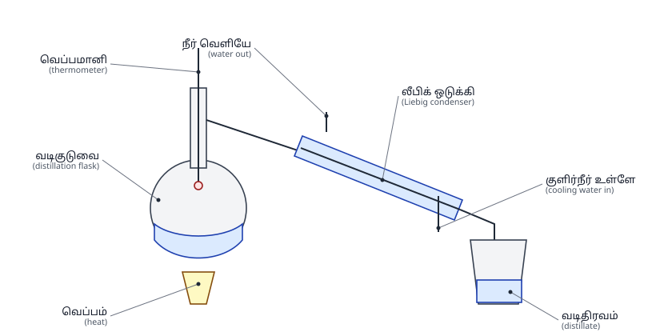

| இல. | பகுதி | English | தொழில் / குறிப்பு | SVG இலக்கு |
|---|---|---|---|---|
| 1 | வடிகுடுவை | distillation flask | கலவையைச் சூடாக்கல் | `CHE-D04-L01-target` |
| 2 | வெப்பமானி | thermometer | குமிழ் பக்கக் குழாய் மட்டத்தில் — ஆவியின் கொதிநிலை | `CHE-D04-L02-target` |
| 3 | லீபிக் ஒடுக்கி | Liebig condenser | ஆவியைக் குளிர்வித்து ஒடுக்கல் | `CHE-D04-L03-target` |
| 4 | குளிர்நீர் உள்ளே | cooling water in | கீழிருந்து மேலாக | `CHE-D04-L04-target` |
| 5 | நீர் வெளியே | water out | — | `CHE-D04-L05-target` |
| 6 | வடிதிரவம் | distillate | தூய திரவம் | `CHE-D04-L06-target` |
| 7 | வெப்பம் | heat | — | `CHE-D04-L07-target` |

### 2. இனங்காணல் முறை

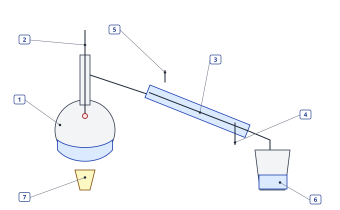

- இலக்கம் 1 இனால் காட்டப்படும் பகுதி எது?
- இலக்கம் 2 இனால் காட்டப்படும் பகுதி எது?
- இலக்கம் 3 இனால் காட்டப்படும் பகுதி எது?
- இலக்கம் 4 இனால் காட்டப்படும் பகுதி எது?
- இலக்கம் 5 இனால் காட்டப்படும் பகுதி எது?
- இலக்கம் 6 இனால் காட்டப்படும் பகுதி எது?
- இலக்கம் 7 இனால் காட்டப்படும் பகுதி எது?

விடைகள்

1. வடிகுடுவை (distillation flask)
2. வெப்பமானி (thermometer)
3. லீபிக் ஒடுக்கி (Liebig condenser)
4. குளிர்நீர் உள்ளே (cooling water in)
5. நீர் வெளியே (water out)
6. வடிதிரவம் (distillate)
7. வெப்பம் (heat)

### 3. பெயரிடல் முறை

பின்வரும் பெயர்களைப் பெயரிடாத படத்தின் இலக்கப் பெட்டிகளில் இடுக: குளிர்நீர் உள்ளே · நீர் வெளியே · லீபிக் ஒடுக்கி · வடிகுடுவை · வடிதிரவம் · வெப்பமானி · வெப்பம்

### 4. தொழில் பொருத்தல்

| பகுதி | தொழில் (கலக்கப்பட்டது) |
|---|---|
| A. வடிகுடுவை | 1. கலவையைச் சூடாக்கல் |
| B. வெப்பமானி | 2. குமிழ் பக்கக் குழாய் மட்டத்தில் — ஆவியின் கொதிநிலை |
| C. லீபிக் ஒடுக்கி | 3. தூய திரவம் |
| D. குளிர்நீர் உள்ளே | 4. ஆவியைக் குளிர்வித்து ஒடுக்கல் |
| E. வடிதிரவம் | 5. கீழிருந்து மேலாக |

விடைகள்

- A → 1
- B → 2
- C → 4
- D → 5
- E → 3

### 5. வரைதல் முறை — சரிபார்ப்புப் பட்டியல்

- [ ] தெளிவான, தொடர்ச்சியான பென்சில் கோடுகள்
- [ ] சரியான விகிதங்கள், ஒழுங்கு
- [ ] குறைந்தது 5 பகுதிகள் பெயரிடப்பட்டுள்ளன; பெயர்க் கோடுகள் குறுக்கிடவில்லை
- [ ] தலைப்பு எழுதப்பட்டுள்ளது

### 6. பரீட்சை முறை

பெயரிடாத படத்தில் (i) இலக்கம் 1, 2 இனைப் பெயரிடுக [2] (ii) 'வடிகுடுவை' இன் ஒரு தொழிலைத் தருக [1].

புள்ளித் திட்டம் (அசல்)

(i) 1 — வடிகுடுவை; 2 — வெப்பமானி [தலா 1] (ii) கலவையைச் சூடாக்கல் [1]

---

## CHE-D05: ஊதுலை (திட்டப் படம்) (Blast furnace (schematic))

<!-- meta {"type":"diagram","id":"CHE-D05","chapter_id":"SC10-16","labelled":"science_assets/chemistry/CHE-D05_labelled.svg","unlabelled":"science_assets/chemistry/CHE-D05_unlabelled.svg","schematic":true,"labels":[{"label_id":"CHE-D05-L01","svg_target":"CHE-D05-L01-target","key":"charge","ta":"உள்ளீடு: ஏமற்றைற்று, கல்கரி, சுண்ணக்கல்","en":"iron ore, coke, limestone","function":""},{"label_id":"CHE-D05-L02","svg_target":"CHE-D05-L02-target","key":"blastair","ta":"சூடான வளி","en":"hot air blast","function":"C + O₂ → CO₂ — அதிக வெப்பம்"},{"label_id":"CHE-D05-L03","svg_target":"CHE-D05-L03-target","key":"zone","ta":"தாழ்த்தல் வலயம்","en":"reduction zone","function":"Fe₂O₃ + 3CO → 2Fe + 3CO₂"},{"label_id":"CHE-D05-L04","svg_target":"CHE-D05-L04-target","key":"slag","ta":"கசடு","en":"slag (CaSiO₃)","function":"மாசுகளை நீக்கும்; உருகிய இரும்பின் மேல் மிதக்கும்"},{"label_id":"CHE-D05-L05","svg_target":"CHE-D05-L05-target","key":"iron","ta":"உருகிய இரும்பு","en":"molten iron","function":"அடியில் சேகரிக்கப்படும்"},{"label_id":"CHE-D05-L06","svg_target":"CHE-D05-L06-target","key":"waste","ta":"கழிவு வாயுக்கள்","en":"waste gases","function":""}],"provenance":"original-programmatic-svg"} -->

*சடப்பொருள்களில் ஏற்படும் மாற்றம் (Changes in matter)* · மூலம்: அசல் நிரல்வழி SVG

### 1. கற்றல் முறை

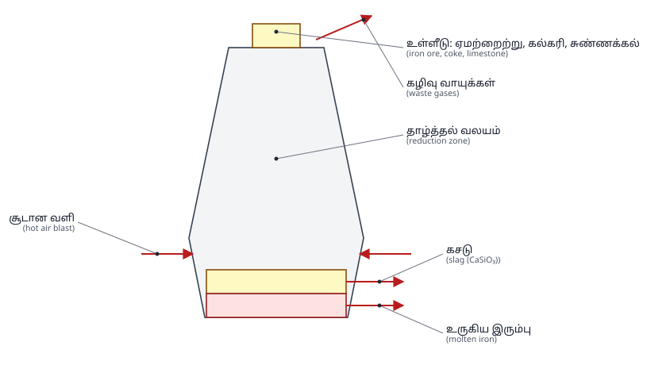

| இல. | பகுதி | English | தொழில் / குறிப்பு | SVG இலக்கு |
|---|---|---|---|---|
| 1 | உள்ளீடு: ஏமற்றைற்று, கல்கரி, சுண்ணக்கல் | iron ore, coke, limestone | — | `CHE-D05-L01-target` |
| 2 | சூடான வளி | hot air blast | C + O₂ → CO₂ — அதிக வெப்பம் | `CHE-D05-L02-target` |
| 3 | தாழ்த்தல் வலயம் | reduction zone | Fe₂O₃ + 3CO → 2Fe + 3CO₂ | `CHE-D05-L03-target` |
| 4 | கசடு | slag (CaSiO₃) | மாசுகளை நீக்கும்; உருகிய இரும்பின் மேல் மிதக்கும் | `CHE-D05-L04-target` |
| 5 | உருகிய இரும்பு | molten iron | அடியில் சேகரிக்கப்படும் | `CHE-D05-L05-target` |
| 6 | கழிவு வாயுக்கள் | waste gases | — | `CHE-D05-L06-target` |

### 2. இனங்காணல் முறை

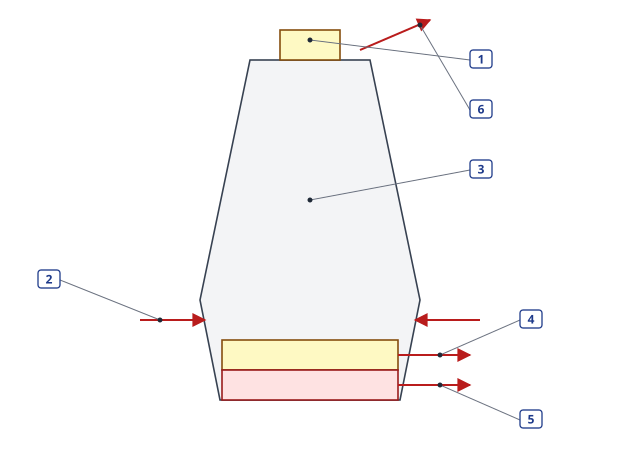

- இலக்கம் 1 இனால் காட்டப்படும் பகுதி எது?
- இலக்கம் 2 இனால் காட்டப்படும் பகுதி எது?
- இலக்கம் 3 இனால் காட்டப்படும் பகுதி எது?
- இலக்கம் 4 இனால் காட்டப்படும் பகுதி எது?
- இலக்கம் 5 இனால் காட்டப்படும் பகுதி எது?
- இலக்கம் 6 இனால் காட்டப்படும் பகுதி எது?

விடைகள்

1. உள்ளீடு: ஏமற்றைற்று, கல்கரி, சுண்ணக்கல் (iron ore, coke, limestone)
2. சூடான வளி (hot air blast)
3. தாழ்த்தல் வலயம் (reduction zone)
4. கசடு (slag (CaSiO₃))
5. உருகிய இரும்பு (molten iron)
6. கழிவு வாயுக்கள் (waste gases)

### 3. பெயரிடல் முறை

பின்வரும் பெயர்களைப் பெயரிடாத படத்தின் இலக்கப் பெட்டிகளில் இடுக: உருகிய இரும்பு · உள்ளீடு: ஏமற்றைற்று, கல்கரி, சுண்ணக்கல் · கசடு · கழிவு வாயுக்கள் · சூடான வளி · தாழ்த்தல் வலயம்

### 4. தொழில் பொருத்தல்

| பகுதி | தொழில் (கலக்கப்பட்டது) |
|---|---|
| A. சூடான வளி | 1. மாசுகளை நீக்கும்; உருகிய இரும்பின் மேல் மிதக்கும் |
| B. தாழ்த்தல் வலயம் | 2. C + O₂ → CO₂ — அதிக வெப்பம் |
| C. கசடு | 3. Fe₂O₃ + 3CO → 2Fe + 3CO₂ |
| D. உருகிய இரும்பு | 4. அடியில் சேகரிக்கப்படும் |

விடைகள்

- A → 2
- B → 3
- C → 1
- D → 4

### 5. வரைதல் முறை — சரிபார்ப்புப் பட்டியல்

- [ ] தெளிவான, தொடர்ச்சியான பென்சில் கோடுகள்
- [ ] சரியான விகிதங்கள், ஒழுங்கு
- [ ] குறைந்தது 5 பகுதிகள் பெயரிடப்பட்டுள்ளன; பெயர்க் கோடுகள் குறுக்கிடவில்லை
- [ ] தலைப்பு எழுதப்பட்டுள்ளது

### 6. பரீட்சை முறை

பெயரிடாத படத்தில் (i) இலக்கம் 1, 2 இனைப் பெயரிடுக [2] (ii) 'உள்ளீடு: ஏமற்றைற்று, கல்கரி, சுண்ணக்கல்' இன் ஒரு தொழிலைத் தருக [1].

புள்ளித் திட்டம் (அசல்)

(i) 1 — உள்ளீடு: ஏமற்றைற்று, கல்கரி, சுண்ணக்கல்; 2 — சூடான வளி [தலா 1] (ii) பொருத்தமான தொழில் [1]

---

## CHE-D06: எளிய மின்கலம் (Zn–Cu) (Simple cell (Zn–Cu))

<!-- meta {"type":"diagram","id":"CHE-D06","chapter_id":"SC11-12","labelled":"science_assets/chemistry/CHE-D06_labelled.svg","unlabelled":"science_assets/chemistry/CHE-D06_unlabelled.svg","schematic":true,"labels":[{"label_id":"CHE-D06-L01","svg_target":"CHE-D06-L01-target","key":"zn","ta":"நாகத் தகடு (−)","en":"zinc plate (negative)","function":"ஒட்சியேற்றம்: Zn → Zn²⁺ + 2e⁻"},{"label_id":"CHE-D06-L02","svg_target":"CHE-D06-L02-target","key":"cu","ta":"செப்புத் தகடு (+)","en":"copper plate (positive)","function":"தாக்கத்திறன் குறைந்த உலோகம்"},{"label_id":"CHE-D06-L03","svg_target":"CHE-D06-L03-target","key":"el","ta":"ஐதான H₂SO₄","en":"dilute sulfuric acid","function":"மின்பகுபொருள்"},{"label_id":"CHE-D06-L04","svg_target":"CHE-D06-L04-target","key":"vm","ta":"வோல்ற்மானி","en":"voltmeter","function":"அழுத்த வேறுபாடு"}],"provenance":"original-programmatic-svg"} -->

*மின்னிரசாயனம் (Electrochemistry)* · மூலம்: அசல் நிரல்வழி SVG

### 1. கற்றல் முறை

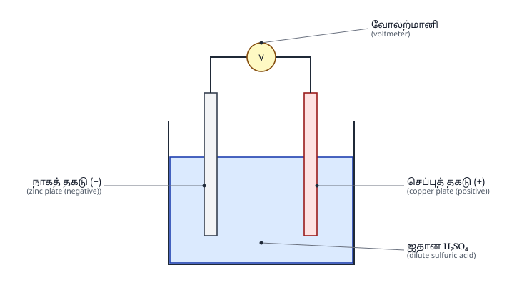

| இல. | பகுதி | English | தொழில் / குறிப்பு | SVG இலக்கு |
|---|---|---|---|---|
| 1 | நாகத் தகடு (−) | zinc plate (negative) | ஒட்சியேற்றம்: Zn → Zn²⁺ + 2e⁻ | `CHE-D06-L01-target` |
| 2 | செப்புத் தகடு (+) | copper plate (positive) | தாக்கத்திறன் குறைந்த உலோகம் | `CHE-D06-L02-target` |
| 3 | ஐதான H₂SO₄ | dilute sulfuric acid | மின்பகுபொருள் | `CHE-D06-L03-target` |
| 4 | வோல்ற்மானி | voltmeter | அழுத்த வேறுபாடு | `CHE-D06-L04-target` |

### 2. இனங்காணல் முறை

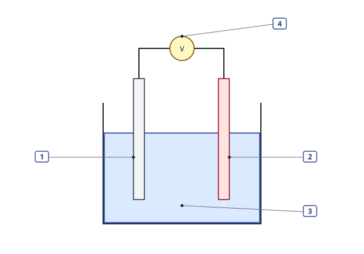

- இலக்கம் 1 இனால் காட்டப்படும் பகுதி எது?
- இலக்கம் 2 இனால் காட்டப்படும் பகுதி எது?
- இலக்கம் 3 இனால் காட்டப்படும் பகுதி எது?
- இலக்கம் 4 இனால் காட்டப்படும் பகுதி எது?

விடைகள்

1. நாகத் தகடு (−) (zinc plate (negative))
2. செப்புத் தகடு (+) (copper plate (positive))
3. ஐதான H₂SO₄ (dilute sulfuric acid)
4. வோல்ற்மானி (voltmeter)

### 3. பெயரிடல் முறை

பின்வரும் பெயர்களைப் பெயரிடாத படத்தின் இலக்கப் பெட்டிகளில் இடுக: ஐதான H₂SO₄ · செப்புத் தகடு (+) · நாகத் தகடு (−) · வோல்ற்மானி

### 4. தொழில் பொருத்தல்

| பகுதி | தொழில் (கலக்கப்பட்டது) |
|---|---|
| A. நாகத் தகடு (−) | 1. அழுத்த வேறுபாடு |
| B. செப்புத் தகடு (+) | 2. ஒட்சியேற்றம்: Zn → Zn²⁺ + 2e⁻ |
| C. ஐதான H₂SO₄ | 3. தாக்கத்திறன் குறைந்த உலோகம் |
| D. வோல்ற்மானி | 4. மின்பகுபொருள் |

விடைகள்

- A → 2
- B → 3
- C → 4
- D → 1

### 5. வரைதல் முறை — சரிபார்ப்புப் பட்டியல்

- [ ] தெளிவான, தொடர்ச்சியான பென்சில் கோடுகள்
- [ ] சரியான விகிதங்கள், ஒழுங்கு
- [ ] குறைந்தது 4 பகுதிகள் பெயரிடப்பட்டுள்ளன; பெயர்க் கோடுகள் குறுக்கிடவில்லை
- [ ] தலைப்பு எழுதப்பட்டுள்ளது

### 6. பரீட்சை முறை

பெயரிடாத படத்தில் (i) இலக்கம் 1, 2 இனைப் பெயரிடுக [2] (ii) 'நாகத் தகடு (−)' இன் ஒரு தொழிலைத் தருக [1].

புள்ளித் திட்டம் (அசல்)

(i) 1 — நாகத் தகடு (−); 2 — செப்புத் தகடு (+) [தலா 1] (ii) ஒட்சியேற்றம்: Zn → Zn²⁺ + 2e⁻ [1]

---

## PHY-D01: தொடர்ச் சுற்று (அம்பியர்மானி, வோல்ற்மானி) (Series circuit with ammeter and voltmeter)

<!-- meta {"type":"diagram","id":"PHY-D01","chapter_id":"SC10-19","labelled":"science_assets/physics/PHY-D01_labelled.svg","unlabelled":"science_assets/physics/PHY-D01_unlabelled.svg","schematic":true,"labels":[{"label_id":"PHY-D01-L01","svg_target":"PHY-D01-L01-target","key":"cell","ta":"மின்கலம்","en":"cell","function":"மின்னியக்க விசை வழங்கல்"},{"label_id":"PHY-D01-L02","svg_target":"PHY-D01-L02-target","key":"res","ta":"தடையி","en":"resistor","function":"மின்னோட்டத்தை எதிர்த்தல்"},{"label_id":"PHY-D01-L03","svg_target":"PHY-D01-L03-target","key":"amm","ta":"அம்பியர்மானி","en":"ammeter","function":"தொடராக — மின்னோட்டம் அளத்தல்"},{"label_id":"PHY-D01-L04","svg_target":"PHY-D01-L04-target","key":"volt","ta":"வோல்ற்மானி","en":"voltmeter","function":"சமாந்தரமாக — அழுத்த வேறுபாடு"},{"label_id":"PHY-D01-L05","svg_target":"PHY-D01-L05-target","key":"sw","ta":"ஆளி","en":"switch","function":"சுற்றைத் திறத்தல்/மூடல்"}],"provenance":"original-programmatic-svg"} -->

*ஓட்ட மின்னியல் (Current electricity)* · மூலம்: அசல் நிரல்வழி SVG

### 1. கற்றல் முறை

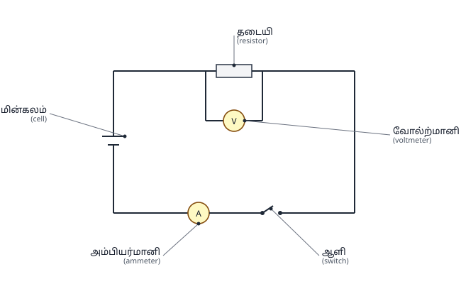

| இல. | பகுதி | English | தொழில் / குறிப்பு | SVG இலக்கு |
|---|---|---|---|---|
| 1 | மின்கலம் | cell | மின்னியக்க விசை வழங்கல் | `PHY-D01-L01-target` |
| 2 | தடையி | resistor | மின்னோட்டத்தை எதிர்த்தல் | `PHY-D01-L02-target` |
| 3 | அம்பியர்மானி | ammeter | தொடராக — மின்னோட்டம் அளத்தல் | `PHY-D01-L03-target` |
| 4 | வோல்ற்மானி | voltmeter | சமாந்தரமாக — அழுத்த வேறுபாடு | `PHY-D01-L04-target` |
| 5 | ஆளி | switch | சுற்றைத் திறத்தல்/மூடல் | `PHY-D01-L05-target` |

### 2. இனங்காணல் முறை

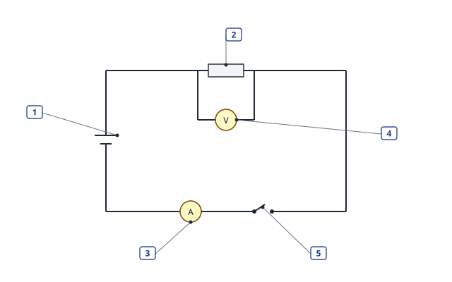

- இலக்கம் 1 இனால் காட்டப்படும் பகுதி எது?
- இலக்கம் 2 இனால் காட்டப்படும் பகுதி எது?
- இலக்கம் 3 இனால் காட்டப்படும் பகுதி எது?
- இலக்கம் 4 இனால் காட்டப்படும் பகுதி எது?
- இலக்கம் 5 இனால் காட்டப்படும் பகுதி எது?

விடைகள்

1. மின்கலம் (cell)
2. தடையி (resistor)
3. அம்பியர்மானி (ammeter)
4. வோல்ற்மானி (voltmeter)
5. ஆளி (switch)

### 3. பெயரிடல் முறை

பின்வரும் பெயர்களைப் பெயரிடாத படத்தின் இலக்கப் பெட்டிகளில் இடுக: அம்பியர்மானி · ஆளி · தடையி · மின்கலம் · வோல்ற்மானி

### 4. தொழில் பொருத்தல்

| பகுதி | தொழில் (கலக்கப்பட்டது) |
|---|---|
| A. மின்கலம் | 1. சமாந்தரமாக — அழுத்த வேறுபாடு |
| B. தடையி | 2. சுற்றைத் திறத்தல்/மூடல் |
| C. அம்பியர்மானி | 3. தொடராக — மின்னோட்டம் அளத்தல் |
| D. வோல்ற்மானி | 4. மின்னோட்டத்தை எதிர்த்தல் |
| E. ஆளி | 5. மின்னியக்க விசை வழங்கல் |

விடைகள்

- A → 5
- B → 4
- C → 3
- D → 1
- E → 2

### 5. வரைதல் முறை — சரிபார்ப்புப் பட்டியல்

- [ ] தெளிவான, தொடர்ச்சியான பென்சில் கோடுகள்
- [ ] சரியான விகிதங்கள், ஒழுங்கு
- [ ] குறைந்தது 5 பகுதிகள் பெயரிடப்பட்டுள்ளன; பெயர்க் கோடுகள் குறுக்கிடவில்லை
- [ ] தலைப்பு எழுதப்பட்டுள்ளது

### 6. பரீட்சை முறை

பெயரிடாத படத்தில் (i) இலக்கம் 1, 2 இனைப் பெயரிடுக [2] (ii) 'மின்கலம்' இன் ஒரு தொழிலைத் தருக [1].

புள்ளித் திட்டம் (அசல்)

(i) 1 — மின்கலம்; 2 — தடையி [தலா 1] (ii) மின்னியக்க விசை வழங்கல் [1]

---

## PHY-D02: சமாந்தரச் சுற்று (Parallel circuit)

<!-- meta {"type":"diagram","id":"PHY-D02","chapter_id":"SC10-19","labelled":"science_assets/physics/PHY-D02_labelled.svg","unlabelled":"science_assets/physics/PHY-D02_unlabelled.svg","schematic":true,"labels":[{"label_id":"PHY-D02-L01","svg_target":"PHY-D02-L01-target","key":"cell","ta":"மின்கலம்","en":"cell","function":""},{"label_id":"PHY-D02-L02","svg_target":"PHY-D02-L02-target","key":"r1","ta":"கிளை 1 (R₁)","en":"branch 1","function":"அழுத்த வேறுபாடு மின்கலத்துக்குச் சமம்"},{"label_id":"PHY-D02-L03","svg_target":"PHY-D02-L03-target","key":"r2","ta":"கிளை 2 (R₂)","en":"branch 2","function":"கிளை மின்னோட்டங்களின் கூட்டு = மொத்தம்"},{"label_id":"PHY-D02-L04","svg_target":"PHY-D02-L04-target","key":"junc","ta":"சந்தி","en":"junction","function":"மின்னோட்டம் பிரியும்/சேரும் புள்ளி"},{"label_id":"PHY-D02-L05","svg_target":"PHY-D02-L05-target","key":"amm","ta":"பிரதான அம்பியர்மானி","en":"main ammeter","function":"மொத்த மின்னோட்டம்"}],"provenance":"original-programmatic-svg"} -->

*ஓட்ட மின்னியல் (Current electricity)* · மூலம்: அசல் நிரல்வழி SVG

### 1. கற்றல் முறை

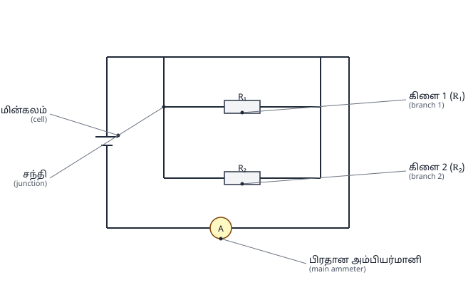

| இல. | பகுதி | English | தொழில் / குறிப்பு | SVG இலக்கு |
|---|---|---|---|---|
| 1 | மின்கலம் | cell | — | `PHY-D02-L01-target` |
| 2 | கிளை 1 (R₁) | branch 1 | அழுத்த வேறுபாடு மின்கலத்துக்குச் சமம் | `PHY-D02-L02-target` |
| 3 | கிளை 2 (R₂) | branch 2 | கிளை மின்னோட்டங்களின் கூட்டு = மொத்தம் | `PHY-D02-L03-target` |
| 4 | சந்தி | junction | மின்னோட்டம் பிரியும்/சேரும் புள்ளி | `PHY-D02-L04-target` |
| 5 | பிரதான அம்பியர்மானி | main ammeter | மொத்த மின்னோட்டம் | `PHY-D02-L05-target` |

### 2. இனங்காணல் முறை

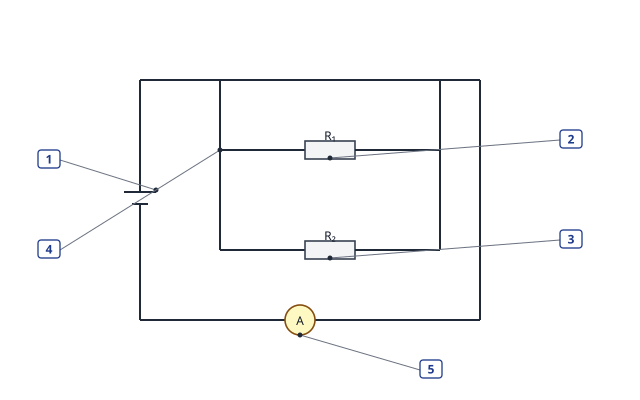

- இலக்கம் 1 இனால் காட்டப்படும் பகுதி எது?
- இலக்கம் 2 இனால் காட்டப்படும் பகுதி எது?
- இலக்கம் 3 இனால் காட்டப்படும் பகுதி எது?
- இலக்கம் 4 இனால் காட்டப்படும் பகுதி எது?
- இலக்கம் 5 இனால் காட்டப்படும் பகுதி எது?

விடைகள்

1. மின்கலம் (cell)
2. கிளை 1 (R₁) (branch 1)
3. கிளை 2 (R₂) (branch 2)
4. சந்தி (junction)
5. பிரதான அம்பியர்மானி (main ammeter)

### 3. பெயரிடல் முறை

பின்வரும் பெயர்களைப் பெயரிடாத படத்தின் இலக்கப் பெட்டிகளில் இடுக: கிளை 1 (R₁) · கிளை 2 (R₂) · சந்தி · பிரதான அம்பியர்மானி · மின்கலம்

### 4. தொழில் பொருத்தல்

| பகுதி | தொழில் (கலக்கப்பட்டது) |
|---|---|
| A. கிளை 1 (R₁) | 1. மின்னோட்டம் பிரியும்/சேரும் புள்ளி |
| B. கிளை 2 (R₂) | 2. மொத்த மின்னோட்டம் |
| C. சந்தி | 3. கிளை மின்னோட்டங்களின் கூட்டு = மொத்தம் |
| D. பிரதான அம்பியர்மானி | 4. அழுத்த வேறுபாடு மின்கலத்துக்குச் சமம் |

விடைகள்

- A → 4
- B → 3
- C → 1
- D → 2

### 5. வரைதல் முறை — சரிபார்ப்புப் பட்டியல்

- [ ] தெளிவான, தொடர்ச்சியான பென்சில் கோடுகள்
- [ ] சரியான விகிதங்கள், ஒழுங்கு
- [ ] குறைந்தது 5 பகுதிகள் பெயரிடப்பட்டுள்ளன; பெயர்க் கோடுகள் குறுக்கிடவில்லை
- [ ] தலைப்பு எழுதப்பட்டுள்ளது

### 6. பரீட்சை முறை

பெயரிடாத படத்தில் (i) இலக்கம் 1, 2 இனைப் பெயரிடுக [2] (ii) 'மின்கலம்' இன் ஒரு தொழிலைத் தருக [1].

புள்ளித் திட்டம் (அசல்)

(i) 1 — மின்கலம்; 2 — கிளை 1 (R₁) [தலா 1] (ii) பொருத்தமான தொழில் [1]

---

## PHY-D03: குவிவு வில்லை: பொருள் 2F க்கு அப்பால் (Convex lens: object beyond 2F)

<!-- meta {"type":"diagram","id":"PHY-D03","chapter_id":"SC11-05","labelled":"science_assets/physics/PHY-D03_labelled.svg","unlabelled":"science_assets/physics/PHY-D03_unlabelled.svg","schematic":false,"labels":[{"label_id":"PHY-D03-L01","svg_target":"PHY-D03-L01-target","key":"obj","ta":"பொருள்","en":"object","function":"2F க்கு அப்பால்"},{"label_id":"PHY-D03-L02","svg_target":"PHY-D03-L02-target","key":"img","ta":"விம்பம்","en":"image","function":"உண்மை, தலைகீழ், சிறியது; F–2F இடையில்"},{"label_id":"PHY-D03-L03","svg_target":"PHY-D03-L03-target","key":"lens","ta":"குவிவு வில்லை","en":"convex lens","function":"ஒருங்கச் செய்யும்"},{"label_id":"PHY-D03-L04","svg_target":"PHY-D03-L04-target","key":"axis","ta":"தலைமை அச்சு","en":"principal axis","function":""},{"label_id":"PHY-D03-L05","svg_target":"PHY-D03-L05-target","key":"f","ta":"குவியம்","en":"principal focus","function":"சமாந்தரக் கதிர்கள் சந்திக்கும் புள்ளி"}],"provenance":"original-programmatic-svg"} -->

*கேத்திரகணித ஒளியியல் (Geometrical optics)* · மூலம்: அசல் நிரல்வழி SVG · அளவிடைப்படி கணிக்கப்பட்டது: f = 80, u = 200, v = 133.3 (படக் குறிப்பலகுகள்)

### 1. கற்றல் முறை

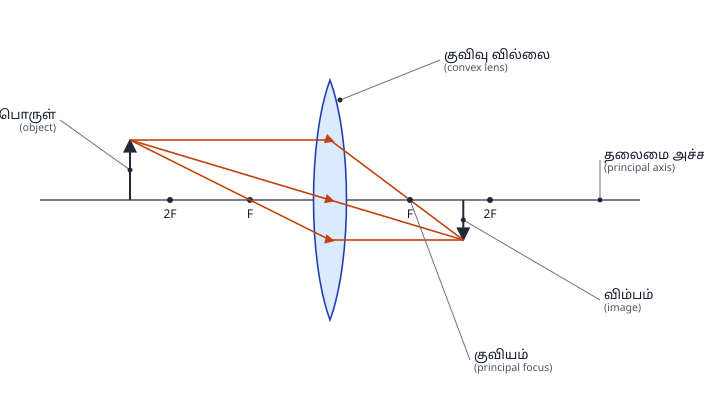

| இல. | பகுதி | English | தொழில் / குறிப்பு | SVG இலக்கு |
|---|---|---|---|---|
| 1 | பொருள் | object | 2F க்கு அப்பால் | `PHY-D03-L01-target` |
| 2 | விம்பம் | image | உண்மை, தலைகீழ், சிறியது; F–2F இடையில் | `PHY-D03-L02-target` |
| 3 | குவிவு வில்லை | convex lens | ஒருங்கச் செய்யும் | `PHY-D03-L03-target` |
| 4 | தலைமை அச்சு | principal axis | — | `PHY-D03-L04-target` |
| 5 | குவியம் | principal focus | சமாந்தரக் கதிர்கள் சந்திக்கும் புள்ளி | `PHY-D03-L05-target` |

### 2. இனங்காணல் முறை

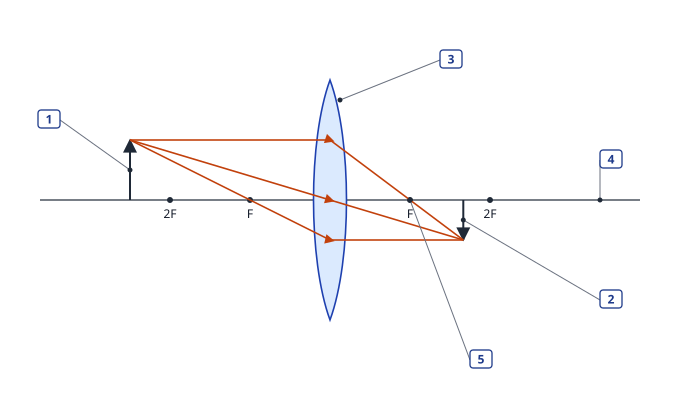

- இலக்கம் 1 இனால் காட்டப்படும் பகுதி எது?
- இலக்கம் 2 இனால் காட்டப்படும் பகுதி எது?
- இலக்கம் 3 இனால் காட்டப்படும் பகுதி எது?
- இலக்கம் 4 இனால் காட்டப்படும் பகுதி எது?
- இலக்கம் 5 இனால் காட்டப்படும் பகுதி எது?

விடைகள்

1. பொருள் (object)
2. விம்பம் (image)
3. குவிவு வில்லை (convex lens)
4. தலைமை அச்சு (principal axis)
5. குவியம் (principal focus)

### 3. பெயரிடல் முறை

பின்வரும் பெயர்களைப் பெயரிடாத படத்தின் இலக்கப் பெட்டிகளில் இடுக: குவியம் · குவிவு வில்லை · தலைமை அச்சு · பொருள் · விம்பம்

### 4. தொழில் பொருத்தல்

| பகுதி | தொழில் (கலக்கப்பட்டது) |
|---|---|
| A. பொருள் | 1. சமாந்தரக் கதிர்கள் சந்திக்கும் புள்ளி |
| B. விம்பம் | 2. 2F க்கு அப்பால் |
| C. குவிவு வில்லை | 3. உண்மை, தலைகீழ், சிறியது; F–2F இடையில் |
| D. குவியம் | 4. ஒருங்கச் செய்யும் |

விடைகள்

- A → 2
- B → 3
- C → 4
- D → 1

### 5. வரைதல் முறை — சரிபார்ப்புப் பட்டியல்

- [ ] தெளிவான, தொடர்ச்சியான பென்சில் கோடுகள்
- [ ] சரியான விகிதங்கள், ஒழுங்கு
- [ ] குறைந்தது 5 பகுதிகள் பெயரிடப்பட்டுள்ளன; பெயர்க் கோடுகள் குறுக்கிடவில்லை
- [ ] தலைப்பு எழுதப்பட்டுள்ளது

### 6. பரீட்சை முறை

பெயரிடாத படத்தில் (i) இலக்கம் 1, 2 இனைப் பெயரிடுக [2] (ii) 'பொருள்' இன் ஒரு தொழிலைத் தருக [1].

புள்ளித் திட்டம் (அசல்)

(i) 1 — பொருள்; 2 — விம்பம் [தலா 1] (ii) 2F க்கு அப்பால் [1]

---

## PHY-D04: சட்டக் காந்தத்தின் காந்தப் புலக் கோடுகள் (Magnetic field lines of a bar magnet)

<!-- meta {"type":"diagram","id":"PHY-D04","chapter_id":"SC11-13","labelled":"science_assets/physics/PHY-D04_labelled.svg","unlabelled":"science_assets/physics/PHY-D04_unlabelled.svg","schematic":true,"labels":[{"label_id":"PHY-D04-L01","svg_target":"PHY-D04-L01-target","key":"n","ta":"வடமுனை","en":"north pole","function":"புலக் கோடுகள் வெளியேறும்"},{"label_id":"PHY-D04-L02","svg_target":"PHY-D04-L02-target","key":"s","ta":"தென்முனை","en":"south pole","function":"புலக் கோடுகள் உட்செல்லும்"},{"label_id":"PHY-D04-L03","svg_target":"PHY-D04-L03-target","key":"line","ta":"புலக் கோடு","en":"field line","function":"N இலிருந்து S க்கு"},{"label_id":"PHY-D04-L04","svg_target":"PHY-D04-L04-target","key":"strong","ta":"வலிய புலம்","en":"strong field","function":"கோடுகள் நெருக்கம் — முனைகளில்"}],"provenance":"original-programmatic-svg"} -->

*மின் காந்தவியலும் தூண்டலும் (Electromagnetism and electromagnetic induction)* · மூலம்: அசல் நிரல்வழி SVG

### 1. கற்றல் முறை

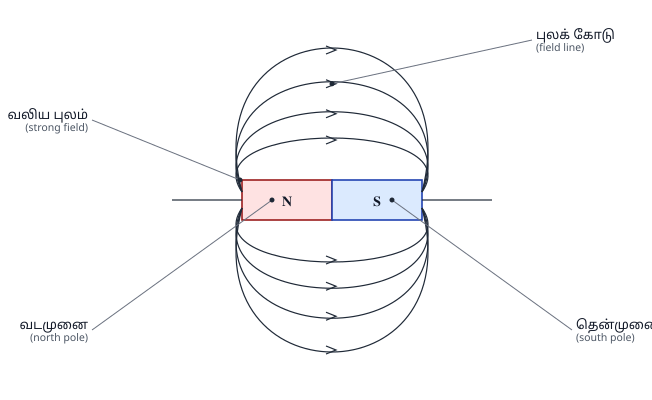

| இல. | பகுதி | English | தொழில் / குறிப்பு | SVG இலக்கு |
|---|---|---|---|---|
| 1 | வடமுனை | north pole | புலக் கோடுகள் வெளியேறும் | `PHY-D04-L01-target` |
| 2 | தென்முனை | south pole | புலக் கோடுகள் உட்செல்லும் | `PHY-D04-L02-target` |
| 3 | புலக் கோடு | field line | N இலிருந்து S க்கு | `PHY-D04-L03-target` |
| 4 | வலிய புலம் | strong field | கோடுகள் நெருக்கம் — முனைகளில் | `PHY-D04-L04-target` |

### 2. இனங்காணல் முறை

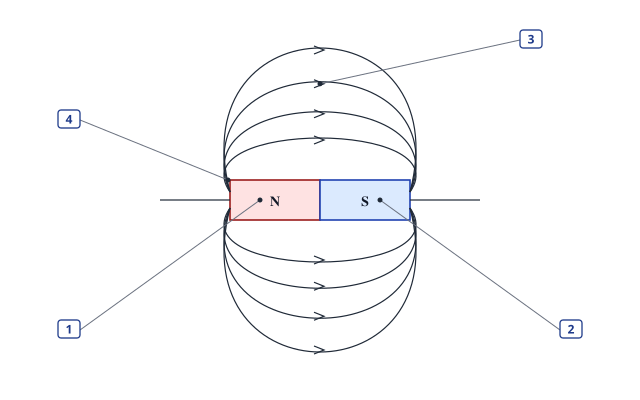

- இலக்கம் 1 இனால் காட்டப்படும் பகுதி எது?
- இலக்கம் 2 இனால் காட்டப்படும் பகுதி எது?
- இலக்கம் 3 இனால் காட்டப்படும் பகுதி எது?
- இலக்கம் 4 இனால் காட்டப்படும் பகுதி எது?

விடைகள்

1. வடமுனை (north pole)
2. தென்முனை (south pole)
3. புலக் கோடு (field line)
4. வலிய புலம் (strong field)

### 3. பெயரிடல் முறை

பின்வரும் பெயர்களைப் பெயரிடாத படத்தின் இலக்கப் பெட்டிகளில் இடுக: தென்முனை · புலக் கோடு · வடமுனை · வலிய புலம்

### 4. தொழில் பொருத்தல்

| பகுதி | தொழில் (கலக்கப்பட்டது) |
|---|---|
| A. வடமுனை | 1. புலக் கோடுகள் வெளியேறும் |
| B. தென்முனை | 2. புலக் கோடுகள் உட்செல்லும் |
| C. புலக் கோடு | 3. கோடுகள் நெருக்கம் — முனைகளில் |
| D. வலிய புலம் | 4. N இலிருந்து S க்கு |

விடைகள்

- A → 1
- B → 2
- C → 4
- D → 3

### 5. வரைதல் முறை — சரிபார்ப்புப் பட்டியல்

- [ ] தெளிவான, தொடர்ச்சியான பென்சில் கோடுகள்
- [ ] சரியான விகிதங்கள், ஒழுங்கு
- [ ] குறைந்தது 4 பகுதிகள் பெயரிடப்பட்டுள்ளன; பெயர்க் கோடுகள் குறுக்கிடவில்லை
- [ ] தலைப்பு எழுதப்பட்டுள்ளது

### 6. பரீட்சை முறை

பெயரிடாத படத்தில் (i) இலக்கம் 1, 2 இனைப் பெயரிடுக [2] (ii) 'வடமுனை' இன் ஒரு தொழிலைத் தருக [1].

புள்ளித் திட்டம் (அசல்)

(i) 1 — வடமுனை; 2 — தென்முனை [தலா 1] (ii) புலக் கோடுகள் வெளியேறும் [1]

---

## PHY-D05: குறுக்கலை (Transverse wave)

<!-- meta {"type":"diagram","id":"PHY-D05","chapter_id":"SC11-04","labelled":"science_assets/physics/PHY-D05_labelled.svg","unlabelled":"science_assets/physics/PHY-D05_unlabelled.svg","schematic":false,"labels":[{"label_id":"PHY-D05-L01","svg_target":"PHY-D05-L01-target","key":"crest","ta":"முடி","en":"crest","function":"உச்ச மேல் இடப்பெயர்ச்சி"},{"label_id":"PHY-D05-L02","svg_target":"PHY-D05-L02-target","key":"trough","ta":"தாழி","en":"trough","function":"உச்சக் கீழ் இடப்பெயர்ச்சி"},{"label_id":"PHY-D05-L03","svg_target":"PHY-D05-L03-target","key":"lambda","ta":"அலைநீளம்","en":"wavelength (λ)","function":"அடுத்தடுத்த இரு முடிகளுக்கிடையிலான தூரம்"},{"label_id":"PHY-D05-L04","svg_target":"PHY-D05-L04-target","key":"amp","ta":"வீச்சம்","en":"amplitude","function":"சமநிலையிலிருந்து உச்ச இடப்பெயர்ச்சி"},{"label_id":"PHY-D05-L05","svg_target":"PHY-D05-L05-target","key":"eq","ta":"சமநிலைக் கோடு","en":"rest position","function":""}],"provenance":"original-programmatic-svg"} -->

*அலைகளும் அவற்றின் பயன்பாடுகளும் (Waves and their applications)* · மூலம்: அசல் நிரல்வழி SVG

### 1. கற்றல் முறை

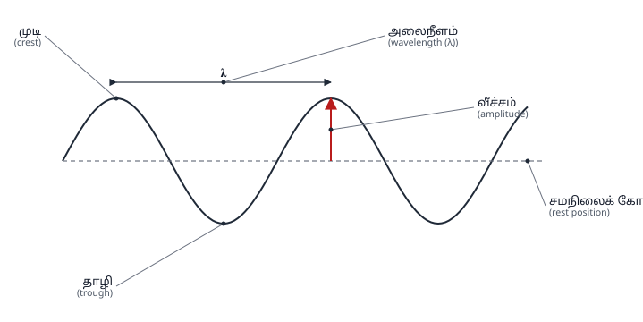

| இல. | பகுதி | English | தொழில் / குறிப்பு | SVG இலக்கு |
|---|---|---|---|---|
| 1 | முடி | crest | உச்ச மேல் இடப்பெயர்ச்சி | `PHY-D05-L01-target` |
| 2 | தாழி | trough | உச்சக் கீழ் இடப்பெயர்ச்சி | `PHY-D05-L02-target` |
| 3 | அலைநீளம் | wavelength (λ) | அடுத்தடுத்த இரு முடிகளுக்கிடையிலான தூரம் | `PHY-D05-L03-target` |
| 4 | வீச்சம் | amplitude | சமநிலையிலிருந்து உச்ச இடப்பெயர்ச்சி | `PHY-D05-L04-target` |
| 5 | சமநிலைக் கோடு | rest position | — | `PHY-D05-L05-target` |

### 2. இனங்காணல் முறை

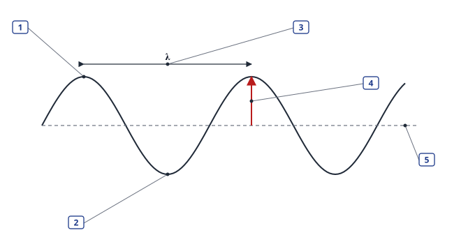

- இலக்கம் 1 இனால் காட்டப்படும் பகுதி எது?
- இலக்கம் 2 இனால் காட்டப்படும் பகுதி எது?
- இலக்கம் 3 இனால் காட்டப்படும் பகுதி எது?
- இலக்கம் 4 இனால் காட்டப்படும் பகுதி எது?
- இலக்கம் 5 இனால் காட்டப்படும் பகுதி எது?

விடைகள்

1. முடி (crest)
2. தாழி (trough)
3. அலைநீளம் (wavelength (λ))
4. வீச்சம் (amplitude)
5. சமநிலைக் கோடு (rest position)

### 3. பெயரிடல் முறை

பின்வரும் பெயர்களைப் பெயரிடாத படத்தின் இலக்கப் பெட்டிகளில் இடுக: அலைநீளம் · சமநிலைக் கோடு · தாழி · முடி · வீச்சம்

### 4. தொழில் பொருத்தல்

| பகுதி | தொழில் (கலக்கப்பட்டது) |
|---|---|
| A. முடி | 1. அடுத்தடுத்த இரு முடிகளுக்கிடையிலான தூரம் |
| B. தாழி | 2. உச்சக் கீழ் இடப்பெயர்ச்சி |
| C. அலைநீளம் | 3. உச்ச மேல் இடப்பெயர்ச்சி |
| D. வீச்சம் | 4. சமநிலையிலிருந்து உச்ச இடப்பெயர்ச்சி |

விடைகள்

- A → 3
- B → 2
- C → 1
- D → 4

### 5. வரைதல் முறை — சரிபார்ப்புப் பட்டியல்

- [ ] தெளிவான, தொடர்ச்சியான பென்சில் கோடுகள்
- [ ] சரியான விகிதங்கள், ஒழுங்கு
- [ ] குறைந்தது 5 பகுதிகள் பெயரிடப்பட்டுள்ளன; பெயர்க் கோடுகள் குறுக்கிடவில்லை
- [ ] தலைப்பு எழுதப்பட்டுள்ளது

### 6. பரீட்சை முறை

பெயரிடாத படத்தில் (i) இலக்கம் 1, 2 இனைப் பெயரிடுக [2] (ii) 'முடி' இன் ஒரு தொழிலைத் தருக [1].

புள்ளித் திட்டம் (அசல்)

(i) 1 — முடி; 2 — தாழி [தலா 1] (ii) உச்ச மேல் இடப்பெயர்ச்சி [1]

---

## PHY-D06: மேசையில் இழுக்கப்படும் பெட்டியின் விசை வரிப்படம் (Free-body diagram: box pulled on a table)

<!-- meta {"type":"diagram","id":"PHY-D06","chapter_id":"SC10-05","labelled":"science_assets/physics/PHY-D06_labelled.svg","unlabelled":"science_assets/physics/PHY-D06_unlabelled.svg","schematic":true,"labels":[{"label_id":"PHY-D06-L01","svg_target":"PHY-D06-L01-target","key":"W","ta":"நிறை (W = mg)","en":"weight","function":"புவியீர்ப்பு — கீழ்நோக்கி"},{"label_id":"PHY-D06-L02","svg_target":"PHY-D06-L02-target","key":"R","ta":"செவ்வன் மறுதாக்கம் (R)","en":"normal reaction","function":"மேற்பரப்புக்குச் செங்குத்து"},{"label_id":"PHY-D06-L03","svg_target":"PHY-D06-L03-target","key":"F","ta":"இழுவிசை (F)","en":"applied force","function":""},{"label_id":"PHY-D06-L04","svg_target":"PHY-D06-L04-target","key":"fr","ta":"உராய்வு (f)","en":"friction","function":"இயக்கத்துக்கு எதிர்த் திசை"}],"provenance":"original-programmatic-svg"} -->

*உராய்வு (Friction)* · மூலம்: அசல் நிரல்வழி SVG

### 1. கற்றல் முறை

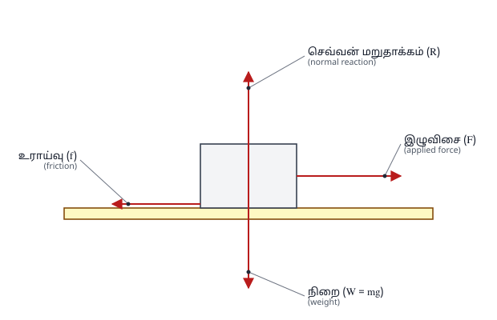

| இல. | பகுதி | English | தொழில் / குறிப்பு | SVG இலக்கு |
|---|---|---|---|---|
| 1 | நிறை (W = mg) | weight | புவியீர்ப்பு — கீழ்நோக்கி | `PHY-D06-L01-target` |
| 2 | செவ்வன் மறுதாக்கம் (R) | normal reaction | மேற்பரப்புக்குச் செங்குத்து | `PHY-D06-L02-target` |
| 3 | இழுவிசை (F) | applied force | — | `PHY-D06-L03-target` |
| 4 | உராய்வு (f) | friction | இயக்கத்துக்கு எதிர்த் திசை | `PHY-D06-L04-target` |

### 2. இனங்காணல் முறை

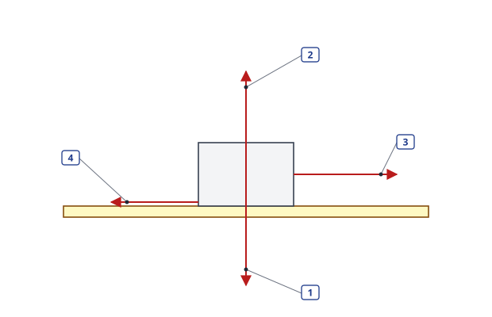

- இலக்கம் 1 இனால் காட்டப்படும் பகுதி எது?
- இலக்கம் 2 இனால் காட்டப்படும் பகுதி எது?
- இலக்கம் 3 இனால் காட்டப்படும் பகுதி எது?
- இலக்கம் 4 இனால் காட்டப்படும் பகுதி எது?

விடைகள்

1. நிறை (W = mg) (weight)
2. செவ்வன் மறுதாக்கம் (R) (normal reaction)
3. இழுவிசை (F) (applied force)
4. உராய்வு (f) (friction)

### 3. பெயரிடல் முறை

பின்வரும் பெயர்களைப் பெயரிடாத படத்தின் இலக்கப் பெட்டிகளில் இடுக: இழுவிசை (F) · உராய்வு (f) · செவ்வன் மறுதாக்கம் (R) · நிறை (W = mg)

### 4. தொழில் பொருத்தல்

| பகுதி | தொழில் (கலக்கப்பட்டது) |
|---|---|
| A. நிறை (W = mg) | 1. புவியீர்ப்பு — கீழ்நோக்கி |
| B. செவ்வன் மறுதாக்கம் (R) | 2. மேற்பரப்புக்குச் செங்குத்து |
| C. உராய்வு (f) | 3. இயக்கத்துக்கு எதிர்த் திசை |

விடைகள்

- A → 1
- B → 2
- C → 3

### 5. வரைதல் முறை — சரிபார்ப்புப் பட்டியல்

- [ ] தெளிவான, தொடர்ச்சியான பென்சில் கோடுகள்
- [ ] சரியான விகிதங்கள், ஒழுங்கு
- [ ] குறைந்தது 4 பகுதிகள் பெயரிடப்பட்டுள்ளன; பெயர்க் கோடுகள் குறுக்கிடவில்லை
- [ ] தலைப்பு எழுதப்பட்டுள்ளது

### 6. பரீட்சை முறை

பெயரிடாத படத்தில் (i) இலக்கம் 1, 2 இனைப் பெயரிடுக [2] (ii) 'நிறை (W = mg)' இன் ஒரு தொழிலைத் தருக [1].

புள்ளித் திட்டம் (அசல்)

(i) 1 — நிறை (W = mg); 2 — செவ்வன் மறுதாக்கம் (R) [தலா 1] (ii) புவியீர்ப்பு — கீழ்நோக்கி [1]

---

## PHY-D07: நிலைமாற்றி (Transformer)

<!-- meta {"type":"diagram","id":"PHY-D07","chapter_id":"SC11-13","labelled":"science_assets/physics/PHY-D07_labelled.svg","unlabelled":"science_assets/physics/PHY-D07_unlabelled.svg","schematic":true,"labels":[{"label_id":"PHY-D07-L01","svg_target":"PHY-D07-L01-target","key":"core","ta":"மென் இரும்பு அகணி","en":"soft-iron core","function":"காந்தப் பாயத்தை இணைத்தல்"},{"label_id":"PHY-D07-L02","svg_target":"PHY-D07-L02-target","key":"prim","ta":"முதன்மைச் சுருள் (Np)","en":"primary coil","function":"AC — மாறும் காந்தப் பாயம்"},{"label_id":"PHY-D07-L03","svg_target":"PHY-D07-L03-target","key":"sec","ta":"துணைச் சுருள் (Ns)","en":"secondary coil","function":"தூண்டிய மி.இ.வி."}],"provenance":"original-programmatic-svg"} -->

*மின் காந்தவியலும் தூண்டலும் (Electromagnetism and electromagnetic induction)* · மூலம்: அசல் நிரல்வழி SVG

### 1. கற்றல் முறை

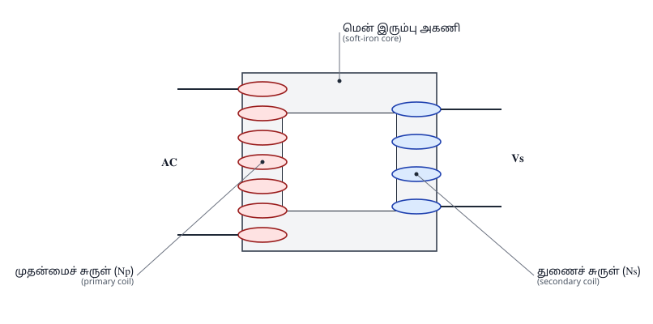

| இல. | பகுதி | English | தொழில் / குறிப்பு | SVG இலக்கு |
|---|---|---|---|---|
| 1 | மென் இரும்பு அகணி | soft-iron core | காந்தப் பாயத்தை இணைத்தல் | `PHY-D07-L01-target` |
| 2 | முதன்மைச் சுருள் (Np) | primary coil | AC — மாறும் காந்தப் பாயம் | `PHY-D07-L02-target` |
| 3 | துணைச் சுருள் (Ns) | secondary coil | தூண்டிய மி.இ.வி. | `PHY-D07-L03-target` |

### 2. இனங்காணல் முறை

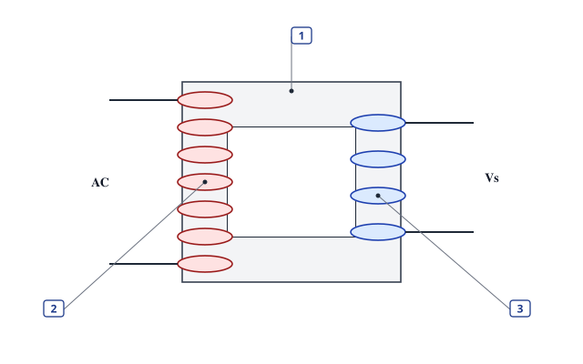

- இலக்கம் 1 இனால் காட்டப்படும் பகுதி எது?
- இலக்கம் 2 இனால் காட்டப்படும் பகுதி எது?
- இலக்கம் 3 இனால் காட்டப்படும் பகுதி எது?

விடைகள்

1. மென் இரும்பு அகணி (soft-iron core)
2. முதன்மைச் சுருள் (Np) (primary coil)
3. துணைச் சுருள் (Ns) (secondary coil)

### 3. பெயரிடல் முறை

பின்வரும் பெயர்களைப் பெயரிடாத படத்தின் இலக்கப் பெட்டிகளில் இடுக: துணைச் சுருள் (Ns) · முதன்மைச் சுருள் (Np) · மென் இரும்பு அகணி

### 4. தொழில் பொருத்தல்

| பகுதி | தொழில் (கலக்கப்பட்டது) |
|---|---|
| A. மென் இரும்பு அகணி | 1. காந்தப் பாயத்தை இணைத்தல் |
| B. முதன்மைச் சுருள் (Np) | 2. AC — மாறும் காந்தப் பாயம் |
| C. துணைச் சுருள் (Ns) | 3. தூண்டிய மி.இ.வி. |

விடைகள்

- A → 1
- B → 2
- C → 3

### 5. வரைதல் முறை — சரிபார்ப்புப் பட்டியல்

- [ ] தெளிவான, தொடர்ச்சியான பென்சில் கோடுகள்
- [ ] சரியான விகிதங்கள், ஒழுங்கு
- [ ] குறைந்தது 3 பகுதிகள் பெயரிடப்பட்டுள்ளன; பெயர்க் கோடுகள் குறுக்கிடவில்லை
- [ ] தலைப்பு எழுதப்பட்டுள்ளது

### 6. பரீட்சை முறை

பெயரிடாத படத்தில் (i) இலக்கம் 1, 2 இனைப் பெயரிடுக [2] (ii) 'மென் இரும்பு அகணி' இன் ஒரு தொழிலைத் தருக [1].

புள்ளித் திட்டம் (அசல்)

(i) 1 — மென் இரும்பு அகணி; 2 — முதன்மைச் சுருள் (Np) [தலா 1] (ii) காந்தப் பாயத்தை இணைத்தல் [1]

---

## PHY-D08: பொது அறிவிப்புத் தொகுதி (கட்டத் தொகுதி வரிப்படம்) (Public address system (block diagram))

<!-- meta {"type":"diagram","id":"PHY-D08","chapter_id":"SC11-11","labelled":"science_assets/physics/PHY-D08_labelled.svg","unlabelled":"science_assets/physics/PHY-D08_unlabelled.svg","schematic":true,"labels":[{"label_id":"PHY-D08-L01","svg_target":"PHY-D08-L01-target","key":"mic","ta":"ஒலிவாங்கி","en":"microphone","function":"ஒலி → மின் சைகை"},{"label_id":"PHY-D08-L02","svg_target":"PHY-D08-L02-target","key":"amp","ta":"விரியலாக்கி (திரான்சிஸ்டர்)","en":"amplifier","function":"சைகையின் வீச்சத்தைக் கூட்டல்"},{"label_id":"PHY-D08-L03","svg_target":"PHY-D08-L03-target","key":"spk","ta":"ஒலிபெருக்கி","en":"loudspeaker","function":"மின் → ஒலி"},{"label_id":"PHY-D08-L04","svg_target":"PHY-D08-L04-target","key":"psu","ta":"மின்வழங்கல்","en":"power supply","function":"விரியலாக்கத்துக்கான சக்தி"}],"provenance":"original-programmatic-svg"} -->

*இலத்திரனியல் (Electronics)* · மூலம்: அசல் நிரல்வழி SVG

### 1. கற்றல் முறை

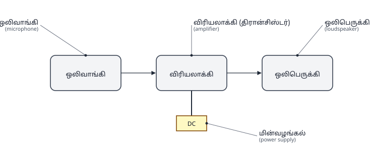

| இல. | பகுதி | English | தொழில் / குறிப்பு | SVG இலக்கு |
|---|---|---|---|---|
| 1 | ஒலிவாங்கி | microphone | ஒலி → மின் சைகை | `PHY-D08-L01-target` |
| 2 | விரியலாக்கி (திரான்சிஸ்டர்) | amplifier | சைகையின் வீச்சத்தைக் கூட்டல் | `PHY-D08-L02-target` |
| 3 | ஒலிபெருக்கி | loudspeaker | மின் → ஒலி | `PHY-D08-L03-target` |
| 4 | மின்வழங்கல் | power supply | விரியலாக்கத்துக்கான சக்தி | `PHY-D08-L04-target` |

### 2. இனங்காணல் முறை

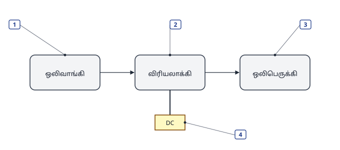

- இலக்கம் 1 இனால் காட்டப்படும் பகுதி எது?
- இலக்கம் 2 இனால் காட்டப்படும் பகுதி எது?
- இலக்கம் 3 இனால் காட்டப்படும் பகுதி எது?
- இலக்கம் 4 இனால் காட்டப்படும் பகுதி எது?

விடைகள்

1. ஒலிவாங்கி (microphone)
2. விரியலாக்கி (திரான்சிஸ்டர்) (amplifier)
3. ஒலிபெருக்கி (loudspeaker)
4. மின்வழங்கல் (power supply)

### 3. பெயரிடல் முறை

பின்வரும் பெயர்களைப் பெயரிடாத படத்தின் இலக்கப் பெட்டிகளில் இடுக: ஒலிபெருக்கி · ஒலிவாங்கி · மின்வழங்கல் · விரியலாக்கி (திரான்சிஸ்டர்)

### 4. தொழில் பொருத்தல்

| பகுதி | தொழில் (கலக்கப்பட்டது) |
|---|---|
| A. ஒலிவாங்கி | 1. மின் → ஒலி |
| B. விரியலாக்கி (திரான்சிஸ்டர்) | 2. சைகையின் வீச்சத்தைக் கூட்டல் |
| C. ஒலிபெருக்கி | 3. ஒலி → மின் சைகை |
| D. மின்வழங்கல் | 4. விரியலாக்கத்துக்கான சக்தி |

விடைகள்

- A → 3
- B → 2
- C → 1
- D → 4

### 5. வரைதல் முறை — சரிபார்ப்புப் பட்டியல்

- [ ] தெளிவான, தொடர்ச்சியான பென்சில் கோடுகள்
- [ ] சரியான விகிதங்கள், ஒழுங்கு
- [ ] குறைந்தது 4 பகுதிகள் பெயரிடப்பட்டுள்ளன; பெயர்க் கோடுகள் குறுக்கிடவில்லை
- [ ] தலைப்பு எழுதப்பட்டுள்ளது

### 6. பரீட்சை முறை

பெயரிடாத படத்தில் (i) இலக்கம் 1, 2 இனைப் பெயரிடுக [2] (ii) 'ஒலிவாங்கி' இன் ஒரு தொழிலைத் தருக [1].

புள்ளித் திட்டம் (அசல்)

(i) 1 — ஒலிவாங்கி; 2 — விரியலாக்கி (திரான்சிஸ்டர்) [தலா 1] (ii) ஒலி → மின் சைகை [1]

---

## PHY-D09: npn திரான்சிஸ்டர் குறியீடு (npn transistor symbol)

<!-- meta {"type":"diagram","id":"PHY-D09","chapter_id":"SC11-11","labelled":"science_assets/physics/PHY-D09_labelled.svg","unlabelled":"science_assets/physics/PHY-D09_unlabelled.svg","schematic":true,"labels":[{"label_id":"PHY-D09-L01","svg_target":"PHY-D09-L01-target","key":"b","ta":"அடி (B)","en":"base","function":"சிறிய கட்டுப்பாட்டு மின்னோட்டம்"},{"label_id":"PHY-D09-L02","svg_target":"PHY-D09-L02-target","key":"c","ta":"சேகரிப்பான் (C)","en":"collector","function":"பெரிய மின்னோட்டம் உட்செல்லும்"},{"label_id":"PHY-D09-L03","svg_target":"PHY-D09-L03-target","key":"e","ta":"காலி (E)","en":"emitter","function":"அம்புக்குறி: மரபு மின்னோட்டத் திசை"}],"provenance":"original-programmatic-svg"} -->

*இலத்திரனியல் (Electronics)* · மூலம்: அசல் நிரல்வழி SVG

### 1. கற்றல் முறை

| இல. | பகுதி | English | தொழில் / குறிப்பு | SVG இலக்கு |
|---|---|---|---|---|
| 1 | அடி (B) | base | சிறிய கட்டுப்பாட்டு மின்னோட்டம் | `PHY-D09-L01-target` |
| 2 | சேகரிப்பான் (C) | collector | பெரிய மின்னோட்டம் உட்செல்லும் | `PHY-D09-L02-target` |
| 3 | காலி (E) | emitter | அம்புக்குறி: மரபு மின்னோட்டத் திசை | `PHY-D09-L03-target` |

### 2. இனங்காணல் முறை

- இலக்கம் 1 இனால் காட்டப்படும் பகுதி எது?
- இலக்கம் 2 இனால் காட்டப்படும் பகுதி எது?
- இலக்கம் 3 இனால் காட்டப்படும் பகுதி எது?

விடைகள்

1. அடி (B) (base)
2. சேகரிப்பான் (C) (collector)
3. காலி (E) (emitter)

### 3. பெயரிடல் முறை

பின்வரும் பெயர்களைப் பெயரிடாத படத்தின் இலக்கப் பெட்டிகளில் இடுக: அடி (B) · காலி (E) · சேகரிப்பான் (C)

### 4. தொழில் பொருத்தல்

| பகுதி | தொழில் (கலக்கப்பட்டது) |
|---|---|
| A. அடி (B) | 1. சிறிய கட்டுப்பாட்டு மின்னோட்டம் |
| B. சேகரிப்பான் (C) | 2. அம்புக்குறி: மரபு மின்னோட்டத் திசை |
| C. காலி (E) | 3. பெரிய மின்னோட்டம் உட்செல்லும் |

விடைகள்

- A → 1
- B → 3
- C → 2

### 5. வரைதல் முறை — சரிபார்ப்புப் பட்டியல்

- [ ] தெளிவான, தொடர்ச்சியான பென்சில் கோடுகள்
- [ ] சரியான விகிதங்கள், ஒழுங்கு
- [ ] குறைந்தது 3 பகுதிகள் பெயரிடப்பட்டுள்ளன; பெயர்க் கோடுகள் குறுக்கிடவில்லை
- [ ] தலைப்பு எழுதப்பட்டுள்ளது

### 6. பரீட்சை முறை

பெயரிடாத படத்தில் (i) இலக்கம் 1, 2 இனைப் பெயரிடுக [2] (ii) 'அடி (B)' இன் ஒரு தொழிலைத் தருக [1].

புள்ளித் திட்டம் (அசல்)

(i) 1 — அடி (B); 2 — சேகரிப்பான் (C) [தலா 1] (ii) சிறிய கட்டுப்பாட்டு மின்னோட்டம் [1]

---

## PHY-D10: ஆழத்துடன் திரவ அமுக்கம் (Liquid pressure increases with depth)

<!-- meta {"type":"diagram","id":"PHY-D10","chapter_id":"SC10-15","labelled":"science_assets/physics/PHY-D10_labelled.svg","unlabelled":"science_assets/physics/PHY-D10_unlabelled.svg","schematic":true,"labels":[{"label_id":"PHY-D10-L01","svg_target":"PHY-D10-L01-target","key":"top","ta":"மேல் துவாரம்","en":"upper hole","function":"குறைந்த ஆழம் — குறுகிய பீச்சு"},{"label_id":"PHY-D10-L02","svg_target":"PHY-D10-L02-target","key":"bottom","ta":"கீழ்த் துவாரம்","en":"lower hole","function":"அதிக ஆழம் — அதிக அமுக்கம், நீண்ட பீச்சு"},{"label_id":"PHY-D10-L03","svg_target":"PHY-D10-L03-target","key":"level","ta":"நீர் மட்டம்","en":"water surface","function":"h அளக்கப்படும் இடம்"}],"provenance":"original-programmatic-svg"} -->

*நீர்நிலையியல் அமுக்கமும் அதன் பிரயோகங்களும் (Hydrostatic pressure and its applications)* · மூலம்: அசல் நிரல்வழி SVG

### 1. கற்றல் முறை

| இல. | பகுதி | English | தொழில் / குறிப்பு | SVG இலக்கு |
|---|---|---|---|---|
| 1 | மேல் துவாரம் | upper hole | குறைந்த ஆழம் — குறுகிய பீச்சு | `PHY-D10-L01-target` |
| 2 | கீழ்த் துவாரம் | lower hole | அதிக ஆழம் — அதிக அமுக்கம், நீண்ட பீச்சு | `PHY-D10-L02-target` |
| 3 | நீர் மட்டம் | water surface | h அளக்கப்படும் இடம் | `PHY-D10-L03-target` |

### 2. இனங்காணல் முறை

- இலக்கம் 1 இனால் காட்டப்படும் பகுதி எது?
- இலக்கம் 2 இனால் காட்டப்படும் பகுதி எது?
- இலக்கம் 3 இனால் காட்டப்படும் பகுதி எது?

விடைகள்

1. மேல் துவாரம் (upper hole)
2. கீழ்த் துவாரம் (lower hole)
3. நீர் மட்டம் (water surface)

### 3. பெயரிடல் முறை

பின்வரும் பெயர்களைப் பெயரிடாத படத்தின் இலக்கப் பெட்டிகளில் இடுக: கீழ்த் துவாரம் · நீர் மட்டம் · மேல் துவாரம்

### 4. தொழில் பொருத்தல்

| பகுதி | தொழில் (கலக்கப்பட்டது) |
|---|---|
| A. மேல் துவாரம் | 1. அதிக ஆழம் — அதிக அமுக்கம், நீண்ட பீச்சு |
| B. கீழ்த் துவாரம் | 2. குறைந்த ஆழம் — குறுகிய பீச்சு |
| C. நீர் மட்டம் | 3. h அளக்கப்படும் இடம் |

விடைகள்

- A → 2
- B → 1
- C → 3

### 5. வரைதல் முறை — சரிபார்ப்புப் பட்டியல்

- [ ] தெளிவான, தொடர்ச்சியான பென்சில் கோடுகள்
- [ ] சரியான விகிதங்கள், ஒழுங்கு
- [ ] குறைந்தது 3 பகுதிகள் பெயரிடப்பட்டுள்ளன; பெயர்க் கோடுகள் குறுக்கிடவில்லை
- [ ] தலைப்பு எழுதப்பட்டுள்ளது

### 6. பரீட்சை முறை

பெயரிடாத படத்தில் (i) இலக்கம் 1, 2 இனைப் பெயரிடுக [2] (ii) 'மேல் துவாரம்' இன் ஒரு தொழிலைத் தருக [1].

புள்ளித் திட்டம் (அசல்)

(i) 1 — மேல் துவாரம்; 2 — கீழ்த் துவாரம் [தலா 1] (ii) குறைந்த ஆழம் — குறுகிய பீச்சு [1]

---

## PHY-D11: திருப்பக் கொள்கை — சீசோ (Principle of moments — see-saw)

<!-- meta {"type":"diagram","id":"PHY-D11","chapter_id":"SC10-11","labelled":"science_assets/physics/PHY-D11_labelled.svg","unlabelled":"science_assets/physics/PHY-D11_unlabelled.svg","schematic":true,"labels":[{"label_id":"PHY-D11-L01","svg_target":"PHY-D11-L01-target","key":"pivot","ta":"சுழல்மையம்","en":"pivot (fulcrum)","function":"திருப்பங்கள் அளக்கப்படும் புள்ளி"},{"label_id":"PHY-D11-L02","svg_target":"PHY-D11-L02-target","key":"f1","ta":"W₁ (இடஞ்சுழித் திருப்பம்)","en":"anticlockwise moment","function":"W₁ × d₁"},{"label_id":"PHY-D11-L03","svg_target":"PHY-D11-L03-target","key":"f2","ta":"W₂ (வலஞ்சுழித் திருப்பம்)","en":"clockwise moment","function":"W₂ × d₂"},{"label_id":"PHY-D11-L04","svg_target":"PHY-D11-L04-target","key":"cond","ta":"சமநிலை: W₁d₁ = W₂d₂","en":"balance condition","function":""}],"provenance":"original-programmatic-svg"} -->

*விசையின் திரும்பல் விளைவு (Turning effect of a force)* · மூலம்: அசல் நிரல்வழி SVG

### 1. கற்றல் முறை

| இல. | பகுதி | English | தொழில் / குறிப்பு | SVG இலக்கு |
|---|---|---|---|---|
| 1 | சுழல்மையம் | pivot (fulcrum) | திருப்பங்கள் அளக்கப்படும் புள்ளி | `PHY-D11-L01-target` |
| 2 | W₁ (இடஞ்சுழித் திருப்பம்) | anticlockwise moment | W₁ × d₁ | `PHY-D11-L02-target` |
| 3 | W₂ (வலஞ்சுழித் திருப்பம்) | clockwise moment | W₂ × d₂ | `PHY-D11-L03-target` |
| 4 | சமநிலை: W₁d₁ = W₂d₂ | balance condition | — | `PHY-D11-L04-target` |

### 2. இனங்காணல் முறை

- இலக்கம் 1 இனால் காட்டப்படும் பகுதி எது?
- இலக்கம் 2 இனால் காட்டப்படும் பகுதி எது?
- இலக்கம் 3 இனால் காட்டப்படும் பகுதி எது?
- இலக்கம் 4 இனால் காட்டப்படும் பகுதி எது?

விடைகள்

1. சுழல்மையம் (pivot (fulcrum))
2. W₁ (இடஞ்சுழித் திருப்பம்) (anticlockwise moment)
3. W₂ (வலஞ்சுழித் திருப்பம்) (clockwise moment)
4. சமநிலை: W₁d₁ = W₂d₂ (balance condition)

### 3. பெயரிடல் முறை

பின்வரும் பெயர்களைப் பெயரிடாத படத்தின் இலக்கப் பெட்டிகளில் இடுக: W₁ (இடஞ்சுழித் திருப்பம்) · W₂ (வலஞ்சுழித் திருப்பம்) · சமநிலை: W₁d₁ = W₂d₂ · சுழல்மையம்

### 4. தொழில் பொருத்தல்

| பகுதி | தொழில் (கலக்கப்பட்டது) |
|---|---|
| A. சுழல்மையம் | 1. திருப்பங்கள் அளக்கப்படும் புள்ளி |
| B. W₁ (இடஞ்சுழித் திருப்பம்) | 2. W₂ × d₂ |
| C. W₂ (வலஞ்சுழித் திருப்பம்) | 3. W₁ × d₁ |

விடைகள்

- A → 1
- B → 3
- C → 2

### 5. வரைதல் முறை — சரிபார்ப்புப் பட்டியல்

- [ ] தெளிவான, தொடர்ச்சியான பென்சில் கோடுகள்
- [ ] சரியான விகிதங்கள், ஒழுங்கு
- [ ] குறைந்தது 4 பகுதிகள் பெயரிடப்பட்டுள்ளன; பெயர்க் கோடுகள் குறுக்கிடவில்லை
- [ ] தலைப்பு எழுதப்பட்டுள்ளது

### 6. பரீட்சை முறை

பெயரிடாத படத்தில் (i) இலக்கம் 1, 2 இனைப் பெயரிடுக [2] (ii) 'சுழல்மையம்' இன் ஒரு தொழிலைத் தருக [1].

புள்ளித் திட்டம் (அசல்)

(i) 1 — சுழல்மையம்; 2 — W₁ (இடஞ்சுழித் திருப்பம்) [தலா 1] (ii) திருப்பங்கள் அளக்கப்படும் புள்ளி [1]

---

## PHY-D12: வரிச்சுருளும் மின்காந்தமும் (Solenoid / electromagnet)

<!-- meta {"type":"diagram","id":"PHY-D12","chapter_id":"SC11-13","labelled":"science_assets/physics/PHY-D12_labelled.svg","unlabelled":"science_assets/physics/PHY-D12_unlabelled.svg","schematic":true,"labels":[{"label_id":"PHY-D12-L01","svg_target":"PHY-D12-L01-target","key":"core","ta":"மென் இரும்பு அகணி","en":"soft-iron core","function":"புலத்தை வலுப்படுத்தல்"},{"label_id":"PHY-D12-L02","svg_target":"PHY-D12-L02-target","key":"coil","ta":"கம்பிச் சுருள்","en":"coil (insulated wire)","function":"சுற்றுகள் கூடப் புலம் வலுக்கும்"},{"label_id":"PHY-D12-L03","svg_target":"PHY-D12-L03-target","key":"cell","ta":"மின்கலம்","en":"cell","function":"மின்னோட்டம் பாயும்போது மட்டும் காந்தம்"}],"provenance":"original-programmatic-svg"} -->

*மின் காந்தவியலும் தூண்டலும் (Electromagnetism and electromagnetic induction)* · மூலம்: அசல் நிரல்வழி SVG

### 1. கற்றல் முறை

| இல. | பகுதி | English | தொழில் / குறிப்பு | SVG இலக்கு |
|---|---|---|---|---|
| 1 | மென் இரும்பு அகணி | soft-iron core | புலத்தை வலுப்படுத்தல் | `PHY-D12-L01-target` |
| 2 | கம்பிச் சுருள் | coil (insulated wire) | சுற்றுகள் கூடப் புலம் வலுக்கும் | `PHY-D12-L02-target` |
| 3 | மின்கலம் | cell | மின்னோட்டம் பாயும்போது மட்டும் காந்தம் | `PHY-D12-L03-target` |

### 2. இனங்காணல் முறை

- இலக்கம் 1 இனால் காட்டப்படும் பகுதி எது?
- இலக்கம் 2 இனால் காட்டப்படும் பகுதி எது?
- இலக்கம் 3 இனால் காட்டப்படும் பகுதி எது?

விடைகள்

1. மென் இரும்பு அகணி (soft-iron core)
2. கம்பிச் சுருள் (coil (insulated wire))
3. மின்கலம் (cell)

### 3. பெயரிடல் முறை

பின்வரும் பெயர்களைப் பெயரிடாத படத்தின் இலக்கப் பெட்டிகளில் இடுக: கம்பிச் சுருள் · மின்கலம் · மென் இரும்பு அகணி

### 4. தொழில் பொருத்தல்

| பகுதி | தொழில் (கலக்கப்பட்டது) |
|---|---|
| A. மென் இரும்பு அகணி | 1. மின்னோட்டம் பாயும்போது மட்டும் காந்தம் |
| B. கம்பிச் சுருள் | 2. புலத்தை வலுப்படுத்தல் |
| C. மின்கலம் | 3. சுற்றுகள் கூடப் புலம் வலுக்கும் |

விடைகள்

- A → 2
- B → 3
- C → 1

### 5. வரைதல் முறை — சரிபார்ப்புப் பட்டியல்

- [ ] தெளிவான, தொடர்ச்சியான பென்சில் கோடுகள்
- [ ] சரியான விகிதங்கள், ஒழுங்கு
- [ ] குறைந்தது 3 பகுதிகள் பெயரிடப்பட்டுள்ளன; பெயர்க் கோடுகள் குறுக்கிடவில்லை
- [ ] தலைப்பு எழுதப்பட்டுள்ளது

### 6. பரீட்சை முறை

பெயரிடாத படத்தில் (i) இலக்கம் 1, 2 இனைப் பெயரிடுக [2] (ii) 'மென் இரும்பு அகணி' இன் ஒரு தொழிலைத் தருக [1].

புள்ளித் திட்டம் (அசல்)

(i) 1 — மென் இரும்பு அகணி; 2 — கம்பிச் சுருள் [தலா 1] (ii) புலத்தை வலுப்படுத்தல் [1]

---

## GR-D01: வேக–நேர வரைபு (Velocity–time graph)

<!-- meta {"type":"diagram","id":"GR-D01","chapter_id":"SC10-02","labelled":"science_assets/graphs/GR-D01_labelled.svg","unlabelled":"science_assets/graphs/GR-D01_unlabelled.svg","schematic":false,"labels":[{"label_id":"GR-D01-L01","svg_target":"GR-D01-L01-target","key":"acc","ta":"ஆர்முடுகல் (படித்திறன் 2.5 m s⁻²)","en":"acceleration","function":""},{"label_id":"GR-D01-L02","svg_target":"GR-D01-L02-target","key":"const","ta":"சீரான வேகம்","en":"constant velocity","function":"ஆர்முடுகல் 0"},{"label_id":"GR-D01-L03","svg_target":"GR-D01-L03-target","key":"dec","ta":"அமர்முடுகல் (−5 m s⁻²)","en":"deceleration","function":""},{"label_id":"GR-D01-L04","svg_target":"GR-D01-L04-target","key":"area","ta":"வரைபின் கீழ்ப் பரப்பு","en":"area under graph","function":"இடப்பெயர்ச்சி = 90 m"}],"provenance":"original-programmatic-svg"} -->

*நேர்கோட்டு இயக்கம் (Motion in a straight line)* · மூலம்: அசல் நிரல்வழி SVG · அளவிடை: x 1 s = 40 px, y 1 m s⁻¹ = 20 px; தரவு (0,0)→(4,10)→(10,10)→(12,0)

### 1. கற்றல் முறை

| இல. | பகுதி | English | தொழில் / குறிப்பு | SVG இலக்கு |
|---|---|---|---|---|
| 1 | ஆர்முடுகல் (படித்திறன் 2.5 m s⁻²) | acceleration | — | `GR-D01-L01-target` |
| 2 | சீரான வேகம் | constant velocity | ஆர்முடுகல் 0 | `GR-D01-L02-target` |
| 3 | அமர்முடுகல் (−5 m s⁻²) | deceleration | — | `GR-D01-L03-target` |
| 4 | வரைபின் கீழ்ப் பரப்பு | area under graph | இடப்பெயர்ச்சி = 90 m | `GR-D01-L04-target` |

### 2. இனங்காணல் முறை

- இலக்கம் 1 இனால் காட்டப்படும் பகுதி எது?
- இலக்கம் 2 இனால் காட்டப்படும் பகுதி எது?
- இலக்கம் 3 இனால் காட்டப்படும் பகுதி எது?
- இலக்கம் 4 இனால் காட்டப்படும் பகுதி எது?

விடைகள்

1. ஆர்முடுகல் (படித்திறன் 2.5 m s⁻²) (acceleration)
2. சீரான வேகம் (constant velocity)
3. அமர்முடுகல் (−5 m s⁻²) (deceleration)
4. வரைபின் கீழ்ப் பரப்பு (area under graph)

### 3. பெயரிடல் முறை

பின்வரும் பெயர்களைப் பெயரிடாத படத்தின் இலக்கப் பெட்டிகளில் இடுக: அமர்முடுகல் (−5 m s⁻²) · ஆர்முடுகல் (படித்திறன் 2.5 m s⁻²) · சீரான வேகம் · வரைபின் கீழ்ப் பரப்பு

### 4. தொழில் பொருத்தல்

| பகுதி | தொழில் (கலக்கப்பட்டது) |
|---|---|
| A. சீரான வேகம் | 1. இடப்பெயர்ச்சி = 90 m |
| B. வரைபின் கீழ்ப் பரப்பு | 2. ஆர்முடுகல் 0 |

விடைகள்

- A → 2
- B → 1

### 5. வரைதல் முறை — சரிபார்ப்புப் பட்டியல்

- [ ] தெளிவான, தொடர்ச்சியான பென்சில் கோடுகள்
- [ ] சரியான விகிதங்கள், ஒழுங்கு
- [ ] குறைந்தது 4 பகுதிகள் பெயரிடப்பட்டுள்ளன; பெயர்க் கோடுகள் குறுக்கிடவில்லை
- [ ] தலைப்பு எழுதப்பட்டுள்ளது

### 6. பரீட்சை முறை

பெயரிடாத படத்தில் (i) இலக்கம் 1, 2 இனைப் பெயரிடுக [2] (ii) 'ஆர்முடுகல் (படித்திறன் 2.5 m s⁻²)' இன் ஒரு தொழிலைத் தருக [1].

புள்ளித் திட்டம் (அசல்)

(i) 1 — ஆர்முடுகல் (படித்திறன் 2.5 m s⁻²); 2 — சீரான வேகம் [தலா 1] (ii) பொருத்தமான தொழில் [1]

---

## GR-D02: நீரின் வெப்பமாக்கல் வளைகோடு (Heating curve of water)

<!-- meta {"type":"diagram","id":"GR-D02","chapter_id":"SC11-09","labelled":"science_assets/graphs/GR-D02_labelled.svg","unlabelled":"science_assets/graphs/GR-D02_unlabelled.svg","schematic":true,"labels":[{"label_id":"GR-D02-L01","svg_target":"GR-D02-L01-target","key":"ice","ta":"பனிக்கட்டி சூடாதல்","en":"ice warming","function":""},{"label_id":"GR-D02-L02","svg_target":"GR-D02-L02-target","key":"melt","ta":"உருகல் — வெப்பநிலை மாறாது","en":"melting (latent heat)","function":"Q = mL"},{"label_id":"GR-D02-L03","svg_target":"GR-D02-L03-target","key":"water","ta":"நீர் சூடாதல்","en":"water warming","function":"Q = mcθ"},{"label_id":"GR-D02-L04","svg_target":"GR-D02-L04-target","key":"boil","ta":"கொதித்தல்","en":"boiling (latent heat of vaporisation)","function":""},{"label_id":"GR-D02-L05","svg_target":"GR-D02-L05-target","key":"steam","ta":"நீராவி சூடாதல்","en":"steam warming","function":""}],"provenance":"original-programmatic-svg"} -->

*வெப்பம் (Heat)* · மூலம்: அசல் நிரல்வழி SVG · பண்பறி வரைபு; அளவிடையில்லை

### 1. கற்றல் முறை

| இல. | பகுதி | English | தொழில் / குறிப்பு | SVG இலக்கு |
|---|---|---|---|---|
| 1 | பனிக்கட்டி சூடாதல் | ice warming | — | `GR-D02-L01-target` |
| 2 | உருகல் — வெப்பநிலை மாறாது | melting (latent heat) | Q = mL | `GR-D02-L02-target` |
| 3 | நீர் சூடாதல் | water warming | Q = mcθ | `GR-D02-L03-target` |
| 4 | கொதித்தல் | boiling (latent heat of vaporisation) | — | `GR-D02-L04-target` |
| 5 | நீராவி சூடாதல் | steam warming | — | `GR-D02-L05-target` |

### 2. இனங்காணல் முறை

- இலக்கம் 1 இனால் காட்டப்படும் பகுதி எது?
- இலக்கம் 2 இனால் காட்டப்படும் பகுதி எது?
- இலக்கம் 3 இனால் காட்டப்படும் பகுதி எது?
- இலக்கம் 4 இனால் காட்டப்படும் பகுதி எது?
- இலக்கம் 5 இனால் காட்டப்படும் பகுதி எது?

விடைகள்

1. பனிக்கட்டி சூடாதல் (ice warming)
2. உருகல் — வெப்பநிலை மாறாது (melting (latent heat))
3. நீர் சூடாதல் (water warming)
4. கொதித்தல் (boiling (latent heat of vaporisation))
5. நீராவி சூடாதல் (steam warming)

### 3. பெயரிடல் முறை

பின்வரும் பெயர்களைப் பெயரிடாத படத்தின் இலக்கப் பெட்டிகளில் இடுக: உருகல் — வெப்பநிலை மாறாது · கொதித்தல் · நீராவி சூடாதல் · நீர் சூடாதல் · பனிக்கட்டி சூடாதல்

### 4. தொழில் பொருத்தல்

| பகுதி | தொழில் (கலக்கப்பட்டது) |
|---|---|
| A. உருகல் — வெப்பநிலை மாறாது | 1. Q = mcθ |
| B. நீர் சூடாதல் | 2. Q = mL |

விடைகள்

- A → 2
- B → 1

### 5. வரைதல் முறை — சரிபார்ப்புப் பட்டியல்

- [ ] தெளிவான, தொடர்ச்சியான பென்சில் கோடுகள்
- [ ] சரியான விகிதங்கள், ஒழுங்கு
- [ ] குறைந்தது 5 பகுதிகள் பெயரிடப்பட்டுள்ளன; பெயர்க் கோடுகள் குறுக்கிடவில்லை
- [ ] தலைப்பு எழுதப்பட்டுள்ளது

### 6. பரீட்சை முறை

பெயரிடாத படத்தில் (i) இலக்கம் 1, 2 இனைப் பெயரிடுக [2] (ii) 'பனிக்கட்டி சூடாதல்' இன் ஒரு தொழிலைத் தருக [1].

புள்ளித் திட்டம் (அசல்)

(i) 1 — பனிக்கட்டி சூடாதல்; 2 — உருகல் — வெப்பநிலை மாறாது [தலா 1] (ii) பொருத்தமான தொழில் [1]

---

## GR-D03: தாக்கவீதம்: வாயுக் கனவளவு–நேரம் (Rate: gas volume vs time)

<!-- meta {"type":"diagram","id":"GR-D03","chapter_id":"SC10-17","labelled":"science_assets/graphs/GR-D03_labelled.svg","unlabelled":"science_assets/graphs/GR-D03_unlabelled.svg","schematic":true,"labels":[{"label_id":"GR-D03-L01","svg_target":"GR-D03-L01-target","key":"A","ta":"A: அதிக வெப்பநிலை / தூள்","en":"faster reaction","function":"ஆரம்பப் படித்திறன் கூடுதல்"},{"label_id":"GR-D03-L02","svg_target":"GR-D03-L02-target","key":"B","ta":"B: குறைந்த வெப்பநிலை / துண்டுகள்","en":"slower reaction","function":""},{"label_id":"GR-D03-L03","svg_target":"GR-D03-L03-target","key":"final","ta":"இறுதிக் கனவளவு சமம்","en":"same final volume","function":"தாக்கிகளின் அளவு ஒன்றே"}],"provenance":"original-programmatic-svg"} -->

*தாக்கவீதம் (Rate of reactions)* · மூலம்: அசல் நிரல்வழி SVG · பண்பறி வரைபு

### 1. கற்றல் முறை

| இல. | பகுதி | English | தொழில் / குறிப்பு | SVG இலக்கு |
|---|---|---|---|---|
| 1 | A: அதிக வெப்பநிலை / தூள் | faster reaction | ஆரம்பப் படித்திறன் கூடுதல் | `GR-D03-L01-target` |
| 2 | B: குறைந்த வெப்பநிலை / துண்டுகள் | slower reaction | — | `GR-D03-L02-target` |
| 3 | இறுதிக் கனவளவு சமம் | same final volume | தாக்கிகளின் அளவு ஒன்றே | `GR-D03-L03-target` |

### 2. இனங்காணல் முறை

- இலக்கம் 1 இனால் காட்டப்படும் பகுதி எது?
- இலக்கம் 2 இனால் காட்டப்படும் பகுதி எது?
- இலக்கம் 3 இனால் காட்டப்படும் பகுதி எது?

விடைகள்

1. A: அதிக வெப்பநிலை / தூள் (faster reaction)
2. B: குறைந்த வெப்பநிலை / துண்டுகள் (slower reaction)
3. இறுதிக் கனவளவு சமம் (same final volume)

### 3. பெயரிடல் முறை

பின்வரும் பெயர்களைப் பெயரிடாத படத்தின் இலக்கப் பெட்டிகளில் இடுக: A: அதிக வெப்பநிலை / தூள் · B: குறைந்த வெப்பநிலை / துண்டுகள் · இறுதிக் கனவளவு சமம்

### 4. தொழில் பொருத்தல்

| பகுதி | தொழில் (கலக்கப்பட்டது) |
|---|---|
| A. A: அதிக வெப்பநிலை / தூள் | 1. தாக்கிகளின் அளவு ஒன்றே |
| B. இறுதிக் கனவளவு சமம் | 2. ஆரம்பப் படித்திறன் கூடுதல் |

விடைகள்

- A → 2
- B → 1

### 5. வரைதல் முறை — சரிபார்ப்புப் பட்டியல்

- [ ] தெளிவான, தொடர்ச்சியான பென்சில் கோடுகள்
- [ ] சரியான விகிதங்கள், ஒழுங்கு
- [ ] குறைந்தது 3 பகுதிகள் பெயரிடப்பட்டுள்ளன; பெயர்க் கோடுகள் குறுக்கிடவில்லை
- [ ] தலைப்பு எழுதப்பட்டுள்ளது

### 6. பரீட்சை முறை

பெயரிடாத படத்தில் (i) இலக்கம் 1, 2 இனைப் பெயரிடுக [2] (ii) 'A: அதிக வெப்பநிலை / தூள்' இன் ஒரு தொழிலைத் தருக [1].

புள்ளித் திட்டம் (அசல்)

(i) 1 — A: அதிக வெப்பநிலை / தூள்; 2 — B: குறைந்த வெப்பநிலை / துண்டுகள் [தலா 1] (ii) ஆரம்பப் படித்திறன் கூடுதல் [1]

---

## GR-D04: ஓமின் விதி: V–I வரைபு (Ohm's law: V–I graph)

<!-- meta {"type":"diagram","id":"GR-D04","chapter_id":"SC10-19","labelled":"science_assets/graphs/GR-D04_labelled.svg","unlabelled":"science_assets/graphs/GR-D04_unlabelled.svg","schematic":false,"labels":[{"label_id":"GR-D04-L01","svg_target":"GR-D04-L01-target","key":"line","ta":"உற்பத்தியினூடான நேர்கோடு","en":"straight line through origin","function":"V ∝ I"},{"label_id":"GR-D04-L02","svg_target":"GR-D04-L02-target","key":"grad","ta":"படித்திறன் = R = 4 Ω","en":"gradient = resistance","function":""}],"provenance":"original-programmatic-svg"} -->

*ஓட்ட மின்னியல் (Current electricity)* · மூலம்: அசல் நிரல்வழி SVG · R = 4 Ω; அளவிடை x 0.5 A = 80 px, y 1 V = 25 px

### 1. கற்றல் முறை

| இல. | பகுதி | English | தொழில் / குறிப்பு | SVG இலக்கு |
|---|---|---|---|---|
| 1 | உற்பத்தியினூடான நேர்கோடு | straight line through origin | V ∝ I | `GR-D04-L01-target` |
| 2 | படித்திறன் = R = 4 Ω | gradient = resistance | — | `GR-D04-L02-target` |

### 2. இனங்காணல் முறை

- இலக்கம் 1 இனால் காட்டப்படும் பகுதி எது?
- இலக்கம் 2 இனால் காட்டப்படும் பகுதி எது?

விடைகள்

1. உற்பத்தியினூடான நேர்கோடு (straight line through origin)
2. படித்திறன் = R = 4 Ω (gradient = resistance)

### 3. பெயரிடல் முறை

பின்வரும் பெயர்களைப் பெயரிடாத படத்தின் இலக்கப் பெட்டிகளில் இடுக: உற்பத்தியினூடான நேர்கோடு · படித்திறன் = R = 4 Ω

### 5. வரைதல் முறை — சரிபார்ப்புப் பட்டியல்

- [ ] தெளிவான, தொடர்ச்சியான பென்சில் கோடுகள்
- [ ] சரியான விகிதங்கள், ஒழுங்கு
- [ ] குறைந்தது 2 பகுதிகள் பெயரிடப்பட்டுள்ளன; பெயர்க் கோடுகள் குறுக்கிடவில்லை
- [ ] தலைப்பு எழுதப்பட்டுள்ளது

### 6. பரீட்சை முறை

பெயரிடாத படத்தில் (i) இலக்கம் 1, 2 இனைப் பெயரிடுக [2] (ii) 'உற்பத்தியினூடான நேர்கோடு' இன் ஒரு தொழிலைத் தருக [1].

புள்ளித் திட்டம் (அசல்)

(i) 1 — உற்பத்தியினூடான நேர்கோடு; 2 — படித்திறன் = R = 4 Ω [தலா 1] (ii) V ∝ I [1]

---

## GR-D05: புறவெப்பத் தாக்கச் சக்தி மட்ட வரிப்படம் (Exothermic energy level diagram)

<!-- meta {"type":"diagram","id":"GR-D05","chapter_id":"SC11-08","labelled":"science_assets/graphs/GR-D05_labelled.svg","unlabelled":"science_assets/graphs/GR-D05_unlabelled.svg","schematic":true,"labels":[{"label_id":"GR-D05-L01","svg_target":"GR-D05-L01-target","key":"dh","ta":"ΔH < 0 (வெப்பம் வெளியேறும்)","en":"ΔH negative","function":""},{"label_id":"GR-D05-L02","svg_target":"GR-D05-L02-target","key":"react","ta":"உயர் சக்தி மட்டம்","en":"higher enthalpy","function":""},{"label_id":"GR-D05-L03","svg_target":"GR-D05-L03-target","key":"prod","ta":"தாழ் சக்தி மட்டம்","en":"lower enthalpy","function":""}],"provenance":"original-programmatic-svg"} -->

*இரசாயனத் தாக்கங்களின் வெப்ப விளைவு (Heat changes associated with chemical reactions)* · மூலம்: அசல் நிரல்வழி SVG

### 1. கற்றல் முறை

| இல. | பகுதி | English | தொழில் / குறிப்பு | SVG இலக்கு |
|---|---|---|---|---|
| 1 | ΔH < 0 (வெப்பம் வெளியேறும்) | ΔH negative | — | `GR-D05-L01-target` |
| 2 | உயர் சக்தி மட்டம் | higher enthalpy | — | `GR-D05-L02-target` |
| 3 | தாழ் சக்தி மட்டம் | lower enthalpy | — | `GR-D05-L03-target` |

### 2. இனங்காணல் முறை

- இலக்கம் 1 இனால் காட்டப்படும் பகுதி எது?
- இலக்கம் 2 இனால் காட்டப்படும் பகுதி எது?
- இலக்கம் 3 இனால் காட்டப்படும் பகுதி எது?

விடைகள்

1. ΔH < 0 (வெப்பம் வெளியேறும்) (ΔH negative)
2. உயர் சக்தி மட்டம் (higher enthalpy)
3. தாழ் சக்தி மட்டம் (lower enthalpy)

### 3. பெயரிடல் முறை

பின்வரும் பெயர்களைப் பெயரிடாத படத்தின் இலக்கப் பெட்டிகளில் இடுக: ΔH < 0 (வெப்பம் வெளியேறும்) · உயர் சக்தி மட்டம் · தாழ் சக்தி மட்டம்

### 5. வரைதல் முறை — சரிபார்ப்புப் பட்டியல்

- [ ] தெளிவான, தொடர்ச்சியான பென்சில் கோடுகள்
- [ ] சரியான விகிதங்கள், ஒழுங்கு
- [ ] குறைந்தது 3 பகுதிகள் பெயரிடப்பட்டுள்ளன; பெயர்க் கோடுகள் குறுக்கிடவில்லை
- [ ] தலைப்பு எழுதப்பட்டுள்ளது

### 6. பரீட்சை முறை

பெயரிடாத படத்தில் (i) இலக்கம் 1, 2 இனைப் பெயரிடுக [2] (ii) 'ΔH < 0 (வெப்பம் வெளியேறும்)' இன் ஒரு தொழிலைத் தருக [1].

புள்ளித் திட்டம் (அசல்)

(i) 1 — ΔH < 0 (வெப்பம் வெளியேறும்); 2 — உயர் சக்தி மட்டம் [தலா 1] (ii) பொருத்தமான தொழில் [1]

---

## EXP-D01: இலையில் மாப்பொருள் சோதனை (Testing a leaf for starch)

<!-- meta {"type":"diagram","id":"EXP-D01","chapter_id":"SC11-02","labelled":"science_assets/experiments/EXP-D01_labelled.svg","unlabelled":"science_assets/experiments/EXP-D01_unlabelled.svg","schematic":true,"labels":[{"label_id":"EXP-D01-L01","svg_target":"EXP-D01-L01-target","key":"boil","ta":"கொதிநீரில் 1–2 நிமிடம்","en":"boil in water","function":"கலங்களைக் கொல்லல், நொதியங்கள் செயலிழப்பு"},{"label_id":"EXP-D01-L02","svg_target":"EXP-D01-L02-target","key":"alc","ta":"சுடுநீர்த் தொட்டியில் அற்ககோல்","en":"warm alcohol (water bath)","function":"பச்சையம் நீக்கல் — நேரடிச் சுவாலை தவிர்"},{"label_id":"EXP-D01-L03","svg_target":"EXP-D01-L03-target","key":"wash","ta":"சுடுநீரில் கழுவல்","en":"rinse in warm water","function":"இலையை மென்மையாக்கல்"},{"label_id":"EXP-D01-L04","svg_target":"EXP-D01-L04-target","key":"iodine","ta":"அயடீன் கரைசல்","en":"iodine solution","function":"மாப்பொருள் இருப்பின் நீல-கறுப்பு"}],"provenance":"original-programmatic-svg"} -->

*ஒளித்தொகுப்பு (Photosynthesis)* · மூலம்: அசல் நிரல்வழி SVG

### 1. கற்றல் முறை

| இல. | பகுதி | English | தொழில் / குறிப்பு | SVG இலக்கு |
|---|---|---|---|---|
| 1 | கொதிநீரில் 1–2 நிமிடம் | boil in water | கலங்களைக் கொல்லல், நொதியங்கள் செயலிழப்பு | `EXP-D01-L01-target` |
| 2 | சுடுநீர்த் தொட்டியில் அற்ககோல் | warm alcohol (water bath) | பச்சையம் நீக்கல் — நேரடிச் சுவாலை தவிர் | `EXP-D01-L02-target` |
| 3 | சுடுநீரில் கழுவல் | rinse in warm water | இலையை மென்மையாக்கல் | `EXP-D01-L03-target` |
| 4 | அயடீன் கரைசல் | iodine solution | மாப்பொருள் இருப்பின் நீல-கறுப்பு | `EXP-D01-L04-target` |

### 2. இனங்காணல் முறை

- இலக்கம் 1 இனால் காட்டப்படும் பகுதி எது?
- இலக்கம் 2 இனால் காட்டப்படும் பகுதி எது?
- இலக்கம் 3 இனால் காட்டப்படும் பகுதி எது?
- இலக்கம் 4 இனால் காட்டப்படும் பகுதி எது?

விடைகள்

1. கொதிநீரில் 1–2 நிமிடம் (boil in water)
2. சுடுநீர்த் தொட்டியில் அற்ககோல் (warm alcohol (water bath))
3. சுடுநீரில் கழுவல் (rinse in warm water)
4. அயடீன் கரைசல் (iodine solution)

### 3. பெயரிடல் முறை

பின்வரும் பெயர்களைப் பெயரிடாத படத்தின் இலக்கப் பெட்டிகளில் இடுக: அயடீன் கரைசல் · கொதிநீரில் 1–2 நிமிடம் · சுடுநீரில் கழுவல் · சுடுநீர்த் தொட்டியில் அற்ககோல்

### 4. தொழில் பொருத்தல்

| பகுதி | தொழில் (கலக்கப்பட்டது) |
|---|---|
| A. கொதிநீரில் 1–2 நிமிடம் | 1. கலங்களைக் கொல்லல், நொதியங்கள் செயலிழப்பு |
| B. சுடுநீர்த் தொட்டியில் அற்ககோல் | 2. இலையை மென்மையாக்கல் |
| C. சுடுநீரில் கழுவல் | 3. மாப்பொருள் இருப்பின் நீல-கறுப்பு |
| D. அயடீன் கரைசல் | 4. பச்சையம் நீக்கல் — நேரடிச் சுவாலை தவிர் |

விடைகள்

- A → 1
- B → 4
- C → 2
- D → 3

### 5. வரைதல் முறை — சரிபார்ப்புப் பட்டியல்

- [ ] தெளிவான, தொடர்ச்சியான பென்சில் கோடுகள்
- [ ] சரியான விகிதங்கள், ஒழுங்கு
- [ ] குறைந்தது 4 பகுதிகள் பெயரிடப்பட்டுள்ளன; பெயர்க் கோடுகள் குறுக்கிடவில்லை
- [ ] தலைப்பு எழுதப்பட்டுள்ளது

### 6. பரீட்சை முறை

பெயரிடாத படத்தில் (i) இலக்கம் 1, 2 இனைப் பெயரிடுக [2] (ii) 'கொதிநீரில் 1–2 நிமிடம்' இன் ஒரு தொழிலைத் தருக [1].

புள்ளித் திட்டம் (அசல்)

(i) 1 — கொதிநீரில் 1–2 நிமிடம்; 2 — சுடுநீர்த் தொட்டியில் அற்ககோல் [தலா 1] (ii) கலங்களைக் கொல்லல், நொதியங்கள் செயலிழப்பு [1]

---

## EXP-D02: ஒளித்தொகுப்பில் O₂ வெளியேற்றம் (Oxygen released in photosynthesis)

<!-- meta {"type":"diagram","id":"EXP-D02","chapter_id":"SC11-02","labelled":"science_assets/experiments/EXP-D02_labelled.svg","unlabelled":"science_assets/experiments/EXP-D02_unlabelled.svg","schematic":true,"labels":[{"label_id":"EXP-D02-L01","svg_target":"EXP-D02-L01-target","key":"plant","ta":"நீர்வாழ் தாவரம் (Hydrilla)","en":"aquatic plant","function":""},{"label_id":"EXP-D02-L02","svg_target":"EXP-D02-L02-target","key":"funnel","ta":"புனல்","en":"inverted funnel","function":""},{"label_id":"EXP-D02-L03","svg_target":"EXP-D02-L03-target","key":"tube","ta":"சோதனைக் குழாய் — சேரும் வாயு","en":"test tube (gas)","function":"தணல் குச்சி மீளப் பற்றும் → O₂"},{"label_id":"EXP-D02-L04","svg_target":"EXP-D02-L04-target","key":"light","ta":"ஒளி மூலம்","en":"light source","function":"தூரம் மாற்றி ஒளிச்செறிவு மாற்றல்"},{"label_id":"EXP-D02-L05","svg_target":"EXP-D02-L05-target","key":"water","ta":"நீர் (+ NaHCO₃)","en":"water with NaHCO₃","function":"CO₂ வழங்கல்"}],"provenance":"original-programmatic-svg"} -->

*ஒளித்தொகுப்பு (Photosynthesis)* · மூலம்: அசல் நிரல்வழி SVG

### 1. கற்றல் முறை

| இல. | பகுதி | English | தொழில் / குறிப்பு | SVG இலக்கு |
|---|---|---|---|---|
| 1 | நீர்வாழ் தாவரம் (Hydrilla) | aquatic plant | — | `EXP-D02-L01-target` |
| 2 | புனல் | inverted funnel | — | `EXP-D02-L02-target` |
| 3 | சோதனைக் குழாய் — சேரும் வாயு | test tube (gas) | தணல் குச்சி மீளப் பற்றும் → O₂ | `EXP-D02-L03-target` |
| 4 | ஒளி மூலம் | light source | தூரம் மாற்றி ஒளிச்செறிவு மாற்றல் | `EXP-D02-L04-target` |
| 5 | நீர் (+ NaHCO₃) | water with NaHCO₃ | CO₂ வழங்கல் | `EXP-D02-L05-target` |

### 2. இனங்காணல் முறை

- இலக்கம் 1 இனால் காட்டப்படும் பகுதி எது?
- இலக்கம் 2 இனால் காட்டப்படும் பகுதி எது?
- இலக்கம் 3 இனால் காட்டப்படும் பகுதி எது?
- இலக்கம் 4 இனால் காட்டப்படும் பகுதி எது?
- இலக்கம் 5 இனால் காட்டப்படும் பகுதி எது?

விடைகள்

1. நீர்வாழ் தாவரம் (Hydrilla) (aquatic plant)
2. புனல் (inverted funnel)
3. சோதனைக் குழாய் — சேரும் வாயு (test tube (gas))
4. ஒளி மூலம் (light source)
5. நீர் (+ NaHCO₃) (water with NaHCO₃)

### 3. பெயரிடல் முறை

பின்வரும் பெயர்களைப் பெயரிடாத படத்தின் இலக்கப் பெட்டிகளில் இடுக: ஒளி மூலம் · சோதனைக் குழாய் — சேரும் வாயு · நீர் (+ NaHCO₃) · நீர்வாழ் தாவரம் (Hydrilla) · புனல்

### 4. தொழில் பொருத்தல்

| பகுதி | தொழில் (கலக்கப்பட்டது) |
|---|---|
| A. சோதனைக் குழாய் — சேரும் வாயு | 1. தூரம் மாற்றி ஒளிச்செறிவு மாற்றல் |
| B. ஒளி மூலம் | 2. CO₂ வழங்கல் |
| C. நீர் (+ NaHCO₃) | 3. தணல் குச்சி மீளப் பற்றும் → O₂ |

விடைகள்

- A → 3
- B → 1
- C → 2

### 5. வரைதல் முறை — சரிபார்ப்புப் பட்டியல்

- [ ] தெளிவான, தொடர்ச்சியான பென்சில் கோடுகள்
- [ ] சரியான விகிதங்கள், ஒழுங்கு
- [ ] குறைந்தது 5 பகுதிகள் பெயரிடப்பட்டுள்ளன; பெயர்க் கோடுகள் குறுக்கிடவில்லை
- [ ] தலைப்பு எழுதப்பட்டுள்ளது

### 6. பரீட்சை முறை

பெயரிடாத படத்தில் (i) இலக்கம் 1, 2 இனைப் பெயரிடுக [2] (ii) 'நீர்வாழ் தாவரம் (Hydrilla)' இன் ஒரு தொழிலைத் தருக [1].

புள்ளித் திட்டம் (அசல்)

(i) 1 — நீர்வாழ் தாவரம் (Hydrilla); 2 — புனல் [தலா 1] (ii) பொருத்தமான தொழில் [1]

---

## EXP-D03: தன்வெப்பக் கொள்ளளவு அளவிடல் (உலோகக் குற்றி) (Measuring specific heat capacity (metal block))

<!-- meta {"type":"diagram","id":"EXP-D03","chapter_id":"SC11-09","labelled":"science_assets/experiments/EXP-D03_labelled.svg","unlabelled":"science_assets/experiments/EXP-D03_unlabelled.svg","schematic":true,"labels":[{"label_id":"EXP-D03-L01","svg_target":"EXP-D03-L01-target","key":"block","ta":"உலோகக் குற்றி (திணிவு m)","en":"metal block","function":""},{"label_id":"EXP-D03-L02","svg_target":"EXP-D03-L02-target","key":"heater","ta":"அமிழ்ப்பு வெப்பமாக்கி","en":"immersion heater","function":"Q = VIt அல்லது Pt"},{"label_id":"EXP-D03-L03","svg_target":"EXP-D03-L03-target","key":"therm","ta":"வெப்பமானி","en":"thermometer","function":"θ₁, θ₂ வாசிப்பு"},{"label_id":"EXP-D03-L04","svg_target":"EXP-D03-L04-target","key":"insul","ta":"வெப்பக் காவலி","en":"insulation","function":"வெப்ப இழப்பைக் குறைத்தல்"},{"label_id":"EXP-D03-L05","svg_target":"EXP-D03-L05-target","key":"supply","ta":"மின்வழங்கல்","en":"power supply","function":""}],"provenance":"original-programmatic-svg"} -->

*வெப்பம் (Heat)* · மூலம்: அசல் நிரல்வழி SVG

### 1. கற்றல் முறை

| இல. | பகுதி | English | தொழில் / குறிப்பு | SVG இலக்கு |
|---|---|---|---|---|
| 1 | உலோகக் குற்றி (திணிவு m) | metal block | — | `EXP-D03-L01-target` |
| 2 | அமிழ்ப்பு வெப்பமாக்கி | immersion heater | Q = VIt அல்லது Pt | `EXP-D03-L02-target` |
| 3 | வெப்பமானி | thermometer | θ₁, θ₂ வாசிப்பு | `EXP-D03-L03-target` |
| 4 | வெப்பக் காவலி | insulation | வெப்ப இழப்பைக் குறைத்தல் | `EXP-D03-L04-target` |
| 5 | மின்வழங்கல் | power supply | — | `EXP-D03-L05-target` |

### 2. இனங்காணல் முறை

- இலக்கம் 1 இனால் காட்டப்படும் பகுதி எது?
- இலக்கம் 2 இனால் காட்டப்படும் பகுதி எது?
- இலக்கம் 3 இனால் காட்டப்படும் பகுதி எது?
- இலக்கம் 4 இனால் காட்டப்படும் பகுதி எது?
- இலக்கம் 5 இனால் காட்டப்படும் பகுதி எது?

விடைகள்

1. உலோகக் குற்றி (திணிவு m) (metal block)
2. அமிழ்ப்பு வெப்பமாக்கி (immersion heater)
3. வெப்பமானி (thermometer)
4. வெப்பக் காவலி (insulation)
5. மின்வழங்கல் (power supply)

### 3. பெயரிடல் முறை

பின்வரும் பெயர்களைப் பெயரிடாத படத்தின் இலக்கப் பெட்டிகளில் இடுக: அமிழ்ப்பு வெப்பமாக்கி · உலோகக் குற்றி (திணிவு m) · மின்வழங்கல் · வெப்பக் காவலி · வெப்பமானி

### 4. தொழில் பொருத்தல்

| பகுதி | தொழில் (கலக்கப்பட்டது) |
|---|---|
| A. அமிழ்ப்பு வெப்பமாக்கி | 1. Q = VIt அல்லது Pt |
| B. வெப்பமானி | 2. θ₁, θ₂ வாசிப்பு |
| C. வெப்பக் காவலி | 3. வெப்ப இழப்பைக் குறைத்தல் |

விடைகள்

- A → 1
- B → 2
- C → 3

### 5. வரைதல் முறை — சரிபார்ப்புப் பட்டியல்

- [ ] தெளிவான, தொடர்ச்சியான பென்சில் கோடுகள்
- [ ] சரியான விகிதங்கள், ஒழுங்கு
- [ ] குறைந்தது 5 பகுதிகள் பெயரிடப்பட்டுள்ளன; பெயர்க் கோடுகள் குறுக்கிடவில்லை
- [ ] தலைப்பு எழுதப்பட்டுள்ளது

### 6. பரீட்சை முறை

பெயரிடாத படத்தில் (i) இலக்கம் 1, 2 இனைப் பெயரிடுக [2] (ii) 'உலோகக் குற்றி (திணிவு m)' இன் ஒரு தொழிலைத் தருக [1].

புள்ளித் திட்டம் (அசல்)

(i) 1 — உலோகக் குற்றி (திணிவு m); 2 — அமிழ்ப்பு வெப்பமாக்கி [தலா 1] (ii) பொருத்தமான தொழில் [1]

---

## EXP-D04: குவிவு வில்லையின் குவியத் தூரம் (தூரப் பொருள் முறை) (Focal length of a convex lens (distant object))

<!-- meta {"type":"diagram","id":"EXP-D04","chapter_id":"SC11-05","labelled":"science_assets/experiments/EXP-D04_labelled.svg","unlabelled":"science_assets/experiments/EXP-D04_unlabelled.svg","schematic":true,"labels":[{"label_id":"EXP-D04-L01","svg_target":"EXP-D04-L01-target","key":"window","ta":"தூரப் பொருள் (யன்னல்)","en":"distant object","function":"கதிர்கள் ஏறத்தாழச் சமாந்தரம்"},{"label_id":"EXP-D04-L02","svg_target":"EXP-D04-L02-target","key":"lens","ta":"குவிவு வில்லை","en":"convex lens","function":""},{"label_id":"EXP-D04-L03","svg_target":"EXP-D04-L03-target","key":"screen","ta":"திரை","en":"screen","function":"தெளிவான விம்பம் விழும் வரை நகர்த்தல்"},{"label_id":"EXP-D04-L04","svg_target":"EXP-D04-L04-target","key":"f","ta":"வில்லை–திரை தூரம் ≈ f","en":"focal length","function":""}],"provenance":"original-programmatic-svg"} -->

*கேத்திரகணித ஒளியியல் (Geometrical optics)* · மூலம்: அசல் நிரல்வழி SVG

### 1. கற்றல் முறை

| இல. | பகுதி | English | தொழில் / குறிப்பு | SVG இலக்கு |
|---|---|---|---|---|
| 1 | தூரப் பொருள் (யன்னல்) | distant object | கதிர்கள் ஏறத்தாழச் சமாந்தரம் | `EXP-D04-L01-target` |
| 2 | குவிவு வில்லை | convex lens | — | `EXP-D04-L02-target` |
| 3 | திரை | screen | தெளிவான விம்பம் விழும் வரை நகர்த்தல் | `EXP-D04-L03-target` |
| 4 | வில்லை–திரை தூரம் ≈ f | focal length | — | `EXP-D04-L04-target` |

### 2. இனங்காணல் முறை

- இலக்கம் 1 இனால் காட்டப்படும் பகுதி எது?
- இலக்கம் 2 இனால் காட்டப்படும் பகுதி எது?
- இலக்கம் 3 இனால் காட்டப்படும் பகுதி எது?
- இலக்கம் 4 இனால் காட்டப்படும் பகுதி எது?

விடைகள்

1. தூரப் பொருள் (யன்னல்) (distant object)
2. குவிவு வில்லை (convex lens)
3. திரை (screen)
4. வில்லை–திரை தூரம் ≈ f (focal length)

### 3. பெயரிடல் முறை

பின்வரும் பெயர்களைப் பெயரிடாத படத்தின் இலக்கப் பெட்டிகளில் இடுக: குவிவு வில்லை · திரை · தூரப் பொருள் (யன்னல்) · வில்லை–திரை தூரம் ≈ f

### 4. தொழில் பொருத்தல்

| பகுதி | தொழில் (கலக்கப்பட்டது) |
|---|---|
| A. தூரப் பொருள் (யன்னல்) | 1. தெளிவான விம்பம் விழும் வரை நகர்த்தல் |
| B. திரை | 2. கதிர்கள் ஏறத்தாழச் சமாந்தரம் |

விடைகள்

- A → 2
- B → 1

### 5. வரைதல் முறை — சரிபார்ப்புப் பட்டியல்

- [ ] தெளிவான, தொடர்ச்சியான பென்சில் கோடுகள்
- [ ] சரியான விகிதங்கள், ஒழுங்கு
- [ ] குறைந்தது 4 பகுதிகள் பெயரிடப்பட்டுள்ளன; பெயர்க் கோடுகள் குறுக்கிடவில்லை
- [ ] தலைப்பு எழுதப்பட்டுள்ளது

### 6. பரீட்சை முறை

பெயரிடாத படத்தில் (i) இலக்கம் 1, 2 இனைப் பெயரிடுக [2] (ii) 'தூரப் பொருள் (யன்னல்)' இன் ஒரு தொழிலைத் தருக [1].

புள்ளித் திட்டம் (அசல்)

(i) 1 — தூரப் பொருள் (யன்னல்); 2 — குவிவு வில்லை [தலா 1] (ii) கதிர்கள் ஏறத்தாழச் சமாந்தரம் [1]

---

## வரையறைகள் (Limitations)

- 38 வரிப்படங்கள் × 2 பதிப்புகள் = 76 SVG.
- உயிரியல் உடற்கூற்றுப் படங்கள் திட்டப் படங்கள்; பரீட்சை வரைதலுக்குப் பாடநூல் படங்களுடன் ஒப்பிடுக.
- தமிழ் எழுத்துருக்கள் பார்வையாளரின் கணினியைச் சார்ந்தவை (Noto Sans Tamil / Latha பரிந்துரை).
- இழுத்து-விடுதல், புள்ளியிடல், வரைதல் கென்வாஸ் ஆகியவை இணையத்தளத்தில் உருவாக்கப்பட வேண்டும்.
