# StudyBuddy — விஞ்ஞான மின்னட்டைகள் (Flashcards)

> ஒவ்வொரு அட்டையிலும்: ID, தரம், அத்தியாயம், துறை, முன்பக்கம், பின்பக்கம், (விரும்பின்) படம், கடினத்தன்மை. பின்பக்கம் `
` இல் மறைக்கப்பட்டுள்ளது — Markdown பார்வையாளரில் 'விரி' என்பதைச் சொடுக்கிப் பார்க்கலாம்; அட்டை புரட்டல், இடைவெளி மீளாய்வு (spaced repetition) போன்ற ஊடாடும் வசதிகள் இணையத்தளத்தில் உருவாக்கப்பட வேண்டும்.

## SC10-01: உயிரின இரசாயன அடிப்படை (Chemical basis of life)

*தரம் 10 · அத்தியாயம் 1 · உயிரியல் · 16 அட்டைகள்*

<!-- meta {"type":"flashcard","id":"SCF-10-01-001","grade":10,"chapter_id":"SC10-01","discipline":"BIO","difficulty":1,"image":null} -->
**SCF-10-01-001** · அடிப்படை

**முன்:** உயிர்ப் பதார்த்தத்தில் மிக அதிகமுள்ள நான்கு மூலகங்கள்?

பின்பக்கம்

C, H, O, N

<!-- meta {"type":"flashcard","id":"SCF-10-01-002","grade":10,"chapter_id":"SC10-01","discipline":"BIO","difficulty":1,"image":null} -->
**SCF-10-01-002** · அடிப்படை

**முன்:** மாப்பொருளுக்கான சோதனை?

பின்பக்கம்

அயடீன் — நீலம்/கருநீலம்

<!-- meta {"type":"flashcard","id":"SCF-10-01-003","grade":10,"chapter_id":"SC10-01","discipline":"BIO","difficulty":1,"image":null} -->
**SCF-10-01-003** · அடிப்படை

**முன்:** தாழ்த்தும் வெல்லச் சோதனை?

பின்பக்கம்

பெனடிக்ற் கரைசலுடன் வெப்பமேற்றல் — செங்கட்டி நிற வீழ்படிவு

<!-- meta {"type":"flashcard","id":"SCF-10-01-004","grade":10,"chapter_id":"SC10-01","discipline":"BIO","difficulty":1,"image":null} -->
**SCF-10-01-004** · அடிப்படை

**முன்:** புரதச் சோதனை?

பின்பக்கம்

பையூரெட் — ஊதா நிறம்

<!-- meta {"type":"flashcard","id":"SCF-10-01-005","grade":10,"chapter_id":"SC10-01","discipline":"BIO","difficulty":1,"image":null} -->
**SCF-10-01-005** · அடிப்படை

**முன்:** இலிப்பிட்டுச் சோதனை?

பின்பக்கம்

சூடான் III — சிவப்பு

<!-- meta {"type":"flashcard","id":"SCF-10-01-006","grade":10,"chapter_id":"SC10-01","discipline":"BIO","difficulty":1,"image":null} -->
**SCF-10-01-006** · அடிப்படை

**முன்:** புரதத்தின் ஒருபகுதியம்?

பின்பக்கம்

அமினோ அமிலம்

<!-- meta {"type":"flashcard","id":"SCF-10-01-007","grade":10,"chapter_id":"SC10-01","discipline":"BIO","difficulty":1,"image":null} -->
**SCF-10-01-007** · அடிப்படை

**முன்:** தாவரச் சேமிப்புப் பல்சக்கரைட்டு?

பின்பக்கம்

மாப்பொருள் (Starch)

<!-- meta {"type":"flashcard","id":"SCF-10-01-008","grade":10,"chapter_id":"SC10-01","discipline":"BIO","difficulty":1,"image":null} -->
**SCF-10-01-008** · அடிப்படை

**முன்:** விலங்குச் சேமிப்புப் பல்சக்கரைட்டு?

பின்பக்கம்

கிளைக்கோசன் (Glycogen)

<!-- meta {"type":"flashcard","id":"SCF-10-01-009","grade":10,"chapter_id":"SC10-01","discipline":"BIO","difficulty":1,"image":null} -->
**SCF-10-01-009** · அடிப்படை

**முன்:** தாவரக் கலச்சுவரின் முக்கிய கூறு?

பின்பக்கம்

செலுலோசு (Cellulose)

<!-- meta {"type":"flashcard","id":"SCF-10-01-010","grade":10,"chapter_id":"SC10-01","discipline":"BIO","difficulty":2,"image":null} -->
**SCF-10-01-010** · இடைநிலை

**முன்:** நொதியம் என்றால் என்ன?

பின்பக்கம்

தாக்க வீதத்தைக் கூட்டும் புரத உயிரியல் ஊக்கி

<!-- meta {"type":"flashcard","id":"SCF-10-01-011","grade":10,"chapter_id":"SC10-01","discipline":"BIO","difficulty":2,"image":null} -->
**SCF-10-01-011** · இடைநிலை

**முன்:** நொதியங்களைப் பாதிக்கும் இரு காரணிகள்?

பின்பக்கம்

வெப்பநிலை, pH

<!-- meta {"type":"flashcard","id":"SCF-10-01-012","grade":10,"chapter_id":"SC10-01","discipline":"BIO","difficulty":2,"image":null} -->
**SCF-10-01-012** · இடைநிலை

**முன்:** இலிப்பிட்டின் கூறுகள்?

பின்பக்கம்

கொழுப்பமிலங்கள் + கிளிசரோல்

<!-- meta {"type":"flashcard","id":"SCF-10-01-013","grade":10,"chapter_id":"SC10-01","discipline":"BIO","difficulty":2,"image":null} -->
**SCF-10-01-013** · இடைநிலை

**முன்:** DNA இன் தொழில்?

பின்பக்கம்

பரம்பரைத் தகவலைச் சேமித்தல்

<!-- meta {"type":"flashcard","id":"SCF-10-01-014","grade":10,"chapter_id":"SC10-01","discipline":"BIO","difficulty":2,"image":null} -->
**SCF-10-01-014** · இடைநிலை

**முன்:** நீர் உடல் வெப்பநிலையைச் சீராக்க உதவும் இயல்பு?

பின்பக்கம்

உயர் தன்வெப்பக் கொள்ளளவு

<!-- meta {"type":"flashcard","id":"SCF-10-01-015","grade":10,"chapter_id":"SC10-01","discipline":"BIO","difficulty":1,"image":null} -->
**SCF-10-01-015** · அடிப்படை

**முன்:** இருசக்கரைட்டுக்கு உதாரணம்?

பின்பக்கம்

சுக்குரோசு / மால்ற்றோசு / இலற்றோசு

<!-- meta {"type":"flashcard","id":"SCF-10-01-016","grade":10,"chapter_id":"SC10-01","discipline":"BIO","difficulty":3,"image":null} -->
**SCF-10-01-016** · கடினம்

**முன்:** தவறான கருத்து: செலுலோசு மனிதனுக்குச் சக்தி தரும்?

பின்பக்கம்

பிழை — மனிதன் செலுலோசைச் சமிபாடடைய முடியாது

## SC10-02: நேர்கோட்டு இயக்கம் (Motion in a straight line)

*தரம் 10 · அத்தியாயம் 2 · பௌதிகவியல் · 19 அட்டைகள்*

<!-- meta {"type":"flashcard","id":"SCF-10-02-001","grade":10,"chapter_id":"SC10-02","discipline":"PHY","difficulty":1,"image":null} -->
**SCF-10-02-001** · அடிப்படை

**முன்:** காவிக் கணியம்?

பின்பக்கம்

பருமனும் திசையும் உடையது

<!-- meta {"type":"flashcard","id":"SCF-10-02-002","grade":10,"chapter_id":"SC10-02","discipline":"PHY","difficulty":1,"image":null} -->
**SCF-10-02-002** · அடிப்படை

**முன்:** எண்ணிக் கணியம்?

பின்பக்கம்

பருமன் மட்டும்

<!-- meta {"type":"flashcard","id":"SCF-10-02-003","grade":10,"chapter_id":"SC10-02","discipline":"PHY","difficulty":1,"image":null} -->
**SCF-10-02-003** · அடிப்படை

**முன்:** வேகத்தின் அலகு?

பின்பக்கம்

m s⁻¹

<!-- meta {"type":"flashcard","id":"SCF-10-02-004","grade":10,"chapter_id":"SC10-02","discipline":"PHY","difficulty":1,"image":null} -->
**SCF-10-02-004** · அடிப்படை

**முன்:** ஆர்முடுகலின் அலகு?

பின்பக்கம்

m s⁻²

<!-- meta {"type":"flashcard","id":"SCF-10-02-005","grade":10,"chapter_id":"SC10-02","discipline":"PHY","difficulty":1,"image":null} -->
**SCF-10-02-005** · அடிப்படை

**முன்:** ஆர்முடுகல் சூத்திரம்?

பின்பக்கம்

a = (v − u) / t

<!-- meta {"type":"flashcard","id":"SCF-10-02-006","grade":10,"chapter_id":"SC10-02","discipline":"PHY","difficulty":1,"image":null} -->
**SCF-10-02-006** · அடிப்படை

**முன்:** v–t வரைபின் படித்திறன்?

பின்பக்கம்

ஆர்முடுகல்

<!-- meta {"type":"flashcard","id":"SCF-10-02-007","grade":10,"chapter_id":"SC10-02","discipline":"PHY","difficulty":2,"image":null} -->
**SCF-10-02-007** · இடைநிலை

**முன்:** v–t வரைபின் பரப்பு?

பின்பக்கம்

இடப்பெயர்ச்சி

<!-- meta {"type":"flashcard","id":"SCF-10-02-008","grade":10,"chapter_id":"SC10-02","discipline":"PHY","difficulty":1,"image":null} -->
**SCF-10-02-008** · அடிப்படை

**முன்:** s–t வரைபின் படித்திறன்?

பின்பக்கம்

வேகம்

<!-- meta {"type":"flashcard","id":"SCF-10-02-009","grade":10,"chapter_id":"SC10-02","discipline":"PHY","difficulty":1,"image":null} -->
**SCF-10-02-009** · அடிப்படை

**முன்:** g இன் பெறுமானம் (O/L)?

பின்பக்கம்

10 m s⁻²

<!-- meta {"type":"flashcard","id":"SCF-10-02-010","grade":10,"chapter_id":"SC10-02","discipline":"PHY","difficulty":2,"image":null} -->
**SCF-10-02-010** · இடைநிலை

**முன்:** அமர்முடுகல்?

பின்பக்கம்

வேகம் குறைதல் (மறை ஆர்முடுகல்)

<!-- meta {"type":"flashcard","id":"SCF-10-02-011","grade":10,"chapter_id":"SC10-02","discipline":"PHY","difficulty":2,"image":null} -->
**SCF-10-02-011** · இடைநிலை

**முன்:** ஒரு சுற்று ஓடிய பின் இடப்பெயர்ச்சி?

பின்பக்கம்

0

<!-- meta {"type":"flashcard","id":"SCF-10-02-012","grade":10,"chapter_id":"SC10-02","discipline":"PHY","difficulty":1,"image":null} -->
**SCF-10-02-012** · அடிப்படை

**முன்:** கதி காவியா?

பின்பக்கம்

இல்லை — எண்ணி

<!-- meta {"type":"flashcard","id":"SCF-10-02-013","grade":10,"chapter_id":"SC10-02","discipline":"PHY","difficulty":2,"image":null} -->
**SCF-10-02-013** · இடைநிலை

**முன்:** சீரான வேகத்தில் v–t வரைபு?

பின்பக்கம்

கிடைக்கோடு

<!-- meta {"type":"flashcard","id":"SCF-10-02-014","grade":10,"chapter_id":"SC10-02","discipline":"PHY","difficulty":2,"image":null} -->
**SCF-10-02-014** · இடைநிலை

**முன்:** சீரான ஆர்முடுகலில் v–t வரைபு?

பின்பக்கம்

சாய்ந்த நேர்கோடு

<!-- meta {"type":"flashcard","id":"SCF-10-02-015","grade":10,"chapter_id":"SC10-02","discipline":"PHY","difficulty":3,"image":null} -->
**SCF-10-02-015** · கடினம்

**முன்:** தவறான கருத்து: v–t பரப்பு = வேகம்?

பின்பக்கம்

பிழை — இடப்பெயர்ச்சி

<!-- meta {"type":"flashcard","id":"SCF-10-02-016","grade":10,"chapter_id":"SC10-02","discipline":"PHY","difficulty":1,"image":"science_assets/graphs/GR-D01_unlabelled.svg"} -->
**SCF-10-02-016** · அடிப்படை

**முன்:** வேக–நேர வரைபு — பெயரிடாத படத்தில் இலக்கம் 1 குறிக்கும் பகுதி?

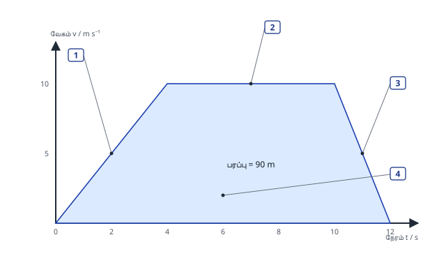

பின்பக்கம்

ஆர்முடுகல் (படித்திறன் 2.5 m s⁻²) (acceleration)

<!-- meta {"type":"flashcard","id":"SCF-10-02-017","grade":10,"chapter_id":"SC10-02","discipline":"PHY","difficulty":1,"image":"science_assets/graphs/GR-D01_unlabelled.svg"} -->
**SCF-10-02-017** · அடிப்படை

**முன்:** வேக–நேர வரைபு — பெயரிடாத படத்தில் இலக்கம் 2 குறிக்கும் பகுதி?

பின்பக்கம்

சீரான வேகம் (constant velocity) — ஆர்முடுகல் 0

<!-- meta {"type":"flashcard","id":"SCF-10-02-018","grade":10,"chapter_id":"SC10-02","discipline":"PHY","difficulty":1,"image":"science_assets/graphs/GR-D01_unlabelled.svg"} -->
**SCF-10-02-018** · அடிப்படை

**முன்:** வேக–நேர வரைபு — பெயரிடாத படத்தில் இலக்கம் 3 குறிக்கும் பகுதி?

பின்பக்கம்

அமர்முடுகல் (−5 m s⁻²) (deceleration)

<!-- meta {"type":"flashcard","id":"SCF-10-02-019","grade":10,"chapter_id":"SC10-02","discipline":"PHY","difficulty":1,"image":"science_assets/graphs/GR-D01_unlabelled.svg"} -->
**SCF-10-02-019** · அடிப்படை

**முன்:** வேக–நேர வரைபு — பெயரிடாத படத்தில் இலக்கம் 4 குறிக்கும் பகுதி?

பின்பக்கம்

வரைபின் கீழ்ப் பரப்பு (area under graph) — இடப்பெயர்ச்சி = 90 m

## SC10-03: சடப்பொருள்களின் கட்டமைப்பு (Structure of matter)

*தரம் 10 · அத்தியாயம் 3 · இரசாயனவியல் · 19 அட்டைகள்*

<!-- meta {"type":"flashcard","id":"SCF-10-03-001","grade":10,"chapter_id":"SC10-03","discipline":"CHE","difficulty":1,"image":null} -->
**SCF-10-03-001** · அடிப்படை

**முன்:** புரோத்தனின் ஏற்றம்?

பின்பக்கம்

+1

<!-- meta {"type":"flashcard","id":"SCF-10-03-002","grade":10,"chapter_id":"SC10-03","discipline":"CHE","difficulty":1,"image":null} -->
**SCF-10-03-002** · அடிப்படை

**முன்:** நியூத்திரனின் ஏற்றம்?

பின்பக்கம்

0 (நடுநிலை)

<!-- meta {"type":"flashcard","id":"SCF-10-03-003","grade":10,"chapter_id":"SC10-03","discipline":"CHE","difficulty":1,"image":null} -->
**SCF-10-03-003** · அடிப்படை

**முன்:** அணுவெண் என்றால்?

பின்பக்கம்

புரோத்தன் எண்ணிக்கை

<!-- meta {"type":"flashcard","id":"SCF-10-03-004","grade":10,"chapter_id":"SC10-03","discipline":"CHE","difficulty":1,"image":null} -->
**SCF-10-03-004** · அடிப்படை

**முன்:** திணிவெண் என்றால்?

பின்பக்கம்

புரோத்தன் + நியூத்திரன்

<!-- meta {"type":"flashcard","id":"SCF-10-03-005","grade":10,"chapter_id":"SC10-03","discipline":"CHE","difficulty":1,"image":null} -->
**SCF-10-03-005** · அடிப்படை

**முன்:** சமதானிகள்?

பின்பக்கம்

ஒரே Z, வேறுபட்ட நியூத்திரன் எண்

<!-- meta {"type":"flashcard","id":"SCF-10-03-006","grade":10,"chapter_id":"SC10-03","discipline":"CHE","difficulty":1,"image":null} -->
**SCF-10-03-006** · அடிப்படை

**முன்:** Na இன் இலத்திரன் நிலையமைப்பு?

பின்பக்கம்

2, 8, 1

<!-- meta {"type":"flashcard","id":"SCF-10-03-007","grade":10,"chapter_id":"SC10-03","discipline":"CHE","difficulty":1,"image":null} -->
**SCF-10-03-007** · அடிப்படை

**முன்:** Cl இன் இலத்திரன் நிலையமைப்பு?

பின்பக்கம்

2, 8, 7

<!-- meta {"type":"flashcard","id":"SCF-10-03-008","grade":10,"chapter_id":"SC10-03","discipline":"CHE","difficulty":2,"image":null} -->
**SCF-10-03-008** · இடைநிலை

**முன்:** Ca இன் இலத்திரன் நிலையமைப்பு?

பின்பக்கம்

2, 8, 8, 2

<!-- meta {"type":"flashcard","id":"SCF-10-03-009","grade":10,"chapter_id":"SC10-03","discipline":"CHE","difficulty":2,"image":null} -->
**SCF-10-03-009** · இடைநிலை

**முன்:** $^{23}_{11}Na$ இல் நியூத்திரன்கள்?

பின்பக்கம்

23 − 11 = 12

<!-- meta {"type":"flashcard","id":"SCF-10-03-010","grade":10,"chapter_id":"SC10-03","discipline":"CHE","difficulty":2,"image":null} -->
**SCF-10-03-010** · இடைநிலை

**முன்:** ஆவர்த்தனத்தில் இடமிருந்து வலம் மின்னெதிர்த்தன்மை?

பின்பக்கம்

கூடும்

<!-- meta {"type":"flashcard","id":"SCF-10-03-011","grade":10,"chapter_id":"SC10-03","discipline":"CHE","difficulty":2,"image":null} -->
**SCF-10-03-011** · இடைநிலை

**முன்:** சடத்துவ வாயுக்கள் தாக்கமடையாமைக்குக் காரணம்?

பின்பக்கம்

நிறைவான வெளிச் சக்தி மட்டம்

<!-- meta {"type":"flashcard","id":"SCF-10-03-012","grade":10,"chapter_id":"SC10-03","discipline":"CHE","difficulty":2,"image":null} -->
**SCF-10-03-012** · இடைநிலை

**முன்:** மின்னைக் கடத்தும் அல்லுலோகம்?

பின்பக்கம்

காரீயம் (Graphite)

<!-- meta {"type":"flashcard","id":"SCF-10-03-013","grade":10,"chapter_id":"SC10-03","discipline":"CHE","difficulty":2,"image":null} -->
**SCF-10-03-013** · இடைநிலை

**முன்:** ஆவர்த்தன எண் எதைக் குறிக்கும்?

பின்பக்கம்

சக்தி மட்டங்களின் எண்ணிக்கை

<!-- meta {"type":"flashcard","id":"SCF-10-03-014","grade":10,"chapter_id":"SC10-03","discipline":"CHE","difficulty":3,"image":null} -->
**SCF-10-03-014** · கடினம்

**முன்:** தவறான கருத்து: சமதானிகளுக்கு வேறு இரசாயன இயல்புகள்?

பின்பக்கம்

பிழை — ஒத்தவை

<!-- meta {"type":"flashcard","id":"SCF-10-03-015","grade":10,"chapter_id":"SC10-03","discipline":"CHE","difficulty":3,"image":null} -->
**SCF-10-03-015** · கடினம்

**முன்:** முதலாம் அயனாக்கற் சக்தி?

பின்பக்கம்

வாயு அணுவிலிருந்து ஒரு இலத்திரனை அகற்றத் தேவையான சக்தி

<!-- meta {"type":"flashcard","id":"SCF-10-03-016","grade":10,"chapter_id":"SC10-03","discipline":"CHE","difficulty":1,"image":"science_assets/chemistry/CHE-D01_unlabelled.svg"} -->
**SCF-10-03-016** · அடிப்படை

**முன்:** சோடியம் அணுவின் இலத்திரன் நிலையமைப்பு (2,8,1) — பெயரிடாத படத்தில் இலக்கம் 1 குறிக்கும் பகுதி?

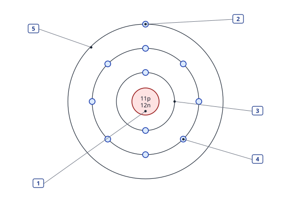

பின்பக்கம்

கரு (nucleus) — புரோத்தன்களும் நியூத்திரன்களும்

<!-- meta {"type":"flashcard","id":"SCF-10-03-017","grade":10,"chapter_id":"SC10-03","discipline":"CHE","difficulty":1,"image":"science_assets/chemistry/CHE-D01_unlabelled.svg"} -->
**SCF-10-03-017** · அடிப்படை

**முன்:** சோடியம் அணுவின் இலத்திரன் நிலையமைப்பு (2,8,1) — பெயரிடாத படத்தில் இலக்கம் 2 குறிக்கும் பகுதி?

பின்பக்கம்

இலத்திரன் (electron) — மறையேற்றம்; ஓடுகளில்

<!-- meta {"type":"flashcard","id":"SCF-10-03-018","grade":10,"chapter_id":"SC10-03","discipline":"CHE","difficulty":1,"image":"science_assets/chemistry/CHE-D01_unlabelled.svg"} -->
**SCF-10-03-018** · அடிப்படை

**முன்:** சோடியம் அணுவின் இலத்திரன் நிலையமைப்பு (2,8,1) — பெயரிடாத படத்தில் இலக்கம் 3 குறிக்கும் பகுதி?

பின்பக்கம்

முதலாம் சக்தி மட்டம் (first shell (K)) — உச்சம் 2 இலத்திரன்கள்

<!-- meta {"type":"flashcard","id":"SCF-10-03-019","grade":10,"chapter_id":"SC10-03","discipline":"CHE","difficulty":1,"image":"science_assets/chemistry/CHE-D01_unlabelled.svg"} -->
**SCF-10-03-019** · அடிப்படை

**முன்:** சோடியம் அணுவின் இலத்திரன் நிலையமைப்பு (2,8,1) — பெயரிடாத படத்தில் இலக்கம் 4 குறிக்கும் பகுதி?

பின்பக்கம்

இரண்டாம் சக்தி மட்டம் (second shell (L)) — உச்சம் 8

## SC10-04: நியூற்றனின் இயக்க விதிகள் (Newton's laws of motion)

*தரம் 10 · அத்தியாயம் 4 · பௌதிகவியல் · 15 அட்டைகள்*

<!-- meta {"type":"flashcard","id":"SCF-10-04-001","grade":10,"chapter_id":"SC10-04","discipline":"PHY","difficulty":1,"image":null} -->
**SCF-10-04-001** · அடிப்படை

**முன்:** நியூற்றனின் முதலாம் விதி?

பின்பக்கம்

சமநிலையற்ற விசை இல்லையெனின் இயக்க நிலை மாறாது

<!-- meta {"type":"flashcard","id":"SCF-10-04-002","grade":10,"chapter_id":"SC10-04","discipline":"PHY","difficulty":1,"image":null} -->
**SCF-10-04-002** · அடிப்படை

**முன்:** F = ma இல் a?

பின்பக்கம்

ஆர்முடுகல்

<!-- meta {"type":"flashcard","id":"SCF-10-04-003","grade":10,"chapter_id":"SC10-04","discipline":"PHY","difficulty":1,"image":null} -->
**SCF-10-04-003** · அடிப்படை

**முன்:** உந்தச் சூத்திரம்?

பின்பக்கம்

p = mv

<!-- meta {"type":"flashcard","id":"SCF-10-04-004","grade":10,"chapter_id":"SC10-04","discipline":"PHY","difficulty":1,"image":null} -->
**SCF-10-04-004** · அடிப்படை

**முன்:** நிறைச் சூத்திரம்?

பின்பக்கம்

W = mg

<!-- meta {"type":"flashcard","id":"SCF-10-04-005","grade":10,"chapter_id":"SC10-04","discipline":"PHY","difficulty":1,"image":null} -->
**SCF-10-04-005** · அடிப்படை

**முன்:** 1 N = ?

பின்பக்கம்

1 kg m s⁻²

<!-- meta {"type":"flashcard","id":"SCF-10-04-006","grade":10,"chapter_id":"SC10-04","discipline":"PHY","difficulty":2,"image":null} -->
**SCF-10-04-006** · இடைநிலை

**முன்:** சடத்துவம் எதைச் சார்ந்தது?

பின்பக்கம்

திணிவு

<!-- meta {"type":"flashcard","id":"SCF-10-04-007","grade":10,"chapter_id":"SC10-04","discipline":"PHY","difficulty":1,"image":null} -->
**SCF-10-04-007** · அடிப்படை

**முன்:** மூன்றாம் விதி?

பின்பக்கம்

தாக்கத்துக்குச் சமனும் எதிருமான மறுதாக்கம்

<!-- meta {"type":"flashcard","id":"SCF-10-04-008","grade":10,"chapter_id":"SC10-04","discipline":"PHY","difficulty":2,"image":null} -->
**SCF-10-04-008** · இடைநிலை

**முன்:** தாக்கம்–மறுதாக்கம் ஒரே பொருளிலா?

பின்பக்கம்

இல்லை — வேறு பொருட்களில்

<!-- meta {"type":"flashcard","id":"SCF-10-04-009","grade":10,"chapter_id":"SC10-04","discipline":"PHY","difficulty":1,"image":null} -->
**SCF-10-04-009** · அடிப்படை

**முன்:** 60 kg மனிதனின் நிறை (g=10)?

பின்பக்கம்

600 N

<!-- meta {"type":"flashcard","id":"SCF-10-04-010","grade":10,"chapter_id":"SC10-04","discipline":"PHY","difficulty":2,"image":null} -->
**SCF-10-04-010** · இடைநிலை

**முன்:** சந்திரனில் திணிவு மாறுமா?

பின்பக்கம்

இல்லை — நிறை மட்டும் மாறும்

<!-- meta {"type":"flashcard","id":"SCF-10-04-011","grade":10,"chapter_id":"SC10-04","discipline":"PHY","difficulty":2,"image":null} -->
**SCF-10-04-011** · இடைநிலை

**முன்:** இருக்கைப் பட்டி எந்த விதி?

பின்பக்கம்

முதலாம் (சடத்துவம்)

<!-- meta {"type":"flashcard","id":"SCF-10-04-012","grade":10,"chapter_id":"SC10-04","discipline":"PHY","difficulty":2,"image":null} -->
**SCF-10-04-012** · இடைநிலை

**முன்:** ஏவுகணை இயக்கம் எந்த விதி?

பின்பக்கம்

மூன்றாம்

<!-- meta {"type":"flashcard","id":"SCF-10-04-013","grade":10,"chapter_id":"SC10-04","discipline":"PHY","difficulty":1,"image":null} -->
**SCF-10-04-013** · அடிப்படை

**முன்:** உந்த அலகு?

பின்பக்கம்

kg m s⁻¹

<!-- meta {"type":"flashcard","id":"SCF-10-04-014","grade":10,"chapter_id":"SC10-04","discipline":"PHY","difficulty":2,"image":null} -->
**SCF-10-04-014** · இடைநிலை

**முன்:** சீரான வேகத்தில் தேறிய விசை?

பின்பக்கம்

பூச்சியம்

<!-- meta {"type":"flashcard","id":"SCF-10-04-015","grade":10,"chapter_id":"SC10-04","discipline":"PHY","difficulty":3,"image":null} -->
**SCF-10-04-015** · கடினம்

**முன்:** தவறான கருத்து: இயக்கத்துக்கு எப்போதும் விசை தேவை?

பின்பக்கம்

பிழை

## SC10-05: உராய்வு (Friction)

*தரம் 10 · அத்தியாயம் 5 · பௌதிகவியல் · 19 அட்டைகள்*

<!-- meta {"type":"flashcard","id":"SCF-10-05-001","grade":10,"chapter_id":"SC10-05","discipline":"PHY","difficulty":1,"image":null} -->
**SCF-10-05-001** · அடிப்படை

**முன்:** உராய்வு என்றால்?

பின்பக்கம்

சார்பியக்கத்தை எதிர்க்கும் விசை

<!-- meta {"type":"flashcard","id":"SCF-10-05-002","grade":10,"chapter_id":"SC10-05","discipline":"PHY","difficulty":1,"image":null} -->
**SCF-10-05-002** · அடிப்படை

**முன்:** எல்லை உராய்வு?

பின்பக்கம்

அசையத் தொடங்கும்போதுள்ள உச்ச உராய்வு

<!-- meta {"type":"flashcard","id":"SCF-10-05-003","grade":10,"chapter_id":"SC10-05","discipline":"PHY","difficulty":2,"image":null} -->
**SCF-10-05-003** · இடைநிலை

**முன்:** இயக்க உராய்வு vs எல்லை?

பின்பக்கம்

இயக்க உராய்வு சற்றுக் குறைவு

<!-- meta {"type":"flashcard","id":"SCF-10-05-004","grade":10,"chapter_id":"SC10-05","discipline":"PHY","difficulty":1,"image":null} -->
**SCF-10-05-004** · அடிப்படை

**முன்:** உராய்வைக் குறைக்கும் முறை?

பின்பக்கம்

உராய்வுநீக்கி / பந்துப் போதிகை

<!-- meta {"type":"flashcard","id":"SCF-10-05-005","grade":10,"chapter_id":"SC10-05","discipline":"PHY","difficulty":1,"image":null} -->
**SCF-10-05-005** · அடிப்படை

**முன்:** உராய்வின் நன்மை?

பின்பக்கம்

நடக்க, தடுப்புக்கு

<!-- meta {"type":"flashcard","id":"SCF-10-05-006","grade":10,"chapter_id":"SC10-05","discipline":"PHY","difficulty":1,"image":null} -->
**SCF-10-05-006** · அடிப்படை

**முன்:** உராய்வின் தீமை?

பின்பக்கம்

தேய்வு, வெப்ப இழப்பு

<!-- meta {"type":"flashcard","id":"SCF-10-05-007","grade":10,"chapter_id":"SC10-05","discipline":"PHY","difficulty":2,"image":null} -->
**SCF-10-05-007** · இடைநிலை

**முன்:** உராய்வு சார்ந்திருப்பது?

பின்பக்கம்

மேற்பரப்பு இயல்பு, செவ்வன் மறுதாக்கம்

<!-- meta {"type":"flashcard","id":"SCF-10-05-008","grade":10,"chapter_id":"SC10-05","discipline":"PHY","difficulty":3,"image":null} -->
**SCF-10-05-008** · கடினம்

**முன்:** தொடுகைப் பரப்பளவைச் சாருமா?

பின்பக்கம்

(ஏறத்தாழ) இல்லை

<!-- meta {"type":"flashcard","id":"SCF-10-05-009","grade":10,"chapter_id":"SC10-05","discipline":"PHY","difficulty":1,"image":null} -->
**SCF-10-05-009** · அடிப்படை

**முன்:** டயர்களில் வடிவங்கள் ஏன்?

பின்பக்கம்

பிடிப்பைக் கூட்ட

<!-- meta {"type":"flashcard","id":"SCF-10-05-010","grade":10,"chapter_id":"SC10-05","discipline":"PHY","difficulty":2,"image":null} -->
**SCF-10-05-010** · இடைநிலை

**முன்:** நீள்பொழிவு வடிவம்?

பின்பக்கம்

வளித் தடையைக் குறைக்கும் வடிவம்

<!-- meta {"type":"flashcard","id":"SCF-10-05-011","grade":10,"chapter_id":"SC10-05","discipline":"PHY","difficulty":1,"image":null} -->
**SCF-10-05-011** · அடிப்படை

**முன்:** தேய்க்கும்போது கைகள் சூடாவது?

பின்பக்கம்

உராய்வு வெப்பமாக மாறல்

<!-- meta {"type":"flashcard","id":"SCF-10-05-012","grade":10,"chapter_id":"SC10-05","discipline":"PHY","difficulty":2,"image":null} -->
**SCF-10-05-012** · இடைநிலை

**முன்:** பந்துப் போதிகை?

பின்பக்கம்

வழுக்கும் உராய்வை உருளும் உராய்வாக்கல்

<!-- meta {"type":"flashcard","id":"SCF-10-05-013","grade":10,"chapter_id":"SC10-05","discipline":"PHY","difficulty":2,"image":null} -->
**SCF-10-05-013** · இடைநிலை

**முன்:** உருளும் உராய்வு vs வழுக்கும்?

பின்பக்கம்

உருளும் உராய்வு குறைவு

<!-- meta {"type":"flashcard","id":"SCF-10-05-014","grade":10,"chapter_id":"SC10-05","discipline":"PHY","difficulty":2,"image":null} -->
**SCF-10-05-014** · இடைநிலை

**முன்:** நிலையியல் உராய்வு பிரயோக விசையுடன்?

பின்பக்கம்

எல்லை வரை சமமாகக் கூடும்

<!-- meta {"type":"flashcard","id":"SCF-10-05-015","grade":10,"chapter_id":"SC10-05","discipline":"PHY","difficulty":3,"image":null} -->
**SCF-10-05-015** · கடினம்

**முன்:** தவறான கருத்து: உராய்வு எப்போதும் தீமை?

பின்பக்கம்

பிழை

<!-- meta {"type":"flashcard","id":"SCF-10-05-016","grade":10,"chapter_id":"SC10-05","discipline":"PHY","difficulty":1,"image":"science_assets/physics/PHY-D06_unlabelled.svg"} -->
**SCF-10-05-016** · அடிப்படை

**முன்:** மேசையில் இழுக்கப்படும் பெட்டியின் விசை வரிப்படம் — பெயரிடாத படத்தில் இலக்கம் 1 குறிக்கும் பகுதி?

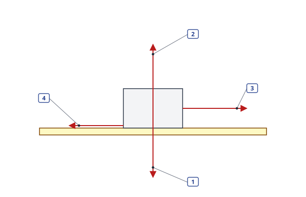

பின்பக்கம்

நிறை (W = mg) (weight) — புவியீர்ப்பு — கீழ்நோக்கி

<!-- meta {"type":"flashcard","id":"SCF-10-05-017","grade":10,"chapter_id":"SC10-05","discipline":"PHY","difficulty":1,"image":"science_assets/physics/PHY-D06_unlabelled.svg"} -->
**SCF-10-05-017** · அடிப்படை

**முன்:** மேசையில் இழுக்கப்படும் பெட்டியின் விசை வரிப்படம் — பெயரிடாத படத்தில் இலக்கம் 2 குறிக்கும் பகுதி?

பின்பக்கம்

செவ்வன் மறுதாக்கம் (R) (normal reaction) — மேற்பரப்புக்குச் செங்குத்து

<!-- meta {"type":"flashcard","id":"SCF-10-05-018","grade":10,"chapter_id":"SC10-05","discipline":"PHY","difficulty":1,"image":"science_assets/physics/PHY-D06_unlabelled.svg"} -->
**SCF-10-05-018** · அடிப்படை

**முன்:** மேசையில் இழுக்கப்படும் பெட்டியின் விசை வரிப்படம் — பெயரிடாத படத்தில் இலக்கம் 3 குறிக்கும் பகுதி?

பின்பக்கம்

இழுவிசை (F) (applied force)

<!-- meta {"type":"flashcard","id":"SCF-10-05-019","grade":10,"chapter_id":"SC10-05","discipline":"PHY","difficulty":1,"image":"science_assets/physics/PHY-D06_unlabelled.svg"} -->
**SCF-10-05-019** · அடிப்படை

**முன்:** மேசையில் இழுக்கப்படும் பெட்டியின் விசை வரிப்படம் — பெயரிடாத படத்தில் இலக்கம் 4 குறிக்கும் பகுதி?

பின்பக்கம்

உராய்வு (f) (friction) — இயக்கத்துக்கு எதிர்த் திசை

## SC10-06: தாவரக்கலங்களினதும் விலங்குக்கலங்களினதும் கட்டமைப்பும் தொழிற்பாடும் (Structure and functions of plant and animal cells)

*தரம் 10 · அத்தியாயம் 6 · உயிரியல் · 23 அட்டைகள்*

<!-- meta {"type":"flashcard","id":"SCF-10-06-001","grade":10,"chapter_id":"SC10-06","discipline":"BIO","difficulty":1,"image":null} -->
**SCF-10-06-001** · அடிப்படை

**முன்:** கலத்தின் கட்டுப்பாட்டு மையம்?

பின்பக்கம்

கரு (Nucleus)

<!-- meta {"type":"flashcard","id":"SCF-10-06-002","grade":10,"chapter_id":"SC10-06","discipline":"BIO","difficulty":1,"image":null} -->
**SCF-10-06-002** · அடிப்படை

**முன்:** ஒளித்தொகுப்பு நடைபெறும் புன்னங்கம்?

பின்பக்கம்

பச்சையவுருமணி

<!-- meta {"type":"flashcard","id":"SCF-10-06-003","grade":10,"chapter_id":"SC10-06","discipline":"BIO","difficulty":1,"image":null} -->
**SCF-10-06-003** · அடிப்படை

**முன்:** காற்றுச் சுவாசம் நடைபெறும் புன்னங்கம்?

பின்பக்கம்

இழைமணி

<!-- meta {"type":"flashcard","id":"SCF-10-06-004","grade":10,"chapter_id":"SC10-06","discipline":"BIO","difficulty":1,"image":null} -->
**SCF-10-06-004** · அடிப்படை

**முன்:** புரதத் தொகுப்பு நடைபெறும் இடம்?

பின்பக்கம்

இறைபோசோம்

<!-- meta {"type":"flashcard","id":"SCF-10-06-005","grade":10,"chapter_id":"SC10-06","discipline":"BIO","difficulty":1,"image":null} -->
**SCF-10-06-005** · அடிப்படை

**முன்:** கலச்சுவரின் பிரதான பதார்த்தம்?

பின்பக்கம்

செலுலோசு

<!-- meta {"type":"flashcard","id":"SCF-10-06-006","grade":10,"chapter_id":"SC10-06","discipline":"BIO","difficulty":1,"image":null} -->
**SCF-10-06-006** · அடிப்படை

**முன்:** தேர்ந்து புகவிடும் பகுதி?

பின்பக்கம்

கலமென்சவ்வு

<!-- meta {"type":"flashcard","id":"SCF-10-06-007","grade":10,"chapter_id":"SC10-06","discipline":"BIO","difficulty":2,"image":null} -->
**SCF-10-06-007** · இடைநிலை

**முன்:** விலங்குக் கலங்களில் மட்டும் உள்ள புன்னங்கம்?

பின்பக்கம்

புன்மையத்தி (Centriole)

<!-- meta {"type":"flashcard","id":"SCF-10-06-008","grade":10,"chapter_id":"SC10-06","discipline":"BIO","difficulty":2,"image":null} -->
**SCF-10-06-008** · இடைநிலை

**முன்:** தாவரக் கலத்தின் பெரிய புன்வெற்றிடத்தின் தொழில்?

பின்பக்கம்

கலச்சாற்றைச் சேமித்து வீக்கவமுக்கம் தருதல்

<!-- meta {"type":"flashcard","id":"SCF-10-06-009","grade":10,"chapter_id":"SC10-06","discipline":"BIO","difficulty":2,"image":null} -->
**SCF-10-06-009** · இடைநிலை

**முன்:** கொல்கி உபகரணத்தின் தொழில்?

பின்பக்கம்

பொருட்களைப் பொதியிட்டுச் சுரத்தல்

<!-- meta {"type":"flashcard","id":"SCF-10-06-010","grade":10,"chapter_id":"SC10-06","discipline":"BIO","difficulty":1,"image":null} -->
**SCF-10-06-010** · அடிப்படை

**முன்:** குழியவுரு என்றால்?

பின்பக்கம்

கரு தவிர கலமென்சவ்வுக்குள் உள்ள பகுதி

<!-- meta {"type":"flashcard","id":"SCF-10-06-011","grade":10,"chapter_id":"SC10-06","discipline":"BIO","difficulty":1,"image":null} -->
**SCF-10-06-011** · அடிப்படை

**முன்:** கலத்தின் அடிப்படை அலகு எது?

பின்பக்கம்

கலம் உயிரின் அடிப்படை அலகு

<!-- meta {"type":"flashcard","id":"SCF-10-06-012","grade":10,"chapter_id":"SC10-06","discipline":"BIO","difficulty":2,"image":null} -->
**SCF-10-06-012** · இடைநிலை

**முன்:** அதிக சக்தி தேவைப்படும் கலங்களில் அதிகம் காணப்படுவது?

பின்பக்கம்

இழைமணி

<!-- meta {"type":"flashcard","id":"SCF-10-06-013","grade":10,"chapter_id":"SC10-06","discipline":"BIO","difficulty":3,"image":null} -->
**SCF-10-06-013** · கடினம்

**முன்:** தவறான கருத்து: தாவரக் கலங்களில் இழைமணி இல்லை?

பின்பக்கம்

பிழை — உண்டு

<!-- meta {"type":"flashcard","id":"SCF-10-06-014","grade":10,"chapter_id":"SC10-06","discipline":"BIO","difficulty":2,"image":null} -->
**SCF-10-06-014** · இடைநிலை

**முன்:** அகக்கலவுருச் சிறுவலையின் தொழில்?

பின்பக்கம்

கலத்துக்குள் பொருட்களைக் கடத்தல்

<!-- meta {"type":"flashcard","id":"SCF-10-06-015","grade":10,"chapter_id":"SC10-06","discipline":"BIO","difficulty":3,"image":null} -->
**SCF-10-06-015** · கடினம்

**முன்:** DNA காணப்படும் இடம்?

பின்பக்கம்

கரு (மேலும் இழைமணி, பச்சையவுருமணியிலும் சிறிதளவு)

<!-- meta {"type":"flashcard","id":"SCF-10-06-016","grade":10,"chapter_id":"SC10-06","discipline":"BIO","difficulty":1,"image":"science_assets/biology/BIO-D01_unlabelled.svg"} -->
**SCF-10-06-016** · அடிப்படை

**முன்:** தாவரக் கலம் — பெயரிடாத படத்தில் இலக்கம் 1 குறிக்கும் பகுதி?

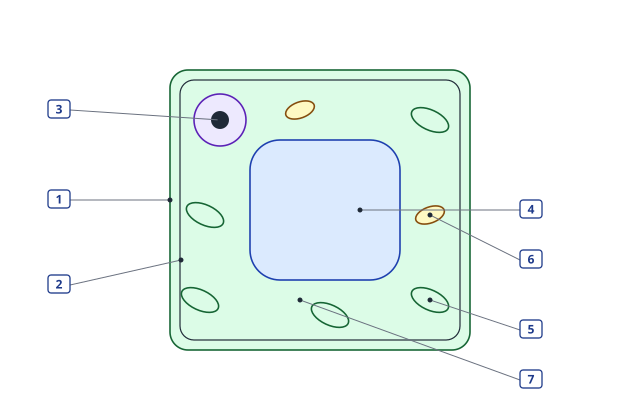

பின்பக்கம்

கலச்சுவர் (cell wall) — பொறிமுறை ஆதாரம், வடிவம்

<!-- meta {"type":"flashcard","id":"SCF-10-06-017","grade":10,"chapter_id":"SC10-06","discipline":"BIO","difficulty":1,"image":"science_assets/biology/BIO-D01_unlabelled.svg"} -->
**SCF-10-06-017** · அடிப்படை

**முன்:** தாவரக் கலம் — பெயரிடாத படத்தில் இலக்கம் 2 குறிக்கும் பகுதி?

பின்பக்கம்

கலமென்சவ்வு (cell membrane) — பதார்த்தங்களின் உட்செல்கை/வெளிச்செல்கையைக் கட்டுப்படுத்தல்

<!-- meta {"type":"flashcard","id":"SCF-10-06-018","grade":10,"chapter_id":"SC10-06","discipline":"BIO","difficulty":1,"image":"science_assets/biology/BIO-D01_unlabelled.svg"} -->
**SCF-10-06-018** · அடிப்படை

**முன்:** தாவரக் கலம் — பெயரிடாத படத்தில் இலக்கம் 3 குறிக்கும் பகுதி?

பின்பக்கம்

கரு (nucleus) — கலத் தொழிற்பாடுகளைக் கட்டுப்படுத்தல்; DNA

<!-- meta {"type":"flashcard","id":"SCF-10-06-019","grade":10,"chapter_id":"SC10-06","discipline":"BIO","difficulty":1,"image":"science_assets/biology/BIO-D01_unlabelled.svg"} -->
**SCF-10-06-019** · அடிப்படை

**முன்:** தாவரக் கலம் — பெயரிடாத படத்தில் இலக்கம் 4 குறிக்கும் பகுதி?

பின்பக்கம்

புன்வெற்றிடம் (vacuole) — கலச்சாறு சேமிப்பு; வீக்கம் பேணல்

<!-- meta {"type":"flashcard","id":"SCF-10-06-020","grade":10,"chapter_id":"SC10-06","discipline":"BIO","difficulty":1,"image":"science_assets/biology/BIO-D02_unlabelled.svg"} -->
**SCF-10-06-020** · அடிப்படை

**முன்:** விலங்குக் கலம் — பெயரிடாத படத்தில் இலக்கம் 1 குறிக்கும் பகுதி?

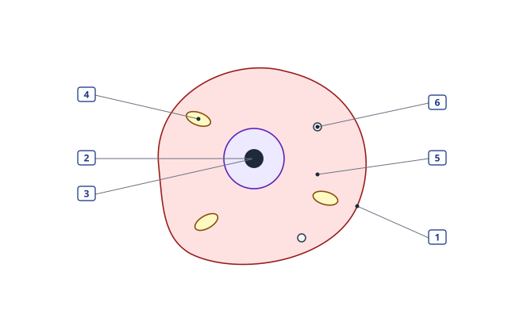

பின்பக்கம்

கலமென்சவ்வு (cell membrane) — உட்செல்கை/வெளிச்செல்கைக் கட்டுப்பாடு

<!-- meta {"type":"flashcard","id":"SCF-10-06-021","grade":10,"chapter_id":"SC10-06","discipline":"BIO","difficulty":1,"image":"science_assets/biology/BIO-D02_unlabelled.svg"} -->
**SCF-10-06-021** · அடிப்படை

**முன்:** விலங்குக் கலம் — பெயரிடாத படத்தில் இலக்கம் 2 குறிக்கும் பகுதி?

பின்பக்கம்

கரு (nucleus) — கட்டுப்பாட்டு மையம்

<!-- meta {"type":"flashcard","id":"SCF-10-06-022","grade":10,"chapter_id":"SC10-06","discipline":"BIO","difficulty":1,"image":"science_assets/biology/BIO-D02_unlabelled.svg"} -->
**SCF-10-06-022** · அடிப்படை

**முன்:** விலங்குக் கலம் — பெயரிடாத படத்தில் இலக்கம் 3 குறிக்கும் பகுதி?

பின்பக்கம்

புன்கரு (nucleolus) — இறைபோசோம் உருவாக்கம்

<!-- meta {"type":"flashcard","id":"SCF-10-06-023","grade":10,"chapter_id":"SC10-06","discipline":"BIO","difficulty":1,"image":"science_assets/biology/BIO-D02_unlabelled.svg"} -->
**SCF-10-06-023** · அடிப்படை

**முன்:** விலங்குக் கலம் — பெயரிடாத படத்தில் இலக்கம் 4 குறிக்கும் பகுதி?

பின்பக்கம்

இழைமணி (mitochondrion) — சக்தி (ATP) உற்பத்தி

## SC10-07: மூலகங்களினதும் சேர்வைகளினதும் அளவறிதல் (Quantification of elements and compounds)

*தரம் 10 · அத்தியாயம் 7 · இரசாயனவியல் · 15 அட்டைகள்*

<!-- meta {"type":"flashcard","id":"SCF-10-07-001","grade":10,"chapter_id":"SC10-07","discipline":"CHE","difficulty":1,"image":null} -->
**SCF-10-07-001** · அடிப்படை

**முன்:** அவகாதரோ மாறிலி?

பின்பக்கம்

6.022 × 10²³ mol⁻¹

<!-- meta {"type":"flashcard","id":"SCF-10-07-002","grade":10,"chapter_id":"SC10-07","discipline":"CHE","difficulty":1,"image":null} -->
**SCF-10-07-002** · அடிப்படை

**முன்:** மூல் எண் சூத்திரம்?

பின்பக்கம்

n = m / M

<!-- meta {"type":"flashcard","id":"SCF-10-07-003","grade":10,"chapter_id":"SC10-07","discipline":"CHE","difficulty":1,"image":null} -->
**SCF-10-07-003** · அடிப்படை

**முன்:** H₂O இன் Mr? (H=1, O=16)

பின்பக்கம்

18

<!-- meta {"type":"flashcard","id":"SCF-10-07-004","grade":10,"chapter_id":"SC10-07","discipline":"CHE","difficulty":1,"image":null} -->
**SCF-10-07-004** · அடிப்படை

**முன்:** CO₂ இன் Mr? (C=12, O=16)

பின்பக்கம்

44

<!-- meta {"type":"flashcard","id":"SCF-10-07-005","grade":10,"chapter_id":"SC10-07","discipline":"CHE","difficulty":1,"image":null} -->
**SCF-10-07-005** · அடிப்படை

**முன்:** செறிவின் அலகு?

பின்பக்கம்

mol dm⁻³

<!-- meta {"type":"flashcard","id":"SCF-10-07-006","grade":10,"chapter_id":"SC10-07","discipline":"CHE","difficulty":1,"image":null} -->
**SCF-10-07-006** · அடிப்படை

**முன்:** 1 dm³ = ? cm³

பின்பக்கம்

1000

<!-- meta {"type":"flashcard","id":"SCF-10-07-007","grade":10,"chapter_id":"SC10-07","discipline":"CHE","difficulty":2,"image":null} -->
**SCF-10-07-007** · இடைநிலை

**முன்:** NaCl இன் மூலர்த் திணிவு? (Na=23, Cl=35.5)

பின்பக்கம்

58.5 g mol⁻¹

<!-- meta {"type":"flashcard","id":"SCF-10-07-008","grade":10,"chapter_id":"SC10-07","discipline":"CHE","difficulty":2,"image":null} -->
**SCF-10-07-008** · இடைநிலை

**முன்:** 2 mol H₂O இன் திணிவு?

பின்பக்கம்

36 g

<!-- meta {"type":"flashcard","id":"SCF-10-07-009","grade":10,"chapter_id":"SC10-07","discipline":"CHE","difficulty":1,"image":null} -->
**SCF-10-07-009** · அடிப்படை

**முன்:** செறிவுச் சூத்திரம்?

பின்பக்கம்

C = n / V

<!-- meta {"type":"flashcard","id":"SCF-10-07-010","grade":10,"chapter_id":"SC10-07","discipline":"CHE","difficulty":3,"image":null} -->
**SCF-10-07-010** · கடினம்

**முன்:** 1 mol O₂ இல் O அணுக்கள்?

பின்பக்கம்

2 × 6.022 × 10²³

<!-- meta {"type":"flashcard","id":"SCF-10-07-011","grade":10,"chapter_id":"SC10-07","discipline":"CHE","difficulty":2,"image":null} -->
**SCF-10-07-011** · இடைநிலை

**முன்:** சார்பு அணுத்திணிவின் நியமம்?

பின்பக்கம்

¹²C அணுத்திணிவின் 1/12

<!-- meta {"type":"flashcard","id":"SCF-10-07-012","grade":10,"chapter_id":"SC10-07","discipline":"CHE","difficulty":2,"image":null} -->
**SCF-10-07-012** · இடைநிலை

**முன்:** NaOH இன் M? (Na=23,O=16,H=1)

பின்பக்கம்

40 g mol⁻¹

<!-- meta {"type":"flashcard","id":"SCF-10-07-013","grade":10,"chapter_id":"SC10-07","discipline":"CHE","difficulty":2,"image":null} -->
**SCF-10-07-013** · இடைநிலை

**முன்:** சமன்பாட்டின் குணகங்கள் காட்டுவது?

பின்பக்கம்

மூல் விகிதம்

<!-- meta {"type":"flashcard","id":"SCF-10-07-014","grade":10,"chapter_id":"SC10-07","discipline":"CHE","difficulty":2,"image":null} -->
**SCF-10-07-014** · இடைநிலை

**முன்:** CaCO₃ இன் M? (Ca=40,C=12,O=16)

பின்பக்கம்

100 g mol⁻¹

<!-- meta {"type":"flashcard","id":"SCF-10-07-015","grade":10,"chapter_id":"SC10-07","discipline":"CHE","difficulty":3,"image":null} -->
**SCF-10-07-015** · கடினம்

**முன்:** 0.5 mol NaOH ஐ 500 cm³ இல் கரைத்தால் செறிவு?

பின்பக்கம்

1 mol dm⁻³

## SC10-08: அங்கிகளின் சிறப்பியல்புகள் (Characteristics of living organisms)

*தரம் 10 · அத்தியாயம் 8 · உயிரியல் · 15 அட்டைகள்*

<!-- meta {"type":"flashcard","id":"SCF-10-08-001","grade":10,"chapter_id":"SC10-08","discipline":"BIO","difficulty":1,"image":null} -->
**SCF-10-08-001** · அடிப்படை

**முன்:** இருசொற் பெயரின் இரு பகுதிகள்?

பின்பக்கம்

சாதிப் பெயர் + இனப் பெயர்

<!-- meta {"type":"flashcard","id":"SCF-10-08-002","grade":10,"chapter_id":"SC10-08","discipline":"BIO","difficulty":1,"image":null} -->
**SCF-10-08-002** · அடிப்படை

**முன்:** மனிதனின் இருசொற் பெயர்?

பின்பக்கம்

Homo sapiens

<!-- meta {"type":"flashcard","id":"SCF-10-08-003","grade":10,"chapter_id":"SC10-08","discipline":"BIO","difficulty":2,"image":null} -->
**SCF-10-08-003** · இடைநிலை

**முன்:** மூன்று ஆட்சிகள்?

பின்பக்கம்

பக்ரீரியா, ஆக்கியா, யூக்கரியா

<!-- meta {"type":"flashcard","id":"SCF-10-08-004","grade":10,"chapter_id":"SC10-08","discipline":"BIO","difficulty":1,"image":null} -->
**SCF-10-08-004** · அடிப்படை

**முன்:** காளான் எந்த இராச்சியம்?

பின்பக்கம்

பங்கசு

<!-- meta {"type":"flashcard","id":"SCF-10-08-005","grade":10,"chapter_id":"SC10-08","discipline":"BIO","difficulty":1,"image":null} -->
**SCF-10-08-005** · அடிப்படை

**முன்:** மூட்டுள்ள கால்கள் உடைய கணம்?

பின்பக்கம்

ஆத்திரப்போடா

<!-- meta {"type":"flashcard","id":"SCF-10-08-006","grade":10,"chapter_id":"SC10-08","discipline":"BIO","difficulty":2,"image":null} -->
**SCF-10-08-006** · இடைநிலை

**முன்:** முட்தோலுடைய கணம்?

பின்பக்கம்

எக்கினோடேமேற்றா

<!-- meta {"type":"flashcard","id":"SCF-10-08-007","grade":10,"chapter_id":"SC10-08","discipline":"BIO","difficulty":1,"image":null} -->
**SCF-10-08-007** · அடிப்படை

**முன்:** உறுத்துணர்ச்சி என்றால்?

பின்பக்கம்

தூண்டலுக்குத் துலங்கும் திறன்

<!-- meta {"type":"flashcard","id":"SCF-10-08-008","grade":10,"chapter_id":"SC10-08","discipline":"BIO","difficulty":2,"image":null} -->
**SCF-10-08-008** · இடைநிலை

**முன்:** இனம் என்றால்?

பின்பக்கம்

இனங்கலந்து வளமான சந்ததி தரும் ஒத்த அங்கிகள்

<!-- meta {"type":"flashcard","id":"SCF-10-08-009","grade":10,"chapter_id":"SC10-08","discipline":"BIO","difficulty":2,"image":null} -->
**SCF-10-08-009** · இடைநிலை

**முன்:** கொட்டும் கலங்களுடைய கணம்?

பின்பக்கம்

நைடேரியா

<!-- meta {"type":"flashcard","id":"SCF-10-08-010","grade":10,"chapter_id":"SC10-08","discipline":"BIO","difficulty":1,"image":null} -->
**SCF-10-08-010** · அடிப்படை

**முன்:** வகைப்படுத்தலின் மிகச் சிறிய அலகு?

பின்பக்கம்

இனம்

<!-- meta {"type":"flashcard","id":"SCF-10-08-011","grade":10,"chapter_id":"SC10-08","discipline":"BIO","difficulty":1,"image":null} -->
**SCF-10-08-011** · அடிப்படை

**முன்:** அங்கிகளின் 3 சிறப்பியல்புகள்?

பின்பக்கம்

சுவாசம், வளர்ச்சி, இனப்பெருக்கம் (மேலும் பல)

<!-- meta {"type":"flashcard","id":"SCF-10-08-012","grade":10,"chapter_id":"SC10-08","discipline":"BIO","difficulty":1,"image":null} -->
**SCF-10-08-012** · அடிப்படை

**முன்:** ஈரூடகவாழிக்கு உதாரணம்?

பின்பக்கம்

தவளை

<!-- meta {"type":"flashcard","id":"SCF-10-08-013","grade":10,"chapter_id":"SC10-08","discipline":"BIO","difficulty":3,"image":null} -->
**SCF-10-08-013** · கடினம்

**முன்:** தவறான கருத்து: தாவரங்கள் அசையாது?

பின்பக்கம்

பிழை — வளர்ச்சி அசைவுகள் உண்டு

<!-- meta {"type":"flashcard","id":"SCF-10-08-014","grade":10,"chapter_id":"SC10-08","discipline":"BIO","difficulty":2,"image":null} -->
**SCF-10-08-014** · இடைநிலை

**முன்:** முள்ளந்தண்டுளிகளின் 5 வகுப்புகள்?

பின்பக்கம்

மீன், ஈரூடகவாழி, ஊர்வன, பறவை, முலையூட்டி

<!-- meta {"type":"flashcard","id":"SCF-10-08-015","grade":10,"chapter_id":"SC10-08","discipline":"BIO","difficulty":1,"image":null} -->
**SCF-10-08-015** · அடிப்படை

**முன்:** இருசொற் பெயரில் பெரிய எழுத்தில் தொடங்குவது?

பின்பக்கம்

சாதிப் பெயர்

## SC10-09: விளையுள் விசை (Resultant force)

*தரம் 10 · அத்தியாயம் 9 · பௌதிகவியல் · 15 அட்டைகள்*

<!-- meta {"type":"flashcard","id":"SCF-10-09-001","grade":10,"chapter_id":"SC10-09","discipline":"PHY","difficulty":1,"image":null} -->
**SCF-10-09-001** · அடிப்படை

**முன்:** ஒரே திசை விசைகளின் விளையுள்?

பின்பக்கம்

கூட்டுத்தொகை

<!-- meta {"type":"flashcard","id":"SCF-10-09-002","grade":10,"chapter_id":"SC10-09","discipline":"PHY","difficulty":1,"image":null} -->
**SCF-10-09-002** · அடிப்படை

**முன்:** எதிர்த் திசை விசைகளின் விளையுள்?

பின்பக்கம்

வித்தியாசம்

<!-- meta {"type":"flashcard","id":"SCF-10-09-003","grade":10,"chapter_id":"SC10-09","discipline":"PHY","difficulty":2,"image":null} -->
**SCF-10-09-003** · இடைநிலை

**முன்:** செங்குத்தான விசைகளின் விளையுள்?

பின்பக்கம்

√(F₁² + F₂²)

<!-- meta {"type":"flashcard","id":"SCF-10-09-004","grade":10,"chapter_id":"SC10-09","discipline":"PHY","difficulty":2,"image":null} -->
**SCF-10-09-004** · இடைநிலை

**முன்:** இணைகர விதியில் விளையுள்?

பின்பக்கம்

மூலைவிட்டம்

<!-- meta {"type":"flashcard","id":"SCF-10-09-005","grade":10,"chapter_id":"SC10-09","discipline":"PHY","difficulty":1,"image":null} -->
**SCF-10-09-005** · அடிப்படை

**முன்:** விளையுள் 0 எனின்?

பின்பக்கம்

சமநிலை

<!-- meta {"type":"flashcard","id":"SCF-10-09-006","grade":10,"chapter_id":"SC10-09","discipline":"PHY","difficulty":2,"image":null} -->
**SCF-10-09-006** · இடைநிலை

**முன்:** 3 N, 4 N செங்குத்தாக — விளையுள்?

பின்பக்கம்

5 N

<!-- meta {"type":"flashcard","id":"SCF-10-09-007","grade":10,"chapter_id":"SC10-09","discipline":"PHY","difficulty":1,"image":null} -->
**SCF-10-09-007** · அடிப்படை

**முன்:** 10 N கிழக்கு, 6 N மேற்கு?

பின்பக்கம்

4 N கிழக்கு

<!-- meta {"type":"flashcard","id":"SCF-10-09-008","grade":10,"chapter_id":"SC10-09","discipline":"PHY","difficulty":1,"image":null} -->
**SCF-10-09-008** · அடிப்படை

**முன்:** விளையுள் விசை என்றால்?

பின்பக்கம்

பல விசைகளுக்குச் சமமான தனி விசை

<!-- meta {"type":"flashcard","id":"SCF-10-09-009","grade":10,"chapter_id":"SC10-09","discipline":"PHY","difficulty":1,"image":null} -->
**SCF-10-09-009** · அடிப்படை

**முன்:** விசை காவியா?

பின்பக்கம்

ஆம்

<!-- meta {"type":"flashcard","id":"SCF-10-09-010","grade":10,"chapter_id":"SC10-09","discipline":"PHY","difficulty":2,"image":null} -->
**SCF-10-09-010** · இடைநிலை

**முன்:** இரு விசைகளின் உச்ச விளையுள்?

பின்பக்கம்

ஒரே திசையில் — கூட்டுத்தொகை

<!-- meta {"type":"flashcard","id":"SCF-10-09-011","grade":10,"chapter_id":"SC10-09","discipline":"PHY","difficulty":2,"image":null} -->
**SCF-10-09-011** · இடைநிலை

**முன்:** இரு விசைகளின் இழிவு விளையுள்?

பின்பக்கம்

எதிர்த் திசையில் — வித்தியாசம்

<!-- meta {"type":"flashcard","id":"SCF-10-09-012","grade":10,"chapter_id":"SC10-09","discipline":"PHY","difficulty":2,"image":null} -->
**SCF-10-09-012** · இடைநிலை

**முன்:** விளையுள் விசையும் ஆர்முடுகலும்?

பின்பக்கம்

F = ma

<!-- meta {"type":"flashcard","id":"SCF-10-09-013","grade":10,"chapter_id":"SC10-09","discipline":"PHY","difficulty":1,"image":null} -->
**SCF-10-09-013** · அடிப்படை

**முன்:** கயிறிழுப்பில் வெற்றி?

பின்பக்கம்

விளையுள் விசைத் திசை

<!-- meta {"type":"flashcard","id":"SCF-10-09-014","grade":10,"chapter_id":"SC10-09","discipline":"PHY","difficulty":2,"image":null} -->
**SCF-10-09-014** · இடைநிலை

**முன்:** அளவிடை 1 cm = 2 N எனின் 7 cm?

பின்பக்கம்

14 N

<!-- meta {"type":"flashcard","id":"SCF-10-09-015","grade":10,"chapter_id":"SC10-09","discipline":"PHY","difficulty":3,"image":null} -->
**SCF-10-09-015** · கடினம்

**முன்:** தவறான கருத்து: 3 N + 4 N = 7 N எப்போதும்?

பின்பக்கம்

பிழை

## SC10-10: இரசாயனப் பிணைப்புகள் (Chemical bonds)

*தரம் 10 · அத்தியாயம் 10 · இரசாயனவியல் · 15 அட்டைகள்*

<!-- meta {"type":"flashcard","id":"SCF-10-10-001","grade":10,"chapter_id":"SC10-10","discipline":"CHE","difficulty":1,"image":null} -->
**SCF-10-10-001** · அடிப்படை

**முன்:** அயன் பிணைப்பு உருவாவது?

பின்பக்கம்

இலத்திரன் இடமாற்றத்தால்

<!-- meta {"type":"flashcard","id":"SCF-10-10-002","grade":10,"chapter_id":"SC10-10","discipline":"CHE","difficulty":1,"image":null} -->
**SCF-10-10-002** · அடிப்படை

**முன்:** பங்கீட்டுவலுப் பிணைப்பு?

பின்பக்கம்

இலத்திரன் சோடிப் பங்கீடு

<!-- meta {"type":"flashcard","id":"SCF-10-10-003","grade":10,"chapter_id":"SC10-10","discipline":"CHE","difficulty":2,"image":null} -->
**SCF-10-10-003** · இடைநிலை

**முன்:** N₂ இலுள்ள பிணைப்பு?

பின்பக்கம்

மும்மைப் பிணைப்பு

<!-- meta {"type":"flashcard","id":"SCF-10-10-004","grade":10,"chapter_id":"SC10-10","discipline":"CHE","difficulty":1,"image":null} -->
**SCF-10-10-004** · அடிப்படை

**முன்:** O₂ இலுள்ள பிணைப்பு?

பின்பக்கம்

இரட்டைப் பிணைப்பு

<!-- meta {"type":"flashcard","id":"SCF-10-10-005","grade":10,"chapter_id":"SC10-10","discipline":"CHE","difficulty":1,"image":null} -->
**SCF-10-10-005** · அடிப்படை

**முன்:** CH₄ இல் பங்கீட்டுவலுப் பிணைப்புகள்?

பின்பக்கம்

4

<!-- meta {"type":"flashcard","id":"SCF-10-10-006","grade":10,"chapter_id":"SC10-10","discipline":"CHE","difficulty":2,"image":null} -->
**SCF-10-10-006** · இடைநிலை

**முன்:** NH₃ இல் பிணைப்புச் சோடிகள்?

பின்பக்கம்

3

<!-- meta {"type":"flashcard","id":"SCF-10-10-007","grade":10,"chapter_id":"SC10-10","discipline":"CHE","difficulty":3,"image":null} -->
**SCF-10-10-007** · கடினம்

**முன்:** CO₂ இல் பிணைப்புகள்?

பின்பக்கம்

இரு இரட்டைப் பிணைப்புகள் (மொத்தம் 4 பிணைப்புச் சோடிகள்)

<!-- meta {"type":"flashcard","id":"SCF-10-10-008","grade":10,"chapter_id":"SC10-10","discipline":"CHE","difficulty":2,"image":null} -->
**SCF-10-10-008** · இடைநிலை

**முன்:** திண்ம NaCl கடத்துமா?

பின்பக்கம்

இல்லை

<!-- meta {"type":"flashcard","id":"SCF-10-10-009","grade":10,"chapter_id":"SC10-10","discipline":"CHE","difficulty":2,"image":null} -->
**SCF-10-10-009** · இடைநிலை

**முன்:** முனைவுப் பிணைப்புக்குக் காரணம்?

பின்பக்கம்

மின்னெதிர்த்தன்மை வேறுபாடு

<!-- meta {"type":"flashcard","id":"SCF-10-10-010","grade":10,"chapter_id":"SC10-10","discipline":"CHE","difficulty":1,"image":null} -->
**SCF-10-10-010** · அடிப்படை

**முன்:** Mg இன் வலுவளவு?

பின்பக்கம்

2

<!-- meta {"type":"flashcard","id":"SCF-10-10-011","grade":10,"chapter_id":"SC10-10","discipline":"CHE","difficulty":1,"image":null} -->
**SCF-10-10-011** · அடிப்படை

**முன்:** Al இன் வலுவளவு?

பின்பக்கம்

3

<!-- meta {"type":"flashcard","id":"SCF-10-10-012","grade":10,"chapter_id":"SC10-10","discipline":"CHE","difficulty":2,"image":null} -->
**SCF-10-10-012** · இடைநிலை

**முன்:** உலோகப் பிணைப்பு?

பின்பக்கம்

நேரயன்கள் + இடம்பெயர் இலத்திரன்கள்

<!-- meta {"type":"flashcard","id":"SCF-10-10-013","grade":10,"chapter_id":"SC10-10","discipline":"CHE","difficulty":1,"image":null} -->
**SCF-10-10-013** · அடிப்படை

**முன்:** NaCl இல் Na இன் அயன்?

பின்பக்கம்

Na⁺

<!-- meta {"type":"flashcard","id":"SCF-10-10-014","grade":10,"chapter_id":"SC10-10","discipline":"CHE","difficulty":2,"image":null} -->
**SCF-10-10-014** · இடைநிலை

**முன்:** MgO இல் O இன் அயன்?

பின்பக்கம்

O²⁻

<!-- meta {"type":"flashcard","id":"SCF-10-10-015","grade":10,"chapter_id":"SC10-10","discipline":"CHE","difficulty":1,"image":null} -->
**SCF-10-10-015** · அடிப்படை

**முன்:** அயன் சேர்வைகளின் உருகுநிலை?

பின்பக்கம்

உயர்வானது

## SC10-11: விசையின் திரும்பல் விளைவு (Turning effect of a force)

*தரம் 10 · அத்தியாயம் 11 · பௌதிகவியல் · 19 அட்டைகள்*

<!-- meta {"type":"flashcard","id":"SCF-10-11-001","grade":10,"chapter_id":"SC10-11","discipline":"PHY","difficulty":1,"image":null} -->
**SCF-10-11-001** · அடிப்படை

**முன்:** திருப்பச் சூத்திரம்?

பின்பக்கம்

M = F × d

<!-- meta {"type":"flashcard","id":"SCF-10-11-002","grade":10,"chapter_id":"SC10-11","discipline":"PHY","difficulty":1,"image":null} -->
**SCF-10-11-002** · அடிப்படை

**முன்:** திருப்ப அலகு?

பின்பக்கம்

N m

<!-- meta {"type":"flashcard","id":"SCF-10-11-003","grade":10,"chapter_id":"SC10-11","discipline":"PHY","difficulty":1,"image":null} -->
**SCF-10-11-003** · அடிப்படை

**முன்:** திருப்பக் கொள்கை?

பின்பக்கம்

சமநிலையில் வலஞ்சுழி = இடஞ்சுழி

<!-- meta {"type":"flashcard","id":"SCF-10-11-004","grade":10,"chapter_id":"SC10-11","discipline":"PHY","difficulty":2,"image":null} -->
**SCF-10-11-004** · இடைநிலை

**முன்:** இணை என்றால்?

பின்பக்கம்

சமனும் எதிருமான சமாந்தர விசைச் சோடி

<!-- meta {"type":"flashcard","id":"SCF-10-11-005","grade":10,"chapter_id":"SC10-11","discipline":"PHY","difficulty":1,"image":null} -->
**SCF-10-11-005** · அடிப்படை

**முன்:** கதவுக் கைப்பிடி தூரத்தில் ஏன்?

பின்பக்கம்

d கூட — குறைந்த விசை

<!-- meta {"type":"flashcard","id":"SCF-10-11-006","grade":10,"chapter_id":"SC10-11","discipline":"PHY","difficulty":2,"image":null} -->
**SCF-10-11-006** · இடைநிலை

**முன்:** d என்பது?

பின்பக்கம்

சுழல்மையத்திலிருந்து செங்குத்துத் தூரம்

<!-- meta {"type":"flashcard","id":"SCF-10-11-007","grade":10,"chapter_id":"SC10-11","discipline":"PHY","difficulty":1,"image":null} -->
**SCF-10-11-007** · அடிப்படை

**முன்:** நெம்புகோலின் மூன்று பகுதிகள்?

பின்பக்கம்

சுழல்மையம், சுமை, முயற்சி

<!-- meta {"type":"flashcard","id":"SCF-10-11-008","grade":10,"chapter_id":"SC10-11","discipline":"PHY","difficulty":2,"image":null} -->
**SCF-10-11-008** · இடைநிலை

**முன்:** இணையின் விளைவு?

பின்பக்கம்

சுழற்சி மட்டும்

<!-- meta {"type":"flashcard","id":"SCF-10-11-009","grade":10,"chapter_id":"SC10-11","discipline":"PHY","difficulty":1,"image":null} -->
**SCF-10-11-009** · அடிப்படை

**முன்:** 10 N, 0.5 m — திருப்பம்?

பின்பக்கம்

5 N m

<!-- meta {"type":"flashcard","id":"SCF-10-11-010","grade":10,"chapter_id":"SC10-11","discipline":"PHY","difficulty":2,"image":null} -->
**SCF-10-11-010** · இடைநிலை

**முன்:** சுழல்மையத்தினூடாகத் தாக்கும் விசையின் திருப்பம்?

பின்பக்கம்

0

<!-- meta {"type":"flashcard","id":"SCF-10-11-011","grade":10,"chapter_id":"SC10-11","discipline":"PHY","difficulty":1,"image":null} -->
**SCF-10-11-011** · அடிப்படை

**முன்:** சீசோ சமநிலை நிபந்தனை?

பின்பக்கம்

F₁d₁ = F₂d₂

<!-- meta {"type":"flashcard","id":"SCF-10-11-012","grade":10,"chapter_id":"SC10-11","discipline":"PHY","difficulty":2,"image":null} -->
**SCF-10-11-012** · இடைநிலை

**முன்:** இணைக்கு உதாரணம்?

பின்பக்கம்

நீர்க்குழாய் திருகுதல் / சுக்கான்

<!-- meta {"type":"flashcard","id":"SCF-10-11-013","grade":10,"chapter_id":"SC10-11","discipline":"PHY","difficulty":1,"image":null} -->
**SCF-10-11-013** · அடிப்படை

**முன்:** வலஞ்சுழித் திருப்பம்?

பின்பக்கம்

மணிக்கூட்டுத் திசையில் சுழற்றும் திருப்பம்

<!-- meta {"type":"flashcard","id":"SCF-10-11-014","grade":10,"chapter_id":"SC10-11","discipline":"PHY","difficulty":2,"image":null} -->
**SCF-10-11-014** · இடைநிலை

**முன்:** நீண்ட குறடு ஏன் உதவும்?

பின்பக்கம்

திருப்பம் கூடும்

<!-- meta {"type":"flashcard","id":"SCF-10-11-015","grade":10,"chapter_id":"SC10-11","discipline":"PHY","difficulty":3,"image":null} -->
**SCF-10-11-015** · கடினம்

**முன்:** தவறான கருத்து: இணை பொருளை நகர்த்தும்?

பின்பக்கம்

பிழை

<!-- meta {"type":"flashcard","id":"SCF-10-11-016","grade":10,"chapter_id":"SC10-11","discipline":"PHY","difficulty":1,"image":"science_assets/physics/PHY-D11_unlabelled.svg"} -->
**SCF-10-11-016** · அடிப்படை

**முன்:** திருப்பக் கொள்கை — சீசோ — பெயரிடாத படத்தில் இலக்கம் 1 குறிக்கும் பகுதி?

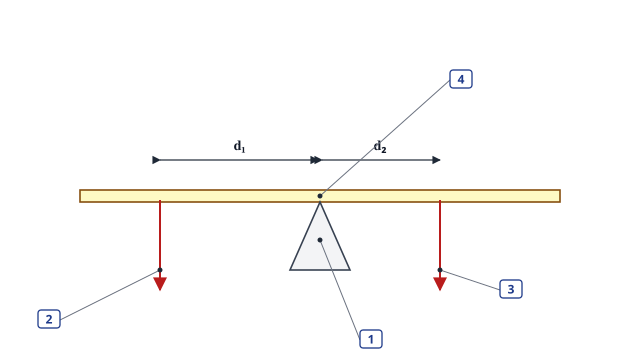

பின்பக்கம்

சுழல்மையம் (pivot (fulcrum)) — திருப்பங்கள் அளக்கப்படும் புள்ளி

<!-- meta {"type":"flashcard","id":"SCF-10-11-017","grade":10,"chapter_id":"SC10-11","discipline":"PHY","difficulty":1,"image":"science_assets/physics/PHY-D11_unlabelled.svg"} -->
**SCF-10-11-017** · அடிப்படை

**முன்:** திருப்பக் கொள்கை — சீசோ — பெயரிடாத படத்தில் இலக்கம் 2 குறிக்கும் பகுதி?

பின்பக்கம்

W₁ (இடஞ்சுழித் திருப்பம்) (anticlockwise moment) — W₁ × d₁

<!-- meta {"type":"flashcard","id":"SCF-10-11-018","grade":10,"chapter_id":"SC10-11","discipline":"PHY","difficulty":1,"image":"science_assets/physics/PHY-D11_unlabelled.svg"} -->
**SCF-10-11-018** · அடிப்படை

**முன்:** திருப்பக் கொள்கை — சீசோ — பெயரிடாத படத்தில் இலக்கம் 3 குறிக்கும் பகுதி?

பின்பக்கம்

W₂ (வலஞ்சுழித் திருப்பம்) (clockwise moment) — W₂ × d₂

<!-- meta {"type":"flashcard","id":"SCF-10-11-019","grade":10,"chapter_id":"SC10-11","discipline":"PHY","difficulty":1,"image":"science_assets/physics/PHY-D11_unlabelled.svg"} -->
**SCF-10-11-019** · அடிப்படை

**முன்:** திருப்பக் கொள்கை — சீசோ — பெயரிடாத படத்தில் இலக்கம் 4 குறிக்கும் பகுதி?

பின்பக்கம்

சமநிலை: W₁d₁ = W₂d₂ (balance condition)

## SC10-12: விசைகளின் சமநிலை (Equilibrium of forces)

*தரம் 10 · அத்தியாயம் 12 · பௌதிகவியல் · 15 அட்டைகள்*

<!-- meta {"type":"flashcard","id":"SCF-10-12-001","grade":10,"chapter_id":"SC10-12","discipline":"PHY","difficulty":1,"image":null} -->
**SCF-10-12-001** · அடிப்படை

**முன்:** இரு விசைச் சமநிலை நிபந்தனைகள்?

பின்பக்கம்

சமன், எதிர்த் திசை, ஒரே கோடு

<!-- meta {"type":"flashcard","id":"SCF-10-12-002","grade":10,"chapter_id":"SC10-12","discipline":"PHY","difficulty":2,"image":null} -->
**SCF-10-12-002** · இடைநிலை

**முன்:** மூன்று விசைச் சமநிலை?

பின்பக்கம்

ஒருங்கமை, விளையுள் 0

<!-- meta {"type":"flashcard","id":"SCF-10-12-003","grade":10,"chapter_id":"SC10-12","discipline":"PHY","difficulty":1,"image":null} -->
**SCF-10-12-003** · அடிப்படை

**முன்:** ஈர்ப்பு மையம்?

பின்பக்கம்

நிறை தாக்கும் புள்ளி

<!-- meta {"type":"flashcard","id":"SCF-10-12-004","grade":10,"chapter_id":"SC10-12","discipline":"PHY","difficulty":1,"image":null} -->
**SCF-10-12-004** · அடிப்படை

**முன்:** உறுதியைக் கூட்டுவன?

பின்பக்கம்

தாழ்ந்த ஈர்ப்பு மையம், அகன்ற அடி

<!-- meta {"type":"flashcard","id":"SCF-10-12-005","grade":10,"chapter_id":"SC10-12","discipline":"PHY","difficulty":2,"image":null} -->
**SCF-10-12-005** · இடைநிலை

**முன்:** ஒழுங்கற்ற தகட்டின் ஈர்ப்பு மையம் காணும் முறை?

பின்பக்கம்

குண்டுநூல் (plumb line) முறை

<!-- meta {"type":"flashcard","id":"SCF-10-12-006","grade":10,"chapter_id":"SC10-12","discipline":"PHY","difficulty":2,"image":null} -->
**SCF-10-12-006** · இடைநிலை

**முன்:** வளையத்தின் ஈர்ப்பு மையம்?

பின்பக்கம்

மையம் (பொருளுக்கு வெளியே)

<!-- meta {"type":"flashcard","id":"SCF-10-12-007","grade":10,"chapter_id":"SC10-12","discipline":"PHY","difficulty":1,"image":null} -->
**SCF-10-12-007** · அடிப்படை

**முன்:** சமநிலையில் விளையுள் விசை?

பின்பக்கம்

0

<!-- meta {"type":"flashcard","id":"SCF-10-12-008","grade":10,"chapter_id":"SC10-12","discipline":"PHY","difficulty":2,"image":null} -->
**SCF-10-12-008** · இடைநிலை

**முன்:** சமநிலையில் தேறிய திருப்பம்?

பின்பக்கம்

0

<!-- meta {"type":"flashcard","id":"SCF-10-12-009","grade":10,"chapter_id":"SC10-12","discipline":"PHY","difficulty":3,"image":null} -->
**SCF-10-12-009** · கடினம்

**முன்:** மூன்று விசைகளின் அளவிடைப் படம்?

பின்பக்கம்

மூடிய முக்கோணி

<!-- meta {"type":"flashcard","id":"SCF-10-12-010","grade":10,"chapter_id":"SC10-12","discipline":"PHY","difficulty":2,"image":null} -->
**SCF-10-12-010** · இடைநிலை

**முன்:** உறுதியற்ற சமநிலைக்கு உதாரணம்?

பின்பக்கம்

கூம்பு முனையில் நிற்றல்

<!-- meta {"type":"flashcard","id":"SCF-10-12-011","grade":10,"chapter_id":"SC10-12","discipline":"PHY","difficulty":2,"image":null} -->
**SCF-10-12-011** · இடைநிலை

**முன்:** நடுநிலைச் சமநிலை?

பின்பக்கம்

உருளும் பந்து (கிடைத்தளத்தில்)

<!-- meta {"type":"flashcard","id":"SCF-10-12-012","grade":10,"chapter_id":"SC10-12","discipline":"PHY","difficulty":1,"image":null} -->
**SCF-10-12-012** · அடிப்படை

**முன்:** பந்தயக் கார் தாழ்வானது ஏன்?

பின்பக்கம்

தாழ்ந்த ஈர்ப்பு மையம்

<!-- meta {"type":"flashcard","id":"SCF-10-12-013","grade":10,"chapter_id":"SC10-12","discipline":"PHY","difficulty":1,"image":null} -->
**SCF-10-12-013** · அடிப்படை

**முன்:** ஒழுங்கான பொருளின் ஈர்ப்பு மையம்?

பின்பக்கம்

வடிவியல் மையம்

<!-- meta {"type":"flashcard","id":"SCF-10-12-014","grade":10,"chapter_id":"SC10-12","discipline":"PHY","difficulty":3,"image":null} -->
**SCF-10-12-014** · கடினம்

**முன்:** பொருள் கவிழும் நிபந்தனை?

பின்பக்கம்

ஈர்ப்பு மையக் கோடு அடிக்கு வெளியே

<!-- meta {"type":"flashcard","id":"SCF-10-12-015","grade":10,"chapter_id":"SC10-12","discipline":"PHY","difficulty":3,"image":null} -->
**SCF-10-12-015** · கடினம்

**முன்:** தவறான கருத்து: சமநிலையில் விசைகள் இல்லை?

பின்பக்கம்

பிழை

## SC10-13: உயிர்க்கோளம் (Biosphere)

*தரம் 10 · அத்தியாயம் 13 · உயிரியல் · 19 அட்டைகள்*

<!-- meta {"type":"flashcard","id":"SCF-10-13-001","grade":10,"chapter_id":"SC10-13","discipline":"BIO","difficulty":1,"image":null} -->
**SCF-10-13-001** · அடிப்படை

**முன்:** உணவுச் சங்கிலியில் அம்புக்குறி காட்டுவது?

பின்பக்கம்

சக்தி பாயும் திசை

<!-- meta {"type":"flashcard","id":"SCF-10-13-002","grade":10,"chapter_id":"SC10-13","discipline":"BIO","difficulty":1,"image":null} -->
**SCF-10-13-002** · அடிப்படை

**முன்:** உற்பத்தியாளர் என்றால்?

பின்பக்கம்

தன் உணவைத் தயாரிக்கும் அங்கி (பச்சைத் தாவரம்)

<!-- meta {"type":"flashcard","id":"SCF-10-13-003","grade":10,"chapter_id":"SC10-13","discipline":"BIO","difficulty":1,"image":null} -->
**SCF-10-13-003** · அடிப்படை

**முன்:** பிரிகையாக்கிகளுக்கு உதாரணம்?

பின்பக்கம்

பக்ரீரியா, பங்கசு

<!-- meta {"type":"flashcard","id":"SCF-10-13-004","grade":10,"chapter_id":"SC10-13","discipline":"BIO","difficulty":2,"image":null} -->
**SCF-10-13-004** · இடைநிலை

**முன்:** அடுத்த போசணை மட்டத்துக்குச் செல்லும் சக்தி ஏறத்தாழ?

பின்பக்கம்

10%

<!-- meta {"type":"flashcard","id":"SCF-10-13-005","grade":10,"chapter_id":"SC10-13","discipline":"BIO","difficulty":1,"image":null} -->
**SCF-10-13-005** · அடிப்படை

**முன்:** CO₂ ஐ வளிமண்டலத்திலிருந்து அகற்றும் செயன்முறை?

பின்பக்கம்

ஒளித்தொகுப்பு

<!-- meta {"type":"flashcard","id":"SCF-10-13-006","grade":10,"chapter_id":"SC10-13","discipline":"BIO","difficulty":2,"image":null} -->
**SCF-10-13-006** · இடைநிலை

**முன்:** அவரை வேர்முடிச்சுகளிலுள்ள நைதரசன் பதிக்கும் பக்ரீரியா?

பின்பக்கம்

Rhizobium

<!-- meta {"type":"flashcard","id":"SCF-10-13-007","grade":10,"chapter_id":"SC10-13","discipline":"BIO","difficulty":1,"image":null} -->
**SCF-10-13-007** · அடிப்படை

**முன்:** சூழற்றொகுதியின் உயிரற்ற கூறுகள்?

பின்பக்கம்

ஒளி, நீர், மண், வெப்பநிலை, காற்று

<!-- meta {"type":"flashcard","id":"SCF-10-13-008","grade":10,"chapter_id":"SC10-13","discipline":"BIO","difficulty":2,"image":null} -->
**SCF-10-13-008** · இடைநிலை

**முன்:** சக்தி மீள்சுழலுமா?

பின்பக்கம்

இல்லை — ஒருவழிப் பாய்ச்சல்

<!-- meta {"type":"flashcard","id":"SCF-10-13-009","grade":10,"chapter_id":"SC10-13","discipline":"BIO","difficulty":2,"image":null} -->
**SCF-10-13-009** · இடைநிலை

**முன்:** ஒன்றுக்கொன்று உதவிக்கு உதாரணம்?

பின்பக்கம்

அவரை – Rhizobium

<!-- meta {"type":"flashcard","id":"SCF-10-13-010","grade":10,"chapter_id":"SC10-13","discipline":"BIO","difficulty":1,"image":null} -->
**SCF-10-13-010** · அடிப்படை

**முன்:** ஒட்டுண்ணிக்கு உதாரணம்?

பின்பக்கம்

நுளம்பு/உண்ணி/தலைப்பேன்

<!-- meta {"type":"flashcard","id":"SCF-10-13-011","grade":10,"chapter_id":"SC10-13","discipline":"BIO","difficulty":1,"image":null} -->
**SCF-10-13-011** · அடிப்படை

**முன்:** உணவு வலை என்றால்?

பின்பக்கம்

ஒன்றோடொன்று இணைந்த பல உணவுச் சங்கிலிகள்

<!-- meta {"type":"flashcard","id":"SCF-10-13-012","grade":10,"chapter_id":"SC10-13","discipline":"BIO","difficulty":2,"image":null} -->
**SCF-10-13-012** · இடைநிலை

**முன்:** CO₂ ஐ விடுவிக்கும் மூன்று செயன்முறைகள்?

பின்பக்கம்

சுவாசம், தகனம், பிரிகை

<!-- meta {"type":"flashcard","id":"SCF-10-13-013","grade":10,"chapter_id":"SC10-13","discipline":"BIO","difficulty":3,"image":null} -->
**SCF-10-13-013** · கடினம்

**முன்:** நைதரசனகற்றல் செய்வது?

பின்பக்கம்

நைதரசனகற்றும் பக்ரீரியா — நைத்திரேற்றை N₂ ஆக்கும்

<!-- meta {"type":"flashcard","id":"SCF-10-13-014","grade":10,"chapter_id":"SC10-13","discipline":"BIO","difficulty":1,"image":null} -->
**SCF-10-13-014** · அடிப்படை

**முன்:** முதல் நிலை நுகர்வோர் எதை உண்ணும்?

பின்பக்கம்

உற்பத்தியாளரை (தாவர உண்ணி)

<!-- meta {"type":"flashcard","id":"SCF-10-13-015","grade":10,"chapter_id":"SC10-13","discipline":"BIO","difficulty":1,"image":null} -->
**SCF-10-13-015** · அடிப்படை

**முன்:** உயிர்க்கோளம் என்றால்?

பின்பக்கம்

அங்கிகள் வாழும் புவியின் பகுதி

<!-- meta {"type":"flashcard","id":"SCF-10-13-016","grade":10,"chapter_id":"SC10-13","discipline":"BIO","difficulty":1,"image":"science_assets/biology/BIO-D09_unlabelled.svg"} -->
**SCF-10-13-016** · அடிப்படை

**முன்:** குளச் சூழல் உணவுவலை (மாதிரி) — பெயரிடாத படத்தில் இலக்கம் 1 குறிக்கும் பகுதி?

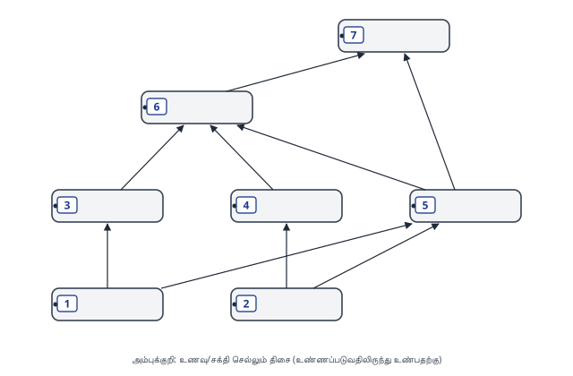

பின்பக்கம்

அல்காக்கள் (algae)

<!-- meta {"type":"flashcard","id":"SCF-10-13-017","grade":10,"chapter_id":"SC10-13","discipline":"BIO","difficulty":1,"image":"science_assets/biology/BIO-D09_unlabelled.svg"} -->
**SCF-10-13-017** · அடிப்படை

**முன்:** குளச் சூழல் உணவுவலை (மாதிரி) — பெயரிடாத படத்தில் இலக்கம் 2 குறிக்கும் பகுதி?

பின்பக்கம்

நீர்த்தாவரம் (Hydrilla)

<!-- meta {"type":"flashcard","id":"SCF-10-13-018","grade":10,"chapter_id":"SC10-13","discipline":"BIO","difficulty":1,"image":"science_assets/biology/BIO-D09_unlabelled.svg"} -->
**SCF-10-13-018** · அடிப்படை

**முன்:** குளச் சூழல் உணவுவலை (மாதிரி) — பெயரிடாத படத்தில் இலக்கம் 3 குறிக்கும் பகுதி?

பின்பக்கம்

விலங்கு மிதவைவாழிகள் (zooplankton)

<!-- meta {"type":"flashcard","id":"SCF-10-13-019","grade":10,"chapter_id":"SC10-13","discipline":"BIO","difficulty":1,"image":"science_assets/biology/BIO-D09_unlabelled.svg"} -->
**SCF-10-13-019** · அடிப்படை

**முன்:** குளச் சூழல் உணவுவலை (மாதிரி) — பெயரிடாத படத்தில் இலக்கம் 4 குறிக்கும் பகுதி?

பின்பக்கம்

நத்தை (snail)

## SC10-14: உயிரின் தொடர்ச்சி (Continuity of life)

*தரம் 10 · அத்தியாயம் 14 · உயிரியல் · 19 அட்டைகள்*

<!-- meta {"type":"flashcard","id":"SCF-10-14-001","grade":10,"chapter_id":"SC10-14","discipline":"BIO","difficulty":1,"image":null} -->
**SCF-10-14-001** · அடிப்படை

**முன்:** இழையுருப்பிரிவில் உருவாகும் மகட்கலங்கள்?

பின்பக்கம்

2

<!-- meta {"type":"flashcard","id":"SCF-10-14-002","grade":10,"chapter_id":"SC10-14","discipline":"BIO","difficulty":1,"image":null} -->
**SCF-10-14-002** · அடிப்படை

**முன்:** ஒடுக்கற்பிரிவில் உருவாகும் மகட்கலங்கள்?

பின்பக்கம்

4

<!-- meta {"type":"flashcard","id":"SCF-10-14-003","grade":10,"chapter_id":"SC10-14","discipline":"BIO","difficulty":1,"image":null} -->
**SCF-10-14-003** · அடிப்படை

**முன்:** மனித உடற்கலத்தின் நிறமூர்த்த எண்?

பின்பக்கம்

46 (2n)

<!-- meta {"type":"flashcard","id":"SCF-10-14-004","grade":10,"chapter_id":"SC10-14","discipline":"BIO","difficulty":1,"image":null} -->
**SCF-10-14-004** · அடிப்படை

**முன்:** மனிதப் புணரியின் நிறமூர்த்த எண்?

பின்பக்கம்

23 (n)

<!-- meta {"type":"flashcard","id":"SCF-10-14-005","grade":10,"chapter_id":"SC10-14","discipline":"BIO","difficulty":1,"image":null} -->
**SCF-10-14-005** · அடிப்படை

**முன்:** மனிதக் கருக்கட்டல் நடைபெறும் இடம்?

பின்பக்கம்

பலோப்பியன் குழாய்

<!-- meta {"type":"flashcard","id":"SCF-10-14-006","grade":10,"chapter_id":"SC10-14","discipline":"BIO","difficulty":1,"image":null} -->
**SCF-10-14-006** · அடிப்படை

**முன்:** மகரந்தக் கூட்டின் தொழில்?

பின்பக்கம்

மகரந்தமணிகளை உருவாக்கல்

<!-- meta {"type":"flashcard","id":"SCF-10-14-007","grade":10,"chapter_id":"SC10-14","discipline":"BIO","difficulty":2,"image":null} -->
**SCF-10-14-007** · இடைநிலை

**முன்:** சூலகத்தின் மூன்று பகுதிகள்?

பின்பக்கம்

குறி, தம்பம், சூலகப்பை

<!-- meta {"type":"flashcard","id":"SCF-10-14-008","grade":10,"chapter_id":"SC10-14","discipline":"BIO","difficulty":1,"image":null} -->
**SCF-10-14-008** · அடிப்படை

**முன்:** ஈஸ்ற் இனப்பெருக்க முறை?

பின்பக்கம்

அரும்புதல்

<!-- meta {"type":"flashcard","id":"SCF-10-14-009","grade":10,"chapter_id":"SC10-14","discipline":"BIO","difficulty":2,"image":null} -->
**SCF-10-14-009** · இடைநிலை

**முன்:** இலிங்கமில் இனப்பெருக்கத்தின் சந்ததி?

பின்பக்கம்

பெற்றாரை ஒத்தது (குளோன்)

<!-- meta {"type":"flashcard","id":"SCF-10-14-010","grade":10,"chapter_id":"SC10-14","discipline":"BIO","difficulty":2,"image":null} -->
**SCF-10-14-010** · இடைநிலை

**முன்:** முட்டை வெளியேற்றம் ஏறத்தாழ எந்நாள்?

பின்பக்கம்

28 நாள் சக்கரத்தின் 14 ஆம் நாள்

<!-- meta {"type":"flashcard","id":"SCF-10-14-011","grade":10,"chapter_id":"SC10-14","discipline":"BIO","difficulty":1,"image":null} -->
**SCF-10-14-011** · அடிப்படை

**முன்:** மகரந்தச் சேர்க்கை என்றால்?

பின்பக்கம்

மகரந்தம் குறியை அடைதல்

<!-- meta {"type":"flashcard","id":"SCF-10-14-012","grade":10,"chapter_id":"SC10-14","discipline":"BIO","difficulty":2,"image":null} -->
**SCF-10-14-012** · இடைநிலை

**முன்:** முளையம் பதியும் இடம்?

பின்பக்கம்

கருப்பைச் சுவர்

<!-- meta {"type":"flashcard","id":"SCF-10-14-013","grade":10,"chapter_id":"SC10-14","discipline":"BIO","difficulty":3,"image":null} -->
**SCF-10-14-013** · கடினம்

**முன்:** தவறான கருத்து: ஒடுக்கற்பிரிவில் 2 கலங்கள்?

பின்பக்கம்

பிழை — 4

<!-- meta {"type":"flashcard","id":"SCF-10-14-014","grade":10,"chapter_id":"SC10-14","discipline":"BIO","difficulty":2,"image":null} -->
**SCF-10-14-014** · இடைநிலை

**முன்:** இலிங்க இனப்பெருக்கத்தின் நன்மை?

பின்பக்கம்

பரம்பரை வேறுபாடுகள்

<!-- meta {"type":"flashcard","id":"SCF-10-14-015","grade":10,"chapter_id":"SC10-14","discipline":"BIO","difficulty":2,"image":null} -->
**SCF-10-14-015** · இடைநிலை

**முன்:** இழைய வளர்ப்பின் நன்மை?

பின்பக்கம்

குறுகிய காலத்தில் நோயற்ற பல தாவரங்கள்

<!-- meta {"type":"flashcard","id":"SCF-10-14-016","grade":10,"chapter_id":"SC10-14","discipline":"BIO","difficulty":1,"image":"science_assets/biology/BIO-D08_unlabelled.svg"} -->
**SCF-10-14-016** · அடிப்படை

**முன்:** பூவின் நெடுக்குவெட்டு — பெயரிடாத படத்தில் இலக்கம் 1 குறிக்கும் பகுதி?

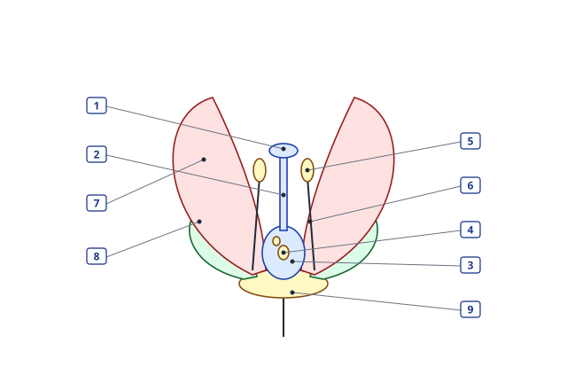

பின்பக்கம்

சூலகமுடி (stigma) — மகரந்தமணிகளைப் பெறல்

<!-- meta {"type":"flashcard","id":"SCF-10-14-017","grade":10,"chapter_id":"SC10-14","discipline":"BIO","difficulty":1,"image":"science_assets/biology/BIO-D08_unlabelled.svg"} -->
**SCF-10-14-017** · அடிப்படை

**முன்:** பூவின் நெடுக்குவெட்டு — பெயரிடாத படத்தில் இலக்கம் 2 குறிக்கும் பகுதி?

பின்பக்கம்

சூல்தண்டு (style) — மகரந்தக் குழாய் வளரும் பாதை

<!-- meta {"type":"flashcard","id":"SCF-10-14-018","grade":10,"chapter_id":"SC10-14","discipline":"BIO","difficulty":1,"image":"science_assets/biology/BIO-D08_unlabelled.svg"} -->
**SCF-10-14-018** · அடிப்படை

**முன்:** பூவின் நெடுக்குவெட்டு — பெயரிடாத படத்தில் இலக்கம் 3 குறிக்கும் பகுதி?

பின்பக்கம்

சூலகம் (ovary) — சூல்வித்துகளைக் கொண்டது; பழமாகும்

<!-- meta {"type":"flashcard","id":"SCF-10-14-019","grade":10,"chapter_id":"SC10-14","discipline":"BIO","difficulty":1,"image":"science_assets/biology/BIO-D08_unlabelled.svg"} -->
**SCF-10-14-019** · அடிப்படை

**முன்:** பூவின் நெடுக்குவெட்டு — பெயரிடாத படத்தில் இலக்கம் 4 குறிக்கும் பகுதி?

பின்பக்கம்

சூல்வித்து (ovule) — கருக்கட்டலின் பின் வித்தாகும்

## SC10-15: நீர்நிலையியல் அமுக்கமும் அதன் பிரயோகங்களும் (Hydrostatic pressure and its applications)

*தரம் 10 · அத்தியாயம் 15 · பௌதிகவியல் · 18 அட்டைகள்*

<!-- meta {"type":"flashcard","id":"SCF-10-15-001","grade":10,"chapter_id":"SC10-15","discipline":"PHY","difficulty":1,"image":null} -->
**SCF-10-15-001** · அடிப்படை

**முன்:** அமுக்கச் சூத்திரம்?

பின்பக்கம்

P = F / A

<!-- meta {"type":"flashcard","id":"SCF-10-15-002","grade":10,"chapter_id":"SC10-15","discipline":"PHY","difficulty":1,"image":null} -->
**SCF-10-15-002** · அடிப்படை

**முன்:** அமுக்க அலகு?

பின்பக்கம்

Pa (N m⁻²)

<!-- meta {"type":"flashcard","id":"SCF-10-15-003","grade":10,"chapter_id":"SC10-15","discipline":"PHY","difficulty":1,"image":null} -->
**SCF-10-15-003** · அடிப்படை

**முன்:** திரவ அமுக்கச் சூத்திரம்?

பின்பக்கம்

P = hρg

<!-- meta {"type":"flashcard","id":"SCF-10-15-004","grade":10,"chapter_id":"SC10-15","discipline":"PHY","difficulty":1,"image":null} -->
**SCF-10-15-004** · அடிப்படை

**முன்:** திரவ அமுக்கம் சார்ந்திருப்பவை?

பின்பக்கம்

ஆழம், அடர்த்தி, g

<!-- meta {"type":"flashcard","id":"SCF-10-15-005","grade":10,"chapter_id":"SC10-15","discipline":"PHY","difficulty":2,"image":null} -->
**SCF-10-15-005** · இடைநிலை

**முன்:** பாத்திர வடிவத்தைச் சாருமா?

பின்பக்கம்

இல்லை

<!-- meta {"type":"flashcard","id":"SCF-10-15-006","grade":10,"chapter_id":"SC10-15","discipline":"PHY","difficulty":1,"image":null} -->
**SCF-10-15-006** · அடிப்படை

**முன்:** பஸ்காலின் விதி?

பின்பக்கம்

அமுக்கம் சமமாகக் கடத்தப்படும்

<!-- meta {"type":"flashcard","id":"SCF-10-15-007","grade":10,"chapter_id":"SC10-15","discipline":"PHY","difficulty":2,"image":null} -->
**SCF-10-15-007** · இடைநிலை

**முன்:** நீரியல் அழுத்திச் சூத்திரம்?

பின்பக்கம்

F₁/A₁ = F₂/A₂

<!-- meta {"type":"flashcard","id":"SCF-10-15-008","grade":10,"chapter_id":"SC10-15","discipline":"PHY","difficulty":2,"image":null} -->
**SCF-10-15-008** · இடைநிலை

**முன்:** கடல் மட்ட வளிமண்டல அமுக்கம்?

பின்பக்கம்

≈ 1.0 × 10⁵ Pa

<!-- meta {"type":"flashcard","id":"SCF-10-15-009","grade":10,"chapter_id":"SC10-15","discipline":"PHY","difficulty":1,"image":null} -->
**SCF-10-15-009** · அடிப்படை

**முன்:** உயரம் கூட வளிமண்டல அமுக்கம்?

பின்பக்கம்

குறையும்

<!-- meta {"type":"flashcard","id":"SCF-10-15-010","grade":10,"chapter_id":"SC10-15","discipline":"PHY","difficulty":2,"image":null} -->
**SCF-10-15-010** · இடைநிலை

**முன்:** ஆக்கிமிடீசின் கொள்கை?

பின்பக்கம்

மேலுதைப்பு = இடம்பெயர்த்த திரவத்தின் நிறை

<!-- meta {"type":"flashcard","id":"SCF-10-15-011","grade":10,"chapter_id":"SC10-15","discipline":"PHY","difficulty":2,"image":null} -->
**SCF-10-15-011** · இடைநிலை

**முன்:** மிதக்கும் நிபந்தனை?

பின்பக்கம்

மேலுதைப்பு = நிறை

<!-- meta {"type":"flashcard","id":"SCF-10-15-012","grade":10,"chapter_id":"SC10-15","discipline":"PHY","difficulty":1,"image":null} -->
**SCF-10-15-012** · அடிப்படை

**முன்:** அணைக்கட்டின் அடி தடிப்பு ஏன்?

பின்பக்கம்

ஆழத்தில் அதிக அமுக்கம்

<!-- meta {"type":"flashcard","id":"SCF-10-15-013","grade":10,"chapter_id":"SC10-15","discipline":"PHY","difficulty":1,"image":null} -->
**SCF-10-15-013** · அடிப்படை

**முன்:** நீரின் அடர்த்தி?

பின்பக்கம்

1000 kg m⁻³

<!-- meta {"type":"flashcard","id":"SCF-10-15-014","grade":10,"chapter_id":"SC10-15","discipline":"PHY","difficulty":1,"image":null} -->
**SCF-10-15-014** · அடிப்படை

**முன்:** கூரிய கத்தி ஏன் வெட்டும்?

பின்பக்கம்

சிறிய பரப்பு — அதிக அமுக்கம்

<!-- meta {"type":"flashcard","id":"SCF-10-15-015","grade":10,"chapter_id":"SC10-15","discipline":"PHY","difficulty":3,"image":null} -->
**SCF-10-15-015** · கடினம்

**முன்:** தவறான கருத்து: அகன்ற பாத்திரம் — அதிக அமுக்கம்?

பின்பக்கம்

பிழை

<!-- meta {"type":"flashcard","id":"SCF-10-15-016","grade":10,"chapter_id":"SC10-15","discipline":"PHY","difficulty":1,"image":"science_assets/physics/PHY-D10_unlabelled.svg"} -->
**SCF-10-15-016** · அடிப்படை

**முன்:** ஆழத்துடன் திரவ அமுக்கம் — பெயரிடாத படத்தில் இலக்கம் 1 குறிக்கும் பகுதி?

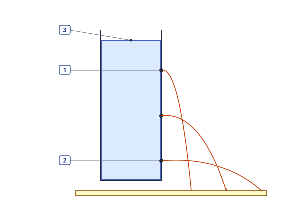

பின்பக்கம்

மேல் துவாரம் (upper hole) — குறைந்த ஆழம் — குறுகிய பீச்சு

<!-- meta {"type":"flashcard","id":"SCF-10-15-017","grade":10,"chapter_id":"SC10-15","discipline":"PHY","difficulty":1,"image":"science_assets/physics/PHY-D10_unlabelled.svg"} -->
**SCF-10-15-017** · அடிப்படை

**முன்:** ஆழத்துடன் திரவ அமுக்கம் — பெயரிடாத படத்தில் இலக்கம் 2 குறிக்கும் பகுதி?

பின்பக்கம்

கீழ்த் துவாரம் (lower hole) — அதிக ஆழம் — அதிக அமுக்கம், நீண்ட பீச்சு

<!-- meta {"type":"flashcard","id":"SCF-10-15-018","grade":10,"chapter_id":"SC10-15","discipline":"PHY","difficulty":1,"image":"science_assets/physics/PHY-D10_unlabelled.svg"} -->
**SCF-10-15-018** · அடிப்படை

**முன்:** ஆழத்துடன் திரவ அமுக்கம் — பெயரிடாத படத்தில் இலக்கம் 3 குறிக்கும் பகுதி?

பின்பக்கம்

நீர் மட்டம் (water surface) — h அளக்கப்படும் இடம்

## SC10-16: சடப்பொருள்களில் ஏற்படும் மாற்றம் (Changes in matter)

*தரம் 10 · அத்தியாயம் 16 · இரசாயனவியல் · 19 அட்டைகள்*

<!-- meta {"type":"flashcard","id":"SCF-10-16-001","grade":10,"chapter_id":"SC10-16","discipline":"CHE","difficulty":1,"image":null} -->
**SCF-10-16-001** · அடிப்படை

**முன்:** பௌதிக மாற்றத்துக்கு உதாரணம்?

பின்பக்கம்

பனிக்கட்டி உருகல்

<!-- meta {"type":"flashcard","id":"SCF-10-16-002","grade":10,"chapter_id":"SC10-16","discipline":"CHE","difficulty":1,"image":null} -->
**SCF-10-16-002** · அடிப்படை

**முன்:** இரசாயன மாற்றத்துக்கு உதாரணம்?

பின்பக்கம்

தகனம் / துருப்பிடித்தல்

<!-- meta {"type":"flashcard","id":"SCF-10-16-003","grade":10,"chapter_id":"SC10-16","discipline":"CHE","difficulty":1,"image":null} -->
**SCF-10-16-003** · அடிப்படை

**முன்:** CaCO₃ → CaO + CO₂ தாக்க வகை?

பின்பக்கம்

பிரிகை

<!-- meta {"type":"flashcard","id":"SCF-10-16-004","grade":10,"chapter_id":"SC10-16","discipline":"CHE","difficulty":1,"image":null} -->
**SCF-10-16-004** · அடிப்படை

**முன்:** Zn + CuSO₄ → ? தாக்க வகை

பின்பக்கம்

தனி இடப்பெயர்ச்சி

<!-- meta {"type":"flashcard","id":"SCF-10-16-005","grade":10,"chapter_id":"SC10-16","discipline":"CHE","difficulty":1,"image":null} -->
**SCF-10-16-005** · அடிப்படை

**முன்:** தாக்கத்திறன் தொடரில் மிக மேலுள்ளது?

பின்பக்கம்

K

<!-- meta {"type":"flashcard","id":"SCF-10-16-006","grade":10,"chapter_id":"SC10-16","discipline":"CHE","difficulty":2,"image":null} -->
**SCF-10-16-006** · இடைநிலை

**முன்:** H₂ ஐ அமிலங்களிலிருந்து இடம்பெயர்க்காத உலோகம்?

பின்பக்கம்

Cu / Ag / Au

<!-- meta {"type":"flashcard","id":"SCF-10-16-007","grade":10,"chapter_id":"SC10-16","discipline":"CHE","difficulty":2,"image":null} -->
**SCF-10-16-007** · இடைநிலை

**முன்:** ஊதுலையில் இரும்பு ஒட்சைட்டைத் தாழ்த்துவது?

பின்பக்கம்

CO

<!-- meta {"type":"flashcard","id":"SCF-10-16-008","grade":10,"chapter_id":"SC10-16","discipline":"CHE","difficulty":2,"image":null} -->
**SCF-10-16-008** · இடைநிலை

**முன்:** ஊதுலையில் சுண்ணக்கல்லின் பங்கு?

பின்பக்கம்

SiO₂ மாசைக் கசடாக அகற்றல்

<!-- meta {"type":"flashcard","id":"SCF-10-16-009","grade":10,"chapter_id":"SC10-16","discipline":"CHE","difficulty":2,"image":null} -->
**SCF-10-16-009** · இடைநிலை

**முன்:** AgNO₃ + NaCl → ? வீழ்படிவு

பின்பக்கம்

AgCl (வெண்மை)

<!-- meta {"type":"flashcard","id":"SCF-10-16-010","grade":10,"chapter_id":"SC10-16","discipline":"CHE","difficulty":1,"image":null} -->
**SCF-10-16-010** · அடிப்படை

**முன்:** Mg + 2HCl → ?

பின்பக்கம்

MgCl₂ + H₂

<!-- meta {"type":"flashcard","id":"SCF-10-16-011","grade":10,"chapter_id":"SC10-16","discipline":"CHE","difficulty":1,"image":null} -->
**SCF-10-16-011** · அடிப்படை

**முன்:** Na நீருடன் தரும் வாயு?

பின்பக்கம்

H₂

<!-- meta {"type":"flashcard","id":"SCF-10-16-012","grade":10,"chapter_id":"SC10-16","discipline":"CHE","difficulty":2,"image":null} -->
**SCF-10-16-012** · இடைநிலை

**முன்:** இரட்டை இடப்பெயர்ச்சித் தாக்கம்?

பின்பக்கம்

இரு சேர்வைகள் அயன்களைப் பரிமாறல்

<!-- meta {"type":"flashcard","id":"SCF-10-16-013","grade":10,"chapter_id":"SC10-16","discipline":"CHE","difficulty":2,"image":null} -->
**SCF-10-16-013** · இடைநிலை

**முன்:** தங்கம் சுயாதீனமாகக் கிடைக்கக் காரணம்?

பின்பக்கம்

தாக்கத்திறன் மிகக் குறைவு

<!-- meta {"type":"flashcard","id":"SCF-10-16-014","grade":10,"chapter_id":"SC10-16","discipline":"CHE","difficulty":3,"image":null} -->
**SCF-10-16-014** · கடினம்

**முன்:** தவறான கருத்து: கரைதல் இரசாயன மாற்றம்?

பின்பக்கம்

பிழை — பௌதிக மாற்றம்

<!-- meta {"type":"flashcard","id":"SCF-10-16-015","grade":10,"chapter_id":"SC10-16","discipline":"CHE","difficulty":3,"image":null} -->
**SCF-10-16-015** · கடினம்

**முன்:** Fe + CuSO₄ இல் அவதானிப்பு?

பின்பக்கம்

நீல நிறம் மங்கும்; செம்பழுப்பு Cu படியும்

<!-- meta {"type":"flashcard","id":"SCF-10-16-016","grade":10,"chapter_id":"SC10-16","discipline":"CHE","difficulty":1,"image":"science_assets/chemistry/CHE-D05_unlabelled.svg"} -->
**SCF-10-16-016** · அடிப்படை

**முன்:** ஊதுலை (திட்டப் படம்) — பெயரிடாத படத்தில் இலக்கம் 1 குறிக்கும் பகுதி?

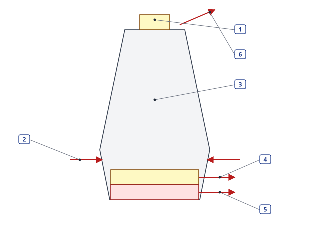

பின்பக்கம்

உள்ளீடு: ஏமற்றைற்று, கல்கரி, சுண்ணக்கல் (iron ore, coke, limestone)

<!-- meta {"type":"flashcard","id":"SCF-10-16-017","grade":10,"chapter_id":"SC10-16","discipline":"CHE","difficulty":1,"image":"science_assets/chemistry/CHE-D05_unlabelled.svg"} -->
**SCF-10-16-017** · அடிப்படை

**முன்:** ஊதுலை (திட்டப் படம்) — பெயரிடாத படத்தில் இலக்கம் 2 குறிக்கும் பகுதி?

பின்பக்கம்

சூடான வளி (hot air blast) — C + O₂ → CO₂ — அதிக வெப்பம்

<!-- meta {"type":"flashcard","id":"SCF-10-16-018","grade":10,"chapter_id":"SC10-16","discipline":"CHE","difficulty":1,"image":"science_assets/chemistry/CHE-D05_unlabelled.svg"} -->
**SCF-10-16-018** · அடிப்படை

**முன்:** ஊதுலை (திட்டப் படம்) — பெயரிடாத படத்தில் இலக்கம் 3 குறிக்கும் பகுதி?

பின்பக்கம்

தாழ்த்தல் வலயம் (reduction zone) — Fe₂O₃ + 3CO → 2Fe + 3CO₂

<!-- meta {"type":"flashcard","id":"SCF-10-16-019","grade":10,"chapter_id":"SC10-16","discipline":"CHE","difficulty":1,"image":"science_assets/chemistry/CHE-D05_unlabelled.svg"} -->
**SCF-10-16-019** · அடிப்படை

**முன்:** ஊதுலை (திட்டப் படம்) — பெயரிடாத படத்தில் இலக்கம் 4 குறிக்கும் பகுதி?

பின்பக்கம்

கசடு (slag (CaSiO₃)) — மாசுகளை நீக்கும்; உருகிய இரும்பின் மேல் மிதக்கும்

## SC10-17: தாக்கவீதம் (Rate of reactions)

*தரம் 10 · அத்தியாயம் 17 · இரசாயனவியல் · 18 அட்டைகள்*

<!-- meta {"type":"flashcard","id":"SCF-10-17-001","grade":10,"chapter_id":"SC10-17","discipline":"CHE","difficulty":1,"image":null} -->
**SCF-10-17-001** · அடிப்படை

**முன்:** தாக்கவீதம் என்றால்?

பின்பக்கம்

ஓரலகு நேரத்தில் தாக்கி/விளைவு மாற்றம்

<!-- meta {"type":"flashcard","id":"SCF-10-17-002","grade":10,"chapter_id":"SC10-17","discipline":"CHE","difficulty":1,"image":null} -->
**SCF-10-17-002** · அடிப்படை

**முன்:** வெப்பநிலை கூட வீதம்?

பின்பக்கம்

கூடும்

<!-- meta {"type":"flashcard","id":"SCF-10-17-003","grade":10,"chapter_id":"SC10-17","discipline":"CHE","difficulty":1,"image":null} -->
**SCF-10-17-003** · அடிப்படை

**முன்:** தூளாக்கல் வீதத்தைக் கூட்டக் காரணம்?

பின்பக்கம்

மேற்பரப்பளவு கூடல்

<!-- meta {"type":"flashcard","id":"SCF-10-17-004","grade":10,"chapter_id":"SC10-17","discipline":"CHE","difficulty":2,"image":null} -->
**SCF-10-17-004** · இடைநிலை

**முன்:** H₂O₂ பிரிகைக்கான ஊக்கி?

பின்பக்கம்

MnO₂

<!-- meta {"type":"flashcard","id":"SCF-10-17-005","grade":10,"chapter_id":"SC10-17","discipline":"CHE","difficulty":2,"image":null} -->
**SCF-10-17-005** · இடைநிலை

**முன்:** ஊக்கி விளைவின் அளவைக் கூட்டுமா?

பின்பக்கம்

இல்லை — வீதத்தை மட்டும்

<!-- meta {"type":"flashcard","id":"SCF-10-17-006","grade":10,"chapter_id":"SC10-17","discipline":"CHE","difficulty":2,"image":null} -->
**SCF-10-17-006** · இடைநிலை

**முன்:** கனவளவு–நேர வரைபின் படித்திறன்?

பின்பக்கம்

தாக்கவீதம்

<!-- meta {"type":"flashcard","id":"SCF-10-17-007","grade":10,"chapter_id":"SC10-17","discipline":"CHE","difficulty":2,"image":null} -->
**SCF-10-17-007** · இடைநிலை

**முன்:** நேரத்துடன் வீதம் குறையக் காரணம்?

பின்பக்கம்

தாக்கிகள் செறிவு குறைதல்

<!-- meta {"type":"flashcard","id":"SCF-10-17-008","grade":10,"chapter_id":"SC10-17","discipline":"CHE","difficulty":1,"image":null} -->
**SCF-10-17-008** · அடிப்படை

**முன்:** குளிரூட்டியில் உணவு நீண்டகாலம் இருக்கக் காரணம்?

பின்பக்கம்

குறைந்த வெப்பநிலை — தாக்கவீதம் குறைவு

<!-- meta {"type":"flashcard","id":"SCF-10-17-009","grade":10,"chapter_id":"SC10-17","discipline":"CHE","difficulty":2,"image":null} -->
**SCF-10-17-009** · இடைநிலை

**முன்:** வாயுத் தாக்கத்தில் அமுக்கம் கூட?

பின்பக்கம்

வீதம் கூடும்

<!-- meta {"type":"flashcard","id":"SCF-10-17-010","grade":10,"chapter_id":"SC10-17","discipline":"CHE","difficulty":2,"image":null} -->
**SCF-10-17-010** · இடைநிலை

**முன்:** வீதத்தின் ஒரு அலகு?

பின்பக்கம்

cm³ s⁻¹

<!-- meta {"type":"flashcard","id":"SCF-10-17-011","grade":10,"chapter_id":"SC10-17","discipline":"CHE","difficulty":2,"image":null} -->
**SCF-10-17-011** · இடைநிலை

**முன்:** Mg + HCl வீதத்தை அளக்கும் முறை?

பின்பக்கம்

வெளியேறும் H₂ கனவளவை நேரத்துடன் அளத்தல்

<!-- meta {"type":"flashcard","id":"SCF-10-17-012","grade":10,"chapter_id":"SC10-17","discipline":"CHE","difficulty":1,"image":null} -->
**SCF-10-17-012** · அடிப்படை

**முன்:** தாக்கவீதத்தைப் பாதிக்கும் நான்கு காரணிகள்?

பின்பக்கம்

வெப்பநிலை, செறிவு, மேற்பரப்பு, ஊக்கி

<!-- meta {"type":"flashcard","id":"SCF-10-17-013","grade":10,"chapter_id":"SC10-17","discipline":"CHE","difficulty":3,"image":null} -->
**SCF-10-17-013** · கடினம்

**முன்:** மோதற் கொள்கையின் அடிப்படை?

பின்பக்கம்

துணிக்கைகள் போதிய சக்தியுடன் மோத வேண்டும்

<!-- meta {"type":"flashcard","id":"SCF-10-17-014","grade":10,"chapter_id":"SC10-17","discipline":"CHE","difficulty":3,"image":null} -->
**SCF-10-17-014** · கடினம்

**முன்:** தவறான கருத்து: ஊக்கி அதிக விளைவு?

பின்பக்கம்

பிழை

<!-- meta {"type":"flashcard","id":"SCF-10-17-015","grade":10,"chapter_id":"SC10-17","discipline":"CHE","difficulty":2,"image":null} -->
**SCF-10-17-015** · இடைநிலை

**முன்:** தாக்கம் முடியும்போது வரைபு?

பின்பக்கம்

கிடையாகும் (படித்திறன் 0)

<!-- meta {"type":"flashcard","id":"SCF-10-17-016","grade":10,"chapter_id":"SC10-17","discipline":"CHE","difficulty":1,"image":"science_assets/graphs/GR-D03_unlabelled.svg"} -->
**SCF-10-17-016** · அடிப்படை

**முன்:** தாக்கவீதம்: வாயுக் கனவளவு–நேரம் — பெயரிடாத படத்தில் இலக்கம் 1 குறிக்கும் பகுதி?

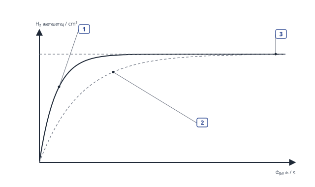

பின்பக்கம்

A: அதிக வெப்பநிலை / தூள் (faster reaction) — ஆரம்பப் படித்திறன் கூடுதல்

<!-- meta {"type":"flashcard","id":"SCF-10-17-017","grade":10,"chapter_id":"SC10-17","discipline":"CHE","difficulty":1,"image":"science_assets/graphs/GR-D03_unlabelled.svg"} -->
**SCF-10-17-017** · அடிப்படை

**முன்:** தாக்கவீதம்: வாயுக் கனவளவு–நேரம் — பெயரிடாத படத்தில் இலக்கம் 2 குறிக்கும் பகுதி?

பின்பக்கம்

B: குறைந்த வெப்பநிலை / துண்டுகள் (slower reaction)

<!-- meta {"type":"flashcard","id":"SCF-10-17-018","grade":10,"chapter_id":"SC10-17","discipline":"CHE","difficulty":1,"image":"science_assets/graphs/GR-D03_unlabelled.svg"} -->
**SCF-10-17-018** · அடிப்படை

**முன்:** தாக்கவீதம்: வாயுக் கனவளவு–நேரம் — பெயரிடாத படத்தில் இலக்கம் 3 குறிக்கும் பகுதி?

பின்பக்கம்

இறுதிக் கனவளவு சமம் (same final volume) — தாக்கிகளின் அளவு ஒன்றே

## SC10-18: வேலை, சக்தி, வலு (Work, energy and power)

*தரம் 10 · அத்தியாயம் 18 · பௌதிகவியல் · 15 அட்டைகள்*

<!-- meta {"type":"flashcard","id":"SCF-10-18-001","grade":10,"chapter_id":"SC10-18","discipline":"PHY","difficulty":1,"image":null} -->
**SCF-10-18-001** · அடிப்படை

**முன்:** வேலைச் சூத்திரம்?

பின்பக்கம்

W = Fs

<!-- meta {"type":"flashcard","id":"SCF-10-18-002","grade":10,"chapter_id":"SC10-18","discipline":"PHY","difficulty":1,"image":null} -->
**SCF-10-18-002** · அடிப்படை

**முன்:** வேலை அலகு?

பின்பக்கம்

J

<!-- meta {"type":"flashcard","id":"SCF-10-18-003","grade":10,"chapter_id":"SC10-18","discipline":"PHY","difficulty":1,"image":null} -->
**SCF-10-18-003** · அடிப்படை

**முன்:** இயக்கசக்திச் சூத்திரம்?

பின்பக்கம்

½mv²

<!-- meta {"type":"flashcard","id":"SCF-10-18-004","grade":10,"chapter_id":"SC10-18","discipline":"PHY","difficulty":1,"image":null} -->
**SCF-10-18-004** · அடிப்படை

**முன்:** அழுத்தசக்திச் சூத்திரம்?

பின்பக்கம்

mgh

<!-- meta {"type":"flashcard","id":"SCF-10-18-005","grade":10,"chapter_id":"SC10-18","discipline":"PHY","difficulty":1,"image":null} -->
**SCF-10-18-005** · அடிப்படை

**முன்:** வலுச் சூத்திரம்?

பின்பக்கம்

P = W / t

<!-- meta {"type":"flashcard","id":"SCF-10-18-006","grade":10,"chapter_id":"SC10-18","discipline":"PHY","difficulty":1,"image":null} -->
**SCF-10-18-006** · அடிப்படை

**முன்:** வலு அலகு?

பின்பக்கம்

W (J s⁻¹)

<!-- meta {"type":"flashcard","id":"SCF-10-18-007","grade":10,"chapter_id":"SC10-18","discipline":"PHY","difficulty":1,"image":null} -->
**SCF-10-18-007** · அடிப்படை

**முன்:** சக்திக் காப்பு விதி?

பின்பக்கம்

சக்தி ஆக்கப்படாது/அழியாது; வடிவம் மாறும்

<!-- meta {"type":"flashcard","id":"SCF-10-18-008","grade":10,"chapter_id":"SC10-18","discipline":"PHY","difficulty":2,"image":null} -->
**SCF-10-18-008** · இடைநிலை

**முன்:** வினைத்திறன்?

பின்பக்கம்

பயனுள்ள வெளியீடு ÷ உள்ளீடு × 100%

<!-- meta {"type":"flashcard","id":"SCF-10-18-009","grade":10,"chapter_id":"SC10-18","discipline":"PHY","difficulty":2,"image":null} -->
**SCF-10-18-009** · இடைநிலை

**முன்:** அசையாத சுவரைத் தள்ளும் வேலை?

பின்பக்கம்

0

<!-- meta {"type":"flashcard","id":"SCF-10-18-010","grade":10,"chapter_id":"SC10-18","discipline":"PHY","difficulty":3,"image":null} -->
**SCF-10-18-010** · கடினம்

**முன்:** வேகம் இருமடங்கானால் Ek?

பின்பக்கம்

நான்கு மடங்கு

<!-- meta {"type":"flashcard","id":"SCF-10-18-011","grade":10,"chapter_id":"SC10-18","discipline":"PHY","difficulty":2,"image":null} -->
**SCF-10-18-011** · இடைநிலை

**முன்:** நீர்மின் சக்தி மாற்றம்?

பின்பக்கம்

அழுத்த → இயக்க → மின்

<!-- meta {"type":"flashcard","id":"SCF-10-18-012","grade":10,"chapter_id":"SC10-18","discipline":"PHY","difficulty":1,"image":null} -->
**SCF-10-18-012** · அடிப்படை

**முன்:** புதுப்பிக்கக்கூடிய சக்திக்கு உதாரணம்?

பின்பக்கம்

சூரிய, காற்று, நீர்

<!-- meta {"type":"flashcard","id":"SCF-10-18-013","grade":10,"chapter_id":"SC10-18","discipline":"PHY","difficulty":1,"image":null} -->
**SCF-10-18-013** · அடிப்படை

**முன்:** 1 kW = ? W

பின்பக்கம்

1000

<!-- meta {"type":"flashcard","id":"SCF-10-18-014","grade":10,"chapter_id":"SC10-18","discipline":"PHY","difficulty":1,"image":null} -->
**SCF-10-18-014** · அடிப்படை

**முன்:** விழும் பொருளில் சக்தி மாற்றம்?

பின்பக்கம்

அழுத்த → இயக்க

<!-- meta {"type":"flashcard","id":"SCF-10-18-015","grade":10,"chapter_id":"SC10-18","discipline":"PHY","difficulty":3,"image":null} -->
**SCF-10-18-015** · கடினம்

**முன்:** தவறான கருத்து: வினைத்திறன் > 100%?

பின்பக்கம்

சாத்தியமில்லை

## SC10-19: ஓட்ட மின்னியல் (Current electricity)

*தரம் 10 · அத்தியாயம் 19 · பௌதிகவியல் · 25 அட்டைகள்*

<!-- meta {"type":"flashcard","id":"SCF-10-19-001","grade":10,"chapter_id":"SC10-19","discipline":"PHY","difficulty":1,"image":null} -->
**SCF-10-19-001** · அடிப்படை

**முன்:** ஓமின் விதி?

பின்பக்கம்

V = IR

<!-- meta {"type":"flashcard","id":"SCF-10-19-002","grade":10,"chapter_id":"SC10-19","discipline":"PHY","difficulty":1,"image":null} -->
**SCF-10-19-002** · அடிப்படை

**முன்:** மின்னோட்ட அலகு?

பின்பக்கம்

அம்பியர் (A)

<!-- meta {"type":"flashcard","id":"SCF-10-19-003","grade":10,"chapter_id":"SC10-19","discipline":"PHY","difficulty":1,"image":null} -->
**SCF-10-19-003** · அடிப்படை

**முன்:** தடை அலகு?

பின்பக்கம்

ஓம் (Ω)

<!-- meta {"type":"flashcard","id":"SCF-10-19-004","grade":10,"chapter_id":"SC10-19","discipline":"PHY","difficulty":1,"image":null} -->
**SCF-10-19-004** · அடிப்படை

**முன்:** அம்பியர்மானி இணைப்பு?

பின்பக்கம்

தொடராக

<!-- meta {"type":"flashcard","id":"SCF-10-19-005","grade":10,"chapter_id":"SC10-19","discipline":"PHY","difficulty":1,"image":null} -->
**SCF-10-19-005** · அடிப்படை

**முன்:** வோல்ற்மானி இணைப்பு?

பின்பக்கம்

சமாந்தரமாக

<!-- meta {"type":"flashcard","id":"SCF-10-19-006","grade":10,"chapter_id":"SC10-19","discipline":"PHY","difficulty":1,"image":null} -->
**SCF-10-19-006** · அடிப்படை

**முன்:** தொடர்த் தடைகள்?

பின்பக்கம்

R = R₁ + R₂

<!-- meta {"type":"flashcard","id":"SCF-10-19-007","grade":10,"chapter_id":"SC10-19","discipline":"PHY","difficulty":2,"image":null} -->
**SCF-10-19-007** · இடைநிலை

**முன்:** சமாந்தரத் தடைகள்?

பின்பக்கம்

1/R = 1/R₁ + 1/R₂

<!-- meta {"type":"flashcard","id":"SCF-10-19-008","grade":10,"chapter_id":"SC10-19","discipline":"PHY","difficulty":1,"image":null} -->
**SCF-10-19-008** · அடிப்படை

**முன்:** நீளம் கூட தடை?

பின்பக்கம்

கூடும்

<!-- meta {"type":"flashcard","id":"SCF-10-19-009","grade":10,"chapter_id":"SC10-19","discipline":"PHY","difficulty":2,"image":null} -->
**SCF-10-19-009** · இடைநிலை

**முன்:** குறுக்குவெட்டுப் பரப்பு கூட தடை?

பின்பக்கம்

குறையும்

<!-- meta {"type":"flashcard","id":"SCF-10-19-010","grade":10,"chapter_id":"SC10-19","discipline":"PHY","difficulty":2,"image":null} -->
**SCF-10-19-010** · இடைநிலை

**முன்:** V–I வரைபின் படித்திறன்?

பின்பக்கம்

தடை R

<!-- meta {"type":"flashcard","id":"SCF-10-19-011","grade":10,"chapter_id":"SC10-19","discipline":"PHY","difficulty":2,"image":null} -->
**SCF-10-19-011** · இடைநிலை

**முன்:** இரு 6 Ω சமாந்தரமாக?

பின்பக்கம்

3 Ω

<!-- meta {"type":"flashcard","id":"SCF-10-19-012","grade":10,"chapter_id":"SC10-19","discipline":"PHY","difficulty":1,"image":null} -->
**SCF-10-19-012** · அடிப்படை

**முன்:** வீட்டுச் சுற்றுகள் எவ்வகை?

பின்பக்கம்

சமாந்தரம்

<!-- meta {"type":"flashcard","id":"SCF-10-19-013","grade":10,"chapter_id":"SC10-19","discipline":"PHY","difficulty":1,"image":null} -->
**SCF-10-19-013** · அடிப்படை

**முன்:** தொடர்ச் சுற்றில் மின்னோட்டம்?

பின்பக்கம்

எங்கும் சமம்

<!-- meta {"type":"flashcard","id":"SCF-10-19-014","grade":10,"chapter_id":"SC10-19","discipline":"PHY","difficulty":3,"image":null} -->
**SCF-10-19-014** · கடினம்

**முன்:** தவறான கருத்து: மின்னோட்டம் சுற்றில் குறையும்?

பின்பக்கம்

பிழை

<!-- meta {"type":"flashcard","id":"SCF-10-19-015","grade":10,"chapter_id":"SC10-19","discipline":"PHY","difficulty":3,"image":null} -->
**SCF-10-19-015** · கடினம்

**முன்:** முனைவுப் பாதுகாப்புக்கு?

பின்பக்கம்

இருவாயி (diode)

<!-- meta {"type":"flashcard","id":"SCF-10-19-016","grade":10,"chapter_id":"SC10-19","discipline":"PHY","difficulty":1,"image":"science_assets/physics/PHY-D01_unlabelled.svg"} -->
**SCF-10-19-016** · அடிப்படை

**முன்:** தொடர்ச் சுற்று (அம்பியர்மானி, வோல்ற்மானி) — பெயரிடாத படத்தில் இலக்கம் 1 குறிக்கும் பகுதி?

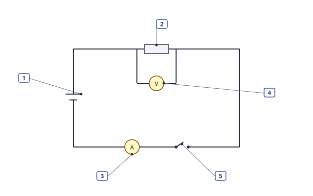

பின்பக்கம்

மின்கலம் (cell) — மின்னியக்க விசை வழங்கல்

<!-- meta {"type":"flashcard","id":"SCF-10-19-017","grade":10,"chapter_id":"SC10-19","discipline":"PHY","difficulty":1,"image":"science_assets/physics/PHY-D01_unlabelled.svg"} -->
**SCF-10-19-017** · அடிப்படை

**முன்:** தொடர்ச் சுற்று (அம்பியர்மானி, வோல்ற்மானி) — பெயரிடாத படத்தில் இலக்கம் 2 குறிக்கும் பகுதி?

பின்பக்கம்

தடையி (resistor) — மின்னோட்டத்தை எதிர்த்தல்

<!-- meta {"type":"flashcard","id":"SCF-10-19-018","grade":10,"chapter_id":"SC10-19","discipline":"PHY","difficulty":1,"image":"science_assets/physics/PHY-D01_unlabelled.svg"} -->
**SCF-10-19-018** · அடிப்படை

**முன்:** தொடர்ச் சுற்று (அம்பியர்மானி, வோல்ற்மானி) — பெயரிடாத படத்தில் இலக்கம் 3 குறிக்கும் பகுதி?

பின்பக்கம்

அம்பியர்மானி (ammeter) — தொடராக — மின்னோட்டம் அளத்தல்

<!-- meta {"type":"flashcard","id":"SCF-10-19-019","grade":10,"chapter_id":"SC10-19","discipline":"PHY","difficulty":1,"image":"science_assets/physics/PHY-D01_unlabelled.svg"} -->
**SCF-10-19-019** · அடிப்படை

**முன்:** தொடர்ச் சுற்று (அம்பியர்மானி, வோல்ற்மானி) — பெயரிடாத படத்தில் இலக்கம் 4 குறிக்கும் பகுதி?

பின்பக்கம்

வோல்ற்மானி (voltmeter) — சமாந்தரமாக — அழுத்த வேறுபாடு

<!-- meta {"type":"flashcard","id":"SCF-10-19-020","grade":10,"chapter_id":"SC10-19","discipline":"PHY","difficulty":1,"image":"science_assets/physics/PHY-D02_unlabelled.svg"} -->
**SCF-10-19-020** · அடிப்படை

**முன்:** சமாந்தரச் சுற்று — பெயரிடாத படத்தில் இலக்கம் 1 குறிக்கும் பகுதி?

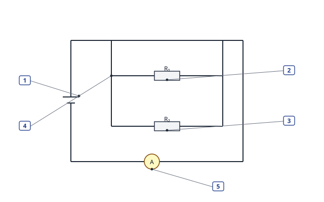

பின்பக்கம்

மின்கலம் (cell)

<!-- meta {"type":"flashcard","id":"SCF-10-19-021","grade":10,"chapter_id":"SC10-19","discipline":"PHY","difficulty":1,"image":"science_assets/physics/PHY-D02_unlabelled.svg"} -->
**SCF-10-19-021** · அடிப்படை

**முன்:** சமாந்தரச் சுற்று — பெயரிடாத படத்தில் இலக்கம் 2 குறிக்கும் பகுதி?

பின்பக்கம்

கிளை 1 (R₁) (branch 1) — அழுத்த வேறுபாடு மின்கலத்துக்குச் சமம்

<!-- meta {"type":"flashcard","id":"SCF-10-19-022","grade":10,"chapter_id":"SC10-19","discipline":"PHY","difficulty":1,"image":"science_assets/physics/PHY-D02_unlabelled.svg"} -->
**SCF-10-19-022** · அடிப்படை

**முன்:** சமாந்தரச் சுற்று — பெயரிடாத படத்தில் இலக்கம் 3 குறிக்கும் பகுதி?

பின்பக்கம்

கிளை 2 (R₂) (branch 2) — கிளை மின்னோட்டங்களின் கூட்டு = மொத்தம்

<!-- meta {"type":"flashcard","id":"SCF-10-19-023","grade":10,"chapter_id":"SC10-19","discipline":"PHY","difficulty":1,"image":"science_assets/physics/PHY-D02_unlabelled.svg"} -->
**SCF-10-19-023** · அடிப்படை

**முன்:** சமாந்தரச் சுற்று — பெயரிடாத படத்தில் இலக்கம் 4 குறிக்கும் பகுதி?

பின்பக்கம்

சந்தி (junction) — மின்னோட்டம் பிரியும்/சேரும் புள்ளி

<!-- meta {"type":"flashcard","id":"SCF-10-19-024","grade":10,"chapter_id":"SC10-19","discipline":"PHY","difficulty":1,"image":"science_assets/graphs/GR-D04_unlabelled.svg"} -->
**SCF-10-19-024** · அடிப்படை

**முன்:** ஓமின் விதி: V–I வரைபு — பெயரிடாத படத்தில் இலக்கம் 1 குறிக்கும் பகுதி?

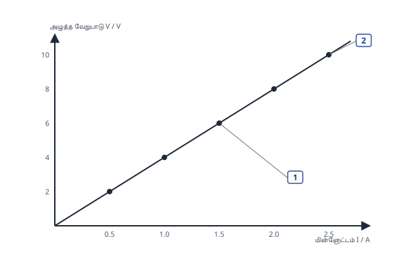

பின்பக்கம்

உற்பத்தியினூடான நேர்கோடு (straight line through origin) — V ∝ I

<!-- meta {"type":"flashcard","id":"SCF-10-19-025","grade":10,"chapter_id":"SC10-19","discipline":"PHY","difficulty":1,"image":"science_assets/graphs/GR-D04_unlabelled.svg"} -->
**SCF-10-19-025** · அடிப்படை

**முன்:** ஓமின் விதி: V–I வரைபு — பெயரிடாத படத்தில் இலக்கம் 2 குறிக்கும் பகுதி?

பின்பக்கம்

படித்திறன் = R = 4 Ω (gradient = resistance)

## SC10-20: தலைமுறையுரிமை (Inheritance)

*தரம் 10 · அத்தியாயம் 20 · உயிரியல் · 18 அட்டைகள்*

<!-- meta {"type":"flashcard","id":"SCF-10-20-001","grade":10,"chapter_id":"SC10-20","discipline":"BIO","difficulty":1,"image":null} -->
**SCF-10-20-001** · அடிப்படை

**முன்:** ஆட்சியுடைய எதிருரு எழுதப்படும் விதம்?

பின்பக்கம்

பெரிய எழுத்து (T)

<!-- meta {"type":"flashcard","id":"SCF-10-20-002","grade":10,"chapter_id":"SC10-20","discipline":"BIO","difficulty":1,"image":null} -->
**SCF-10-20-002** · அடிப்படை

**முன்:** Tt × Tt தோற்றவமைப்பு விகிதம்?

பின்பக்கம்

3 : 1

<!-- meta {"type":"flashcard","id":"SCF-10-20-003","grade":10,"chapter_id":"SC10-20","discipline":"BIO","difficulty":2,"image":null} -->
**SCF-10-20-003** · இடைநிலை

**முன்:** Tt × Tt பிறப்புரிமையமைப்பு விகிதம்?

பின்பக்கம்

1 TT : 2 Tt : 1 tt

<!-- meta {"type":"flashcard","id":"SCF-10-20-004","grade":10,"chapter_id":"SC10-20","discipline":"BIO","difficulty":1,"image":null} -->
**SCF-10-20-004** · அடிப்படை

**முன்:** ஒத்தநுகத்துக்கு உதாரணம்?

பின்பக்கம்

TT அல்லது tt

<!-- meta {"type":"flashcard","id":"SCF-10-20-005","grade":10,"chapter_id":"SC10-20","discipline":"BIO","difficulty":1,"image":null} -->
**SCF-10-20-005** · அடிப்படை

**முன்:** பல்லினநுகம்?

பின்பக்கம்

Tt

<!-- meta {"type":"flashcard","id":"SCF-10-20-006","grade":10,"chapter_id":"SC10-20","discipline":"BIO","difficulty":1,"image":null} -->
**SCF-10-20-006** · அடிப்படை

**முன்:** ஆணின் இலிங்க நிறமூர்த்தங்கள்?

பின்பக்கம்

XY

<!-- meta {"type":"flashcard","id":"SCF-10-20-007","grade":10,"chapter_id":"SC10-20","discipline":"BIO","difficulty":1,"image":null} -->
**SCF-10-20-007** · அடிப்படை

**முன்:** பெண்ணின் இலிங்க நிறமூர்த்தங்கள்?

பின்பக்கம்

XX

<!-- meta {"type":"flashcard","id":"SCF-10-20-008","grade":10,"chapter_id":"SC10-20","discipline":"BIO","difficulty":2,"image":null} -->
**SCF-10-20-008** · இடைநிலை

**முன்:** பிள்ளையின் இலிங்கத்தைத் தீர்மானிப்பது?

பின்பக்கம்

தந்தையின் விந்து (X அல்லது Y)

<!-- meta {"type":"flashcard","id":"SCF-10-20-009","grade":10,"chapter_id":"SC10-20","discipline":"BIO","difficulty":1,"image":null} -->
**SCF-10-20-009** · அடிப்படை

**முன்:** ஆண் பிள்ளை பிறக்கும் நிகழ்தகவு?

பின்பக்கம்

½

<!-- meta {"type":"flashcard","id":"SCF-10-20-010","grade":10,"chapter_id":"SC10-20","discipline":"BIO","difficulty":1,"image":null} -->
**SCF-10-20-010** · அடிப்படை

**முன்:** தோற்றவமைப்பு என்றால்?

பின்பக்கம்

வெளித்தெரியும் இயல்பு

<!-- meta {"type":"flashcard","id":"SCF-10-20-011","grade":10,"chapter_id":"SC10-20","discipline":"BIO","difficulty":2,"image":null} -->
**SCF-10-20-011** · இடைநிலை

**முன்:** எதிருரு (Allele) என்றால்?

பின்பக்கம்

ஒரு பரம்பரை அலகின் வேறுபட்ட வடிவங்கள்

<!-- meta {"type":"flashcard","id":"SCF-10-20-012","grade":10,"chapter_id":"SC10-20","discipline":"BIO","difficulty":2,"image":null} -->
**SCF-10-20-012** · இடைநிலை

**முன்:** Tt × tt தோற்றவமைப்பு விகிதம்?

பின்பக்கம்

1 : 1

<!-- meta {"type":"flashcard","id":"SCF-10-20-013","grade":10,"chapter_id":"SC10-20","discipline":"BIO","difficulty":2,"image":null} -->
**SCF-10-20-013** · இடைநிலை

**முன்:** X இணைந்த பரம்பரை நோய்க்கு உதாரணம்?

பின்பக்கம்

நிறக்குருடு / ஈமோபீலியா

<!-- meta {"type":"flashcard","id":"SCF-10-20-014","grade":10,"chapter_id":"SC10-20","discipline":"BIO","difficulty":3,"image":null} -->
**SCF-10-20-014** · கடினம்

**முன்:** இரு தலசீமியா காவிகளின் பிள்ளைக்கு நோய் வரும் நிகழ்தகவு?

பின்பக்கம்

¼

<!-- meta {"type":"flashcard","id":"SCF-10-20-015","grade":10,"chapter_id":"SC10-20","discipline":"BIO","difficulty":1,"image":null} -->
**SCF-10-20-015** · அடிப்படை

**முன்:** பரம்பரை அலகுகள் உள்ள இடம்?

பின்பக்கம்

நிறமூர்த்தங்களில்

<!-- meta {"type":"flashcard","id":"SCF-10-20-016","grade":10,"chapter_id":"SC10-20","discipline":"BIO","difficulty":1,"image":"science_assets/biology/BIO-D10_unlabelled.svg"} -->
**SCF-10-20-016** · அடிப்படை

**முன்:** புனெற் சதுரம்: Tt × Tt — பெயரிடாத படத்தில் இலக்கம் 1 குறிக்கும் பகுதி?

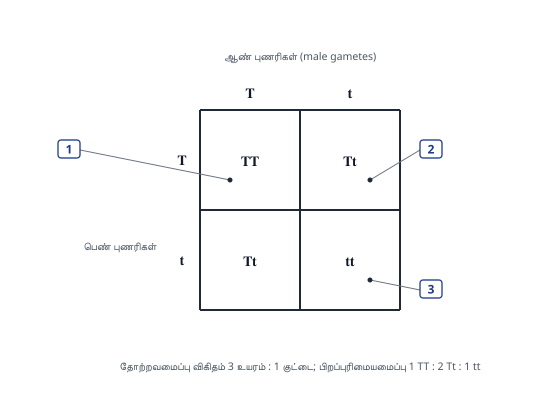

பின்பக்கம்

ஓரினநுக உயரம் (TT) (homozygous tall)

<!-- meta {"type":"flashcard","id":"SCF-10-20-017","grade":10,"chapter_id":"SC10-20","discipline":"BIO","difficulty":1,"image":"science_assets/biology/BIO-D10_unlabelled.svg"} -->
**SCF-10-20-017** · அடிப்படை

**முன்:** புனெற் சதுரம்: Tt × Tt — பெயரிடாத படத்தில் இலக்கம் 2 குறிக்கும் பகுதி?

பின்பக்கம்

பல்லினநுக உயரம் (Tt) (heterozygous tall)

<!-- meta {"type":"flashcard","id":"SCF-10-20-018","grade":10,"chapter_id":"SC10-20","discipline":"BIO","difficulty":1,"image":"science_assets/biology/BIO-D10_unlabelled.svg"} -->
**SCF-10-20-018** · அடிப்படை

**முன்:** புனெற் சதுரம்: Tt × Tt — பெயரிடாத படத்தில் இலக்கம் 3 குறிக்கும் பகுதி?

பின்பக்கம்

ஓரினநுகக் குட்டை (tt) (homozygous dwarf) — பின்னிடைவு இயல்பு வெளிப்படும்

## SC11-01: தாவர இழையங்களும் விலங்கு இழையங்களும் (Living tissues)

*தரம் 11 · அத்தியாயம் 1 · உயிரியல் · 15 அட்டைகள்*

<!-- meta {"type":"flashcard","id":"SCF-11-01-001","grade":11,"chapter_id":"SC11-01","discipline":"BIO","difficulty":1,"image":null} -->
**SCF-11-01-001** · அடிப்படை

**முன்:** நீரைக் கடத்தும் தாவர இழையம்?

பின்பக்கம்

காழ் (Xylem)

<!-- meta {"type":"flashcard","id":"SCF-11-01-002","grade":11,"chapter_id":"SC11-01","discipline":"BIO","difficulty":1,"image":null} -->
**SCF-11-01-002** · அடிப்படை

**முன்:** உணவைக் கடத்தும் தாவர இழையம்?

பின்பக்கம்

உரியம் (Phloem)

<!-- meta {"type":"flashcard","id":"SCF-11-01-003","grade":11,"chapter_id":"SC11-01","discipline":"BIO","difficulty":1,"image":null} -->
**SCF-11-01-003** · அடிப்படை

**முன்:** கலப்பிரிவு நடைபெறும் தாவர இழையம்?

பின்பக்கம்

பிரியிழையம்

<!-- meta {"type":"flashcard","id":"SCF-11-01-004","grade":11,"chapter_id":"SC11-01","discipline":"BIO","difficulty":2,"image":null} -->
**SCF-11-01-004** · இடைநிலை

**முன்:** காழ்க் கலச்சுவரை வலுப்படுத்தும் பதார்த்தம்?

பின்பக்கம்

இலிக்னின்

<!-- meta {"type":"flashcard","id":"SCF-11-01-005","grade":11,"chapter_id":"SC11-01","discipline":"BIO","difficulty":2,"image":null} -->
**SCF-11-01-005** · இடைநிலை

**முன்:** உரியத்தில் உணவு கடத்தப்படும் வடிவம்?

பின்பக்கம்

சுக்குரோசு

<!-- meta {"type":"flashcard","id":"SCF-11-01-006","grade":11,"chapter_id":"SC11-01","discipline":"BIO","difficulty":1,"image":null} -->
**SCF-11-01-006** · அடிப்படை

**முன்:** நான்கு விலங்கு இழைய வகைகள்?

பின்பக்கம்

மேலணி, தொடுப்பு, தசை, நரம்பு

<!-- meta {"type":"flashcard","id":"SCF-11-01-007","grade":11,"chapter_id":"SC11-01","discipline":"BIO","difficulty":1,"image":null} -->
**SCF-11-01-007** · அடிப்படை

**முன்:** சோர்வடையாத தசை?

பின்பக்கம்

இதயத் தசை

<!-- meta {"type":"flashcard","id":"SCF-11-01-008","grade":11,"chapter_id":"SC11-01","discipline":"BIO","difficulty":2,"image":null} -->
**SCF-11-01-008** · இடைநிலை

**முன்:** பல்கருவுடைய தசைக் கலங்கள்?

பின்பக்கம்

வன்கூட்டுத் தசை

<!-- meta {"type":"flashcard","id":"SCF-11-01-009","grade":11,"chapter_id":"SC11-01","discipline":"BIO","difficulty":2,"image":null} -->
**SCF-11-01-009** · இடைநிலை

**முன்:** இரத்தம் எந்த இழைய வகை?

பின்பக்கம்

தொடுப்பிழையம்

<!-- meta {"type":"flashcard","id":"SCF-11-01-010","grade":11,"chapter_id":"SC11-01","discipline":"BIO","difficulty":1,"image":null} -->
**SCF-11-01-010** · அடிப்படை

**முன்:** நரம்புக் கணத்தாக்கம் கடத்தும் கலம்?

பின்பக்கம்

நியூரோன்

<!-- meta {"type":"flashcard","id":"SCF-11-01-011","grade":11,"chapter_id":"SC11-01","discipline":"BIO","difficulty":2,"image":null} -->
**SCF-11-01-011** · இடைநிலை

**முன்:** உரியத்தின் இரு கலவகைகள்?

பின்பக்கம்

நெய்யரிக் குழாய், தோழமைக் கலம்

<!-- meta {"type":"flashcard","id":"SCF-11-01-012","grade":11,"chapter_id":"SC11-01","discipline":"BIO","difficulty":2,"image":null} -->
**SCF-11-01-012** · இடைநிலை

**முன்:** மழமழப்பான தசை காணப்படும் இடம்?

பின்பக்கம்

உணவுக்கால்வாய்ச் சுவர்

<!-- meta {"type":"flashcard","id":"SCF-11-01-013","grade":11,"chapter_id":"SC11-01","discipline":"BIO","difficulty":3,"image":null} -->
**SCF-11-01-013** · கடினம்

**முன்:** தேங்காய்ச் சிரட்டையின் கடினத்துக்குக் காரணமான இழையம்?

பின்பக்கம்

வல்லருகுக்கலவிழையம்

<!-- meta {"type":"flashcard","id":"SCF-11-01-014","grade":11,"chapter_id":"SC11-01","discipline":"BIO","difficulty":3,"image":null} -->
**SCF-11-01-014** · கடினம்

**முன்:** தவறான கருத்து: உரியம் நீரைக் கடத்தும்?

பின்பக்கம்

பிழை — காழ்

<!-- meta {"type":"flashcard","id":"SCF-11-01-015","grade":11,"chapter_id":"SC11-01","discipline":"BIO","difficulty":1,"image":null} -->
**SCF-11-01-015** · அடிப்படை

**முன்:** இழையம் என்றால்?

பின்பக்கம்

ஒத்த அமைப்பும் தொழிலும் உடைய கலக் கூட்டம்

## SC11-02: ஒளித்தொகுப்பு (Photosynthesis)

*தரம் 11 · அத்தியாயம் 2 · உயிரியல் · 27 அட்டைகள்*

<!-- meta {"type":"flashcard","id":"SCF-11-02-001","grade":11,"chapter_id":"SC11-02","discipline":"BIO","difficulty":1,"image":null} -->
**SCF-11-02-001** · அடிப்படை

**முன்:** ஒளித்தொகுப்புச் சமன்பாடு?

பின்பக்கம்

6CO₂ + 6H₂O → C₆H₁₂O₆ + 6O₂

<!-- meta {"type":"flashcard","id":"SCF-11-02-002","grade":11,"chapter_id":"SC11-02","discipline":"BIO","difficulty":1,"image":null} -->
**SCF-11-02-002** · அடிப்படை

**முன்:** ஒளித்தொகுப்பின் சக்தி மாற்றம்?

பின்பக்கம்

ஒளிச்சக்தி → இரசாயனச் சக்தி

<!-- meta {"type":"flashcard","id":"SCF-11-02-003","grade":11,"chapter_id":"SC11-02","discipline":"BIO","difficulty":1,"image":null} -->
**SCF-11-02-003** · அடிப்படை

**முன்:** ஒளியைக் கவரும் நிறப்பொருள்?

பின்பக்கம்

பச்சையம்

<!-- meta {"type":"flashcard","id":"SCF-11-02-004","grade":11,"chapter_id":"SC11-02","discipline":"BIO","difficulty":1,"image":null} -->
**SCF-11-02-004** · அடிப்படை

**முன்:** ஒளித்தொகுப்பின் விளைவு வாயு?

பின்பக்கம்

O₂

<!-- meta {"type":"flashcard","id":"SCF-11-02-005","grade":11,"chapter_id":"SC11-02","discipline":"BIO","difficulty":2,"image":null} -->
**SCF-11-02-005** · இடைநிலை

**முன்:** CO₂ ஐ அகற்றப் பயன்படும் இரசாயனம்?

பின்பக்கம்

KOH (பொற்றாசியம் ஐதரொட்சைட்டு)

<!-- meta {"type":"flashcard","id":"SCF-11-02-006","grade":11,"chapter_id":"SC11-02","discipline":"BIO","difficulty":2,"image":null} -->
**SCF-11-02-006** · இடைநிலை

**முன்:** இலையிலிருந்து பச்சையத்தை அகற்றுவது?

பின்பக்கம்

எதனோல் (நீர்த்தொட்டியில் வெப்பமேற்றி)

<!-- meta {"type":"flashcard","id":"SCF-11-02-007","grade":11,"chapter_id":"SC11-02","discipline":"BIO","difficulty":2,"image":null} -->
**SCF-11-02-007** · இடைநிலை

**முன்:** இலையை இருட்டில் வைப்பதன் நோக்கம்?

பின்பக்கம்

இருக்கும் மாப்பொருளை அகற்ற

<!-- meta {"type":"flashcard","id":"SCF-11-02-008","grade":11,"chapter_id":"SC11-02","discipline":"BIO","difficulty":2,"image":null} -->
**SCF-11-02-008** · இடைநிலை

**முன்:** மட்டுப்படுத்தும் காரணி என்றால்?

பின்பக்கம்

குறைந்தளவில் இருந்து வீதத்தைக் கட்டுப்படுத்தும் காரணி

<!-- meta {"type":"flashcard","id":"SCF-11-02-009","grade":11,"chapter_id":"SC11-02","discipline":"BIO","difficulty":1,"image":null} -->
**SCF-11-02-009** · அடிப்படை

**முன்:** இலைவாய்களைக் கட்டுப்படுத்தும் கலங்கள்?

பின்பக்கம்

காவற்கலங்கள்

<!-- meta {"type":"flashcard","id":"SCF-11-02-010","grade":11,"chapter_id":"SC11-02","discipline":"BIO","difficulty":2,"image":null} -->
**SCF-11-02-010** · இடைநிலை

**முன்:** பச்சையவுருமணி அதிகமுள்ள இலை இழையம்?

பின்பக்கம்

வேலிக்கற்புடைக்கலவிழையம்

<!-- meta {"type":"flashcard","id":"SCF-11-02-011","grade":11,"chapter_id":"SC11-02","discipline":"BIO","difficulty":1,"image":null} -->
**SCF-11-02-011** · அடிப்படை

**முன்:** ஒளித்தொகுப்பின் மூன்று காரணிகள்?

பின்பக்கம்

ஒளி, CO₂, வெப்பநிலை

<!-- meta {"type":"flashcard","id":"SCF-11-02-012","grade":11,"chapter_id":"SC11-02","discipline":"BIO","difficulty":1,"image":null} -->
**SCF-11-02-012** · அடிப்படை

**முன்:** குளுக்கோசு சேமிக்கப்படும் வடிவம்?

பின்பக்கம்

மாப்பொருள்

<!-- meta {"type":"flashcard","id":"SCF-11-02-013","grade":11,"chapter_id":"SC11-02","discipline":"BIO","difficulty":2,"image":null} -->
**SCF-11-02-013** · இடைநிலை

**முன்:** எதனோலை நேரடியாக வெப்பமேற்றக்கூடாது ஏன்?

பின்பக்கம்

எளிதில் தீப்பற்றும்

<!-- meta {"type":"flashcard","id":"SCF-11-02-014","grade":11,"chapter_id":"SC11-02","discipline":"BIO","difficulty":2,"image":null} -->
**SCF-11-02-014** · இடைநிலை

**முன்:** பல்வண்ண இலைப் பரிசோதனை காட்டுவது?

பின்பக்கம்

பச்சையம் தேவை

<!-- meta {"type":"flashcard","id":"SCF-11-02-015","grade":11,"chapter_id":"SC11-02","discipline":"BIO","difficulty":3,"image":null} -->
**SCF-11-02-015** · கடினம்

**முன்:** தவறான கருத்து: தாவரம் இரவில் மட்டும் சுவாசிக்கும்?

பின்பக்கம்

பிழை — எப்போதும்

<!-- meta {"type":"flashcard","id":"SCF-11-02-016","grade":11,"chapter_id":"SC11-02","discipline":"BIO","difficulty":1,"image":"science_assets/biology/BIO-D03_unlabelled.svg"} -->
**SCF-11-02-016** · அடிப்படை

**முன்:** இலையின் குறுக்குவெட்டு — பெயரிடாத படத்தில் இலக்கம் 1 குறிக்கும் பகுதி?

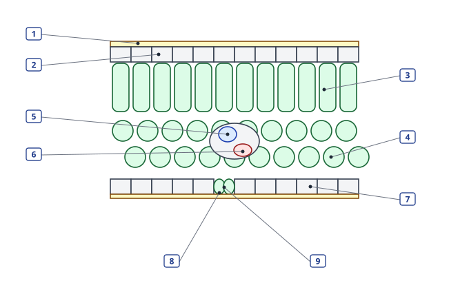

பின்பக்கம்

புறத்தோல் படை (waxy cuticle) — நீரிழப்பைக் குறைத்தல்

<!-- meta {"type":"flashcard","id":"SCF-11-02-017","grade":11,"chapter_id":"SC11-02","discipline":"BIO","difficulty":1,"image":"science_assets/biology/BIO-D03_unlabelled.svg"} -->
**SCF-11-02-017** · அடிப்படை

**முன்:** இலையின் குறுக்குவெட்டு — பெயரிடாத படத்தில் இலக்கம் 2 குறிக்கும் பகுதி?

பின்பக்கம்

மேற்புறத்தோல் (upper epidermis) — பாதுகாப்பு; ஒளி ஊடுபுகல்

<!-- meta {"type":"flashcard","id":"SCF-11-02-018","grade":11,"chapter_id":"SC11-02","discipline":"BIO","difficulty":1,"image":"science_assets/biology/BIO-D03_unlabelled.svg"} -->
**SCF-11-02-018** · அடிப்படை

**முன்:** இலையின் குறுக்குவெட்டு — பெயரிடாத படத்தில் இலக்கம் 3 குறிக்கும் பகுதி?

பின்பக்கம்

வேலிக்காப்பு இழையம் (palisade mesophyll) — பிரதான ஒளித்தொகுப்பு

<!-- meta {"type":"flashcard","id":"SCF-11-02-019","grade":11,"chapter_id":"SC11-02","discipline":"BIO","difficulty":1,"image":"science_assets/biology/BIO-D03_unlabelled.svg"} -->
**SCF-11-02-019** · அடிப்படை

**முன்:** இலையின் குறுக்குவெட்டு — பெயரிடாத படத்தில் இலக்கம் 4 குறிக்கும் பகுதி?

பின்பக்கம்

கடற்பஞ்சு இழையம் (spongy mesophyll) — வாயுப் பரிமாற்றம் — காற்று இடைவெளிகள்

<!-- meta {"type":"flashcard","id":"SCF-11-02-020","grade":11,"chapter_id":"SC11-02","discipline":"BIO","difficulty":1,"image":"science_assets/experiments/EXP-D01_unlabelled.svg"} -->
**SCF-11-02-020** · அடிப்படை

**முன்:** இலையில் மாப்பொருள் சோதனை — பெயரிடாத படத்தில் இலக்கம் 1 குறிக்கும் பகுதி?

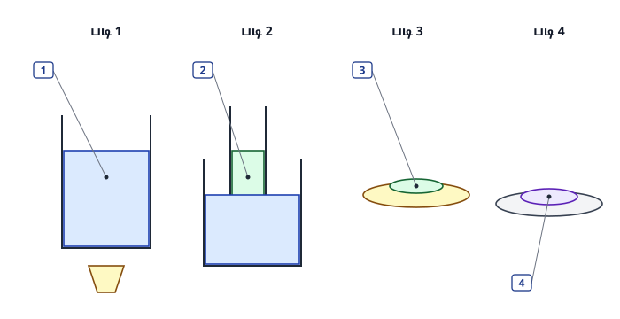

பின்பக்கம்

கொதிநீரில் 1–2 நிமிடம் (boil in water) — கலங்களைக் கொல்லல், நொதியங்கள் செயலிழப்பு

<!-- meta {"type":"flashcard","id":"SCF-11-02-021","grade":11,"chapter_id":"SC11-02","discipline":"BIO","difficulty":1,"image":"science_assets/experiments/EXP-D01_unlabelled.svg"} -->
**SCF-11-02-021** · அடிப்படை

**முன்:** இலையில் மாப்பொருள் சோதனை — பெயரிடாத படத்தில் இலக்கம் 2 குறிக்கும் பகுதி?

பின்பக்கம்

சுடுநீர்த் தொட்டியில் அற்ககோல் (warm alcohol (water bath)) — பச்சையம் நீக்கல் — நேரடிச் சுவாலை தவிர்

<!-- meta {"type":"flashcard","id":"SCF-11-02-022","grade":11,"chapter_id":"SC11-02","discipline":"BIO","difficulty":1,"image":"science_assets/experiments/EXP-D01_unlabelled.svg"} -->
**SCF-11-02-022** · அடிப்படை

**முன்:** இலையில் மாப்பொருள் சோதனை — பெயரிடாத படத்தில் இலக்கம் 3 குறிக்கும் பகுதி?

பின்பக்கம்

சுடுநீரில் கழுவல் (rinse in warm water) — இலையை மென்மையாக்கல்

<!-- meta {"type":"flashcard","id":"SCF-11-02-023","grade":11,"chapter_id":"SC11-02","discipline":"BIO","difficulty":1,"image":"science_assets/experiments/EXP-D01_unlabelled.svg"} -->
**SCF-11-02-023** · அடிப்படை

**முன்:** இலையில் மாப்பொருள் சோதனை — பெயரிடாத படத்தில் இலக்கம் 4 குறிக்கும் பகுதி?

பின்பக்கம்

அயடீன் கரைசல் (iodine solution) — மாப்பொருள் இருப்பின் நீல-கறுப்பு

<!-- meta {"type":"flashcard","id":"SCF-11-02-024","grade":11,"chapter_id":"SC11-02","discipline":"BIO","difficulty":1,"image":"science_assets/experiments/EXP-D02_unlabelled.svg"} -->
**SCF-11-02-024** · அடிப்படை

**முன்:** ஒளித்தொகுப்பில் O₂ வெளியேற்றம் — பெயரிடாத படத்தில் இலக்கம் 1 குறிக்கும் பகுதி?

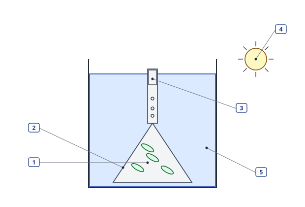

பின்பக்கம்

நீர்வாழ் தாவரம் (Hydrilla) (aquatic plant)

<!-- meta {"type":"flashcard","id":"SCF-11-02-025","grade":11,"chapter_id":"SC11-02","discipline":"BIO","difficulty":1,"image":"science_assets/experiments/EXP-D02_unlabelled.svg"} -->
**SCF-11-02-025** · அடிப்படை

**முன்:** ஒளித்தொகுப்பில் O₂ வெளியேற்றம் — பெயரிடாத படத்தில் இலக்கம் 2 குறிக்கும் பகுதி?

பின்பக்கம்

புனல் (inverted funnel)

<!-- meta {"type":"flashcard","id":"SCF-11-02-026","grade":11,"chapter_id":"SC11-02","discipline":"BIO","difficulty":1,"image":"science_assets/experiments/EXP-D02_unlabelled.svg"} -->
**SCF-11-02-026** · அடிப்படை

**முன்:** ஒளித்தொகுப்பில் O₂ வெளியேற்றம் — பெயரிடாத படத்தில் இலக்கம் 3 குறிக்கும் பகுதி?

பின்பக்கம்

சோதனைக் குழாய் — சேரும் வாயு (test tube (gas)) — தணல் குச்சி மீளப் பற்றும் → O₂

<!-- meta {"type":"flashcard","id":"SCF-11-02-027","grade":11,"chapter_id":"SC11-02","discipline":"BIO","difficulty":1,"image":"science_assets/experiments/EXP-D02_unlabelled.svg"} -->
**SCF-11-02-027** · அடிப்படை

**முன்:** ஒளித்தொகுப்பில் O₂ வெளியேற்றம் — பெயரிடாத படத்தில் இலக்கம் 4 குறிக்கும் பகுதி?

பின்பக்கம்

ஒளி மூலம் (light source) — தூரம் மாற்றி ஒளிச்செறிவு மாற்றல்

## SC11-03: கலவை (Mixtures)

*தரம் 11 · அத்தியாயம் 3 · இரசாயனவியல் · 19 அட்டைகள்*

<!-- meta {"type":"flashcard","id":"SCF-11-03-001","grade":11,"chapter_id":"SC11-03","discipline":"CHE","difficulty":1,"image":null} -->
**SCF-11-03-001** · அடிப்படை

**முன்:** கரைசலின் இரு கூறுகள்?

பின்பக்கம்

கரையம், கரைப்பான்

<!-- meta {"type":"flashcard","id":"SCF-11-03-002","grade":11,"chapter_id":"SC11-03","discipline":"CHE","difficulty":1,"image":null} -->
**SCF-11-03-002** · அடிப்படை

**முன்:** மணலை நீரிலிருந்து பிரிக்க?

பின்பக்கம்

வடிகட்டல்

<!-- meta {"type":"flashcard","id":"SCF-11-03-003","grade":11,"chapter_id":"SC11-03","discipline":"CHE","difficulty":1,"image":null} -->
**SCF-11-03-003** · அடிப்படை

**முன்:** எதனோலை நீரிலிருந்து பிரிக்க?

பின்பக்கம்

பகுதிபடக் காய்ச்சிவடித்தல்

<!-- meta {"type":"flashcard","id":"SCF-11-03-004","grade":11,"chapter_id":"SC11-03","discipline":"CHE","difficulty":1,"image":null} -->
**SCF-11-03-004** · அடிப்படை

**முன்:** மை நிறப்பொருட்களைப் பிரிக்க?

பின்பக்கம்

நிறப்பகுப்பு

<!-- meta {"type":"flashcard","id":"SCF-11-03-005","grade":11,"chapter_id":"SC11-03","discipline":"CHE","difficulty":1,"image":null} -->
**SCF-11-03-005** · அடிப்படை

**முன்:** எண்ணெயை நீரிலிருந்து பிரிக்க?

பின்பக்கம்

பிரிபுனல்

<!-- meta {"type":"flashcard","id":"SCF-11-03-006","grade":11,"chapter_id":"SC11-03","discipline":"CHE","difficulty":2,"image":null} -->
**SCF-11-03-006** · இடைநிலை

**முன்:** கறுவா எண்ணெய் பிரித்தெடுப்பு?

பின்பக்கம்

நீராவிக் காய்ச்சிவடித்தல்

<!-- meta {"type":"flashcard","id":"SCF-11-03-007","grade":11,"chapter_id":"SC11-03","discipline":"CHE","difficulty":1,"image":null} -->
**SCF-11-03-007** · அடிப்படை

**முன்:** அடர்த்திச் சூத்திரம்?

பின்பக்கம்

ρ = m / V

<!-- meta {"type":"flashcard","id":"SCF-11-03-008","grade":11,"chapter_id":"SC11-03","discipline":"CHE","difficulty":2,"image":null} -->
**SCF-11-03-008** · இடைநிலை

**முன்:** w/w % சூத்திரம்?

பின்பக்கம்

கரையத் திணிவு ÷ கரைசல் திணிவு × 100

<!-- meta {"type":"flashcard","id":"SCF-11-03-009","grade":11,"chapter_id":"SC11-03","discipline":"CHE","difficulty":2,"image":null} -->
**SCF-11-03-009** · இடைநிலை

**முன்:** வெப்பநிலை கூட வாயுக் கரைதிறன்?

பின்பக்கம்

குறையும்

<!-- meta {"type":"flashcard","id":"SCF-11-03-010","grade":11,"chapter_id":"SC11-03","discipline":"CHE","difficulty":2,"image":null} -->
**SCF-11-03-010** · இடைநிலை

**முன்:** அமுக்கம் கூட வாயுக் கரைதிறன்?

பின்பக்கம்

கூடும்

<!-- meta {"type":"flashcard","id":"SCF-11-03-011","grade":11,"chapter_id":"SC11-03","discipline":"CHE","difficulty":1,"image":null} -->
**SCF-11-03-011** · அடிப்படை

**முன்:** சீரான கலவைக்கு உதாரணம்?

பின்பக்கம்

உப்புக் கரைசல் / வளி

<!-- meta {"type":"flashcard","id":"SCF-11-03-012","grade":11,"chapter_id":"SC11-03","discipline":"CHE","difficulty":2,"image":null} -->
**SCF-11-03-012** · இடைநிலை

**முன்:** நிரம்பிய கரைசல்?

பின்பக்கம்

மேலும் கரையம் கரையாதது

<!-- meta {"type":"flashcard","id":"SCF-11-03-013","grade":11,"chapter_id":"SC11-03","discipline":"CHE","difficulty":2,"image":null} -->
**SCF-11-03-013** · இடைநிலை

**முன்:** மசகெண்ணெய் பிரிக்கப்படும் முறை?

பின்பக்கம்

பகுதிபடக் காய்ச்சிவடித்தல்

<!-- meta {"type":"flashcard","id":"SCF-11-03-014","grade":11,"chapter_id":"SC11-03","discipline":"CHE","difficulty":3,"image":null} -->
**SCF-11-03-014** · கடினம்

**முன்:** தவறான கருத்து: வடிகட்டல் உப்பைப் பிரிக்கும்?

பின்பக்கம்

பிழை

<!-- meta {"type":"flashcard","id":"SCF-11-03-015","grade":11,"chapter_id":"SC11-03","discipline":"CHE","difficulty":2,"image":null} -->
**SCF-11-03-015** · இடைநிலை

**முன்:** கலவையின் கூறுகள் தம் இயல்புகளைப் பேணுமா?

பின்பக்கம்

ஆம்

<!-- meta {"type":"flashcard","id":"SCF-11-03-016","grade":11,"chapter_id":"SC11-03","discipline":"CHE","difficulty":1,"image":"science_assets/chemistry/CHE-D04_unlabelled.svg"} -->
**SCF-11-03-016** · அடிப்படை

**முன்:** காய்ச்சிவடித்தல் — பெயரிடாத படத்தில் இலக்கம் 1 குறிக்கும் பகுதி?

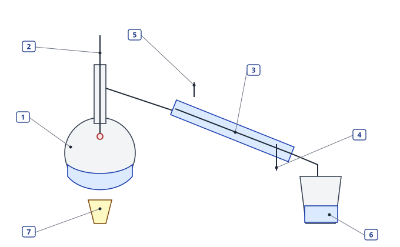

பின்பக்கம்

வடிகுடுவை (distillation flask) — கலவையைச் சூடாக்கல்

<!-- meta {"type":"flashcard","id":"SCF-11-03-017","grade":11,"chapter_id":"SC11-03","discipline":"CHE","difficulty":1,"image":"science_assets/chemistry/CHE-D04_unlabelled.svg"} -->
**SCF-11-03-017** · அடிப்படை

**முன்:** காய்ச்சிவடித்தல் — பெயரிடாத படத்தில் இலக்கம் 2 குறிக்கும் பகுதி?

பின்பக்கம்

வெப்பமானி (thermometer) — குமிழ் பக்கக் குழாய் மட்டத்தில் — ஆவியின் கொதிநிலை

<!-- meta {"type":"flashcard","id":"SCF-11-03-018","grade":11,"chapter_id":"SC11-03","discipline":"CHE","difficulty":1,"image":"science_assets/chemistry/CHE-D04_unlabelled.svg"} -->
**SCF-11-03-018** · அடிப்படை

**முன்:** காய்ச்சிவடித்தல் — பெயரிடாத படத்தில் இலக்கம் 3 குறிக்கும் பகுதி?

பின்பக்கம்

லீபிக் ஒடுக்கி (Liebig condenser) — ஆவியைக் குளிர்வித்து ஒடுக்கல்

<!-- meta {"type":"flashcard","id":"SCF-11-03-019","grade":11,"chapter_id":"SC11-03","discipline":"CHE","difficulty":1,"image":"science_assets/chemistry/CHE-D04_unlabelled.svg"} -->
**SCF-11-03-019** · அடிப்படை

**முன்:** காய்ச்சிவடித்தல் — பெயரிடாத படத்தில் இலக்கம் 4 குறிக்கும் பகுதி?

பின்பக்கம்

குளிர்நீர் உள்ளே (cooling water in) — கீழிருந்து மேலாக

## SC11-04: அலைகளும் அவற்றின் பயன்பாடுகளும் (Waves and their applications)

*தரம் 11 · அத்தியாயம் 4 · பௌதிகவியல் · 19 அட்டைகள்*

<!-- meta {"type":"flashcard","id":"SCF-11-04-001","grade":11,"chapter_id":"SC11-04","discipline":"PHY","difficulty":1,"image":null} -->
**SCF-11-04-001** · அடிப்படை

**முன்:** அலைவேகச் சூத்திரம்?

பின்பக்கம்

v = fλ

<!-- meta {"type":"flashcard","id":"SCF-11-04-002","grade":11,"chapter_id":"SC11-04","discipline":"PHY","difficulty":1,"image":null} -->
**SCF-11-04-002** · அடிப்படை

**முன்:** மீடிறன் அலகு?

பின்பக்கம்

Hz

<!-- meta {"type":"flashcard","id":"SCF-11-04-003","grade":11,"chapter_id":"SC11-04","discipline":"PHY","difficulty":1,"image":null} -->
**SCF-11-04-003** · அடிப்படை

**முன்:** ஒலி எவ்வகை அலை?

பின்பக்கம்

நெட்டாங்கு

<!-- meta {"type":"flashcard","id":"SCF-11-04-004","grade":11,"chapter_id":"SC11-04","discipline":"PHY","difficulty":1,"image":null} -->
**SCF-11-04-004** · அடிப்படை

**முன்:** ஒளி எவ்வகை அலை?

பின்பக்கம்

குறுக்கு (மின்காந்த)

<!-- meta {"type":"flashcard","id":"SCF-11-04-005","grade":11,"chapter_id":"SC11-04","discipline":"PHY","difficulty":1,"image":null} -->
**SCF-11-04-005** · அடிப்படை

**முன்:** வளியில் ஒலி வேகம்?

பின்பக்கம்

≈ 340 m s⁻¹

<!-- meta {"type":"flashcard","id":"SCF-11-04-006","grade":11,"chapter_id":"SC11-04","discipline":"PHY","difficulty":1,"image":null} -->
**SCF-11-04-006** · அடிப்படை

**முன்:** வெற்றிடத்தில் ஒளி வேகம்?

பின்பக்கம்

3 × 10⁸ m s⁻¹

<!-- meta {"type":"flashcard","id":"SCF-11-04-007","grade":11,"chapter_id":"SC11-04","discipline":"PHY","difficulty":2,"image":null} -->
**SCF-11-04-007** · இடைநிலை

**முன்:** சுருதி சார்ந்திருப்பது?

பின்பக்கம்

மீடிறன்

<!-- meta {"type":"flashcard","id":"SCF-11-04-008","grade":11,"chapter_id":"SC11-04","discipline":"PHY","difficulty":2,"image":null} -->
**SCF-11-04-008** · இடைநிலை

**முன்:** உரப்பு சார்ந்திருப்பது?

பின்பக்கம்

வீச்சம்

<!-- meta {"type":"flashcard","id":"SCF-11-04-009","grade":11,"chapter_id":"SC11-04","discipline":"PHY","difficulty":1,"image":null} -->
**SCF-11-04-009** · அடிப்படை

**முன்:** மனிதச் செவிப்புல வீச்சு?

பின்பக்கம்

20 Hz – 20 kHz

<!-- meta {"type":"flashcard","id":"SCF-11-04-010","grade":11,"chapter_id":"SC11-04","discipline":"PHY","difficulty":1,"image":null} -->
**SCF-11-04-010** · அடிப்படை

**முன்:** மீயொலி?

பின்பக்கம்

> 20 kHz

<!-- meta {"type":"flashcard","id":"SCF-11-04-011","grade":11,"chapter_id":"SC11-04","discipline":"PHY","difficulty":2,"image":null} -->
**SCF-11-04-011** · இடைநிலை

**முன்:** காலம் T?

பின்பக்கம்

1/f

<!-- meta {"type":"flashcard","id":"SCF-11-04-012","grade":11,"chapter_id":"SC11-04","discipline":"PHY","difficulty":1,"image":null} -->
**SCF-11-04-012** · அடிப்படை

**முன்:** ஒலிக்கு ஊடகம் தேவையா?

பின்பக்கம்

ஆம்

<!-- meta {"type":"flashcard","id":"SCF-11-04-013","grade":11,"chapter_id":"SC11-04","discipline":"PHY","difficulty":2,"image":null} -->
**SCF-11-04-013** · இடைநிலை

**முன்:** அதிக சக்தியுடைய மின்காந்த அலை?

பின்பக்கம்

காமா

<!-- meta {"type":"flashcard","id":"SCF-11-04-014","grade":11,"chapter_id":"SC11-04","discipline":"PHY","difficulty":2,"image":null} -->
**SCF-11-04-014** · இடைநிலை

**முன்:** நெட்டாங்கு அலையின் பகுதிகள்?

பின்பக்கம்

நெருக்கம், ஐதாக்கம்

<!-- meta {"type":"flashcard","id":"SCF-11-04-015","grade":11,"chapter_id":"SC11-04","discipline":"PHY","difficulty":3,"image":null} -->
**SCF-11-04-015** · கடினம்

**முன்:** தவறான கருத்து: அலை நீரைக் கொண்டு செல்லும்?

பின்பக்கம்

பிழை — சக்தி மட்டும்

<!-- meta {"type":"flashcard","id":"SCF-11-04-016","grade":11,"chapter_id":"SC11-04","discipline":"PHY","difficulty":1,"image":"science_assets/physics/PHY-D05_unlabelled.svg"} -->
**SCF-11-04-016** · அடிப்படை

**முன்:** குறுக்கலை — பெயரிடாத படத்தில் இலக்கம் 1 குறிக்கும் பகுதி?

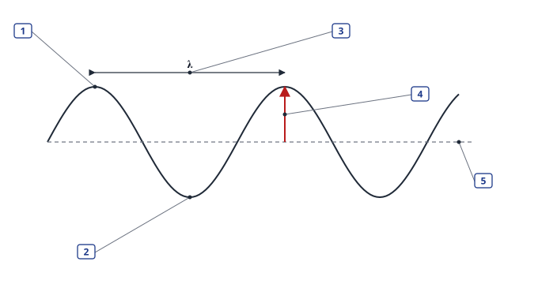

பின்பக்கம்

முடி (crest) — உச்ச மேல் இடப்பெயர்ச்சி

<!-- meta {"type":"flashcard","id":"SCF-11-04-017","grade":11,"chapter_id":"SC11-04","discipline":"PHY","difficulty":1,"image":"science_assets/physics/PHY-D05_unlabelled.svg"} -->
**SCF-11-04-017** · அடிப்படை

**முன்:** குறுக்கலை — பெயரிடாத படத்தில் இலக்கம் 2 குறிக்கும் பகுதி?

பின்பக்கம்

தாழி (trough) — உச்சக் கீழ் இடப்பெயர்ச்சி

<!-- meta {"type":"flashcard","id":"SCF-11-04-018","grade":11,"chapter_id":"SC11-04","discipline":"PHY","difficulty":1,"image":"science_assets/physics/PHY-D05_unlabelled.svg"} -->
**SCF-11-04-018** · அடிப்படை

**முன்:** குறுக்கலை — பெயரிடாத படத்தில் இலக்கம் 3 குறிக்கும் பகுதி?

பின்பக்கம்

அலைநீளம் (wavelength (λ)) — அடுத்தடுத்த இரு முடிகளுக்கிடையிலான தூரம்

<!-- meta {"type":"flashcard","id":"SCF-11-04-019","grade":11,"chapter_id":"SC11-04","discipline":"PHY","difficulty":1,"image":"science_assets/physics/PHY-D05_unlabelled.svg"} -->
**SCF-11-04-019** · அடிப்படை

**முன்:** குறுக்கலை — பெயரிடாத படத்தில் இலக்கம் 4 குறிக்கும் பகுதி?

பின்பக்கம்

வீச்சம் (amplitude) — சமநிலையிலிருந்து உச்ச இடப்பெயர்ச்சி

## SC11-05: கேத்திரகணித ஒளியியல் (Geometrical optics)

*தரம் 11 · அத்தியாயம் 5 · பௌதிகவியல் · 27 அட்டைகள்*

<!-- meta {"type":"flashcard","id":"SCF-11-05-001","grade":11,"chapter_id":"SC11-05","discipline":"PHY","difficulty":1,"image":null} -->
**SCF-11-05-001** · அடிப்படை

**முன்:** தெறிப்பு விதி?

பின்பக்கம்

படுகோணம் = தெறிகோணம்

<!-- meta {"type":"flashcard","id":"SCF-11-05-002","grade":11,"chapter_id":"SC11-05","discipline":"PHY","difficulty":1,"image":null} -->
**SCF-11-05-002** · அடிப்படை

**முன்:** முறிவு என்றால்?

பின்பக்கம்

ஊடகம் மாறும்போது ஒளி வளைதல்

<!-- meta {"type":"flashcard","id":"SCF-11-05-003","grade":11,"chapter_id":"SC11-05","discipline":"PHY","difficulty":2,"image":null} -->
**SCF-11-05-003** · இடைநிலை

**முன்:** முறிவுச் சுட்டி?

பின்பக்கம்

n = sin i / sin r

<!-- meta {"type":"flashcard","id":"SCF-11-05-004","grade":11,"chapter_id":"SC11-05","discipline":"PHY","difficulty":2,"image":null} -->
**SCF-11-05-004** · இடைநிலை

**முன்:** முழு அகத்தெறிப்பு நிபந்தனை?

பின்பக்கம்

அடர்த்தி → ஐதான; படுகோணம் > அவதிக் கோணம்

<!-- meta {"type":"flashcard","id":"SCF-11-05-005","grade":11,"chapter_id":"SC11-05","discipline":"PHY","difficulty":1,"image":null} -->
**SCF-11-05-005** · அடிப்படை

**முன்:** குவிவு வில்லை?

பின்பக்கம்

ஒருங்கச் செய்யும்

<!-- meta {"type":"flashcard","id":"SCF-11-05-006","grade":11,"chapter_id":"SC11-05","discipline":"PHY","difficulty":1,"image":null} -->
**SCF-11-05-006** · அடிப்படை

**முன்:** குழிவு வில்லை விம்பம்?

பின்பக்கம்

மாய, நேரான, சிறிய

<!-- meta {"type":"flashcard","id":"SCF-11-05-007","grade":11,"chapter_id":"SC11-05","discipline":"PHY","difficulty":2,"image":null} -->
**SCF-11-05-007** · இடைநிலை

**முன்:** உருப்பெருக்கியாக வில்லை?

பின்பக்கம்

குவிவு; பொருள் F க்குள்

<!-- meta {"type":"flashcard","id":"SCF-11-05-008","grade":11,"chapter_id":"SC11-05","discipline":"PHY","difficulty":2,"image":null} -->
**SCF-11-05-008** · இடைநிலை

**முன்:** 2F இல் பொருள் — விம்பம்?

பின்பக்கம்

2F இல், சம அளவு, தலைகீழ்

<!-- meta {"type":"flashcard","id":"SCF-11-05-009","grade":11,"chapter_id":"SC11-05","discipline":"PHY","difficulty":2,"image":null} -->
**SCF-11-05-009** · இடைநிலை

**முன்:** அண்மைப் பார்வைத் திருத்தம்?

பின்பக்கம்

குழிவு வில்லை

<!-- meta {"type":"flashcard","id":"SCF-11-05-010","grade":11,"chapter_id":"SC11-05","discipline":"PHY","difficulty":2,"image":null} -->
**SCF-11-05-010** · இடைநிலை

**முன்:** சேய்மைப் பார்வைத் திருத்தம்?

பின்பக்கம்

குவிவு வில்லை

<!-- meta {"type":"flashcard","id":"SCF-11-05-011","grade":11,"chapter_id":"SC11-05","discipline":"PHY","difficulty":2,"image":null} -->
**SCF-11-05-011** · இடைநிலை

**முன்:** ஒளியியல் நார் இயக்கக் கொள்கை?

பின்பக்கம்

முழு அகத்தெறிப்பு

<!-- meta {"type":"flashcard","id":"SCF-11-05-012","grade":11,"chapter_id":"SC11-05","discipline":"PHY","difficulty":3,"image":null} -->
**SCF-11-05-012** · கடினம்

**முன்:** முறிவில் மாறாதது?

பின்பக்கம்

மீடிறன்

<!-- meta {"type":"flashcard","id":"SCF-11-05-013","grade":11,"chapter_id":"SC11-05","discipline":"PHY","difficulty":1,"image":null} -->
**SCF-11-05-013** · அடிப்படை

**முன்:** உண்மை விம்பத்தைத் திரையில் பெற முடியுமா?

பின்பக்கம்

ஆம்

<!-- meta {"type":"flashcard","id":"SCF-11-05-014","grade":11,"chapter_id":"SC11-05","discipline":"PHY","difficulty":3,"image":null} -->
**SCF-11-05-014** · கடினம்

**முன்:** வில்லைச் சூத்திரம்?

பின்பக்கம்

1/v − 1/u = 1/f

<!-- meta {"type":"flashcard","id":"SCF-11-05-015","grade":11,"chapter_id":"SC11-05","discipline":"PHY","difficulty":3,"image":null} -->
**SCF-11-05-015** · கடினம்

**முன்:** தவறான கருத்து: குழிவு வில்லை உண்மை விம்பம்?

பின்பக்கம்

பிழை

<!-- meta {"type":"flashcard","id":"SCF-11-05-016","grade":11,"chapter_id":"SC11-05","discipline":"PHY","difficulty":1,"image":"science_assets/biology/BIO-D11_unlabelled.svg"} -->
**SCF-11-05-016** · அடிப்படை

**முன்:** மனிதக் கண் (திட்டப் படம்) — பெயரிடாத படத்தில் இலக்கம் 1 குறிக்கும் பகுதி?

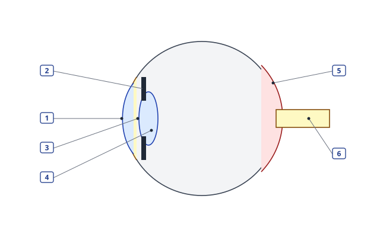

பின்பக்கம்

விழிவெண்படலம் (cornea) — ஒளியை முறித்தல் — பெரும்பகுதி

<!-- meta {"type":"flashcard","id":"SCF-11-05-017","grade":11,"chapter_id":"SC11-05","discipline":"PHY","difficulty":1,"image":"science_assets/biology/BIO-D11_unlabelled.svg"} -->
**SCF-11-05-017** · அடிப்படை

**முன்:** மனிதக் கண் (திட்டப் படம்) — பெயரிடாத படத்தில் இலக்கம் 2 குறிக்கும் பகுதி?

பின்பக்கம்

கதிராளி (iris) — கண்மணியின் அளவைக் கட்டுப்படுத்தல்

<!-- meta {"type":"flashcard","id":"SCF-11-05-018","grade":11,"chapter_id":"SC11-05","discipline":"PHY","difficulty":1,"image":"science_assets/biology/BIO-D11_unlabelled.svg"} -->
**SCF-11-05-018** · அடிப்படை

**முன்:** மனிதக் கண் (திட்டப் படம்) — பெயரிடாத படத்தில் இலக்கம் 3 குறிக்கும் பகுதி?

பின்பக்கம்

கண்மணி (pupil) — ஒளி உட்செல்லும் துவாரம்

<!-- meta {"type":"flashcard","id":"SCF-11-05-019","grade":11,"chapter_id":"SC11-05","discipline":"PHY","difficulty":1,"image":"science_assets/biology/BIO-D11_unlabelled.svg"} -->
**SCF-11-05-019** · அடிப்படை

**முன்:** மனிதக் கண் (திட்டப் படம்) — பெயரிடாத படத்தில் இலக்கம் 4 குறிக்கும் பகுதி?

பின்பக்கம்

வில்லை (lens) — குவியத் தூரத்தைச் சீராக்கல்

<!-- meta {"type":"flashcard","id":"SCF-11-05-020","grade":11,"chapter_id":"SC11-05","discipline":"PHY","difficulty":1,"image":"science_assets/physics/PHY-D03_unlabelled.svg"} -->
**SCF-11-05-020** · அடிப்படை

**முன்:** குவிவு வில்லை: பொருள் 2F க்கு அப்பால் — பெயரிடாத படத்தில் இலக்கம் 1 குறிக்கும் பகுதி?

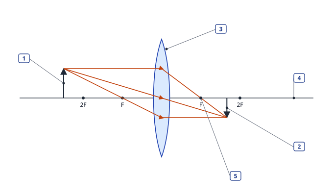

பின்பக்கம்

பொருள் (object) — 2F க்கு அப்பால்

<!-- meta {"type":"flashcard","id":"SCF-11-05-021","grade":11,"chapter_id":"SC11-05","discipline":"PHY","difficulty":1,"image":"science_assets/physics/PHY-D03_unlabelled.svg"} -->
**SCF-11-05-021** · அடிப்படை

**முன்:** குவிவு வில்லை: பொருள் 2F க்கு அப்பால் — பெயரிடாத படத்தில் இலக்கம் 2 குறிக்கும் பகுதி?

பின்பக்கம்

விம்பம் (image) — உண்மை, தலைகீழ், சிறியது; F–2F இடையில்

<!-- meta {"type":"flashcard","id":"SCF-11-05-022","grade":11,"chapter_id":"SC11-05","discipline":"PHY","difficulty":1,"image":"science_assets/physics/PHY-D03_unlabelled.svg"} -->
**SCF-11-05-022** · அடிப்படை

**முன்:** குவிவு வில்லை: பொருள் 2F க்கு அப்பால் — பெயரிடாத படத்தில் இலக்கம் 3 குறிக்கும் பகுதி?

பின்பக்கம்

குவிவு வில்லை (convex lens) — ஒருங்கச் செய்யும்

<!-- meta {"type":"flashcard","id":"SCF-11-05-023","grade":11,"chapter_id":"SC11-05","discipline":"PHY","difficulty":1,"image":"science_assets/physics/PHY-D03_unlabelled.svg"} -->
**SCF-11-05-023** · அடிப்படை

**முன்:** குவிவு வில்லை: பொருள் 2F க்கு அப்பால் — பெயரிடாத படத்தில் இலக்கம் 4 குறிக்கும் பகுதி?

பின்பக்கம்

தலைமை அச்சு (principal axis)

<!-- meta {"type":"flashcard","id":"SCF-11-05-024","grade":11,"chapter_id":"SC11-05","discipline":"PHY","difficulty":1,"image":"science_assets/experiments/EXP-D04_unlabelled.svg"} -->
**SCF-11-05-024** · அடிப்படை

**முன்:** குவிவு வில்லையின் குவியத் தூரம் (தூரப் பொருள் முறை) — பெயரிடாத படத்தில் இலக்கம் 1 குறிக்கும் பகுதி?

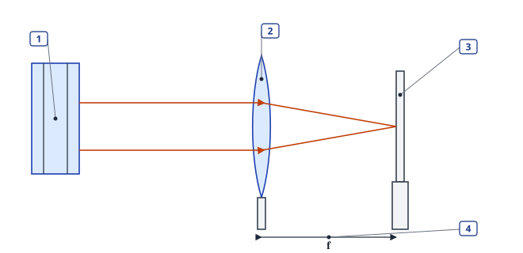

பின்பக்கம்

தூரப் பொருள் (யன்னல்) (distant object) — கதிர்கள் ஏறத்தாழச் சமாந்தரம்

<!-- meta {"type":"flashcard","id":"SCF-11-05-025","grade":11,"chapter_id":"SC11-05","discipline":"PHY","difficulty":1,"image":"science_assets/experiments/EXP-D04_unlabelled.svg"} -->
**SCF-11-05-025** · அடிப்படை

**முன்:** குவிவு வில்லையின் குவியத் தூரம் (தூரப் பொருள் முறை) — பெயரிடாத படத்தில் இலக்கம் 2 குறிக்கும் பகுதி?

பின்பக்கம்

குவிவு வில்லை (convex lens)

<!-- meta {"type":"flashcard","id":"SCF-11-05-026","grade":11,"chapter_id":"SC11-05","discipline":"PHY","difficulty":1,"image":"science_assets/experiments/EXP-D04_unlabelled.svg"} -->
**SCF-11-05-026** · அடிப்படை

**முன்:** குவிவு வில்லையின் குவியத் தூரம் (தூரப் பொருள் முறை) — பெயரிடாத படத்தில் இலக்கம் 3 குறிக்கும் பகுதி?

பின்பக்கம்

திரை (screen) — தெளிவான விம்பம் விழும் வரை நகர்த்தல்

<!-- meta {"type":"flashcard","id":"SCF-11-05-027","grade":11,"chapter_id":"SC11-05","discipline":"PHY","difficulty":1,"image":"science_assets/experiments/EXP-D04_unlabelled.svg"} -->
**SCF-11-05-027** · அடிப்படை

**முன்:** குவிவு வில்லையின் குவியத் தூரம் (தூரப் பொருள் முறை) — பெயரிடாத படத்தில் இலக்கம் 4 குறிக்கும் பகுதி?

பின்பக்கம்

வில்லை–திரை தூரம் ≈ f (focal length)

## SC11-06: மனித உடற் செயன்முறைகள் (Biological processes in the human body)

*தரம் 11 · அத்தியாயம் 6 · உயிரியல் · 32 அட்டைகள்*

<!-- meta {"type":"flashcard","id":"SCF-11-06-001","grade":11,"chapter_id":"SC11-06","discipline":"BIO","difficulty":1,"image":null} -->
**SCF-11-06-001** · அடிப்படை

**முன்:** புரதச் சமிபாடு தொடங்கும் இடம்?

பின்பக்கம்

இரைப்பை (பெப்சின்)

<!-- meta {"type":"flashcard","id":"SCF-11-06-002","grade":11,"chapter_id":"SC11-06","discipline":"BIO","difficulty":1,"image":null} -->
**SCF-11-06-002** · அடிப்படை

**முன்:** நீர் பெருமளவில் அகத்துறிஞ்சப்படும் இடம்?

பின்பக்கம்

பெருங்குடல்

<!-- meta {"type":"flashcard","id":"SCF-11-06-003","grade":11,"chapter_id":"SC11-06","discipline":"BIO","difficulty":1,"image":null} -->
**SCF-11-06-003** · அடிப்படை

**முன்:** சடைமுளைகளின் தொழில்?

பின்பக்கம்

சமிபாடடைந்த உணவை உறிஞ்சுதல்

<!-- meta {"type":"flashcard","id":"SCF-11-06-004","grade":11,"chapter_id":"SC11-06","discipline":"BIO","difficulty":2,"image":null} -->
**SCF-11-06-004** · இடைநிலை

**முன்:** பித்தத்தின் தொழில்?

பின்பக்கம்

கொழுப்புகளைக் குழம்பாக்கல்

<!-- meta {"type":"flashcard","id":"SCF-11-06-005","grade":11,"chapter_id":"SC11-06","discipline":"BIO","difficulty":1,"image":null} -->
**SCF-11-06-005** · அடிப்படை

**முன்:** வாயுப் பரிமாற்றம் நடைபெறும் இடம்?

பின்பக்கம்

சுவாசச் சிற்றறைகள் (Alveoli)

<!-- meta {"type":"flashcard","id":"SCF-11-06-006","grade":11,"chapter_id":"SC11-06","discipline":"BIO","difficulty":2,"image":null} -->
**SCF-11-06-006** · இடைநிலை

**முன்:** காற்றுச் சுவாசச் சமன்பாடு?

பின்பக்கம்

C₆H₁₂O₆ + 6O₂ → 6CO₂ + 6H₂O + சக்தி

<!-- meta {"type":"flashcard","id":"SCF-11-06-007","grade":11,"chapter_id":"SC11-06","discipline":"BIO","difficulty":2,"image":null} -->
**SCF-11-06-007** · இடைநிலை

**முன்:** தசையில் காற்றின்றிச் சுவாச விளைவு?

பின்பக்கம்

இலற்றிக்கமிலம்

<!-- meta {"type":"flashcard","id":"SCF-11-06-008","grade":11,"chapter_id":"SC11-06","discipline":"BIO","difficulty":1,"image":null} -->
**SCF-11-06-008** · அடிப்படை

**முன்:** இதய அறைகளின் எண்ணிக்கை?

பின்பக்கம்

4

<!-- meta {"type":"flashcard","id":"SCF-11-06-009","grade":11,"chapter_id":"SC11-06","discipline":"BIO","difficulty":1,"image":null} -->
**SCF-11-06-009** · அடிப்படை

**முன்:** O₂ ஐக் காவும் குருதிக் கூறு?

பின்பக்கம்

செங்குழியங்களிலுள்ள ஈமோகுளோபின்

<!-- meta {"type":"flashcard","id":"SCF-11-06-010","grade":11,"chapter_id":"SC11-06","discipline":"BIO","difficulty":1,"image":null} -->
**SCF-11-06-010** · அடிப்படை

**முன்:** குருதி உறைதலுக்கு உதவுவது?

பின்பக்கம்

குருதிச் சிறுதட்டுகள்

<!-- meta {"type":"flashcard","id":"SCF-11-06-011","grade":11,"chapter_id":"SC11-06","discipline":"BIO","difficulty":1,"image":null} -->
**SCF-11-06-011** · அடிப்படை

**முன்:** சிறுநீரகத்தின் தொழிற்பாட்டு அலகு?

பின்பக்கம்

சிறுநீரகத்தி (Nephron)

<!-- meta {"type":"flashcard","id":"SCF-11-06-012","grade":11,"chapter_id":"SC11-06","discipline":"BIO","difficulty":2,"image":null} -->
**SCF-11-06-012** · இடைநிலை

**முன்:** சிறுநீரின் பிரதான கூறு?

பின்பக்கம்

நீர்

<!-- meta {"type":"flashcard","id":"SCF-11-06-013","grade":11,"chapter_id":"SC11-06","discipline":"BIO","difficulty":2,"image":null} -->
**SCF-11-06-013** · இடைநிலை

**முன்:** உடற் சமநிலையைப் பேணும் மூளைப் பகுதி?

பின்பக்கம்

சிறுமூளை

<!-- meta {"type":"flashcard","id":"SCF-11-06-014","grade":11,"chapter_id":"SC11-06","discipline":"BIO","difficulty":1,"image":null} -->
**SCF-11-06-014** · அடிப்படை

**முன்:** குருதி குளுக்கோசைக் குறைக்கும் ஓமோன்?

பின்பக்கம்

இன்சுலின்

<!-- meta {"type":"flashcard","id":"SCF-11-06-015","grade":11,"chapter_id":"SC11-06","discipline":"BIO","difficulty":3,"image":null} -->
**SCF-11-06-015** · கடினம்

**முன்:** O₂ குறைந்த குருதியைக் காவும் நாடி?

பின்பக்கம்

சுவாசப்பை நாடி

<!-- meta {"type":"flashcard","id":"SCF-11-06-016","grade":11,"chapter_id":"SC11-06","discipline":"BIO","difficulty":2,"image":null} -->
**SCF-11-06-016** · இடைநிலை

**முன்:** தெறிவினை என்றால்?

பின்பக்கம்

தூண்டலுக்கான விரைவான விருப்பமற்ற துலங்கல்

<!-- meta {"type":"flashcard","id":"SCF-11-06-017","grade":11,"chapter_id":"SC11-06","discipline":"BIO","difficulty":1,"image":"science_assets/biology/BIO-D04_unlabelled.svg"} -->
**SCF-11-06-017** · அடிப்படை

**முன்:** மனித இதயம் (திட்டப் படம்) — பெயரிடாத படத்தில் இலக்கம் 1 குறிக்கும் பகுதி?

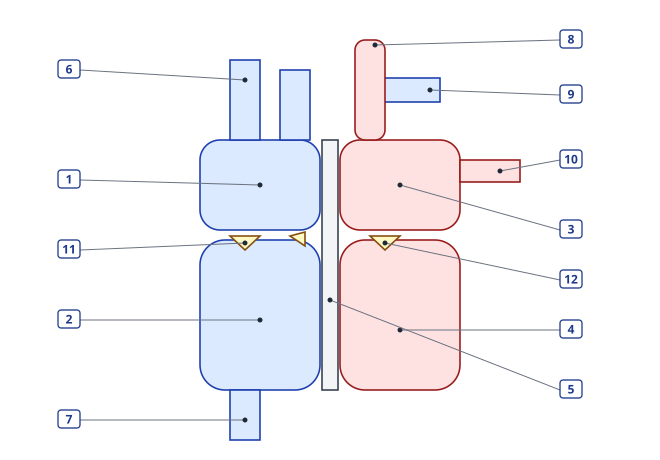

பின்பக்கம்

வலது சோணையறை (right atrium) — உடலிலிருந்து ஒட்சிசனற்ற குருதியைப் பெறல்

<!-- meta {"type":"flashcard","id":"SCF-11-06-018","grade":11,"chapter_id":"SC11-06","discipline":"BIO","difficulty":1,"image":"science_assets/biology/BIO-D04_unlabelled.svg"} -->
**SCF-11-06-018** · அடிப்படை

**முன்:** மனித இதயம் (திட்டப் படம்) — பெயரிடாத படத்தில் இலக்கம் 2 குறிக்கும் பகுதி?

பின்பக்கம்

வலது இதயவறை (right ventricle) — நுரையீரலுக்குக் குருதியைப் பம்புதல்

<!-- meta {"type":"flashcard","id":"SCF-11-06-019","grade":11,"chapter_id":"SC11-06","discipline":"BIO","difficulty":1,"image":"science_assets/biology/BIO-D04_unlabelled.svg"} -->
**SCF-11-06-019** · அடிப்படை

**முன்:** மனித இதயம் (திட்டப் படம்) — பெயரிடாத படத்தில் இலக்கம் 3 குறிக்கும் பகுதி?

பின்பக்கம்

இடது சோணையறை (left atrium) — நுரையீரலிலிருந்து ஒட்சிசனுள்ள குருதி

<!-- meta {"type":"flashcard","id":"SCF-11-06-020","grade":11,"chapter_id":"SC11-06","discipline":"BIO","difficulty":1,"image":"science_assets/biology/BIO-D04_unlabelled.svg"} -->
**SCF-11-06-020** · அடிப்படை

**முன்:** மனித இதயம் (திட்டப் படம்) — பெயரிடாத படத்தில் இலக்கம் 4 குறிக்கும் பகுதி?

பின்பக்கம்

இடது இதயவறை (left ventricle) — உடலுக்குப் பம்புதல் — தடித்த சுவர்

<!-- meta {"type":"flashcard","id":"SCF-11-06-021","grade":11,"chapter_id":"SC11-06","discipline":"BIO","difficulty":1,"image":"science_assets/biology/BIO-D05_unlabelled.svg"} -->
**SCF-11-06-021** · அடிப்படை

**முன்:** சமிபாட்டுத் தொகுதி (திட்டப் படம்) — பெயரிடாத படத்தில் இலக்கம் 1 குறிக்கும் பகுதி?

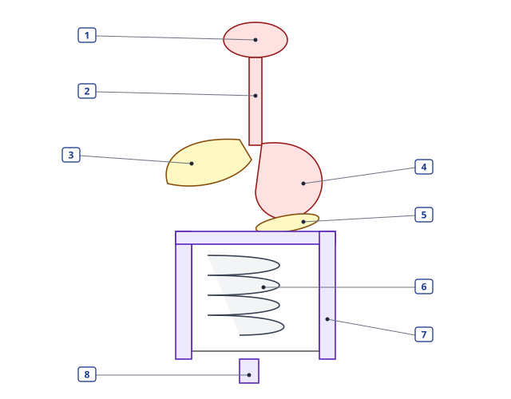

பின்பக்கம்

வாய்க்குழி (buccal cavity) — மெல்லுதல்; உமிழ்நீர் அமிலேசு

<!-- meta {"type":"flashcard","id":"SCF-11-06-022","grade":11,"chapter_id":"SC11-06","discipline":"BIO","difficulty":1,"image":"science_assets/biology/BIO-D05_unlabelled.svg"} -->
**SCF-11-06-022** · அடிப்படை

**முன்:** சமிபாட்டுத் தொகுதி (திட்டப் படம்) — பெயரிடாத படத்தில் இலக்கம் 2 குறிக்கும் பகுதி?

பின்பக்கம்

களம் (oesophagus) — சுற்றுச் சுருக்க அசைவால் உணவு கடத்தல்

<!-- meta {"type":"flashcard","id":"SCF-11-06-023","grade":11,"chapter_id":"SC11-06","discipline":"BIO","difficulty":1,"image":"science_assets/biology/BIO-D05_unlabelled.svg"} -->
**SCF-11-06-023** · அடிப்படை

**முன்:** சமிபாட்டுத் தொகுதி (திட்டப் படம்) — பெயரிடாத படத்தில் இலக்கம் 3 குறிக்கும் பகுதி?

பின்பக்கம்

ஈரல் (liver) — பித்தம் உற்பத்தி

<!-- meta {"type":"flashcard","id":"SCF-11-06-024","grade":11,"chapter_id":"SC11-06","discipline":"BIO","difficulty":1,"image":"science_assets/biology/BIO-D05_unlabelled.svg"} -->
**SCF-11-06-024** · அடிப்படை

**முன்:** சமிபாட்டுத் தொகுதி (திட்டப் படம்) — பெயரிடாத படத்தில் இலக்கம் 4 குறிக்கும் பகுதி?

பின்பக்கம்

இரைப்பை (stomach) — பெப்சின், HCl — புரதச் சமிபாடு

<!-- meta {"type":"flashcard","id":"SCF-11-06-025","grade":11,"chapter_id":"SC11-06","discipline":"BIO","difficulty":1,"image":"science_assets/biology/BIO-D06_unlabelled.svg"} -->
**SCF-11-06-025** · அடிப்படை

**முன்:** சுவாசத் தொகுதி — பெயரிடாத படத்தில் இலக்கம் 1 குறிக்கும் பகுதி?

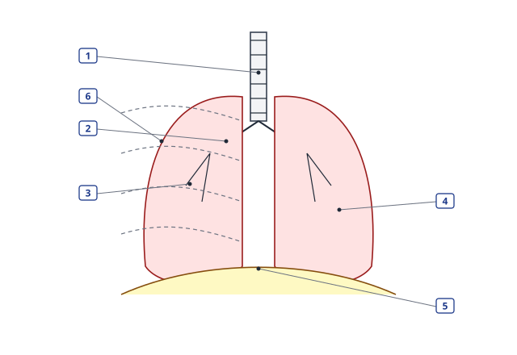

பின்பக்கம்

வாதனாளி (trachea) — C வடிவக் கசியிழை வளையங்கள் — திறந்திருக்கும்

<!-- meta {"type":"flashcard","id":"SCF-11-06-026","grade":11,"chapter_id":"SC11-06","discipline":"BIO","difficulty":1,"image":"science_assets/biology/BIO-D06_unlabelled.svg"} -->
**SCF-11-06-026** · அடிப்படை

**முன்:** சுவாசத் தொகுதி — பெயரிடாத படத்தில் இலக்கம் 2 குறிக்கும் பகுதி?

பின்பக்கம்

சுவாசப்பை நாளி (bronchus) — வளியை நுரையீரலுக்குக் கடத்தல்

<!-- meta {"type":"flashcard","id":"SCF-11-06-027","grade":11,"chapter_id":"SC11-06","discipline":"BIO","difficulty":1,"image":"science_assets/biology/BIO-D06_unlabelled.svg"} -->
**SCF-11-06-027** · அடிப்படை

**முன்:** சுவாசத் தொகுதி — பெயரிடாத படத்தில் இலக்கம் 3 குறிக்கும் பகுதி?

பின்பக்கம்

சுவாசச் சிறுகுழாய் (bronchiole) — சிற்றறைகளுக்கு வளி

<!-- meta {"type":"flashcard","id":"SCF-11-06-028","grade":11,"chapter_id":"SC11-06","discipline":"BIO","difficulty":1,"image":"science_assets/biology/BIO-D06_unlabelled.svg"} -->
**SCF-11-06-028** · அடிப்படை

**முன்:** சுவாசத் தொகுதி — பெயரிடாத படத்தில் இலக்கம் 4 குறிக்கும் பகுதி?

பின்பக்கம்

நுரையீரல் (lung) — வாயுப் பரிமாற்றம் (சிற்றறைகள்)

<!-- meta {"type":"flashcard","id":"SCF-11-06-029","grade":11,"chapter_id":"SC11-06","discipline":"BIO","difficulty":1,"image":"science_assets/biology/BIO-D07_unlabelled.svg"} -->
**SCF-11-06-029** · அடிப்படை

**முன்:** நெப்பிரோன் (திட்டப் படம்) — பெயரிடாத படத்தில் இலக்கம் 1 குறிக்கும் பகுதி?

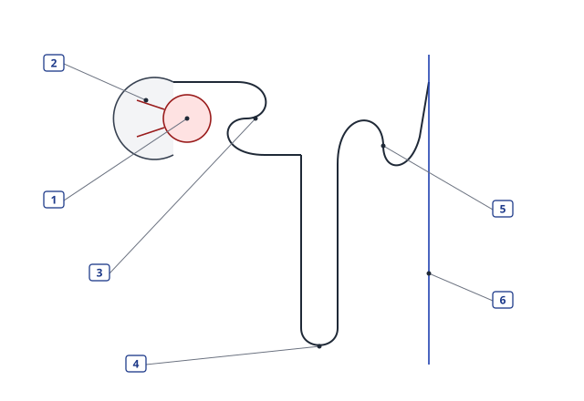

பின்பக்கம்

கலனுருச்சிறுதிரள் (glomerulus) — அமுக்க வடிகட்டல் (மீவடிகட்டல்)

<!-- meta {"type":"flashcard","id":"SCF-11-06-030","grade":11,"chapter_id":"SC11-06","discipline":"BIO","difficulty":1,"image":"science_assets/biology/BIO-D07_unlabelled.svg"} -->
**SCF-11-06-030** · அடிப்படை

**முன்:** நெப்பிரோன் (திட்டப் படம்) — பெயரிடாத படத்தில் இலக்கம் 2 குறிக்கும் பகுதி?

பின்பக்கம்

போமனின் உறை (Bowman's capsule) — வடிதிரவத்தைச் சேகரித்தல்

<!-- meta {"type":"flashcard","id":"SCF-11-06-031","grade":11,"chapter_id":"SC11-06","discipline":"BIO","difficulty":1,"image":"science_assets/biology/BIO-D07_unlabelled.svg"} -->
**SCF-11-06-031** · அடிப்படை

**முன்:** நெப்பிரோன் (திட்டப் படம்) — பெயரிடாத படத்தில் இலக்கம் 3 குறிக்கும் பகுதி?

பின்பக்கம்

அண்மைச் சுருண்ட சிறுகுழாய் (proximal convoluted tubule) — குளுக்கோசு, அமினோவமில மீளுறிஞ்சல்

<!-- meta {"type":"flashcard","id":"SCF-11-06-032","grade":11,"chapter_id":"SC11-06","discipline":"BIO","difficulty":1,"image":"science_assets/biology/BIO-D07_unlabelled.svg"} -->
**SCF-11-06-032** · அடிப்படை

**முன்:** நெப்பிரோன் (திட்டப் படம்) — பெயரிடாத படத்தில் இலக்கம் 4 குறிக்கும் பகுதி?

பின்பக்கம்

என்லேயின் தடம் (loop of Henle) — நீர், உப்பு மீளுறிஞ்சல்

## SC11-07: அமிலம், மூலம், உப்பு (Acids, bases and salts)

*தரம் 11 · அத்தியாயம் 7 · இரசாயனவியல் · 19 அட்டைகள்*

<!-- meta {"type":"flashcard","id":"SCF-11-07-001","grade":11,"chapter_id":"SC11-07","discipline":"CHE","difficulty":1,"image":null} -->
**SCF-11-07-001** · அடிப்படை

**முன்:** அமிலம் நீரில் தரும் அயன்?

பின்பக்கம்

H⁺

<!-- meta {"type":"flashcard","id":"SCF-11-07-002","grade":11,"chapter_id":"SC11-07","discipline":"CHE","difficulty":1,"image":null} -->
**SCF-11-07-002** · அடிப்படை

**முன்:** காரம் நீரில் தரும் அயன்?

பின்பக்கம்

OH⁻

<!-- meta {"type":"flashcard","id":"SCF-11-07-003","grade":11,"chapter_id":"SC11-07","discipline":"CHE","difficulty":1,"image":null} -->
**SCF-11-07-003** · அடிப்படை

**முன்:** நடுநிலை pH?

பின்பக்கம்

7

<!-- meta {"type":"flashcard","id":"SCF-11-07-004","grade":11,"chapter_id":"SC11-07","discipline":"CHE","difficulty":1,"image":null} -->
**SCF-11-07-004** · அடிப்படை

**முன்:** அமிலத்தில் பாசிச்சாயம்?

பின்பக்கம்

சிவப்பு

<!-- meta {"type":"flashcard","id":"SCF-11-07-005","grade":11,"chapter_id":"SC11-07","discipline":"CHE","difficulty":1,"image":null} -->
**SCF-11-07-005** · அடிப்படை

**முன்:** காரத்தில் பீனோல்ப்தலீன்?

பின்பக்கம்

இளஞ்சிவப்பு

<!-- meta {"type":"flashcard","id":"SCF-11-07-006","grade":11,"chapter_id":"SC11-07","discipline":"CHE","difficulty":2,"image":null} -->
**SCF-11-07-006** · இடைநிலை

**முன்:** நடுநிலையாக்கச் சமன்பாடு (அயன்)?

பின்பக்கம்

H⁺ + OH⁻ → H₂O

<!-- meta {"type":"flashcard","id":"SCF-11-07-007","grade":11,"chapter_id":"SC11-07","discipline":"CHE","difficulty":1,"image":null} -->
**SCF-11-07-007** · அடிப்படை

**முன்:** வன்னமிலத்துக்கு உதாரணம்?

பின்பக்கம்

HCl

<!-- meta {"type":"flashcard","id":"SCF-11-07-008","grade":11,"chapter_id":"SC11-07","discipline":"CHE","difficulty":1,"image":null} -->
**SCF-11-07-008** · அடிப்படை

**முன்:** மென்னமிலத்துக்கு உதாரணம்?

பின்பக்கம்

அசற்றிக்கமிலம்

<!-- meta {"type":"flashcard","id":"SCF-11-07-009","grade":11,"chapter_id":"SC11-07","discipline":"CHE","difficulty":1,"image":null} -->
**SCF-11-07-009** · அடிப்படை

**முன்:** அமிலம் + Zn → ?

பின்பக்கம்

உப்பு + H₂

<!-- meta {"type":"flashcard","id":"SCF-11-07-010","grade":11,"chapter_id":"SC11-07","discipline":"CHE","difficulty":2,"image":null} -->
**SCF-11-07-010** · இடைநிலை

**முன்:** அமிலம் + Na₂CO₃ → ?

பின்பக்கம்

உப்பு + CO₂ + H₂O

<!-- meta {"type":"flashcard","id":"SCF-11-07-011","grade":11,"chapter_id":"SC11-07","discipline":"CHE","difficulty":1,"image":null} -->
**SCF-11-07-011** · அடிப்படை

**முன்:** HCl + NaOH உப்பு?

பின்பக்கம்

NaCl

<!-- meta {"type":"flashcard","id":"SCF-11-07-012","grade":11,"chapter_id":"SC11-07","discipline":"CHE","difficulty":2,"image":null} -->
**SCF-11-07-012** · இடைநிலை

**முன்:** H₂SO₄ தரும் உப்பு வகை?

பின்பக்கம்

சல்பேற்று

<!-- meta {"type":"flashcard","id":"SCF-11-07-013","grade":11,"chapter_id":"SC11-07","discipline":"CHE","difficulty":2,"image":null} -->
**SCF-11-07-013** · இடைநிலை

**முன்:** வயிற்றமில நீக்கி?

பின்பக்கம்

Mg(OH)₂ / Al(OH)₃

<!-- meta {"type":"flashcard","id":"SCF-11-07-014","grade":11,"chapter_id":"SC11-07","discipline":"CHE","difficulty":2,"image":null} -->
**SCF-11-07-014** · இடைநிலை

**முன்:** அமில மண்ணைத் திருத்த?

பின்பக்கம்

சுண்ணாம்பு (CaO/Ca(OH)₂)

<!-- meta {"type":"flashcard","id":"SCF-11-07-015","grade":11,"chapter_id":"SC11-07","discipline":"CHE","difficulty":3,"image":null} -->
**SCF-11-07-015** · கடினம்

**முன்:** தவறான கருத்து: மென்னமிலம் = ஐதானது?

பின்பக்கம்

பிழை

<!-- meta {"type":"flashcard","id":"SCF-11-07-016","grade":11,"chapter_id":"SC11-07","discipline":"CHE","difficulty":1,"image":"science_assets/chemistry/CHE-D03_unlabelled.svg"} -->
**SCF-11-07-016** · அடிப்படை

**முன்:** ஐதரசன் தயாரிப்பு — நீரின் கீழ்முக இடப்பெயர்ச்சி — பெயரிடாத படத்தில் இலக்கம் 1 குறிக்கும் பகுதி?

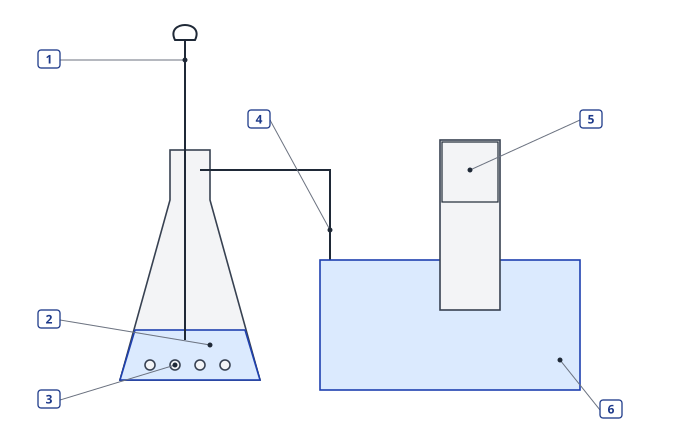

பின்பக்கம்

முட்புனல் (thistle funnel) — அமிலத்தைச் சேர்த்தல்

<!-- meta {"type":"flashcard","id":"SCF-11-07-017","grade":11,"chapter_id":"SC11-07","discipline":"CHE","difficulty":1,"image":"science_assets/chemistry/CHE-D03_unlabelled.svg"} -->
**SCF-11-07-017** · அடிப்படை

**முன்:** ஐதரசன் தயாரிப்பு — நீரின் கீழ்முக இடப்பெயர்ச்சி — பெயரிடாத படத்தில் இலக்கம் 2 குறிக்கும் பகுதி?

பின்பக்கம்

ஐதான HCl (dilute HCl) — தாக்கி

<!-- meta {"type":"flashcard","id":"SCF-11-07-018","grade":11,"chapter_id":"SC11-07","discipline":"CHE","difficulty":1,"image":"science_assets/chemistry/CHE-D03_unlabelled.svg"} -->
**SCF-11-07-018** · அடிப்படை

**முன்:** ஐதரசன் தயாரிப்பு — நீரின் கீழ்முக இடப்பெயர்ச்சி — பெயரிடாத படத்தில் இலக்கம் 3 குறிக்கும் பகுதி?

பின்பக்கம்

நாகத் துண்டுகள் (zinc granules) — Zn + 2HCl → ZnCl₂ + H₂

<!-- meta {"type":"flashcard","id":"SCF-11-07-019","grade":11,"chapter_id":"SC11-07","discipline":"CHE","difficulty":1,"image":"science_assets/chemistry/CHE-D03_unlabelled.svg"} -->
**SCF-11-07-019** · அடிப்படை

**முன்:** ஐதரசன் தயாரிப்பு — நீரின் கீழ்முக இடப்பெயர்ச்சி — பெயரிடாத படத்தில் இலக்கம் 4 குறிக்கும் பகுதி?

பின்பக்கம்

விநியோகக் குழாய் (delivery tube) — வாயுவைக் கடத்தல்

## SC11-08: இரசாயனத் தாக்கங்களின் வெப்ப விளைவு (Heat changes associated with chemical reactions)

*தரம் 11 · அத்தியாயம் 8 · இரசாயனவியல் · 18 அட்டைகள்*

<!-- meta {"type":"flashcard","id":"SCF-11-08-001","grade":11,"chapter_id":"SC11-08","discipline":"CHE","difficulty":1,"image":null} -->
**SCF-11-08-001** · அடிப்படை

**முன்:** புறவெப்பத் தாக்கத்தில் ΔH குறி?

பின்பக்கம்

மறை (−)

<!-- meta {"type":"flashcard","id":"SCF-11-08-002","grade":11,"chapter_id":"SC11-08","discipline":"CHE","difficulty":1,"image":null} -->
**SCF-11-08-002** · அடிப்படை

**முன்:** அகவெப்பத் தாக்கத்தில் ΔH குறி?

பின்பக்கம்

நேர் (+)

<!-- meta {"type":"flashcard","id":"SCF-11-08-003","grade":11,"chapter_id":"SC11-08","discipline":"CHE","difficulty":1,"image":null} -->
**SCF-11-08-003** · அடிப்படை

**முன்:** தகனம் எவ்வகை?

பின்பக்கம்

புறவெப்பம்

<!-- meta {"type":"flashcard","id":"SCF-11-08-004","grade":11,"chapter_id":"SC11-08","discipline":"CHE","difficulty":1,"image":null} -->
**SCF-11-08-004** · அடிப்படை

**முன்:** CaCO₃ வெப்பப் பிரிகை?

பின்பக்கம்

அகவெப்பம்

<!-- meta {"type":"flashcard","id":"SCF-11-08-005","grade":11,"chapter_id":"SC11-08","discipline":"CHE","difficulty":2,"image":null} -->
**SCF-11-08-005** · இடைநிலை

**முன்:** பிணைப்பு உடைதல்?

பின்பக்கம்

சக்தியை உறிஞ்சும்

<!-- meta {"type":"flashcard","id":"SCF-11-08-006","grade":11,"chapter_id":"SC11-08","discipline":"CHE","difficulty":2,"image":null} -->
**SCF-11-08-006** · இடைநிலை

**முன்:** பிணைப்பு உருவாதல்?

பின்பக்கம்

சக்தியை வெளியிடும்

<!-- meta {"type":"flashcard","id":"SCF-11-08-007","grade":11,"chapter_id":"SC11-08","discipline":"CHE","difficulty":2,"image":null} -->
**SCF-11-08-007** · இடைநிலை

**முன்:** NH₄Cl நீரில் கரையும்போது வெப்பநிலை?

பின்பக்கம்

குறையும் (அகவெப்பம்)

<!-- meta {"type":"flashcard","id":"SCF-11-08-008","grade":11,"chapter_id":"SC11-08","discipline":"CHE","difficulty":1,"image":null} -->
**SCF-11-08-008** · அடிப்படை

**முன்:** நடுநிலையாக்கம்?

பின்பக்கம்

புறவெப்பம்

<!-- meta {"type":"flashcard","id":"SCF-11-08-009","grade":11,"chapter_id":"SC11-08","discipline":"CHE","difficulty":2,"image":null} -->
**SCF-11-08-009** · இடைநிலை

**முன்:** புறவெப்ப சக்தி மட்ட வரிப்படம்?

பின்பக்கம்

விளைவுகள் தாக்கிகளுக்குக் கீழே

<!-- meta {"type":"flashcard","id":"SCF-11-08-010","grade":11,"chapter_id":"SC11-08","discipline":"CHE","difficulty":2,"image":null} -->
**SCF-11-08-010** · இடைநிலை

**முன்:** ஒளித்தொகுப்பு?

பின்பக்கம்

அகவெப்பம்

<!-- meta {"type":"flashcard","id":"SCF-11-08-011","grade":11,"chapter_id":"SC11-08","discipline":"CHE","difficulty":1,"image":null} -->
**SCF-11-08-011** · அடிப்படை

**முன்:** சுவாசம்?

பின்பக்கம்

புறவெப்பம்

<!-- meta {"type":"flashcard","id":"SCF-11-08-012","grade":11,"chapter_id":"SC11-08","discipline":"CHE","difficulty":2,"image":null} -->
**SCF-11-08-012** · இடைநிலை

**முன்:** உடனடி குளிர்ப்பொதியின் அடிப்படை?

பின்பக்கம்

அகவெப்பக் கரைதல்

<!-- meta {"type":"flashcard","id":"SCF-11-08-013","grade":11,"chapter_id":"SC11-08","discipline":"CHE","difficulty":3,"image":null} -->
**SCF-11-08-013** · கடினம்

**முன்:** தவறான கருத்து: தகனம் அகவெப்பம்?

பின்பக்கம்

பிழை

<!-- meta {"type":"flashcard","id":"SCF-11-08-014","grade":11,"chapter_id":"SC11-08","discipline":"CHE","difficulty":2,"image":null} -->
**SCF-11-08-014** · இடைநிலை

**முன்:** Q = mcΔθ இல் c?

பின்பக்கம்

தன்வெப்பக் கொள்ளளவு

<!-- meta {"type":"flashcard","id":"SCF-11-08-015","grade":11,"chapter_id":"SC11-08","discipline":"CHE","difficulty":2,"image":null} -->
**SCF-11-08-015** · இடைநிலை

**முன்:** ΔH அலகு?

பின்பக்கம்

kJ mol⁻¹

<!-- meta {"type":"flashcard","id":"SCF-11-08-016","grade":11,"chapter_id":"SC11-08","discipline":"CHE","difficulty":1,"image":"science_assets/graphs/GR-D05_unlabelled.svg"} -->
**SCF-11-08-016** · அடிப்படை

**முன்:** புறவெப்பத் தாக்கச் சக்தி மட்ட வரிப்படம் — பெயரிடாத படத்தில் இலக்கம் 1 குறிக்கும் பகுதி?

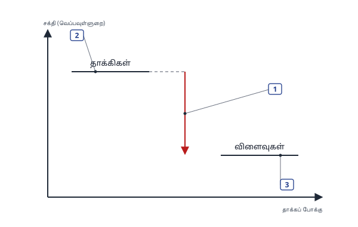

பின்பக்கம்

ΔH < 0 (வெப்பம் வெளியேறும்) (ΔH negative)

<!-- meta {"type":"flashcard","id":"SCF-11-08-017","grade":11,"chapter_id":"SC11-08","discipline":"CHE","difficulty":1,"image":"science_assets/graphs/GR-D05_unlabelled.svg"} -->
**SCF-11-08-017** · அடிப்படை

**முன்:** புறவெப்பத் தாக்கச் சக்தி மட்ட வரிப்படம் — பெயரிடாத படத்தில் இலக்கம் 2 குறிக்கும் பகுதி?

பின்பக்கம்

உயர் சக்தி மட்டம் (higher enthalpy)

<!-- meta {"type":"flashcard","id":"SCF-11-08-018","grade":11,"chapter_id":"SC11-08","discipline":"CHE","difficulty":1,"image":"science_assets/graphs/GR-D05_unlabelled.svg"} -->
**SCF-11-08-018** · அடிப்படை

**முன்:** புறவெப்பத் தாக்கச் சக்தி மட்ட வரிப்படம் — பெயரிடாத படத்தில் இலக்கம் 3 குறிக்கும் பகுதி?

பின்பக்கம்

தாழ் சக்தி மட்டம் (lower enthalpy)

## SC11-09: வெப்பம் (Heat)

*தரம் 11 · அத்தியாயம் 9 · பௌதிகவியல் · 23 அட்டைகள்*

<!-- meta {"type":"flashcard","id":"SCF-11-09-001","grade":11,"chapter_id":"SC11-09","discipline":"PHY","difficulty":1,"image":null} -->
**SCF-11-09-001** · அடிப்படை

**முன்:** Q = mcθ இல் c?

பின்பக்கம்

தன்வெப்பக் கொள்ளளவு

<!-- meta {"type":"flashcard","id":"SCF-11-09-002","grade":11,"chapter_id":"SC11-09","discipline":"PHY","difficulty":1,"image":null} -->
**SCF-11-09-002** · அடிப்படை

**முன்:** நீரின் c?

பின்பக்கம்

4200 J kg⁻¹ °C⁻¹

<!-- meta {"type":"flashcard","id":"SCF-11-09-003","grade":11,"chapter_id":"SC11-09","discipline":"PHY","difficulty":1,"image":null} -->
**SCF-11-09-003** · அடிப்படை

**முன்:** மறைவெப்பச் சூத்திரம்?

பின்பக்கம்

Q = mL

<!-- meta {"type":"flashcard","id":"SCF-11-09-004","grade":11,"chapter_id":"SC11-09","discipline":"PHY","difficulty":1,"image":null} -->
**SCF-11-09-004** · அடிப்படை

**முன்:** K = ?

பின்பக்கம்

°C + 273

<!-- meta {"type":"flashcard","id":"SCF-11-09-005","grade":11,"chapter_id":"SC11-09","discipline":"PHY","difficulty":1,"image":null} -->
**SCF-11-09-005** · அடிப்படை

**முன்:** 25 °C = ? K

பின்பக்கம்

298 K

<!-- meta {"type":"flashcard","id":"SCF-11-09-006","grade":11,"chapter_id":"SC11-09","discipline":"PHY","difficulty":1,"image":null} -->
**SCF-11-09-006** · அடிப்படை

**முன்:** வெற்றிடத்தில் வெப்பம் கடத்தும் முறை?

பின்பக்கம்

கதிர்ப்பு

<!-- meta {"type":"flashcard","id":"SCF-11-09-007","grade":11,"chapter_id":"SC11-09","discipline":"PHY","difficulty":1,"image":null} -->
**SCF-11-09-007** · அடிப்படை

**முன்:** பாய்மங்களில் வெப்பம்?

பின்பக்கம்

மேற்காவுகை

<!-- meta {"type":"flashcard","id":"SCF-11-09-008","grade":11,"chapter_id":"SC11-09","discipline":"PHY","difficulty":1,"image":null} -->
**SCF-11-09-008** · அடிப்படை

**முன்:** திண்மங்களில்?

பின்பக்கம்

கடத்தல்

<!-- meta {"type":"flashcard","id":"SCF-11-09-009","grade":11,"chapter_id":"SC11-09","discipline":"PHY","difficulty":2,"image":null} -->
**SCF-11-09-009** · இடைநிலை

**முன்:** ஆவியாதல் vs கொதித்தல்: குமிழ்கள்?

பின்பக்கம்

கொதித்தலில் மட்டும்

<!-- meta {"type":"flashcard","id":"SCF-11-09-010","grade":11,"chapter_id":"SC11-09","discipline":"PHY","difficulty":2,"image":null} -->
**SCF-11-09-010** · இடைநிலை

**முன்:** நிலை மாற்றத்தின்போது வெப்பநிலை?

பின்பக்கம்

மாறாது

<!-- meta {"type":"flashcard","id":"SCF-11-09-011","grade":11,"chapter_id":"SC11-09","discipline":"PHY","difficulty":2,"image":null} -->
**SCF-11-09-011** · இடைநிலை

**முன்:** சிறந்த கதிர்ப்பு உறிஞ்சி?

பின்பக்கம்

கருமை மேற்பரப்பு

<!-- meta {"type":"flashcard","id":"SCF-11-09-012","grade":11,"chapter_id":"SC11-09","discipline":"PHY","difficulty":2,"image":null} -->
**SCF-11-09-012** · இடைநிலை

**முன்:** குளிர்விப்பானுக்கு உகந்த இயல்பு?

பின்பக்கம்

உயர் தன்வெப்பக் கொள்ளளவு

<!-- meta {"type":"flashcard","id":"SCF-11-09-013","grade":11,"chapter_id":"SC11-09","discipline":"PHY","difficulty":3,"image":null} -->
**SCF-11-09-013** · கடினம்

**முன்:** நீரின் அடர்த்தி உச்சம்?

பின்பக்கம்

4 °C

<!-- meta {"type":"flashcard","id":"SCF-11-09-014","grade":11,"chapter_id":"SC11-09","discipline":"PHY","difficulty":1,"image":null} -->
**SCF-11-09-014** · அடிப்படை

**முன்:** தண்டவாளங்களில் இடைவெளி ஏன்?

பின்பக்கம்

வெப்ப விரிவு

<!-- meta {"type":"flashcard","id":"SCF-11-09-015","grade":11,"chapter_id":"SC11-09","discipline":"PHY","difficulty":3,"image":null} -->
**SCF-11-09-015** · கடினம்

**முன்:** தவறான கருத்து: வெப்பம் = வெப்பநிலை?

பின்பக்கம்

பிழை

<!-- meta {"type":"flashcard","id":"SCF-11-09-016","grade":11,"chapter_id":"SC11-09","discipline":"PHY","difficulty":1,"image":"science_assets/graphs/GR-D02_unlabelled.svg"} -->
**SCF-11-09-016** · அடிப்படை

**முன்:** நீரின் வெப்பமாக்கல் வளைகோடு — பெயரிடாத படத்தில் இலக்கம் 1 குறிக்கும் பகுதி?

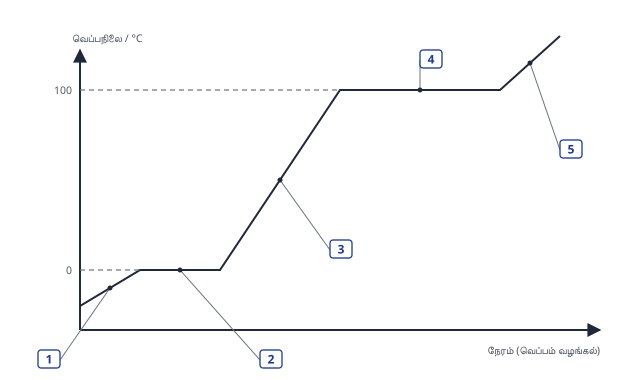

பின்பக்கம்

பனிக்கட்டி சூடாதல் (ice warming)

<!-- meta {"type":"flashcard","id":"SCF-11-09-017","grade":11,"chapter_id":"SC11-09","discipline":"PHY","difficulty":1,"image":"science_assets/graphs/GR-D02_unlabelled.svg"} -->
**SCF-11-09-017** · அடிப்படை

**முன்:** நீரின் வெப்பமாக்கல் வளைகோடு — பெயரிடாத படத்தில் இலக்கம் 2 குறிக்கும் பகுதி?

பின்பக்கம்

உருகல் — வெப்பநிலை மாறாது (melting (latent heat)) — Q = mL

<!-- meta {"type":"flashcard","id":"SCF-11-09-018","grade":11,"chapter_id":"SC11-09","discipline":"PHY","difficulty":1,"image":"science_assets/graphs/GR-D02_unlabelled.svg"} -->
**SCF-11-09-018** · அடிப்படை

**முன்:** நீரின் வெப்பமாக்கல் வளைகோடு — பெயரிடாத படத்தில் இலக்கம் 3 குறிக்கும் பகுதி?

பின்பக்கம்

நீர் சூடாதல் (water warming) — Q = mcθ

<!-- meta {"type":"flashcard","id":"SCF-11-09-019","grade":11,"chapter_id":"SC11-09","discipline":"PHY","difficulty":1,"image":"science_assets/graphs/GR-D02_unlabelled.svg"} -->
**SCF-11-09-019** · அடிப்படை

**முன்:** நீரின் வெப்பமாக்கல் வளைகோடு — பெயரிடாத படத்தில் இலக்கம் 4 குறிக்கும் பகுதி?

பின்பக்கம்

கொதித்தல் (boiling (latent heat of vaporisation))

<!-- meta {"type":"flashcard","id":"SCF-11-09-020","grade":11,"chapter_id":"SC11-09","discipline":"PHY","difficulty":1,"image":"science_assets/experiments/EXP-D03_unlabelled.svg"} -->
**SCF-11-09-020** · அடிப்படை

**முன்:** தன்வெப்பக் கொள்ளளவு அளவிடல் (உலோகக் குற்றி) — பெயரிடாத படத்தில் இலக்கம் 1 குறிக்கும் பகுதி?

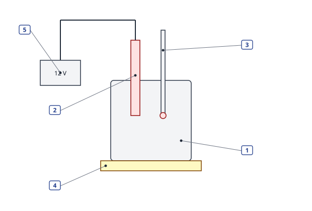

பின்பக்கம்

உலோகக் குற்றி (திணிவு m) (metal block)

<!-- meta {"type":"flashcard","id":"SCF-11-09-021","grade":11,"chapter_id":"SC11-09","discipline":"PHY","difficulty":1,"image":"science_assets/experiments/EXP-D03_unlabelled.svg"} -->
**SCF-11-09-021** · அடிப்படை

**முன்:** தன்வெப்பக் கொள்ளளவு அளவிடல் (உலோகக் குற்றி) — பெயரிடாத படத்தில் இலக்கம் 2 குறிக்கும் பகுதி?

பின்பக்கம்

அமிழ்ப்பு வெப்பமாக்கி (immersion heater) — Q = VIt அல்லது Pt

<!-- meta {"type":"flashcard","id":"SCF-11-09-022","grade":11,"chapter_id":"SC11-09","discipline":"PHY","difficulty":1,"image":"science_assets/experiments/EXP-D03_unlabelled.svg"} -->
**SCF-11-09-022** · அடிப்படை

**முன்:** தன்வெப்பக் கொள்ளளவு அளவிடல் (உலோகக் குற்றி) — பெயரிடாத படத்தில் இலக்கம் 3 குறிக்கும் பகுதி?

பின்பக்கம்

வெப்பமானி (thermometer) — θ₁, θ₂ வாசிப்பு

<!-- meta {"type":"flashcard","id":"SCF-11-09-023","grade":11,"chapter_id":"SC11-09","discipline":"PHY","difficulty":1,"image":"science_assets/experiments/EXP-D03_unlabelled.svg"} -->
**SCF-11-09-023** · அடிப்படை

**முன்:** தன்வெப்பக் கொள்ளளவு அளவிடல் (உலோகக் குற்றி) — பெயரிடாத படத்தில் இலக்கம் 4 குறிக்கும் பகுதி?

பின்பக்கம்

வெப்பக் காவலி (insulation) — வெப்ப இழப்பைக் குறைத்தல்

## SC11-10: மின் சாதனங்களின் வலுவும் சக்தியும் (Power and energy of electric appliances)

*தரம் 11 · அத்தியாயம் 10 · பௌதிகவியல் · 15 அட்டைகள்*

<!-- meta {"type":"flashcard","id":"SCF-11-10-001","grade":11,"chapter_id":"SC11-10","discipline":"PHY","difficulty":1,"image":null} -->
**SCF-11-10-001** · அடிப்படை

**முன்:** வலுச் சூத்திரம் (மின்)?

பின்பக்கம்

P = VI

<!-- meta {"type":"flashcard","id":"SCF-11-10-002","grade":11,"chapter_id":"SC11-10","discipline":"PHY","difficulty":1,"image":null} -->
**SCF-11-10-002** · அடிப்படை

**முன்:** சக்திச் சூத்திரம்?

பின்பக்கம்

E = Pt

<!-- meta {"type":"flashcard","id":"SCF-11-10-003","grade":11,"chapter_id":"SC11-10","discipline":"PHY","difficulty":2,"image":null} -->
**SCF-11-10-003** · இடைநிலை

**முன்:** 1 kWh = ? J

பின்பக்கம்

3.6 × 10⁶ J

<!-- meta {"type":"flashcard","id":"SCF-11-10-004","grade":11,"chapter_id":"SC11-10","discipline":"PHY","difficulty":1,"image":null} -->
**SCF-11-10-004** · அடிப்படை

**முன்:** மின் கட்டணம்?

பின்பக்கம்

kWh × ஓரலகு விலை

<!-- meta {"type":"flashcard","id":"SCF-11-10-005","grade":11,"chapter_id":"SC11-10","discipline":"PHY","difficulty":1,"image":null} -->
**SCF-11-10-005** · அடிப்படை

**முன்:** 1000 W 2 h?

பின்பக்கம்

2 kWh

<!-- meta {"type":"flashcard","id":"SCF-11-10-006","grade":11,"chapter_id":"SC11-10","discipline":"PHY","difficulty":1,"image":null} -->
**SCF-11-10-006** · அடிப்படை

**முன்:** உருகியின் தொழில்?

பின்பக்கம்

அதிக மின்னோட்டத்தில் சுற்றைத் துண்டித்தல்

<!-- meta {"type":"flashcard","id":"SCF-11-10-007","grade":11,"chapter_id":"SC11-10","discipline":"PHY","difficulty":2,"image":null} -->
**SCF-11-10-007** · இடைநிலை

**முன்:** உருகி இணைக்கப்படும் வடம்?

பின்பக்கம்

உயிர் வடம்

<!-- meta {"type":"flashcard","id":"SCF-11-10-008","grade":11,"chapter_id":"SC11-10","discipline":"PHY","difficulty":1,"image":null} -->
**SCF-11-10-008** · அடிப்படை

**முன்:** புவித்தொடுப்பின் தொழில்?

பின்பக்கம்

கசிவு மின்னோட்டத்தைப் புவிக்குச் செலுத்தல்

<!-- meta {"type":"flashcard","id":"SCF-11-10-009","grade":11,"chapter_id":"SC11-10","discipline":"PHY","difficulty":2,"image":null} -->
**SCF-11-10-009** · இடைநிலை

**முன்:** P = I²R?

பின்பக்கம்

ஆம் — வெப்பமாக்கல் விளைவு

<!-- meta {"type":"flashcard","id":"SCF-11-10-010","grade":11,"chapter_id":"SC11-10","discipline":"PHY","difficulty":1,"image":null} -->
**SCF-11-10-010** · அடிப்படை

**முன்:** LED vs இழைக் குமிழ்?

பின்பக்கம்

LED வினைத்திறன் கூடியது

<!-- meta {"type":"flashcard","id":"SCF-11-10-011","grade":11,"chapter_id":"SC11-10","discipline":"PHY","difficulty":2,"image":null} -->
**SCF-11-10-011** · இடைநிலை

**முன்:** 230 V, 920 W சாதன மின்னோட்டம்?

பின்பக்கம்

4 A

<!-- meta {"type":"flashcard","id":"SCF-11-10-012","grade":11,"chapter_id":"SC11-10","discipline":"PHY","difficulty":2,"image":null} -->
**SCF-11-10-012** · இடைநிலை

**முன்:** MCB?

பின்பக்கம்

சிறிய சுற்று முறிப்பான்

<!-- meta {"type":"flashcard","id":"SCF-11-10-013","grade":11,"chapter_id":"SC11-10","discipline":"PHY","difficulty":2,"image":null} -->
**SCF-11-10-013** · இடைநிலை

**முன்:** kWh என்பது?

பின்பக்கம்

சக்தி அலகு (வலு அல்ல)

<!-- meta {"type":"flashcard","id":"SCF-11-10-014","grade":11,"chapter_id":"SC11-10","discipline":"PHY","difficulty":2,"image":null} -->
**SCF-11-10-014** · இடைநிலை

**முன்:** வினைத்திறன்?

பின்பக்கம்

பயனுள்ள சக்தி ÷ உள்ளீடு × 100%

<!-- meta {"type":"flashcard","id":"SCF-11-10-015","grade":11,"chapter_id":"SC11-10","discipline":"PHY","difficulty":3,"image":null} -->
**SCF-11-10-015** · கடினம்

**முன்:** தவறான கருத்து: உருகி நடுநிலை வடத்தில்?

பின்பக்கம்

பிழை

## SC11-11: இலத்திரனியல் (Electronics)

*தரம் 11 · அத்தியாயம் 11 · பௌதிகவியல் · 22 அட்டைகள்*

<!-- meta {"type":"flashcard","id":"SCF-11-11-001","grade":11,"chapter_id":"SC11-11","discipline":"PHY","difficulty":1,"image":null} -->
**SCF-11-11-001** · அடிப்படை

**முன்:** அரைக்கடத்திக்கு உதாரணம்?

பின்பக்கம்

சிலிக்கன் / ஜேர்மேனியம்

<!-- meta {"type":"flashcard","id":"SCF-11-11-002","grade":11,"chapter_id":"SC11-11","discipline":"PHY","difficulty":2,"image":null} -->
**SCF-11-11-002** · இடைநிலை

**முன்:** n-வகைக்கான மாசு?

பின்பக்கம்

பொசுபரசு (5 வலுவளவு)

<!-- meta {"type":"flashcard","id":"SCF-11-11-003","grade":11,"chapter_id":"SC11-11","discipline":"PHY","difficulty":2,"image":null} -->
**SCF-11-11-003** · இடைநிலை

**முன்:** p-வகைக்கான மாசு?

பின்பக்கம்

போரன் (3 வலுவளவு)

<!-- meta {"type":"flashcard","id":"SCF-11-11-004","grade":11,"chapter_id":"SC11-11","discipline":"PHY","difficulty":2,"image":null} -->
**SCF-11-11-004** · இடைநிலை

**முன்:** p-வகையின் பெரும்பான்மைக் காவி?

பின்பக்கம்

துளைகள்

<!-- meta {"type":"flashcard","id":"SCF-11-11-005","grade":11,"chapter_id":"SC11-11","discipline":"PHY","difficulty":1,"image":null} -->
**SCF-11-11-005** · அடிப்படை

**முன்:** இருவாயி கடத்தும் நிலை?

பின்பக்கம்

முற்சார்பு

<!-- meta {"type":"flashcard","id":"SCF-11-11-006","grade":11,"chapter_id":"SC11-11","discipline":"PHY","difficulty":1,"image":null} -->
**SCF-11-11-006** · அடிப்படை

**முன்:** திருத்தல்?

பின்பக்கம்

AC → DC

<!-- meta {"type":"flashcard","id":"SCF-11-11-007","grade":11,"chapter_id":"SC11-11","discipline":"PHY","difficulty":2,"image":null} -->
**SCF-11-11-007** · இடைநிலை

**முன்:** முழு அலைப் பாலத் திருத்தியில் இருவாயிகள்?

பின்பக்கம்

4

<!-- meta {"type":"flashcard","id":"SCF-11-11-008","grade":11,"chapter_id":"SC11-11","discipline":"PHY","difficulty":1,"image":null} -->
**SCF-11-11-008** · அடிப்படை

**முன்:** திரான்சிஸ்டர் முனைகள்?

பின்பக்கம்

காலி, அடி, சேகரிப்பான்

<!-- meta {"type":"flashcard","id":"SCF-11-11-009","grade":11,"chapter_id":"SC11-11","discipline":"PHY","difficulty":1,"image":null} -->
**SCF-11-11-009** · அடிப்படை

**முன்:** திரான்சிஸ்டரின் இரு பயன்கள்?

பின்பக்கம்

ஆளி, விரியலாக்கி

<!-- meta {"type":"flashcard","id":"SCF-11-11-010","grade":11,"chapter_id":"SC11-11","discipline":"PHY","difficulty":2,"image":null} -->
**SCF-11-11-010** · இடைநிலை

**முன்:** LDR இல் ஒளி கூட தடை?

பின்பக்கம்

குறையும்

<!-- meta {"type":"flashcard","id":"SCF-11-11-011","grade":11,"chapter_id":"SC11-11","discipline":"PHY","difficulty":1,"image":null} -->
**SCF-11-11-011** · அடிப்படை

**முன்:** ஒலிவாங்கியின் சக்தி மாற்றம்?

பின்பக்கம்

ஒலி → மின்

<!-- meta {"type":"flashcard","id":"SCF-11-11-012","grade":11,"chapter_id":"SC11-11","discipline":"PHY","difficulty":1,"image":null} -->
**SCF-11-11-012** · அடிப்படை

**முன்:** ஒலிபெருக்கியின் சக்தி மாற்றம்?

பின்பக்கம்

மின் → ஒலி

<!-- meta {"type":"flashcard","id":"SCF-11-11-013","grade":11,"chapter_id":"SC11-11","discipline":"PHY","difficulty":2,"image":null} -->
**SCF-11-11-013** · இடைநிலை

**முன்:** LED ஒளிர நிபந்தனை?

பின்பக்கம்

முற்சார்பு

<!-- meta {"type":"flashcard","id":"SCF-11-11-014","grade":11,"chapter_id":"SC11-11","discipline":"PHY","difficulty":3,"image":null} -->
**SCF-11-11-014** · கடினம்

**முன்:** வெப்பநிலை கூட அரைக்கடத்திக் கடத்துதிறன்?

பின்பக்கம்

கூடும்

<!-- meta {"type":"flashcard","id":"SCF-11-11-015","grade":11,"chapter_id":"SC11-11","discipline":"PHY","difficulty":3,"image":null} -->
**SCF-11-11-015** · கடினம்

**முன்:** தவறான கருத்து: இருவாயி இருதிசை?

பின்பக்கம்

பிழை

<!-- meta {"type":"flashcard","id":"SCF-11-11-016","grade":11,"chapter_id":"SC11-11","discipline":"PHY","difficulty":1,"image":"science_assets/physics/PHY-D08_unlabelled.svg"} -->
**SCF-11-11-016** · அடிப்படை

**முன்:** பொது அறிவிப்புத் தொகுதி (கட்டத் தொகுதி வரிப்படம்) — பெயரிடாத படத்தில் இலக்கம் 1 குறிக்கும் பகுதி?

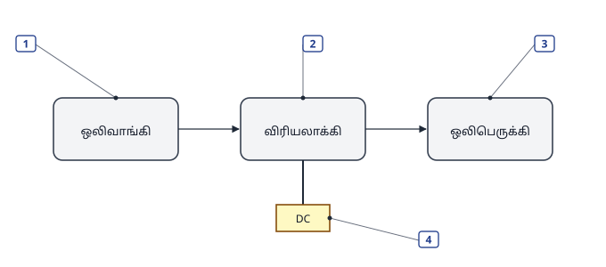

பின்பக்கம்

ஒலிவாங்கி (microphone) — ஒலி → மின் சைகை

<!-- meta {"type":"flashcard","id":"SCF-11-11-017","grade":11,"chapter_id":"SC11-11","discipline":"PHY","difficulty":1,"image":"science_assets/physics/PHY-D08_unlabelled.svg"} -->
**SCF-11-11-017** · அடிப்படை

**முன்:** பொது அறிவிப்புத் தொகுதி (கட்டத் தொகுதி வரிப்படம்) — பெயரிடாத படத்தில் இலக்கம் 2 குறிக்கும் பகுதி?

பின்பக்கம்

விரியலாக்கி (திரான்சிஸ்டர்) (amplifier) — சைகையின் வீச்சத்தைக் கூட்டல்

<!-- meta {"type":"flashcard","id":"SCF-11-11-018","grade":11,"chapter_id":"SC11-11","discipline":"PHY","difficulty":1,"image":"science_assets/physics/PHY-D08_unlabelled.svg"} -->
**SCF-11-11-018** · அடிப்படை

**முன்:** பொது அறிவிப்புத் தொகுதி (கட்டத் தொகுதி வரிப்படம்) — பெயரிடாத படத்தில் இலக்கம் 3 குறிக்கும் பகுதி?

பின்பக்கம்

ஒலிபெருக்கி (loudspeaker) — மின் → ஒலி

<!-- meta {"type":"flashcard","id":"SCF-11-11-019","grade":11,"chapter_id":"SC11-11","discipline":"PHY","difficulty":1,"image":"science_assets/physics/PHY-D08_unlabelled.svg"} -->
**SCF-11-11-019** · அடிப்படை

**முன்:** பொது அறிவிப்புத் தொகுதி (கட்டத் தொகுதி வரிப்படம்) — பெயரிடாத படத்தில் இலக்கம் 4 குறிக்கும் பகுதி?

பின்பக்கம்

மின்வழங்கல் (power supply) — விரியலாக்கத்துக்கான சக்தி

<!-- meta {"type":"flashcard","id":"SCF-11-11-020","grade":11,"chapter_id":"SC11-11","discipline":"PHY","difficulty":1,"image":"science_assets/physics/PHY-D09_unlabelled.svg"} -->
**SCF-11-11-020** · அடிப்படை

**முன்:** npn திரான்சிஸ்டர் குறியீடு — பெயரிடாத படத்தில் இலக்கம் 1 குறிக்கும் பகுதி?

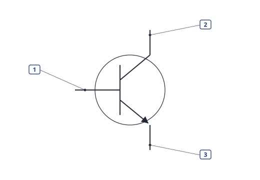

பின்பக்கம்

அடி (B) (base) — சிறிய கட்டுப்பாட்டு மின்னோட்டம்

<!-- meta {"type":"flashcard","id":"SCF-11-11-021","grade":11,"chapter_id":"SC11-11","discipline":"PHY","difficulty":1,"image":"science_assets/physics/PHY-D09_unlabelled.svg"} -->
**SCF-11-11-021** · அடிப்படை

**முன்:** npn திரான்சிஸ்டர் குறியீடு — பெயரிடாத படத்தில் இலக்கம் 2 குறிக்கும் பகுதி?

பின்பக்கம்

சேகரிப்பான் (C) (collector) — பெரிய மின்னோட்டம் உட்செல்லும்

<!-- meta {"type":"flashcard","id":"SCF-11-11-022","grade":11,"chapter_id":"SC11-11","discipline":"PHY","difficulty":1,"image":"science_assets/physics/PHY-D09_unlabelled.svg"} -->
**SCF-11-11-022** · அடிப்படை

**முன்:** npn திரான்சிஸ்டர் குறியீடு — பெயரிடாத படத்தில் இலக்கம் 3 குறிக்கும் பகுதி?

பின்பக்கம்

காலி (E) (emitter) — அம்புக்குறி: மரபு மின்னோட்டத் திசை

## SC11-12: மின்னிரசாயனம் (Electrochemistry)

*தரம் 11 · அத்தியாயம் 12 · இரசாயனவியல் · 23 அட்டைகள்*

<!-- meta {"type":"flashcard","id":"SCF-11-12-001","grade":11,"chapter_id":"SC11-12","discipline":"CHE","difficulty":1,"image":null} -->
**SCF-11-12-001** · அடிப்படை

**முன்:** மின்பகுப்பில் கதோட்டு?

பின்பக்கம்

மறைமுனை — தாழ்த்தல்

<!-- meta {"type":"flashcard","id":"SCF-11-12-002","grade":11,"chapter_id":"SC11-12","discipline":"CHE","difficulty":1,"image":null} -->
**SCF-11-12-002** · அடிப்படை

**முன்:** மின்பகுப்பில் அனோட்டு?

பின்பக்கம்

நேர்முனை — ஒட்சியேற்றம்

<!-- meta {"type":"flashcard","id":"SCF-11-12-003","grade":11,"chapter_id":"SC11-12","discipline":"CHE","difficulty":1,"image":null} -->
**SCF-11-12-003** · அடிப்படை

**முன்:** ஒட்சியேற்றம்?

பின்பக்கம்

இலத்திரன் இழப்பு

<!-- meta {"type":"flashcard","id":"SCF-11-12-004","grade":11,"chapter_id":"SC11-12","discipline":"CHE","difficulty":1,"image":null} -->
**SCF-11-12-004** · அடிப்படை

**முன்:** தாழ்த்தல்?

பின்பக்கம்

இலத்திரன் ஏற்பு

<!-- meta {"type":"flashcard","id":"SCF-11-12-005","grade":11,"chapter_id":"SC11-12","discipline":"CHE","difficulty":1,"image":null} -->
**SCF-11-12-005** · அடிப்படை

**முன்:** உருகிய NaCl கதோட்டு விளைவு?

பின்பக்கம்

Na

<!-- meta {"type":"flashcard","id":"SCF-11-12-006","grade":11,"chapter_id":"SC11-12","discipline":"CHE","difficulty":1,"image":null} -->
**SCF-11-12-006** · அடிப்படை

**முன்:** உருகிய NaCl அனோட்டு விளைவு?

பின்பக்கம்

Cl₂

<!-- meta {"type":"flashcard","id":"SCF-11-12-007","grade":11,"chapter_id":"SC11-12","discipline":"CHE","difficulty":2,"image":null} -->
**SCF-11-12-007** · இடைநிலை

**முன்:** Na பிரித்தெடுக்கும் கலம்?

பின்பக்கம்

டவுன்ஸ் கலம்

<!-- meta {"type":"flashcard","id":"SCF-11-12-008","grade":11,"chapter_id":"SC11-12","discipline":"CHE","difficulty":2,"image":null} -->
**SCF-11-12-008** · இடைநிலை

**முன்:** நீர்க் NaCl கதோட்டு வாயு?

பின்பக்கம்

H₂

<!-- meta {"type":"flashcard","id":"SCF-11-12-009","grade":11,"chapter_id":"SC11-12","discipline":"CHE","difficulty":2,"image":null} -->
**SCF-11-12-009** · இடைநிலை

**முன்:** மின்முலாமிடலில் பொருள் இணைக்கப்படுவது?

பின்பக்கம்

கதோட்டு

<!-- meta {"type":"flashcard","id":"SCF-11-12-010","grade":11,"chapter_id":"SC11-12","discipline":"CHE","difficulty":1,"image":null} -->
**SCF-11-12-010** · அடிப்படை

**முன்:** துருப்பிடித்தலுக்குத் தேவை?

பின்பக்கம்

O₂, நீர்

<!-- meta {"type":"flashcard","id":"SCF-11-12-011","grade":11,"chapter_id":"SC11-12","discipline":"CHE","difficulty":2,"image":null} -->
**SCF-11-12-011** · இடைநிலை

**முன்:** நாகமுலாமிடல்?

பின்பக்கம்

இரும்பின் மேல் Zn படை

<!-- meta {"type":"flashcard","id":"SCF-11-12-012","grade":11,"chapter_id":"SC11-12","discipline":"CHE","difficulty":3,"image":null} -->
**SCF-11-12-012** · கடினம்

**முன்:** Zn–Cu கலத்தில் Zn?

பின்பக்கம்

ஒட்சியேற்றமடையும் மின்வாய் (மறை)

<!-- meta {"type":"flashcard","id":"SCF-11-12-013","grade":11,"chapter_id":"SC11-12","discipline":"CHE","difficulty":2,"image":null} -->
**SCF-11-12-013** · இடைநிலை

**முன்:** Cl⁻ அனோட்டில்?

பின்பக்கம்

2Cl⁻ → Cl₂ + 2e⁻

<!-- meta {"type":"flashcard","id":"SCF-11-12-014","grade":11,"chapter_id":"SC11-12","discipline":"CHE","difficulty":2,"image":null} -->
**SCF-11-12-014** · இடைநிலை

**முன்:** தியாக அனோட்டு உலோகம்?

பின்பக்கம்

Mg / Zn

<!-- meta {"type":"flashcard","id":"SCF-11-12-015","grade":11,"chapter_id":"SC11-12","discipline":"CHE","difficulty":3,"image":null} -->
**SCF-11-12-015** · கடினம்

**முன்:** கலத்தில் இலத்திரன் பாதை?

பின்பக்கம்

வெளிச் சுற்று

<!-- meta {"type":"flashcard","id":"SCF-11-12-016","grade":11,"chapter_id":"SC11-12","discipline":"CHE","difficulty":1,"image":"science_assets/chemistry/CHE-D02_unlabelled.svg"} -->
**SCF-11-12-016** · அடிப்படை

**முன்:** மின்பகுப்புக் கலம் — பெயரிடாத படத்தில் இலக்கம் 1 குறிக்கும் பகுதி?

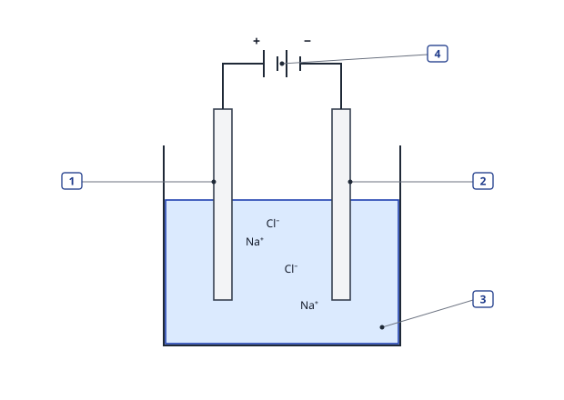

பின்பக்கம்

அனோட்டு (+) (anode) — ஒட்சியேற்றம் — அனயன்கள் இலத்திரன் இழக்கும்

<!-- meta {"type":"flashcard","id":"SCF-11-12-017","grade":11,"chapter_id":"SC11-12","discipline":"CHE","difficulty":1,"image":"science_assets/chemistry/CHE-D02_unlabelled.svg"} -->
**SCF-11-12-017** · அடிப்படை

**முன்:** மின்பகுப்புக் கலம் — பெயரிடாத படத்தில் இலக்கம் 2 குறிக்கும் பகுதி?

பின்பக்கம்

கதோட்டு (−) (cathode) — தாழ்த்தல் — கற்றயன்கள் இலத்திரன் பெறும்

<!-- meta {"type":"flashcard","id":"SCF-11-12-018","grade":11,"chapter_id":"SC11-12","discipline":"CHE","difficulty":1,"image":"science_assets/chemistry/CHE-D02_unlabelled.svg"} -->
**SCF-11-12-018** · அடிப்படை

**முன்:** மின்பகுப்புக் கலம் — பெயரிடாத படத்தில் இலக்கம் 3 குறிக்கும் பகுதி?

பின்பக்கம்

மின்பகுபொருள் (electrolyte) — அயன்கள் அசைந்து மின் கடத்தும்

<!-- meta {"type":"flashcard","id":"SCF-11-12-019","grade":11,"chapter_id":"SC11-12","discipline":"CHE","difficulty":1,"image":"science_assets/chemistry/CHE-D02_unlabelled.svg"} -->
**SCF-11-12-019** · அடிப்படை

**முன்:** மின்பகுப்புக் கலம் — பெயரிடாத படத்தில் இலக்கம் 4 குறிக்கும் பகுதி?

பின்பக்கம்

மின்கலவடுக்கு (battery (d.c.)) — நேரோட்ட மின்வழங்கல்

<!-- meta {"type":"flashcard","id":"SCF-11-12-020","grade":11,"chapter_id":"SC11-12","discipline":"CHE","difficulty":1,"image":"science_assets/chemistry/CHE-D06_unlabelled.svg"} -->
**SCF-11-12-020** · அடிப்படை

**முன்:** எளிய மின்கலம் (Zn–Cu) — பெயரிடாத படத்தில் இலக்கம் 1 குறிக்கும் பகுதி?

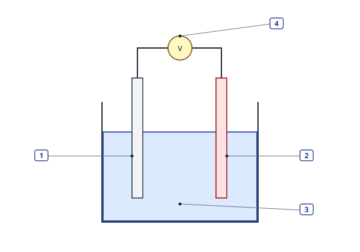

பின்பக்கம்

நாகத் தகடு (−) (zinc plate (negative)) — ஒட்சியேற்றம்: Zn → Zn²⁺ + 2e⁻

<!-- meta {"type":"flashcard","id":"SCF-11-12-021","grade":11,"chapter_id":"SC11-12","discipline":"CHE","difficulty":1,"image":"science_assets/chemistry/CHE-D06_unlabelled.svg"} -->
**SCF-11-12-021** · அடிப்படை

**முன்:** எளிய மின்கலம் (Zn–Cu) — பெயரிடாத படத்தில் இலக்கம் 2 குறிக்கும் பகுதி?

பின்பக்கம்

செப்புத் தகடு (+) (copper plate (positive)) — தாக்கத்திறன் குறைந்த உலோகம்

<!-- meta {"type":"flashcard","id":"SCF-11-12-022","grade":11,"chapter_id":"SC11-12","discipline":"CHE","difficulty":1,"image":"science_assets/chemistry/CHE-D06_unlabelled.svg"} -->
**SCF-11-12-022** · அடிப்படை

**முன்:** எளிய மின்கலம் (Zn–Cu) — பெயரிடாத படத்தில் இலக்கம் 3 குறிக்கும் பகுதி?

பின்பக்கம்

ஐதான H₂SO₄ (dilute sulfuric acid) — மின்பகுபொருள்

<!-- meta {"type":"flashcard","id":"SCF-11-12-023","grade":11,"chapter_id":"SC11-12","discipline":"CHE","difficulty":1,"image":"science_assets/chemistry/CHE-D06_unlabelled.svg"} -->
**SCF-11-12-023** · அடிப்படை

**முன்:** எளிய மின்கலம் (Zn–Cu) — பெயரிடாத படத்தில் இலக்கம் 4 குறிக்கும் பகுதி?

பின்பக்கம்

வோல்ற்மானி (voltmeter) — அழுத்த வேறுபாடு

## SC11-13: மின் காந்தவியலும் தூண்டலும் (Electromagnetism and electromagnetic induction)

*தரம் 11 · அத்தியாயம் 13 · பௌதிகவியல் · 25 அட்டைகள்*

<!-- meta {"type":"flashcard","id":"SCF-11-13-001","grade":11,"chapter_id":"SC11-13","discipline":"PHY","difficulty":1,"image":null} -->
**SCF-11-13-001** · அடிப்படை

**முன்:** புலக் கோடுகளின் திசை?

பின்பக்கம்

வடமுனை → தென்முனை

<!-- meta {"type":"flashcard","id":"SCF-11-13-002","grade":11,"chapter_id":"SC11-13","discipline":"PHY","difficulty":1,"image":null} -->
**SCF-11-13-002** · அடிப்படை

**முன்:** நேர்க் கடத்தியின் புலத் திசை விதி?

பின்பக்கம்

வலக்கைப் பிடி விதி

<!-- meta {"type":"flashcard","id":"SCF-11-13-003","grade":11,"chapter_id":"SC11-13","discipline":"PHY","difficulty":2,"image":null} -->
**SCF-11-13-003** · இடைநிலை

**முன்:** மோட்டர் விசைத் திசை விதி?

பின்பக்கம்

பிளெமிங்கின் இடக்கை விதி

<!-- meta {"type":"flashcard","id":"SCF-11-13-004","grade":11,"chapter_id":"SC11-13","discipline":"PHY","difficulty":1,"image":null} -->
**SCF-11-13-004** · அடிப்படை

**முன்:** மோட்டரின் சக்தி மாற்றம்?

பின்பக்கம்

மின் → பொறிமுறை

<!-- meta {"type":"flashcard","id":"SCF-11-13-005","grade":11,"chapter_id":"SC11-13","discipline":"PHY","difficulty":1,"image":null} -->
**SCF-11-13-005** · அடிப்படை

**முன்:** பிறப்பாக்கியின் சக்தி மாற்றம்?

பின்பக்கம்

பொறிமுறை → மின்

<!-- meta {"type":"flashcard","id":"SCF-11-13-006","grade":11,"chapter_id":"SC11-13","discipline":"PHY","difficulty":1,"image":null} -->
**SCF-11-13-006** · அடிப்படை

**முன்:** நிலைமாற்றிச் சூத்திரம்?

பின்பக்கம்

Vs/Vp = Ns/Np

<!-- meta {"type":"flashcard","id":"SCF-11-13-007","grade":11,"chapter_id":"SC11-13","discipline":"PHY","difficulty":2,"image":null} -->
**SCF-11-13-007** · இடைநிலை

**முன்:** நிலைமாற்றி DC யில் இயங்குமா?

பின்பக்கம்

இல்லை

<!-- meta {"type":"flashcard","id":"SCF-11-13-008","grade":11,"chapter_id":"SC11-13","discipline":"PHY","difficulty":2,"image":null} -->
**SCF-11-13-008** · இடைநிலை

**முன்:** ஏற்றும் நிலைமாற்றி?

பின்பக்கம்

Ns > Np

<!-- meta {"type":"flashcard","id":"SCF-11-13-009","grade":11,"chapter_id":"SC11-13","discipline":"PHY","difficulty":2,"image":null} -->
**SCF-11-13-009** · இடைநிலை

**முன்:** தூண்டிய மி.இ.வி. கூட்டும் வழிகள்?

பின்பக்கம்

வேகமான அசைவு, அதிக சுற்றுகள், வலிய காந்தம்

<!-- meta {"type":"flashcard","id":"SCF-11-13-010","grade":11,"chapter_id":"SC11-13","discipline":"PHY","difficulty":1,"image":null} -->
**SCF-11-13-010** · அடிப்படை

**முன்:** மின்காந்த அகணி?

பின்பக்கம்

மென் இரும்பு

<!-- meta {"type":"flashcard","id":"SCF-11-13-011","grade":11,"chapter_id":"SC11-13","discipline":"PHY","difficulty":3,"image":null} -->
**SCF-11-13-011** · கடினம்

**முன்:** இலட்சிய நிலைமாற்றி?

பின்பக்கம்

VpIp = VsIs

<!-- meta {"type":"flashcard","id":"SCF-11-13-012","grade":11,"chapter_id":"SC11-13","discipline":"PHY","difficulty":3,"image":null} -->
**SCF-11-13-012** · கடினம்

**முன்:** உயர் அழுத்தப் பரிமாற்றம் ஏன்?

பின்பக்கம்

மின்னோட்டம் குறைந்து வெப்ப இழப்பு குறைவு

<!-- meta {"type":"flashcard","id":"SCF-11-13-013","grade":11,"chapter_id":"SC11-13","discipline":"PHY","difficulty":1,"image":null} -->
**SCF-11-13-013** · அடிப்படை

**முன்:** மின்காந்தத் தூண்டலைக் கண்டுபிடித்தவர்?

பின்பக்கம்

மைக்கல் பரடே

<!-- meta {"type":"flashcard","id":"SCF-11-13-014","grade":11,"chapter_id":"SC11-13","discipline":"PHY","difficulty":2,"image":null} -->
**SCF-11-13-014** · இடைநிலை

**முன்:** ஒலிபெருக்கிக் கொள்கை?

பின்பக்கம்

காந்தப் புலத்தில் மின்னோட்டக் கடத்தியில் விசை

<!-- meta {"type":"flashcard","id":"SCF-11-13-015","grade":11,"chapter_id":"SC11-13","discipline":"PHY","difficulty":3,"image":null} -->
**SCF-11-13-015** · கடினம்

**முன்:** தவறான கருத்து: ஏற்றும் நிலைமாற்றி சக்தியைக் கூட்டும்?

பின்பக்கம்

பிழை

<!-- meta {"type":"flashcard","id":"SCF-11-13-016","grade":11,"chapter_id":"SC11-13","discipline":"PHY","difficulty":1,"image":"science_assets/physics/PHY-D04_unlabelled.svg"} -->
**SCF-11-13-016** · அடிப்படை

**முன்:** சட்டக் காந்தத்தின் காந்தப் புலக் கோடுகள் — பெயரிடாத படத்தில் இலக்கம் 1 குறிக்கும் பகுதி?

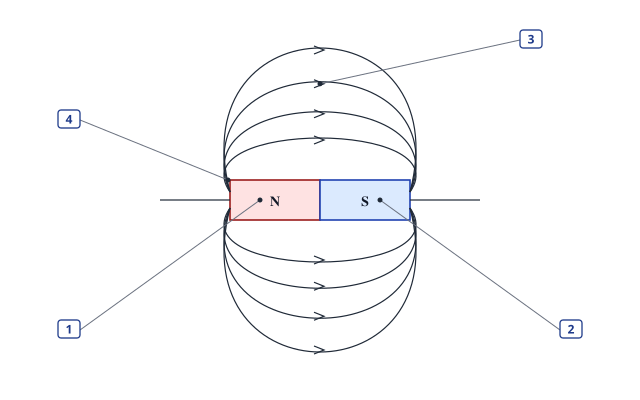

பின்பக்கம்

வடமுனை (north pole) — புலக் கோடுகள் வெளியேறும்

<!-- meta {"type":"flashcard","id":"SCF-11-13-017","grade":11,"chapter_id":"SC11-13","discipline":"PHY","difficulty":1,"image":"science_assets/physics/PHY-D04_unlabelled.svg"} -->
**SCF-11-13-017** · அடிப்படை

**முன்:** சட்டக் காந்தத்தின் காந்தப் புலக் கோடுகள் — பெயரிடாத படத்தில் இலக்கம் 2 குறிக்கும் பகுதி?

பின்பக்கம்

தென்முனை (south pole) — புலக் கோடுகள் உட்செல்லும்

<!-- meta {"type":"flashcard","id":"SCF-11-13-018","grade":11,"chapter_id":"SC11-13","discipline":"PHY","difficulty":1,"image":"science_assets/physics/PHY-D04_unlabelled.svg"} -->
**SCF-11-13-018** · அடிப்படை

**முன்:** சட்டக் காந்தத்தின் காந்தப் புலக் கோடுகள் — பெயரிடாத படத்தில் இலக்கம் 3 குறிக்கும் பகுதி?

பின்பக்கம்

புலக் கோடு (field line) — N இலிருந்து S க்கு

<!-- meta {"type":"flashcard","id":"SCF-11-13-019","grade":11,"chapter_id":"SC11-13","discipline":"PHY","difficulty":1,"image":"science_assets/physics/PHY-D04_unlabelled.svg"} -->
**SCF-11-13-019** · அடிப்படை

**முன்:** சட்டக் காந்தத்தின் காந்தப் புலக் கோடுகள் — பெயரிடாத படத்தில் இலக்கம் 4 குறிக்கும் பகுதி?

பின்பக்கம்

வலிய புலம் (strong field) — கோடுகள் நெருக்கம் — முனைகளில்

<!-- meta {"type":"flashcard","id":"SCF-11-13-020","grade":11,"chapter_id":"SC11-13","discipline":"PHY","difficulty":1,"image":"science_assets/physics/PHY-D07_unlabelled.svg"} -->
**SCF-11-13-020** · அடிப்படை

**முன்:** நிலைமாற்றி — பெயரிடாத படத்தில் இலக்கம் 1 குறிக்கும் பகுதி?

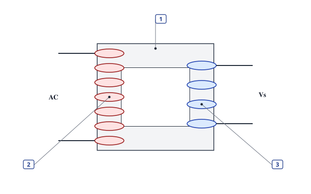

பின்பக்கம்

மென் இரும்பு அகணி (soft-iron core) — காந்தப் பாயத்தை இணைத்தல்

<!-- meta {"type":"flashcard","id":"SCF-11-13-021","grade":11,"chapter_id":"SC11-13","discipline":"PHY","difficulty":1,"image":"science_assets/physics/PHY-D07_unlabelled.svg"} -->
**SCF-11-13-021** · அடிப்படை

**முன்:** நிலைமாற்றி — பெயரிடாத படத்தில் இலக்கம் 2 குறிக்கும் பகுதி?

பின்பக்கம்

முதன்மைச் சுருள் (Np) (primary coil) — AC — மாறும் காந்தப் பாயம்

<!-- meta {"type":"flashcard","id":"SCF-11-13-022","grade":11,"chapter_id":"SC11-13","discipline":"PHY","difficulty":1,"image":"science_assets/physics/PHY-D07_unlabelled.svg"} -->
**SCF-11-13-022** · அடிப்படை

**முன்:** நிலைமாற்றி — பெயரிடாத படத்தில் இலக்கம் 3 குறிக்கும் பகுதி?

பின்பக்கம்

துணைச் சுருள் (Ns) (secondary coil) — தூண்டிய மி.இ.வி.

<!-- meta {"type":"flashcard","id":"SCF-11-13-023","grade":11,"chapter_id":"SC11-13","discipline":"PHY","difficulty":1,"image":"science_assets/physics/PHY-D12_unlabelled.svg"} -->
**SCF-11-13-023** · அடிப்படை

**முன்:** வரிச்சுருளும் மின்காந்தமும் — பெயரிடாத படத்தில் இலக்கம் 1 குறிக்கும் பகுதி?

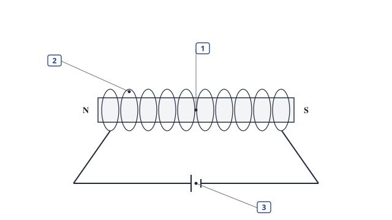

பின்பக்கம்

மென் இரும்பு அகணி (soft-iron core) — புலத்தை வலுப்படுத்தல்

<!-- meta {"type":"flashcard","id":"SCF-11-13-024","grade":11,"chapter_id":"SC11-13","discipline":"PHY","difficulty":1,"image":"science_assets/physics/PHY-D12_unlabelled.svg"} -->
**SCF-11-13-024** · அடிப்படை

**முன்:** வரிச்சுருளும் மின்காந்தமும் — பெயரிடாத படத்தில் இலக்கம் 2 குறிக்கும் பகுதி?

பின்பக்கம்

கம்பிச் சுருள் (coil (insulated wire)) — சுற்றுகள் கூடப் புலம் வலுக்கும்

<!-- meta {"type":"flashcard","id":"SCF-11-13-025","grade":11,"chapter_id":"SC11-13","discipline":"PHY","difficulty":1,"image":"science_assets/physics/PHY-D12_unlabelled.svg"} -->
**SCF-11-13-025** · அடிப்படை

**முன்:** வரிச்சுருளும் மின்காந்தமும் — பெயரிடாத படத்தில் இலக்கம் 3 குறிக்கும் பகுதி?

பின்பக்கம்

மின்கலம் (cell) — மின்னோட்டம் பாயும்போது மட்டும் காந்தம்

## SC11-14: ஐதரோகாபன்களும் அவற்றின் பெறுதிகளும் (Hydrocarbons and their derivatives)

*தரம் 11 · அத்தியாயம் 14 · இரசாயனவியல் · 15 அட்டைகள்*

<!-- meta {"type":"flashcard","id":"SCF-11-14-001","grade":11,"chapter_id":"SC11-14","discipline":"CHE","difficulty":1,"image":null} -->
**SCF-11-14-001** · அடிப்படை

**முன்:** அல்கேன் பொதுச் சூத்திரம்?

பின்பக்கம்

CₙH₂ₙ₊₂

<!-- meta {"type":"flashcard","id":"SCF-11-14-002","grade":11,"chapter_id":"SC11-14","discipline":"CHE","difficulty":1,"image":null} -->
**SCF-11-14-002** · அடிப்படை

**முன்:** அல்கீன் பொதுச் சூத்திரம்?

பின்பக்கம்

CₙH₂ₙ

<!-- meta {"type":"flashcard","id":"SCF-11-14-003","grade":11,"chapter_id":"SC11-14","discipline":"CHE","difficulty":2,"image":null} -->
**SCF-11-14-003** · இடைநிலை

**முன்:** அல்கைன் பொதுச் சூத்திரம்?

பின்பக்கம்

CₙH₂ₙ₋₂

<!-- meta {"type":"flashcard","id":"SCF-11-14-004","grade":11,"chapter_id":"SC11-14","discipline":"CHE","difficulty":1,"image":null} -->
**SCF-11-14-004** · அடிப்படை

**முன்:** மெதேன் சூத்திரம்?

பின்பக்கம்

CH₄

<!-- meta {"type":"flashcard","id":"SCF-11-14-005","grade":11,"chapter_id":"SC11-14","discipline":"CHE","difficulty":1,"image":null} -->
**SCF-11-14-005** · அடிப்படை

**முன்:** எதீன் சூத்திரம்?

பின்பக்கம்

C₂H₄

<!-- meta {"type":"flashcard","id":"SCF-11-14-006","grade":11,"chapter_id":"SC11-14","discipline":"CHE","difficulty":2,"image":null} -->
**SCF-11-14-006** · இடைநிலை

**முன்:** நிரம்பாமைச் சோதனை?

பின்பக்கம்

புரோமீன் நீர் நிறமற்றதாதல்

<!-- meta {"type":"flashcard","id":"SCF-11-14-007","grade":11,"chapter_id":"SC11-14","discipline":"CHE","difficulty":1,"image":null} -->
**SCF-11-14-007** · அடிப்படை

**முன்:** பொலித்தீனின் ஒருபகுதியம்?

பின்பக்கம்

எதீன்

<!-- meta {"type":"flashcard","id":"SCF-11-14-008","grade":11,"chapter_id":"SC11-14","discipline":"CHE","difficulty":1,"image":null} -->
**SCF-11-14-008** · அடிப்படை

**முன்:** எதனோல் தொழிற்பாட்டுக் கூட்டம்?

பின்பக்கம்

–OH

<!-- meta {"type":"flashcard","id":"SCF-11-14-009","grade":11,"chapter_id":"SC11-14","discipline":"CHE","difficulty":2,"image":null} -->
**SCF-11-14-009** · இடைநிலை

**முன்:** அசற்றிக்கமிலத் தொழிற்பாட்டுக் கூட்டம்?

பின்பக்கம்

–COOH

<!-- meta {"type":"flashcard","id":"SCF-11-14-010","grade":11,"chapter_id":"SC11-14","discipline":"CHE","difficulty":2,"image":null} -->
**SCF-11-14-010** · இடைநிலை

**முன்:** LP வாயுவின் கூறுகள்?

பின்பக்கம்

புரொப்பேன், பியூற்றேன்

<!-- meta {"type":"flashcard","id":"SCF-11-14-011","grade":11,"chapter_id":"SC11-14","discipline":"CHE","difficulty":2,"image":null} -->
**SCF-11-14-011** · இடைநிலை

**முன்:** CH₄ முழுத் தகனம்?

பின்பக்கம்

CH₄ + 2O₂ → CO₂ + 2H₂O

<!-- meta {"type":"flashcard","id":"SCF-11-14-012","grade":11,"chapter_id":"SC11-14","discipline":"CHE","difficulty":1,"image":null} -->
**SCF-11-14-012** · அடிப்படை

**முன்:** குறைத் தகனத்தின் நச்சு விளைவு?

பின்பக்கம்

CO

<!-- meta {"type":"flashcard","id":"SCF-11-14-013","grade":11,"chapter_id":"SC11-14","discipline":"CHE","difficulty":2,"image":null} -->
**SCF-11-14-013** · இடைநிலை

**முன்:** இயற்கைப் பல்பகுதியத்துக்கு உதாரணம்?

பின்பக்கம்

இறப்பர் / செலுலோசு / புரதம்

<!-- meta {"type":"flashcard","id":"SCF-11-14-014","grade":11,"chapter_id":"SC11-14","discipline":"CHE","difficulty":2,"image":null} -->
**SCF-11-14-014** · இடைநிலை

**முன்:** ஓரினத்தொடரில் அடுத்தடுத்த உறுப்புகளின் வேறுபாடு?

பின்பக்கம்

CH₂

<!-- meta {"type":"flashcard","id":"SCF-11-14-015","grade":11,"chapter_id":"SC11-14","discipline":"CHE","difficulty":2,"image":null} -->
**SCF-11-14-015** · இடைநிலை

**முன்:** பியூற்றேன் சூத்திரம்?

பின்பக்கம்

C₄H₁₀

## SC11-15: உயிர்க் கோளம் (Biosphere (Grade 11))

*தரம் 11 · அத்தியாயம் 15 · உயிரியல் · 15 அட்டைகள்*

<!-- meta {"type":"flashcard","id":"SCF-11-15-001","grade":11,"chapter_id":"SC11-15","discipline":"BIO","difficulty":1,"image":null} -->
**SCF-11-15-001** · அடிப்படை

**முன்:** அமில மழைக்குக் காரணமான வாயுக்கள்?

பின்பக்கம்

SO₂, NO₂

<!-- meta {"type":"flashcard","id":"SCF-11-15-002","grade":11,"chapter_id":"SC11-15","discipline":"BIO","difficulty":1,"image":null} -->
**SCF-11-15-002** · அடிப்படை

**முன்:** ஓசோனைச் சிதைக்கும் பதார்த்தம்?

பின்பக்கம்

CFC

<!-- meta {"type":"flashcard","id":"SCF-11-15-003","grade":11,"chapter_id":"SC11-15","discipline":"BIO","difficulty":1,"image":null} -->
**SCF-11-15-003** · அடிப்படை

**முன்:** ஓசோன் படையின் தொழில்?

பின்பக்கம்

UV கதிர்களை உறிஞ்சுதல்

<!-- meta {"type":"flashcard","id":"SCF-11-15-004","grade":11,"chapter_id":"SC11-15","discipline":"BIO","difficulty":1,"image":null} -->
**SCF-11-15-004** · அடிப்படை

**முன்:** இரு பச்சை வீட்டு வாயுக்கள்?

பின்பக்கம்

CO₂, CH₄

<!-- meta {"type":"flashcard","id":"SCF-11-15-005","grade":11,"chapter_id":"SC11-15","discipline":"BIO","difficulty":2,"image":null} -->
**SCF-11-15-005** · இடைநிலை

**முன்:** போசணைச் செறிவாக்கத்தின் காரணம்?

பின்பக்கம்

பசளை/கழிவுநீர் வழிந்தோட்டம்

<!-- meta {"type":"flashcard","id":"SCF-11-15-006","grade":11,"chapter_id":"SC11-15","discipline":"BIO","difficulty":1,"image":null} -->
**SCF-11-15-006** · அடிப்படை

**முன்:** உயிர்வாயுவின் பிரதான கூறு?

பின்பக்கம்

மெதேன் (CH₄)

<!-- meta {"type":"flashcard","id":"SCF-11-15-007","grade":11,"chapter_id":"SC11-15","discipline":"BIO","difficulty":1,"image":null} -->
**SCF-11-15-007** · அடிப்படை

**முன்:** 4R?

பின்பக்கம்

Reduce, Reuse, Recycle, Refuse

<!-- meta {"type":"flashcard","id":"SCF-11-15-008","grade":11,"chapter_id":"SC11-15","discipline":"BIO","difficulty":2,"image":null} -->
**SCF-11-15-008** · இடைநிலை

**முன்:** உணவு மைல் குறைப்பதன் நன்மை?

பின்பக்கம்

போக்குவரத்து CO₂ வெளியீடு குறைவு

<!-- meta {"type":"flashcard","id":"SCF-11-15-009","grade":11,"chapter_id":"SC11-15","discipline":"BIO","difficulty":2,"image":null} -->
**SCF-11-15-009** · இடைநிலை

**முன்:** உயிர்ப் பெருக்கமடையும் மாசுக்கு உதாரணம்?

பின்பக்கம்

பாதரசம்/ஈயம்/DDT

<!-- meta {"type":"flashcard","id":"SCF-11-15-010","grade":11,"chapter_id":"SC11-15","discipline":"BIO","difficulty":3,"image":null} -->
**SCF-11-15-010** · கடினம்

**முன்:** ஒளி இரசாயனப் புகைப்பனிக்குத் தேவை?

பின்பக்கம்

NOₓ, ஐதரோகாபன்கள், சூரிய ஒளி

<!-- meta {"type":"flashcard","id":"SCF-11-15-011","grade":11,"chapter_id":"SC11-15","discipline":"BIO","difficulty":2,"image":null} -->
**SCF-11-15-011** · இடைநிலை

**முன்:** நிலைபேறான அபிவிருத்தி?

பின்பக்கம்

எதிர்காலத் தேவைகளைப் பாதிக்காத அபிவிருத்தி

<!-- meta {"type":"flashcard","id":"SCF-11-15-012","grade":11,"chapter_id":"SC11-15","discipline":"BIO","difficulty":3,"image":null} -->
**SCF-11-15-012** · கடினம்

**முன்:** SO₂ இலிருந்து உருவாகும் இரண்டாம்நிலை மாசு?

பின்பக்கம்

H₂SO₄ (சல்பூரிக் அமிலம்)

<!-- meta {"type":"flashcard","id":"SCF-11-15-013","grade":11,"chapter_id":"SC11-15","discipline":"BIO","difficulty":2,"image":null} -->
**SCF-11-15-013** · இடைநிலை

**முன்:** CO ஏன் ஆபத்தானது?

பின்பக்கம்

ஈமோகுளோபினுடன் இணைந்து O₂ கடத்தலைத் தடுக்கும்

<!-- meta {"type":"flashcard","id":"SCF-11-15-014","grade":11,"chapter_id":"SC11-15","discipline":"BIO","difficulty":3,"image":null} -->
**SCF-11-15-014** · கடினம்

**முன்:** தவறான கருத்து: ஓசோன் துளையே பூகோள வெப்பமடைதல்?

பின்பக்கம்

பிழை — வேறு பிரச்சினைகள்

<!-- meta {"type":"flashcard","id":"SCF-11-15-015","grade":11,"chapter_id":"SC11-15","discipline":"BIO","difficulty":1,"image":null} -->
**SCF-11-15-015** · அடிப்படை

**முன்:** பூகோள வெப்பமடைதலின் ஒரு விளைவு?

பின்பக்கம்

கடல் மட்ட உயர்வு

---

## வரையறைகள் (Limitations)

- வரிப்பட அட்டைகளின் இலக்கங்கள் பெயரிடாத SVG யிலுள்ள இலக்கப் பெட்டிகளுடன் பொருந்துகின்றன.
- இலக்கு 15–30/அத்தியாயம்; உண்மை எண்ணிக்கை 15–32.
