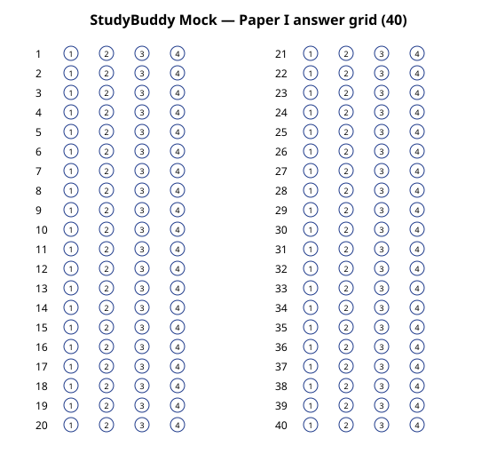

# StudyBuddy — மாதிரிப் பரீட்சைகள் (Mock Exams)

> **இவை உத்தியோகபூர்வ வினாத்தாள்கள் அல்ல.** எல்லா வினாக்களும் StudyBuddy இற்காக எழுதப்பட்ட அசல் (ORIGINAL) வினாக்கள். அமைப்பு 2019 உத்தியோகபூர்வ புள்ளித் திட்டத்திலிருந்து சரிபார்க்கப்பட்ட பரீட்சை வடிவத்தைப் பின்பற்றுகிறது.

| பகுதி | அமைப்பு | புள்ளிகள் |
|---|---|---|
| வினாத்தாள் I (1 மணி) | 40 MCQ × 2 | 80 |
| வினாத்தாள் II A | 4 × 15 (கட்டாயம்) | 60 |
| வினாத்தாள் II B | 5 இல் 3 × 20 | 60 |
| மொத்தம் | | 200 → இறுதிப் புள்ளி = மொத்தம் ÷ 2 (100 இல்) |

OMR விடைத்தாள் மாதிரி: 

---

# மாதிரிப் பரீட்சை 1 (ORIGINAL MOCK 1)

<!-- meta {"type":"mock_exam","id":"MOCK-1","paper1_items":40,"paper1_marks":80,"partA_items":4,"partA_marks":60,"partB_items":5,"partB_answer":3,"partB_marks":60,"total":200,"scaled":100,"origin":"ORIGINAL"} -->

## வினாத்தாள் I — 1 மணிநேரம்

எல்லா வினாக்களுக்கும் விடையளிக்க. ஒவ்வொன்றுக்கும் 2 புள்ளிகள்.

<!-- meta {"type":"mock_mcq","id":"MOCK1-P1-Q01","chapter_id":"SC10-06","answer":2,"marks":2,"origin":"ORIGINAL"} -->
**1.** ×100 இல் பார்வைப் புலத்தின் விட்டம் 2 mm; அதைக் குறுக்காக 5 கலங்கள் நிரப்புகின்றன. ஒரு கலத்தின் உண்மை நீளம் (µm)? (புல விட்டம் உண்மை அளவாகத் தரப்பட்டுள்ளது) `[SC10-06]`

   (1) 4000 µm
   (2) 400 µm
   (3) 200 µm
   (4) 800 µm

<!-- meta {"type":"mock_mcq","id":"MOCK1-P1-Q02","chapter_id":"SC10-01","answer":2,"marks":2,"origin":"ORIGINAL"} -->
**2.** நொதியச் செயற்பாடு–வெப்பநிலை வரைபில் உச்சப் புள்ளி குறிப்பது? `[SC10-01]`

   (1) இயல்பிழப்பு வெப்பநிலை
   (2) உகந்த வெப்பநிலை
   (3) உறைநிலை
   (4) கொதிநிலை

<!-- meta {"type":"mock_mcq","id":"MOCK1-P1-Q03","chapter_id":"SC10-16","answer":2,"marks":2,"origin":"ORIGINAL"} -->
**3.** தாக்கத்திறன் கூடிய உலோகங்கள் பிரித்தெடுக்கப்படுவது? `[SC10-16]`

   (1) காபனால் தாழ்த்தல்
   (2) மின்பகுப்பு
   (3) வெப்பமேற்றல் மட்டும்
   (4) நீரில் கழுவுதல்

<!-- meta {"type":"mock_mcq","id":"MOCK1-P1-Q04","chapter_id":"SC11-11","answer":1,"marks":2,"origin":"ORIGINAL"} -->
**4.** ஒலிவாங்கி செயற்படும் கொள்கை? `[SC11-11]`

   (1) மின்காந்தத் தூண்டல் (அசையும் சுருள் வகை)
   (2) முறிவு
   (3) மாசூட்டல்
   (4) வெப்ப விரிவு

<!-- meta {"type":"mock_mcq","id":"MOCK1-P1-Q05","chapter_id":"SC11-04","answer":2,"marks":2,"origin":"ORIGINAL"} -->
**5.** மீடிறனைக் கூட்டினால் (வேகம் மாறாமல்) அலைநீளம்? `[SC11-04]`

   (1) கூடும்
   (2) குறையும்
   (3) மாறாது
   (4) 0

<!-- meta {"type":"mock_mcq","id":"MOCK1-P1-Q06","chapter_id":"SC10-13","answer":2,"marks":2,"origin":"ORIGINAL"} -->
**6.** உற்பத்தியாளரிடம் 50 000 kJ. 10% விதிப்படி இரண்டாம் நிலை நுகர்வோருக்குக் கிடைப்பது? `[SC10-13]`

   (1) 1000 kJ
   (2) 500 kJ
   (3) 5000 kJ
   (4) 250 kJ

<!-- meta {"type":"mock_mcq","id":"MOCK1-P1-Q07","chapter_id":"SC10-20","answer":2,"marks":2,"origin":"ORIGINAL"} -->
**7.** பரம்பரை அலகு என்பது? `[SC10-20]`

   (1) புரதம்
   (2) DNA துண்டு
   (3) குழியவுரு
   (4) இலிப்பிட்டு

<!-- meta {"type":"mock_mcq","id":"MOCK1-P1-Q08","chapter_id":"SC11-05","answer":3,"marks":2,"origin":"ORIGINAL"} -->
**8.** ஒளி ஊடகம் மாறும்போது மாறாதது? `[SC11-05]`

   (1) வேகம்
   (2) அலைநீளம்
   (3) மீடிறன்
   (4) திசை

<!-- meta {"type":"mock_mcq","id":"MOCK1-P1-Q09","chapter_id":"SC10-09","answer":4,"marks":2,"origin":"ORIGINAL"} -->
**9.** 4 kg பொருளில் 20 N வலதும் 8 N இடதும். ஆர்முடுகல்? `[SC10-09]`

   (1) 6 m s⁻²
   (2) 30 m s⁻²
   (3) 1.5 m s⁻²
   (4) 3 m s⁻²

<!-- meta {"type":"mock_mcq","id":"MOCK1-P1-Q10","chapter_id":"SC11-14","answer":2,"marks":2,"origin":"ORIGINAL"} -->
**10.** பிளாத்திக்கு மாசடைதலைக் குறைக்கச் சிறந்தது? `[SC11-14]`

   (1) எரித்தல்
   (2) 4R — குறைத்தல், மீள்பாவனை, மீள்சுழற்சி
   (3) கடலில் வீசுதல்
   (4) புதைத்தல்

<!-- meta {"type":"mock_mcq","id":"MOCK1-P1-Q11","chapter_id":"SC10-06","answer":4,"marks":2,"origin":"ORIGINAL"} -->
**11.** ×400 இல் ஒரு கலத்தின் விம்ப நீளம் 8 mm. உண்மை நீளம் (µm)? `[SC10-06]`

   (1) 40 µm
   (2) 200 µm
   (3) 10 µm
   (4) 20 µm

<!-- meta {"type":"mock_mcq","id":"MOCK1-P1-Q12","chapter_id":"SC10-15","answer":3,"marks":2,"origin":"ORIGINAL"} -->
**12.** 800 N நிறையுடைய பெட்டி 0.04 m² பரப்பில் நிற்கிறது. அமுக்கம்? `[SC10-15]`

   (1) 40000 Pa
   (2) 2 × 10⁵ Pa
   (3) 20000 Pa
   (4) 10000 Pa

<!-- meta {"type":"mock_mcq","id":"MOCK1-P1-Q13","chapter_id":"SC10-18","answer":1,"marks":2,"origin":"ORIGINAL"} -->
**13.** வினைத்திறன் எப்போதும் 100% க்குக் குறைவு. காரணம்? `[SC10-18]`

   (1) சக்தியின் ஒரு பகுதி வெப்பம், ஒலியாக வீணாதல்
   (2) சக்தி அழிதல்
   (3) சக்தி உருவாதல்
   (4) நிறை

<!-- meta {"type":"mock_mcq","id":"MOCK1-P1-Q14","chapter_id":"SC11-01","answer":1,"marks":2,"origin":"ORIGINAL"} -->
**14.** தாவரங்களில் இளம் தண்டுகளுக்குப் பொறிமுறை ஆதாரம் தரும் உயிருள்ள இழையம்? `[SC11-01]`

   (1) ஒட்டுக்கலவிழையம்
   (2) வல்லருகுக்கலவிழையம்
   (3) காழ்
   (4) பிரியிழையம்

<!-- meta {"type":"mock_mcq","id":"MOCK1-P1-Q15","chapter_id":"SC10-18","answer":4,"marks":2,"origin":"ORIGINAL"} -->
**15.** 40 N விசை பெட்டியை விசைத் திசையில் 6 m நகர்த்துகிறது. வேலை? `[SC10-18]`

   (1) 480 J
   (2) 120 J
   (3) 2400 J
   (4) 240 J

<!-- meta {"type":"mock_mcq","id":"MOCK1-P1-Q16","chapter_id":"SC10-06","answer":2,"marks":2,"origin":"ORIGINAL"} -->
**16.** வாடிய கீரையை நீரில் இட்டதும் விறைப்பாவதில் பங்குகொள்வது? `[SC10-06]`

   (1) இழைமணி
   (2) புன்வெற்றிடம்
   (3) இறைபோசோம்
   (4) கரு

<!-- meta {"type":"mock_mcq","id":"MOCK1-P1-Q17","chapter_id":"SC10-08","answer":2,"marks":2,"origin":"ORIGINAL"} -->
**17.** ஆக்கியா ஆட்சியின் அங்கிகள் அதிகம் காணப்படுவது? `[SC10-08]`

   (1) மிதமான சூழல்
   (2) கடும் சூழல் (உயர் வெப்பம், உப்பு)
   (3) மனித உடல் மட்டும்
   (4) இலைகளில்

<!-- meta {"type":"mock_mcq","id":"MOCK1-P1-Q18","chapter_id":"SC11-08","answer":2,"marks":2,"origin":"ORIGINAL"} -->
**18.** நடுநிலையாக்கத்தில் 100 g கரைசலின் வெப்பநிலை 6.5 °C கூடியது (c = 4200 J kg⁻¹ °C⁻¹). வெளியேறிய வெப்பம்? `[SC11-08]`

   (1) 5460 J
   (2) 2730 J
   (3) 1365 J
   (4) 27300 J

<!-- meta {"type":"mock_mcq","id":"MOCK1-P1-Q19","chapter_id":"SC11-04","answer":4,"marks":2,"origin":"ORIGINAL"} -->
**19.** வளியில் ஒலி 340 m s⁻¹. 17 kHz ஒலியின் அலைநீளம் (cm இல்)? `[SC11-04]`

   (1) 20 cm
   (2) 1 cm
   (3) 4 cm
   (4) 2 cm

<!-- meta {"type":"mock_mcq","id":"MOCK1-P1-Q20","chapter_id":"SC11-08","answer":3,"marks":2,"origin":"ORIGINAL"} -->
**20.** CH₄ தகனம் ΔH = −890 kJ mol⁻¹. 2 mol எரியும்போது வெளியேறும் வெப்பம்? `[SC11-08]`

   (1) 890 kJ
   (2) 3560 kJ
   (3) 1780 kJ
   (4) 17800 kJ

<!-- meta {"type":"mock_mcq","id":"MOCK1-P1-Q21","chapter_id":"SC10-14","answer":1,"marks":2,"origin":"ORIGINAL"} -->
**21.** கருவளர்ச்சியின்போது சிசுவுக்கு உணவும் O₂ உம் வழங்கும் அமைப்பு? `[SC10-14]`

   (1) சூல்வித்தகம் (Placenta)
   (2) சூலகம்
   (3) பலோப்பியன் குழாய்
   (4) கருப்பைக் கழுத்து

<!-- meta {"type":"mock_mcq","id":"MOCK1-P1-Q22","chapter_id":"SC10-09","answer":1,"marks":2,"origin":"ORIGINAL"} -->
**22.** 20 N வடக்கு, 15 N தெற்கு, 5 N தெற்கு — விளையுள்? `[SC10-09]`

   (1) 0
   (2) 40 N
   (3) 10 N வடக்கு
   (4) 10 N தெற்கு

<!-- meta {"type":"mock_mcq","id":"MOCK1-P1-Q23","chapter_id":"SC11-06","answer":2,"marks":2,"origin":"ORIGINAL"} -->
**23.** இன்சுலின் சுரப்புக் குறைபாட்டால் ஏற்படும் நோய்? `[SC11-06]`

   (1) கண்டக்கழலை
   (2) நீரிழிவு
   (3) இரத்தச்சோகை
   (4) தலசீமியா

<!-- meta {"type":"mock_mcq","id":"MOCK1-P1-Q24","chapter_id":"SC11-08","answer":2,"marks":2,"origin":"ORIGINAL"} -->
**24.** நடுநிலையாக்கத்தின் போது பயன்படும் வெப்பமானியின் வாசிப்பு? `[SC11-08]`

   (1) குறையும்
   (2) கூடும்
   (3) மாறாது
   (4) 0 ஆகும்

<!-- meta {"type":"mock_mcq","id":"MOCK1-P1-Q25","chapter_id":"SC10-03","answer":2,"marks":2,"origin":"ORIGINAL"} -->
**25.** இலத்திரனின் சார்புத் திணிவு ஏறத்தாழ? `[SC10-03]`

   (1) 1
   (2) 1/1840
   (3) 0
   (4) 2

<!-- meta {"type":"mock_mcq","id":"MOCK1-P1-Q26","chapter_id":"SC10-11","answer":2,"marks":2,"origin":"ORIGINAL"} -->
**26.** 50 N விசை 30° சாய்வில் 2 m குறடில். செங்குத்துத் தூரம் 1 m எனின் திருப்பம்? `[SC10-11]`

   (1) 100 N m
   (2) 50 N m
   (3) 25 N m
   (4) 0

<!-- meta {"type":"mock_mcq","id":"MOCK1-P1-Q27","chapter_id":"SC10-19","answer":2,"marks":2,"origin":"ORIGINAL"} -->
**27.** 3 Ω, 6 Ω சமாந்தரம், அதனுடன் 4 Ω தொடர். மொத்தம்? `[SC10-19]`

   (1) 13 Ω
   (2) 6 Ω
   (3) 2 Ω
   (4) 4.5 Ω

<!-- meta {"type":"mock_mcq","id":"MOCK1-P1-Q28","chapter_id":"SC11-10","answer":2,"marks":2,"origin":"ORIGINAL"} -->
**28.** மாதம் 120 அலகுகள் நுகர்ந்தால் — அலகு என்பது? `[SC11-10]`

   (1) 120 kW
   (2) 120 kWh
   (3) 120 J
   (4) 120 W

<!-- meta {"type":"mock_mcq","id":"MOCK1-P1-Q29","chapter_id":"SC10-04","answer":2,"marks":2,"origin":"ORIGINAL"} -->
**29.** 2 kg பொருள் 4 m s⁻¹ இலிருந்து 10 m s⁻¹ க்கு 3 s இல் மாறியது. தேவையான விசை? `[SC10-04]`

   (1) 2 N
   (2) 4 N
   (3) 6 N
   (4) 12 N

<!-- meta {"type":"mock_mcq","id":"MOCK1-P1-Q30","chapter_id":"SC10-05","answer":1,"marks":2,"origin":"ORIGINAL"} -->
**30.** சதுரங்கக் காய்களின் அடியில் துணி ஒட்டுவதன் நோக்கம்? `[SC10-05]`

   (1) உராய்வைக் குறைக்க/கீறல் தவிர்க்க
   (2) நிறையைக் கூட்ட
   (3) காந்தம்
   (4) நிறம்

<!-- meta {"type":"mock_mcq","id":"MOCK1-P1-Q31","chapter_id":"SC11-03","answer":2,"marks":2,"origin":"ORIGINAL"} -->
**31.** வினாகிரிக் கரைசலில் அசற்றிக்கமிலச் செறிவைக் கூட்ட எளிய முறை? (2019 வினாத்தாள் II வி6C வகை) `[SC11-03]`

   (1) வடிகட்டல்
   (2) பகுதிபடக் காய்ச்சிவடித்தல்/ஆவியாக்கி நீரை அகற்றல்
   (3) நிறப்பகுப்பு
   (4) பிரிபுனல்

<!-- meta {"type":"mock_mcq","id":"MOCK1-P1-Q32","chapter_id":"SC10-10","answer":1,"marks":2,"origin":"ORIGINAL"} -->
**32.** உயர் உருகுநிலையுடைய, நீரில் கரைந்து கடத்தும் பதார்த்தம் பெரும்பாலும்? `[SC10-10]`

   (1) அயன் சேர்வை
   (2) பங்கீட்டுவலு வாயு
   (3) சடத்துவ வாயு
   (4) உலோகம்

<!-- meta {"type":"mock_mcq","id":"MOCK1-P1-Q33","chapter_id":"SC11-13","answer":3,"marks":2,"origin":"ORIGINAL"} -->
**33.** இலட்சிய நிலைமாற்றி: Vp = 240 V, Ip = 0.5 A, Vs = 12 V. Is? `[SC11-13]`

   (1) 20 A
   (2) 5 A
   (3) 10 A
   (4) 100 A

<!-- meta {"type":"mock_mcq","id":"MOCK1-P1-Q34","chapter_id":"SC11-15","answer":1,"marks":2,"origin":"ORIGINAL"} -->
**34.** பின்வருவனவற்றுள் 'மீள்பாவனை' (Reuse)? `[SC11-15]`

   (1) போத்தலை மீண்டும் நீர் நிரப்பப் பயன்படுத்தல்
   (2) போத்தலை உருக்கிப் புதிது செய்தல்
   (3) போத்தல் வாங்காமை
   (4) எரித்தல்

<!-- meta {"type":"mock_mcq","id":"MOCK1-P1-Q35","chapter_id":"SC11-09","answer":1,"marks":2,"origin":"ORIGINAL"} -->
**35.** குளிர்பானப் போத்தலின் வெளிப்புறத்தில் நீர்த்துளிகள்? `[SC11-09]`

   (1) ஒடுங்கல்
   (2) ஆவியாதல்
   (3) கொதித்தல்
   (4) உருகல்

<!-- meta {"type":"mock_mcq","id":"MOCK1-P1-Q36","chapter_id":"SC11-13","answer":1,"marks":2,"origin":"ORIGINAL"} -->
**36.** இலட்சிய நிலைமாற்றியில் Vp = 240 V, Ip = 0.5 A, Vs = 12 V. Is? `[SC11-13]`

   (1) 10 A
   (2) 0.025 A
   (3) 5 A
   (4) 1 A

<!-- meta {"type":"mock_mcq","id":"MOCK1-P1-Q37","chapter_id":"SC10-15","answer":2,"marks":2,"origin":"ORIGINAL"} -->
**37.** ஒரே ஆழத்தில் திரவ அமுக்கம்? `[SC10-15]`

   (1) கீழ்நோக்கி மட்டும்
   (2) எல்லாத் திசைகளிலும் சமம்
   (3) மேல்நோக்கி மட்டும்
   (4) பக்கவாட்டில் இல்லை

<!-- meta {"type":"mock_mcq","id":"MOCK1-P1-Q38","chapter_id":"SC10-15","answer":4,"marks":2,"origin":"ORIGINAL"} -->
**38.** நீரியல் தூக்கியில் சிறிய முசலம் 5 cm², பெரியது 200 cm². சிறியதில் 150 N பிரயோகித்தால் பெரியதில் விசை? `[SC10-15]`

   (1) 12000 N
   (2) 60000 N
   (3) 3000 N
   (4) 6000 N

<!-- meta {"type":"mock_mcq","id":"MOCK1-P1-Q39","chapter_id":"SC10-02","answer":3,"marks":2,"origin":"ORIGINAL"} -->
**39.** ஒரு சைக்கிளோட்டி 120 m தூரத்தை 15 s இல் கடக்கிறார். சராசரிக் கதியைக் காண்க. `[SC10-02]`

   (1) 80 m s⁻¹
   (2) 16 m s⁻¹
   (3) 8 m s⁻¹
   (4) 4 m s⁻¹

<!-- meta {"type":"mock_mcq","id":"MOCK1-P1-Q40","chapter_id":"SC10-13","answer":1,"marks":2,"origin":"ORIGINAL"} -->
**40.** உணவு வலையில் ஒரு தாவர உண்ணி அழிந்தால் உடனடியாக அதிகரிக்கக்கூடியது? `[SC10-13]`

   (1) அது உண்ட தாவரம்
   (2) அதை உண்ட கொன்றுண்ணி
   (3) சூரிய ஒளி
   (4) மண் pH

## வினாத்தாள் II — 3 மணிநேரம் (+10 நிமிட வாசிப்பு)

### பகுதி A — எல்லா வினாக்களுக்கும் விடையளிக்க (ஒவ்வொன்றும் 15 புள்ளிகள்)

<!-- meta {"type":"mock_structured","id":"MOCK1-P2A-Q1","chapter_ids":["SC10-06","SC11-01"],"marks":15,"origin":"ORIGINAL"} -->
**வினா 1. கலங்களும் இழையங்களும்** `[SC10-06, SC11-01]`

- **A(i)** தாவரக் கலத்தில் மட்டும் காணப்படும் இரு புன்னங்கங்களைப் பெயரிடுக. *[2]*
- **A(ii)** இழைமணியின் தொழில் யாது? *[1]*
- **A(iii)** ×10 பார்வைத்துண்டும் ×40 பொருள்வில்லையும் பயன்படுத்தப்பட்டன. மொத்த உருப்பெருக்கம்? *[1]*
- **A(iv)** மேற்படி உருப்பெருக்கத்தில் ஒரு கலத்தின் விம்பம் 12 mm. உண்மை நீளத்தை µm இல் காண்க. *[2]*
- **B(i)** காழ், உரியம் ஆகியவற்றின் ஒவ்வொரு தொழிலைத் தருக. *[2]*
- **B(ii)** விலங்கு இழையத்தின் நான்கு பிரதான வகைகளைப் பெயரிடுக. *[2]*
- **B(iii)** இரத்தம் எவ்வகை இழையம்? *[1]*
- **C(i)** ஒரு கலம் பல கருக்களைக் கொண்டிருப்பதற்கு ஓர் உதாரணம் தருக. *[1]*
- **C(ii)** இலையின் வேலிக்காப்பு இழையக் கலங்களில் பச்சையவுருமணிகள் அதிகம் காணப்படுவதன் நன்மை? *[2]*
- **C(iii)** கலக் கொள்கையின் ஒரு கூற்றைத் தருக. *[1]*

<!-- meta {"type":"mock_structured","id":"MOCK1-P2A-Q2","chapter_ids":["SC10-02","SC10-04"],"marks":15,"origin":"ORIGINAL"} -->
**வினா 2. நேர்கோட்டு இயக்கம்** `[SC10-02, SC10-04]`

- **A(i)** இடப்பெயர்ச்சி, கதி இவற்றுள் காவிக் கணியம் எது? *[1]*
- **A(ii)** ஒரு கார் ஓய்விலிருந்து 8 s இல் 24 m s⁻¹ ஐ அடைகிறது. ஆர்முடுகல்? *[2]*
- **A(iii)** பின் 10 s சீரான வேகத்தில் செல்கிறது. இக்காலத்தில் இடப்பெயர்ச்சி? *[2]*
- **A(iv)** பின் 6 s இல் சீராக நிறுத்தப்படுகிறது. முழு இயக்கத்துக்குமான v–t வரைபை வரைந்து (பருமட்டாக) மொத்த இடப்பெயர்ச்சியைக் காண்க. *[4]*
- **B(i)** காரின் திணிவு 1000 kg எனின் முதல் 8 s இல் விளையுள் விசை? *[2]*
- **B(ii)** நிறுத்தும்போது பயணிகள் முன்னோக்கிச் சாய்வதை விளக்கும் விதி? *[1]*
- **B(iii)** இருக்கைப் பட்டி இதிலிருந்து எவ்வாறு பாதுகாக்கிறது? *[1]*
- **B(iv)** முதல் 8 s முடிவில் காரின் உந்தம்? *[2]*

<!-- meta {"type":"mock_structured","id":"MOCK1-P2A-Q3","chapter_ids":["SC10-03","SC10-10"],"marks":15,"origin":"ORIGINAL"} -->
**வினா 3. அணுக் கட்டமைப்பும் ஆவர்த்தன அட்டவணையும்** `[SC10-03, SC10-10]`

- **A(i)** மக்னீசியத்தின் (Z = 12) இலத்திரன் நிலையமைப்பு? *[1]*
- **A(ii)** அதன் கூட்டமும் ஆவர்த்தனமும்? *[2]*
- **A(iii)** Mg உம் O உம் இணையும்போது உருவாகும் பிணைப்பு வகையும் சேர்வையின் சூத்திரமும்? *[2]*
- **A(iv)** Mg இலிருந்து O க்கு இலத்திரன் இடமாற்றத்தைப் புள்ளி–குறுக்கு வரிப்படத்தால் காட்டுக. *[3]*
- **B(i)** ³⁵Cl, ³⁷Cl ஆகியவை எதற்கு உதாரணம்? *[1]*
- **B(ii)** இவை வேறுபடும் உபஅணுத் துணிக்கை? *[1]*
- **B(iii)** Cl₂ மூலக்கூற்றின் பிணைப்பு வகை? *[1]*
- **B(iv)** NaCl இன் உருகுநிலை உயர்வாக இருப்பதற்கான காரணம்? *[2]*
- **B(v)** NaCl திண்மமாக மின்னைக் கடத்தாமைக்கான காரணம்? *[2]*

<!-- meta {"type":"mock_structured","id":"MOCK1-P2A-Q4","chapter_ids":["SC10-07","SC11-03"],"marks":15,"origin":"ORIGINAL"} -->
**வினா 4. மூல் கணிப்புகள்** `[SC10-07, SC11-03]`

- **A(i)** CO₂ இன் சார் மூலக்கூற்றுத் திணிவு? (C = 12, O = 16) *[1]*
- **A(ii)** 22 g CO₂ இல் மூல்? *[2]*
- **A(iii)** அதிலுள்ள மூலக்கூறுகள்? (Nₐ = 6.0 × 10²³) *[2]*
- **B(i)** 0.1 mol dm⁻³ NaOH 500 cm³ தயாரிக்கத் தேவையான NaOH திணிவு? (NaOH = 40) *[3]*
- **B(ii)** தயாரிப்பில் பயன்படும் கண்ணாடி உபகரணம்? *[1]*
- **C(i)** CaCO₃ → CaO + CO₂. 50 g CaCO₃ பிரிகையடைந்தால் உருவாகும் CaO திணிவு? (Ca = 40) *[4]*
- **C(ii)** இத்தாக்கத்தின் வகை? *[1]*
- **C(iii)** வெளியேறும் வாயுவைச் சோதிக்கும் முறை? *[1]*

### பகுதி B — எவையேனும் மூன்று வினாக்களுக்கு விடையளிக்க (ஒவ்வொன்றும் 20 புள்ளிகள்)

<!-- meta {"type":"mock_structured","id":"MOCK1-P2B-Q5","chapter_ids":["SC10-18","SC11-08"],"marks":20,"origin":"ORIGINAL"} -->
**வினா 5. சக்தியும் வலுவும் + தாக்க வெப்பம்** `[SC10-18, SC11-08]`

- **A(i)** 2 kg கல் 5 m உயரத்திலிருந்து விழுகிறது. ஆரம்ப அழுத்தசக்தி? (g = 10) *[2]*
- **A(ii)** நிலத்தை அடையும் வேகம் (வளித் தடை இல்லை)? *[3]*
- **A(iii)** சக்திக் காப்பு விதியைக் கூறுக. *[2]*
- **A(iv)** 60 kg மாணவன் 4 m உயரப் படிகளை 8 s இல் ஏறுகிறான். வலு? *[3]*
- **B(i)** புறவெப்பத் தாக்கம் என்றால் என்ன? ஓர் உதாரணம் தருக. *[2]*
- **B(ii)** NH₄NO₃ நீரில் கரையும்போது வெப்பநிலை குறைகிறது. தாக்க வகை? *[1]*
- **B(iii)** புறவெப்பத் தாக்கத்துக்கான சக்தி மட்ட வரிப்படத்தை வரைக. *[3]*
- **B(iv)** CH₄ தகனம் ΔH = −890 kJ mol⁻¹. 8 g மெதேன் எரியும்போது வெளியேறும் வெப்பம்? (CH₄ = 16) *[3]*
- **B(v)** இரசாயனப் பிணைப்புகள் முறிவதும் உருவாவதும் தொடர்பாக ΔH மறையாவதை விளக்குக. *[1]*

<!-- meta {"type":"mock_structured","id":"MOCK1-P2B-Q6","chapter_ids":["SC11-06","SC10-15"],"marks":20,"origin":"ORIGINAL"} -->
**வினா 6. சுவாசமும் கழிவகற்றலும் + அமுக்கம்** `[SC11-06, SC10-15]`

- **A(i)** உட்சுவாசத்தின்போது பிரிமென்றகட்டுக்கும் விலா இடைத்தசைகளுக்கும் நிகழ்வது? *[3]*
- **A(ii)** சிற்றறைகளின் வாயுப் பரிமாற்றத்துக்கான இரு இசைவாக்கங்கள்? *[2]*
- **A(iii)** காற்றுச் சுவாசச் சமன்பாடு? *[2]*
- **B(i)** நெப்பிரோனில் மீவடிகட்டல் நிகழும் இடம்? *[1]*
- **B(ii)** சாதாரண சிறுநீரில் இல்லாத இரு கூறுகள்? *[2]*
- **B(iii)** ADH இன் தொழில்? *[2]*
- **C(i)** விமானம் மேலெழும்போது காதில் அசௌகரியம் ஏற்படுவதை விளக்குக. *[3]*
- **C(ii)** கடல் மட்ட வளிமண்டல அமுக்கம் (Pa)? *[1]*
- **C(iii)** 10 m நீர் ஆழத்தில் மொத்த அமுக்கம்? (ρ = 1000, g = 10) *[4]*

<!-- meta {"type":"mock_structured","id":"MOCK1-P2B-Q7","chapter_ids":["SC11-10","SC11-11"],"marks":20,"origin":"ORIGINAL"} -->
**வினா 7. மின் சாதனங்கள் + இலத்திரனியல்** `[SC11-10, SC11-11]`

- **A(i)** 230 V, 1150 W மின் அழுத்தியின் மின்னோட்டம்? *[2]*
- **A(ii)** நாளுக்கு 30 நிமிடம், 30 நாட்கள். நுகரும் அலகுகள்? *[3]*
- **A(iii)** அலகு ரூ. 40 எனின் செலவு? *[1]*
- **A(iv)** 3 A, 5 A, 13 A உருகிகளில் பொருத்தமானது? காரணம்? *[2]*
- **A(v)** புவித்தொடுப்பின் பாதுகாப்புப் பங்கு? *[2]*
- **B(i)** n-வகை அரைக்கடத்தி தயாரிக்கப் பயன்படும் மாசு மூலகம்? *[1]*
- **B(ii)** இருவாயியின் முற்சார்பு இணைப்பை வரைந்து விளக்குக. *[3]*
- **B(iii)** பொது அறிவிப்புத் தொகுதியின் மூன்று பகுதிகளும் சக்தி மாற்றங்களும்? *[3]*
- **B(iv)** திரான்சிஸ்டரின் மூன்று முனைகள்? *[2]*
- **B(v)** LDR ஐ ஆளியாகக் கொண்ட தானியங்கி வீதி விளக்கின் இயக்கத்தை ஒரு வாக்கியத்தில் கூறுக. *[1]*

<!-- meta {"type":"mock_structured","id":"MOCK1-P2B-Q8","chapter_ids":["SC10-14","SC11-03"],"marks":20,"origin":"ORIGINAL"} -->
**வினா 8. உயிரின் தொடர்ச்சி + கலவைகள்** `[SC10-14, SC11-03]`

- **A(i)** இழையுருப்பிரிவுக்கும் ஒடுக்கற்பிரிவுக்கும் இடையிலான மூன்று வேறுபாடுகள்? *[3]*
- **A(ii)** மனிதனில் கருக்கட்டல் நிகழும் இடம்? *[1]*
- **A(iii)** தாவரங்களில் இலிங்கமில் இனப்பெருக்கத்துக்கு இரு உதாரணங்கள்? *[2]*
- **A(iv)** பூவின் ஆண், பெண் பகுதிகளைப் பெயரிடுக. *[2]*
- **A(v)** பூச்சி மகரந்தச் சேர்க்கைப் பூக்களின் இரு இயல்புகள்? *[2]*
- **B(i)** கொதித்த நீர் ஆறும்போது மீன் தொட்டியில் இடக்கூடாததற்கான காரணம்? *[2]*
- **B(ii)** 0.2 mol dm⁻³ கரைசல் 250 cm³ இல் கரையத்தின் மூல்? *[2]*
- **B(iii)** வினாகிரி: அடர்த்தி 1.02 g cm⁻³, 250 cm³ — திணிவு? *[2]*
- **B(iv)** அதில் 5% (திணிவு) அசற்றிக்கமிலம் — அமிலத் திணிவு? *[2]*
- **B(v)** அதன் மூலர்ச் செறிவு? (CH₃COOH = 60) *[2]*

<!-- meta {"type":"mock_structured","id":"MOCK1-P2B-Q9","chapter_ids":["SC11-13","SC10-08"],"marks":20,"origin":"ORIGINAL"} -->
**வினா 9. மின்காந்தவியல் + அங்கிகளின் சிறப்பியல்புகள்** `[SC11-13, SC10-08]`

- **A(i)** சட்டக் காந்தத்தின் புலக் கோடுகளை வரைக. *[2]*
- **A(ii)** மின்காந்தத்தின் வலிமையைக் கூட்டும் இரு வழிகள்? *[2]*
- **A(iii)** DC மோட்டரின் இயக்கக் கொள்கை? *[2]*
- **A(iv)** நிலைமாற்றி: Np = 2000, Ns = 100, Vp = 230 V. Vs? *[2]*
- **A(v)** வினைத்திறன் 92%, முதன்மை வலு 50 W. துணை வலு? *[2]*
- **B(i)** உயிரங்கிகளின் ஐந்து சிறப்பியல்புகள்? *[5]*
- **B(ii)** இருசொற் பெயரீட்டு முறையைப் பயன்படுத்தி மனிதனின் விஞ்ஞானப் பெயரை எழுதி அதன் இரு பகுதிகளைக் குறிக்குக. *[3]*
- **B(iii)** முள்ளந்தண்டுளிகளின் ஐந்து வகுப்புகள்? *[2]*

## மாதிரிப் பரீட்சை 1 — விடைச் சாவியும் புள்ளித் திட்டமும்

வினாத்தாள் I விடைகள்

| வினா | விடை | அத்தியாயம் | வினா | விடை | அத்தியாயம் |
|---|---|---|---|---|---|
| 1 | 2 | SC10-06 | 21 | 1 | SC10-14 |
| 2 | 2 | SC10-01 | 22 | 1 | SC10-09 |
| 3 | 2 | SC10-16 | 23 | 2 | SC11-06 |
| 4 | 1 | SC11-11 | 24 | 2 | SC11-08 |
| 5 | 2 | SC11-04 | 25 | 2 | SC10-03 |
| 6 | 2 | SC10-13 | 26 | 2 | SC10-11 |
| 7 | 2 | SC10-20 | 27 | 2 | SC10-19 |
| 8 | 3 | SC11-05 | 28 | 2 | SC11-10 |
| 9 | 4 | SC10-09 | 29 | 2 | SC10-04 |
| 10 | 2 | SC11-14 | 30 | 1 | SC10-05 |
| 11 | 4 | SC10-06 | 31 | 2 | SC11-03 |
| 12 | 3 | SC10-15 | 32 | 1 | SC10-10 |
| 13 | 1 | SC10-18 | 33 | 3 | SC11-13 |
| 14 | 1 | SC11-01 | 34 | 1 | SC11-15 |
| 15 | 4 | SC10-18 | 35 | 1 | SC11-09 |
| 16 | 2 | SC10-06 | 36 | 1 | SC11-13 |
| 17 | 2 | SC10-08 | 37 | 2 | SC10-15 |
| 18 | 2 | SC11-08 | 38 | 4 | SC10-15 |
| 19 | 4 | SC11-04 | 39 | 3 | SC10-02 |
| 20 | 3 | SC11-08 | 40 | 1 | SC10-13 |

வினாத்தாள் I — சுருக்க விளக்கங்கள்

1. (2) சரியான விடை 400 µm. கோப்பு 5 இல் CL-MICRO (சவால்) எட்டுப் படித் தீர்வைப் பார்க்க.
2. (2) செயற்பாடு அதிகமாகும் வெப்பநிலை உகந்த வெப்பநிலை.
3. (2) Na, Al போன்றவை மின்பகுப்பால்.
4. (1) சுருள் காந்தப் புலத்தில் அதிர்ந்து மின் தூண்டப்படும் (SC11-13).
5. (2) λ = v/f.
6. (2) சரியான விடை 500 kJ. கோப்பு 5 இல் CL-ECO (அடிப்படை) எட்டுப் படித் தீர்வைப் பார்க்க.
7. (2) இயல்பைத் தீர்மானிக்கும் DNA பகுதி.
8. (3) மூலத்தால் தீர்மானிக்கப்படும்.
9. (4) சரியான விடை 3 m s⁻². கோப்பு 5 இல் CL-RESULT (பரீட்சைத் தரம்) எட்டுப் படித் தீர்வைப் பார்க்க.
10. (2) எரித்தல் நச்சு வாயுக்களைத் தரும்.
11. (4) சரியான விடை 20 µm. கோப்பு 5 இல் CL-MICRO (இடைநிலை) எட்டுப் படித் தீர்வைப் பார்க்க.
12. (3) சரியான விடை 20000 Pa. கோப்பு 5 இல் CL-PRESS (அடிப்படை) எட்டுப் படித் தீர்வைப் பார்க்க.
13. (1) பயனற்ற வடிவங்களுக்கு மாறல்.
14. (1) ஒட்டுக்கலவிழையம் உயிருள்ளது, மூலைகளில் தடிப்பு.
15. (4) சரியான விடை 240 J. கோப்பு 5 இல் CL-WORK (அடிப்படை) எட்டுப் படித் தீர்வைப் பார்க்க.
16. (2) புன்வெற்றிடம் நீரை உறிஞ்சி வீக்கவமுக்கம் உருவாகும்.
17. (2) ஆக்கியாக்கள் பெரும்பாலும் தீவிரச் சூழல்களில் வாழும்.
18. (2) சரியான விடை 2730 J. கோப்பு 5 இல் CL-ENTH (பரீட்சைத் தரம்) எட்டுப் படித் தீர்வைப் பார்க்க.
19. (4) சரியான விடை 2 cm. கோப்பு 5 இல் CL-WAVE (இடைநிலை) எட்டுப் படித் தீர்வைப் பார்க்க.
20. (3) சரியான விடை 1780 kJ. கோப்பு 5 இல் CL-ENTH (அடிப்படை) எட்டுப் படித் தீர்வைப் பார்க்க.
21. (1) சூல்வித்தகம் தாய்–சிசு பரிமாற்றம்.
22. (1) 20 − 20 = 0.
23. (2) குருதி குளுக்கோசு உயர்வு.
24. (2) புறவெப்பம்.
25. (2) புரோத்தனின் திணிவில் ≈ 1/1840.
26. (2) செங்குத்துத் தூரம் பயன்படும்: 50 × 1.
27. (2) 2 + 4 = 6 Ω.
28. (2) அலகு = kWh.
29. (2) a = 6/3 = 2; F = 2 × 2 = 4 N.
30. (1) மென்மையான நகர்வு.
31. (2) நீரை அகற்றக் கொதிநிலை வேறுபாடு.
32. (1) அயன் சேர்வைகளின் இயல்புகள்.
33. (3) சரியான விடை 10 A. கோப்பு 5 இல் CL-TRANS (பரீட்சைத் தரம்) எட்டுப் படித் தீர்வைப் பார்க்க.
34. (1) அதே வடிவில் மீண்டும் பயன்படுத்தல்.
35. (1) வளி நீராவி குளிர்ந்து ஒடுங்கும்.
36. (1) 240 × 0.5 = 12 × Is.
37. (2) திரவ அமுக்கப் பண்பு.
38. (4) சரியான விடை 6000 N. கோப்பு 5 இல் CL-PRESS (பரீட்சைத் தரம்) எட்டுப் படித் தீர்வைப் பார்க்க.
39. (3) சரியான விடை 8 m s⁻¹. கோப்பு 5 இல் CL-SPEED (அடிப்படை) எட்டுப் படித் தீர்வைப் பார்க்க.
40. (1) உண்ணப்படுவது குறைந்ததால் தாவரம் பெருகும்.

வினாத்தாள் II புள்ளித் திட்டம்

**வினா 1 (15 புள்ளிகள்)**

- A(i) [2] கலச்சுவர், பச்சையவுருமணி (பெரிய நிலையான புன்வெற்றிடமும் ஏற்கப்படலாம்).
- A(ii) [1] காற்றுச் சுவாசம் — ATP வடிவில் சக்தி உற்பத்தி.
- A(iii) [1] ×400.
- A(iv) [2] 12/400 = 0.03 mm = 30 µm.
- B(i) [2] காழ் — நீர், கனியுப்புக் கடத்தல் (+ ஆதாரம்); உரியம் — தொகுக்கப்பட்ட உணவு கடத்தல்.
- B(ii) [2] மேலணி, இணைப்பு, தசை, நரம்பு.
- B(iii) [1] இணைப்பிழையம் (திரவ இணைப்பிழையம்).
- C(i) [1] வன்கூட்டுத் தசைக் கலம் (இழை).
- C(ii) [2] மேற்பரப்புக்கு அண்மையில் அதிக ஒளியை உறிஞ்சி ஒளித்தொகுப்பைப் பெருக்கல்.
- C(iii) [1] எல்லா அங்கிகளும் கலங்களால் ஆனவை / கலம் அடிப்படை அலகு / கலங்கள் முன்னிருந்த கலங்களிலிருந்து தோன்றும்.

**வினா 2 (15 புள்ளிகள்)**

- A(i) [1] இடப்பெயர்ச்சி.
- A(ii) [2] a = 24/8 = 3 m s⁻².
- A(iii) [2] 24 × 10 = 240 m.
- A(iv) [4] வரைபு: (0,0)→(8,24)→(18,24)→(24,0) [2]; பரப்பு = ½·8·24 + 240 + ½·6·24 = 96 + 240 + 72 = 408 m [2].
- B(i) [2] F = ma = 1000 × 3 = 3000 N.
- B(ii) [1] நியூற்றனின் முதலாம் விதி (சடத்துவம்).
- B(iii) [1] உடலில் பின்னோக்கிய விசை செலுத்தி முன்னோக்கிய இயக்கத்தைத் தடுத்தல்.
- B(iv) [2] p = 1000 × 24 = 24 000 kg m s⁻¹.

**வினா 3 (15 புள்ளிகள்)**

- A(i) [1] 2, 8, 2.
- A(ii) [2] கூட்டம் 2, ஆவர்த்தனம் 3.
- A(iii) [2] அயன் பிணைப்பு; MgO.
- A(iv) [3] Mg 2 இலத்திரன்களை இழந்து Mg²⁺ (2,8); O 2 இலத்திரன்களைப் பெற்று O²⁻ (2,8) — வரிப்படம் [3].
- B(i) [1] சமதானிகள்.
- B(ii) [1] நியூத்திரன் எண்ணிக்கை.
- B(iii) [1] முனைவற்ற பங்கீட்டு வலுப் பிணைப்பு.
- B(iv) [2] எதிர் ஏற்ற அயன்களுக்கிடையிலான வலிய நிலைமின் கவர்ச்சி — அதிக சக்தி தேவை.
- B(v) [2] அயன்கள் சாலகத்தில் நிலையாக உள்ளன; அசைய முடியாது.

**வினா 4 (15 புள்ளிகள்)**

- A(i) [1] 44.
- A(ii) [2] 22/44 = 0.5 mol.
- A(iii) [2] 0.5 × 6.0 × 10²³ = 3.0 × 10²³.
- B(i) [3] n = 0.1 × 0.5 = 0.05 mol [1]; m = 0.05 × 40 = 2.0 g [2].
- B(ii) [1] கனவளவுக் குடுவை (volumetric flask).
- C(i) [4] n(CaCO₃) = 50/100 = 0.5 [2]; CaO = 0.5 × 56 = 28 g [2].
- C(ii) [1] வெப்பப் பிரிகை.
- C(iii) [1] சுண்ணாம்பு நீரைப் பால் நிறமாக்கும்.

**வினா 5 (20 புள்ளிகள்)**

- A(i) [2] 100 J.
- A(ii) [3] ½·2·v² = 100 → v = 10 m s⁻¹.
- A(iii) [2] சக்தியை ஆக்கவோ அழிக்கவோ முடியாது; ஒரு வடிவிலிருந்து மற்றொன்றுக்கு மாற்றலாம்.
- A(iv) [3] W = 2400 J; P = 300 W.
- B(i) [2] சூழலுக்கு வெப்பத்தை வெளியிடும் தாக்கம்; தகனம்/நடுநிலையாக்கல்.
- B(ii) [1] அகவெப்பம்.
- B(iii) [3] தாக்கிகள் மேல், விளைவுகள் கீழ், ΔH மறை அம்பு (GR-D05).
- B(iv) [3] n = 0.5; 445 kJ.
- B(v) [1] உருவாகும் பிணைப்புகள் வெளியிடும் சக்தி > முறியும் பிணைப்புகள் உறிஞ்சும் சக்தி.

**வினா 6 (20 புள்ளிகள்)**

- A(i) [3] பிரிமென்றகடு சுருங்கித் தட்டையாகும்; வெளி விலா இடைத்தசைகள் சுருங்கி விலாக்கள் மேல், வெளியே — நெஞ்சறைக் கனவளவு கூடி அமுக்கம் குறையும்.
- A(ii) [2] மெல்லிய சுவர், அதிக மேற்பரப்பு, ஈரலிப்பு, மயிர்த்துளைக் குழாய் வலை.
- A(iii) [2] C₆H₁₂O₆ + 6O₂ → 6CO₂ + 6H₂O + சக்தி.
- B(i) [1] கலனுருச்சிறுதிரள் — போமனின் உறை.
- B(ii) [2] குளுக்கோசு, புரதம் (குருதிக் கலங்கள்).
- B(iii) [2] சேகரிக்கும் கானில் நீர் மீளுறிஞ்சலைக் கூட்டல்.
- C(i) [3] வெளி வளியமுக்கம் குறைய, நடுச்செவியின் உள் அமுக்கம் கூடுதலாகிச் செவிப்பறை வெளிப்புறமாகத் தள்ளப்படும்.
- C(ii) [1] ≈ 1.0 × 10⁵ Pa.
- C(iii) [4] திரவம் 1.0 × 10⁵ [2] + வளிமண்டலம் 1.0 × 10⁵ [1] = 2.0 × 10⁵ Pa [1].

**வினா 7 (20 புள்ளிகள்)**

- A(i) [2] 5 A.
- A(ii) [3] 1.15 kW × 15 h = 17.25 kWh.
- A(iii) [1] ரூ. 690.
- A(iv) [2] 13 A — 5 A ஐ விடக் கூடிய அடுத்த பெறுமானம் (5 A உருகி இயல்பு மின்னோட்டத்தில் உருகக்கூடும்).
- A(v) [2] கசிவு மின்னோட்டம் புவிக்குச் சென்று உருகி உருகும் — அதிர்ச்சி தவிர்ப்பு.
- B(i) [1] பொசுபரசு / ஆசனிக்கு.
- B(ii) [3] p பக்கம் + முனைக்கு, n பக்கம் − முனைக்கு; மின்னோட்டம் பாயும்.
- B(iii) [3] ஒலிவாங்கி (ஒலி→மின்), விரியலாக்கி, ஒலிபெருக்கி (மின்→ஒலி).
- B(iv) [2] காலி, அடி, சேகரிப்பான்.
- B(v) [1] இருட்டில் LDR தடை கூடி திரான்சிஸ்டர் ON ஆகி விளக்கு எரியும்.

**வினா 8 (20 புள்ளிகள்)**

- A(i) [3] மகட்கலங்கள் 2 vs 4; நிறமூர்த்த எண் மாறாது vs அரைவாசி; வளர்ச்சி vs புணரி உருவாக்கம்.
- A(ii) [1] பலோப்பியன் குழாய் (முட்டைக்கான்).
- A(iii) [2] கிழங்கு (உருளைக்கிழங்கு), ஓடி, ஒட்டுதல், பதிவைத்தல்.
- A(iv) [2] கேசரம் (மகரந்தக்கூடு, இழை); சூலகம் (சூலகமுடி, சூல்தண்டு, சூலகம்).
- A(v) [2] நிறமுடைய அல்லியிதழ்கள், மணம், தேன்.
- B(i) [2] கரைந்த O₂ வெளியேறியிருக்கும்.
- B(ii) [2] 0.05 mol.
- B(iii) [2] 255 g.
- B(iv) [2] 12.75 g.
- B(v) [2] n = 0.2125 mol; C = 0.85 mol dm⁻³.

**வினா 9 (20 புள்ளிகள்)**

- A(i) [2] N→S, மூடிய வளைகோடுகள் (PHY-D04).
- A(ii) [2] சுற்றுகளைக் கூட்டல், மின்னோட்டத்தைக் கூட்டல், மென் இரும்பு அகணி.
- A(iii) [2] காந்தப் புலத்திலுள்ள மின்னோட்டக் கடத்தியில் விசை (இடக்கை விதி).
- A(iv) [2] 11.5 V.
- A(v) [2] 46 W.
- B(i) [5] போசணை, சுவாசம், கழிவகற்றல், அசைவு, உணர்திறன், வளர்ச்சி, இனப்பெருக்கம் (ஏதேனும் 5).
- B(ii) [3] Homo sapiens — சாதி (Homo), இனம் (sapiens).
- B(iii) [2] மீன், ஈரூடகவாழி, ஊர்வன, பறவை, முலையூட்டி.

**புள்ளிச் சரிபார்ப்பு:** வினாத்தாள் I = 40 × 2 = 80 · பகுதி A = 15 + 15 + 15 + 15 = 60 · பகுதி B (3 இல்) = 3 × 20 = 60 · மொத்தம் 200 → 100.

*அத்தியாய உள்ளடக்கம்: 30 / 35 அத்தியாயங்கள்.*

---

# மாதிரிப் பரீட்சை 2 (ORIGINAL MOCK 2)

<!-- meta {"type":"mock_exam","id":"MOCK-2","paper1_items":40,"paper1_marks":80,"partA_items":4,"partA_marks":60,"partB_items":5,"partB_answer":3,"partB_marks":60,"total":200,"scaled":100,"origin":"ORIGINAL"} -->

## வினாத்தாள் I — 1 மணிநேரம்

எல்லா வினாக்களுக்கும் விடையளிக்க. ஒவ்வொன்றுக்கும் 2 புள்ளிகள்.

<!-- meta {"type":"mock_mcq","id":"MOCK2-P1-Q01","chapter_id":"SC10-02","answer":2,"marks":2,"origin":"ORIGINAL"} -->
**1.** சீரான ஆர்முடுகலுடைய பொருளின் v–t வரைபு? `[SC10-02]`

   (1) கிடைக்கோடு
   (2) சாய்ந்த நேர்கோடு
   (3) வளைகோடு
   (4) நிலைக்குத்துக் கோடு

<!-- meta {"type":"mock_mcq","id":"MOCK2-P1-Q02","chapter_id":"SC10-06","answer":2,"marks":2,"origin":"ORIGINAL"} -->
**2.** கலத்தின் பரம்பரைத் தகவல் பெரும்பாலும் உள்ள இடம்? `[SC10-06]`

   (1) குழியவுரு
   (2) கரு
   (3) கலச்சுவர்
   (4) புன்வெற்றிடம்

<!-- meta {"type":"mock_mcq","id":"MOCK2-P1-Q03","chapter_id":"SC11-07","answer":2,"marks":2,"origin":"ORIGINAL"} -->
**3.** அமில மண்ணில் சுண்ணாம்பு சேர்ப்பதன் விளைவு? `[SC11-07]`

   (1) pH குறையும்
   (2) pH கூடி நடுநிலைக்கு அண்மிக்கும்
   (3) மண் அமிலமாகும்
   (4) மாற்றம் இல்லை

<!-- meta {"type":"mock_mcq","id":"MOCK2-P1-Q04","chapter_id":"SC11-04","answer":1,"marks":2,"origin":"ORIGINAL"} -->
**4.** ரிவி தொலைவியக்கி (remote) பயன்படுத்தும் கதிர்? `[SC11-04]`

   (1) அகச்சிவப்பு
   (2) புற ஊதா
   (3) X
   (4) காமா

<!-- meta {"type":"mock_mcq","id":"MOCK2-P1-Q05","chapter_id":"SC11-13","answer":3,"marks":2,"origin":"ORIGINAL"} -->
**5.** நிலைமாற்றியில் Np = 1150, Ns = 60, Vp = 230 V. Vs? `[SC11-13]`

   (1) 120 V
   (2) 24 V
   (3) 12 V
   (4) 6 V

<!-- meta {"type":"mock_mcq","id":"MOCK2-P1-Q06","chapter_id":"SC11-02","answer":1,"marks":2,"origin":"ORIGINAL"} -->
**6.** இலைவாய்கள் பெரும்பாலும் இலையின் கீழ்ப்புறத்தில் இருப்பதன் நன்மை? `[SC11-02]`

   (1) நீரிழப்பு குறைவு
   (2) அதிக ஒளி
   (3) அதிக CO₂ உற்பத்தி
   (4) வேகமான வளர்ச்சி

<!-- meta {"type":"mock_mcq","id":"MOCK2-P1-Q07","chapter_id":"SC10-01","answer":2,"marks":2,"origin":"ORIGINAL"} -->
**7.** RNA க்கும் DNA க்கும் பொதுவானது? `[SC10-01]`

   (1) இரட்டைச் சுருளி
   (2) நியூக்கிளியோரைட்டுகளால் ஆனமை
   (3) கலச்சுவரில் இருத்தல்
   (4) சக்தி சேமித்தல்

<!-- meta {"type":"mock_mcq","id":"MOCK2-P1-Q08","chapter_id":"SC11-01","answer":2,"marks":2,"origin":"ORIGINAL"} -->
**8.** நியூரோனின் நீண்ட நீட்சி? `[SC11-01]`

   (1) கிளைமுளை (Dendrite)
   (2) நரம்பிழை (Axon)
   (3) கரு
   (4) கலவுடல்

<!-- meta {"type":"mock_mcq","id":"MOCK2-P1-Q09","chapter_id":"SC10-17","answer":3,"marks":2,"origin":"ORIGINAL"} -->
**9.** ஒரு தாக்கம் 60 s இல் 48 cm³ H₂ ஐத் தருகிறது. சராசரி வீதம்? `[SC10-17]`

   (1) 0.4 cm³ s⁻¹
   (2) 1.6 cm³ s⁻¹
   (3) 0.8 cm³ s⁻¹
   (4) 8 cm³ s⁻¹

<!-- meta {"type":"mock_mcq","id":"MOCK2-P1-Q10","chapter_id":"SC11-10","answer":3,"marks":2,"origin":"ORIGINAL"} -->
**10.** 230 V இல் 5 A மின்னோட்டம் பெறும் சூடாக்கியின் வலு? `[SC11-10]`

   (1) 575 W
   (2) 11500 W
   (3) 1150 W
   (4) 2300 W

<!-- meta {"type":"mock_mcq","id":"MOCK2-P1-Q11","chapter_id":"SC11-11","answer":1,"marks":2,"origin":"ORIGINAL"} -->
**11.** LED இன் நன்மை? `[SC11-11]`

   (1) குறைந்த வலு, நீண்ட ஆயுள்
   (2) அதிக வெப்பம்
   (3) AC யில் மட்டும்
   (4) பெரிய அளவு

<!-- meta {"type":"mock_mcq","id":"MOCK2-P1-Q12","chapter_id":"SC11-09","answer":3,"marks":2,"origin":"ORIGINAL"} -->
**12.** 250 K ஐ °C இல்? `[SC11-09]`

   (1) -230 °C
   (2) -11.5 °C
   (3) -23 °C
   (4) -46 °C

<!-- meta {"type":"mock_mcq","id":"MOCK2-P1-Q13","chapter_id":"SC11-05","answer":1,"marks":2,"origin":"ORIGINAL"} -->
**13.** உண்மை விம்பத்தின் இயல்பு? `[SC11-05]`

   (1) திரையில் பெறலாம்
   (2) எப்போதும் நேரானது
   (3) எப்போதும் பெரியது
   (4) திரையில் பெற முடியாது

<!-- meta {"type":"mock_mcq","id":"MOCK2-P1-Q14","chapter_id":"SC11-10","answer":2,"marks":2,"origin":"ORIGINAL"} -->
**14.** 1500 W மின் அழுத்தி (iron) நாளொன்றுக்கு 2 மணிநேரம், 30 நாட்கள். அலகு ஒன்று ரூ. 32 எனின் கட்டணம்? `[SC11-10]`

   (1) 28800 ரூ.
   (2) 2880 ரூ.
   (3) 5760 ரூ.
   (4) 1440 ரூ.

<!-- meta {"type":"mock_mcq","id":"MOCK2-P1-Q15","chapter_id":"SC10-10","answer":3,"marks":2,"origin":"ORIGINAL"} -->
**15.** பின்வருவனவற்றுள் முனைவற்ற மூலக்கூறு? `[SC10-10]`

   (1) HCl
   (2) H₂O
   (3) Cl₂
   (4) NH₃

<!-- meta {"type":"mock_mcq","id":"MOCK2-P1-Q16","chapter_id":"SC11-06","answer":2,"marks":2,"origin":"ORIGINAL"} -->
**16.** இதய வால்வுகளின் தொழில்? `[SC11-06]`

   (1) குருதியைச் சுத்தமாக்கல்
   (2) குருதி பின்னோக்கிப் பாய்வதைத் தடுத்தல்
   (3) O₂ சேர்த்தல்
   (4) அமுக்கம் குறைத்தல்

<!-- meta {"type":"mock_mcq","id":"MOCK2-P1-Q17","chapter_id":"SC10-15","answer":1,"marks":2,"origin":"ORIGINAL"} -->
**17.** நீர்த் தாங்கியை உயரத்தில் வைப்பதன் நோக்கம்? `[SC10-15]`

   (1) குழாய்களில் அதிக நீரமுக்கம் பெற
   (2) நீர் குளிர
   (3) சுத்தமாக்க
   (4) ஆவியாதல் குறைய

<!-- meta {"type":"mock_mcq","id":"MOCK2-P1-Q18","chapter_id":"SC11-10","answer":1,"marks":2,"origin":"ORIGINAL"} -->
**18.** RCCB/ELCB இன் பயன்? `[SC11-10]`

   (1) கசிவு மின்னோட்டத்தில் விரைவாகத் துண்டித்து அதிர்ச்சி தவிர்த்தல்
   (2) வோல்ற்றளவு கூட்டல்
   (3) சக்தி சேமித்தல்
   (4) ஒளி

<!-- meta {"type":"mock_mcq","id":"MOCK2-P1-Q19","chapter_id":"SC11-15","answer":1,"marks":2,"origin":"ORIGINAL"} -->
**19.** அமில மழையால் பாதிக்கப்படும் கட்டடப் பொருள்? `[SC11-15]`

   (1) சுண்ணக்கல்/பளிங்கு (CaCO₃)
   (2) கண்ணாடி
   (3) பிளாத்திக்கு
   (4) தங்கம்

<!-- meta {"type":"mock_mcq","id":"MOCK2-P1-Q20","chapter_id":"SC10-07","answer":2,"marks":2,"origin":"ORIGINAL"} -->
**20.** Ca(OH)₂ இன் Mr? (Ca=40, O=16, H=1) `[SC10-07]`

   (1) 57
   (2) 74
   (3) 58
   (4) 112

<!-- meta {"type":"mock_mcq","id":"MOCK2-P1-Q21","chapter_id":"SC11-14","answer":3,"marks":2,"origin":"ORIGINAL"} -->
**21.** ஓரினத்தொடர் உறுப்புகளின் இயல்பு அல்லாதது? `[SC11-14]`

   (1) ஒரே பொதுச் சூத்திரம்
   (2) ஒத்த இரசாயன இயல்புகள்
   (3) ஒரே மூலக்கூற்றுத் திணிவு
   (4) CH₂ வேறுபாடு

<!-- meta {"type":"mock_mcq","id":"MOCK2-P1-Q22","chapter_id":"SC10-11","answer":1,"marks":2,"origin":"ORIGINAL"} -->
**22.** நீர்க்குழாய்க் கைப்பிடியைத் திருகுவது எதற்கு உதாரணம்? `[SC10-11]`

   (1) இணை
   (2) சமநிலை
   (3) உராய்வு
   (4) அமுக்கம்

<!-- meta {"type":"mock_mcq","id":"MOCK2-P1-Q23","chapter_id":"SC10-04","answer":1,"marks":2,"origin":"ORIGINAL"} -->
**23.** மேசைத் துணியை விரைவாக இழுத்தபோதும் பாத்திரங்கள் விழாததற்குக் காரணம்? `[SC10-04]`

   (1) சடத்துவம்
   (2) ஈர்ப்பு
   (3) மூன்றாம் விதி
   (4) காந்தம்

<!-- meta {"type":"mock_mcq","id":"MOCK2-P1-Q24","chapter_id":"SC10-19","answer":4,"marks":2,"origin":"ORIGINAL"} -->
**24.** 6 V கலத்துடன் 3 Ω உம் 6 Ω உம் சமாந்தரமாக. கலத்திலிருந்து பெறப்படும் மொத்த மின்னோட்டம்? இரு முறைகளில் சரிபார்க்க. `[SC10-19]`

   (1) 30 A
   (2) 6 A
   (3) 1.5 A
   (4) 3 A

<!-- meta {"type":"mock_mcq","id":"MOCK2-P1-Q25","chapter_id":"SC10-14","answer":3,"marks":2,"origin":"ORIGINAL"} -->
**25.** இழைய வளர்ப்பின் நன்மை அல்லாதது? `[SC10-14]`

   (1) குறுகிய காலம்
   (2) நோயற்ற தாவரங்கள்
   (3) அதிக பரம்பரை வேறுபாடு
   (4) பெருமளவு உற்பத்தி

<!-- meta {"type":"mock_mcq","id":"MOCK2-P1-Q26","chapter_id":"SC10-09","answer":1,"marks":2,"origin":"ORIGINAL"} -->
**26.** விளையுள் விசையின் திசையில் நிகழ்வது? `[SC10-09]`

   (1) ஆர்முடுகல்
   (2) உராய்வு
   (3) நிறை
   (4) சமநிலை

<!-- meta {"type":"mock_mcq","id":"MOCK2-P1-Q27","chapter_id":"SC11-12","answer":1,"marks":2,"origin":"ORIGINAL"} -->
**27.** துருவின் இரசாயனப் பெயர் ஏறத்தாழ? `[SC11-12]`

   (1) Fe₂O₃·xH₂O (நீரேற்றிய இரும்பு(III) ஒட்சைட்டு)
   (2) FeCl₂
   (3) FeS
   (4) Fe₃C

<!-- meta {"type":"mock_mcq","id":"MOCK2-P1-Q28","chapter_id":"SC10-19","answer":2,"marks":2,"origin":"ORIGINAL"} -->
**28.** 9 V மின்கலத்துடன் 3 Ω தடை. மின்னோட்டம்? `[SC10-19]`

   (1) 6 A
   (2) 3 A
   (3) 1.5 A
   (4) 30 A

<!-- meta {"type":"mock_mcq","id":"MOCK2-P1-Q29","chapter_id":"SC10-20","answer":2,"marks":2,"origin":"ORIGINAL"} -->
**29.** ஒரு குடும்பத்தில் மூன்று பிள்ளைகளும் பெண். நான்காவது ஆண் ஆகும் நிகழ்தகவு? `[SC10-20]`

   (1) ¼
   (2) ½
   (3) ¾
   (4) 1

<!-- meta {"type":"mock_mcq","id":"MOCK2-P1-Q30","chapter_id":"SC10-12","answer":2,"marks":2,"origin":"ORIGINAL"} -->
**30.** சமநிலையிலுள்ள மூன்று விசைகளை அளவிடையில் வரைந்தால்? `[SC10-12]`

   (1) திறந்த கோடு
   (2) மூடிய முக்கோணி
   (3) வட்டம்
   (4) நேர்கோடு

<!-- meta {"type":"mock_mcq","id":"MOCK2-P1-Q31","chapter_id":"SC10-04","answer":4,"marks":2,"origin":"ORIGINAL"} -->
**31.** 2 kg தள்ளுவண்டி 3 m s⁻¹ இல் வந்து ஓய்விலுள்ள 1 kg வண்டியுடன் இணைந்து ஒன்றாக நகர்கிறது. பொது வேகம்? (உந்தக் காப்பு) `[SC10-04]`

   (1) 20 m s⁻¹
   (2) 4 m s⁻¹
   (3) 1 m s⁻¹
   (4) 2 m s⁻¹

<!-- meta {"type":"mock_mcq","id":"MOCK2-P1-Q32","chapter_id":"SC10-19","answer":2,"marks":2,"origin":"ORIGINAL"} -->
**32.** மின்கலத்தைத் தவறான முனைவில் இணைத்தால் வானொலி பழுதாகாமல் தடுக்க? `[SC10-19]`

   (1) தடை
   (2) இருவாயியைத் தொடராக
   (3) குமிழ்
   (4) ஆளி

<!-- meta {"type":"mock_mcq","id":"MOCK2-P1-Q33","chapter_id":"SC10-17","answer":2,"marks":2,"origin":"ORIGINAL"} -->
**33.** வரைபு கிடையாகும் புள்ளி காட்டுவது? `[SC10-17]`

   (1) தாக்கம் தொடங்கல்
   (2) தாக்கம் முடிவு
   (3) வீதம் உச்சம்
   (4) ஊக்கி சேர்த்தல்

<!-- meta {"type":"mock_mcq","id":"MOCK2-P1-Q34","chapter_id":"SC10-11","answer":2,"marks":2,"origin":"ORIGINAL"} -->
**34.** 1.0 N நிறையுடைய சீரான மீற்றர் கோல் 40 cm குறியில் சுழல்மையத்தில். 10 cm குறியில் 2.0 N தொங்குகிறது. 90 cm குறியில் தொங்கவிட வேண்டிய நிறை? `[SC10-11]`

   (1) 10 N
   (2) 1 N
   (3) 2 N
   (4) 0.5 N

<!-- meta {"type":"mock_mcq","id":"MOCK2-P1-Q35","chapter_id":"SC10-05","answer":1,"marks":2,"origin":"ORIGINAL"} -->
**35.** தடுப்புகள் (brakes) இயங்குவதன் அடிப்படை? `[SC10-05]`

   (1) உராய்வு
   (2) காந்தம்
   (3) மிதப்பு
   (4) வளியமுக்கம் மட்டும்

<!-- meta {"type":"mock_mcq","id":"MOCK2-P1-Q36","chapter_id":"SC10-19","answer":1,"marks":2,"origin":"ORIGINAL"} -->
**36.** 6 Ω, 12 Ω சமாந்தரமாக; அச்சேர்க்கையுடன் 4 Ω தொடராக. மொத்தத் தடை? `[SC10-19]`

   (1) 8 Ω
   (2) 80 Ω
   (3) 4 Ω
   (4) 16 Ω

<!-- meta {"type":"mock_mcq","id":"MOCK2-P1-Q37","chapter_id":"SC11-09","answer":1,"marks":2,"origin":"ORIGINAL"} -->
**37.** வெப்பக் குடுவையில் (thermos) வெள்ளிப் பூச்சின் பங்கு? `[SC11-09]`

   (1) கதிர்ப்பு வெப்ப இழப்பைக் குறைத்தல்
   (2) கடத்தல் கூட்டல்
   (3) அழகு
   (4) மேற்காவுகை கூட்டல்

<!-- meta {"type":"mock_mcq","id":"MOCK2-P1-Q38","chapter_id":"SC10-04","answer":3,"marks":2,"origin":"ORIGINAL"} -->
**38.** 800 kg வாகனம் 10 s இல் 5 இலிருந்து 25 m s⁻¹ க்கு வேகம் கூடுகிறது. சராசரி விளையுள் விசை? `[SC10-04]`

   (1) 16000 N
   (2) 800 N
   (3) 1600 N
   (4) 3200 N

<!-- meta {"type":"mock_mcq","id":"MOCK2-P1-Q39","chapter_id":"SC10-16","answer":2,"marks":2,"origin":"ORIGINAL"} -->
**39.** Ca குளிர்நீருடன் தாக்கமடைந்து உருவாக்குவது? `[SC10-16]`

   (1) CaO + H₂
   (2) Ca(OH)₂ + H₂
   (3) CaCO₃
   (4) CaH₂

<!-- meta {"type":"mock_mcq","id":"MOCK2-P1-Q40","chapter_id":"SC11-08","answer":3,"marks":2,"origin":"ORIGINAL"} -->
**40.** மேலுள்ள தாக்கத்தில் 0.05 mol நீர் உருவானது. நடுநிலையாக்க வெப்பவுள்ளுறை மாற்றம் (kJ mol⁻¹)? `[SC11-08]`

   (1) -109.2 kJ mol⁻¹
   (2) -27.3 kJ mol⁻¹
   (3) -54.6 kJ mol⁻¹
   (4) -546 kJ mol⁻¹

## வினாத்தாள் II — 3 மணிநேரம் (+10 நிமிட வாசிப்பு)

### பகுதி A — எல்லா வினாக்களுக்கும் விடையளிக்க (ஒவ்வொன்றும் 15 புள்ளிகள்)

<!-- meta {"type":"mock_structured","id":"MOCK2-P2A-Q1","chapter_ids":["SC11-02"],"marks":15,"origin":"ORIGINAL"} -->
**வினா 1. ஒளித்தொகுப்பு** `[SC11-02]`

- **A(i)** ஒளித்தொகுப்பின் சமன்செய்த சொற் அல்லது இரசாயனச் சமன்பாட்டை எழுதுக. *[2]*
- **A(ii)** ஒளித்தொகுப்பைப் பாதிக்கும் மூன்று புறக் காரணிகள்? *[3]*
- **B(i)** மாப்பொருள் சோதனைக்கு முன் தாவரம் இருட்டில் வைக்கப்படுவதன் நோக்கம்? *[1]*
- **B(ii)** இலையைக் கொதிநீரில் இடுவதன் நோக்கம்? *[1]*
- **B(iii)** அற்ககோலைச் சுடுநீர்த் தொட்டியில் மட்டும் சூடாக்குவதற்கான காரணம்? *[1]*
- **B(iv)** ஒளி பெற்ற பகுதியில் அயடீனுடனான நிறம்? *[1]*
- **C(i)** Hydrilla பரிசோதனையில் விளக்கின் தூரம் கூட குமிழ் வீதம் குறைவதை விளக்குக. *[2]*
- **C(ii)** மேற்படி பரிசோதனையில் கட்டுப்படுத்த வேண்டிய இரு மாறிகள்? *[2]*
- **C(iii)** சேரும் வாயுவைச் சோதிக்கும் முறை? *[2]*

<!-- meta {"type":"mock_structured","id":"MOCK2-P2A-Q2","chapter_ids":["SC10-19"],"marks":15,"origin":"ORIGINAL"} -->
**வினா 2. ஓட்ட மின்னியல்** `[SC10-19]`

- **A(i)** அம்பியர்மானி, வோல்ற்மானி ஆகியவை சுற்றில் இணைக்கப்படும் முறைகள்? *[2]*
- **A(ii)** ஓமின் விதியைக் கூறுக. *[2]*
- **B(i)** 6 Ω, 3 Ω தடையிகள் சமாந்தரமாக இணைக்கப்பட்டுள்ளன. விளையுள் தடை? *[2]*
- **B(ii)** இச்சேர்க்கைக்குத் தொடராக 4 Ω உம் 12 V மின்கலமும். மொத்த மின்னோட்டம்? *[2]*
- **B(iii)** 4 Ω இன் அழுத்த வேறுபாடு? *[1]*
- **B(iv)** 6 Ω இனூடான மின்னோட்டம்? *[2]*
- **C(i)** கம்பியின் நீளத்தை இருமடங்காக்கினால் தடைக்கு என்ன நிகழும்? *[1]*
- **C(ii)** வீட்டுச் சுற்றுகள் சமாந்தரமாக இணைக்கப்படுவதன் இரு நன்மைகள்? *[2]*
- **C(iii)** V–I வரைபின் படித்திறன் எதைக் குறிக்கும்? *[1]*

<!-- meta {"type":"mock_structured","id":"MOCK2-P2A-Q3","chapter_ids":["SC11-07"],"marks":15,"origin":"ORIGINAL"} -->
**வினா 3. அமிலம், மூலம், உப்பு** `[SC11-07]`

- **A(i)** pH 2, 7, 12 கரைசல்கள் முறையே எவ்வியல்புடையவை? *[3]*
- **A(ii)** அமிலம் நீரில் கரையும்போது உருவாகும் அயன்? *[1]*
- **B(i)** இரைப்பை அமிலத்தன்மையைக் குறைக்கப் பயன்படும் ஒரு பதார்த்தம்? *[1]*
- **B(ii)** HCl உம் Mg(OH)₂ உம் இடையிலான சமன்செய்த சமன்பாடு? *[2]*
- **B(iii)** இத்தாக்கத்தின் வகை? *[1]*
- **C(i)** நாகம் + ஐதான HCl இன் சமன்செய்த சமன்பாடு? *[2]*
- **C(ii)** உருவாகும் வாயுவைச் சோதிக்கும் முறை? *[1]*
- **C(iii)** வாயுவை நீரின் கீழ்முக இடப்பெயர்ச்சியால் சேகரிப்பதற்கான காரணம்? *[1]*
- **D(i)** எறும்புக் கடியின் வலியைக் குறைக்க சவர்க்காரம் தடவப்படுவதன் காரணம்? *[2]*
- **D(ii)** அமில மழைக்குக் காரணமான ஒரு வாயு? *[1]*

<!-- meta {"type":"mock_structured","id":"MOCK2-P2A-Q4","chapter_ids":["SC11-09"],"marks":15,"origin":"ORIGINAL"} -->
**வினா 4. வெப்பம்** `[SC11-09]`

- **A(i)** வெப்பத்துக்கும் வெப்பநிலைக்குமிடையிலான வேறுபாடு? *[2]*
- **A(ii)** 35 °C ஐக் கெல்வினில்? *[1]*
- **B(i)** 0.5 kg நீரை 20 °C இலிருந்து 100 °C க்குச் சூடாக்கத் தேவையான வெப்பம்? (c = 4200) *[3]*
- **B(ii)** அந்நீரின் 0.1 kg ஐ 100 °C இல் நீராவியாக்க? (L = 2.26 × 10⁶ J kg⁻¹) *[2]*
- **B(iii)** கொதிக்கும்போது வெப்பநிலை மாறாததற்கான காரணம்? *[2]*
- **C(i)** ஆவியாதலுக்கும் கொதித்தலுக்கும் இடையிலான இரு வேறுபாடுகள்? *[2]*
- **C(ii)** மண் பானையில் நீர் குளிர்ந்திருப்பதற்கான காரணம்? *[2]*
- **C(iii)** சூரியனிலிருந்து புவிக்கு வெப்பம் கடத்தப்படும் முறை? *[1]*

### பகுதி B — எவையேனும் மூன்று வினாக்களுக்கு விடையளிக்க (ஒவ்வொன்றும் 20 புள்ளிகள்)

<!-- meta {"type":"mock_structured","id":"MOCK2-P2B-Q5","chapter_ids":["SC10-01","SC10-16"],"marks":20,"origin":"ORIGINAL"} -->
**வினா 5. உயிரின இரசாயன அடிப்படை + சடப்பொருள் மாற்றம்** `[SC10-01, SC10-16]`

- **A(i)** காபோவைதரேற்றுகளின் மூன்று வகைகளுக்கு உதாரணம்? *[3]*
- **A(ii)** தாவரக் கலச்சுவரிலுள்ள பல்சக்கரைட்டு? *[1]*
- **A(iii)** நொதியங்களின் இரு இயல்புகள்? *[2]*
- **A(iv)** விற்றமின் C குறைபாட்டு நோய்? *[1]*
- **A(v)** புரதச் சோதனையும் நேர்ப் பெறுபேறும்? *[2]*
- **B(i)** பின்வருவனவற்றைச் சமன்செய்க: (a) Fe + O₂ → Fe₂O₃ (b) C₃H₈ + O₂ → CO₂ + H₂O *[4]*
- **B(ii)** ஊதுலையில் சுண்ணக்கல்லின் பங்கு? *[2]*
- **B(iii)** ஊதுலையில் இரும்பு ஒட்சைட்டைத் தாழ்த்தும் சமன்பாடு? *[2]*
- **B(iv)** இரசாயன மாற்றத்தின் மூன்று அடையாளங்கள்? *[3]*

<!-- meta {"type":"mock_structured","id":"MOCK2-P2B-Q6","chapter_ids":["SC10-09","SC10-05","SC11-01"],"marks":20,"origin":"ORIGINAL"} -->
**வினா 6. விளையுள் விசை, உராய்வு + தாவர இழையங்கள்** `[SC10-09, SC10-05, SC11-01]`

- **A(i)** 5 kg பெட்டியை 40 N இழுவிசை; உராய்வு 15 N. விளையுள் விசை? *[2]*
- **A(ii)** ஆர்முடுகல்? *[2]*
- **A(iii)** 8 N, 6 N செங்குத்தான விசைகளின் விளையுள்? *[2]*
- **A(iv)** இயக்க உராய்வு எல்லை உராய்வை விடக் குறைவு என்பதை அன்றாட அனுபவத்தால் விளக்குக. *[2]*
- **A(v)** உராய்வைக் குறைக்கும் இரு முறைகள்? *[2]*
- **B(i)** தாவரங்களில் மூன்று எளிய இழையங்களைப் பெயரிடுக. *[3]*
- **B(ii)** பிரியிழையத்தின் தொழில்? *[2]*
- **B(iii)** காழ்க் கலன்கள் இறந்த கலங்களாக இருப்பதன் நன்மை? *[2]*
- **B(iv)** இலைவாய்கள் கீழ்ப்புறத்தோலில் அதிகம் இருப்பதன் நன்மை? *[3]*

<!-- meta {"type":"mock_structured","id":"MOCK2-P2B-Q7","chapter_ids":["SC11-12","SC11-11"],"marks":20,"origin":"ORIGINAL"} -->
**வினா 7. மின்னிரசாயனம் + பொது அறிவிப்புத் தொகுதி** `[SC11-12, SC11-11]`

- **A(i)** டவுன்ஸ் கலத்தில் உருகிய NaCl க்குப் பதிலாக NaCl கரைசலைப் பயன்படுத்தினால் கதோட்டில் Na கிடைக்காததற்கான காரணம்? *[2]*
- **A(ii)** அனோட்டு அரைச் சமன்பாடு? *[2]*
- **A(iii)** கதோட்டாக இரும்பும் அனோட்டாகக் காரீயமும் (graphite) பயன்படுவதற்கான காரணம்? *[2]*
- **A(iv)** சோடியத்தின் இரு பயன்கள்? *[2]*
- **A(v)** Cl₂ இன் ஒரு பயன்? *[1]*
- **A(vi)** உருகிய NaCl இல் அயன்கள் மின்வாய்களை நோக்கி நகரும் திசைகள்? *[1]*
- **B(i)** ஒலிவாங்கியின் சக்தி மாற்றம்? *[1]*
- **B(ii)** விரியலாக்கியில் திரான்சிஸ்டர் செய்வது? *[3]*
- **B(iii)** ஒலிபெருக்கியின் இயக்கக் கொள்கை? *[2]*
- **B(iv)** ஒலிபெருக்கி ஒலிவாங்கிக்கு மிக அருகில் இருப்பின் ஏற்படும் விளைவு? *[2]*
- **B(v)** உரப்பைக் கூட்ட மாற்ற வேண்டிய அலை இயல்பு? *[1]*
- **B(vi)** பெருக்கப்பட்ட ஒலியின் மீடிறன் மாறுமா? *[1]*

<!-- meta {"type":"mock_structured","id":"MOCK2-P2B-Q8","chapter_ids":["SC11-02","SC11-09"],"marks":20,"origin":"ORIGINAL"} -->
**வினா 8. ஒளித்தொகுப்பு + வெப்பம்** `[SC11-02, SC11-09]`

- **A(i)** பச்சையவுருமணியின் இரு பகுதிகளும் அவற்றில் நிகழும் கட்டங்களும்? *[2]*
- **A(ii)** ஒளித்தொகுப்பின் விளைவுகளான குளுக்கோசின் மூன்று பயன்கள்? *[3]*
- **A(iii)** பச்சைவீடுகளில் CO₂ சேர்ப்பதன் நோக்கம்? *[2]*
- **A(iv)** பல்வண்ண இலையின் வெள்ளைப் பகுதியில் மாப்பொருள் இல்லாமைக்கான காரணம்? *[2]*
- **A(v)** ஒளித்தொகுப்பின் முக்கியத்துவம் இரண்டு? *[1]*
- **B(i)** 1 kg அலுமினியக் குற்றிக்கு 50 W வெப்பமாக்கி 10 நிமிடம். வெப்பநிலை 33 °C கூடியது. c? *[4]*
- **B(ii)** பெறப்பட்ட பெறுமானம் உண்மையை விடக் கூடுதலாக இருப்பதற்கான காரணம்? *[2]*
- **B(iii)** அதைக் குறைக்க ஒரு வழி? *[1]*
- **B(iv)** கடற்காற்று உருவாவதைத் தன்வெப்பக் கொள்ளளவு அடிப்படையில் விளக்குக. *[3]*

<!-- meta {"type":"mock_structured","id":"MOCK2-P2B-Q9","chapter_ids":["SC11-14","SC10-18"],"marks":20,"origin":"ORIGINAL"} -->
**வினா 9. ஐதரோகாபன்கள் + வேலை, சக்தி, வலு (உயிர்வாயு)** `[SC11-14, SC10-18]`

- **A(i)** உயிர்வாயுவின் பிரதான கூறு? *[1]*
- **A(ii)** உயிர்வாயு உற்பத்தியில் பயன்படும் இரு மூலப்பொருட்கள்? *[2]*
- **A(iii)** உயிர்வாயுத் தாங்கியில் நிகழும் செயன்முறை? *[2]*
- **A(iv)** விறகுக்குப் பதிலாக உயிர்வாயு பயன்படுத்துவதன் இரு சூழல் நன்மைகள்? *[2]*
- **A(v)** உயிர்வாயு புதுப்பிக்கத்தக்க சக்தி மூலமா? காரணம்? *[2]*
- **A(vi)** மெதேன் தகனச் சமன்பாடு? *[1]*
- **B(i)** நீர்மின் நிலையத்தின் சக்தி மாற்றச் சங்கிலி? *[3]*
- **B(ii)** 1000 kg நீர் 50 m உயரத்திலிருந்து விழுகிறது. அழுத்தசக்தி இழப்பு? *[2]*
- **B(iii)** இது ஒவ்வொரு செக்கனிலும் நிகழ்ந்து வினைத்திறன் 80% எனின் மின் வலு? *[3]*
- **B(iv)** சூரியக் கலங்களின் ஒரு குறைபாடு? *[2]*

## மாதிரிப் பரீட்சை 2 — விடைச் சாவியும் புள்ளித் திட்டமும்

வினாத்தாள் I விடைகள்

| வினா | விடை | அத்தியாயம் | வினா | விடை | அத்தியாயம் |
|---|---|---|---|---|---|
| 1 | 2 | SC10-02 | 21 | 3 | SC11-14 |
| 2 | 2 | SC10-06 | 22 | 1 | SC10-11 |
| 3 | 2 | SC11-07 | 23 | 1 | SC10-04 |
| 4 | 1 | SC11-04 | 24 | 4 | SC10-19 |
| 5 | 3 | SC11-13 | 25 | 3 | SC10-14 |
| 6 | 1 | SC11-02 | 26 | 1 | SC10-09 |
| 7 | 2 | SC10-01 | 27 | 1 | SC11-12 |
| 8 | 2 | SC11-01 | 28 | 2 | SC10-19 |
| 9 | 3 | SC10-17 | 29 | 2 | SC10-20 |
| 10 | 3 | SC11-10 | 30 | 2 | SC10-12 |
| 11 | 1 | SC11-11 | 31 | 4 | SC10-04 |
| 12 | 3 | SC11-09 | 32 | 2 | SC10-19 |
| 13 | 1 | SC11-05 | 33 | 2 | SC10-17 |
| 14 | 2 | SC11-10 | 34 | 2 | SC10-11 |
| 15 | 3 | SC10-10 | 35 | 1 | SC10-05 |
| 16 | 2 | SC11-06 | 36 | 1 | SC10-19 |
| 17 | 1 | SC10-15 | 37 | 1 | SC11-09 |
| 18 | 1 | SC11-10 | 38 | 3 | SC10-04 |
| 19 | 1 | SC11-15 | 39 | 2 | SC10-16 |
| 20 | 2 | SC10-07 | 40 | 3 | SC11-08 |

வினாத்தாள் I — சுருக்க விளக்கங்கள்

1. (2) படித்திறன் மாறாதது.
2. (2) DNA கருவிலுள்ள நிறமூர்த்தங்களில் உள்ளது.
3. (2) மூலம் அமிலத்தை நடுநிலையாக்கும்.
4. (1) அகச்சிவப்புக் கதிர்.
5. (3) சரியான விடை 12 V. கோப்பு 5 இல் CL-TRANS (அடிப்படை) எட்டுப் படித் தீர்வைப் பார்க்க.
6. (1) நேரடிச் சூரிய வெப்பம் குறைவு → ஆவியுயிர்ப்பு குறைவு.
7. (2) இரண்டும் நியூக்கிளியோரைட்டுப் பல்பகுதியங்கள்.
8. (2) நரம்பிழை கணத்தாக்கத்தைக் கலவுடலிலிருந்து வெளிக்கடத்தும்.
9. (3) சரியான விடை 0.8 cm³ s⁻¹. கோப்பு 5 இல் CL-RATE (அடிப்படை) எட்டுப் படித் தீர்வைப் பார்க்க.
10. (3) சரியான விடை 1150 W. கோப்பு 5 இல் CL-EPOWER (அடிப்படை) எட்டுப் படித் தீர்வைப் பார்க்க.
11. (1) வினைத்திறன் கூடியது.
12. (3) சரியான விடை -23 °C. கோப்பு 5 இல் CL-TEMP (இடைநிலை) எட்டுப் படித் தீர்வைப் பார்க்க.
13. (1) கதிர்கள் உண்மையில் சந்திக்கும்.
14. (2) சரியான விடை 2880 ரூ.. கோப்பு 5 இல் CL-EPOWER (இடைநிலை) எட்டுப் படித் தீர்வைப் பார்க்க.
15. (3) ஒரே அணுக்கள் — மின்னெதிர்த்தன்மை வேறுபாடு இல்லை.
16. (2) ஒருவழிப் பாய்ச்சலை உறுதிசெய்யும்.
17. (1) h கூட P கூடும்.
18. (1) உயிர்ப் பாதுகாப்பு.
19. (1) CaCO₃ அமிலத்துடன் தாக்கமடையும்.
20. (2) 40 + 2(16 + 1) = 74.
21. (3) திணிவு படிப்படியாகக் கூடும்.
22. (1) இரு விரல்களின் எதிர் விசைகள்.
23. (1) ஓய்விலுள்ள பொருள் ஓய்விலேயே இருக்க முயலும்.
24. (4) சரியான விடை 3 A. கோப்பு 5 இல் CL-OHM (சவால்) எட்டுப் படித் தீர்வைப் பார்க்க.
25. (3) இழைய வளர்ப்பு ஒத்த குளோன்களை உருவாக்கும்.
26. (1) F = ma — ஒரே திசை.
27. (1) நீரேற்றிய ஒட்சைட்டு.
28. (2) சரியான விடை 3 A. கோப்பு 5 இல் CL-OHM (அடிப்படை) எட்டுப் படித் தீர்வைப் பார்க்க.
29. (2) ஒவ்வொரு பிறப்பும் சாராதது: ½.
30. (2) விளையுள் 0.
31. (4) சரியான விடை 2 m s⁻¹. கோப்பு 5 இல் CL-WMOM (சவால்) எட்டுப் படித் தீர்வைப் பார்க்க.
32. (2) இருவாயி ஒருதிசையில் மட்டும் கடத்தும்.
33. (2) இனி வாயு உருவாகாது.
34. (2) சரியான விடை 1 N. கோப்பு 5 இல் CL-MOMENT (சவால்) எட்டுப் படித் தீர்வைப் பார்க்க.
35. (1) உராய்வு இயக்கசக்தியை வெப்பமாக்கும்.
36. (1) சரியான விடை 8 Ω. கோப்பு 5 இல் CL-OHM (இடைநிலை) எட்டுப் படித் தீர்வைப் பார்க்க.
37. (1) பளபளப்பான மேற்பரப்பு கதிர்ப்பைத் தெறிக்கும்.
38. (3) சரியான விடை 1600 N. கோப்பு 5 இல் CL-FMA (சவால்) எட்டுப் படித் தீர்வைப் பார்க்க.
39. (2) Ca + 2H₂O → Ca(OH)₂ + H₂.
40. (3) சரியான விடை -54.6 kJ mol⁻¹. கோப்பு 5 இல் CL-ENTH (சவால்) எட்டுப் படித் தீர்வைப் பார்க்க.

வினாத்தாள் II புள்ளித் திட்டம்

**வினா 1 (15 புள்ளிகள்)**

- A(i) [2] 6CO₂ + 6H₂O → C₆H₁₂O₆ + 6O₂ (ஒளி, பச்சையம்).
- A(ii) [3] ஒளிச்செறிவு, CO₂ செறிவு, வெப்பநிலை.
- B(i) [1] இலையிலுள்ள மாப்பொருளை நீக்க.
- B(ii) [1] கலங்களைக் கொன்று நொதியத் தாக்கங்களை நிறுத்தல்; அயடீன் உட்செல்ல உதவல்.
- B(iii) [1] அற்ககோல் எளிதில் தீப்பற்றும்.
- B(iv) [1] நீல-கறுப்பு.
- C(i) [2] ஒளிச்செறிவு குறைவதால் ஒளித்தொகுப்பு வீதம் குறையும்.
- C(ii) [2] நீர் வெப்பநிலை, CO₂ (NaHCO₃) செறிவு / தாவர அளவு.
- C(iii) [2] தணல் குச்சியை உட்செலுத்த மீளப் பற்றி எரியும் — O₂.

**வினா 2 (15 புள்ளிகள்)**

- A(i) [2] அம்பியர்மானி தொடராக; வோல்ற்மானி சமாந்தரமாக.
- A(ii) [2] மாறா வெப்பநிலையில் கடத்தியினூடான மின்னோட்டம் அதன் முனைகளுக்கிடையிலான அழுத்த வேறுபாட்டுக்கு நேர் விகிதசமன்.
- B(i) [2] 1/R = 1/6 + 1/3 = 1/2 → R = 2 Ω.
- B(ii) [2] R = 6 Ω; I = 12/6 = 2 A.
- B(iii) [1] 8 V.
- B(iv) [2] சமாந்தரப் பகுதி அழுத்தம் 4 V; I = 4/6 ≈ 0.67 A.
- C(i) [1] இருமடங்காகும்.
- C(ii) [2] ஒவ்வொரு சாதனத்துக்கும் முழு அழுத்தம்; ஒன்று பழுதானாலும் மற்றவை இயங்கும் / தனித்தனி ஆளி.
- C(iii) [1] தடை.

**வினா 3 (15 புள்ளிகள்)**

- A(i) [3] வலிய அமிலம், நடுநிலை, வலிய மூலம்.
- A(ii) [1] H⁺ (H₃O⁺).
- B(i) [1] Mg(OH)₂ / NaHCO₃ / Al(OH)₃.
- B(ii) [2] 2HCl + Mg(OH)₂ → MgCl₂ + 2H₂O.
- B(iii) [1] நடுநிலையாக்கல்.
- C(i) [2] Zn + 2HCl → ZnCl₂ + H₂.
- C(ii) [1] எரியும் குச்சி 'பொப்' ஒலி.
- C(iii) [1] நீரில் அரிதாகக் கரையும்.
- D(i) [2] எறும்பின் மெதனோயிக் அமிலத்தை மூலம் நடுநிலையாக்கும்.
- D(ii) [1] SO₂ / NO₂.

**வினா 4 (15 புள்ளிகள்)**

- A(i) [2] வெப்பம் — பாயும் சக்தி (J); வெப்பநிலை — சூட்டின் அளவு (°C/K).
- A(ii) [1] 308 K.
- B(i) [3] Q = 0.5 × 4200 × 80 = 168 000 J.
- B(ii) [2] Q = 0.1 × 2.26 × 10⁶ = 2.26 × 10⁵ J.
- B(iii) [2] வழங்கும் வெப்பம் மூலக்கூற்றிடைக் கவர்ச்சியை முறிக்க (மறைவெப்பம்) பயன்படும்.
- C(i) [2] ஆவியாதல் எந்த வெப்பநிலையிலும் மேற்பரப்பில்; கொதித்தல் கொதிநிலையில் முழுவதும், குமிழ்களுடன்.
- C(ii) [2] நுண்துளைகளினூடு கசியும் நீர் ஆவியாகி மறைவெப்பத்தை எடுத்தல்.
- C(iii) [1] கதிர்ப்பு.

**வினா 5 (20 புள்ளிகள்)**

- A(i) [3] ஒருசக்கரைட்டு குளுக்கோசு; இருசக்கரைட்டு சுக்குரோசு; பல்சக்கரைட்டு மாப்பொருள்.
- A(ii) [1] செலுலோசு.
- A(iii) [2] புரதம்; தனித்துவம்; உகந்த வெப்பநிலை/pH; மீளப் பயன்படும்.
- A(iv) [1] ஸ்கேவி.
- A(v) [2] பையூரெற் — ஊதா.
- B(i) [4] (a) 4Fe + 3O₂ → 2Fe₂O₃ [2]; (b) C₃H₈ + 5O₂ → 3CO₂ + 4H₂O [2].
- B(ii) [2] பிரிகையடைந்து CaO ஆகி SiO₂ மாசுவுடன் கசடு (CaSiO₃) உருவாக்கல்.
- B(iii) [2] Fe₂O₃ + 3CO → 2Fe + 3CO₂.
- B(iv) [3] நிறமாற்றம், வாயு வெளியேற்றம், வீழ்படிவு, வெப்பநிலை மாற்றம், புதிய பதார்த்தம்.

**வினா 6 (20 புள்ளிகள்)**

- A(i) [2] 25 N.
- A(ii) [2] 5 m s⁻².
- A(iii) [2] 10 N.
- A(iv) [2] கனமான பொருளை அசைக்கத் தொடங்குவது கடினம்; அசைந்தபின் தள்ளுவது எளிது.
- A(v) [2] உராய்வுநீக்கி, பந்துப் போதிகை, மழமழப்பாக்கல்.
- B(i) [3] புடைக்கலவிழையம், ஒட்டுக்கலவிழையம், வல்லருகுக்கலவிழையம்.
- B(ii) [2] கலப்பிரிவால் வளர்ச்சி.
- B(iii) [2] குழியவுரு இல்லாததால் நீர் தடையின்றிப் பாயும்; லிக்னின் ஆதாரம்.
- B(iv) [3] நேரடிச் சூரிய ஒளியிலிருந்து விலகி ஆவியுயிர்ப்பால் நீரிழப்புக் குறைவு.

**வினா 7 (20 புள்ளிகள்)**

- A(i) [2] நீரிலிருந்து H₂ உருவாகும் (Na நீருடன் தாக்கமடையும்).
- A(ii) [2] 2Cl⁻ → Cl₂ + 2e⁻.
- A(iii) [2] காரீயம் Cl₂ உடன் தாக்கமடையாது; இரும்பு Na உடன் தாக்கமடையாது.
- A(iv) [2] தெரு விளக்குகள், அணு உலைக் குளிர்விப்பான், Na சேர்வைகள் தயாரிப்பு.
- A(v) [1] நீர் தொற்றுநீக்கல் / PVC / வெளிற்றி.
- A(vi) [1] Na⁺ கதோட்டுக்கு; Cl⁻ அனோட்டுக்கு.
- B(i) [1] ஒலி → மின்.
- B(ii) [3] சிறிய அடி மின்னோட்ட மாற்றங்கள் பெரிய சேகரிப்பான் மின்னோட்ட மாற்றங்களைத் தரும் — சைகை விரியலாக்கம்.
- B(iii) [2] காந்தப் புலத்தில் மின்னோட்டக் கடத்தி (சுருள்) மீதான விசை — கூம்பு அதிர்தல்.
- B(iv) [2] பின்னூட்டம் (feedback) — கூச்சல் ஒலி.
- B(v) [1] வீச்சம்.
- B(vi) [1] இல்லை.

**வினா 8 (20 புள்ளிகள்)**

- A(i) [2] தைலக்கொய்டு — ஒளித் தாக்கம்; பஞ்சணை — இருட்டுத் தாக்கம் (காபன் பதித்தல்).
- A(ii) [3] சுவாசம், மாப்பொருள் சேமிப்பு, செலுலோசு உருவாக்கம் (சுக்குரோசாகக் கடத்தல்).
- A(iii) [2] கட்டுப்படுத்தும் காரணியை நீக்கி விளைச்சல் கூட்டல்.
- A(iv) [2] பச்சையம் இல்லை.
- A(v) [1] உணவு உற்பத்தி; O₂ வழங்கல் (CO₂ சமநிலை).
- B(i) [4] Q = 30 000 J [2]; c = 30 000/33 ≈ 909 J kg⁻¹ °C⁻¹ [2].
- B(ii) [2] சூழலுக்கு வெப்ப இழப்பு — அளந்த Δθ குறைவு.
- B(iii) [1] குற்றியைக் காவலியால் மூடுதல்.
- B(iv) [3] பகலில் நிலம் (குறைந்த c) விரைவாகச் சூடாகி மேலுள்ள வளி மேலெழ, கடலிலிருந்து குளிர்ந்த வளி நிலத்தை நோக்கி வீசும்.

**வினா 9 (20 புள்ளிகள்)**

- A(i) [1] மெதேன்.
- A(ii) [2] மாட்டுச் சாணம், சமையலறைக் கழிவு, தாவரக் கழிவு.
- A(iii) [2] காற்றின்றிய பற்றீரியாப் பிரிகையாக்கல்.
- A(iv) [2] காடழிப்பு குறைவு; புகை குறைவு; கழிவு முகாமை; பசளை.
- A(v) [2] ஆம் — கழிவுகள் தொடர்ந்து கிடைக்கும்.
- A(vi) [1] CH₄ + 2O₂ → CO₂ + 2H₂O.
- B(i) [3] அழுத்தசக்தி → இயக்கசக்தி → (சுழலி) பொறிமுறைச் சக்தி → மின்சக்தி.
- B(ii) [2] 5 × 10⁵ J.
- B(iii) [3] 4 × 10⁵ W = 400 kW.
- B(iv) [2] இரவில்/மேகமூட்டத்தில் வெளியீடு குறைவு; ஆரம்பச் செலவு அதிகம்.

**புள்ளிச் சரிபார்ப்பு:** வினாத்தாள் I = 40 × 2 = 80 · பகுதி A = 15 + 15 + 15 + 15 = 60 · பகுதி B (3 இல்) = 3 × 20 = 60 · மொத்தம் 200 → 100.

*அத்தியாய உள்ளடக்கம்: 31 / 35 அத்தியாயங்கள்.*

---

# மாதிரிப் பரீட்சை 3 (ORIGINAL MOCK 3)

<!-- meta {"type":"mock_exam","id":"MOCK-3","paper1_items":40,"paper1_marks":80,"partA_items":4,"partA_marks":60,"partB_items":5,"partB_answer":3,"partB_marks":60,"total":200,"scaled":100,"origin":"ORIGINAL"} -->

## வினாத்தாள் I — 1 மணிநேரம்

எல்லா வினாக்களுக்கும் விடையளிக்க. ஒவ்வொன்றுக்கும் 2 புள்ளிகள்.

<!-- meta {"type":"mock_mcq","id":"MOCK3-P1-Q01","chapter_id":"SC10-11","answer":1,"marks":2,"origin":"ORIGINAL"} -->
**1.** குறடின் முனையில் 25 N விசை சுழல்மையத்திலிருந்து 0.4 m தூரத்தில் செங்குத்தாகத் தாக்குகிறது. திருப்பம்? `[SC10-11]`

   (1) 10 N m
   (2) 5 N m
   (3) 20 N m
   (4) 100 N m

<!-- meta {"type":"mock_mcq","id":"MOCK3-P1-Q02","chapter_id":"SC10-01","answer":2,"marks":2,"origin":"ORIGINAL"} -->
**2.** நார்ச்சத்து (செலுலோசு) உணவில் முக்கியமாவதற்குக் காரணம்? `[SC10-01]`

   (1) அதிக சக்தி தரும்
   (2) குடலசைவை (peristalsis) தூண்டி மலச்சிக்கலைத் தடுக்கும்
   (3) புரதமாக மாறும்
   (4) இரத்தத்தை உருவாக்கும்

<!-- meta {"type":"mock_mcq","id":"MOCK3-P1-Q03","chapter_id":"SC10-06","answer":3,"marks":2,"origin":"ORIGINAL"} -->
**3.** படத்தில் 30 mm நீளமுள்ள கலம் உண்மையில் 0.075 mm. படத்தின் உருப்பெருக்கம்? `[SC10-06]`

   (1) 200 மடங்கு
   (2) 4000 மடங்கு
   (3) 400 மடங்கு
   (4) 800 மடங்கு

<!-- meta {"type":"mock_mcq","id":"MOCK3-P1-Q04","chapter_id":"SC10-20","answer":1,"marks":2,"origin":"ORIGINAL"} -->
**4.** tt × tt இன் சந்ததி? `[SC10-20]`

   (1) எல்லாம் tt
   (2) 1:1
   (3) 3:1
   (4) எல்லாம் Tt

<!-- meta {"type":"mock_mcq","id":"MOCK3-P1-Q05","chapter_id":"SC10-08","answer":1,"marks":2,"origin":"ORIGINAL"} -->
**5.** வகைப்படுத்தல் படிநிலையில் சரியான ஒழுங்கு? `[SC10-08]`

   (1) இனம் → சாதி → குடும்பம்
   (2) குடும்பம் → இனம் → சாதி
   (3) சாதி → குடும்பம் → இனம்
   (4) இனம் → குடும்பம் → சாதி

<!-- meta {"type":"mock_mcq","id":"MOCK3-P1-Q06","chapter_id":"SC11-13","answer":1,"marks":2,"origin":"ORIGINAL"} -->
**6.** 11 kV ஐ 230 V ஆக்கும் நிலைமாற்றியின் முதன்மைச் சுற்றுகள் 4400. துணைச் சுற்றுகள்? `[SC11-13]`

   (1) 92 சுற்றுகள்
   (2) 920 சுற்றுகள்
   (3) 184 சுற்றுகள்
   (4) 46 சுற்றுகள்

<!-- meta {"type":"mock_mcq","id":"MOCK3-P1-Q07","chapter_id":"SC10-20","answer":2,"marks":2,"origin":"ORIGINAL"} -->
**7.** உயரம் (Tt) × குட்டை (tt) — 240 சந்ததிகள். குட்டைத் தாவரங்கள்? `[SC10-20]`

   (1) 1200 தாவரங்கள்
   (2) 120 தாவரங்கள்
   (3) 240 தாவரங்கள்
   (4) 60 தாவரங்கள்

<!-- meta {"type":"mock_mcq","id":"MOCK3-P1-Q08","chapter_id":"SC10-02","answer":3,"marks":2,"origin":"ORIGINAL"} -->
**8.** ஒரு பேருந்து 9 km தூரத்தை 15 நிமிடத்தில் செல்கிறது. சராசரிக் கதியை m s⁻¹ இல் காண்க. `[SC10-02]`

   (1) 100 m s⁻¹
   (2) 20 m s⁻¹
   (3) 10 m s⁻¹
   (4) 5 m s⁻¹

<!-- meta {"type":"mock_mcq","id":"MOCK3-P1-Q09","chapter_id":"SC10-17","answer":2,"marks":2,"origin":"ORIGINAL"} -->
**9.** நியாயமான சோதனையில் வெப்பநிலையின் விளைவை ஆராயும்போது மாறாமல் வைக்க வேண்டியது? `[SC10-17]`

   (1) வெப்பநிலை
   (2) அமிலச் செறிவு, Mg திணிவு, கனவளவு
   (3) நேரம்
   (4) எதுவுமில்லை

<!-- meta {"type":"mock_mcq","id":"MOCK3-P1-Q10","chapter_id":"SC10-06","answer":4,"marks":2,"origin":"ORIGINAL"} -->
**10.** பார்வைத்துண்டு ×10, பொருள்வில்லை ×40. மொத்த உருப்பெருக்கம்? `[SC10-06]`

   (1) 4000 மடங்கு
   (2) 800 மடங்கு
   (3) 200 மடங்கு
   (4) 400 மடங்கு

<!-- meta {"type":"mock_mcq","id":"MOCK3-P1-Q11","chapter_id":"SC10-05","answer":2,"marks":2,"origin":"ORIGINAL"} -->
**11.** உராய்வு விசையின் திசை? `[SC10-05]`

   (1) இயக்கத் திசையில்
   (2) சார்பியக்கத்துக்கு எதிர்த் திசையில்
   (3) மேல்நோக்கி
   (4) கீழ்நோக்கி

<!-- meta {"type":"mock_mcq","id":"MOCK3-P1-Q12","chapter_id":"SC10-11","answer":1,"marks":2,"origin":"ORIGINAL"} -->
**12.** மீற்றர் கோலின் ஈர்ப்பு மையம் 50 cm இல் இல்லாவிடின் சமநிலைக் கணிப்பில்? `[SC10-11]`

   (1) கோலின் நிறையின் திருப்பத்தையும் சேர்க்க வேண்டும்
   (2) புறக்கணிக்கலாம்
   (3) இரட்டிக்க வேண்டும்
   (4) நீக்க வேண்டும்

<!-- meta {"type":"mock_mcq","id":"MOCK3-P1-Q13","chapter_id":"SC11-06","answer":2,"marks":2,"origin":"ORIGINAL"} -->
**13.** மனித இரட்டைச் சுற்றோட்டம் என்பதன் பொருள்? `[SC11-06]`

   (1) இரு இதயங்கள்
   (2) ஒரு முழுச் சுற்றில் குருதி இருமுறை இதயத்தினூடு செல்லும்
   (3) இரு வகைக் குருதி
   (4) இரு சுவாசப்பைகள்

<!-- meta {"type":"mock_mcq","id":"MOCK3-P1-Q14","chapter_id":"SC11-07","answer":3,"marks":2,"origin":"ORIGINAL"} -->
**14.** அமிலங்களின் பொது இயல்பு அல்லாதது? `[SC11-07]`

   (1) புளிப்புச் சுவை
   (2) நீலப் பாசிச்சாயத்தைச் சிவப்பாக்கும்
   (3) வழுவழுப்பு
   (4) உலோகங்களுடன் H₂

<!-- meta {"type":"mock_mcq","id":"MOCK3-P1-Q15","chapter_id":"SC10-07","answer":2,"marks":2,"origin":"ORIGINAL"} -->
**15.** Mg + 2HCl → MgCl₂ + H₂. 6 g Mg முழுமையாகத் தாக்கமடைந்தால் உருவாகும் H₂ திணிவு? (Mg = 24, H = 1) `[SC10-07]`

   (1) 0.25 g
   (2) 0.5 g
   (3) 1 g
   (4) 5 g

<!-- meta {"type":"mock_mcq","id":"MOCK3-P1-Q16","chapter_id":"SC11-10","answer":1,"marks":2,"origin":"ORIGINAL"} -->
**16.** 60 W இழைக் குமிழுக்குப் பதிலாக அதே ஒளி தரும் 8 W LED. நாளுக்கு 5 மணிநேரம் எனின் ஒரு வருடத்தில் (365 நாள்) சேமிக்கப்படும் சக்தி? `[SC11-10]`

   (1) 94.9 kWh
   (2) 949 kWh
   (3) 189.8 kWh
   (4) 47.45 kWh

<!-- meta {"type":"mock_mcq","id":"MOCK3-P1-Q17","chapter_id":"SC10-02","answer":2,"marks":2,"origin":"ORIGINAL"} -->
**17.** 2 m s⁻² இல் ஓய்விலிருந்து ஆர்முடுகும் பொருள் 5 s இல் செல்லும் தூரம்? `[SC10-02]`

   (1) 10 m
   (2) 25 m
   (3) 50 m
   (4) 5 m

<!-- meta {"type":"mock_mcq","id":"MOCK3-P1-Q18","chapter_id":"SC10-15","answer":4,"marks":2,"origin":"ORIGINAL"} -->
**18.** நீர்த் தொட்டியின் 12 m ஆழத்திலுள்ள திரவ அமுக்கம்? (ρ = 1000 kg m⁻³) `[SC10-15]`

   (1) 240000 Pa
   (2) 1200000 Pa
   (3) 60000 Pa
   (4) 120000 Pa

<!-- meta {"type":"mock_mcq","id":"MOCK3-P1-Q19","chapter_id":"SC10-06","answer":1,"marks":2,"origin":"ORIGINAL"} -->
**19.** தாவரக் கலத்தின் வடிவம் ஒழுங்காக இருப்பதற்குக் காரணம்? `[SC10-06]`

   (1) கலச்சுவர்
   (2) கரு
   (3) இழைமணி
   (4) இறைபோசோம்

<!-- meta {"type":"mock_mcq","id":"MOCK3-P1-Q20","chapter_id":"SC11-12","answer":1,"marks":2,"origin":"ORIGINAL"} -->
**20.** சோடியம் ஏன் காபனால் தாழ்த்திப் பிரித்தெடுக்கப்படுவதில்லை? `[SC11-12]`

   (1) Na காபனை விடத் தாக்கத்திறன் கூடியது
   (2) Na விலையுயர்ந்தது
   (3) காபன் இல்லை
   (4) Na திரவம்

<!-- meta {"type":"mock_mcq","id":"MOCK3-P1-Q21","chapter_id":"SC10-10","answer":2,"marks":2,"origin":"ORIGINAL"} -->
**21.** Ca, N உடன் உருவாக்கும் சேர்வையின் சூத்திரம் (Ca²⁺, N³⁻)? `[SC10-10]`

   (1) CaN
   (2) Ca₃N₂
   (3) Ca₂N₃
   (4) CaN₂

<!-- meta {"type":"mock_mcq","id":"MOCK3-P1-Q22","chapter_id":"SC10-18","answer":2,"marks":2,"origin":"ORIGINAL"} -->
**22.** 60 kg மாணவன் 3 m உயரப் படிகளை 6 s இல் ஏறுகிறான். வலு? (g = 10) `[SC10-18]`

   (1) 30 W
   (2) 300 W
   (3) 1800 W
   (4) 180 W

<!-- meta {"type":"mock_mcq","id":"MOCK3-P1-Q23","chapter_id":"SC10-16","answer":2,"marks":2,"origin":"ORIGINAL"} -->
**23.** ஒரு உலோகம் Fe²⁺ உப்புக் கரைசலிலிருந்து Fe ஐ இடம்பெயர்க்கும்; Zn²⁺ இலிருந்து இடம்பெயர்க்காது. அவ்வுலோகத்தின் நிலை? `[SC10-16]`

   (1) Zn க்கு மேலே
   (2) Zn க்கும் Fe க்கும் இடையில்
   (3) Fe க்குக் கீழே
   (4) Cu க்குக் கீழே

<!-- meta {"type":"mock_mcq","id":"MOCK3-P1-Q24","chapter_id":"SC11-13","answer":1,"marks":2,"origin":"ORIGINAL"} -->
**24.** பிறப்பாக்கியின் வெளியீட்டைக் கூட்ட? `[SC11-13]`

   (1) சுருளை விரைவாகச் சுழற்றல்
   (2) சுருளை நிறுத்தல்
   (3) காந்தத்தை அகற்றல்
   (4) குறைந்த சுற்றுகள்

<!-- meta {"type":"mock_mcq","id":"MOCK3-P1-Q25","chapter_id":"SC10-07","answer":2,"marks":2,"origin":"ORIGINAL"} -->
**25.** ஒரு கரைசலை நீரால் இருமடங்கு கனவளவுக்கு ஐதாக்கினால் செறிவு? `[SC10-07]`

   (1) இருமடங்காகும்
   (2) அரைவாசியாகும்
   (3) மாறாது
   (4) நான்கு மடங்காகும்

<!-- meta {"type":"mock_mcq","id":"MOCK3-P1-Q26","chapter_id":"SC11-04","answer":4,"marks":2,"origin":"ORIGINAL"} -->
**26.** மின்னல் தெரிந்து 4 s இன் பின் இடி கேட்கிறது (ஒளி நேரம் புறக்கணிப்பு). மின்னலின் தூரம்? `[SC11-04]`

   (1) 680 m
   (2) 13600 m
   (3) 2720 m
   (4) 1360 m

<!-- meta {"type":"mock_mcq","id":"MOCK3-P1-Q27","chapter_id":"SC11-05","answer":4,"marks":2,"origin":"ORIGINAL"} -->
**27.** முறிவுச் சுட்டி 1.5 உடைய கண்ணாடியில் ஒளியின் வேகம்? (வளியில் 3 × 10⁸ m s⁻¹) `[SC11-05]`

   (1) 1 × 10⁸ m s⁻¹
   (2) 2 × 10⁹ m s⁻¹
   (3) 4 × 10⁸ m s⁻¹
   (4) 2 × 10⁸ m s⁻¹

<!-- meta {"type":"mock_mcq","id":"MOCK3-P1-Q28","chapter_id":"SC11-05","answer":1,"marks":2,"origin":"ORIGINAL"} -->
**28.** கமராவில் பயன்படும் வில்லை, பொருளின் நிலை? `[SC11-05]`

   (1) குவிவு; 2F க்கு அப்பால்
   (2) குழிவு; F இல்
   (3) குவிவு; F க்குள்
   (4) குழிவு; 2F இல்

<!-- meta {"type":"mock_mcq","id":"MOCK3-P1-Q29","chapter_id":"SC11-02","answer":3,"marks":2,"origin":"ORIGINAL"} -->
**29.** ஒளித்தொகுப்புக்கு அவசியமற்றது? `[SC11-02]`

   (1) ஒளி
   (2) CO₂
   (3) O₂
   (4) பச்சையம்

<!-- meta {"type":"mock_mcq","id":"MOCK3-P1-Q30","chapter_id":"SC11-01","answer":3,"marks":2,"origin":"ORIGINAL"} -->
**30.** உரியத்தில் கடத்தல் பற்றிய சரியான கூற்று? `[SC11-01]`

   (1) மேல்நோக்கி மட்டும்
   (2) கீழ்நோக்கி மட்டும்
   (3) இருதிசையும்
   (4) கிடையாக மட்டும்

<!-- meta {"type":"mock_mcq","id":"MOCK3-P1-Q31","chapter_id":"SC11-10","answer":2,"marks":2,"origin":"ORIGINAL"} -->
**31.** 2 A, 3 நிமிடம், 12 V. மாற்றப்பட்ட சக்தி? `[SC11-10]`

   (1) 72 J
   (2) 4320 J
   (3) 24 J
   (4) 432 J

<!-- meta {"type":"mock_mcq","id":"MOCK3-P1-Q32","chapter_id":"SC10-03","answer":4,"marks":2,"origin":"ORIGINAL"} -->
**32.** உலோகமொன்றின் இயல்பு அல்லாதது? `[SC10-03]`

   (1) மின் கடத்தல்
   (2) இழுபடுமை
   (3) பளபளப்பு
   (4) உடையும் தன்மை (நொருங்கல்)

<!-- meta {"type":"mock_mcq","id":"MOCK3-P1-Q33","chapter_id":"SC11-15","answer":3,"marks":2,"origin":"ORIGINAL"} -->
**33.** பூகோள வெப்பமடைதலைக் குறைக்க உதவாதது? `[SC11-15]`

   (1) மரம் நடுதல்
   (2) பொதுப் போக்குவரத்து
   (3) புதைபடிவ எரிபொருள் அதிகரிப்பு
   (4) சூரியசக்தி

<!-- meta {"type":"mock_mcq","id":"MOCK3-P1-Q34","chapter_id":"SC11-03","answer":2,"marks":2,"origin":"ORIGINAL"} -->
**34.** பிரிபுனலால் பிரிக்கக்கூடியது? `[SC11-03]`

   (1) உப்பு + நீர்
   (2) மண்ணெண்ணெய் + நீர்
   (3) எதனோல் + நீர்
   (4) சீனி + நீர்

<!-- meta {"type":"mock_mcq","id":"MOCK3-P1-Q35","chapter_id":"SC11-11","answer":2,"marks":2,"origin":"ORIGINAL"} -->
**35.** அரைக்கடத்தியின் வெப்பநிலை கூடும்போது தடை? `[SC11-11]`

   (1) கூடும்
   (2) குறையும்
   (3) மாறாது
   (4) முடிவிலி

<!-- meta {"type":"mock_mcq","id":"MOCK3-P1-Q36","chapter_id":"SC10-15","answer":1,"marks":2,"origin":"ORIGINAL"} -->
**36.** திரவத்தின் 2 m ஆழத்தில் அமுக்கம் 16 000 Pa (g = 10). அடர்த்தி? `[SC10-15]`

   (1) 800 kg m⁻³
   (2) 1000 kg m⁻³
   (3) 320 kg m⁻³
   (4) 8000 kg m⁻³

<!-- meta {"type":"mock_mcq","id":"MOCK3-P1-Q37","chapter_id":"SC10-13","answer":4,"marks":2,"origin":"ORIGINAL"} -->
**37.** முதல் நிலை நுகர்வோரில் 2400 kJ, இரண்டாம் நிலையில் 300 kJ. சக்திக் கடத்தல் %? `[SC10-13]`

   (1) 125 %
   (2) 25 %
   (3) 6.25 %
   (4) 12.5 %

<!-- meta {"type":"mock_mcq","id":"MOCK3-P1-Q38","chapter_id":"SC10-13","answer":1,"marks":2,"origin":"ORIGINAL"} -->
**38.** அவரைப் பயிர்ச் சுழற்சி மண் வளத்தைக் கூட்டுவது எதனால்? `[SC10-13]`

   (1) வேர்முடிச்சுகளில் நைதரசன் பதிக்கப்படுவதால்
   (2) நீர் சேமிப்பால்
   (3) pH குறைவதால்
   (4) ஒளி கூடுவதால்

<!-- meta {"type":"mock_mcq","id":"MOCK3-P1-Q39","chapter_id":"SC11-08","answer":1,"marks":2,"origin":"ORIGINAL"} -->
**39.** தகனத்துக்குத் தீக்குச்சி தேவைப்பட்டாலும் அது புறவெப்பம் எனக் காரணம்? `[SC11-08]`

   (1) தொடக்கச் சக்தியை விட அதிக சக்தி வெளியேறும்
   (2) தீக்குச்சி வெப்பம் உறிஞ்சும்
   (3) CO₂ குளிர்
   (4) O₂ வெப்பம்

<!-- meta {"type":"mock_mcq","id":"MOCK3-P1-Q40","chapter_id":"SC10-12","answer":1,"marks":2,"origin":"ORIGINAL"} -->
**40.** ஒரு பொருள் கவிழாமல் இருக்க ஈர்ப்பு மையத்தினூடான நிலைக்குத்துக் கோடு? `[SC10-12]`

   (1) அடிக்குள் விழ வேண்டும்
   (2) அடிக்கு வெளியே
   (3) மேல்நோக்கி
   (4) எங்கும்

## வினாத்தாள் II — 3 மணிநேரம் (+10 நிமிட வாசிப்பு)

### பகுதி A — எல்லா வினாக்களுக்கும் விடையளிக்க (ஒவ்வொன்றும் 15 புள்ளிகள்)

<!-- meta {"type":"mock_structured","id":"MOCK3-P2A-Q1","chapter_ids":["SC10-13","SC11-15"],"marks":15,"origin":"ORIGINAL"} -->
**வினா 1. உயிர்க்கோளம்** `[SC10-13, SC11-15]`

- **A(i)** ஒரு குளச் சூழலிலுள்ள உணவுச் சங்கிலி ஒன்றை எழுதுக (நான்கு அங்கிகள்). *[2]*
- **A(ii)** அதில் முதல் நிலை நுகர்வோன்? *[1]*
- **A(iii)** உற்பத்தியாளனில் 20 000 kJ எனின் மூன்றாம் நிலை நுகர்வோனுக்குக் கிடைப்பது (10% விதி)? *[2]*
- **B(i)** காபன் வட்டத்தில் CO₂ ஐ வளிமண்டலத்திலிருந்து அகற்றும் செயன்முறை? *[1]*
- **B(ii)** வளிமண்டலத்துக்கு CO₂ ஐச் சேர்க்கும் இரு செயன்முறைகள்? *[2]*
- **C(i)** பச்சைவீட்டு விளைவை விளக்குக. *[2]*
- **C(ii)** ஓசோன் படையைச் சிதைக்கும் இரசாயனக் கூட்டம்? *[1]*
- **C(iii)** ஓசோன் படைச் சிதைவின் ஒரு விளைவு? *[1]*
- **D(i)** 'உணவு மைல்' (food mileage) குறைப்பு சூழலுக்கு உதவுவது எவ்வாறு? *[2]*
- **D(ii)** உயிர்ப் பல்வகைமைப் பாதுகாப்புக்கு ஒரு நடவடிக்கை? *[1]*

<!-- meta {"type":"mock_structured","id":"MOCK3-P2A-Q2","chapter_ids":["SC11-04"],"marks":15,"origin":"ORIGINAL"} -->
**வினா 2. அலைகள்** `[SC11-04]`

- **A(i)** குறுக்கலைக்கும் நெட்டாங்கு அலைக்கும் ஓர் உதாரணம் வீதம் தருக. *[2]*
- **A(ii)** அலைவரிப்படத்தில் அலைநீளத்தையும் வீச்சத்தையும் குறிக்குக. *[2]*
- **B(i)** ஒலியின் மீடிறன் 500 Hz, வளியில் வேகம் 340 m s⁻¹. அலைநீளம்? *[2]*
- **B(ii)** மீடிறன் இருமடங்கானால் அலைநீளம்? *[1]*
- **B(iii)** ஒலியின் சுருதியைத் தீர்மானிப்பது? *[1]*
- **C(i)** SONAR துடிப்பு 0.8 s இல் திரும்புகிறது. நீரில் ஒலி 1500 m s⁻¹. ஆழம்? *[3]*
- **C(ii)** வௌவால்கள் பயன்படுத்தும் ஒலி வகை? *[1]*
- **D(i)** மின்காந்த நிறமாலையில் மிகக் குறைந்த அலைநீளமுடையது? *[1]*
- **D(ii)** ஒலி வெற்றிடத்தில் செல்லாமைக்கான காரணம்? *[2]*

<!-- meta {"type":"mock_structured","id":"MOCK3-P2A-Q3","chapter_ids":["SC10-16","SC10-17"],"marks":15,"origin":"ORIGINAL"} -->
**வினா 3. இரசாயனத் தாக்கங்களும் தாக்கவீதமும்** `[SC10-16, SC10-17]`

- **A(i)** Fe + CuSO₄ → FeSO₄ + Cu இன் தாக்க வகை? *[1]*
- **A(ii)** இத்தாக்கத்தில் காணக்கூடிய இரு அவதானிப்புகள்? *[2]*
- **A(iii)** Cu, Fe, Mg, Zn ஐத் தாக்குதிறன் இறங்குவரிசையில் ஒழுங்குபடுத்துக. *[2]*
- **B(i)** CaCO₃ + HCl தாக்கத்தின் வீதத்தைக் கூட்டும் மூன்று வழிகள்? *[3]*
- **B(ii)** மோதல் கொள்கையைப் பயன்படுத்தி வெப்பநிலையின் விளைவை விளக்குக. *[2]*
- **C(i)** வாயுக் கனவளவு–நேர வரைபில் படித்திறன் படிப்படியாகக் குறைவதற்கான காரணம்? *[2]*
- **C(ii)** 60 s இல் 30 cm³ வாயு உருவானது. சராசரி வீதம்? *[2]*
- **C(iii)** ஊக்கியின் வரைவிலக்கணம்? *[1]*

<!-- meta {"type":"mock_structured","id":"MOCK3-P2A-Q4","chapter_ids":["SC10-15"],"marks":15,"origin":"ORIGINAL"} -->
**வினா 4. அமுக்கம்** `[SC10-15]`

- **A(i)** அமுக்கத்தின் வரைவிலக்கணமும் SI அலகும்? *[2]*
- **A(ii)** 60 kg மாணவன் (g = 10) ஒரு காலில் (பரப்பு 0.015 m²) நிற்கும்போது அமுக்கம்? *[2]*
- **A(iii)** இரு கால்களிலும் நிற்கும்போது அமுக்கம்? *[1]*
- **B(i)** 8 m ஆழத்தில் நீர் அமுக்கம்? (ρ = 1000, g = 10) *[2]*
- **B(ii)** திரவ அமுக்கம் தங்கியுள்ள மூன்று காரணிகள்? *[3]*
- **C(i)** நீரியல் தூக்கியில் A₁ = 2 cm², A₂ = 100 cm², F₁ = 50 N. F₂? *[3]*
- **C(ii)** மேற்படி கணிப்பின் அடிப்படைக் கொள்கை? *[1]*
- **C(iii)** நீரியல் தடுப்பில் பயன்படும் திரவத்தின் ஒரு இயல்பு? *[1]*

### பகுதி B — எவையேனும் மூன்று வினாக்களுக்கு விடையளிக்க (ஒவ்வொன்றும் 20 புள்ளிகள்)

<!-- meta {"type":"mock_structured","id":"MOCK3-P2B-Q5","chapter_ids":["SC10-20","SC11-04"],"marks":20,"origin":"ORIGINAL"} -->
**வினா 5. தலைமுறையுரிமை + அலைகள்** `[SC10-20, SC11-04]`

- **A(i)** DNA, மரபணு, நிறமூர்த்தம் ஆகியவற்றுக்கிடையிலான தொடர்பு? *[3]*
- **A(ii)** மனிதக் கலத்திலுள்ள நிறமூர்த்த எண்ணிக்கை? புணரியில்? *[2]*
- **A(iii)** தலசீமியா காவியான பெற்றோர் (Tt × Tt) — நோயுள்ள பிள்ளை நிகழ்தகவு? *[2]*
- **A(iv)** விகாரம் (mutation) என்றால் என்ன? *[2]*
- **A(v)** மரபணு மாற்றுப் பயிர்களின் ஒரு நன்மை, ஒரு கவலை? *[1]*
- **B(i)** மனித செவிப்புல வீச்சு? *[1]*
- **B(ii)** அலை 0.5 s இல் 10 முழு அதிர்வுகள். மீடிறன்? *[2]*
- **B(iii)** அதன் அலைநீளம் 17 m எனின் வேகம்? *[2]*
- **B(iv)** மின்னலைக் கண்டு 2.5 s இல் இடி கேட்டது. தூரம்? *[2]*
- **B(v)** X கதிர்களின் ஒரு பயனும் ஒரு அபாயமும்? *[3]*

<!-- meta {"type":"mock_structured","id":"MOCK3-P2B-Q6","chapter_ids":["SC10-07","SC10-17"],"marks":20,"origin":"ORIGINAL"} -->
**வினா 6. மூலகங்கள் மற்றும் சேர்வைகளின் அளவறிதல் + தாக்கவீதம்** `[SC10-07, SC10-17]`

- **A(i)** ஒரு மூல் வரையறை? *[2]*
- **A(ii)** H₂SO₄ இன் மூலர்த் திணிவு? (H = 1, S = 32, O = 16) *[2]*
- **A(iii)** 4.9 g H₂SO₄ இலுள்ள மூல்? *[2]*
- **A(iv)** Mg + 2HCl → MgCl₂ + H₂. 2.4 g Mg உடன் தாக்கமடையத் தேவையான HCl மூல்? *[3]*
- **A(v)** உருவாகும் H₂ திணிவு? *[1]*
- **B(i)** Mg + HCl தாக்கவீதத்தை அளக்கும் இரு முறைகள்? *[2]*
- **B(ii)** H₂O₂ பிரிகையில் MnO₂ இன் பங்கு? *[2]*
- **B(iii)** செறிவை இருமடங்காக்கினால் ஆரம்ப வீதத்துக்கு என்ன நிகழும் என எதிர்பார்க்கலாம்? காரணம்? *[3]*
- **B(iv)** உணவுகளைக் குளிர்சாதனப் பெட்டியில் வைப்பது பழுதடைதலைத் தாமதிப்பதை விளக்குக. *[3]*

<!-- meta {"type":"mock_structured","id":"MOCK3-P2B-Q7","chapter_ids":["SC11-06","SC11-05"],"marks":20,"origin":"ORIGINAL"} -->
**வினா 7. இதயம் + ஒளியியல்** `[SC11-06, SC11-05]`

- **A(i)** இதயத்தில் குருதி பாயும் பாதையை வலது சோணையறையிலிருந்து பெருநாடி வரை ஒழுங்காக எழுதுக. *[4]*
- **A(ii)** இதய வால்வுகளின் தொழில்? *[1]*
- **A(iii)** குருதியமுக்கம் 120/80 mmHg இல் 120 எதைக் குறிக்கும்? *[2]*
- **A(iv)** இதய நோய்களைத் தவிர்க்க இரு வாழ்க்கை முறைப் பழக்கங்கள்? *[2]*
- **A(v)** நிணநீரின் ஒரு தொழில்? *[1]*
- **B(i)** f = 15 cm குவிவு வில்லை; பொருள் 45 cm இல். விம்பத் தூரம்? *[3]*
- **B(ii)** உருப்பெருக்கம்? *[2]*
- **B(iii)** இவ்வமைப்பைப் பயன்படுத்தும் ஒரு கருவி? *[1]*
- **B(iv)** அரியத்தில் வெண்ணொளி நிறமாலையாகப் பிரிவதற்கான காரணம்? *[2]*
- **B(v)** நீச்சல் தடாகம் ஆழம் குறைவாகத் தெரிவதற்கான காரணம்? *[2]*

<!-- meta {"type":"mock_structured","id":"MOCK3-P2B-Q8","chapter_ids":["SC10-13","SC11-09"],"marks":20,"origin":"ORIGINAL"} -->
**வினா 8. உயிர்க்கோளம் (குளச் சூழல்) + வெப்பம்** `[SC10-13, SC11-09]`

- **A(i)** குளச் சூழலின் இரு உயிரற்ற காரணிகள்? *[2]*
- **A(ii)** பிரிகையாக்கிகளின் பங்கு? *[2]*
- **A(iii)** BIO-D09 உணவுவலையில் சிறுமீன் அகற்றப்பட்டால் தலைப்பிரட்டை எண்ணிக்கைக்கு என்ன நிகழும்? காரணம்? *[3]*
- **A(iv)** நைதரசன் வட்டத்தில் வேர்முடிச்சுப் பற்றீரியாவின் பங்கு? *[2]*
- **A(v)** யூற்றோபிக்கேசன் (eutrophication) என்றால்? *[1]*
- **B(i)** 0 °C இலுள்ள 0.1 kg பனிக்கட்டியை 30 °C நீராக்கத் தேவையான வெப்பம்? (L = 3.36 × 10⁵, c = 4200) *[4]*
- **B(ii)** பனிக்கட்டி உருகும்போது வெப்பநிலை மாறாததற்கான காரணம்? *[2]*
- **B(iii)** குளிர்காலத்தில் குளத்தின் மேற்பரப்பு உறைந்தாலும் மீன்கள் உயிர்வாழ்வதற்கான காரணம்? *[4]*

<!-- meta {"type":"mock_structured","id":"MOCK3-P2B-Q9","chapter_ids":["SC11-07","SC10-04"],"marks":20,"origin":"ORIGINAL"} -->
**வினா 9. அமிலம், மூலம், உப்பு + நியூற்றனின் விதிகள்** `[SC11-07, SC10-04]`

- **A(i)** உப்பு தயாரிக்கும் மூன்று முறைகள்? *[3]*
- **A(ii)** CuO + H₂SO₄ இலிருந்து செப்புச் சல்பேற்றுப் பளிங்குகள் பெறும் படிகள்? *[4]*
- **A(iii)** pH 3 கரைசலை நீரால் ஐதாக்கினால் pH? *[1]*
- **A(iv)** சர்வ காட்டி pH 13 இல் காட்டும் நிறம்? *[1]*
- **A(v)** மண் அமிலத்தன்மையைக் குறைக்கச் சேர்க்கப்படுவது? *[1]*
- **B(i)** நியூற்றனின் மூன்றாம் விதியைக் கூறுக. *[2]*
- **B(ii)** ஏவுகணை முன்னோக்கிச் செல்வதை அவ்விதியால் விளக்குக. *[2]*
- **B(iii)** 0.5 kg பந்துக்கு 0.1 s இல் 20 m s⁻¹ வேகம் தர உதைக்கும் சராசரி விசை (ஓய்விலிருந்து)? *[4]*
- **B(iv)** பந்தின் இறுதி உந்தம்? *[2]*

## மாதிரிப் பரீட்சை 3 — விடைச் சாவியும் புள்ளித் திட்டமும்

வினாத்தாள் I விடைகள்

| வினா | விடை | அத்தியாயம் | வினா | விடை | அத்தியாயம் |
|---|---|---|---|---|---|
| 1 | 1 | SC10-11 | 21 | 2 | SC10-10 |
| 2 | 2 | SC10-01 | 22 | 2 | SC10-18 |
| 3 | 3 | SC10-06 | 23 | 2 | SC10-16 |
| 4 | 1 | SC10-20 | 24 | 1 | SC11-13 |
| 5 | 1 | SC10-08 | 25 | 2 | SC10-07 |
| 6 | 1 | SC11-13 | 26 | 4 | SC11-04 |
| 7 | 2 | SC10-20 | 27 | 4 | SC11-05 |
| 8 | 3 | SC10-02 | 28 | 1 | SC11-05 |
| 9 | 2 | SC10-17 | 29 | 3 | SC11-02 |
| 10 | 4 | SC10-06 | 30 | 3 | SC11-01 |
| 11 | 2 | SC10-05 | 31 | 2 | SC11-10 |
| 12 | 1 | SC10-11 | 32 | 4 | SC10-03 |
| 13 | 2 | SC11-06 | 33 | 3 | SC11-15 |
| 14 | 3 | SC11-07 | 34 | 2 | SC11-03 |
| 15 | 2 | SC10-07 | 35 | 2 | SC11-11 |
| 16 | 1 | SC11-10 | 36 | 1 | SC10-15 |
| 17 | 2 | SC10-02 | 37 | 4 | SC10-13 |
| 18 | 4 | SC10-15 | 38 | 1 | SC10-13 |
| 19 | 1 | SC10-06 | 39 | 1 | SC11-08 |
| 20 | 1 | SC11-12 | 40 | 1 | SC10-12 |

வினாத்தாள் I — சுருக்க விளக்கங்கள்

1. (1) சரியான விடை 10 N m. கோப்பு 5 இல் CL-MOMENT (அடிப்படை) எட்டுப் படித் தீர்வைப் பார்க்க.
2. (2) சமிபாடடையாவிடினும் குடலசைவுக்கு உதவும்.
3. (3) சரியான விடை 400 மடங்கு. கோப்பு 5 இல் CL-MICRO (பரீட்சைத் தரம்) எட்டுப் படித் தீர்வைப் பார்க்க.
4. (1) இரு பெற்றாரும் t மட்டும் தருவர்.
5. (1) கீழிருந்து மேல்: இனம், சாதி, குடும்பம், வரிசை…
6. (1) சரியான விடை 92 சுற்றுகள். கோப்பு 5 இல் CL-TRANS (இடைநிலை) எட்டுப் படித் தீர்வைப் பார்க்க.
7. (2) சரியான விடை 120 தாவரங்கள். கோப்பு 5 இல் CL-GENE (பரீட்சைத் தரம்) எட்டுப் படித் தீர்வைப் பார்க்க.
8. (3) சரியான விடை 10 m s⁻¹. கோப்பு 5 இல் CL-SPEED (இடைநிலை) எட்டுப் படித் தீர்வைப் பார்க்க.
9. (2) சாரா மாறி வெப்பநிலை மட்டும்.
10. (4) சரியான விடை 400 மடங்கு. கோப்பு 5 இல் CL-MICRO (அடிப்படை) எட்டுப் படித் தீர்வைப் பார்க்க.
11. (2) எதிர்க்கும் விசை.
12. (1) நிறை ஈர்ப்பு மையத்தில் தாக்கும்.
13. (2) சுவாசப்பைச் சுற்றோட்டம் + தொகுதிச் சுற்றோட்டம்.
14. (3) வழுவழுப்பு காரங்களின் இயல்பு.
15. (2) சரியான விடை 0.5 g. கோப்பு 5 இல் CL-MOLE (சவால்) எட்டுப் படித் தீர்வைப் பார்க்க.
16. (1) சரியான விடை 94.9 kWh. கோப்பு 5 இல் CL-EPOWER (பரீட்சைத் தரம்) எட்டுப் படித் தீர்வைப் பார்க்க.
17. (2) v = 10; பரப்பு = ½ × 5 × 10 = 25 m.
18. (4) சரியான விடை 120000 Pa. கோப்பு 5 இல் CL-PRESS (இடைநிலை) எட்டுப் படித் தீர்வைப் பார்க்க.
19. (1) திண்மையான கலச்சுவர் வடிவம் தரும்.
20. (1) மின்பகுப்பு தேவை.
21. (2) 3(+2) + 2(−3) = 0.
22. (2) W = 60 × 10 × 3 = 1800 J; P = 1800/6.
23. (2) Fe ஐ விடக் கூடியது, Zn ஐ விடக் குறைந்தது.
24. (1) பாய மாற்ற வீதம்.
25. (2) n மாறாது; V இருமடங்கு.
26. (4) சரியான விடை 1360 m. கோப்பு 5 இல் CL-WAVE (பரீட்சைத் தரம்) எட்டுப் படித் தீர்வைப் பார்க்க.
27. (4) சரியான விடை 2 × 10⁸ m s⁻¹. கோப்பு 5 இல் CL-OPTICS (இடைநிலை) எட்டுப் படித் தீர்வைப் பார்க்க.
28. (1) சிறிய, உண்மை, தலைகீழ் விம்பம்.
29. (3) O₂ விளைவு; தேவைப்படுவதில்லை.
30. (3) உரியம் உணவை இருதிசையிலும் கடத்தும்.
31. (2) E = VIt = 12 × 2 × 180.
32. (4) நொருங்கல் பெரும்பாலும் அல்லுலோக இயல்பு.
33. (3) புதைபடிவ எரிபொருள் CO₂ ஐக் கூட்டும்.
34. (2) கலவாத திரவங்கள்.
35. (2) அதிக காவிகள் விடுவிக்கப்படும்.
36. (1) ρ = P/(hg) = 16000/20.
37. (4) சரியான விடை 12.5 %. கோப்பு 5 இல் CL-ECO (இடைநிலை) எட்டுப் படித் தீர்வைப் பார்க்க.
38. (1) Rhizobium N₂ ஐ பதிக்கும்.
39. (1) ஏவற்சக்தி தேவை, ஆனால் தேறிய வெப்பம் வெளியேறும்.
40. (1) திருப்பம் மீட்கும் திசையில்.

வினாத்தாள் II புள்ளித் திட்டம்

**வினா 1 (15 புள்ளிகள்)**

- A(i) [2] அல்கா → விலங்கு மிதவைவாழி → சிறுமீன் → மீன்கொத்தி (பொருத்தமானவை ஏற்கப்படும்).
- A(ii) [1] விலங்கு மிதவைவாழி.
- A(iii) [2] 20 000 × 0.1³ = 20 kJ.
- B(i) [1] ஒளித்தொகுப்பு.
- B(ii) [2] சுவாசம், தகனம் (பிரிகையாக்கல்).
- C(i) [2] CO₂, CH₄ போன்ற வாயுக்கள் புவியிலிருந்து வெளியேறும் அகச்சிவப்புக் கதிர்ப்பை உறிஞ்சி வளிமண்டலத்தை வெப்பமாக்கல்.
- C(ii) [1] CFC (குளோரோபுளோரோகாபன்கள்).
- C(iii) [1] அதிக புற ஊதாக் கதிர் — தோல் புற்றுநோய், கண்புரை.
- D(i) [2] போக்குவரத்து எரிபொருள் தகனம் குறைந்து CO₂ வெளியேற்றம் குறையும்.
- D(ii) [1] காப்பகங்கள்/சரணாலயங்கள், வாழிடப் பாதுகாப்பு, மீள்காடாக்கல்.

**வினா 2 (15 புள்ளிகள்)**

- A(i) [2] குறுக்கு — ஒளி/நீர் அலை; நெட்டாங்கு — ஒலி.
- A(ii) [2] அடுத்தடுத்த முடிகளுக்கிடையிலான தூரம்; சமநிலையிலிருந்து முடி வரையிலான உயரம் (PHY-D05).
- B(i) [2] λ = 340/500 = 0.68 m.
- B(ii) [1] அரைவாசி (0.34 m).
- B(iii) [1] மீடிறன்.
- C(i) [3] d = 1500 × 0.8 / 2 = 600 m.
- C(ii) [1] மீயொலி.
- D(i) [1] காமாக் கதிர்.
- D(ii) [2] ஒலி பொறிமுறை அலை — அதிர ஊடகத் துணிக்கைகள் தேவை.

**வினா 3 (15 புள்ளிகள்)**

- A(i) [1] தனி இடப்பெயர்ச்சி.
- A(ii) [2] நீல நிறம் மங்கும்; இரும்பில் செம்பழுப்புப் படிவு.
- A(iii) [2] Mg > Zn > Fe > Cu.
- B(i) [3] வெப்பநிலை கூட்டல், அமிலச் செறிவு கூட்டல், தூளாக்கல் (பரப்பு).
- B(ii) [2] துணிக்கைகளின் இயக்கசக்தி கூடி, மோதல் மீடிறனும் ஏவற்சக்தியை மீறும் மோதல்களும் கூடும்.
- C(i) [2] தாக்கிகளின் செறிவு குறைதல்.
- C(ii) [2] 0.5 cm³ s⁻¹.
- C(iii) [1] தாக்கவீதத்தைக் கூட்டி, தாக்கத்தின் முடிவில் இரசாயன ரீதியாக மாறாமலிருக்கும் பதார்த்தம்.

**வினா 4 (15 புள்ளிகள்)**

- A(i) [2] ஓரலகுப் பரப்பில் செங்குத்தாகத் தாக்கும் விசை; Pa (N m⁻²).
- A(ii) [2] 600/0.015 = 40 000 Pa.
- A(iii) [1] 20 000 Pa.
- B(i) [2] 80 000 Pa.
- B(ii) [3] ஆழம், திரவ அடர்த்தி, g.
- C(i) [3] F₂ = 50 × 100/2 = 2500 N.
- C(ii) [1] பஸ்காலின் விதி.
- C(iii) [1] அமுக்கமுடியாதது (வாயுக் குமிழ் இல்லாதது).

**வினா 5 (20 புள்ளிகள்)**

- A(i) [3] நிறமூர்த்தம் DNA யாலானது; மரபணு என்பது ஒரு இயல்பைக் குறியீடு செய்யும் DNA பகுதி.
- A(ii) [2] 46; 23.
- A(iii) [2] ¼.
- A(iv) [2] DNA யில் ஏற்படும் திடீர் மாற்றம்.
- A(v) [1] அதிக விளைச்சல்/பீடை எதிர்ப்பு; சூழல்/சுகாதாரக் கவலை (ஏதேனும்).
- B(i) [1] 20 Hz – 20 kHz.
- B(ii) [2] 20 Hz.
- B(iii) [2] 340 m s⁻¹.
- B(iv) [2] 850 m.
- B(v) [3] என்பு முறிவுப் படம்; அயனாக்கும் — கல சேதம்/புற்றுநோய்.

**வினா 6 (20 புள்ளிகள்)**

- A(i) [2] 6.022 × 10²³ துணிக்கைகள் கொண்ட பதார்த்த அளவு (¹²C இன் 12 g இலுள்ள அணுக்கள்).
- A(ii) [2] 98 g mol⁻¹.
- A(iii) [2] 0.05 mol.
- A(iv) [3] n(Mg) = 0.1 [1]; HCl = 0.2 mol [2].
- A(v) [1] 0.2 g.
- B(i) [2] வாயு ஊசியால் கனவளவு/நேரம்; திணிவு இழப்பு/நேரம்.
- B(ii) [2] ஊக்கி — வீதத்தைக் கூட்டும்.
- B(iii) [3] கூடும் — ஓரலகுக் கனவளவில் அதிக துணிக்கைகள், அதிக மோதல்கள்.
- B(iv) [3] குறைந்த வெப்பநிலையில் நுண்ணுயிர் நொதியத் தாக்கங்களின் வீதம் குறையும்.

**வினா 7 (20 புள்ளிகள்)**

- A(i) [4] வலது சோணையறை → வலது இதயவறை → நுரையீரல் நாடி → நுரையீரல் → நுரையீரல் நாளம் → இடது சோணையறை → இடது இதயவறை → பெருநாடி.
- A(ii) [1] பின்னோட்டத்தைத் தடுத்தல்.
- A(iii) [2] இதயவறைச் சுருக்க (systolic) அமுக்கம்.
- A(iv) [2] உடற்பயிற்சி, குறைந்த கொழுப்பு/உப்பு உணவு, புகைத்தல் தவிர்.
- A(v) [1] இழையத் திரவத்தை மீளக் குருதிக்கு; நோயெதிர்ப்பு.
- B(i) [3] 1/v = 1/15 − 1/45 = 2/45 → v = 22.5 cm.
- B(ii) [2] 0.5.
- B(iii) [1] கமரா / கண்.
- B(iv) [2] வெவ்வேறு அலைநீளங்கள் வெவ்வேறு அளவில் முறிதல் (நிறப்பிரிகை).
- B(v) [2] நீரிலிருந்து வளிக்கு வரும் கதிர்கள் செவ்வனிலிருந்து விலகி முறிதல்.

**வினா 8 (20 புள்ளிகள்)**

- A(i) [2] ஒளி, வெப்பநிலை, கரைந்த O₂, pH.
- A(ii) [2] இறந்த சேதனப் பொருட்களைப் பிரித்துப் போசணைகளை மீள்சுழற்சி செய்தல்.
- A(iii) [3] ஆரம்பத்தில் கூடும் — வேட்டையாடி குறைவு (மீன்கொத்தி தலைப்பிரட்டையை அதிகம் உண்ணலாம்).
- A(iv) [2] வளிமண்டல N₂ ஐ நைத்திரேற்று/அமோனியமாகப் பதித்தல்.
- A(v) [1] பசளை கழுவப்பட்டு நீரில் போசணைகள் கூடி அல்கா மிகை வளர்ச்சி — O₂ குறைவு.
- B(i) [4] 33 600 + 12 600 = 46 200 J.
- B(ii) [2] வெப்பம் மூலக்கூற்றிடைப் பிணைப்புகளை முறிக்கப் பயன்படும் (மறைவெப்பம்).
- B(iii) [4] நீர் 4 °C இல் அதிக அடர்த்தி — அடியில் தங்கும்; பனிக்கட்டி மிதந்து காவலியாகச் செயற்படும்.

**வினா 9 (20 புள்ளிகள்)**

- A(i) [3] அமிலம் + உலோகம்; அமிலம் + மூலம்/உலோக ஒட்சைட்டு; அமிலம் + காபனேற்று (வீழ்படிவாக்கலும்).
- A(ii) [4] மிகை CuO ஐ அமிலத்தில் சேர்த்துச் சூடாக்கல்; வடித்தல்; வடிதிரவத்தை ஆவியாக்கிச் செறிவாக்கல்; குளிர்வித்துப் பளிங்காக்கல்.
- A(iii) [1] கூடும் (7 ஐ நோக்கி).
- A(iv) [1] ஊதா.
- A(v) [1] சுண்ணாம்பு (CaO / Ca(OH)₂ / டொலமைற்று).
- B(i) [2] ஒவ்வொரு தாக்கத்துக்கும் சமனும் எதிருமான மறுதாக்கம் உண்டு.
- B(ii) [2] வாயுக்களைப் பின்னோக்கித் தள்ள, வாயுக்கள் ஏவுகணையை முன்னோக்கித் தள்ளும்.
- B(iii) [4] a = 200 m s⁻² [2]; F = 100 N [2].
- B(iv) [2] 10 kg m s⁻¹.

**புள்ளிச் சரிபார்ப்பு:** வினாத்தாள் I = 40 × 2 = 80 · பகுதி A = 15 + 15 + 15 + 15 = 60 · பகுதி B (3 இல்) = 3 × 20 = 60 · மொத்தம் 200 → 100.

*அத்தியாய உள்ளடக்கம்: 31 / 35 அத்தியாயங்கள்.*

---

# மாதிரிப் பரீட்சை 4 (ORIGINAL MOCK 4)

<!-- meta {"type":"mock_exam","id":"MOCK-4","paper1_items":40,"paper1_marks":80,"partA_items":4,"partA_marks":60,"partB_items":5,"partB_answer":3,"partB_marks":60,"total":200,"scaled":100,"origin":"ORIGINAL"} -->

## வினாத்தாள் I — 1 மணிநேரம்

எல்லா வினாக்களுக்கும் விடையளிக்க. ஒவ்வொன்றுக்கும் 2 புள்ளிகள்.

<!-- meta {"type":"mock_mcq","id":"MOCK4-P1-Q01","chapter_id":"SC11-12","answer":1,"marks":2,"origin":"ORIGINAL"} -->
**1.** கதோட்டில் Cu²⁺ + 2e⁻ → Cu — அவதானிப்பு? `[SC11-12]`

   (1) செம்பழுப்புப் படிவு
   (2) வாயுக் குமிழ்
   (3) பச்சைக் கரைசல்
   (4) மாற்றம் இல்லை

<!-- meta {"type":"mock_mcq","id":"MOCK4-P1-Q02","chapter_id":"SC10-17","answer":2,"marks":2,"origin":"ORIGINAL"} -->
**2.** 30 s இல் 20 cm³, 60 s இல் 35 cm³ வாயு. 30–60 s இடையிலான சராசரி வீதம்? `[SC10-17]`

   (1) 5 cm³ s⁻¹
   (2) 0.5 cm³ s⁻¹
   (3) 0.25 cm³ s⁻¹
   (4) 1 cm³ s⁻¹

<!-- meta {"type":"mock_mcq","id":"MOCK4-P1-Q03","chapter_id":"SC11-09","answer":1,"marks":2,"origin":"ORIGINAL"} -->
**3.** 1 kg பொருளுக்கு 9000 J தந்தபோது 10 °C உயர்ந்தது. c? `[SC11-09]`

   (1) 900 J kg⁻¹ °C⁻¹
   (2) 90 000
   (3) 9000
   (4) 90

<!-- meta {"type":"mock_mcq","id":"MOCK4-P1-Q04","chapter_id":"SC10-19","answer":3,"marks":2,"origin":"ORIGINAL"} -->
**4.** தொடர்ச் சுற்றில் அம்பியர்மானியை வேறு இடத்துக்கு மாற்றினால் வாசிப்பு? `[SC10-19]`

   (1) கூடும்
   (2) குறையும்
   (3) மாறாது
   (4) 0

<!-- meta {"type":"mock_mcq","id":"MOCK4-P1-Q05","chapter_id":"SC10-08","answer":1,"marks":2,"origin":"ORIGINAL"} -->
**5.** கடல் சாமந்தி எக்கணம்? `[SC10-08]`

   (1) நைடேரியா
   (2) தட்டைப்புழு
   (3) மொலஸ்கா
   (4) வளையப்புழு

<!-- meta {"type":"mock_mcq","id":"MOCK4-P1-Q06","chapter_id":"SC11-08","answer":2,"marks":2,"origin":"ORIGINAL"} -->
**6.** C₂H₄ தகனம் ΔH = −1400 kJ mol⁻¹. 14 g எதீன் எரியும்போது வெப்பம்? (C₂H₄ = 28) `[SC11-08]`

   (1) 1400 kJ
   (2) 700 kJ
   (3) 7000 kJ
   (4) 350 kJ

<!-- meta {"type":"mock_mcq","id":"MOCK4-P1-Q07","chapter_id":"SC10-11","answer":1,"marks":2,"origin":"ORIGINAL"} -->
**7.** சுமையைத் தூக்கும் நெம்புகோலில் முயற்சியைக் குறைக்க? `[SC10-11]`

   (1) முயற்சிக் கையை நீட்டல்
   (2) சுமைக் கையை நீட்டல்
   (3) சுழல்மையத்தை நீக்கல்
   (4) சுமையைக் கூட்டல்

<!-- meta {"type":"mock_mcq","id":"MOCK4-P1-Q08","chapter_id":"SC11-02","answer":2,"marks":2,"origin":"ORIGINAL"} -->
**8.** நீர்த்தாவரத்திலிருந்து வெளியேறும் குமிழ்களை எண்ணுவது அளப்பது? `[SC11-02]`

   (1) சுவாச வீதம்
   (2) ஒளித்தொகுப்பு வீதம்
   (3) ஆவியுயிர்ப்பு
   (4) கடத்தல்

<!-- meta {"type":"mock_mcq","id":"MOCK4-P1-Q09","chapter_id":"SC10-17","answer":4,"marks":2,"origin":"ORIGINAL"} -->
**9.** CaCO₃ + HCl குடுவையின் திணிவு 120 s இல் 150.40 g இலிருந்து 149.80 g ஆகக் குறைந்தது. CO₂ வெளியேறிய சராசரி வீதம் (g s⁻¹)? `[SC10-17]`

   (1) 0.002 g s⁻¹
   (2) 0.05 g s⁻¹
   (3) 0.01 g s⁻¹
   (4) 0.005 g s⁻¹

<!-- meta {"type":"mock_mcq","id":"MOCK4-P1-Q10","chapter_id":"SC10-18","answer":2,"marks":2,"origin":"ORIGINAL"} -->
**10.** ஊசலின் அதியுயர் புள்ளியில்? `[SC10-18]`

   (1) Ek உச்சம்
   (2) Ep உச்சம், Ek பூச்சியம்
   (3) இரண்டும் பூச்சியம்
   (4) இரண்டும் உச்சம்

<!-- meta {"type":"mock_mcq","id":"MOCK4-P1-Q11","chapter_id":"SC10-14","answer":2,"marks":2,"origin":"ORIGINAL"} -->
**11.** ஒருமடியக் கலம் (n = 8) இழையுருப்பிரிவுக்கு உட்பட்டால் மகட்கலங்களின் நிறமூர்த்த எண்? `[SC10-14]`

   (1) 4
   (2) 8
   (3) 16
   (4) 2

<!-- meta {"type":"mock_mcq","id":"MOCK4-P1-Q12","chapter_id":"SC11-14","answer":1,"marks":2,"origin":"ORIGINAL"} -->
**12.** எதனோல் ஐதரோகாபன் அல்ல ஏன்? `[SC11-14]`

   (1) O உள்ளது
   (2) C இல்லை
   (3) திரவம்
   (4) எரியும்

<!-- meta {"type":"mock_mcq","id":"MOCK4-P1-Q13","chapter_id":"SC10-13","answer":1,"marks":2,"origin":"ORIGINAL"} -->
**13.** சிங்கமும் சிறுத்தையும் ஒரே இரைக்காகப் போராடுவது? `[SC10-13]`

   (1) போட்டி
   (2) ஒட்டுண்ணி
   (3) ஒன்றுக்கொன்று உதவி
   (4) பிரிகை

<!-- meta {"type":"mock_mcq","id":"MOCK4-P1-Q14","chapter_id":"SC10-16","answer":2,"marks":2,"origin":"ORIGINAL"} -->
**14.** பௌதிக மாற்றத்தின் இயல்பு? `[SC10-16]`

   (1) புதிய பதார்த்தம்
   (2) பெரும்பாலும் மீளக்கூடியது, புதிய பதார்த்தம் இல்லை
   (3) சக்தி எப்போதும் வெளியேறும்
   (4) நிறம் எப்போதும் மாறும்

<!-- meta {"type":"mock_mcq","id":"MOCK4-P1-Q15","chapter_id":"SC11-08","answer":1,"marks":2,"origin":"ORIGINAL"} -->
**15.** ஒளித்தொகுப்பு அகவெப்பம் ஏன்? `[SC11-08]`

   (1) சூரியசக்தி உறிஞ்சப்பட்டு இரசாயனச் சக்தியாகச் சேமிக்கப்படுவதால்
   (2) வெப்பம் வெளியேறுவதால்
   (3) O₂ வெளியேறுவதால்
   (4) நீர் ஆவியாவதால்

<!-- meta {"type":"mock_mcq","id":"MOCK4-P1-Q16","chapter_id":"SC11-06","answer":2,"marks":2,"origin":"ORIGINAL"} -->
**16.** பித்தம் சுரக்கப்படுவதும் சேமிக்கப்படுவதும் முறையே? `[SC11-06]`

   (1) கணையம், ஈரல்
   (2) ஈரல், பித்தப்பை
   (3) பித்தப்பை, ஈரல்
   (4) இரைப்பை, ஈரல்

<!-- meta {"type":"mock_mcq","id":"MOCK4-P1-Q17","chapter_id":"SC11-09","answer":3,"marks":2,"origin":"ORIGINAL"} -->
**17.** 0.5 kg நீர் 293 K இலிருந்து 353 K ஆகச் சூடாக்கப்படுகிறது. தேவையான வெப்பம்? (c = 4200 J kg⁻¹ K⁻¹) `[SC11-09]`

   (1) 2.52 × 10⁵ J
   (2) 63000 J
   (3) 1.26 × 10⁵ J
   (4) 1.26 × 10⁶ J

<!-- meta {"type":"mock_mcq","id":"MOCK4-P1-Q18","chapter_id":"SC10-07","answer":4,"marks":2,"origin":"ORIGINAL"} -->
**18.** எது அதிக அணுக்களைக் கொண்டது? `[SC10-07]`

   (1) 1 mol He
   (2) 1 mol H₂
   (3) 1 mol H₂O
   (4) 1 mol CH₄

<!-- meta {"type":"mock_mcq","id":"MOCK4-P1-Q19","chapter_id":"SC10-12","answer":1,"marks":2,"origin":"ORIGINAL"} -->
**19.** தலையில் சுமை தூக்கும் பெண் நேராக நடப்பதன் காரணம்? `[SC10-12]`

   (1) ஈர்ப்பு மையத்தை அடிக்கு மேல் வைத்து உறுதி பேண
   (2) வேகமாக நடக்க
   (3) உராய்வு
   (4) சக்தி

<!-- meta {"type":"mock_mcq","id":"MOCK4-P1-Q20","chapter_id":"SC11-01","answer":2,"marks":2,"origin":"ORIGINAL"} -->
**20.** எலும்பு, கசியிழையம், இரத்தம் — பொதுவான இழைய வகை? `[SC11-01]`

   (1) மேலணி
   (2) தொடுப்பு
   (3) தசை
   (4) நரம்பு

<!-- meta {"type":"mock_mcq","id":"MOCK4-P1-Q21","chapter_id":"SC11-04","answer":2,"marks":2,"origin":"ORIGINAL"} -->
**21.** அலை வரிப்படத்தில் அடுத்தடுத்த இரு முடிகளுக்கிடையிலான தூரம் 4 cm. அலைநீளம்? `[SC11-04]`

   (1) 2 cm
   (2) 4 cm
   (3) 8 cm
   (4) 1 cm

<!-- meta {"type":"mock_mcq","id":"MOCK4-P1-Q22","chapter_id":"SC10-02","answer":2,"marks":2,"origin":"ORIGINAL"} -->
**22.** ஒரு கார் 25 m s⁻¹ சீரான கதியில் 40 s செல்கிறது. கடந்த தூரம்? `[SC10-02]`

   (1) 10000 m
   (2) 1000 m
   (3) 2000 m
   (4) 500 m

<!-- meta {"type":"mock_mcq","id":"MOCK4-P1-Q23","chapter_id":"SC10-04","answer":2,"marks":2,"origin":"ORIGINAL"} -->
**23.** ஒரு பொருளுக்கு 10 N விசையால் 2 m s⁻² ஆர்முடுகல். திணிவு? `[SC10-04]`

   (1) 20 kg
   (2) 5 kg
   (3) 0.2 kg
   (4) 12 kg

<!-- meta {"type":"mock_mcq","id":"MOCK4-P1-Q24","chapter_id":"SC11-09","answer":3,"marks":2,"origin":"ORIGINAL"} -->
**24.** 2 kg நீரை 30 °C ஆல் சூடாக்கத் தேவையான வெப்பம்? (c = 4200 J kg⁻¹ °C⁻¹) `[SC11-09]`

   (1) 504000 J
   (2) 1.26 × 10⁵ J
   (3) 252000 J
   (4) 2520000 J

<!-- meta {"type":"mock_mcq","id":"MOCK4-P1-Q25","chapter_id":"SC10-02","answer":2,"marks":2,"origin":"ORIGINAL"} -->
**25.** வேகத்தின் பருமன் மாறாமல் திசை மட்டும் மாறினால்? `[SC10-02]`

   (1) ஆர்முடுகல் இல்லை
   (2) ஆர்முடுகல் உண்டு (வேகம் மாறுகிறது)
   (3) கதி மாறும்
   (4) ஓய்வு

<!-- meta {"type":"mock_mcq","id":"MOCK4-P1-Q26","chapter_id":"SC10-01","answer":2,"marks":2,"origin":"ORIGINAL"} -->
**26.** பெப்சின் வயிற்றில் தொழிற்படுவதும் வாயில் தொழிற்படாததும் எதனால்? `[SC10-01]`

   (1) வெப்பநிலை வேறுபாடு
   (2) pH வேறுபாடு
   (3) நீர் இல்லாமை
   (4) ஒளி

<!-- meta {"type":"mock_mcq","id":"MOCK4-P1-Q27","chapter_id":"SC11-13","answer":1,"marks":2,"origin":"ORIGINAL"} -->
**27.** ஒலிபெருக்கியில் கூம்பு அதிர்வது? `[SC11-13]`

   (1) மாறும் மின்னோட்டத்தால் சுருளில் மாறும் விசை
   (2) வெப்பம்
   (3) ஒளி
   (4) தூண்டல் மட்டும்

<!-- meta {"type":"mock_mcq","id":"MOCK4-P1-Q28","chapter_id":"SC11-03","answer":1,"marks":2,"origin":"ORIGINAL"} -->
**28.** 25 cm³ எதனோல் 100 cm³ கரைசலில். v/v %? `[SC11-03]`

   (1) 25%
   (2) 20%
   (3) 4%
   (4) 125%

<!-- meta {"type":"mock_mcq","id":"MOCK4-P1-Q29","chapter_id":"SC10-04","answer":1,"marks":2,"origin":"ORIGINAL"} -->
**29.** 500 g பந்தில் 4 N விளையுள் விசை தாக்குகிறது. ஆர்முடுகல்? `[SC10-04]`

   (1) 8 m s⁻²
   (2) 80 m s⁻²
   (3) 4 m s⁻²
   (4) 16 m s⁻²

<!-- meta {"type":"mock_mcq","id":"MOCK4-P1-Q30","chapter_id":"SC10-18","answer":1,"marks":2,"origin":"ORIGINAL"} -->
**30.** 1500 kg கார் 20 m s⁻¹ இல் செல்கிறது. இயக்கசக்தி (kJ இல்)? `[SC10-18]`

   (1) 300 kJ
   (2) 600 kJ
   (3) 150 kJ
   (4) 3000 kJ

<!-- meta {"type":"mock_mcq","id":"MOCK4-P1-Q31","chapter_id":"SC10-03","answer":2,"marks":2,"origin":"ORIGINAL"} -->
**31.** ஒரு அயனில் 11 புரோத்தன்களும் 10 இலத்திரன்களும் உள்ளன. அதன் ஏற்றம்? `[SC10-03]`

   (1) −1
   (2) +1
   (3) 0
   (4) +11

<!-- meta {"type":"mock_mcq","id":"MOCK4-P1-Q32","chapter_id":"SC10-11","answer":2,"marks":2,"origin":"ORIGINAL"} -->
**32.** கதவின் சுழல்மையத்திலிருந்து 60 cm இல் 30 N செங்குத்து விசை. திருப்பம்? `[SC10-11]`

   (1) 9 N m
   (2) 18 N m
   (3) 36 N m
   (4) 180 N m

<!-- meta {"type":"mock_mcq","id":"MOCK4-P1-Q33","chapter_id":"SC11-09","answer":3,"marks":2,"origin":"ORIGINAL"} -->
**33.** நீர் 20 °C இலிருந்து 80 °C ஆகிறது. வெப்பநிலை மாற்றம் கெல்வினில்? `[SC11-09]`

   (1) 30 K
   (2) 600 K
   (3) 60 K
   (4) 120 K

<!-- meta {"type":"mock_mcq","id":"MOCK4-P1-Q34","chapter_id":"SC11-07","answer":2,"marks":2,"origin":"ORIGINAL"} -->
**34.** 0.1 mol dm⁻³ HCl ஐ நீரால் ஐதாக்கினால் pH? `[SC11-07]`

   (1) குறையும்
   (2) கூடும் (7 ஐ நோக்கி)
   (3) மாறாது
   (4) 14 ஆகும்

<!-- meta {"type":"mock_mcq","id":"MOCK4-P1-Q35","chapter_id":"SC11-03","answer":4,"marks":2,"origin":"ORIGINAL"} -->
**35.** 0.2 mol NaCl, 500 cm³ கரைசலில். செறிவு? `[SC11-03]`

   (1) 0.2 mol dm⁻³
   (2) 0.8 mol dm⁻³
   (3) 4 mol dm⁻³
   (4) 0.4 mol dm⁻³

<!-- meta {"type":"mock_mcq","id":"MOCK4-P1-Q36","chapter_id":"SC11-11","answer":1,"marks":2,"origin":"ORIGINAL"} -->
**36.** திரான்சிஸ்டர் ஆளியாக 'ON' நிலையில்? `[SC11-11]`

   (1) அடி மின்னோட்டம் போதுமானது — சேகரிப்பான் மின்னோட்டம் பாயும்
   (2) அடி மின்னோட்டம் 0
   (3) காலி துண்டிப்பு
   (4) சேகரிப்பான் இல்லை

<!-- meta {"type":"mock_mcq","id":"MOCK4-P1-Q37","chapter_id":"SC10-09","answer":3,"marks":2,"origin":"ORIGINAL"} -->
**37.** ஓடும் நதியில் (3 m s⁻¹) அதற்குச் செங்குத்தாக 4 m s⁻¹ இல் படகு. விளையுள் கதி? `[SC10-09]`

   (1) 7 m s⁻¹
   (2) 1 m s⁻¹
   (3) 5 m s⁻¹
   (4) 12 m s⁻¹

<!-- meta {"type":"mock_mcq","id":"MOCK4-P1-Q38","chapter_id":"SC10-06","answer":2,"marks":2,"origin":"ORIGINAL"} -->
**38.** ஒரு கலத்தில் கலச்சுவர், கரு, இழைமணி உண்டு; பச்சையவுருமணி இல்லை. அது எதுவாக இருக்கலாம்? `[SC10-06]`

   (1) விலங்குக் கலம்
   (2) வேர் மயிர்க் கலம்
   (3) இலை நடுவிழையக் கலம்
   (4) இரத்தச் சிவப்புக் கலம்

<!-- meta {"type":"mock_mcq","id":"MOCK4-P1-Q39","chapter_id":"SC10-17","answer":2,"marks":2,"origin":"ORIGINAL"} -->
**39.** வாயுக்களுக்கிடையிலான தாக்கத்தில் அமுக்கத்தைக் கூட்டினால்? `[SC10-17]`

   (1) வீதம் குறையும்
   (2) வீதம் கூடும்
   (3) மாறாது
   (4) தாக்கம் நிற்கும்

<!-- meta {"type":"mock_mcq","id":"MOCK4-P1-Q40","chapter_id":"SC10-13","answer":4,"marks":2,"origin":"ORIGINAL"} -->
**40.** முதல் நிலை நுகர்வோர் 10 000 kJ உண்கிறது; 60% சுவாசத்தில், 30% கழிவாக இழக்கப்படுகிறது. அதன் உடல் வளர்ச்சிக்கு (அடுத்த மட்டத்துக்குக் கிடைக்கக்கூடியது) எஞ்சுவது? `[SC10-13]`

   (1) 500 kJ
   (2) 2000 kJ
   (3) 10000 kJ
   (4) 1000 kJ

## வினாத்தாள் II — 3 மணிநேரம் (+10 நிமிட வாசிப்பு)

### பகுதி A — எல்லா வினாக்களுக்கும் விடையளிக்க (ஒவ்வொன்றும் 15 புள்ளிகள்)

<!-- meta {"type":"mock_structured","id":"MOCK4-P2A-Q1","chapter_ids":["SC11-06"],"marks":15,"origin":"ORIGINAL"} -->
**வினா 1. மனித உடற் செயன்முறைகள் — குருதிச் சுற்றோட்டம்** `[SC11-06]`

- **A(i)** இதயத்தின் நான்கு அறைகளையும் பெயரிடுக. *[2]*
- **A(ii)** இடது இதயவறைச் சுவர் தடிப்பாக இருப்பதற்கான காரணம்? *[2]*
- **A(iii)** ஒட்சிசனற்ற குருதியைக் காவும் நாடி? *[1]*
- **B(i)** செங்குருதிச் சிறுதுணிக்கை, வெண்குருதிச் சிறுதுணிக்கை, குருதிச் சிறுதட்டுகளின் தொழில்கள்? *[3]*
- **B(ii)** குருதிச் சோகைக்குக் காரணமான ஒரு போசணைக் குறைபாடு? *[1]*
- **C(i)** நாடிக்கும் நாளத்துக்கும் இடையிலான இரு வேறுபாடுகள்? *[2]*
- **C(ii)** மயிர்த்துளைக் குழாய்ச் சுவர் ஒரு கலத் தடிப்பாக இருப்பதன் நன்மை? *[2]*
- **C(iii)** இரட்டைச் சுற்றோட்டம் என்பதன் பொருள்? *[2]*

<!-- meta {"type":"mock_structured","id":"MOCK4-P2A-Q2","chapter_ids":["SC11-12"],"marks":15,"origin":"ORIGINAL"} -->
**வினா 2. மின்னிரசாயனம்** `[SC11-12]`

- **A(i)** உருகிய NaCl மின்பகுப்பில் கதோட்டிலும் அனோட்டிலும் விளைவுகள்? *[2]*
- **A(ii)** கதோட்டு அரைச் சமன்பாடு? *[1]*
- **A(iii)** NaCl ஐத் திண்ம நிலையில் மின்பகுக்க முடியாமைக்கான காரணம்? *[1]*
- **B(i)** செப்பு முலாமிடலில் முலாமிடப்படும் பொருள் இணைக்கப்படும் மின்வாய்? *[1]*
- **B(ii)** மின்பகுபொருளாகப் பயன்படுத்தக்கூடிய கரைசல்? *[1]*
- **B(iii)** கதோட்டுத் தாக்கம்? *[1]*
- **C(i)** Zn–Cu எளிய மின்கலத்தில் மறைமுனை எது? காரணம்? *[2]*
- **C(ii)** இரும்பு துருப்பிடிக்கத் தேவையான இரு நிபந்தனைகள்? *[2]*
- **C(iii)** தியாகப் பாதுகாப்பு (sacrificial protection) இல் பயன்படும் உலோகமும் காரணமும்? *[2]*
- **C(iv)** வாகனங்களுக்கு நிறப்பூச்சு பூசுவதன் நோக்கம்? *[2]*

<!-- meta {"type":"mock_structured","id":"MOCK4-P2A-Q3","chapter_ids":["SC10-20"],"marks":15,"origin":"ORIGINAL"} -->
**வினா 3. தலைமுறையுரிமை** `[SC10-20]`

- **A(i)** ஆட்சியான, பின்னிடைவான இயல்புகளை வரையறுக்குக. *[2]*
- **A(ii)** ஓரினநுகம், பல்லினநுகம் ஆகியவற்றுக்கு உதாரணம் தருக (T/t). *[2]*
- **B(i)** Tt × Tt கலப்புக்கான புனெற் சதுரத்தை வரைக. *[3]*
- **B(ii)** தோற்றவமைப்பு விகிதம்? *[1]*
- **B(iii)** 400 சந்ததிகளில் எதிர்பார்க்கும் குட்டைத் தாவரங்கள்? *[1]*
- **C(i)** மனிதனில் பாலைத் தீர்மானிக்கும் நிறமூர்த்தங்கள்? *[2]*
- **C(ii)** பிள்ளை ஆணாகும் நிகழ்தகவு? *[1]*
- **C(iii)** இலங்கையில் பொதுவான ஒரு பரம்பரை நோய்? *[1]*
- **C(iv)** திருமணத்துக்கு முன் மரபணுப் பரிசோதனையின் முக்கியத்துவம்? *[2]*

<!-- meta {"type":"mock_structured","id":"MOCK4-P2A-Q4","chapter_ids":["SC10-11","SC10-12"],"marks":15,"origin":"ORIGINAL"} -->
**வினா 4. விசையின் திரும்பல் விளைவும் சமநிலையும்** `[SC10-11, SC10-12]`

- **A(i)** திருப்பத்தின் வரைவிலக்கணம்? *[2]*
- **A(ii)** 40 N விசை 0.25 m தூரத்தில் — திருப்பம்? *[1]*
- **B(i)** சீசோவில் 500 N பிள்ளை மையத்திலிருந்து 1.2 m இல். 300 N பிள்ளை சமநிலைக்கு அமர வேண்டிய தூரம்? *[3]*
- **B(ii)** பயன்படுத்திய கொள்கை? *[1]*
- **C(i)** இணைக்கு ஓர் அன்றாட உதாரணம்? *[1]*
- **C(ii)** ஒழுங்கற்ற தகட்டின் ஈர்ப்பு மையத்தைக் காணும் முறையைச் சுருக்கமாக விளக்குக. *[3]*
- **C(iii)** பேருந்தின் கூரையில் அதிக சுமை ஏற்றுதல் ஆபத்தானது ஏன்? *[2]*
- **C(iv)** மூன்று விசைகள் சமநிலையில் இருக்கும் நிபந்தனை? *[2]*

### பகுதி B — எவையேனும் மூன்று வினாக்களுக்கு விடையளிக்க (ஒவ்வொன்றும் 20 புள்ளிகள்)

<!-- meta {"type":"mock_structured","id":"MOCK4-P2B-Q5","chapter_ids":["SC10-03","SC10-10"],"marks":20,"origin":"ORIGINAL"} -->
**வினா 5. சடப்பொருள் கட்டமைப்பு + பிணைப்பு + ஆவர்த்தன அட்டவணை** `[SC10-03, SC10-10]`

- **A(i)** ஆவர்த்தனம் 2 இன் மூலகங்களை ஒழுங்காக எழுதுக. *[2]*
- **A(ii)** அவற்றுள் அதிக மின்னெதிர்த்தன்மை உடையது? *[1]*
- **A(iii)** ஆவர்த்தனத்தில் இடமிருந்து வலமாக அணு ஆரை மாறும் விதம்? காரணம்? *[3]*
- **A(iv)** சடத்துவ வாயுக்கள் தாக்கமடையாமைக்கான காரணம்? *[2]*
- **A(v)** C இன் இரு புறவேற்றுருக்கள்? *[2]*
- **B(i)** H₂O இன் புள்ளி–குறுக்கு வரிப்படம். *[3]*
- **B(ii)** நீர் முனைவுள்ள மூலக்கூறாக இருப்பதற்கான காரணம்? *[2]*
- **B(iii)** N₂ இல் உள்ள பிணைப்பு? *[1]*
- **B(iv)** அயன் சேர்வை, பங்கீட்டுச் சேர்வை இவற்றின் இரு இயல்பு வேறுபாடுகள்? *[4]*

<!-- meta {"type":"mock_structured","id":"MOCK4-P2B-Q6","chapter_ids":["SC10-06","SC10-02"],"marks":20,"origin":"ORIGINAL"} -->
**வினா 6. தாவர, விலங்குக் கலங்கள் + நேர்கோட்டு இயக்கம்** `[SC10-06, SC10-02]`

- **A(i)** தாவர, விலங்குக் கலங்களுக்கிடையிலான மூன்று வேறுபாடுகள்? *[3]*
- **A(ii)** கலமென்சவ்வின் தொழில்? *[1]*
- **A(iii)** பிரசாரணம் என்றால்? *[3]*
- **A(iv)** உப்புக் கரைசலில் வைத்த தாவரக் கலத்துக்கு என்ன நிகழும்? *[2]*
- **A(v)** ஒருகல அங்கிக்கு ஓர் உதாரணம்? *[1]*
- **B(i)** ஒரு வாகனம் 72 km h⁻¹ இலிருந்து 5 s இல் நிற்கிறது. அமர்முடுகல்? *[3]*
- **B(ii)** நிறுத்தத் தூரம்? *[3]*
- **B(iii)** சாரதி 0.7 s தாமதித்து தடுப்பை அழுத்தினால் மேலதிகத் தூரம்? *[2]*
- **B(iv)** வேகம் இருமடங்கானால் (அதே அமர்முடுகல்) நிறுத்தத் தூரம்? *[2]*

<!-- meta {"type":"mock_structured","id":"MOCK4-P2B-Q7","chapter_ids":["SC11-10","SC10-15"],"marks":20,"origin":"ORIGINAL"} -->
**வினா 7. மின்வலு + நீர்நிலையியல் அமுக்கம்** `[SC11-10, SC10-15]`

- **A(i)** 60 W இழைக் குமிழுக்குப் பதிலாக 10 W LED — நாளுக்கு 6 மணிநேரம், 30 நாள். சேமிக்கும் அலகுகள்? *[3]*
- **A(ii)** அலகு ரூ. 30 — சேமிப்பு? *[1]*
- **A(iii)** LED கூடிய வினைத்திறன் உடையது என்பதன் பொருள்? *[2]*
- **A(iv)** P = I²R இன்படி கம்பிகள் சூடாவதைக் குறைக்க வழி? *[2]*
- **A(v)** MCB இன் நன்மை உருகியுடன் ஒப்பிடுகையில்? *[2]*
- **B(i)** நீர்த் தாங்கியிலிருந்து 12 m கீழுள்ள குழாயில் நீரமுக்கம்? (ρ = 1000, g = 10) *[2]*
- **B(ii)** குழாய் வாயின் பரப்பு 2 × 10⁻⁴ m² எனின் நீர் செலுத்தும் விசை? *[2]*
- **B(iii)** மிதக்கும் பொருளுக்கான நிபந்தனையும் ஆக்கிமிடீசின் கொள்கையும்? *[3]*
- **B(iv)** வளியில் 12 N, நீரில் 8 N நிறையுடைய பொருளின் மேலுதைப்பு? *[2]*
- **B(v)** அதன் கனவளவு? (ρ = 1000, g = 10) *[1]*

<!-- meta {"type":"mock_structured","id":"MOCK4-P2B-Q8","chapter_ids":["SC11-13","SC10-07"],"marks":20,"origin":"ORIGINAL"} -->
**வினா 8. மின்காந்தத் தூண்டல் + இரசாயனப் பிணைப்பு/அளவறிதல்** `[SC11-13, SC10-07]`

- **A(i)** காந்தத்தைச் சுருளினுள் தள்ளும்போதும் வெளியே எடுக்கும்போதும் கல்வனோமானியின் நடத்தை? *[2]*
- **A(ii)** தூண்டிய மின்னோட்டத்தைக் கூட்டும் மூன்று வழிகள்? *[3]*
- **A(iii)** மின் விநியோகத்தில் ஏற்றும் நிலைமாற்றியின் பங்கு? *[2]*
- **A(iv)** Vp = 11 000 V, Vs = 230 V, Ns = 230. Np? *[3]*
- **B(i)** KMnO₄ இன் மூலர்த் திணிவு? (K = 39, Mn = 55, O = 16) *[2]*
- **B(ii)** 3.16 g KMnO₄ இல் மூல்? *[2]*
- **B(iii)** அதை 200 cm³ கரைசலாக்கினால் செறிவு? *[2]*
- **B(iv)** Al₂(SO₄)₃ இன் ஒரு மூலக்கூற்றிலுள்ள மொத்த அணுக்கள்? *[2]*
- **B(v)** 0.5 mol Al₂(SO₄)₃ இலுள்ள O அணு மூல்? *[2]*

<!-- meta {"type":"mock_structured","id":"MOCK4-P2B-Q9","chapter_ids":["SC11-15","SC11-03"],"marks":20,"origin":"ORIGINAL"} -->
**வினா 9. உயிர்க் கோளம் (உயிர்ப் பல்வகைமை) + கலவைகள் (நீர் சுத்திகரிப்பு)** `[SC11-15, SC11-03]`

- **A(i)** இலங்கையின் இரு உயிர்ப் பல்வகைமை வெப்பப் பிரதேசங்கள் / பாதுகாக்கப்பட்ட பகுதிகள்? *[2]*
- **A(ii)** இடத்துக்குரிய (endemic) இனம் என்றால்? *[2]*
- **A(iii)** உயிர்ப் பல்வகைமை இழப்புக்கான மூன்று காரணங்கள்? *[3]*
- **A(iv)** காலநிலை மாற்றத்தின் இரு விளைவுகள்? *[2]*
- **A(v)** நிலைபேறான அபிவிருத்திக்கு ஒரு நடவடிக்கை? *[1]*
- **B(i)** குடிநீர் சுத்திகரிப்பின் மூன்று படிகளும் நோக்கங்களும்? *[6]*
- **B(ii)** வன்னீரை மென்னீராக்கும் ஒரு முறை? *[2]*
- **B(iii)** கிணற்று நீரை வடித்தல் மூலம் மட்டும் பாதுகாப்பாக்க முடியாததற்கான காரணம்? *[2]*

## மாதிரிப் பரீட்சை 4 — விடைச் சாவியும் புள்ளித் திட்டமும்

வினாத்தாள் I விடைகள்

| வினா | விடை | அத்தியாயம் | வினா | விடை | அத்தியாயம் |
|---|---|---|---|---|---|
| 1 | 1 | SC11-12 | 21 | 2 | SC11-04 |
| 2 | 2 | SC10-17 | 22 | 2 | SC10-02 |
| 3 | 1 | SC11-09 | 23 | 2 | SC10-04 |
| 4 | 3 | SC10-19 | 24 | 3 | SC11-09 |
| 5 | 1 | SC10-08 | 25 | 2 | SC10-02 |
| 6 | 2 | SC11-08 | 26 | 2 | SC10-01 |
| 7 | 1 | SC10-11 | 27 | 1 | SC11-13 |
| 8 | 2 | SC11-02 | 28 | 1 | SC11-03 |
| 9 | 4 | SC10-17 | 29 | 1 | SC10-04 |
| 10 | 2 | SC10-18 | 30 | 1 | SC10-18 |
| 11 | 2 | SC10-14 | 31 | 2 | SC10-03 |
| 12 | 1 | SC11-14 | 32 | 2 | SC10-11 |
| 13 | 1 | SC10-13 | 33 | 3 | SC11-09 |
| 14 | 2 | SC10-16 | 34 | 2 | SC11-07 |
| 15 | 1 | SC11-08 | 35 | 4 | SC11-03 |
| 16 | 2 | SC11-06 | 36 | 1 | SC11-11 |
| 17 | 3 | SC11-09 | 37 | 3 | SC10-09 |
| 18 | 4 | SC10-07 | 38 | 2 | SC10-06 |
| 19 | 1 | SC10-12 | 39 | 2 | SC10-17 |
| 20 | 2 | SC11-01 | 40 | 4 | SC10-13 |

வினாத்தாள் I — சுருக்க விளக்கங்கள்

1. (1) செம்பு படியும்.
2. (2) சரியான விடை 0.5 cm³ s⁻¹. கோப்பு 5 இல் CL-RATE (இடைநிலை) எட்டுப் படித் தீர்வைப் பார்க்க.
3. (1) c = 9000/(1 × 10).
4. (3) தொடர்ச் சுற்றில் மின்னோட்டம் எங்கும் சமம்.
5. (1) கொட்டும் கலங்கள், ஆரைச் சமச்சீர்.
6. (2) சரியான விடை 700 kJ. கோப்பு 5 இல் CL-ENTH (இடைநிலை) எட்டுப் படித் தீர்வைப் பார்க்க.
7. (1) முயற்சியின் d கூட வேண்டும்.
8. (2) O₂ குமிழ்கள் ஒளித்தொகுப்பு வீதத்தைக் காட்டும்.
9. (4) சரியான விடை 0.005 g s⁻¹. கோப்பு 5 இல் CL-RATE (பரீட்சைத் தரம்) எட்டுப் படித் தீர்வைப் பார்க்க.
10. (2) கணநேர ஓய்வு.
11. (2) இழையுருப்பிரிவு எண்ணை மாற்றாது.
12. (1) ஐதரோகாபன் C, H மட்டும்.
13. (1) ஒரே வளத்துக்கான போட்டி.
14. (2) இயல்பு மட்டும் மாறும்.
15. (1) சக்தி உறிஞ்சல்.
16. (2) ஈரல் சுரக்கும்; பித்தப்பை சேமிக்கும்.
17. (3) சரியான விடை 1.26 × 10⁵ J. கோப்பு 5 இல் CL-TEMP (சவால்) எட்டுப் படித் தீர்வைப் பார்க்க.
18. (4) CH₄ இல் ஒரு மூலக்கூறுக்கு 5 அணுக்கள்.
19. (1) உறுதிநிலை.
20. (2) இவை தொடுப்பிழையங்கள்.
21. (2) வரைவிலக்கணம்.
22. (2) சரியான விடை 1000 m. கோப்பு 5 இல் CL-SPEED (பரீட்சைத் தரம்) எட்டுப் படித் தீர்வைப் பார்க்க.
23. (2) m = F/a.
24. (3) சரியான விடை 252000 J. கோப்பு 5 இல் CL-HEAT (அடிப்படை) எட்டுப் படித் தீர்வைப் பார்க்க.
25. (2) வேகம் காவி — திசை மாற்றமும் வேக மாற்றம்.
26. (2) பெப்சின் அமில pH (வயிறு) இல் உகந்ததாகத் தொழிற்படும்.
27. (1) மோட்டர் விளைவு.
28. (1) 25/100 × 100 = 25%.
29. (1) சரியான விடை 8 m s⁻². கோப்பு 5 இல் CL-FMA (இடைநிலை) எட்டுப் படித் தீர்வைப் பார்க்க.
30. (1) சரியான விடை 300 kJ. கோப்பு 5 இல் CL-WORK (இடைநிலை) எட்டுப் படித் தீர்வைப் பார்க்க.
31. (2) 11 − 10 = +1 (Na⁺).
32. (2) சரியான விடை 18 N m. கோப்பு 5 இல் CL-MOMENT (இடைநிலை) எட்டுப் படித் தீர்வைப் பார்க்க.
33. (3) சரியான விடை 60 K. கோப்பு 5 இல் CL-TEMP (பரீட்சைத் தரம்) எட்டுப் படித் தீர்வைப் பார்க்க.
34. (2) H⁺ செறிவு குறையும்.
35. (4) சரியான விடை 0.4 mol dm⁻³. கோப்பு 5 இல் CL-CONC (அடிப்படை) எட்டுப் படித் தீர்வைப் பார்க்க.
36. (1) நிரம்பல் நிலை.
37. (3) √(9 + 16).
38. (2) கலச்சுவர் → தாவரம்; பச்சையவுருமணி இல்லை → ஒளி பெறாத வேர்க் கலம்.
39. (2) ஓரலகுக் கனவளவில் மூலக்கூறுகள் அதிகம்.
40. (4) சரியான விடை 1000 kJ. கோப்பு 5 இல் CL-ECO (சவால்) எட்டுப் படித் தீர்வைப் பார்க்க.

வினாத்தாள் II புள்ளித் திட்டம்

**வினா 1 (15 புள்ளிகள்)**

- A(i) [2] வலது/இடது சோணையறை, வலது/இடது இதயவறை.
- A(ii) [2] உடல் முழுவதற்கும் அதிக அமுக்கத்தில் குருதியைப் பம்ப வேண்டும்.
- A(iii) [1] நுரையீரல் நாடி.
- B(i) [3] O₂ காவுதல்; நோயெதிர்ப்பு; குருதி உறைதல்.
- B(ii) [1] இரும்பு (அல்லது B₁₂/போலிக் அமிலம்) குறைபாடு.
- C(i) [2] நாடி — தடித்த சுவர், உயர் அமுக்கம், வால்வு இல்லை; நாளம் — மெல்லிய சுவர், வால்வுகள், தாழ் அமுக்கம்.
- C(ii) [2] பதார்த்தப் பரிமாற்றத்துக்கான பரவல் தூரம் குறைவு.
- C(iii) [2] ஒரு முழுச் சுற்றில் குருதி இதயத்தினூடு இருமுறை செல்லல் (நுரையீரல், உடல் சுற்றோட்டங்கள்).

**வினா 2 (15 புள்ளிகள்)**

- A(i) [2] கதோட்டு — Na; அனோட்டு — Cl₂.
- A(ii) [1] Na⁺ + e⁻ → Na.
- A(iii) [1] அயன்கள் அசைய முடியாது.
- B(i) [1] கதோட்டு.
- B(ii) [1] CuSO₄ கரைசல்.
- B(iii) [1] Cu²⁺ + 2e⁻ → Cu.
- C(i) [2] Zn — தாக்குதிறன் கூடியதால் இலத்திரன்களை இழக்கும்.
- C(ii) [2] நீர், ஒட்சிசன்.
- C(iii) [2] Mg/Zn — இரும்பை விடத் தாக்குதிறன் கூடியதால் அது முதலில் ஒட்சியேறும்.
- C(iv) [2] நீர், ஒட்சிசனுடனான தொடுகையைத் தடுத்தல்.

**வினா 3 (15 புள்ளிகள்)**

- A(i) [2] ஆட்சி — பல்லினநுகத்தில் வெளிப்படும்; பின்னிடைவு — ஓரினநுகத்தில் மட்டும் வெளிப்படும்.
- A(ii) [2] TT/tt; Tt.
- B(i) [3] TT, Tt, Tt, tt (BIO-D10).
- B(ii) [1] 3 உயரம் : 1 குட்டை.
- B(iii) [1] 100.
- C(i) [2] ஆண் XY, பெண் XX.
- C(ii) [1] ½.
- C(iii) [1] தலசீமியா.
- C(iv) [2] இரு காவிகளுக்கிடையிலான திருமணத்தால் நோயுள்ள பிள்ளை பிறக்கும் அபாயத்தை அறிதல் (¼).

**வினா 4 (15 புள்ளிகள்)**

- A(i) [2] விசை × சுழல்மையத்திலிருந்து தாக்கக் கோட்டுக்கான செங்குத்துத் தூரம்.
- A(ii) [1] 10 N m.
- B(i) [3] 500 × 1.2 = 300 × d → d = 2 m.
- B(ii) [1] திருப்பக் கொள்கை.
- C(i) [1] நீர்க்குழாய் திருகுதல் / சுக்கான்.
- C(ii) [3] இரு புள்ளிகளிலிருந்து தொங்கவிட்டு, ஒவ்வொரு முறையும் குண்டுநூல் கோட்டை வரைதல்; வெட்டுப் புள்ளி = ஈர்ப்பு மையம்.
- C(iii) [2] ஈர்ப்பு மையம் உயர்ந்து உறுதி குறைந்து கவிழும் அபாயம்.
- C(iv) [2] ஒருதளம், ஒருங்கமை (ஒரு புள்ளியில் சந்திக்கும்), விளையுள் பூச்சியம்.

**வினா 5 (20 புள்ளிகள்)**

- A(i) [2] Li, Be, B, C, N, O, F, Ne.
- A(ii) [1] F.
- A(iii) [3] குறையும் — கரு ஏற்றம் கூடி இலத்திரன்கள் நெருக்கமாக ஈர்க்கப்படும்.
- A(iv) [2] நிரம்பிய வலுவளவு ஓடு (நிலையான அமைப்பு).
- A(v) [2] வைரம், காரீயம் (கிரபைற்று).
- B(i) [3] O இல் இரு H உடன் இரு பங்கீட்டுச் சோடிகள் + இரு தனிச் சோடிகள்.
- B(ii) [2] O–H மின்னெதிர்த்தன்மை வேறுபாடு + வளைந்த வடிவம்.
- B(iii) [1] மும்மைப் பங்கீட்டுப் பிணைப்பு.
- B(iv) [4] அயன் — உயர் உருகுநிலை, உருகிய/கரைந்த நிலையில் மின்கடத்தல்; பங்கீட்டு — தாழ் உருகுநிலை, பொதுவாக மின் கடத்தாது.

**வினா 6 (20 புள்ளிகள்)**

- A(i) [3] கலச்சுவர், பச்சையவுருமணி, பெரிய புன்வெற்றிடம் — தாவரத்தில் மட்டும் (விலங்கில் பொதுவாக இல்லை).
- A(ii) [1] தேர்ந்து புகவிடும் — பதார்த்த உட்செல்கை/வெளிச்செல்கைக் கட்டுப்பாடு.
- A(iii) [3] அரைபுகவிடும் மென்சவ்வினூடு நீர் மூலக்கூறுகள் ஐதான கரைசலிலிருந்து செறிவான கரைசலுக்குச் செல்லல்.
- A(iv) [2] நீரிழந்து முதலுருச் சுருக்கம் (plasmolysis).
- A(v) [1] அமீபா / பரமேசியம் / பற்றீரியா / மதுவம்.
- B(i) [3] 20 m s⁻¹ [1]; a = −4 m s⁻² [2].
- B(ii) [3] ½ × 5 × 20 = 50 m.
- B(iii) [2] 20 × 0.7 = 14 m.
- B(iv) [2] நான்கு மடங்கு (200 m).

**வினா 7 (20 புள்ளிகள்)**

- A(i) [3] 0.05 kW × 180 h = 9 kWh.
- A(ii) [1] ரூ. 270.
- A(iii) [2] உள்ளீட்டுச் சக்தியின் அதிக பங்கு ஒளியாக மாறும் (வெப்ப இழப்பு குறைவு).
- A(iv) [2] தடிப்பான கம்பி (குறைந்த R) / குறைந்த மின்னோட்டம்.
- A(v) [2] மீள அமைக்கலாம் (மாற்றத் தேவையில்லை); விரைவானது.
- B(i) [2] 1.2 × 10⁵ Pa.
- B(ii) [2] 24 N.
- B(iii) [3] மேலுதைப்பு = நிறை; மேலுதைப்பு = இடம்பெயர்த்த திரவத்தின் நிறை.
- B(iv) [2] 4 N.
- B(v) [1] 4 × 10⁻⁴ m³.

**வினா 8 (20 புள்ளிகள்)**

- A(i) [2] எதிர்த் திசைகளில் திரும்பும்; நிலையாக இருக்கும்போது பூச்சியம்.
- A(ii) [3] வேகமான அசைவு, அதிக சுற்றுகள், வலிய காந்தம்.
- A(iii) [2] அழுத்தத்தைக் கூட்டி மின்னோட்டம் குறைத்து I²R இழப்பைக் குறைத்தல்.
- A(iv) [3] 11 000.
- B(i) [2] 158 g mol⁻¹.
- B(ii) [2] 0.02 mol.
- B(iii) [2] 0.1 mol dm⁻³.
- B(iv) [2] 2 + 3 + 12 = 17.
- B(v) [2] 6 mol.

**வினா 9 (20 புள்ளிகள்)**

- A(i) [2] சிங்கராஜ வனம், ஹோர்ட்டன் சமவெளி, யால, வில்பத்து (ஏதேனும்).
- A(ii) [2] ஒரு குறித்த பிரதேசத்தில் மட்டும் இயற்கையாகக் காணப்படும் இனம்.
- A(iii) [3] வாழிட அழிவு, மாசுபாடு, ஆக்கிரமிப்பு இனங்கள், மிகை அறுவடை.
- A(iv) [2] கடல் மட்ட உயர்வு, தீவிர வானிலை, பவளப்பாறை வெளிறல்.
- A(v) [1] 3R — குறைத்தல், மீள்பயன்பாடு, மீள்சுழற்சி.
- B(i) [6] படிவாக்கல் (படிகாரம்) — தொங்கற் துணிக்கை; வடித்தல் (மணல்) — துணிக்கைகள்; குளோரினேற்றம் — நுண்ணுயிர் கொல்லல் [ஒவ்வொன்றும் 2].
- B(ii) [2] கொதிக்கவைத்தல் (தற்காலிகம்) / சலவைச்சோடா சேர்த்தல்.
- B(iii) [2] கரைந்த மாசுகளும் நுண்ணுயிர்களும் வடிதாளை ஊடுருவும்.

**புள்ளிச் சரிபார்ப்பு:** வினாத்தாள் I = 40 × 2 = 80 · பகுதி A = 15 + 15 + 15 + 15 = 60 · பகுதி B (3 இல்) = 3 × 20 = 60 · மொத்தம் 200 → 100.

*அத்தியாய உள்ளடக்கம்: 33 / 35 அத்தியாயங்கள்.*

---

# மாதிரிப் பரீட்சை 5 (ORIGINAL MOCK 5)

<!-- meta {"type":"mock_exam","id":"MOCK-5","paper1_items":40,"paper1_marks":80,"partA_items":4,"partA_marks":60,"partB_items":5,"partB_answer":3,"partB_marks":60,"total":200,"scaled":100,"origin":"ORIGINAL"} -->

## வினாத்தாள் I — 1 மணிநேரம்

எல்லா வினாக்களுக்கும் விடையளிக்க. ஒவ்வொன்றுக்கும் 2 புள்ளிகள்.

<!-- meta {"type":"mock_mcq","id":"MOCK5-P1-Q01","chapter_id":"SC11-15","answer":1,"marks":2,"origin":"ORIGINAL"} -->
**1.** UV கதிர்கள் அதிகரிப்பதன் நேரடி விளைவு? `[SC11-15]`

   (1) தோல் புற்றுநோய், கண்புரை
   (2) அமில மழை
   (3) கடல் மட்ட உயர்வு
   (4) போசணைச் செறிவாக்கம்

<!-- meta {"type":"mock_mcq","id":"MOCK5-P1-Q02","chapter_id":"SC10-20","answer":2,"marks":2,"origin":"ORIGINAL"} -->
**2.** Tt × Tt இலிருந்து 600 சந்ததிகள். பல்லினநுக (Tt) சந்ததிகள்? `[SC10-20]`

   (1) 600 சந்ததிகள்
   (2) 300 சந்ததிகள்
   (3) 150 சந்ததிகள்
   (4) 3000 சந்ததிகள்

<!-- meta {"type":"mock_mcq","id":"MOCK5-P1-Q03","chapter_id":"SC11-02","answer":2,"marks":2,"origin":"ORIGINAL"} -->
**3.** விளக்கை நீர்த்தாவரத்துக்கு அருகே நகர்த்தினால் குமிழ் வீதம்? `[SC11-02]`

   (1) குறையும்
   (2) கூடும்
   (3) மாறாது
   (4) நிற்கும்

<!-- meta {"type":"mock_mcq","id":"MOCK5-P1-Q04","chapter_id":"SC10-08","answer":1,"marks":2,"origin":"ORIGINAL"} -->
**4.** நுண்ணுயிரெதிரிகளுக்கு எதிர்ப்புடைய பக்ரீரியாக்கள் பெருகுவதை விளக்குவது? `[SC10-08]`

   (1) இசைவாக்கம் / இயற்கைத் தேர்வு
   (2) உறுத்துணர்ச்சி
   (3) வளர்ச்சி
   (4) கழிவகற்றல்

<!-- meta {"type":"mock_mcq","id":"MOCK5-P1-Q05","chapter_id":"SC10-18","answer":4,"marks":2,"origin":"ORIGINAL"} -->
**5.** வலுவின் அலகு அல்லாதது? `[SC10-18]`

   (1) W
   (2) J s⁻¹
   (3) kW
   (4) J

<!-- meta {"type":"mock_mcq","id":"MOCK5-P1-Q06","chapter_id":"SC10-07","answer":4,"marks":2,"origin":"ORIGINAL"} -->
**6.** 0.25 mol CO₂ இல் உள்ள மூலக்கூறுகளும் ஒட்சிசன் அணுக்களும்? `[SC10-07]`

   (1) 3.011 × 10²³ மூலக்கூறுகள்
   (2) 1.506 × 10²⁴ மூலக்கூறுகள்
   (3) 7.528 × 10²² மூலக்கூறுகள்
   (4) 1.506 × 10²³ மூலக்கூறுகள்

<!-- meta {"type":"mock_mcq","id":"MOCK5-P1-Q07","chapter_id":"SC11-09","answer":2,"marks":2,"origin":"ORIGINAL"} -->
**7.** வெப்பமாக்கல் வளைகோட்டில் கிடைப் பகுதி காட்டுவது? `[SC11-09]`

   (1) வெப்பநிலை உயர்வு
   (2) நிலை மாற்றம்
   (3) குளிர்தல்
   (4) கதிர்ப்பு

<!-- meta {"type":"mock_mcq","id":"MOCK5-P1-Q08","chapter_id":"SC11-03","answer":2,"marks":2,"origin":"ORIGINAL"} -->
**8.** கலவை பற்றிய சரியான கூற்று? `[SC11-03]`

   (1) நிலையான சூத்திரம்
   (2) கூறுகளைப் பௌதிக முறைகளால் பிரிக்கலாம்
   (3) புதிய இயல்புகள்
   (4) எப்போதும் சீரானது

<!-- meta {"type":"mock_mcq","id":"MOCK5-P1-Q09","chapter_id":"SC10-10","answer":2,"marks":2,"origin":"ORIGINAL"} -->
**9.** Mg (2,8,2) உம் O (2,6) உம் சேரும்போது இடமாறும் இலத்திரன்கள்? `[SC10-10]`

   (1) 1
   (2) 2
   (3) 3
   (4) 4

<!-- meta {"type":"mock_mcq","id":"MOCK5-P1-Q10","chapter_id":"SC11-09","answer":3,"marks":2,"origin":"ORIGINAL"} -->
**10.** 0 °C இலுள்ள 0.2 kg பனிக்கட்டியை 20 °C நீராக்கத் தேவையான மொத்த வெப்பம்? (L = 336 000 J kg⁻¹, c = 4200 J kg⁻¹ °C⁻¹) `[SC11-09]`

   (1) 42000 J
   (2) 1.68 × 10⁵ J
   (3) 84000 J
   (4) 8.4 × 10⁵ J

<!-- meta {"type":"mock_mcq","id":"MOCK5-P1-Q11","chapter_id":"SC11-05","answer":2,"marks":2,"origin":"ORIGINAL"} -->
**11.** நீர்க் குளத்தின் அடி உண்மையை விட மேலே தெரிவதற்குக் காரணம்? `[SC11-05]`

   (1) தெறிப்பு
   (2) முறிவு
   (3) முழு அகத்தெறிப்பு
   (4) சிதறல்

<!-- meta {"type":"mock_mcq","id":"MOCK5-P1-Q12","chapter_id":"SC11-04","answer":1,"marks":2,"origin":"ORIGINAL"} -->
**12.** மீடிறன் 256 Hz, அலைநீளம் 1.3 m உடைய ஒலியின் வேகம்? `[SC11-04]`

   (1) 332.8 m s⁻¹
   (2) 3328 m s⁻¹
   (3) 166.4 m s⁻¹
   (4) 665.6 m s⁻¹

<!-- meta {"type":"mock_mcq","id":"MOCK5-P1-Q13","chapter_id":"SC10-20","answer":2,"marks":2,"origin":"ORIGINAL"} -->
**13.** மென்டல் பரிசோதனைக்குப் பயன்படுத்தியது? `[SC10-20]`

   (1) சோளம்
   (2) பட்டாணி
   (3) நெல்
   (4) கோதுமை

<!-- meta {"type":"mock_mcq","id":"MOCK5-P1-Q14","chapter_id":"SC11-14","answer":3,"marks":2,"origin":"ORIGINAL"} -->
**14.** C₂H₂ இல் காபன்–காபன் பிணைப்பு? `[SC11-14]`

   (1) தனி
   (2) இரட்டை
   (3) மும்மை
   (4) அயன்

<!-- meta {"type":"mock_mcq","id":"MOCK5-P1-Q15","chapter_id":"SC10-13","answer":2,"marks":2,"origin":"ORIGINAL"} -->
**15.** பின்வரும் கூற்றுகளுள் சரியானது? `[SC10-13]`

   (1) சக்தி சூழற்றொகுதியில் மீள்சுழலும்
   (2) பதார்த்தங்கள் மீள்சுழலும், சக்தி ஒருவழிப் பாயும்
   (3) இரண்டும் மீள்சுழலும்
   (4) இரண்டும் ஒருவழி

<!-- meta {"type":"mock_mcq","id":"MOCK5-P1-Q16","chapter_id":"SC11-10","answer":3,"marks":2,"origin":"ORIGINAL"} -->
**16.** வலு அலகு அல்லாதது? `[SC11-10]`

   (1) W
   (2) kW
   (3) kWh
   (4) J s⁻¹

<!-- meta {"type":"mock_mcq","id":"MOCK5-P1-Q17","chapter_id":"SC11-09","answer":2,"marks":2,"origin":"ORIGINAL"} -->
**17.** 500 g அலுமினியப் பாத்திரம் 25 °C இலிருந்து 85 °C க்குச் சூடாக்கப்படுகிறது. (c = 900 J kg⁻¹ °C⁻¹) உறிஞ்சிய வெப்பம்? `[SC11-09]`

   (1) 2.7 × 10⁵ J
   (2) 27000 J
   (3) 54000 J
   (4) 13500 J

<!-- meta {"type":"mock_mcq","id":"MOCK5-P1-Q18","chapter_id":"SC10-13","answer":4,"marks":2,"origin":"ORIGINAL"} -->
**18.** மூன்றாம் நிலை நுகர்வோருக்கு 20 kJ கிடைக்க உற்பத்தியாளரிடம் தேவையான சக்தி? (10%) `[SC10-13]`

   (1) 2 × 10⁵ kJ
   (2) 10000 kJ
   (3) 40000 kJ
   (4) 20000 kJ

<!-- meta {"type":"mock_mcq","id":"MOCK5-P1-Q19","chapter_id":"SC11-04","answer":3,"marks":2,"origin":"ORIGINAL"} -->
**19.** ஒலி அதிவேகமாகச் செல்லும் ஊடகம்? `[SC11-04]`

   (1) வளி
   (2) நீர்
   (3) உருக்கு
   (4) வெற்றிடம்

<!-- meta {"type":"mock_mcq","id":"MOCK5-P1-Q20","chapter_id":"SC10-09","answer":2,"marks":2,"origin":"ORIGINAL"} -->
**20.** மூன்று விசைகள் தாக்கியும் பொருள் அசையவில்லை. மூன்றின் விளையுள்? `[SC10-09]`

   (1) கூட்டுத்தொகை
   (2) 0
   (3) மிகப்பெரியது
   (4) மிகச்சிறியது

<!-- meta {"type":"mock_mcq","id":"MOCK5-P1-Q21","chapter_id":"SC10-09","answer":4,"marks":2,"origin":"ORIGINAL"} -->
**21.** ஒரு பொருளில் 12 N கிழக்கும் 5 N மேற்கும் தாக்குகின்றன. விளையுள்? `[SC10-09]`

   (1) 14 N
   (2) 70 N
   (3) 3.5 N
   (4) 7 N

<!-- meta {"type":"mock_mcq","id":"MOCK5-P1-Q22","chapter_id":"SC10-02","answer":1,"marks":2,"origin":"ORIGINAL"} -->
**22.** ஒருவர் 600 m ஐ 100 s இலும், பின் 900 m ஐ 200 s இலும் ஓடுகிறார். முழுப் பயணத்தின் சராசரிக் கதி? `[SC10-02]`

   (1) 5 m s⁻¹
   (2) 10 m s⁻¹
   (3) 50 m s⁻¹
   (4) 2.5 m s⁻¹

<!-- meta {"type":"mock_mcq","id":"MOCK5-P1-Q23","chapter_id":"SC10-15","answer":2,"marks":2,"origin":"ORIGINAL"} -->
**23.** பொருள் ஒன்று வளியில் 10 N, நீரில் அமிழ்த்தியபோது 7 N. மேலுதைப்பு? `[SC10-15]`

   (1) 17 N
   (2) 3 N
   (3) 7 N
   (4) 10 N

<!-- meta {"type":"mock_mcq","id":"MOCK5-P1-Q24","chapter_id":"SC11-04","answer":2,"marks":2,"origin":"ORIGINAL"} -->
**24.** கப்பலின் SONAR மீயொலித் துடிப்பு கடலடியிலிருந்து தெறித்து 0.6 s இல் திரும்புகிறது. நீரில் ஒலி 1500 m s⁻¹. கடலின் ஆழம்? `[SC11-04]`

   (1) 225 m
   (2) 450 m
   (3) 900 m
   (4) 4500 m

<!-- meta {"type":"mock_mcq","id":"MOCK5-P1-Q25","chapter_id":"SC11-12","answer":1,"marks":2,"origin":"ORIGINAL"} -->
**25.** கார் உதிரிப்பாகங்களுக்குக் குரோமியம் முலாமிடுவதன் நோக்கம்? `[SC11-12]`

   (1) அரிப்புத் தடுப்பும் அழகும்
   (2) நிறையைக் கூட்ட
   (3) மின் கடத்த
   (4) வெப்பம் சேமிக்க

<!-- meta {"type":"mock_mcq","id":"MOCK5-P1-Q26","chapter_id":"SC11-07","answer":2,"marks":2,"origin":"ORIGINAL"} -->
**26.** CH₃COOH இன் கரைசலில் பெரும்பாலும் இருப்பது? `[SC11-07]`

   (1) முழுமையாக அயன்கள்
   (2) பெரும்பாலும் அயனாகாத மூலக்கூறுகள்
   (3) OH⁻ மட்டும்
   (4) Na⁺

<!-- meta {"type":"mock_mcq","id":"MOCK5-P1-Q27","chapter_id":"SC10-04","answer":1,"marks":2,"origin":"ORIGINAL"} -->
**27.** கனமான வாகனத்தை நிறுத்துவது கடினமாவதற்குக் காரணம்? `[SC10-04]`

   (1) அதிக சடத்துவம்/உந்தம்
   (2) குறைந்த உராய்வு
   (3) குறைந்த திணிவு
   (4) வளி

<!-- meta {"type":"mock_mcq","id":"MOCK5-P1-Q28","chapter_id":"SC10-07","answer":1,"marks":2,"origin":"ORIGINAL"} -->
**28.** 25 g CaCO₃ இலுள்ள மூல்? (Ca = 40, C = 12, O = 16) `[SC10-07]`

   (1) 0.25 mol
   (2) 0.125 mol
   (3) 0.5 mol
   (4) 2.5 mol

<!-- meta {"type":"mock_mcq","id":"MOCK5-P1-Q29","chapter_id":"SC10-07","answer":1,"marks":2,"origin":"ORIGINAL"} -->
**29.** 5.85 g NaCl இல் உள்ள மூல்? (NaCl = 58.5) `[SC10-07]`

   (1) 0.1
   (2) 1
   (3) 0.01
   (4) 10

<!-- meta {"type":"mock_mcq","id":"MOCK5-P1-Q30","chapter_id":"SC11-03","answer":4,"marks":2,"origin":"ORIGINAL"} -->
**30.** 185 g நீரில் 15 g சீனி கரைக்கப்பட்டது. திணிவுப் பின்ன %? `[SC11-03]`

   (1) 15 %
   (2) 3.75 %
   (3) 75 %
   (4) 7.5 %

<!-- meta {"type":"mock_mcq","id":"MOCK5-P1-Q31","chapter_id":"SC10-05","answer":3,"marks":2,"origin":"ORIGINAL"} -->
**31.** உராய்வு ஏறத்தாழ சாராதது? `[SC10-05]`

   (1) மேற்பரப்பு இயல்பு
   (2) செவ்வன் மறுதாக்கம்
   (3) தொடுகைப் பரப்பளவு
   (4) மேற்பரப்புகளின் வகை

<!-- meta {"type":"mock_mcq","id":"MOCK5-P1-Q32","chapter_id":"SC10-14","answer":4,"marks":2,"origin":"ORIGINAL"} -->
**32.** தவறான இணை எது? `[SC10-14]`

   (1) ஈஸ்ற் – அரும்புதல்
   (2) வாழை – பதியம்/குருத்து
   (3) பாசி – வித்திகள்
   (4) மனிதன் – இலிங்கமில்

<!-- meta {"type":"mock_mcq","id":"MOCK5-P1-Q33","chapter_id":"SC10-02","answer":1,"marks":2,"origin":"ORIGINAL"} -->
**33.** 54 km h⁻¹ இல் செல்லும் மோட்டார் சைக்கிள் 5 s இல் நிறுத்தப்படுகிறது. ஆர்முடுகல்? `[SC10-02]`

   (1) -3 m s⁻²
   (2) -1.5 m s⁻²
   (3) -30 m s⁻²
   (4) -6 m s⁻²

<!-- meta {"type":"mock_mcq","id":"MOCK5-P1-Q34","chapter_id":"SC10-12","answer":3,"marks":2,"origin":"ORIGINAL"} -->
**34.** கிடைத்தளத்தில் உருளும் பந்து? `[SC10-12]`

   (1) உறுதியான
   (2) உறுதியற்ற
   (3) நடுநிலைச் சமநிலை
   (4) சமநிலையல்ல

<!-- meta {"type":"mock_mcq","id":"MOCK5-P1-Q35","chapter_id":"SC10-02","answer":2,"marks":2,"origin":"ORIGINAL"} -->
**35.** 72 km h⁻¹ = ? m s⁻¹ `[SC10-02]`

   (1) 72
   (2) 20
   (3) 7.2
   (4) 259.2

<!-- meta {"type":"mock_mcq","id":"MOCK5-P1-Q36","chapter_id":"SC11-08","answer":2,"marks":2,"origin":"ORIGINAL"} -->
**36.** ΔH அலகு? `[SC11-08]`

   (1) J
   (2) kJ mol⁻¹
   (3) °C
   (4) W

<!-- meta {"type":"mock_mcq","id":"MOCK5-P1-Q37","chapter_id":"SC11-13","answer":1,"marks":2,"origin":"ORIGINAL"} -->
**37.** ஒரு திசைக்காட்டியை மின்னோட்டக் கம்பிக்கு அருகே வைத்தால்? `[SC11-13]`

   (1) திரும்பும்
   (2) திரும்பாது
   (3) உருகும்
   (4) ஒளிரும்

<!-- meta {"type":"mock_mcq","id":"MOCK5-P1-Q38","chapter_id":"SC10-19","answer":3,"marks":2,"origin":"ORIGINAL"} -->
**38.** 1.5 V கலங்கள் மூன்றைத் தொடராக (சரியான முனைவில்) இணைத்தால் மொத்த மி.இ.வி.? `[SC10-19]`

   (1) 1.5 V
   (2) 3 V
   (3) 4.5 V
   (4) 0.5 V

<!-- meta {"type":"mock_mcq","id":"MOCK5-P1-Q39","chapter_id":"SC10-17","answer":1,"marks":2,"origin":"ORIGINAL"} -->
**39.** நொதியங்களும் ஊக்கிகளே; ஆனால் உயர் வெப்பநிலையில் வீதம் குறைவதற்குக் காரணம்? `[SC10-17]`

   (1) இயல்பிழப்பு
   (2) செறிவு
   (3) மேற்பரப்பு
   (4) அமுக்கம்

<!-- meta {"type":"mock_mcq","id":"MOCK5-P1-Q40","chapter_id":"SC10-03","answer":2,"marks":2,"origin":"ORIGINAL"} -->
**40.** காரீயம் மின்னைக் கடத்தக் காரணம்? `[SC10-03]`

   (1) அயன்கள் உண்டு
   (2) சுயாதீன இலத்திரன்கள் உண்டு
   (3) உலோகம்
   (4) நீரில் கரையும்

## வினாத்தாள் II — 3 மணிநேரம் (+10 நிமிட வாசிப்பு)

### பகுதி A — எல்லா வினாக்களுக்கும் விடையளிக்க (ஒவ்வொன்றும் 15 புள்ளிகள்)

<!-- meta {"type":"mock_structured","id":"MOCK5-P2A-Q1","chapter_ids":["SC11-03"],"marks":15,"origin":"ORIGINAL"} -->
**வினா 1. கலவைகள்** `[SC11-03]`

- **A(i)** கரைசல், தொங்கல், கூழ் ஒவ்வொன்றுக்கும் ஓர் உதாரணம்? *[3]*
- **A(ii)** கடல் நீரிலிருந்து உப்பைப் பெறும் முறை? *[1]*
- **B(i)** மையிலுள்ள நிறமிகளைப் பிரிக்கும் முறை? *[1]*
- **B(ii)** Rf கணிக்க: நிறமி 3.6 cm, கரைப்பான் 9.0 cm. *[2]*
- **C(i)** 185 g நீரில் 15 g உப்பு. திணிவுப் பின்ன %? *[2]*
- **C(ii)** வெப்பநிலை கூட வாயுக்களின் கரைதிறன்? *[1]*
- **C(iii)** ஆழ்கடல் சுழியோடிகள் விரைவாக மேலெழும்போது ஏற்படும் ஆபத்தை கரைதிறன் அடிப்படையில் விளக்குக. *[2]*
- **C(iv)** பெற்றோலிய மசகு எண்ணெயைக் கூறுகளாகப் பிரிக்கும் முறை? *[1]*
- **C(v)** எண்ணெயும் நீரும் கலந்த கலவையைப் பிரிக்கும் உபகரணம்? *[2]*

<!-- meta {"type":"mock_structured","id":"MOCK5-P2A-Q2","chapter_ids":["SC11-14"],"marks":15,"origin":"ORIGINAL"} -->
**வினா 2. ஐதரோகாபன்கள்** `[SC11-14]`

- **A(i)** அல்கேன்களின் பொதுச் சூத்திரம்? *[1]*
- **A(ii)** C₃H₈ இன் பெயர்? *[1]*
- **A(iii)** எதேனுக்கும் எதீனுக்கும் இடையிலான கட்டமைப்பு வேறுபாடு? *[2]*
- **B(i)** நிரம்பாத் தன்மையைச் சோதிக்கும் முறையும் அவதானிப்பும்? *[2]*
- **B(ii)** மெதேனின் முழுமையான தகனத்தின் சமன்செய்த சமன்பாடு? *[2]*
- **B(iii)** முழுமையற்ற தகனத்தின் அபாயகரமான விளைவு? *[1]*
- **C(i)** பொலிதீனின் ஒருபகுதியம்? *[1]*
- **C(ii)** பொலிமராக்கல் வகை? *[1]*
- **C(iii)** பிளாத்திக்கு உயிரியல் பிரிகையடையாமையின் இரு சூழல் விளைவுகள்? *[2]*
- **C(iv)** நொதித்தலால் எதனோல் தயாரிப்பின் சமன்பாடு? *[2]*

<!-- meta {"type":"mock_structured","id":"MOCK5-P2A-Q3","chapter_ids":["SC11-05"],"marks":15,"origin":"ORIGINAL"} -->
**வினா 3. கேத்திரகணித ஒளியியல்** `[SC11-05]`

- **A(i)** தெறிப்பின் இரு விதிகள்? *[2]*
- **A(ii)** முழு அகத்தெறிப்பு நிகழ்வதற்கான இரு நிபந்தனைகள்? *[2]*
- **B(i)** குவிவு வில்லையின் 2F க்கு அப்பால் பொருள் — கதிர் வரிப்படம் வரைக. *[3]*
- **B(ii)** விம்பத்தின் மூன்று இயல்புகள்? *[3]*
- **C(i)** அண்மைப் பார்வைக் குறைபாட்டைத் திருத்தும் வில்லை? *[1]*
- **C(ii)** ஒளியியல் நாரின் ஒரு மருத்துவப் பயன்பாடு? *[1]*
- **C(iii)** முறிவுச் சுட்டி 1.5 உடைய கண்ணாடியில் ஒளியின் வேகம்? (c = 3 × 10⁸) *[2]*
- **C(iv)** குவிவு வில்லையை உருப்பெருக்கியாகப் பயன்படுத்த பொருள் வைக்கப்பட வேண்டிய இடம்? *[1]*

<!-- meta {"type":"mock_structured","id":"MOCK5-P2A-Q4","chapter_ids":["SC10-18"],"marks":15,"origin":"ORIGINAL"} -->
**வினா 4. வேலை, சக்தி, வலு** `[SC10-18]`

- **A(i)** வேலையின் வரைவிலக்கணமும் அலகும்? *[2]*
- **A(ii)** 30 N விசையால் பெட்டியை 5 m இழுத்தால் செய்த வேலை? *[1]*
- **A(iii)** அதை 10 s இல் செய்தால் வலு? *[1]*
- **B(i)** 800 kg கார் 15 m s⁻¹ இல் — இயக்கசக்தி? *[2]*
- **B(ii)** வேகம் 30 m s⁻¹ ஆனால் இயக்கசக்தி எத்தனை மடங்கு? *[1]*
- **B(iii)** காரை நிறுத்தும்போது இயக்கசக்தி பெரும்பாலும் மாறும் வடிவம்? *[1]*
- **C(i)** மின்மோட்டர் 2000 J மின்சக்தியைப் பெற்று 1500 J பயனுள்ள வேலை தருகிறது. வினைத்திறன்? *[2]*
- **C(ii)** வீணாகும் 500 J இன் இரு வடிவங்கள்? *[2]*
- **D(i)** புதுப்பிக்கத்தக்க, புதுப்பிக்கமுடியாத சக்தி மூலங்களுக்கு இவ்விரு உதாரணங்கள்? *[2]*
- **D(ii)** ஊசல் ஒன்றின் அதியுயர் புள்ளியிலும் அதிதாழ் புள்ளியிலும் உச்சமாக இருக்கும் சக்தி வகைகள்? *[1]*

### பகுதி B — எவையேனும் மூன்று வினாக்களுக்கு விடையளிக்க (ஒவ்வொன்றும் 20 புள்ளிகள்)

<!-- meta {"type":"mock_structured","id":"MOCK5-P2B-Q5","chapter_ids":["SC10-19","SC10-12"],"marks":20,"origin":"ORIGINAL"} -->
**வினா 5. ஓட்ட மின்னியல் (செயற்பாடு) + சமநிலை** `[SC10-19, SC10-12]`

- **A(i)** ஓமின் விதியைச் சரிபார்க்கும் சுற்று வரிப்படத்தை வரைக. *[3]*
- **A(ii)** பெறப்பட்ட வாசிப்புகள்: (0.2 A, 1.0 V), (0.4 A, 2.0 V), (0.6 A, 3.0 V). தடையைக் காண்க. *[2]*
- **A(iii)** வாசிப்பின் பின் ஆளியைத் திறக்கவேண்டியதற்கான காரணம்? *[2]*
- **A(iv)** இழைக் குமிழின் V–I வரைபு வளைவதற்கான காரணம்? *[2]*
- **A(v)** 1 kΩ இனூடு 2 mA பாயின் அழுத்த வேறுபாடு? *[1]*
- **B(i)** சுவரில் சாய்ந்த ஏணியில் தாக்கும் மூன்று விசைகள்? *[3]*
- **B(ii)** இரு விசைச் சமநிலையின் மூன்று நிபந்தனைகள்? *[3]*
- **B(iii)** உறுதியான, உறுதியற்ற, நடுநிலைச் சமநிலைக்கு ஒவ்வோர் உதாரணம்? *[3]*
- **B(iv)** பந்தயக் கார்கள் தாழ்வாகவும் அகலமாகவும் இருப்பதற்கான காரணம்? *[1]*

<!-- meta {"type":"mock_structured","id":"MOCK5-P2B-Q6","chapter_ids":["SC11-06","SC11-08"],"marks":20,"origin":"ORIGINAL"} -->
**வினா 6. மனித உடற் செயன்முறைகள் (நரம்பு, சமிபாடு) + தாக்க வெப்பம்** `[SC11-06, SC11-08]`

- **A(i)** மூளையின் மூன்று பிரதான பகுதிகளும் தொழில்களும்? *[3]*
- **A(ii)** தெறிவினை என்றால்? ஓர் உதாரணம். *[2]*
- **A(iii)** பெப்சின், அமிலேசு, இலிப்பேசு செயற்படும் உணவுக் கூறுகள்? *[3]*
- **A(iv)** பித்தத்தின் பங்கு? *[2]*
- **B(i)** தகனம் புறவெப்பமானது; இதற்கான ஆதாரம்? *[1]*
- **B(ii)** 50 cm³ 1 mol dm⁻³ HCl + 50 cm³ 1 mol dm⁻³ NaOH — உருவாகும் நீர் மூல்? *[2]*
- **B(iii)** வெப்பநிலை 6.8 °C உயர்ந்தது (கரைசல் 100 g, c = 4200). வெளியேறிய வெப்பம்? *[3]*
- **B(iv)** நடுநிலையாக்க ΔH (kJ mol⁻¹)? *[2]*
- **B(v)** பெறுமானம் நியமத்தை விடக் குறைவாக இருக்கக்கூடிய ஒரு காரணம்? *[2]*

<!-- meta {"type":"mock_structured","id":"MOCK5-P2B-Q7","chapter_ids":["SC11-01","SC11-10"],"marks":20,"origin":"ORIGINAL"} -->
**வினா 7. கலங்கள் (இழையங்கள்) + ஓட்ட மின்னியல் (வீட்டு வயரிங்)** `[SC11-01, SC11-10]`

- **A(i)** மேலணி இழையத்தின் இரு வகைகளும் அமைவிடங்களும்? *[2]*
- **A(ii)** மூன்று வகைத் தசை இழையங்கள்? *[3]*
- **A(iii)** இதயத் தசையின் ஒரு சிறப்பியல்பு? *[1]*
- **A(iv)** நரம்புக் கலத்தின் மூன்று பகுதிகள்? *[3]*
- **A(v)** என்பு எவ்வகை இழையம்? *[1]*
- **B(i)** வீட்டு மின் வடங்களின் மூன்று வகைகள்? *[3]*
- **B(ii)** ஆளி உயிர் வடத்தில் இணைக்கப்படுவதற்கான காரணம்? *[2]*
- **B(iii)** 1000 W, 2000 W, 100 W சாதனங்கள் 230 V இல் ஒரே நேரத்தில். மொத்த மின்னோட்டம்? *[3]*
- **B(iv)** ஈரக் கைகளால் ஆளிகளைத் தொடக்கூடாததற்கான காரணம்? *[2]*

<!-- meta {"type":"mock_structured","id":"MOCK5-P2B-Q8","chapter_ids":["SC10-10","SC10-05"],"marks":20,"origin":"ORIGINAL"} -->
**வினா 8. பிணைப்பு, அளவறிதல் + உராய்வு (செயற்பாடு)** `[SC10-10, SC10-05]`

- **A(i)** அலுமினியம் (Al³⁺) உம் சல்பேற்றும் (SO₄²⁻) சேர்ந்த சேர்வையின் சூத்திரம்? *[2]*
- **A(ii)** அமோனியம் காபனேற்றின் சூத்திரம்? *[2]*
- **A(iii)** Na இன் அயனாக்கம் Na⁺ தருவதை இலத்திரன் நிலையமைப்பால் விளக்குக. *[3]*
- **A(iv)** உலோகப் பிணைப்பின் ஒரு இயல்பும் அதனால் ஏற்படும் பண்பும்? *[3]*
- **B(i)** எல்லை உராய்வு செவ்வன் மறுதாக்கத்துடன் மாறுவதை ஆராயும் செயற்பாட்டில் சாரா மாறியும் சார் மாறியும்? *[2]*
- **B(ii)** கட்டுப்படுத்த வேண்டிய ஒரு மாறி? *[1]*
- **B(iii)** R = 2, 4, 6, 8 N இல் F = 0.8, 1.6, 2.4, 3.2 N. F–R தொடர்பைக் கூறுக. *[2]*
- **B(iv)** R = 10 N இல் எதிர்பார்க்கும் F? *[2]*
- **B(v)** டயர்களில் வடிவங்கள் (treads) இருப்பதன் நோக்கம்? *[3]*

<!-- meta {"type":"mock_structured","id":"MOCK5-P2B-Q9","chapter_ids":["SC11-02","SC11-11"],"marks":20,"origin":"ORIGINAL"} -->
**வினா 9. ஒளித்தொகுப்பு/சுவாச வாயுப் பரிமாற்றம் + இலத்திரனியல் (LDR)** `[SC11-02, SC11-11]`

- **A(i)** இலைகளில் வாயுப் பரிமாற்றம் நிகழும் கட்டமைப்பு? *[1]*
- **A(ii)** பகலிலும் இரவிலும் இலையிலிருந்து வெளியேறும் தேறிய வாயுக்கள்? *[2]*
- **A(iii)** இலைவாய் திறத்தலைக் காவற்கலங்களின் வீக்கத்தால் விளக்குக. *[3]*
- **A(iv)** ஆவியுயிர்ப்பை அதிகரிக்கும் இரு காரணிகள்? *[2]*
- **A(v)** ஆவியுயிர்ப்பின் ஒரு நன்மை? *[2]*
- **B(i)** LDR இல் ஒளிச்செறிவு கூடத் தடைக்கு நிகழ்வது? *[1]*
- **B(ii)** தானியங்கி வீதி விளக்குச் சுற்றில் திரான்சிஸ்டரின் பங்கு? *[2]*
- **B(iii)** அரைக்கடத்திகளின் கடத்துதிறன் வெப்பநிலையுடன் மாறுவது உலோகங்களிலிருந்து எவ்வாறு வேறுபடுகிறது? *[3]*
- **B(iv)** LED ஒன்றுடன் தொடராகத் தடையி இணைக்கப்படுவதன் நோக்கம்? *[2]*
- **B(v)** பாலத் திருத்தியின் வெளியீட்டு அலைவடிவம் (பண்பறி)? *[2]*

## மாதிரிப் பரீட்சை 5 — விடைச் சாவியும் புள்ளித் திட்டமும்

வினாத்தாள் I விடைகள்

| வினா | விடை | அத்தியாயம் | வினா | விடை | அத்தியாயம் |
|---|---|---|---|---|---|
| 1 | 1 | SC11-15 | 21 | 4 | SC10-09 |
| 2 | 2 | SC10-20 | 22 | 1 | SC10-02 |
| 3 | 2 | SC11-02 | 23 | 2 | SC10-15 |
| 4 | 1 | SC10-08 | 24 | 2 | SC11-04 |
| 5 | 4 | SC10-18 | 25 | 1 | SC11-12 |
| 6 | 4 | SC10-07 | 26 | 2 | SC11-07 |
| 7 | 2 | SC11-09 | 27 | 1 | SC10-04 |
| 8 | 2 | SC11-03 | 28 | 1 | SC10-07 |
| 9 | 2 | SC10-10 | 29 | 1 | SC10-07 |
| 10 | 3 | SC11-09 | 30 | 4 | SC11-03 |
| 11 | 2 | SC11-05 | 31 | 3 | SC10-05 |
| 12 | 1 | SC11-04 | 32 | 4 | SC10-14 |
| 13 | 2 | SC10-20 | 33 | 1 | SC10-02 |
| 14 | 3 | SC11-14 | 34 | 3 | SC10-12 |
| 15 | 2 | SC10-13 | 35 | 2 | SC10-02 |
| 16 | 3 | SC11-10 | 36 | 2 | SC11-08 |
| 17 | 2 | SC11-09 | 37 | 1 | SC11-13 |
| 18 | 4 | SC10-13 | 38 | 3 | SC10-19 |
| 19 | 3 | SC11-04 | 39 | 1 | SC10-17 |
| 20 | 2 | SC10-09 | 40 | 2 | SC10-03 |

வினாத்தாள் I — சுருக்க விளக்கங்கள்

1. (1) ஓசோன் தேய்வின் விளைவு.
2. (2) சரியான விடை 300 சந்ததிகள். கோப்பு 5 இல் CL-GENE (இடைநிலை) எட்டுப் படித் தீர்வைப் பார்க்க.
3. (2) ஒளிச்செறிவு கூடும்.
4. (1) எதிர்ப்புடையவை உயிர்வாழ்ந்து பெருகும்.
5. (4) J வேலை/சக்தி அலகு.
6. (4) சரியான விடை 1.506 × 10²³ மூலக்கூறுகள். கோப்பு 5 இல் CL-MOLE (பரீட்சைத் தரம்) எட்டுப் படித் தீர்வைப் பார்க்க.
7. (2) மறைவெப்பம்.
8. (2) இரசாயனப் பிணைப்பு இல்லை.
9. (2) Mg இரு இலத்திரன்களை O க்குக் கொடுக்கும்.
10. (3) சரியான விடை 84000 J. கோப்பு 5 இல் CL-HEAT (சவால்) எட்டுப் படித் தீர்வைப் பார்க்க.
11. (2) நீரிலிருந்து வளிக்கு வரும் கதிர்கள் விலகும்.
12. (1) சரியான விடை 332.8 m s⁻¹. கோப்பு 5 இல் CL-WAVE (அடிப்படை) எட்டுப் படித் தீர்வைப் பார்க்க.
13. (2) Pisum sativum (பட்டாணி).
14. (3) எதைன் (அல்கைன்).
15. (2) சக்தி இறுதியில் வெப்பமாக இழக்கப்படும்.
16. (3) kWh சக்தி அலகு.
17. (2) சரியான விடை 27000 J. கோப்பு 5 இல் CL-HEAT (இடைநிலை) எட்டுப் படித் தீர்வைப் பார்க்க.
18. (4) சரியான விடை 20000 kJ. கோப்பு 5 இல் CL-ECO (பரீட்சைத் தரம்) எட்டுப் படித் தீர்வைப் பார்க்க.
19. (3) திண்மங்களில் வேகம் கூடுதல்.
20. (2) சமநிலை.
21. (4) சரியான விடை 7 N. கோப்பு 5 இல் CL-RESULT (அடிப்படை) எட்டுப் படித் தீர்வைப் பார்க்க.
22. (1) சரியான விடை 5 m s⁻¹. கோப்பு 5 இல் CL-SPEED (சவால்) எட்டுப் படித் தீர்வைப் பார்க்க.
23. (2) 10 − 7 = 3 N.
24. (2) சரியான விடை 450 m. கோப்பு 5 இல் CL-WAVE (சவால்) எட்டுப் படித் தீர்வைப் பார்க்க.
25. (1) மின்முலாமிடலின் பயன்.
26. (2) மென்னமிலம் பகுதியாக மட்டும் அயனாகும்.
27. (1) திணிவு கூடச் சடத்துவம் கூடும்.
28. (1) சரியான விடை 0.25 mol. கோப்பு 5 இல் CL-MOLE (இடைநிலை) எட்டுப் படித் தீர்வைப் பார்க்க.
29. (1) 5.85/58.5 = 0.1 mol.
30. (4) சரியான விடை 7.5 %. கோப்பு 5 இல் CL-CONC (பரீட்சைத் தரம்) எட்டுப் படித் தீர்வைப் பார்க்க.
31. (3) O/L மட்டத்தில் பரப்பளவைச் சாராது.
32. (4) மனிதன் இலிங்க இனப்பெருக்கம் மட்டும்.
33. (1) சரியான விடை -3 m s⁻². கோப்பு 5 இல் CL-ACCEL (இடைநிலை) எட்டுப் படித் தீர்வைப் பார்க்க.
34. (3) எந்நிலையிலும் ஈர்ப்பு மைய உயரம் மாறாது.
35. (2) 72 × 1000/3600 = 20.
36. (2) மூல் ஒன்றுக்கான சக்தி.
37. (1) மின்னோட்டத்தின் காந்த விளைவு (ஓர்ஸ்ரெட்).
38. (3) 1.5 × 3.
39. (1) புரத ஊக்கிகள் வெப்பத்தால் பாதிக்கப்படும் (SC10-01).
40. (2) ஒவ்வொரு C அணுவும் ஒரு இடம்பெயர் இலத்திரன் தரும்.

வினாத்தாள் II புள்ளித் திட்டம்

**வினா 1 (15 புள்ளிகள்)**

- A(i) [3] சீனிக் கரைசல்; சேற்று நீர்; பால்.
- A(ii) [1] ஆவியாக்கல் (சூரிய ஆவியாக்கல் — உப்பளங்கள்).
- B(i) [1] காகித நிறப்பகுப்பு.
- B(ii) [2] 0.4.
- C(i) [2] 15/200 × 100 = 7.5%.
- C(ii) [1] குறையும்.
- C(iii) [2] அமுக்கம் குறைய குருதியில் கரைந்த N₂ குமிழ்களாக வெளியேறும் (decompression sickness).
- C(iv) [1] பகுதிபடக் காய்ச்சிவடித்தல்.
- C(v) [2] பிரிபுனல் (separating funnel).

**வினா 2 (15 புள்ளிகள்)**

- A(i) [1] CₙH₂ₙ₊₂.
- A(ii) [1] புரொப்பேன்.
- A(iii) [2] எதேன் C–C ஒற்றைப் பிணைப்பு (நிரம்பியது); எதீன் C=C இரட்டைப் பிணைப்பு (நிரம்பாதது).
- B(i) [2] புரோமீன் நீர் — செம்மஞ்சள் நிறம் நீங்கும்.
- B(ii) [2] CH₄ + 2O₂ → CO₂ + 2H₂O.
- B(iii) [1] CO (காபனோரொட்சைட்டு).
- C(i) [1] எதீன்.
- C(ii) [1] கூட்டல் பொலிமராக்கல்.
- C(iii) [2] நிலம்/கடல் மாசு, விலங்குகள் விழுங்குதல், வடிகால் அடைப்பு.
- C(iv) [2] C₆H₁₂O₆ → 2C₂H₅OH + 2CO₂.

**வினா 3 (15 புள்ளிகள்)**

- A(i) [2] படுகோணம் = தெறிகோணம்; படுகதிர், தெறிகதிர், செவ்வன் ஒரே தளம்.
- A(ii) [2] அடர்த்தி → ஐதான ஊடகம்; படுகோணம் > அவதிக் கோணம்.
- B(i) [3] இரு கதிர்கள் சரியாக [2]; விம்பம் F–2F இடையில் [1] (PHY-D03).
- B(ii) [3] உண்மை, தலைகீழ், சிறியது.
- C(i) [1] குழிவு வில்லை.
- C(ii) [1] அகநோக்கி (endoscope).
- C(iii) [2] 2 × 10⁸ m s⁻¹.
- C(iv) [1] F க்கும் வில்லைக்கும் இடையில்.

**வினா 4 (15 புள்ளிகள்)**

- A(i) [2] விசை × விசைத் திசையிலான இடப்பெயர்ச்சி; J.
- A(ii) [1] 150 J.
- A(iii) [1] 15 W.
- B(i) [2] ½ × 800 × 225 = 90 000 J.
- B(ii) [1] 4 மடங்கு.
- B(iii) [1] வெப்பம் (தடுப்புகளில் உராய்வு).
- C(i) [2] 75%.
- C(ii) [2] வெப்பம், ஒலி.
- D(i) [2] சூரியன், காற்று; நிலக்கரி, பெற்றோலியம்.
- D(ii) [1] அதியுயர் — அழுத்தசக்தி; அதிதாழ் — இயக்கசக்தி.

**வினா 5 (20 புள்ளிகள்)**

- A(i) [3] மின்கலம், மாறுந்தடை, தடையி, தொடராக அம்பியர்மானி, சமாந்தரமாக வோல்ற்மானி, ஆளி (PHY-D01).
- A(ii) [2] 5 Ω.
- A(iii) [2] கம்பி சூடாகித் தடை மாறுவதைத் தவிர்க்க.
- A(iv) [2] வெப்பநிலை கூடத் தடை கூடும்.
- A(v) [1] 2 V.
- B(i) [3] நிறை, சுவரின் செவ்வன் மறுதாக்கம், தரையின் மறுதாக்கம் (+ உராய்வு).
- B(ii) [3] சமன் பருமன், எதிர்த் திசை, ஒரே தாக்கக் கோடு.
- B(iii) [3] கூம்பு அடியில் / கூம்பு முனையில் / பக்கவாட்டில் உருளும் கூம்பு அல்லது பந்து.
- B(iv) [1] தாழ் ஈர்ப்பு மையம், அகன்ற அடி — உறுதி.

**வினா 6 (20 புள்ளிகள்)**

- A(i) [3] பெருமூளை — சிந்தனை, நினைவு; சிறுமூளை — சமநிலை, தசை ஒருங்கிணைப்பு; நீள்வளைய மையவிழையம் — சுவாசம், இதயத் துடிப்பு.
- A(ii) [2] தன்னிச்சையான விரைவான துலங்கல்; சூடான பொருளிலிருந்து கையை இழுத்தல்.
- A(iii) [3] புரதம், மாப்பொருள், இலிப்பிட்டு.
- A(iv) [2] கொழுப்பைக் குழம்பாக்கல்.
- B(i) [1] வெப்பமும் ஒளியும் வெளியேறல்.
- B(ii) [2] 0.05 mol.
- B(iii) [3] 0.1 × 4200 × 6.8 = 2856 J.
- B(iv) [2] −2.856/0.05 = −57.12 kJ mol⁻¹.
- B(v) [2] சூழலுக்கு வெப்ப இழப்பு.

**வினா 7 (20 புள்ளிகள்)**

- A(i) [2] செதின் மேலணி — சிற்றறை; நிரல் மேலணி — குடல் (சிலியா மேலணி — சுவாசப் பாதை).
- A(ii) [3] வன்கூட்டுத் தசை, மழமழப்பான தசை, இதயத் தசை.
- A(iii) [1] களைப்படையாது; தன்னிச்சையாகச் சுருங்கும்.
- A(iv) [3] கலவுடல், கிளைமுளை, நரம்புமுளை.
- A(v) [1] இணைப்பிழையம்.
- B(i) [3] உயிர், நடுநிலை, புவி.
- B(ii) [2] ஆளி திறந்திருக்கும்போது சாதனம் உயர் அழுத்தத்திலிருந்து துண்டிக்கப்பட.
- B(iii) [3] 3100/230 ≈ 13.5 A.
- B(iv) [2] நீர் தோல் தடையைக் குறைத்து மின் அதிர்ச்சி அபாயம் கூடும்.

**வினா 8 (20 புள்ளிகள்)**

- A(i) [2] Al₂(SO₄)₃.
- A(ii) [2] (NH₄)₂CO₃.
- A(iii) [3] 2,8,1 → ஒரு இலத்திரனை இழந்து 2,8 (நிலையான) Na⁺.
- A(iv) [3] அசையும் இலத்திரன் கடல் — மின்/வெப்பக் கடத்தல், தகடாக்கல்.
- B(i) [2] சாரா — குற்றியிலுள்ள திணிவு (R); சார் — விற்றராசு வாசிப்பு (F).
- B(ii) [1] மேற்பரப்பு வகை.
- B(iii) [2] நேர் விகிதசமன் (F = 0.4R).
- B(iv) [2] 4 N.
- B(v) [3] பிடிப்பைக் கூட்டல்; மழைநீரை வெளியேற்றி வழுக்கல் தவிர்த்தல்.

**வினா 9 (20 புள்ளிகள்)**

- A(i) [1] இலைவாய்.
- A(ii) [2] பகல் O₂ (ஒளித்தொகுப்பு > சுவாசம்); இரவு CO₂.
- A(iii) [3] காவற்கலங்கள் நீரைப் பெற்று வீங்கி வளைந்து துவாரம் திறக்கும்.
- A(iv) [2] அதிக வெப்பநிலை, காற்று, குறைந்த ஈரப்பதன், ஒளி.
- A(v) [2] நீர், கனியுப்பு மேல்நோக்கிய கடத்தல்; குளிர்வித்தல்.
- B(i) [1] குறையும்.
- B(ii) [2] ஆளியாகச் செயற்பட்டு விளக்கை ON/OFF செய்தல்.
- B(iii) [3] அரைக்கடத்தி — வெப்பநிலை கூடக் கடத்துதிறன் கூடும்; உலோகம் — குறையும்.
- B(iv) [2] மின்னோட்டத்தைக் கட்டுப்படுத்தி LED எரிந்துவிடாமல் தடுத்தல்.
- B(v) [2] ஒருதிசை, முழு அலைத் துடிப்புகள்.

**புள்ளிச் சரிபார்ப்பு:** வினாத்தாள் I = 40 × 2 = 80 · பகுதி A = 15 + 15 + 15 + 15 = 60 · பகுதி B (3 இல்) = 3 × 20 = 60 · மொத்தம் 200 → 100.

*அத்தியாய உள்ளடக்கம்: 31 / 35 அத்தியாயங்கள்.*
---

## வரையறைகள் (Limitations)

- விடைச் சாவிகள் தானியங்கியாக உருவாக்கப்பட்டன; கணிப்பு விடைகள் Python இல் சரிபார்க்கப்பட்டன. விவரண விடைகள் (பகுதி A/B) மாதிரிப் புள்ளித் திட்டங்கள் — ஏற்கக்கூடிய மாற்று விடைகளை ஆசிரியர் தீர்மானிக்க வேண்டும்.
- நேரக்கணிப்பு, தானியங்கித் திருத்தம், பகுதி B தெரிவு போன்றவை இணையத்தளத்தில் உருவாக்கப்பட வேண்டும்.
- இவ்வினாக்கள் உண்மைப் பரீட்சையின் கடினத்தன்மையை உறுதியாகப் பிரதிபலிக்கும் எனக் கூற முடியாது.
