# StudyBuddy — க.பொ.த (சா/த) விஞ்ஞானம்: அத்தியாயக் குறிப்புகள்

> தமிழ் மொழிமூலம் · தரம் 10–11 · உயிரியல், இரசாயனவியல், பௌதிகவியல் இணைந்த பாடத்திட்டம். கலைச்சொற்களுக்குப் பின் அடைப்புக்குறிக்குள் ஆங்கிலச் சொல் தரப்பட்டுள்ளது.

> அத்தியாய ஒழுங்கு e-thaksalawa (கல்வி அமைச்சு) தரம் 10, 11 விஞ்ஞானக் கற்கை நெறிப் பட்டியல்களிலிருந்து எடுக்கப்பட்டது. குறிப்புகள் சுயமாக எழுதப்பட்டவை; பாடநூல் வாசகங்கள் நகலெடுக்கப்படவில்லை.

## உள்ளடக்கம்

- [SC10-01 — உயிரின இரசாயன அடிப்படை](#sc10-01) · உயிரியல்
- [SC10-02 — நேர்கோட்டு இயக்கம்](#sc10-02) · பௌதிகவியல்
- [SC10-03 — சடப்பொருள்களின் கட்டமைப்பு](#sc10-03) · இரசாயனவியல்
- [SC10-04 — நியூற்றனின் இயக்க விதிகள்](#sc10-04) · பௌதிகவியல்
- [SC10-05 — உராய்வு](#sc10-05) · பௌதிகவியல்
- [SC10-06 — தாவரக்கலங்களினதும் விலங்குக்கலங்களினதும் கட்டமைப்பும் தொழிற்பாடும்](#sc10-06) · உயிரியல்
- [SC10-07 — மூலகங்களினதும் சேர்வைகளினதும் அளவறிதல்](#sc10-07) · இரசாயனவியல்
- [SC10-08 — அங்கிகளின் சிறப்பியல்புகள்](#sc10-08) · உயிரியல்
- [SC10-09 — விளையுள் விசை](#sc10-09) · பௌதிகவியல்
- [SC10-10 — இரசாயனப் பிணைப்புகள்](#sc10-10) · இரசாயனவியல்
- [SC10-11 — விசையின் திரும்பல் விளைவு](#sc10-11) · பௌதிகவியல்
- [SC10-12 — விசைகளின் சமநிலை](#sc10-12) · பௌதிகவியல்
- [SC10-13 — உயிர்க்கோளம்](#sc10-13) · உயிரியல்
- [SC10-14 — உயிரின் தொடர்ச்சி](#sc10-14) · உயிரியல்
- [SC10-15 — நீர்நிலையியல் அமுக்கமும் அதன் பிரயோகங்களும்](#sc10-15) · பௌதிகவியல்
- [SC10-16 — சடப்பொருள்களில் ஏற்படும் மாற்றம்](#sc10-16) · இரசாயனவியல்
- [SC10-17 — தாக்கவீதம்](#sc10-17) · இரசாயனவியல்
- [SC10-18 — வேலை, சக்தி, வலு](#sc10-18) · பௌதிகவியல்
- [SC10-19 — ஓட்ட மின்னியல்](#sc10-19) · பௌதிகவியல்
- [SC10-20 — தலைமுறையுரிமை](#sc10-20) · உயிரியல்
- [SC11-01 — தாவர இழையங்களும் விலங்கு இழையங்களும்](#sc11-01) · உயிரியல்
- [SC11-02 — ஒளித்தொகுப்பு](#sc11-02) · உயிரியல்
- [SC11-03 — கலவை](#sc11-03) · இரசாயனவியல்
- [SC11-04 — அலைகளும் அவற்றின் பயன்பாடுகளும்](#sc11-04) · பௌதிகவியல்
- [SC11-05 — கேத்திரகணித ஒளியியல்](#sc11-05) · பௌதிகவியல்
- [SC11-06 — மனித உடற் செயன்முறைகள்](#sc11-06) · உயிரியல்
- [SC11-07 — அமிலம், மூலம், உப்பு](#sc11-07) · இரசாயனவியல்
- [SC11-08 — இரசாயனத் தாக்கங்களின் வெப்ப விளைவு](#sc11-08) · இரசாயனவியல்
- [SC11-09 — வெப்பம்](#sc11-09) · பௌதிகவியல்
- [SC11-10 — மின் சாதனங்களின் வலுவும் சக்தியும்](#sc11-10) · பௌதிகவியல்
- [SC11-11 — இலத்திரனியல்](#sc11-11) · பௌதிகவியல்
- [SC11-12 — மின்னிரசாயனம்](#sc11-12) · இரசாயனவியல்
- [SC11-13 — மின் காந்தவியலும் தூண்டலும்](#sc11-13) · பௌதிகவியல்
- [SC11-14 — ஐதரோகாபன்களும் அவற்றின் பெறுதிகளும்](#sc11-14) · இரசாயனவியல்
- [SC11-15 — உயிர்க் கோளம்](#sc11-15) · உயிரியல்

---

## SC10-01: உயிரின இரசாயன அடிப்படை (Chemical basis of life)

<!-- meta {"type":"chapter_notes","id":"SC10-01","grade":10,"chapter":1,"discipline":"BIO"} -->

*தரம் 10 · அத்தியாயம் 1 · உயிரியல்*

உயிருள்ள அங்கிகள் காபன், ஐதரசன், ஒட்சிசன், நைதரசன் போன்ற மூலகங்களால் ஆன சேதனச் சேர்வைகளையும் நீர், கனிப்பொருள் போன்ற அசேதனச் சேர்வைகளையும் கொண்டவை.

### கற்றல் நோக்கங்கள்

- உயிர்ப் பதார்த்தங்களிலுள்ள முக்கிய மூலகங்களைக் கூறுதல்
- காபோவைதரேற்று, புரதம், இலிப்பிட்டு, கருவமிலம் ஆகியவற்றின் தொழில்களை விளக்குதல்
- நொதியங்களின் இயல்புகளை விளக்குதல்

### பிரதான எண்ணக்கருக்கள்

- உயிர்ப் பதார்த்தத்தில் அதிகமுள்ள மூலகங்கள்: C, H, O, N; குறைந்தளவு: P, S, Ca, Fe முதலியன.
- நீர் (Water): சிறந்த கரைப்பான்; உயர் தன்வெப்பக் கொள்ளளவு; உடல் வெப்பநிலையைச் சீராக்கும்; நொதியத் தாக்கங்களுக்கு ஊடகம்.
- காபோவைதரேற்று (Carbohydrates): C, H, O; ஒற்றைச்சக்கரைட்டு (குளுக்கோசு), இருசக்கரைட்டு (சுக்குரோசு, மால்ற்றோசு, இலற்றோசு), பல்சக்கரைட்டு (மாப்பொருள், கிளைக்கோசன், செலுலோசு).
- புரதம் (Proteins): அமினோ அமிலங்களின் பல்பகுதியம்; C, H, O, N (சில வேளை S); கட்டமைப்பு, நொதியம், ஓமோன், பிறபொருளெதிரி.
- இலிப்பிட்டு (Lipids): கொழுப்பமிலம் + கிளிசரோல்; சக்தி சேமிப்பு, வெப்பக் காப்பு, கலமென்சவ்வின் கூறு.
- கருவமிலங்கள் (Nucleic acids): DNA, RNA; நியூக்கிளியோரைட்டுகளால் ஆனவை; பரம்பரைத் தகவலைச் சேமித்துக் கடத்தும்.
- நொதியங்கள் (Enzymes): உயிரியல் ஊக்கிகள்; புரதங்கள்; தனித்துவமானவை; வெப்பநிலை, pH ஆல் பாதிக்கப்படும்; உயர் வெப்பநிலையில் இயல்பிழக்கும்.

### வரைவிலக்கணங்கள்

- **நொதியம் (Enzyme):** உயிர்க் கலங்களில் உருவாகி, இரசாயனத் தாக்க வீதத்தைக் கூட்டும் புரத ஊக்கி.
- **பல்பகுதியம் (Polymer):** பல ஒருபகுதியங்கள் இணைந்து உருவாகும் பெரிய மூலக்கூறு.
- **அமினோ அமிலம் (Amino acid):** புரதத்தின் ஒருபகுதியம்.

### ஒப்பீட்டு அட்டவணை

| உணவுக் கூறு | சோதனை | நேர் விளைவு |
|---|---|---|
| மாப்பொருள் | அயடீன் கரைசல் | நீலம்–கருநீலம் |
| தாழ்த்தும் வெல்லம் | பெனடிக்ற் + வெப்பம் | செங்கட்டி நிற வீழ்படிவு |
| புரதம் | பையூரெட் | ஊதா |
| இலிப்பிட்டு | சூடான் III | சிவப்பு |

### அன்றாட வாழ்க்கைத் தொடர்புகள்

- பாண் மெல்லும்போது இனிப்புச் சுவை — உமிழ்நீர் அமைலேசு மாப்பொருளை மால்ற்றோசாக்குகிறது.
- காய்ச்சல் மிகக் கூடினால் நொதியங்கள் பாதிக்கப்படலாம்.

### பொதுவான தவறான எண்ணக்கருக்கள்

- ⚠️ செலுலோசு மனிதனுக்குச் சக்தி தரும் — இல்லை; மனிதன் அதைச் சமிபாடடைய முடியாது, ஆனால் நார்ப்பொருளாக உதவும்.
- ⚠️ எல்லா நொதியங்களும் ஒரே pH இல் தொழிற்படும் — இல்லை; பெப்சின் அமில ஊடகத்தில், அமைலேசு நடுநிலை அண்மையில்.

### பரீட்சைக் கவனம்

- உணவுச் சோதனைகள்: மாப்பொருள் — அயடீன் (நீலம்/கருநீலம்); தாழ்த்தும் வெல்லம் — பெனடிக்ற் (செங்கட்டி நிற வீழ்படிவு, வெப்பமேற்றி); புரதம் — பையூரெட் (ஊதா); இலிப்பிட்டு — சூடான் III (சிவப்பு).
- நொதியச் செயற்பாடு–வெப்பநிலை வரைபு: உகந்த வெப்பநிலையில் உச்சம்.

### தொடர்புடைய வளங்கள்

- பரிசோதனை EXP-01 — உணவில் மாப்பொருள், வெல்லம், புரதம், இலிப்பிட்டு சோதனைகள் (கோப்பு 8)
- பரிசோதனை EXP-05 — அமிலேசு நொதியத்தின் செயற்பாட்டில் வெப்பநிலையின் விளைவு (கோப்பு 8)
- சமன்பாடுகள் EQ-042 (கோப்பு 7)

---

## SC10-02: நேர்கோட்டு இயக்கம் (Motion in a straight line)

<!-- meta {"type":"chapter_notes","id":"SC10-02","grade":10,"chapter":2,"discipline":"PHY"} -->

*தரம் 10 · அத்தியாயம் 2 · பௌதிகவியல்*

நேர்கோட்டு இயக்கத்தில் தூரம், இடப்பெயர்ச்சி, கதி, வேகம், ஆர்முடுகல் ஆகிய கணியங்களும் இயக்க வரைபுகளும் கற்கப்படுகின்றன.

### கற்றல் நோக்கங்கள்

- எண்ணிக் கணியங்களையும் காவிக் கணியங்களையும் வேறுபடுத்துதல்
- கதி, வேகம், ஆர்முடுகலைக் கணித்தல்
- இடப்பெயர்ச்சி–நேர, வேக–நேர வரைபுகளை விளக்குதல்

### பிரதான எண்ணக்கருக்கள்

- எண்ணிக் கணியம் (Scalar): பருமன் மட்டும் (தூரம், கதி, திணிவு, நேரம்). காவிக் கணியம் (Vector): பருமனும் திசையும் (இடப்பெயர்ச்சி, வேகம், ஆர்முடுகல், விசை) (2019 வினாத்தாள் I வி3).
- சராசரிக் கதி = மொத்தத் தூரம் ÷ நேரம்; வேகம் = இடப்பெயர்ச்சி ÷ நேரம் (m s⁻¹).
- ஆர்முடுகல் $a = \frac{v-u}{t}$ (m s⁻²); வேகம் குறைந்தால் அமர்முடுகல் (மறை ஆர்முடுகல்).
- இடப்பெயர்ச்சி–நேர வரைபின் படித்திறன் = வேகம்.
- வேக–நேர வரைபின் படித்திறன் = ஆர்முடுகல்; வரைபின் கீழுள்ள பரப்பு = இடப்பெயர்ச்சி (2019 வினாத்தாள் I வி15).
- புவியீர்ப்பு ஆர்முடுகல் g ≈ 10 m s⁻² (O/L கணிப்புகளில்).

### வரைவிலக்கணங்கள்

- **இடப்பெயர்ச்சி (Displacement):** குறித்த திசையில் ஆரம்பப் புள்ளியிலிருந்து இறுதிப் புள்ளிக்கான நேர்கோட்டுத் தூரம்.
- **வேகம் (Velocity):** ஓரலகு நேரத்தில் ஏற்படும் இடப்பெயர்ச்சி.
- **ஆர்முடுகல் (Acceleration):** ஓரலகு நேரத்தில் ஏற்படும் வேக மாற்றம்.

### ஒப்பீட்டு அட்டவணை

| வரைபு | படித்திறன் | பரப்பு |
|---|---|---|
| இடப்பெயர்ச்சி–நேரம் | வேகம் | — |
| வேகம்–நேரம் | ஆர்முடுகல் | இடப்பெயர்ச்சி |

### அன்றாட வாழ்க்கைத் தொடர்புகள்

- ஓட்டப்பந்தய மைதானத்தை ஒரு சுற்று ஓடினால் தூரம் 400 m, இடப்பெயர்ச்சி 0.
- வாகன வேகமானி கதியைக் காட்டும்.

### பொதுவான தவறான எண்ணக்கருக்கள்

- ⚠️ கதியும் வேகமும் ஒன்றே — பிழை; வேகத்துக்குத் திசை உண்டு.
- ⚠️ வேக–நேர வரைபின் பரப்பு வேகம் — பிழை; இடப்பெயர்ச்சி.

### பரீட்சைக் கவனம்

- v–t வரைபிலிருந்து ஆர்முடுகல், இடப்பெயர்ச்சி கணித்தல் (கோப்பு 5).
- எண்ணி/காவி வகைப்படுத்தல்.

### தொடர்புடைய வளங்கள்

- வரிப்படம் GR-D01 — வேக–நேர வரைபு ([பெயரிட்டது](science_assets/graphs/GR-D01_labelled.svg))
- பரிசோதனை EXP-18 — டிக்கர் நாடா / அளவுகோலால் சராசரிக் கதி, ஆர்முடுகல் (கோப்பு 8)
- கணிப்பு CL-SPEED — சராசரிக் கதி (Average speed) (கோப்பு 5)
- கணிப்பு CL-ACCEL — ஆர்முடுகல் (Acceleration) (கோப்பு 5)

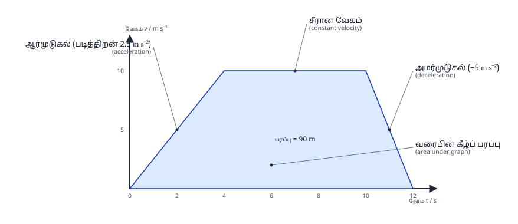

---

## SC10-03: சடப்பொருள்களின் கட்டமைப்பு (Structure of matter)

<!-- meta {"type":"chapter_notes","id":"SC10-03","grade":10,"chapter":3,"discipline":"CHE"} -->

*தரம் 10 · அத்தியாயம் 3 · இரசாயனவியல்*

சடப்பொருள் அணுக்களால் ஆனது. அணு உப அணுத் துணிக்கைகளைக் கொண்டது; மூலகங்கள் ஆவர்த்தன அட்டவணையில் ஒழுங்குபடுத்தப்பட்டுள்ளன.

### கற்றல் நோக்கங்கள்

- உப அணுத் துணிக்கைகளின் இயல்புகளைக் கூறுதல்
- அணுவெண், திணிவெண், சமதானிகளை விளக்குதல்
- இலத்திரன் நிலையமைப்பை எழுதுதல்
- ஆவர்த்தன அட்டவணையின் போக்குகளை விளக்குதல்

### பிரதான எண்ணக்கருக்கள்

- உப அணுத் துணிக்கைகள்: புரோத்தன் (+1, கருவில்), நியூத்திரன் (0, கருவில்), இலத்திரன் (−1, சக்தி மட்டங்களில்; திணிவு மிகக் குறைவு).
- அணுவெண் (Z) = புரோத்தன் எண்ணிக்கை; திணிவெண் (A) = புரோத்தன் + நியூத்திரன். குறியீடு: $^{A}_{Z}X$.
- சமதானிகள் (Isotopes): ஒரே Z, வேறுபட்ட நியூத்திரன் எண் (உ-ம் $^{12}_{6}C$, $^{14}_{6}C$; $^{35}Cl$, $^{37}Cl$).
- இலத்திரன் நிலையமைப்பு: முதல் மட்டம் 2, இரண்டாம் 8, மூன்றாம் 8 (முதல் 20 மூலகங்களுக்கு); உ-ம் Na 2,8,1; Cl 2,8,7; Ca 2,8,8,2.
- ஆவர்த்தனம் (Period) = சக்தி மட்டங்களின் எண்ணிக்கை; கூட்டம் (Group) = வெளி இலத்திரன் எண் (1–2, 13–17 கூட்டங்களுக்கு).
- ஓர் ஆவர்த்தனத்தில் இடமிருந்து வலம்: முதலாம் அயனாக்கற் சக்தியும் மின்னெதிர்த்தன்மையும் பொதுவாகக் கூடும்; அணு ஆரை குறையும்.
- கூட்டம் 18: சடத்துவ வாயுக்கள் — நிறைவான வெளிமட்டம், தாக்கமடைவது குறைவு.
- உலோகங்கள்: பளபளப்பு, மின், வெப்பக் கடத்தல், இழுபடுமை; அல்லுலோகங்கள்: பெரும்பாலும் எதிர் இயல்புகள் (காரீயம் விதிவிலக்கு — மின் கடத்தும்).

### வரைவிலக்கணங்கள்

- **அணுவெண் (Atomic number):** அணுக்கருவிலுள்ள புரோத்தன்களின் எண்ணிக்கை.
- **திணிவெண் (Mass number):** புரோத்தன், நியூத்திரன் எண்ணிக்கைகளின் கூட்டுத்தொகை.
- **சமதானிகள் (Isotopes):** ஒரே அணுவெண்ணும் வேறுபட்ட திணிவெண்ணும் உடைய அணுக்கள்.
- **முதலாம் அயனாக்கற் சக்தி:** வாயு நிலை அணுவிலிருந்து ஒரு இலத்திரனை அகற்றத் தேவையான சக்தி.

### ஒப்பீட்டு அட்டவணை

| துணிக்கை | ஏற்றம் | சார்புத் திணிவு | இருப்பிடம் |
|---|---|---|---|
| புரோத்தன் | +1 | 1 | கரு |
| நியூத்திரன் | 0 | 1 | கரு |
| இலத்திரன் | −1 | ≈ 1/1840 | சக்தி மட்டங்கள் |

### அன்றாட வாழ்க்கைத் தொடர்புகள்

- $^{14}C$ சமதானி தொல்பொருள் காலக்கணிப்பில்.
- நியோன் விளம்பரப் பலகைகளில் சடத்துவ வாயு.

### பொதுவான தவறான எண்ணக்கருக்கள்

- ⚠️ சமதானிகளுக்கு வெவ்வேறு இரசாயன இயல்புகள் — பிழை; இலத்திரன் எண் ஒன்றாதலால் இரசாயன இயல்புகள் ஒத்தவை.
- ⚠️ திணிவெண் = புரோத்தன் + இலத்திரன் — பிழை; புரோத்தன் + நியூத்திரன்.

### பரீட்சைக் கவனம்

- அயனாக்கற் சக்தி–அணுவெண் வரைபு விளக்கம் (2016 கருத்தரங்கு, 2019 வினாத்தாள் II வி3A).
- சமதானிகளில் உப அணுத் துணிக்கைகளைக் கணித்தல் (2019 வினாத்தாள் I வி36).

### தொடர்புடைய வளங்கள்

- வரிப்படம் CHE-D01 — சோடியம் அணுவின் இலத்திரன் நிலையமைப்பு (2,8,1) ([பெயரிட்டது](science_assets/chemistry/CHE-D01_labelled.svg))
- பரிசோதனை EXP-08 — சுவாலைச் சோதனை (கோப்பு 8)

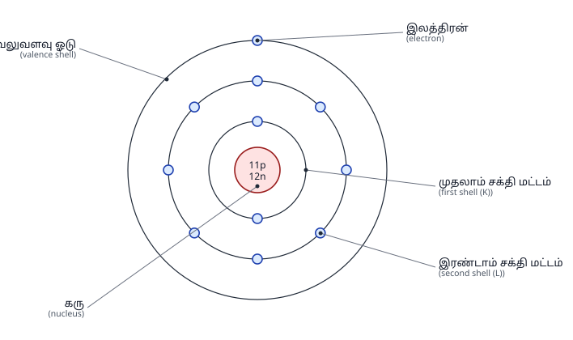

---

## SC10-04: நியூற்றனின் இயக்க விதிகள் (Newton's laws of motion)

<!-- meta {"type":"chapter_notes","id":"SC10-04","grade":10,"chapter":4,"discipline":"PHY"} -->

*தரம் 10 · அத்தியாயம் 4 · பௌதிகவியல்*

நியூற்றனின் மூன்று இயக்க விதிகள் விசைக்கும் இயக்கத்துக்குமான தொடர்பை விளக்குகின்றன.

### கற்றல் நோக்கங்கள்

- சடத்துவத்தை விளக்குதல்
- F = ma ஐப் பயன்படுத்துதல்
- உந்தத்தைக் கணித்தல்
- தாக்கம்–மறுதாக்கச் சோடிகளை இனங்காணுதல்

### பிரதான எண்ணக்கருக்கள்

- முதலாம் விதி (சடத்துவ விதி): சமநிலையற்ற விசை தாக்காவிடின் பொருள் ஓய்விலோ சீரான வேகத்திலோ தொடரும். திணிவு கூடச் சடத்துவம் கூடும்.
- இரண்டாம் விதி: $F = ma$; 1 N = 1 kg m s⁻².
- உந்தம் (Momentum) $p = mv$ (kg m s⁻¹).
- மூன்றாம் விதி: ஒவ்வொரு தாக்கத்துக்கும் சமனும் எதிருமான மறுதாக்கம் — வேறு வேறு பொருட்களில் தாக்கும்.
- நிறை (Weight) $W = mg$ — புவி பொருளில் செலுத்தும் விசை (N); திணிவு (kg) மாறாது, நிறை g ஐச் சார்ந்தது (2019 வினாத்தாள் I வி11).
- பயன்பாடுகள்: இருக்கைப் பட்டி (சடத்துவம்), ஏவுகணை (மூன்றாம் விதி).

### வரைவிலக்கணங்கள்

- **சடத்துவம் (Inertia):** பொருள் தன் இயக்க நிலையை மாற்ற எதிர்க்கும் இயல்பு.
- **நியூற்றன் (N):** 1 kg திணிவுக்கு 1 m s⁻² ஆர்முடுகல் தரும் விசை.
- **உந்தம் (Momentum):** திணிவு × வேகம்.

### ஒப்பீட்டு அட்டவணை

| கணியம் | சூத்திரம் | அலகு |
|---|---|---|
| விசை | F = ma | N |
| நிறை | W = mg | N |
| உந்தம் | p = mv | kg m s⁻¹ |

### அன்றாட வாழ்க்கைத் தொடர்புகள்

- பேருந்து திடீரென நிற்கும்போது பயணிகள் முன்னோக்கிச் சாய்வது.
- படகிலிருந்து கரைக்குக் குதிக்கும்போது படகு பின்னோக்கி நகர்தல்.

### பொதுவான தவறான எண்ணக்கருக்கள்

- ⚠️ இயங்கும் பொருளுக்கு எப்போதும் விசை தேவை — பிழை; சீரான வேகத்துக்குத் தேறிய விசை 0.
- ⚠️ தாக்கமும் மறுதாக்கமும் ஒன்றையொன்று சமநிலைப்படுத்தும் — பிழை; வேறு பொருட்களில் தாக்குவதால் இல்லை.

### பரீட்சைக் கவனம்

- F = ma, W = mg கணிப்புகள்.
- சந்திரனில் நிறை (g சந்திரன் ≈ g/6).

### தொடர்புடைய வளங்கள்

- கணிப்பு CL-FMA — நியூற்றனின் இரண்டாம் விதி (கோப்பு 5)
- கணிப்பு CL-WMOM — நிறையும் உந்தமும் (கோப்பு 5)

---

## SC10-05: உராய்வு (Friction)

<!-- meta {"type":"chapter_notes","id":"SC10-05","grade":10,"chapter":5,"discipline":"PHY"} -->

*தரம் 10 · அத்தியாயம் 5 · பௌதிகவியல்*

உராய்வு என்பது தொடுகையிலுள்ள இரு மேற்பரப்புகளுக்கிடையே சார்பியக்கத்தை எதிர்க்கும் விசை.

### கற்றல் நோக்கங்கள்

- நிலையியல், எல்லை, இயக்க உராய்வுகளை வேறுபடுத்துதல்
- உராய்வைப் பாதிக்கும் காரணிகளை விளக்குதல்
- உராய்வின் நன்மை தீமைகள், குறைக்கும் முறைகள்

### பிரதான எண்ணக்கருக்கள்

- நிலையியல் உராய்வு: பொருள் அசையத் தொடங்குமுன்; பிரயோக விசைக்கேற்பக் கூடும்.
- எல்லை உராய்வு: அசையத் தொடங்கும் கணத்திலுள்ள உச்ச நிலையியல் உராய்வு.
- இயக்க உராய்வு: அசையும்போது; எல்லை உராய்வை விடச் சற்றுக் குறைவு.
- உராய்வு மேற்பரப்புகளின் இயல்பையும் செவ்வன் மறுதாக்கத்தையும் (R) சார்ந்தது; தொடுகைப் பரப்பளவைச் (ஏறத்தாழ) சாராது.
- நன்மைகள்: நடத்தல், தடுப்பு (brake), பிடிப்பு. தீமைகள்: தேய்வு, வெப்ப இழப்பு, சக்தி வீண்.
- குறைத்தல்: உராய்வுநீக்கி எண்ணெய், பந்துப் போதிகை (ball bearing), மழமழப்பாக்கல், நீள்பொழிவு வடிவம் (streamlining).

### வரைவிலக்கணங்கள்

- **உராய்வு (Friction):** தொடுகை மேற்பரப்புகளின் சார்பியக்கத்தை எதிர்க்கும் விசை.
- **எல்லை உராய்வு (Limiting friction):** பொருள் அசையத் தொடங்கும்போதுள்ள உச்ச நிலையியல் உராய்வு.

### ஒப்பீட்டு அட்டவணை

| வகை | நிலை | பருமன் |
|---|---|---|
| நிலையியல் | ஓய்வு | 0 முதல் எல்லை வரை |
| எல்லை | அசையத் தொடங்கும் கணம் | உச்சம் |
| இயக்க | அசையும்போது | எல்லையை விடச் சிறிது குறைவு |

### அன்றாட வாழ்க்கைத் தொடர்புகள்

- மழைநாளில் வீதி வழுக்கும் — உராய்வு குறைவு.
- சப்பாத்து அடியில் வடிவங்கள் — பிடிப்பு.

### பொதுவான தவறான எண்ணக்கருக்கள்

- ⚠️ உராய்வு எப்போதும் தீமை — பிழை; நடக்க உராய்வு தேவை.
- ⚠️ பரப்பளவு கூட உராய்வு கூடும் — பிழை; (ஏறத்தாழ) சாராது.

### பரீட்சைக் கவனம்

- விசை–உராய்வு வரைபு (நிலையியல் → எல்லை → இயக்கம்).
- உராய்வு பரிசோதனையில் மாறிகள் (கோப்பு 8).

### தொடர்புடைய வளங்கள்

- வரிப்படம் PHY-D06 — மேசையில் இழுக்கப்படும் பெட்டியின் விசை வரிப்படம் ([பெயரிட்டது](science_assets/physics/PHY-D06_labelled.svg))
- பரிசோதனை EXP-19 — எல்லை உராய்வும் செவ்வன் மறுதாக்கமும் (கோப்பு 8)

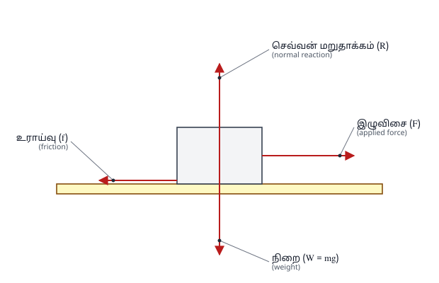

---

## SC10-06: தாவரக்கலங்களினதும் விலங்குக்கலங்களினதும் கட்டமைப்பும் தொழிற்பாடும் (Structure and functions of plant and animal cells)

<!-- meta {"type":"chapter_notes","id":"SC10-06","grade":10,"chapter":6,"discipline":"BIO"} -->

*தரம் 10 · அத்தியாயம் 6 · உயிரியல்*

கலம் (Cell) உயிரின் அடிப்படை அலகு. தாவரக் கலங்களுக்கும் விலங்குக் கலங்களுக்கும் பொதுவான பகுதிகளும் தனித்துவமான பகுதிகளும் உள்ளன.

### கற்றல் நோக்கங்கள்

- கலப் புன்னங்கங்களை இனங்காணுதல்
- ஒவ்வொரு புன்னங்கத்தின் தொழிலைக் கூறுதல்
- தாவர, விலங்குக் கலங்களை ஒப்பிடுதல்

### பிரதான எண்ணக்கருக்கள்

- கலமென்சவ்வு (Cell membrane): தேர்ந்து புகவிடும்; பொருட்களின் உள்–வெளிப் பயணத்தைக் கட்டுப்படுத்தும்.
- கரு (Nucleus): DNA ஐக் கொண்டது; கலச் செயற்பாடுகளைக் கட்டுப்படுத்தும்.
- குழியவுரு (Cytoplasm): புன்னங்கங்கள் உள்ள ஊடகம்; பல தாக்கங்கள் நடைபெறும் இடம்.
- இழைமணி (Mitochondria): காற்றுச் சுவாசம் — ATP வடிவில் சக்தி உற்பத்தி.
- பச்சையவுருமணி (Chloroplast): ஒளித்தொகுப்பு; தாவரக் கலங்களில் மட்டும்.
- கலச்சுவர் (Cell wall): செலுலோசு; வடிவமும் பாதுகாப்பும்; தாவரக் கலங்களில்.
- புன்வெற்றிடம் (Vacuole): தாவரக் கலத்தில் பெரிய மத்திய புன்வெற்றிடம் — கலச்சாறு, வீக்கவமுக்கம்.
- இறைபோசோம் (Ribosome): புரதத் தொகுப்பு. அகக்கலவுருச் சிறுவலை (ER), கொல்கி உபகரணம் — பொருட்களைக் கடத்தல், சுரத்தல்.

### வரைவிலக்கணங்கள்

- **கலம் (Cell):** உயிரின் கட்டமைப்பு, தொழிற்பாட்டு அடிப்படை அலகு.
- **புன்னங்கம் (Organelle):** கலத்தினுள் குறித்த தொழிலைச் செய்யும் மென்சவ்வால் சூழப்பட்ட அமைப்பு.
- **தேர்ந்து புகவிடும் மென்சவ்வு:** சில பதார்த்தங்களை மட்டும் புகவிடும் மென்சவ்வு.

### ஒப்பீட்டு அட்டவணை

| பகுதி | தாவரக் கலம் | விலங்குக் கலம் |
|---|---|---|
| கலச்சுவர் | உண்டு | இல்லை |
| பச்சையவுருமணி | உண்டு | இல்லை |
| பெரிய மத்திய புன்வெற்றிடம் | உண்டு | இல்லை (சிறியவை) |
| புன்மையத்தி (Centriole) | பொதுவாக இல்லை | உண்டு |
| வடிவம் | ஒழுங்கானது | ஒழுங்கற்றது |

### அன்றாட வாழ்க்கைத் தொடர்புகள்

- வாடிய கீரையை நீரில் இட்டால் புன்வெற்றிடம் நீரை உறிஞ்சி மீண்டும் விறைப்பாகும்.
- தசைக் கலங்களில் அதிக இழைமணிகள் — அதிக சக்தி தேவை.

### பொதுவான தவறான எண்ணக்கருக்கள்

- ⚠️ தாவரக் கலங்களில் இழைமணி இல்லை — பிழை; தாவரக் கலங்களும் சுவாசிக்கின்றன.
- ⚠️ கலச்சுவர் பொருட்களைத் தேர்ந்து புகவிடும் — பிழை; அது முழுமையாகப் புகவிடும்; கலமென்சவ்வே தேர்ந்து புகவிடும்.

### பரீட்சைக் கவனம்

- தாவர–விலங்குக் கல ஒப்பீட்டு அட்டவணை அடிக்கடி வரும்.
- படத்திலுள்ள புன்னங்கங்களைப் பெயரிடல் (கோப்பு 6 பார்க்க).

### தொடர்புடைய வளங்கள்

- வரிப்படம் BIO-D01 — தாவரக் கலம் ([பெயரிட்டது](science_assets/biology/BIO-D01_labelled.svg))
- வரிப்படம் BIO-D02 — விலங்குக் கலம் ([பெயரிட்டது](science_assets/biology/BIO-D02_labelled.svg))
- பரிசோதனை EXP-02 — நுணுக்குக்காட்டியில் வெங்காயத் தோல் கலங்கள் (கோப்பு 8)
- கணிப்பு CL-MICRO — நுணுக்குக்காட்டி உருப்பெருக்கம் (கோப்பு 5)

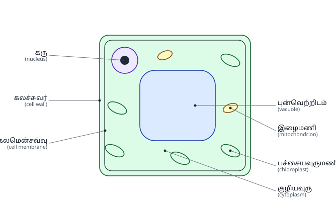

---

## SC10-07: மூலகங்களினதும் சேர்வைகளினதும் அளவறிதல் (Quantification of elements and compounds)

<!-- meta {"type":"chapter_notes","id":"SC10-07","grade":10,"chapter":7,"discipline":"CHE"} -->

*தரம் 10 · அத்தியாயம் 7 · இரசாயனவியல்*

இரசாயனத்தில் பதார்த்தங்களின் அளவை மூல் (mole) எனும் அலகால் அளக்கிறோம். சார்பு அணுத்திணிவு, மூலர்த் திணிவு, செறிவு போன்றவை கணிப்புகளுக்கு அடிப்படை.

### கற்றல் நோக்கங்கள்

- சார்பு அணுத்திணிவு, சார்பு மூலக்கூற்றுத் திணிவைக் கணித்தல்
- மூல், அவகாதரோ மாறிலியைப் பயன்படுத்துதல்
- திணிவு–மூல்–துணிக்கை எண் மாற்றங்கள்
- கரைசற் செறிவைக் கணித்தல்

### பிரதான எண்ணக்கருக்கள்

- சார்பு அணுத்திணிவு (Ar): $^{12}C$ அணுத்திணிவின் 1/12 உடன் ஒப்பிட்ட திணிவு (H = 1, C = 12, O = 16, Na = 23, Cl = 35.5).
- சார்பு மூலக்கூற்றுத் திணிவு (Mr) = அணுத்திணிவுகளின் கூட்டுத்தொகை; உ-ம் H₂O = 18.
- மூல் (mole): 6.022 × 10²³ துணிக்கைகள் (அவகாதரோ மாறிலி, $N_A$).
- மூலர்த் திணிவு (M) = Mr g mol⁻¹. மூல் எண்ணிக்கை $n = \frac{m}{M}$.
- துணிக்கை எண்ணிக்கை $N = n \times N_A$.
- செறிவு $C = \frac{n}{V}$ (mol dm⁻³; V dm³ இல்). 1 dm³ = 1000 cm³.
- சமன்செய்த சமன்பாட்டின் குணகங்கள் மூல் விகிதத்தைக் காட்டும் — திணிவுக் கணிப்புக்குப் பயன்படும் (2019 வினாத்தாள் I வி17, வி30).

### வரைவிலக்கணங்கள்

- **மூல் (Mole):** 6.022 × 10²³ துணிக்கைகளைக் கொண்ட பதார்த்த அளவு.
- **மூலர்த் திணிவு (Molar mass):** ஒரு மூல் பதார்த்தத்தின் திணிவு (g mol⁻¹).
- **செறிவு (Concentration):** ஓரலகுக் கனவளவுக் கரைசலிலுள்ள கரையத்தின் மூல் எண்ணிக்கை.

### ஒப்பீட்டு அட்டவணை

| கணியம் | சூத்திரம் | அலகு |
|---|---|---|
| மூல் எண் | $n = m/M$ | mol |
| துணிக்கைகள் | $N = nN_A$ | — |
| செறிவு | $C = n/V$ | mol dm⁻³ |

### அன்றாட வாழ்க்கைத் தொடர்புகள்

- மருந்துகளின் அளவு mg இல்; சேலைன் 0.9% NaCl.
- பசளைகளில் N, P, K சதவீதம்.

### பொதுவான தவறான எண்ணக்கருக்கள்

- ⚠️ ஒரு மூல் O₂ இல் 6.022 × 10²³ அணுக்கள் — பிழை; அது மூலக்கூறுகள்; அணுக்கள் இருமடங்கு.
- ⚠️ செறிவுக் கணிப்பில் cm³ ஐ நேரடியாகப் பயன்படுத்தல் — பிழை; dm³ ஆக மாற்றுக.

### பரீட்சைக் கவனம்

- திணிவு ↔ மூல் ↔ துணிக்கைகள் மாற்றங்கள் (கோப்பு 5).
- கரைசல் தயாரிக்கத் தேவையான திணிவு (2019 வினாத்தாள் I வி14).

### தொடர்புடைய வளங்கள்

- கணிப்பு CL-MOLE — மூல், மூலர்த் திணிவு, துணிக்கைகள் (கோப்பு 5)

---

## SC10-08: அங்கிகளின் சிறப்பியல்புகள் (Characteristics of living organisms)

<!-- meta {"type":"chapter_notes","id":"SC10-08","grade":10,"chapter":8,"discipline":"BIO"} -->

*தரம் 10 · அத்தியாயம் 8 · உயிரியல்*

அங்கிகளை உயிரற்றவற்றிலிருந்து வேறுபடுத்தும் சிறப்பியல்புகள் உள்ளன; அவற்றின் அடிப்படையில் அங்கிகள் வகைப்படுத்தப்படுகின்றன.

### கற்றல் நோக்கங்கள்

- அங்கிகளின் சிறப்பியல்புகளைப் பட்டியலிடுதல்
- இருசொற் பெயரீட்டை விளக்குதல்
- முக்கிய அங்கிக் கூட்டங்களை வகைப்படுத்துதல்

### பிரதான எண்ணக்கருக்கள்

- சிறப்பியல்புகள்: கல அமைப்பு, போசணை, சுவாசம், கழிவகற்றல், உறுத்துணர்ச்சி, அசைவு, வளர்ச்சி, இனப்பெருக்கம், இசைவாக்கம்.
- இருசொற் பெயரீடு (Binomial nomenclature): சாதிப் பெயர் + இனப் பெயர்; சாதிப் பெயர் பெரிய எழுத்தில் தொடங்கும்; சாய்வெழுத்தில் / கீழ்க்கோடு; உ-ம் Homo sapiens.
- வகைப்படுத்தல் படிநிலை: ஆட்சி (Domain) → இராச்சியம் (Kingdom) → கணம் (Phylum) → வகுப்பு → வரிசை → குடும்பம் → சாதி (Genus) → இனம் (Species).
- மூன்று ஆட்சிகள்: பக்ரீரியா (Bacteria), ஆக்கியா (Archaea), யூக்கரியா (Eukarya).
- யூக்கரியா இராச்சியங்கள்: புரொட்டிஸ்டா, பங்கசு (Fungi), தாவரம் (Plantae), விலங்கு (Animalia).
- விலங்கு முள்ளந்தண்டிலிகள்: நைடேரியா, தட்டைப்புழு, வளையப்புழு, மொலஸ்கா, ஆத்திரப்போடா, எக்கினோடேமேற்றா; முள்ளந்தண்டுளிகள்: மீன், ஈரூடகவாழி, ஊர்வன, பறவை, முலையூட்டி.

### வரைவிலக்கணங்கள்

- **இனம் (Species):** இயற்கையாக இனங்கலந்து வளமான சந்ததியை உருவாக்கக்கூடிய ஒத்த அங்கிகளின் கூட்டம்.
- **உறுத்துணர்ச்சி (Irritability):** தூண்டல்களுக்குத் துலங்கும் திறன்.
- **இசைவாக்கம் (Adaptation):** சூழலில் வாழ உதவும் அமைப்பு/நடத்தை இயல்புகள்.

### ஒப்பீட்டு அட்டவணை

| கணம் | உதாரணம் | முக்கிய இயல்பு |
|---|---|---|
| நைடேரியா | ஐதரா, கடல் சாமந்தி | கொட்டும் கலங்கள், ஆரைச் சமச்சீர் |
| வளையப்புழு | மண்புழு | வளையங்களாகப் பிரிந்த உடல் |
| மொலஸ்கா | நத்தை | மென்மையான உடல், ஓடு |
| ஆத்திரப்போடா | பூச்சி, நண்டு | மூட்டுள்ள கால்கள், புறவன்கூடு |
| எக்கினோடேமேற்றா | நட்சத்திர மீன் | முட்தோல், குழாய்ப் பாதங்கள் |

### அன்றாட வாழ்க்கைத் தொடர்புகள்

- தொட்டாற்சிணுங்கி தொடுகைக்குத் துலங்கல் — உறுத்துணர்ச்சி.
- பக்ரீரியாக்கள் நுண்ணுயிர் எதிரிகளுக்கு எதிர்ப்பைப் பெறுதல் — இசைவாக்கம் / கூர்ப்பு.

### பொதுவான தவறான எண்ணக்கருக்கள்

- ⚠️ தாவரங்கள் அசையாது — பிழை; தாவரங்கள் வளர்ச்சி அசைவுகளைக் காட்டும் (உ-ம் ஒளித்திருப்பம்).
- ⚠️ காளான் ஒரு தாவரம் — பிழை; அது பங்கசு இராச்சியம்.

### பரீட்சைக் கவனம்

- வகைப்படுத்தல் சாவி (key) மற்றும் விலங்குக் கணங்களின் இயல்புகள் அடிக்கடி வினவப்படும் (2019 வினாத்தாள் II வி2 வகைப்படுத்தல் விளக்கப்படம்).
- இருசொற் பெயரை எழுதும் விதிகள்.

---

## SC10-09: விளையுள் விசை (Resultant force)

<!-- meta {"type":"chapter_notes","id":"SC10-09","grade":10,"chapter":9,"discipline":"PHY"} -->

*தரம் 10 · அத்தியாயம் 9 · பௌதிகவியல்*

ஒரு பொருளில் பல விசைகள் தாக்கும்போது அவற்றின் ஒருமித்த விளைவைத் தரும் தனி விசை விளையுள் விசை.

### கற்றல் நோக்கங்கள்

- ஒரே கோட்டிலுள்ள விசைகளின் விளையுளைக் கணித்தல்
- செங்குத்தான விசைகளின் விளையுளைக் கணித்தல்
- இணைகர விதியைப் பயன்படுத்துதல்

### பிரதான எண்ணக்கருக்கள்

- ஒரே திசை: விளையுள் = F₁ + F₂; எதிர்த் திசை: விளையுள் = |F₁ − F₂| (பெரிய விசையின் திசையில்).
- செங்குத்தான விசைகள்: $R = \sqrt{F_1^2 + F_2^2}$.
- இணைகர விதி: இரு விசைகளை இணைகரத்தின் அயல் பக்கங்களாக வரைந்தால், அவற்றின் பொதுப் புள்ளியிலிருந்தான மூலைவிட்டம் விளையுள் (அளவிடைப் படம்).
- விளையுள் 0 எனின் பொருள் சமநிலையில்.
- விளையுள் விசை F = ma ஐத் தரும் (SC10-04 உடன் இணைப்பு).

### வரைவிலக்கணங்கள்

- **விளையுள் விசை (Resultant force):** பல விசைகளின் மொத்த விளைவைத் தரும் தனி விசை.

### அன்றாட வாழ்க்கைத் தொடர்புகள்

- கயிறிழுப்புப் போட்டி — விளையுள் விசைத் திசையில் இயக்கம்.
- படகு ஓட்டம் + நீரோட்டம்.

### பொதுவான தவறான எண்ணக்கருக்கள்

- ⚠️ 3 N + 4 N எப்போதும் 7 N — பிழை; திசையைப் பொறுத்து 1 N முதல் 7 N வரை.
- ⚠️ விளையுள் விசை ஒரு கூடுதல் விசை — பிழை; அது மாற்றீடு.

### பரீட்சைக் கவனம்

- இணைகர விதிப்படி அளவிடைப் படம் வரைதல்.
- விளையுளிலிருந்து ஆர்முடுகல்.

### தொடர்புடைய வளங்கள்

- கணிப்பு CL-RESULT — விளையுள் விசை (கோப்பு 5)

---

## SC10-10: இரசாயனப் பிணைப்புகள் (Chemical bonds)

<!-- meta {"type":"chapter_notes","id":"SC10-10","grade":10,"chapter":10,"discipline":"CHE"} -->

*தரம் 10 · அத்தியாயம் 10 · இரசாயனவியல்*

அணுக்கள் நிலையான இலத்திரன் நிலையமைப்பைப் பெற இலத்திரன்களை இழந்து/ஏற்று அல்லது பங்கிட்டு இரசாயனப் பிணைப்புகளை உருவாக்குகின்றன.

### கற்றல் நோக்கங்கள்

- அயன் பிணைப்பையும் பங்கீட்டுவலுப் பிணைப்பையும் விளக்குதல்
- புள்ளி–குறுக்கு வரைபடங்களை வரைதல்
- முனைவுப் பிணைப்புகளை மின்னெதிர்த்தன்மையால் விளக்குதல்
- பிணைப்பு வகைக்கும் இயல்புகளுக்குமான தொடர்பு

### பிரதான எண்ணக்கருக்கள்

- அயன் பிணைப்பு: உலோகம் இலத்திரனை இழந்து நேரயனாகும்; அல்லுலோகம் ஏற்று மறையயனாகும்; நிலைமின் கவர்ச்சி (உ-ம் NaCl, MgO).
- அயன் சேர்வைகள்: உயர் உருகுநிலை, நீரில் கரையும், உருகிய/கரைந்த நிலையில் மின்னைக் கடத்தும் (திண்ம நிலையில் கடத்தாது).
- பங்கீட்டுவலுப் பிணைப்பு (Covalent): அல்லுலோக அணுக்கள் இலத்திரன் சோடிகளைப் பங்கிடும்: H₂ (தனி), O₂ (இரட்டை), N₂ (மும்மை), H₂O, CH₄, NH₃, CO₂.
- முனைவுப் பங்கீட்டுவலுப் பிணைப்பு: மின்னெதிர்த்தன்மை வேறுபாட்டால் பகுதி ஏற்றங்கள் (δ+, δ−); உ-ம் H₂O, HCl.
- பங்கீட்டுவலு மூலக்கூற்றுச் சேர்வைகள்: பொதுவாகத் தாழ்ந்த உருகு/கொதிநிலை; மின்னைக் கடத்தாது.
- உலோகப் பிணைப்பு: நேரயன்கள் + இடம்பெயர் இலத்திரன் கடல் — கடத்துதிறன்.
- வலுவளவு: H 1, O 2, N 3, C 4, Na 1, Mg 2, Al 3, Cl 1.

### வரைவிலக்கணங்கள்

- **அயன் பிணைப்பு (Ionic bond):** எதிரேற்ற அயன்களுக்கிடையிலான நிலைமின் கவர்ச்சி.
- **பங்கீட்டுவலுப் பிணைப்பு (Covalent bond):** இரு அணுக்கள் இலத்திரன் சோடியைப் பங்கிடுவதால் உருவாகும் பிணைப்பு.
- **மின்னெதிர்த்தன்மை (Electronegativity):** பிணைப்பிலுள்ள இலத்திரன்களை அணு கவரும் இயல்பு.

### ஒப்பீட்டு அட்டவணை

| இயல்பு | அயன் சேர்வை | பங்கீட்டுவலு மூலக்கூறு |
|---|---|---|
| உருகுநிலை | உயர் | தாழ் |
| நீரில் கரைதிறன் | பெரும்பாலும் கரையும் | பல கரையாது |
| மின் கடத்தல் | உருகிய/கரைந்த நிலையில் | பொதுவாக இல்லை |

### அன்றாட வாழ்க்கைத் தொடர்புகள்

- உப்புக் கரைசல் மின்னைக் கடத்தும் — அயன்கள்.
- சீனிக் கரைசல் கடத்தாது — பங்கீட்டுவலு மூலக்கூறுகள்.

### பொதுவான தவறான எண்ணக்கருக்கள்

- ⚠️ திண்ம NaCl மின்னைக் கடத்தும் — பிழை; அயன்கள் அசைய முடியாது.
- ⚠️ அயன் சேர்வைகளில் மூலக்கூறுகள் உண்டு — பிழை; அயன் சாலகம் (lattice).

### பரீட்சைக் கவனம்

- புள்ளி–குறுக்கு வரைபடங்கள் (கோப்பு 6).
- ஒரு மூலக்கூறிலுள்ள பங்கீட்டுவலுப் பிணைப்புகளை எண்ணுதல் (2019 வினாத்தாள் I வி8).

---

## SC10-11: விசையின் திரும்பல் விளைவு (Turning effect of a force)

<!-- meta {"type":"chapter_notes","id":"SC10-11","grade":10,"chapter":11,"discipline":"PHY"} -->

*தரம் 10 · அத்தியாயம் 11 · பௌதிகவியல்*

விசை ஒரு பொருளைச் சுழலச் செய்யும் விளைவு திருப்பம் (moment). இது நெம்புகோல்கள், கதவுகள், சமநிலைகளில் பயன்படுகிறது.

### கற்றல் நோக்கங்கள்

- விசையின் திருப்பத்தைக் கணித்தல்
- திருப்பக் கொள்கையைப் பயன்படுத்துதல்
- இணையை (couple) விளக்குதல்
- நெம்புகோல் வகைகள்

### பிரதான எண்ணக்கருக்கள்

- திருப்பம் $M = F \times d$; d = சுழல்மையத்திலிருந்து விசையின் தாக்கக் கோட்டுக்கான செங்குத்துத் தூரம்; அலகு N m.
- வலஞ்சுழி / இடஞ்சுழித் திருப்பங்கள்.
- திருப்பக் கொள்கை: சமநிலையில் வலஞ்சுழித் திருப்பங்களின் கூட்டுத்தொகை = இடஞ்சுழித் திருப்பங்களின் கூட்டுத்தொகை.
- இணை (Couple): சமனும் எதிருமான சமாந்தர விசைகள் சோடி; திருப்பம் = F × இடைத்தூரம் (உ-ம் குழாய் திருகுதல், சுக்கான்).
- நெம்புகோல் (Lever): சுழல்மையம், சுமை, முயற்சி; நீண்ட கைப்பிடி — குறைந்த முயற்சி.

### வரைவிலக்கணங்கள்

- **விசையின் திருப்பம் (Moment):** விசை × சுழல்மையத்திலிருந்து தாக்கக் கோட்டுக்கான செங்குத்துத் தூரம்.
- **இணை (Couple):** ஒரே கோட்டிலில்லாத சமனும் எதிருமான சமாந்தர விசைச் சோடி.

### அன்றாட வாழ்க்கைத் தொடர்புகள்

- கதவுக் கைப்பிடி சுழல்மையத்திலிருந்து தூரத்தில் — குறைந்த விசை போதும்.
- சீசோ (see-saw) சமநிலை.

### பொதுவான தவறான எண்ணக்கருக்கள்

- ⚠️ திருப்பம் = விசை × எந்தத் தூரமும் — பிழை; செங்குத்துத் தூரம்.
- ⚠️ இணை பொருளை நகர்த்தும் — பிழை; சுழற்றும் மட்டும்.

### பரீட்சைக் கவனம்

- சீசோ/மீற்றர் கோல் சமநிலைக் கணிப்புகள் (கோப்பு 5).
- திருப்பக் கொள்கைப் பரிசோதனை (கோப்பு 8).

### தொடர்புடைய வளங்கள்

- வரிப்படம் PHY-D11 — திருப்பக் கொள்கை — சீசோ ([பெயரிட்டது](science_assets/physics/PHY-D11_labelled.svg))
- பரிசோதனை EXP-20 — திருப்பக் கொள்கையைச் சரிபார்த்தல் (மீற்றர் கோல்) (கோப்பு 8)
- கணிப்பு CL-MOMENT — விசையின் திருப்பம் (கோப்பு 5)

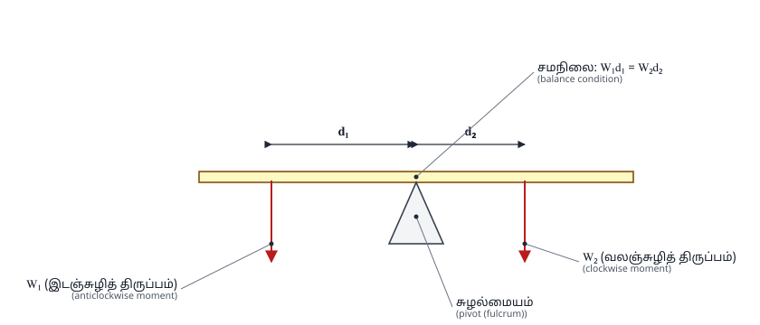

---

## SC10-12: விசைகளின் சமநிலை (Equilibrium of forces)

<!-- meta {"type":"chapter_notes","id":"SC10-12","grade":10,"chapter":12,"discipline":"PHY"} -->

*தரம் 10 · அத்தியாயம் 12 · பௌதிகவியல்*

ஒரு பொருளில் தாக்கும் விசைகளின் விளையுளும் தேறிய திருப்பமும் பூச்சியமெனின் அது சமநிலையில் இருக்கும்.

### கற்றல் நோக்கங்கள்

- இரு விசைச் சமநிலை நிபந்தனைகள்
- மூன்று விசைச் சமநிலை (ஒருங்கமை விசைகள்)
- ஈர்ப்பு மையமும் உறுதிநிலையும்

### பிரதான எண்ணக்கருக்கள்

- இரு விசைச் சமநிலை: விசைகள் சமன், எதிர்த் திசை, ஒரே தாக்கக் கோடு.
- மூன்று விசைச் சமநிலை: ஒருதளத்தில், ஒரு புள்ளியில் சந்திக்கும் (ஒருங்கமை), விளையுள் 0; முக்கோண விதியால் அளவிடைப் படம் மூடிய முக்கோணி.
- ஈர்ப்பு மையம் (Centre of gravity): பொருளின் முழு நிறையும் தாக்குவதாகக் கருதப்படும் புள்ளி. ஒழுங்கான பொருட்களுக்கு வடிவியல் மையம்.
- உறுதிநிலை: தாழ்ந்த ஈர்ப்பு மையமும் அகன்ற அடியும் உறுதியைக் கூட்டும்.
- உறுதியான, உறுதியற்ற, நடுநிலைச் சமநிலைகள்.

### வரைவிலக்கணங்கள்

- **சமநிலை (Equilibrium):** விளையுள் விசையும் தேறிய திருப்பமும் பூச்சியமான நிலை.
- **ஈர்ப்பு மையம்:** பொருளின் நிறை தாக்குவதாகக் கருதப்படும் புள்ளி.

### அன்றாட வாழ்க்கைத் தொடர்புகள்

- பந்தயக் கார்கள் தாழ்வானவை — உறுதி.
- கழுத்தில் சுமை தூக்குவோர் சாய்ந்து நடத்தல் — ஈர்ப்பு மையத்தை அடிக்கு மேல் வைத்தல்.

### பொதுவான தவறான எண்ணக்கருக்கள்

- ⚠️ சமநிலையில் விசைகள் இல்லை — பிழை; விசைகள் உண்டு, விளையுள் பூச்சியம்.
- ⚠️ ஈர்ப்பு மையம் எப்போதும் பொருளுக்குள் — பிழை; வளையத்தில் வெளியே.

### பரீட்சைக் கவனம்

- ஒழுங்கற்ற தகட்டின் ஈர்ப்பு மையம் — குண்டுநூல் முறை (கோப்பு 8).
- மூன்று விசைகளின் முக்கோண வரைபு.

---

## SC10-13: உயிர்க்கோளம் (Biosphere)

<!-- meta {"type":"chapter_notes","id":"SC10-13","grade":10,"chapter":13,"discipline":"BIO"} -->

*தரம் 10 · அத்தியாயம் 13 · உயிரியல்*

உயிர்க்கோளம் என்பது அங்கிகள் வாழும் புவியின் பகுதி. அங்கிகள் ஒன்றுடனொன்றும் சூழலுடனும் இடைத்தாக்கம் புரிகின்றன.

### கற்றல் நோக்கங்கள்

- சூழற்றொகுதியின் கூறுகளை விளக்குதல்
- உணவுச் சங்கிலி, உணவு வலை அமைத்தல்
- சக்திப் பாய்ச்சலையும் போசணைச் சக்கரங்களையும் விளக்குதல்

### பிரதான எண்ணக்கருக்கள்

- சூழற்றொகுதி (Ecosystem) = உயிருள்ள கூறுகள் (உற்பத்தியாளர், நுகர்வோர், பிரிகையாக்கிகள்) + உயிரற்ற கூறுகள் (ஒளி, நீர், மண், வெப்பநிலை).
- உணவுச் சங்கிலி: உற்பத்தியாளர் → முதல் நிலை நுகர்வோர் → இரண்டாம் நிலை நுகர்வோர் … அம்புக்குறி சக்தி செல்லும் திசையைக் காட்டும்.
- ஒவ்வொரு போசணை மட்டத்திலும் சக்தியின் பெரும்பகுதி (சுவாசம், வெப்பம்) இழக்கப்படும்; அடுத்த மட்டத்துக்கு ஏறத்தாழ 10% மட்டுமே செல்லும்.
- காபன் வட்டம்: ஒளித்தொகுப்பு CO₂ ஐ அகற்றும்; சுவாசம், தகனம், பிரிகை CO₂ ஐ விடுவிக்கும்.
- நைதரசன் வட்டம்: நைதரசன் பதித்தல் (Rhizobium — அவரை வேர்முடிச்சு, மின்னல்), நைத்திரேற்றாக்கம், நைதரசனகற்றல்.
- இடைத்தாக்கங்கள்: கொன்றுண்ணல், ஒட்டுண்ணி வாழ்க்கை, ஒன்றுக்கொன்று உதவி (mutualism), போட்டி.

### வரைவிலக்கணங்கள்

- **சூழற்றொகுதி (Ecosystem):** ஒரு பிரதேசத்தின் அங்கிகளும் உயிரற்ற சூழலும் இடைத்தாக்கும் அலகு.
- **உற்பத்தியாளர் (Producer):** ஒளித்தொகுப்பால் தன் உணவைத் தயாரிக்கும் அங்கி.
- **பிரிகையாக்கி (Decomposer):** இறந்த சேதனப் பொருட்களைப் பிரிகையடையச் செய்யும் பக்ரீரியா, பங்கசு.

### அன்றாட வாழ்க்கைத் தொடர்புகள்

- அவரைப் பயிர் வளர்த்த நிலத்தில் நைதரசன் அதிகரிக்கும்.
- குளச் சூழற்றொகுதியில் நீர்த்தாவரங்கள் O₂ ஐ விடுவிக்கும் (2019 வினாத்தாள் II வி8).

### பொதுவான தவறான எண்ணக்கருக்கள்

- ⚠️ அம்புக்குறி 'யார் யாரை உண்கிறது' எனக் காட்டும் — பிழை; சக்தி செல்லும் திசை (உண்ணப்படுவதிலிருந்து உண்பவனுக்கு).
- ⚠️ சக்தி மீள்சுழற்சியாகும் — பிழை; சக்தி ஒருவழிப் பாய்ச்சல்; பதார்த்தங்களே மீள்சுழலும்.

### பரீட்சைக் கவனம்

- தரப்பட்ட அங்கிகளிலிருந்து உணவுச் சங்கிலி அமைத்தல்.
- 10% விதியால் சக்திக் கணிப்பு (கோப்பு 5).

### தொடர்புடைய வளங்கள்

- வரிப்படம் BIO-D09 — குளச் சூழல் உணவுவலை (மாதிரி) ([பெயரிட்டது](science_assets/biology/BIO-D09_labelled.svg))
- கணிப்பு CL-ECO — உணவுச் சங்கிலியில் சக்திக் கடத்தல் (கோப்பு 5)

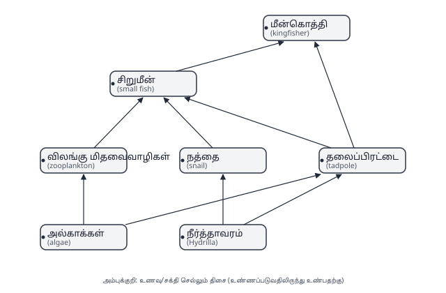

---

## SC10-14: உயிரின் தொடர்ச்சி (Continuity of life)

<!-- meta {"type":"chapter_notes","id":"SC10-14","grade":10,"chapter":14,"discipline":"BIO"} -->

*தரம் 10 · அத்தியாயம் 14 · உயிரியல்*

அங்கிகள் இனப்பெருக்கத்தின் மூலம் தம் இனத்தைத் தொடர்கின்றன. கலப்பிரிவு, இலிங்கமில்–இலிங்க இனப்பெருக்கம், மனித இனப்பெருக்கம் இவ்வத்தியாயத்தில் அடங்கும்.

### கற்றல் நோக்கங்கள்

- இழையுருப்பிரிவையும் ஒடுக்கற்பிரிவையும் ஒப்பிடுதல்
- இலிங்கமில், இலிங்க இனப்பெருக்கத்தை விளக்குதல்
- பூவின் பகுதிகளையும் மகரந்தச் சேர்க்கையையும் விளக்குதல்
- மனித இனப்பெருக்கத் தொகுதியை விளக்குதல்

### பிரதான எண்ணக்கருக்கள்

- இழையுருப்பிரிவு (Mitosis): 2 மகட்கலங்கள்; நிறமூர்த்த எண்ணிக்கை மாறாது (2n → 2n); வளர்ச்சி, திருத்தம், இலிங்கமில் இனப்பெருக்கம்.
- ஒடுக்கற்பிரிவு (Meiosis): 4 மகட்கலங்கள்; நிறமூர்த்த எண்ணிக்கை அரைவாசி (2n → n); புணரிகள் உருவாக்கம்; வேறுபாடுகள்.
- மனிதன்: 2n = 46; புணரிகள் n = 23.
- இலிங்கமில் இனப்பெருக்கம்: அரும்புதல் (ஈஸ்ற்), துண்டாதல், வித்திகள், பதியமிடல், ஒட்டுதல், இழைய வளர்ப்பு — பெற்றாரை ஒத்த சந்ததி.
- பூ: புல்லி, அல்லி, கேசரம் (மகரந்தக் கூடு + இழை), சூலகம் (குறி, தம்பம், சூலகப்பை). மகரந்தச் சேர்க்கை — பூச்சி, காற்று.
- மனிதக் கருக்கட்டல் பலோப்பியன் குழாயில் நடைபெறும்; முளையம் கருப்பைச் சுவரில் பதியும்.
- மாதவிடாய்ச் சக்கரம் ஏறத்தாழ 28 நாட்கள்; முட்டை வெளியேற்றம் ஏறத்தாழ 14 ஆம் நாள்.

### வரைவிலக்கணங்கள்

- **புணரி (Gamete):** ஒருமடிய (n) இலிங்கக் கலம் — விந்து, முட்டை.
- **கருக்கட்டல் (Fertilization):** ஆண், பெண் புணரிகளின் கருக்கள் இணைதல்.
- **மகரந்தச் சேர்க்கை (Pollination):** மகரந்தமணிகள் குறியை அடைதல்.

### ஒப்பீட்டு அட்டவணை

| அம்சம் | இழையுருப்பிரிவு | ஒடுக்கற்பிரிவு |
|---|---|---|
| மகட்கலங்கள் | 2 | 4 |
| நிறமூர்த்த எண் | மாறாது (2n) | அரைவாசி (n) |
| நடைபெறும் இடம் | உடற்கலங்கள் | இனப்பெருக்க அங்கங்கள் |
| வேறுபாடுகள் | இல்லை | உண்டு |

### அன்றாட வாழ்க்கைத் தொடர்புகள்

- வாழை, கரும்பு பதியம்/துண்டுகளால் பெருக்கப்படும்.
- இழைய வளர்ப்பால் நோயற்ற தாவரங்கள் பெருமளவில்.

### பொதுவான தவறான எண்ணக்கருக்கள்

- ⚠️ ஒடுக்கற்பிரிவில் 2 கலங்கள் உருவாகும் — பிழை; 4.
- ⚠️ கருக்கட்டல் கருப்பையில் நடக்கும் — பிழை; பலோப்பியன் குழாயில் (2019 வினாத்தாள் I வி13).

### பரீட்சைக் கவனம்

- இழையுருப்பிரிவு–ஒடுக்கற்பிரிவு ஒப்பீடு (2019 வினாத்தாள் II வி5B).
- பூவின் பகுதிகளைப் பெயரிடல்.

### தொடர்புடைய வளங்கள்

- வரிப்படம் BIO-D08 — பூவின் நெடுக்குவெட்டு ([பெயரிட்டது](science_assets/biology/BIO-D08_labelled.svg))
- பரிசோதனை EXP-07 — வித்து முளைத்தலுக்கான நிபந்தனைகள் (கோப்பு 8)

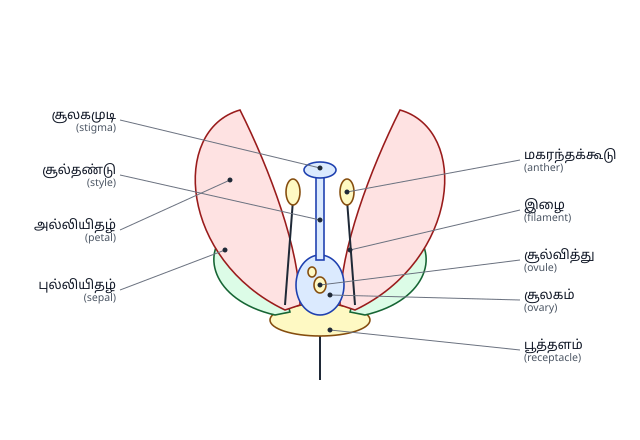

---

## SC10-15: நீர்நிலையியல் அமுக்கமும் அதன் பிரயோகங்களும் (Hydrostatic pressure and its applications)

<!-- meta {"type":"chapter_notes","id":"SC10-15","grade":10,"chapter":15,"discipline":"PHY"} -->

*தரம் 10 · அத்தியாயம் 15 · பௌதிகவியல்*

திரவங்களும் வாயுக்களும் அமுக்கத்தைச் செலுத்துகின்றன. திரவ அமுக்கம் ஆழம், அடர்த்தி, g ஐச் சார்ந்தது; இது பல பிரயோகங்களுக்கு அடிப்படை.

### கற்றல் நோக்கங்கள்

- அமுக்கத்தைக் கணித்தல் (P = F/A)
- திரவ அமுக்கம் P = hρg
- பஸ்காலின் விதி, நீரியல் இயந்திரங்கள்
- வளிமண்டல அமுக்கம், மிதப்பு

### பிரதான எண்ணக்கருக்கள்

- அமுக்கம் $P = \frac{F}{A}$; அலகு Pa (N m⁻²).
- திரவ அமுக்கம் $P = h\rho g$ — ஆழம் (h), அடர்த்தி (ρ), g ஐச் சார்ந்தது; பாத்திர வடிவத்தைச் சாராது (2019 வினாத்தாள் I வி37).
- ஒரே ஆழத்தில் எல்லாத் திசைகளிலும் சமன்.
- பஸ்காலின் விதி: மூடிய திரவத்தில் பிரயோகிக்கும் அமுக்கம் எல்லாப் பகுதிகளுக்கும் சமமாகக் கடத்தப்படும் — நீரியல் அழுத்தி, நீரியல் தடுப்பு: $\frac{F_1}{A_1} = \frac{F_2}{A_2}$.
- வளிமண்டல அமுக்கம் கடல் மட்டத்தில் ≈ 1.0 × 10⁵ Pa (760 mmHg); உயரம் கூடக் குறையும் (2019 வினாத்தாள் I வி22 — செவிப்பறை).
- மேலுதைப்பு (Upthrust): திரவத்திலுள்ள பொருளில் மேல்நோக்கிய விசை = இடம்பெயர்த்த திரவத்தின் நிறை (ஆக்கிமிடீசின் கொள்கை); மேலுதைப்பு = நிறை எனின் மிதக்கும்.

### வரைவிலக்கணங்கள்

- **அமுக்கம் (Pressure):** ஓரலகுப் பரப்பில் செங்குத்தாகத் தாக்கும் விசை.
- **பஸ்காலின் விதி:** மூடிய திரவத்தில் அமுக்கம் எல்லாத் திசைகளுக்கும் சமமாகக் கடத்தப்படும்.
- **மேலுதைப்பு (Upthrust):** திரவத்தில் அமிழ்ந்த பொருளில் தாக்கும் மேல்நோக்கிய விசை.

### ஒப்பீட்டு அட்டவணை

| சூத்திரம் | பயன்பாடு |
|---|---|
| P = F/A | திண்ம அமுக்கம் |
| P = hρg | திரவ அமுக்கம் |
| F₁/A₁ = F₂/A₂ | நீரியல் அழுத்தி |

### அன்றாட வாழ்க்கைத் தொடர்புகள்

- அணைக்கட்டின் அடி தடிப்பானது — ஆழத்தில் அமுக்கம் அதிகம்.
- கூரிய கத்தி வெட்டும் — சிறிய பரப்பு, அதிக அமுக்கம்.
- நீரியல் தூக்கி (garage jack).

### பொதுவான தவறான எண்ணக்கருக்கள்

- ⚠️ அகன்ற பாத்திரத்தின் அடியில் அமுக்கம் கூடுதல் — பிழை; ஆழமே தீர்மானிக்கும்.
- ⚠️ கனமான பொருள் எப்போதும் அமிழும் — பிழை; அடர்த்தியும் மேலுதைப்பும் தீர்மானிக்கும் (கப்பல்).

### பரீட்சைக் கவனம்

- P = hρg, F/A கணிப்புகள் (கோப்பு 5).
- நீரியல் அழுத்தியின் விசைப் பெருக்கம்.

### தொடர்புடைய வளங்கள்

- வரிப்படம் PHY-D10 — ஆழத்துடன் திரவ அமுக்கம் ([பெயரிட்டது](science_assets/physics/PHY-D10_labelled.svg))
- பரிசோதனை EXP-21 — ஆழத்துடன் திரவ அமுக்கம் (கோப்பு 8)
- கணிப்பு CL-PRESS — அமுக்கம், திரவ அமுக்கம், பஸ்கால் (கோப்பு 5)

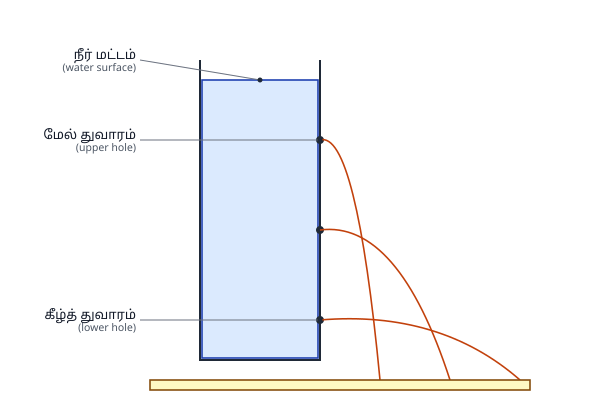

---

## SC10-16: சடப்பொருள்களில் ஏற்படும் மாற்றம் (Changes in matter)

<!-- meta {"type":"chapter_notes","id":"SC10-16","grade":10,"chapter":16,"discipline":"CHE"} -->

*தரம் 10 · அத்தியாயம் 16 · இரசாயனவியல்*

சடப்பொருளில் பௌதிக மாற்றங்களும் இரசாயன மாற்றங்களும் நிகழ்கின்றன. இரசாயனத் தாக்கங்கள் பல வகைப்படும்; உலோகங்களின் தாக்கத்திறன் தொடர் இதற்கு முக்கியம்.

### கற்றல் நோக்கங்கள்

- பௌதிக, இரசாயன மாற்றங்களை வேறுபடுத்துதல்
- தாக்க வகைகளை இனங்காணுதல்
- தாக்கத்திறன் தொடரைப் பயன்படுத்துதல்
- இரும்புப் பிரித்தெடுப்பை விளக்குதல்

### பிரதான எண்ணக்கருக்கள்

- பௌதிக மாற்றம்: புதிய பதார்த்தம் இல்லை (உருகல், ஆவியாதல், கரைதல்). இரசாயன மாற்றம்: புதிய பதார்த்தம் (தகனம், துருப்பிடித்தல்).
- தாக்க வகைகள்: சேர்க்கை (2Mg + O₂ → 2MgO), பிரிகை (CaCO₃ → CaO + CO₂), தனி இடப்பெயர்ச்சி (Zn + CuSO₄ → ZnSO₄ + Cu), இரட்டை இடப்பெயர்ச்சி (AgNO₃ + NaCl → AgCl + NaNO₃).
- தாக்கத்திறன் தொடர்: K > Na > Ca > Mg > Al > Zn > Fe > Sn > Pb > (H) > Cu > Hg > Ag > Au.
- H க்கு மேலுள்ள உலோகங்கள் ஐதான அமிலங்களிலிருந்து H₂ ஐ இடம்பெயர்க்கும்: Mg + 2HCl → MgCl₂ + H₂.
- குளிர்நீருடன்: K, Na, Ca தாக்கமடைந்து ஐதரொட்சைட்டு + H₂; Mg கொதிநீர்/நீராவியுடன்.
- தாக்கத்திறன் கூடிய உலோகம் குறைந்ததை அதன் உப்புக் கரைசலிலிருந்து இடம்பெயர்க்கும்.
- இரும்புப் பிரித்தெடுப்பு (ஊதுலை): Fe₂O₃ + 3CO → 2Fe + 3CO₂; சுண்ணக்கல் (CaCO₃) → CaO, அது SiO₂ மாசை கசடாக (CaSiO₃) அகற்றும் (2019 வினாத்தாள் I வி34).

### வரைவிலக்கணங்கள்

- **இரசாயன மாற்றம்:** புதிய பதார்த்தங்கள் உருவாகும் மாற்றம்.
- **இடப்பெயர்ச்சித் தாக்கம்:** ஒரு மூலகம் சேர்வையிலிருந்து வேறொரு மூலகத்தை இடம்பெயர்த்தல்.
- **தாக்கத்திறன் தொடர்:** உலோகங்களைத் தாக்கமடையும் தன்மையின் இறங்கு வரிசையில் ஒழுங்குபடுத்தல்.

### ஒப்பீட்டு அட்டவணை

| உலோகம் | குளிர்நீர் | ஐதான அமிலம் |
|---|---|---|
| Na | கடுமையான தாக்கம் | ஆபத்தானது |
| Mg | மிக மெதுவாக (நீராவியுடன் விரைவு) | விரைவாக H₂ |
| Zn | இல்லை | H₂ |
| Cu | இல்லை | இல்லை |

### அன்றாட வாழ்க்கைத் தொடர்புகள்

- இரும்புக் கூரைகள் துருப்பிடித்தல் — இரசாயன மாற்றம்.
- தங்கம் இயற்கையில் சுயாதீனமாகக் கிடைத்தல் — தாக்கத்திறன் குறைவு.

### பொதுவான தவறான எண்ணக்கருக்கள்

- ⚠️ கரைதல் இரசாயன மாற்றம் — பிழை; பௌதிக மாற்றம்.
- ⚠️ Cu ஐதான HCl உடன் H₂ தரும் — பிழை; Cu, H க்குக் கீழே.

### பரீட்சைக் கவனம்

- தாக்கத்திறன் தொடரைக் கொண்டு தாக்கம் நடைபெறுமா எனக் கணித்தல்.
- தாக்க வகைகளை இனங்காணல்; சமன்பாடுகளைச் சமன்செய்தல் (கோப்பு 7).

### தொடர்புடைய வளங்கள்

- வரிப்படம் CHE-D05 — ஊதுலை (திட்டப் படம்) ([பெயரிட்டது](science_assets/chemistry/CHE-D05_labelled.svg))
- சமன்பாடுகள் EQ-001, EQ-002, EQ-003, EQ-004, EQ-005, EQ-006, EQ-007, EQ-008 … (கோப்பு 7)

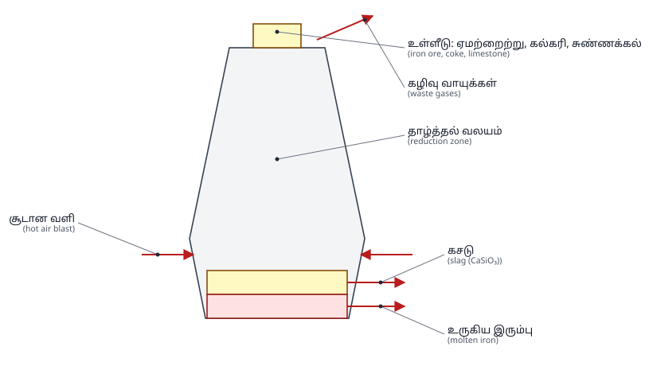

---

## SC10-17: தாக்கவீதம் (Rate of reactions)

<!-- meta {"type":"chapter_notes","id":"SC10-17","grade":10,"chapter":17,"discipline":"CHE"} -->

*தரம் 10 · அத்தியாயம் 17 · இரசாயனவியல்*

தாக்கவீதம் என்பது ஓரலகு நேரத்தில் தாக்கிகள் நுகரப்படும் அல்லது விளைவுகள் உருவாகும் அளவு. பல காரணிகள் இதைப் பாதிக்கும்.

### கற்றல் நோக்கங்கள்

- தாக்கவீதத்தை வரையறுத்து அளத்தல்
- வெப்பநிலை, செறிவு, மேற்பரப்பளவு, ஊக்கி ஆகியவற்றின் விளைவை விளக்குதல்
- வரைபுகளிலிருந்து வீதத்தை விளக்குதல்

### பிரதான எண்ணக்கருக்கள்

- வீதம் = மாற்றம் ÷ நேரம் (உ-ம் வெளியேறும் வாயுக் கனவளவு cm³ s⁻¹).
- வெப்பநிலை கூடும்போது துணிக்கைகளின் இயக்கசக்தி கூடி மோதல்கள் அதிகரிக்கும் → வீதம் கூடும்.
- செறிவு கூட ஓரலகுக் கனவளவில் துணிக்கைகள் அதிகம் → மோதல் கூடும்.
- திண்மத்தின் துணிக்கை அளவு குறைய (தூள்) மேற்பரப்பளவு கூடும் → வீதம் கூடும்.
- ஊக்கி (Catalyst): தாக்க வீதத்தைக் கூட்டும்; தானே நிரந்தரமாக மாறாது (உ-ம் H₂O₂ பிரிகையில் MnO₂).
- வாயுத் தாக்கங்களில் அமுக்கம் கூட வீதம் கூடும்.
- வாயுக் கனவளவு–நேர வரைபின் படித்திறன் = வீதம்; நேரத்துடன் வீதம் குறையும் (தாக்கிகள் குறைவதால்).

### வரைவிலக்கணங்கள்

- **தாக்கவீதம் (Rate of reaction):** ஓரலகு நேரத்தில் ஏற்படும் தாக்கி/விளைவு அளவு மாற்றம்.
- **ஊக்கி (Catalyst):** தாக்கத்தில் நிரந்தரமாக மாறாமல் வீதத்தைக் கூட்டும் பதார்த்தம்.

### ஒப்பீட்டு அட்டவணை

| காரணி | மாற்றம் | வீதம் | காரணம் |
|---|---|---|---|
| வெப்பநிலை | கூட்டல் | கூடும் | இயக்கசக்தி, மோதல் அதிகரிப்பு |
| செறிவு | கூட்டல் | கூடும் | துணிக்கைகள் அதிகம் |
| மேற்பரப்பு | தூளாக்கல் | கூடும் | தொடுகைப் பரப்பு அதிகம் |
| ஊக்கி | சேர்த்தல் | கூடும் | மாற்று வழி |

### அன்றாட வாழ்க்கைத் தொடர்புகள்

- உணவைக் குளிரூட்டியில் வைத்தல் — பழுதடையும் வீதம் குறையும்.
- விறகுத் துண்டுகளை விட விறகுத்தூள் விரைவாக எரியும்.

### பொதுவான தவறான எண்ணக்கருக்கள்

- ⚠️ ஊக்கி அதிக விளைவைத் தரும் — பிழை; விரைவாகத் தரும், அளவு மாறாது.
- ⚠️ தாக்கம் முழுதும் வீதம் மாறாது — பிழை; காலப்போக்கில் குறையும்.

### பரீட்சைக் கவனம்

- வரைபுகளை ஒப்பிடல் (தூள் vs துண்டு; வெப்பநிலை).
- நியாயமான சோதனையில் மாறிகளைக் கட்டுப்படுத்தல் (கோப்பு 8).

### தொடர்புடைய வளங்கள்

- வரிப்படம் GR-D03 — தாக்கவீதம்: வாயுக் கனவளவு–நேரம் ([பெயரிட்டது](science_assets/graphs/GR-D03_labelled.svg))
- பரிசோதனை EXP-09 — வெப்பநிலையும் தாக்கவீதமும் (சோடியம் தயோசல்பேற்று + HCl) (கோப்பு 8)
- பரிசோதனை EXP-10 — பரப்பளவும் தாக்கவீதமும் (CaCO₃ + HCl) (கோப்பு 8)
- கணிப்பு CL-RATE — சராசரித் தாக்கவீதம் (கோப்பு 5)

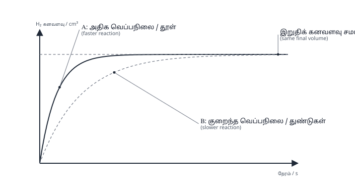

---

## SC10-18: வேலை, சக்தி, வலு (Work, energy and power)

<!-- meta {"type":"chapter_notes","id":"SC10-18","grade":10,"chapter":18,"discipline":"PHY"} -->

*தரம் 10 · அத்தியாயம் 18 · பௌதிகவியல்*

விசை பொருளை அதன் திசையில் நகர்த்தும்போது வேலை செய்யப்படுகிறது. சக்தி வேலை செய்யும் ஆற்றல்; வலு வேலை செய்யப்படும் வீதம்.

### கற்றல் நோக்கங்கள்

- வேலை, இயக்கசக்தி, அழுத்தசக்தியைக் கணித்தல்
- சக்திக் காப்பு விதியைப் பயன்படுத்துதல்
- வலு, வினைத்திறனைக் கணித்தல்

### பிரதான எண்ணக்கருக்கள்

- வேலை $W = Fs$ (விசைத் திசையில் இடப்பெயர்ச்சி); அலகு J.
- இயக்கசக்தி $E_k = \frac12 mv^2$; ஈர்ப்பு அழுத்தசக்தி $E_p = mgh$.
- சக்திக் காப்பு விதி: சக்தியை ஆக்கவோ அழிக்கவோ முடியாது; ஒரு வடிவிலிருந்து மற்றொன்றுக்கு மாறும். உராய்வின்றி விழும் பொருளில் Ep இழப்பு = Ek பெறல்.
- வலு $P = \frac{W}{t}$; அலகு W (J s⁻¹).
- வினைத்திறன் = (பயனுள்ள வெளியீடு ÷ உள்ளீடு) × 100%.
- சக்தி வடிவங்கள்: இயக்க, அழுத்த, வெப்ப, ஒலி, ஒளி, மின், இரசாயன, அணுக்கரு; புதுப்பிக்கக்கூடிய/முடியாத மூலங்கள்.

### வரைவிலக்கணங்கள்

- **வேலை (Work):** விசையும் விசைத் திசையிலான இடப்பெயர்ச்சியும் பெருக்கம்.
- **வலு (Power):** வேலை செய்யப்படும் வீதம்.
- **ஜூல் (J):** 1 N விசை 1 m நகர்த்தும்போது செய்யும் வேலை.

### ஒப்பீட்டு அட்டவணை

| கணியம் | சூத்திரம் | அலகு |
|---|---|---|
| வேலை | W = Fs | J |
| இயக்கசக்தி | ½mv² | J |
| அழுத்தசக்தி | mgh | J |
| வலு | W/t | W |

### அன்றாட வாழ்க்கைத் தொடர்புகள்

- நீர்மின் நிலையம்: அழுத்தசக்தி → இயக்கசக்தி → மின்சக்தி.
- சுமையைக் கையில் பிடித்து நிற்பது (இயக்கம் இல்லை) — பௌதிக வேலை 0.

### பொதுவான தவறான எண்ணக்கருக்கள்

- ⚠️ தள்ளியும் அசையாத சுவரில் வேலை செய்யப்படுகிறது — பிழை; இடப்பெயர்ச்சி 0.
- ⚠️ வினைத்திறன் 100% ஐத் தாண்டலாம் — பிழை.

### பரீட்சைக் கவனம்

- Ep ↔ Ek மாற்றக் கணிப்புகள் (கோப்பு 5).
- சக்தி மாற்றச் சங்கிலிகள் (2019 வினாத்தாள் II வி1B).

### தொடர்புடைய வளங்கள்

- கணிப்பு CL-WORK — வேலை, சக்தி, வலு, வினைத்திறன் (கோப்பு 5)

---

## SC10-19: ஓட்ட மின்னியல் (Current electricity)

<!-- meta {"type":"chapter_notes","id":"SC10-19","grade":10,"chapter":19,"discipline":"PHY"} -->

*தரம் 10 · அத்தியாயம் 19 · பௌதிகவியல்*

ஓட்ட மின்னியலில் மின்னோட்டம், அழுத்த வேறுபாடு, தடை, அவற்றுக்கிடையிலான ஓமின் விதி, தொடர்–சமாந்தரச் சுற்றுகள் கற்கப்படுகின்றன.

### கற்றல் நோக்கங்கள்

- மின்னோட்டம், அழுத்த வேறுபாடு, தடையை வரையறுத்தல்
- ஓமின் விதியைப் பயன்படுத்துதல்
- தொடர், சமாந்தரத் தடைகளைக் கணித்தல்
- அம்பியர்மானி, வோல்ற்மானியை இணைத்தல்

### பிரதான எண்ணக்கருக்கள்

- மின்னோட்டம் (I): ஏற்றப் பாய்ச்சல் வீதம்; அலகு A; அம்பியர்மானி தொடராக இணைக்கப்படும்.
- அழுத்த வேறுபாடு (V): அலகு V; வோல்ற்மானி சமாந்தரமாக இணைக்கப்படும்.
- ஓமின் விதி: மாறா வெப்பநிலையில் $V = IR$; V–I வரைபு உற்பத்தியினூடான நேர்கோடு, படித்திறன் = R.
- தடை (R, Ω) சார்ந்திருப்பவை: நீளம் (நேர் விகிதம்), குறுக்குவெட்டுப் பரப்பு (நேர்மாறு), பதார்த்தம், வெப்பநிலை (2019 வினாத்தாள் I வி18).
- தொடர்: $R = R_1 + R_2$; ஒரே மின்னோட்டம். சமாந்தரம்: $\frac1R = \frac1{R_1} + \frac1{R_2}$; ஒரே அழுத்த வேறுபாடு.
- கலங்களைத் தொடராக இணைத்தால் மொத்த மின்னியக்க விசை கூடும்.
- முனைவுப் பாதுகாப்பு: தவறான முனைவில் இணைத்தால் உபகரணம் பழுதாகாதிருக்க இருவாயி (diode) பயன்படும் (2019 வினாத்தாள் I வி19).

### வரைவிலக்கணங்கள்

- **மின்னோட்டம் (Current):** ஒரு புள்ளியினூடு ஏற்றம் பாயும் வீதம்.
- **ஓமின் விதி:** மாறா வெப்பநிலையில் கடத்தியின் மின்னோட்டம் அழுத்த வேறுபாட்டுக்கு நேர் விகிதசமன்.
- **தடை (Resistance):** மின்னோட்டத்தை எதிர்க்கும் இயல்பு; R = V/I.

### ஒப்பீட்டு அட்டவணை

| | தொடர் | சமாந்தரம் |
|---|---|---|
| மின்னோட்டம் | எங்கும் சமம் | கிளைகளில் பிரியும் |
| அழுத்த வேறுபாடு | பிரியும் | எல்லாக் கிளையிலும் சமம் |
| மொத்தத் தடை | R₁ + R₂ | 1/R = 1/R₁ + 1/R₂ |

### அன்றாட வாழ்க்கைத் தொடர்புகள்

- வீட்டுச் சுற்றுகள் சமாந்தரம் — ஒரு குமிழ் அணைந்தாலும் மற்றவை எரியும்.
- நீண்ட மெல்லிய கம்பி அதிக தடை — வெப்பமாக்கிச் சுருள்.

### பொதுவான தவறான எண்ணக்கருக்கள்

- ⚠️ மின்னோட்டம் சுற்றில் 'பயன்படுத்தப்பட்டு' குறையும் — பிழை; தொடர்ச் சுற்றில் எங்கும் சமம்.
- ⚠️ சமாந்தரத்தில் தடைகளைச் சேர்க்க மொத்தத் தடை கூடும் — பிழை; குறையும்.

### பரீட்சைக் கவனம்

- V = IR, தொடர்–சமாந்தரக் கணிப்புகள் (கோப்பு 5).
- சுற்று வரிப்படங்கள் வரைதல் (கோப்பு 6).

### தொடர்புடைய வளங்கள்

- வரிப்படம் PHY-D01 — தொடர்ச் சுற்று (அம்பியர்மானி, வோல்ற்மானி) ([பெயரிட்டது](science_assets/physics/PHY-D01_labelled.svg))
- வரிப்படம் PHY-D02 — சமாந்தரச் சுற்று ([பெயரிட்டது](science_assets/physics/PHY-D02_labelled.svg))
- வரிப்படம் GR-D04 — ஓமின் விதி: V–I வரைபு ([பெயரிட்டது](science_assets/graphs/GR-D04_labelled.svg))
- பரிசோதனை EXP-22 — ஓமின் விதி (கோப்பு 8)
- பரிசோதனை EXP-23 — கம்பியின் நீளமும் தடையும் (கோப்பு 8)
- கணிப்பு CL-OHM — ஓமின் விதியும் தடைச் சேர்க்கைகளும் (கோப்பு 5)

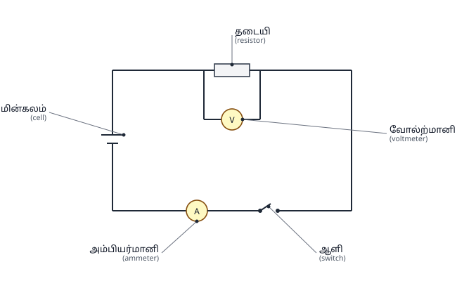

---

## SC10-20: தலைமுறையுரிமை (Inheritance)

<!-- meta {"type":"chapter_notes","id":"SC10-20","grade":10,"chapter":20,"discipline":"BIO"} -->

*தரம் 10 · அத்தியாயம் 20 · உயிரியல்*

பெற்றோரின் இயல்புகள் பரம்பரை அலகுகள் (genes) மூலம் சந்ததிக்குக் கடத்தப்படுகின்றன. மென்டலின் பரிசோதனைகள் இதன் அடிப்படை.

### கற்றல் நோக்கங்கள்

- ஆட்சியுடைய, பின்னடைவான இயல்புகளை விளக்குதல்
- ஒற்றைக் கலப்புப் பிறப்பைப் புனெற் சதுரத்தால் காட்டுதல்
- இலிங்கம் தீர்மானிக்கப்படுதலை விளக்குதல்

### பிரதான எண்ணக்கருக்கள்

- பரம்பரை அலகு (Gene): ஓர் இயல்பைத் தீர்மானிக்கும் DNA பகுதி; நிறமூர்த்தத்தில் உள்ளது.
- எதிருரு (Allele): ஒரு பரம்பரை அலகின் வேறுபட்ட வடிவங்கள் (T, t).
- ஆட்சியுடைய (Dominant) எதிருரு பெரிய எழுத்து (T); பின்னடைவான (Recessive) சிறிய எழுத்து (t).
- பிறப்புரிமையமைப்பு (Genotype): TT, Tt, tt; தோற்றவமைப்பு (Phenotype): உயரம்/குட்டை.
- ஒத்தநுகம் (Homozygous): TT, tt; பல்லினநுகம் (Heterozygous): Tt.
- Tt × Tt → பிறப்புரிமையமைப்பு விகிதம் 1 TT : 2 Tt : 1 tt; தோற்றவமைப்பு 3 : 1.
- இலிங்கம்: பெண் XX, ஆண் XY; தந்தையின் விந்தே இலிங்கத்தைத் தீர்மானிக்கும்; ஆண் பிள்ளைக்கான நிகழ்தகவு ½.
- பரம்பரை நோய்கள்: தலசீமியா, நிறக்குருடு, ஈமோபீலியா (X இணைந்தவை — நிறக்குருடு, ஈமோபீலியா).

### வரைவிலக்கணங்கள்

- **பரம்பரை அலகு (Gene):** ஒரு இயல்பைத் தீர்மானிக்கும் DNA துண்டு.
- **பிறப்புரிமையமைப்பு (Genotype):** ஒரு அங்கியின் எதிருருச் சேர்க்கை.
- **தோற்றவமைப்பு (Phenotype):** வெளித்தெரியும் இயல்பு.

### ஒப்பீட்டு அட்டவணை

| | T | t |
|---|---|---|
| **T** | TT | Tt |
| **t** | Tt | tt |

### அன்றாட வாழ்க்கைத் தொடர்புகள்

- தலசீமியா காவிகள் இருவர் திருமணம் செய்தால் பிள்ளைக்கு நோய் வர ¼ நிகழ்தகவு — திருமணத்துக்கு முன் சோதனை.
- நிறக்குருடு ஆண்களில் அதிகம்.

### பொதுவான தவறான எண்ணக்கருக்கள்

- ⚠️ ஆட்சியுடைய இயல்பு எப்போதும் சனத்தொகையில் அதிகம் — பிழை; அது தோற்ற வெளிப்பாடு மட்டும்.
- ⚠️ தாய் பிள்ளையின் இலிங்கத்தைத் தீர்மானிக்கிறார் — பிழை; தந்தையின் X/Y விந்து.

### பரீட்சைக் கவனம்

- புனெற் சதுரத்துடன் F1, F2 விகிதங்கள் (2019 வினாத்தாள் II வி5C — விதை வடிவம்).
- சொற்களை வரையறுத்தல்: genotype, phenotype, homozygous.

### தொடர்புடைய வளங்கள்

- வரிப்படம் BIO-D10 — புனெற் சதுரம்: Tt × Tt ([பெயரிட்டது](science_assets/biology/BIO-D10_labelled.svg))
- கணிப்பு CL-GENE — மென்டல் விகிதங்கள் (கோப்பு 5)

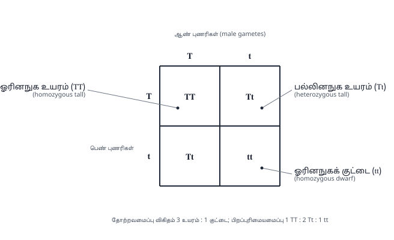

---

## SC11-01: தாவர இழையங்களும் விலங்கு இழையங்களும் (Living tissues)

<!-- meta {"type":"chapter_notes","id":"SC11-01","grade":11,"chapter":1,"discipline":"BIO"} -->

*தரம் 11 · அத்தியாயம் 1 · உயிரியல்*

ஒத்த அமைப்பும் தொழிலும் உடைய கலக் கூட்டம் இழையம் (Tissue). தாவரங்களிலும் விலங்குகளிலும் வெவ்வேறு இழையங்கள் உள்ளன.

### கற்றல் நோக்கங்கள்

- தாவர இழையங்களை வகைப்படுத்துதல்
- விலங்கு இழையங்களின் வகைகளையும் தொழில்களையும் விளக்குதல்
- இழையங்களை அவற்றின் இருப்பிடத்துடன் தொடர்புபடுத்துதல்

### பிரதான எண்ணக்கருக்கள்

- தாவர இழையங்கள்: பிரியிழையம் (Meristematic) — கலப்பிரிவு (நுனி, பக்க); நிலையான இழையம் — புடைக்கலவிழையம் (Parenchyma), ஒட்டுக்கலவிழையம் (Collenchyma), வல்லருகுக்கலவிழையம் (Sclerenchyma), காழ் (Xylem), உரியம் (Phloem).
- காழ்: நீரும் கனிப்பொருட்களும் மேல்நோக்கி; இறந்த கலங்கள் (குழாய்கள், குழற்போலிகள்); இலிக்னின்.
- உரியம்: தயாரிக்கப்பட்ட உணவு (சுக்குரோசு) இருதிசையிலும்; நெய்யரிக் குழாய்கள், தோழமைக் கலங்கள்.
- விலங்கு இழையங்கள்: மேலணி (Epithelial), தொடுப்பு (Connective: என்பு, கசியிழையம், இரத்தம்), தசை (வன்கூட்டுத் தசை, மழமழப்பான தசை, இதயத் தசை), நரம்பு இழையம்.
- இதயத் தசை சோர்வடையாது; தன்னிச்சையற்றது; கிளைத்த நார்கள்.
- வன்கூட்டுத் தசைக் கலங்கள் பல்கருவுள்ளவை (2019 வினாத்தாள் I வி38 — பல்கருக் கலங்கள்).

### வரைவிலக்கணங்கள்

- **இழையம் (Tissue):** ஒத்த அமைப்பும் தொழிலும் உடைய கலக் கூட்டம்.
- **பிரியிழையம்:** தொடர்ந்து பிரியும் இளம் கலங்களாலான தாவர இழையம்.
- **நியூரோன் (Neuron):** நரம்புக் கணத்தாக்கங்களைக் கடத்தும் கலம்.

### ஒப்பீட்டு அட்டவணை

| தசை வகை | இருப்பிடம் | கட்டுப்பாடு | கரு |
|---|---|---|---|
| வன்கூட்டுத் தசை | எலும்புகளுடன் | விருப்பத்துக்குரியது | பல கருக்கள் |
| மழமழப்பான தசை | உணவுக்கால்வாய், குருதிக்கலன் | தன்னிச்சையற்றது | ஒரு கரு |
| இதயத் தசை | இதயம் | தன்னிச்சையற்றது | ஒரு கரு, கிளைத்தவை |

### அன்றாட வாழ்க்கைத் தொடர்புகள்

- தேங்காய்ச் சிரட்டை, விதையுறைகள் வல்லருகுக்கலவிழையத்தால் கடினமானவை.
- தண்டை நிற நீரில் வைத்தால் காழ் நிறமடையும் — நீர்க் கடத்தலுக்குச் சான்று.

### பொதுவான தவறான எண்ணக்கருக்கள்

- ⚠️ உரியம் நீரைக் கடத்தும் — பிழை; காழே நீரைக் கடத்தும்.
- ⚠️ எல்லாத் தசைகளும் விருப்பத்துக்கேற்பச் சுருங்கும் — பிழை; மழமழப்பான, இதயத் தசைகள் தன்னிச்சையற்றவை.

### பரீட்சைக் கவனம்

- இழையம் — இருப்பிடம் — தொழில் பொருத்துதல்.
- தசை வகைகளின் ஒப்பீடு.

---

## SC11-02: ஒளித்தொகுப்பு (Photosynthesis)

<!-- meta {"type":"chapter_notes","id":"SC11-02","grade":11,"chapter":2,"discipline":"BIO"} -->

*தரம் 11 · அத்தியாயம் 2 · உயிரியல்*

ஒளித்தொகுப்பில் பச்சைத் தாவரங்கள் ஒளிச்சக்தியைப் பயன்படுத்தி CO₂ உம் நீரும் இருந்து குளுக்கோசைத் தயாரித்து O₂ ஐ வெளியிடுகின்றன.

### கற்றல் நோக்கங்கள்

- ஒளித்தொகுப்புச் சமன்பாட்டை எழுதுதல்
- பாதிக்கும் காரணிகளை விளக்குதல்
- இலையின் இசைவாக்கங்களை விளக்குதல்
- ஒளித்தொகுப்புப் பரிசோதனைகளைச் செய்தல்

### பிரதான எண்ணக்கருக்கள்

- சமன்பாடு: 6CO₂ + 6H₂O →(ஒளி, பச்சையம்) C₆H₁₂O₆ + 6O₂.
- ஒளிச்சக்தி இரசாயனச் சக்தியாக மாற்றப்படும்.
- தேவைகள்: ஒளி, CO₂, நீர், பச்சையம் (Chlorophyll); பொருத்தமான வெப்பநிலை.
- இலையின் இசைவாக்கம்: அகன்ற மேற்பரப்பு, மெல்லியது, இலைவாய்கள் (Stomata), நெருக்கமான வேலிக்கற்புடைக்கலவிழையம் (பச்சையவுருமணி அதிகம்), நரம்புகள் (காழ், உரியம்).
- மட்டுப்படுத்தும் காரணி: ஒளிச்செறிவு, CO₂ செறிவு, வெப்பநிலை — மிகக் குறைவாக உள்ளது வீதத்தைக் கட்டுப்படுத்தும்.
- குளுக்கோசு மாப்பொருளாகச் சேமிக்கப்படும் — அயடீனால் சோதிக்கலாம்.
- மாப்பொருட் சோதனைக்கு முன் இலையை இருட்டில் வைத்தல் (மாப்பொருள் நீக்கல்) அவசியம் (2019 வினாத்தாள் II வி2B).

### வரைவிலக்கணங்கள்

- **ஒளித்தொகுப்பு (Photosynthesis):** ஒளிச்சக்தியைப் பயன்படுத்தி CO₂, H₂O இலிருந்து குளுக்கோசு தயாரித்தல்.
- **மட்டுப்படுத்தும் காரணி (Limiting factor):** குறைந்தளவில் இருந்து வீதத்தைக் கட்டுப்படுத்தும் காரணி.
- **இலைவாய் (Stoma):** வாயுப் பரிமாற்றத்துக்கான இலைத்துளை; காவற்கலங்களால் கட்டுப்படுத்தப்படும்.

### ஒப்பீட்டு அட்டவணை

| பரிசோதனை | மாறும் காரணி | கட்டுப்பாட்டு அமைப்பு |
|---|---|---|
| கருந்தாளால் இலைப் பகுதியை மூடல் | ஒளி | மூடாத பகுதி |
| KOH உடன் மூடிய போத்தல் | CO₂ | KOH இல்லாத போத்தல் |
| பல்வண்ண இலை | பச்சையம் | பச்சைப் பகுதி |

### அன்றாட வாழ்க்கைத் தொடர்புகள்

- பசுமைக் கூடங்களில் CO₂ கூட்டி விளைச்சல் அதிகரிப்பு.
- நிழலில் வளரும் தாவரங்கள் மெதுவாக வளரும்.

### பொதுவான தவறான எண்ணக்கருக்கள்

- ⚠️ தாவரங்கள் இரவில் மட்டும் சுவாசிக்கும் — பிழை; எப்போதும் சுவாசிக்கும்.
- ⚠️ தாவரம் உணவை மண்ணிலிருந்து பெறும் — பிழை; மண்ணிலிருந்து நீரும் கனிப்பொருளும் மட்டும்.

### பரீட்சைக் கவனம்

- பல்வண்ண இலை (variegated) — பச்சையம் தேவை; KOH — CO₂ தேவை; கருந்தாள் — ஒளி தேவை.
- மாப்பொருட் சோதனைப் படிகள்: கொதிநீர் → எதனோல் (நீர்த்தொட்டியில்) → கொதிநீர் → அயடீன்.

### தொடர்புடைய வளங்கள்

- வரிப்படம் BIO-D03 — இலையின் குறுக்குவெட்டு ([பெயரிட்டது](science_assets/biology/BIO-D03_labelled.svg))
- வரிப்படம் EXP-D01 — இலையில் மாப்பொருள் சோதனை ([பெயரிட்டது](science_assets/experiments/EXP-D01_labelled.svg))
- வரிப்படம் EXP-D02 — ஒளித்தொகுப்பில் O₂ வெளியேற்றம் ([பெயரிட்டது](science_assets/experiments/EXP-D02_labelled.svg))
- பரிசோதனை EXP-03 — ஒளித்தொகுப்புக்கு ஒளி அவசியம் (மாப்பொருள் சோதனை) (கோப்பு 8)
- பரிசோதனை EXP-04 — ஒளிச்செறிவும் ஒளித்தொகுப்பு வீதமும் (Hydrilla) (கோப்பு 8)
- சமன்பாடுகள் EQ-041 (கோப்பு 7)

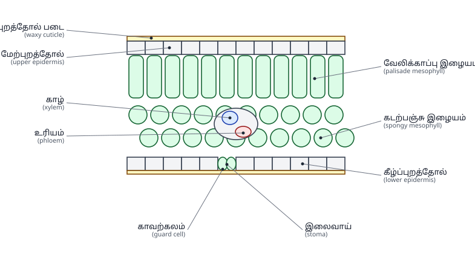

---

## SC11-03: கலவை (Mixtures)

<!-- meta {"type":"chapter_notes","id":"SC11-03","grade":11,"chapter":3,"discipline":"CHE"} -->

*தரம் 11 · அத்தியாயம் 3 · இரசாயனவியல்*

கலவை என்பது இரசாயன ரீதியாகப் பிணையாத இரண்டு அல்லது அதற்கு மேற்பட்ட பதார்த்தங்களின் சேர்க்கை. கரைசல்கள், அவற்றின் செறிவு, பிரித்தெடுக்கும் முறைகள் இவ்வத்தியாயத்தில்.

### கற்றல் நோக்கங்கள்

- சீரான, சீரற்ற கலவைகளை வேறுபடுத்துதல்
- கரைசற் செறிவைப் பல முறைகளில் கணித்தல்
- பொருத்தமான பிரித்தெடுப்பு முறையைத் தெரிதல்

### பிரதான எண்ணக்கருக்கள்

- சீரான கலவை (Homogeneous): ஒரே அவத்தை (உப்புக் கரைசல், வளி). சீரற்ற கலவை: வேறுபட்ட அவத்தைகள் (மண் + நீர்).
- கரைசல் = கரையம் + கரைப்பான்.
- செறிவு: திணிவுப் பின்னம் (w/w %), கனவளவுப் பின்னம் (v/v %), திணிவு/கனவளவு (g dm⁻³), மூலர்ச் செறிவு (mol dm⁻³).
- அடர்த்தி $\rho = m/V$ — கரைசல் திணிவைக் கணிக்கப் பயன்படும் (2019 வினாத்தாள் II வி6C).
- பிரித்தெடுப்பு: வடிகட்டல் (கரையாத திண்மம்), ஆவியாக்கல்/படிகமாக்கல் (கரைந்த திண்மம்), காய்ச்சிவடித்தல் (கரைப்பான் மீட்பு), பகுதிபடக் காய்ச்சிவடித்தல் (கொதிநிலை வேறுபட்ட திரவங்கள் — மசகெண்ணெய், எதனோல்–நீர்), நிறப்பகுப்பு (நிறப்பொருட்கள்), பிரிபுனல் (கலவாத திரவங்கள்), கரைப்பான் பிரித்தெடுப்பு, நீராவிக் காய்ச்சிவடித்தல் (நறுமண எண்ணெய்கள் — கறுவா).
- வாயுக்களின் கரைதிறன் அமுக்கம் கூடக் கூடும், வெப்பநிலை கூடக் குறையும்.

### வரைவிலக்கணங்கள்

- **கலவை (Mixture):** இரசாயனப் பிணைப்பின்றிச் சேர்ந்த பதார்த்தங்கள்; கூறுகள் தம் இயல்புகளைப் பேணும்.
- **கரைதிறன் (Solubility):** குறித்த வெப்பநிலையில் குறித்த அளவுக் கரைப்பானில் கரையக்கூடிய உச்ச கரையத் திணிவு.
- **நிரம்பிய கரைசல்:** மேலும் கரையம் கரையாத கரைசல்.

### ஒப்பீட்டு அட்டவணை

| கலவை | முறை | அடிப்படை |
|---|---|---|
| மணல் + நீர் | வடிகட்டல் | கரைதிறன் |
| உப்பு + நீர் | ஆவியாக்கல் | ஆவியாகும் தன்மை |
| எதனோல் + நீர் | பகுதிபடக் காய்ச்சிவடித்தல் | கொதிநிலை வேறுபாடு |
| மை நிறப்பொருட்கள் | நிறப்பகுப்பு | அசைவு வேறுபாடு |
| எண்ணெய் + நீர் | பிரிபுனல் | கலவாமை, அடர்த்தி |
| கறுவா எண்ணெய் | நீராவிக் காய்ச்சிவடித்தல் | ஆவியாகும் எண்ணெய் |

### அன்றாட வாழ்க்கைத் தொடர்புகள்

- கறுவா எண்ணெய் — நீராவிக் காய்ச்சிவடித்தல்.
- கடலுப்பு — ஆவியாக்கல்; உப்பளங்கள்.
- ஆழ்கடல் சுழியோடிகள் — அமுக்கத்தால் வாயுக் கரைதிறன் (2019 வினாத்தாள் I வி32).

### பொதுவான தவறான எண்ணக்கருக்கள்

- ⚠️ கலவைக்கு நிலையான சூத்திரம் உண்டு — பிழை; கூறுகளின் விகிதம் மாறலாம்.
- ⚠️ வடிகட்டல் உப்பை நீரிலிருந்து பிரிக்கும் — பிழை; கரைந்த உப்பு வடிகட்டிக்கூடாகச் செல்லும்.

### பரீட்சைக் கவனம்

- கலவை — பிரித்தெடுப்பு முறை பொருத்துதல் (2019 வினாத்தாள் I வி29).
- செறிவு, அடர்த்திக் கணிப்புகள் (கோப்பு 5).

### தொடர்புடைய வளங்கள்

- வரிப்படம் CHE-D04 — காய்ச்சிவடித்தல் ([பெயரிட்டது](science_assets/chemistry/CHE-D04_labelled.svg))
- பரிசோதனை EXP-13 — காய்ச்சிவடித்தலால் உப்பு நீரிலிருந்து தூய நீர் (கோப்பு 8)
- பரிசோதனை EXP-14 — காகித நிறப்பகுப்பு (மை நிறமிகள்) (கோப்பு 8)
- கணிப்பு CL-CONC — கரைசற் செறிவு, அடர்த்தி (கோப்பு 5)

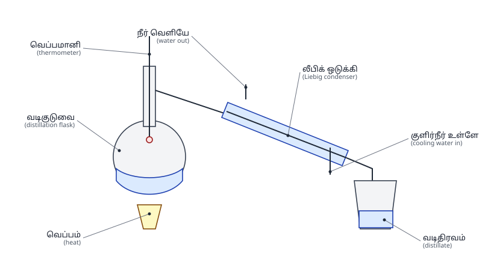

---

## SC11-04: அலைகளும் அவற்றின் பயன்பாடுகளும் (Waves and their applications)

<!-- meta {"type":"chapter_notes","id":"SC11-04","grade":11,"chapter":4,"discipline":"PHY"} -->

*தரம் 11 · அத்தியாயம் 4 · பௌதிகவியல்*

அலைகள் சக்தியை ஊடகத்தினூடு அல்லது வெற்றிடத்தினூடு கடத்துகின்றன; பதார்த்தம் இடம்பெயர்வதில்லை. ஒலி, மின்காந்த அலைகள் இவ்வத்தியாயத்தில்.

### கற்றல் நோக்கங்கள்

- குறுக்கலைகளையும் நெட்டாங்கு அலைகளையும் வேறுபடுத்துதல்
- அலைநீளம், மீடிறன், வீச்சம், அலைவேகம்
- ஒலியின் இயல்புகள்
- மின்காந்த நிறமாலையும் பயன்பாடுகளும்

### பிரதான எண்ணக்கருக்கள்

- குறுக்கலை (Transverse): துணிக்கை அதிர்வு அலைச் செலுத்தத் திசைக்குச் செங்குத்து (நீர் அலை, ஒளி) — முடி, தாழி.
- நெட்டாங்கு அலை (Longitudinal): அதிர்வு செலுத்தத் திசைக்குச் சமாந்தரம் (ஒலி) — நெருக்கம், ஐதாக்கம் (2019 வினாத்தாள் I வி33).
- அலைவேகம் $v = f\lambda$; f (Hz), λ (m). காலம் $T = 1/f$.
- ஒலிக்கு ஊடகம் தேவை; வெற்றிடத்தில் செல்லாது. வளியில் ≈ 340 m s⁻¹; திண்மங்களில் வேகம் கூடுதல்.
- சுருதி (pitch) மீடிறனைச் சார்ந்தது; உரப்பு (loudness) வீச்சத்தைச் சார்ந்தது.
- செவிப்புல வீச்சு 20 Hz – 20 kHz; மீயொலி (> 20 kHz): கருப்பை ஊடுகதிர் படம், SONAR.
- மின்காந்த நிறமாலை: வானொலி, நுண்ணலை, அகச்சிவப்பு, கட்புலன், புற ஊதா, X, காமா — வெற்றிடத்தில் 3 × 10⁸ m s⁻¹.

### வரைவிலக்கணங்கள்

- **அலைநீளம் (Wavelength):** அடுத்தடுத்த இரு முடிகளுக்கு (அல்லது ஒத்த புள்ளிகளுக்கு) இடையிலான தூரம்.
- **மீடிறன் (Frequency):** ஒரு செக்கனில் உருவாகும் அலைகளின் எண்ணிக்கை.
- **வீச்சம் (Amplitude):** சமநிலையிலிருந்து உச்ச இடப்பெயர்ச்சி.

### ஒப்பீட்டு அட்டவணை

| அம்சம் | குறுக்கலை | நெட்டாங்கு அலை |
|---|---|---|
| அதிர்வுத் திசை | செங்குத்து | சமாந்தரம் |
| உதாரணம் | ஒளி, நீர் அலை | ஒலி |
| பகுதிகள் | முடி, தாழி | நெருக்கம், ஐதாக்கம் |

### அன்றாட வாழ்க்கைத் தொடர்புகள்

- மின்னல் முதலில் தெரிந்து இடி பின் கேட்கும் — ஒளி ஒலியை விட வேகமானது.
- வௌவால் மீயொலியால் வழி காணல்.

### பொதுவான தவறான எண்ணக்கருக்கள்

- ⚠️ அலை நீரை முன்னோக்கிக் கொண்டு செல்லும் — பிழை; சக்தி மட்டும் செல்லும்.
- ⚠️ ஒலி வெற்றிடத்தில் செல்லும் — பிழை.

### பரீட்சைக் கவனம்

- v = fλ கணிப்புகள் (கோப்பு 5).
- அலை வரிப்படத்தில் λ, வீச்சம் குறித்தல் (கோப்பு 6).

### தொடர்புடைய வளங்கள்

- வரிப்படம் PHY-D05 — குறுக்கலை ([பெயரிட்டது](science_assets/physics/PHY-D05_labelled.svg))
- கணிப்பு CL-WAVE — அலைச் சமன்பாடு (கோப்பு 5)

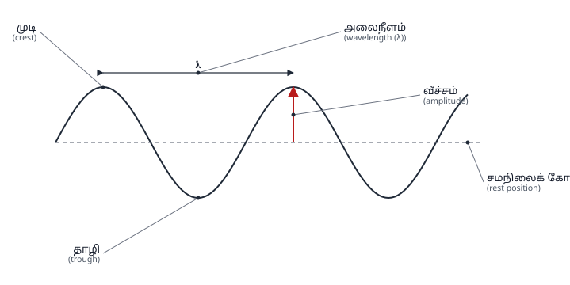

---

## SC11-05: கேத்திரகணித ஒளியியல் (Geometrical optics)

<!-- meta {"type":"chapter_notes","id":"SC11-05","grade":11,"chapter":5,"discipline":"PHY"} -->

*தரம் 11 · அத்தியாயம் 5 · பௌதிகவியல்*

ஒளி நேர்கோட்டில் செல்லும்; தெறிப்பு, முறிவு, முழு அகத்தெறிப்பு, வில்லைகளால் விம்பம் உருவாதல் இவ்வத்தியாயத்தில்.

### கற்றல் நோக்கங்கள்

- தெறிப்பு விதிகள்
- முறிவும் முறிவுச் சுட்டியும்
- முழு அகத்தெறிப்பு
- குவிவு, குழிவு வில்லைகளின் கதிர் வரிப்படங்கள்
- கண் குறைபாடுகள்

### பிரதான எண்ணக்கருக்கள்

- தெறிப்பு விதிகள்: படுகோணம் = தெறிகோணம்; படுகதிர், தெறிகதிர், செவ்வன் ஒரே தளம்.
- முறிவு: ஒளி ஒரு ஊடகத்திலிருந்து மற்றொன்றுக்குச் செல்லும்போது வேகம் மாறி திசை மாறும்; அடர்த்தியான ஊடகத்துக்குள் செவ்வனை நோக்கி வளையும்.
- முறிவுச் சுட்டி $n = \frac{\sin i}{\sin r}$ = (வளியில் ஒளி வேகம்) ÷ (ஊடகத்தில் வேகம்).
- முழு அகத்தெறிப்பு: அடர்த்தியான ஊடகத்திலிருந்து ஐதானதுக்குச் செல்லும்போது படுகோணம் அவதிக் கோணத்தை மீறினால்; ஒளியியல் நார்கள், அரியங்கள்.
- குவிவு வில்லை (Convex): சமாந்தரக் கதிர்களைக் குவியத்தில் ஒருங்கச் செய்யும்; பொருள் 2F க்கு அப்பால் → உண்மை, தலைகீழ், சிறிய விம்பம்; F க்கும் வில்லைக்கும் இடையில் → மாய, நேரான, பெரிய (உருப்பெருக்கி).
- குழிவு வில்லை (Concave): விரிக்கும்; எப்போதும் மாய, நேரான, சிறிய விம்பம்.
- வில்லைச் சூத்திரம் (சரிபார்ப்புக்கு): $\frac1v - \frac1u = \frac1f$ (கார்ட்டீசியன் குறியிடல்); உருப்பெருக்கம் $m = v/u$.
- கண்: அண்மைப் பார்வை (Myopia) — குழிவு வில்லை; சேய்மைப் பார்வை (Hypermetropia) — குவிவு வில்லை.

### வரைவிலக்கணங்கள்

- **முறிவு (Refraction):** ஒளி ஊடகம் மாறும்போது திசை மாறுதல்.
- **அவதிக் கோணம் (Critical angle):** முறிகோணம் 90° ஆகும் படுகோணம்.
- **குவியம் (Focal point):** தலைமை அச்சுக்குச் சமாந்தரமான கதிர்கள் முறிவின்பின் சந்திக்கும் புள்ளி.

### ஒப்பீட்டு அட்டவணை

| பொருளின் நிலை (குவிவு வில்லை) | விம்ப இடம் | இயல்புகள் |
|---|---|---|
| 2F க்கு அப்பால் | F–2F | உண்மை, தலைகீழ், சிறிய |
| 2F இல் | 2F | உண்மை, தலைகீழ், சம அளவு |
| F–2F | 2F க்கு அப்பால் | உண்மை, தலைகீழ், பெரிய |
| F இல் | முடிவிலி | — |
| F க்கும் வில்லைக்கும் இடையில் | அதே பக்கம் | மாய, நேரான, பெரிய |

### அன்றாட வாழ்க்கைத் தொடர்புகள்

- நீரில் கோல் வளைந்து தெரிதல் — முறிவு.
- ஒளியியல் நார் இணையம் — முழு அகத்தெறிப்பு.
- உருப்பெருக்கும் கண்ணாடி — குவிவு வில்லை.

### பொதுவான தவறான எண்ணக்கருக்கள்

- ⚠️ குழிவு வில்லை உண்மை விம்பம் தரும் — பிழை; எப்போதும் மாய.
- ⚠️ முறிவின்போது மீடிறன் மாறும் — பிழை; வேகமும் அலைநீளமும் மாறும்.

### பரீட்சைக் கவனம்

- கதிர் வரிப்படங்கள் வரைந்து விம்ப இயல்புகள் (2019 வினாத்தாள் II வி7A) — கோப்பு 6.
- குவியத் தூரத்தை அண்ணளவாகக் காணும் செயற்பாடு (கோப்பு 8).

### தொடர்புடைய வளங்கள்

- வரிப்படம் BIO-D11 — மனிதக் கண் (திட்டப் படம்) ([பெயரிட்டது](science_assets/biology/BIO-D11_labelled.svg))
- வரிப்படம் PHY-D03 — குவிவு வில்லை: பொருள் 2F க்கு அப்பால் ([பெயரிட்டது](science_assets/physics/PHY-D03_labelled.svg))
- வரிப்படம் EXP-D04 — குவிவு வில்லையின் குவியத் தூரம் (தூரப் பொருள் முறை) ([பெயரிட்டது](science_assets/experiments/EXP-D04_labelled.svg))
- பரிசோதனை EXP-25 — குவிவு வில்லையின் குவியத் தூரம் (அண்ணளவு) (கோப்பு 8)
- கணிப்பு CL-OPTICS — முறிவுச் சுட்டியும் வில்லைகளும் (கோப்பு 5)

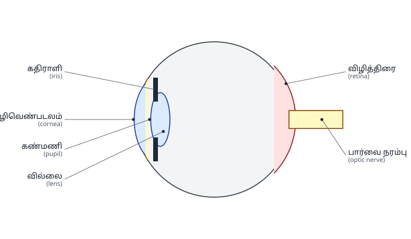

---

## SC11-06: மனித உடற் செயன்முறைகள் (Biological processes in the human body)

<!-- meta {"type":"chapter_notes","id":"SC11-06","grade":11,"chapter":6,"discipline":"BIO"} -->

*தரம் 11 · அத்தியாயம் 6 · உயிரியல்*

மனித உடலில் சமிபாடு, சுவாசம், குருதிச் சுற்றோட்டம், கழிவகற்றல், ஒருங்கிணைப்பு போன்ற செயன்முறைகள் ஒன்றிணைந்து நடைபெறுகின்றன.

### கற்றல் நோக்கங்கள்

- சமிபாட்டுத் தொகுதியையும் நொதியங்களையும் விளக்குதல்
- சுவாசத் தொகுதியையும் வாயுப் பரிமாற்றத்தையும் விளக்குதல்
- இதயம், குருதிச் சுற்றோட்டத்தை விளக்குதல்
- சிறுநீரகத்தின் தொழிலையும் நரம்பு, ஓமோன் ஒருங்கிணைப்பையும் விளக்குதல்

### பிரதான எண்ணக்கருக்கள்

- சமிபாடு: வாய் (அமைலேசு) → களம் → இரைப்பை (பெப்சின், HCl) → சிறுகுடல் (முன்சிறுகுடல்: கணையச் சாறு, பித்தம்; குடற்சாறு) → பெருங்குடல் (நீர் அகத்துறிஞ்சல்).
- சிறுகுடற் சடைமுளைகள் (Villi): பெரிய மேற்பரப்பு, மெல்லிய சுவர், நிறைய மயிர்த்துளைக் குழாய்கள், பால்நிண நாளம் (lacteal) — உறிஞ்சலுக்கு இசைவாக்கம்.
- சுவாசம்: மூக்கு → தொண்டை → குரல்வளை → வாதனாளி → சுவாசப்பைக் குழாய் → சிற்றறைகள் (Alveoli) — பரவலால் வாயுப் பரிமாற்றம்.
- காற்றுச் சுவாசம்: C₆H₁₂O₆ + 6O₂ → 6CO₂ + 6H₂O + சக்தி (ATP). காற்றின்றிச் சுவாசம் (தசை): குளுக்கோசு → இலற்றிக்கமிலம்.
- இதயம்: 4 அறைகள்; வலது பக்கம் O₂ குறைந்த குருதி → சுவாசப்பைச் சுற்றோட்டம்; இடது பக்கம் O₂ நிறைந்த குருதி → தொகுதிச் சுற்றோட்டம். வால்வுகள் பின்னோட்டத்தைத் தடுக்கும். இரட்டைச் சுற்றோட்டம்.
- குருதி: செங்குழியங்கள் (ஈமோகுளோபின் — O₂), வெண்குழியங்கள் (பாதுகாப்பு), குருதிச் சிறுதட்டுகள் (உறைதல்), முதலுரு (கடத்தல்).
- சிறுநீரகம்: சிறுநீரகத்தி (Nephron) — வடிகட்டல் (கலன்கோளம்), தேர்ந்து மீள உறிஞ்சல், சுரத்தல்; சிறுநீரின் பிரதான கூறு நீர், பின் யூரியா.
- ஒருங்கிணைப்பு: நரம்புத் தொகுதி (மூளை — பெருமூளை, சிறுமூளை, நீள்வளைய மையவிழையம்; முண்ணாண்; தெறிவினை) மற்றும் அகஞ்சுரக்கும் சுரப்பிகள் (இன்சுலின் — குருதி குளுக்கோசைக் குறைக்கும்).

### வரைவிலக்கணங்கள்

- **சமிபாடு (Digestion):** பெரிய உணவு மூலக்கூறுகளை உறிஞ்சக்கூடிய சிறிய மூலக்கூறுகளாக்குதல்.
- **தெறிவினை (Reflex action):** தூண்டலுக்கு விருப்பமின்றி விரைவாக நிகழும் துலங்கல்.
- **ஓமோன் (Hormone):** அகஞ்சுரக்கும் சுரப்பியால் குருதிக்குச் சுரக்கப்படும் இரசாயனத் தூதுவர்.

### ஒப்பீட்டு அட்டவணை

| நொதியம் | சுரக்கும் இடம் | அடிப்படைப் பொருள் → விளைவு |
|---|---|---|
| உமிழ்நீர் அமைலேசு | உமிழ்நீர்ச் சுரப்பி | மாப்பொருள் → மால்ற்றோசு |
| பெப்சின் | இரைப்பை | புரதம் → பெப்ரைட்டுகள் |
| இலிப்பேசு | கணையம் | இலிப்பிட்டு → கொழுப்பமிலம் + கிளிசரோல் |
| திரிப்சின் | கணையம் | புரதம் → பெப்ரைட்டுகள் |
| மால்ற்றேசு | சிறுகுடல் | மால்ற்றோசு → குளுக்கோசு |

### அன்றாட வாழ்க்கைத் தொடர்புகள்

- கடும் உடற்பயிற்சியின் பின் தசைப்பிடிப்பு — இலற்றிக்கமிலம்.
- முடியுருநாடி அடைப்பு மாரடைப்பை உண்டாக்கும் (2019 வினாத்தாள் II வி5A).

### பொதுவான தவறான எண்ணக்கருக்கள்

- ⚠️ நாடிகள் எப்போதும் O₂ நிறைந்த குருதியைக் காவும் — பிழை; சுவாசப்பை நாடி O₂ குறைந்த குருதியைக் காவும்.
- ⚠️ சமிபாடு இரைப்பையில் முடிவடையும் — பிழை; சிறுகுடலில் நிறைவடையும்.

### பரீட்சைக் கவனம்

- இதயப் படத்தில் அறைகள், வால்வுகள், குருதிக்கலன்களைப் பெயரிடல் (கோப்பு 6).
- நொதியம் — சுரக்கும் இடம் — அடிப்படைப் பொருள் — விளைவு அட்டவணை (2019 வினாத்தாள் I வி16).

### தொடர்புடைய வளங்கள்

- வரிப்படம் BIO-D04 — மனித இதயம் (திட்டப் படம்) ([பெயரிட்டது](science_assets/biology/BIO-D04_labelled.svg))
- வரிப்படம் BIO-D05 — சமிபாட்டுத் தொகுதி (திட்டப் படம்) ([பெயரிட்டது](science_assets/biology/BIO-D05_labelled.svg))
- வரிப்படம் BIO-D06 — சுவாசத் தொகுதி ([பெயரிட்டது](science_assets/biology/BIO-D06_labelled.svg))
- வரிப்படம் BIO-D07 — நெப்பிரோன் (திட்டப் படம்) ([பெயரிட்டது](science_assets/biology/BIO-D07_labelled.svg))
- பரிசோதனை EXP-06 — உட்சுவாச, வெளிச்சுவாச வளியில் CO₂ ஒப்பீடு (கோப்பு 8)

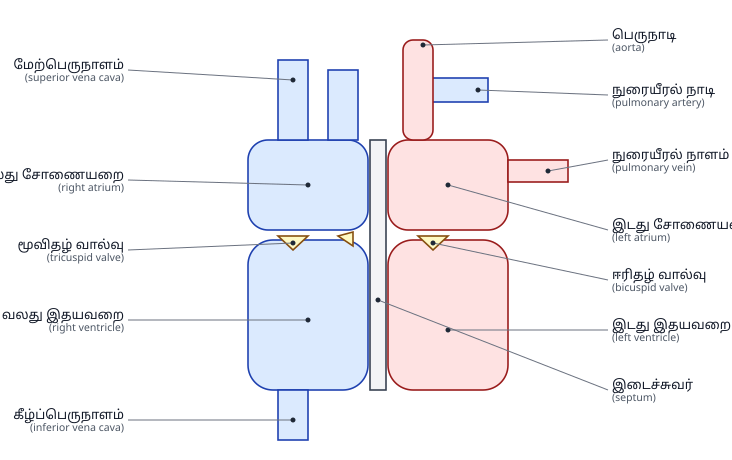

---

## SC11-07: அமிலம், மூலம், உப்பு (Acids, bases and salts)

<!-- meta {"type":"chapter_notes","id":"SC11-07","grade":11,"chapter":7,"discipline":"CHE"} -->

*தரம் 11 · அத்தியாயம் 7 · இரசாயனவியல்*

அமிலங்கள் நீரில் H⁺ அயன்களையும், மூலங்கள் (காரங்கள்) OH⁻ அயன்களையும் தரும். அவை நடுநிலையாக்கத்தில் உப்பையும் நீரையும் தருகின்றன.

### கற்றல் நோக்கங்கள்

- அமிலம், மூலத்தை வரையறுத்தல்
- வன்/மென் அமிலங்களை வேறுபடுத்துதல்
- pH, காட்டிகளைப் பயன்படுத்துதல்
- நடுநிலையாக்கம், உப்புத் தயாரிப்பு

### பிரதான எண்ணக்கருக்கள்

- அமிலம் (ஆரேனியசு): நீரில் H⁺ தரும்; HCl → H⁺ + Cl⁻.
- வன்னமிலம் முழுமையாக அயனாக்கமடையும் (HCl, H₂SO₄, HNO₃); மென்னமிலம் பகுதியாக (CH₃COOH).
- மூலம்: நீரில் OH⁻ தரும் (NaOH, KOH); கரையும் மூலங்கள் காரங்கள் (alkalis).
- pH அளவுத்திட்டம் 0–14: < 7 அமிலம், 7 நடுநிலை, > 7 காரம். ஒரே செறிவில் வன்னமிலத்தின் pH குறைவு (2019 வினாத்தாள் I வி20).
- காட்டிகள்: பாசிச்சாயம் (அமிலம் சிவப்பு, காரம் நீலம்), பீனோல்ப்தலீன் (காரத்தில் இளஞ்சிவப்பு, அமிலத்தில் நிறமற்றது), மெதைல் செம்மஞ்சள்.
- நடுநிலையாக்கம்: அமிலம் + மூலம் → உப்பு + நீர்; H⁺ + OH⁻ → H₂O; வெப்பம் வெளியேறும்.
- அமிலம் + உலோகம் → உப்பு + H₂; அமிலம் + காபனேற்று → உப்பு + CO₂ + H₂O.
- பயன்பாடுகள்: அமிலநீக்கிகள் (Mg(OH)₂ — வயிற்றமிலம்), அமில மண்ணுக்குச் சுண்ணாம்பு (2019 வினாத்தாள் II வி6B).

### வரைவிலக்கணங்கள்

- **அமிலம் (Acid):** நீர்க் கரைசலில் H⁺ அயன்களைத் தரும் பதார்த்தம்.
- **மூலம் (Base):** அமிலத்துடன் தாக்கமடைந்து உப்பையும் நீரையும் தரும் பதார்த்தம்; காரம் நீரில் OH⁻ தரும்.
- **நடுநிலையாக்கம் (Neutralization):** அமிலமும் மூலமும் தாக்கமடைந்து உப்பையும் நீரையும் தருதல்.

### ஒப்பீட்டு அட்டவணை

| காட்டி | அமிலம் | காரம் |
|---|---|---|
| பாசிச்சாயம் | சிவப்பு | நீலம் |
| பீனோல்ப்தலீன் | நிறமற்றது | இளஞ்சிவப்பு |
| மெதைல் செம்மஞ்சள் | சிவப்பு | மஞ்சள் |

### அன்றாட வாழ்க்கைத் தொடர்புகள்

- தேனீக் கொட்டு (அமிலம்) — சவர்க்காரம்/சமையல் சோடா.
- வயிற்றெரிச்சலுக்கு அமிலநீக்கி.

### பொதுவான தவறான எண்ணக்கருக்கள்

- ⚠️ எல்லா மூலங்களும் நீரில் கரையும் — பிழை; கரைவன மட்டும் காரங்கள்.
- ⚠️ மென்னமிலம் = ஐதான அமிலம் — பிழை; வலிமை அயனாக்கத்தைச் சார்ந்தது, செறிவு கரைசலின் அளவைச் சார்ந்தது.

### பரீட்சைக் கவனம்

- அமிலம் + காபனேற்று → CO₂ சோதனை (சுண்ணாம்புநீர்).
- நடுநிலையாக்கச் சமன்பாடுகள்; உப்பின் பெயர் (கோப்பு 7).

### தொடர்புடைய வளங்கள்

- வரிப்படம் CHE-D03 — ஐதரசன் தயாரிப்பு — நீரின் கீழ்முக இடப்பெயர்ச்சி ([பெயரிட்டது](science_assets/chemistry/CHE-D03_labelled.svg))
- பரிசோதனை EXP-11 — நடுநிலையாக்கல் — காட்டி பயன்படுத்தல் (கோப்பு 8)
- பரிசோதனை EXP-12 — ஐதரசன் தயாரிப்பும் சோதனையும் (கோப்பு 8)
- சமன்பாடுகள் EQ-025, EQ-026, EQ-027, EQ-028, EQ-029, EQ-030, EQ-031, EQ-032 … (கோப்பு 7)

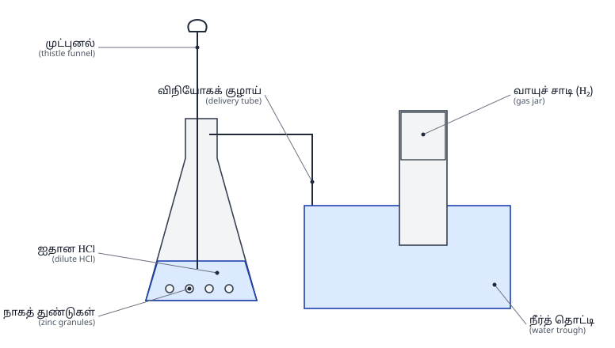

---

## SC11-08: இரசாயனத் தாக்கங்களின் வெப்ப விளைவு (Heat changes associated with chemical reactions)

<!-- meta {"type":"chapter_notes","id":"SC11-08","grade":11,"chapter":8,"discipline":"CHE"} -->

*தரம் 11 · அத்தியாயம் 8 · இரசாயனவியல்*

இரசாயனத் தாக்கங்களின்போது சக்தி வெப்பமாக வெளியேறலாம் (புறவெப்பம்) அல்லது உறிஞ்சப்படலாம் (அகவெப்பம்).

### கற்றல் நோக்கங்கள்

- புறவெப்ப, அகவெப்பத் தாக்கங்களை வேறுபடுத்துதல்
- சக்தி மட்ட வரிப்படங்களை வரைதல்
- தாக்க வெப்பத்தைக் கணித்தல்

### பிரதான எண்ணக்கருக்கள்

- புறவெப்பத் தாக்கம் (Exothermic): வெப்பம் வெளியேறும்; சூழல் வெப்பநிலை கூடும்; ΔH மறை (தகனம், நடுநிலையாக்கம், சுவாசம்).
- அகவெப்பத் தாக்கம் (Endothermic): வெப்பம் உறிஞ்சப்படும்; ΔH நேர் (CaCO₃ பிரிகை, ஒளித்தொகுப்பு, NH₄Cl கரைதல்).
- பிணைப்பு உடைதல் சக்தியை உறிஞ்சும்; பிணைப்பு உருவாதல் சக்தியை வெளியிடும்.
- சக்தி மட்ட வரிப்படம்: புறவெப்பத்தில் விளைவுகள் தாக்கிகளுக்குக் கீழே (2019 வினாத்தாள் I வி31).
- சமன்பாட்டில் வெப்பம்: C₂H₄ + 3O₂ → 2CO₂ + 2H₂O, ΔH = −1400 kJ mol⁻¹ (ஏறத்தாழ).
- வெப்ப மாற்றக் கணிப்பு: $Q = mc\Delta\theta$ (SC11-09 உடன் இணைப்பு).

### வரைவிலக்கணங்கள்

- **புறவெப்பத் தாக்கம்:** சூழலுக்கு வெப்பத்தை வெளியிடும் தாக்கம்.
- **அகவெப்பத் தாக்கம்:** சூழலிலிருந்து வெப்பத்தை உறிஞ்சும் தாக்கம்.
- **வெப்பவுள்ளுறை மாற்றம் (ΔH):** மாறா அமுக்கத்தில் தாக்கத்துடன் தொடர்புடைய வெப்ப மாற்றம்.

### ஒப்பீட்டு அட்டவணை

| அம்சம் | புறவெப்பம் | அகவெப்பம் |
|---|---|---|
| வெப்பம் | வெளியேறும் | உறிஞ்சப்படும் |
| சூழல் வெப்பநிலை | கூடும் | குறையும் |
| ΔH | மறை | நேர் |
| உதாரணம் | தகனம், நடுநிலையாக்கம் | CaCO₃ பிரிகை, ஒளித்தொகுப்பு |

### அன்றாட வாழ்க்கைத் தொடர்புகள்

- உடனடி குளிர்ப்பொதி (NH₄NO₃ கரைதல்) — அகவெப்பம்.
- எரிவாயு அடுப்பு — தகனம், புறவெப்பம்.

### பொதுவான தவறான எண்ணக்கருக்கள்

- ⚠️ தகனத்துக்கு ஆரம்ப வெப்பம் தேவை, எனவே அகவெப்பம் — பிழை; மொத்தத்தில் வெப்பம் வெளியேறும்.
- ⚠️ புறவெப்பத் தாக்கத்தில் ΔH நேர் — பிழை; மறை.

### பரீட்சைக் கவனம்

- சக்தி மட்ட வரிப்படங்களை இனங்காணல்/வரைதல்.
- தரப்பட்ட ΔH இலிருந்து திணிவுக்கான வெப்பம் (கோப்பு 5).

### தொடர்புடைய வளங்கள்

- வரிப்படம் GR-D05 — புறவெப்பத் தாக்கச் சக்தி மட்ட வரிப்படம் ([பெயரிட்டது](science_assets/graphs/GR-D05_labelled.svg))
- பரிசோதனை EXP-17 — நடுநிலையாக்கலின் வெப்ப மாற்றம் (கோப்பு 8)
- கணிப்பு CL-ENTH — தாக்க வெப்பம் (கோப்பு 5)
- சமன்பாடுகள் EQ-048, EQ-050 (கோப்பு 7)

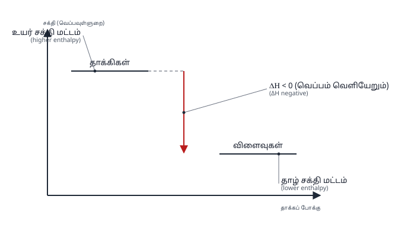

---

## SC11-09: வெப்பம் (Heat)

<!-- meta {"type":"chapter_notes","id":"SC11-09","grade":11,"chapter":9,"discipline":"PHY"} -->

*தரம் 11 · அத்தியாயம் 9 · பௌதிகவியல்*

வெப்பம் வெப்பநிலை வேறுபாட்டால் பாயும் சக்தி. தன்வெப்பக் கொள்ளளவு, மறைவெப்பம், வெப்பக் கடத்தல் முறைகள் இவ்வத்தியாயத்தில்.

### கற்றல் நோக்கங்கள்

- வெப்பம், வெப்பநிலையை வேறுபடுத்துதல்
- Q = mcθ, Q = mL ஐப் பயன்படுத்துதல்
- நிலை மாற்றங்களை விளக்குதல்
- கடத்தல், மேற்காவுகை, கதிர்ப்பு

### பிரதான எண்ணக்கருக்கள்

- வெப்பநிலை: சூடு/குளிரின் அளவு (°C, K); K = °C + 273. வெப்பம்: பாயும் சக்தி (J).
- தன்வெப்பக் கொள்ளளவு (c): 1 kg பதார்த்தத்தின் வெப்பநிலையை 1 °C உயர்த்தத் தேவையான வெப்பம்; $Q = mc\theta$ (நீர் c = 4200 J kg⁻¹ °C⁻¹).
- உயர் c உடைய திரவங்கள் சிறந்த குளிர்விப்பான்கள் (2019 வினாத்தாள் II வி8B).
- மறைவெப்பம் (L): வெப்பநிலை மாறாமல் நிலை மாற்றத் தேவையான வெப்பம்; $Q = mL$.
- ஆவியாதல்: எந்த வெப்பநிலையிலும், மேற்பரப்பில், குளிர்விக்கும்; கொதித்தல்: குறித்த வெப்பநிலையில், முழுத் திரவத்திலும் (2019 வினாத்தாள் I வி39).
- கடத்தல் (திண்மம்), மேற்காவுகை (பாய்மங்கள் — அடர்த்தி மாற்றம்), கதிர்ப்பு (வெற்றிடத்திலும்; கருமை மேற்பரப்பு சிறந்த உறிஞ்சி/காலி).
- வெப்ப விரிவு: பெரும்பாலும் வெப்பமேற்ற விரியும்; தண்டவாள இடைவெளிகள்; நீரின் அசாதாரண விரிவு (0–4 °C).

### வரைவிலக்கணங்கள்

- **தன்வெப்பக் கொள்ளளவு (Specific heat capacity):** 1 kg இன் வெப்பநிலையை 1 K உயர்த்தத் தேவையான வெப்பம்.
- **தன்மறைவெப்பம் (Specific latent heat):** 1 kg ஐ வெப்பநிலை மாறாமல் நிலை மாற்றத் தேவையான வெப்பம்.
- **வெப்பநிலை:** பொருளின் சூடு/குளிரின் அளவு.

### ஒப்பீட்டு அட்டவணை

| அம்சம் | ஆவியாதல் | கொதித்தல் |
|---|---|---|
| வெப்பநிலை | எந்த வெப்பநிலையிலும் | கொதிநிலையில் மட்டும் |
| இடம் | மேற்பரப்பில் | திரவம் முழுவதும் |
| குமிழ்கள் | இல்லை | உண்டு |
| விளைவு | குளிர்விக்கும் | வெப்பநிலை மாறாது |

### அன்றாட வாழ்க்கைத் தொடர்புகள்

- கடற்கரைக் காற்று — நிலம், நீரின் c வேறுபாடு.
- மண் குடத்தில் நீர் குளிர்தல் — ஆவியாதல்.
- வாகன ரேடியேற்றரில் நீர்.

### பொதுவான தவறான எண்ணக்கருக்கள்

- ⚠️ வெப்பமும் வெப்பநிலையும் ஒன்றே — பிழை.
- ⚠️ கொதிக்கும் நீருக்கு மேலும் வெப்பம் தந்தால் வெப்பநிலை கூடும் — பிழை; நிலை மாற்றத்துக்குப் பயன்படும்.

### பரீட்சைக் கவனம்

- Q = mcθ, Q = mL கணிப்புகள் (கோப்பு 5).
- வெப்பமாக்கல் வளைகோடு (கோப்பு 6).

### தொடர்புடைய வளங்கள்

- வரிப்படம் GR-D02 — நீரின் வெப்பமாக்கல் வளைகோடு ([பெயரிட்டது](science_assets/graphs/GR-D02_labelled.svg))
- வரிப்படம் EXP-D03 — தன்வெப்பக் கொள்ளளவு அளவிடல் (உலோகக் குற்றி) ([பெயரிட்டது](science_assets/experiments/EXP-D03_labelled.svg))
- பரிசோதனை EXP-24 — உலோகக் குற்றியின் தன்வெப்பக் கொள்ளளவு (கோப்பு 8)
- கணிப்பு CL-HEAT — தன்வெப்பக் கொள்ளளவும் மறைவெப்பமும் (கோப்பு 5)
- கணிப்பு CL-TEMP — வெப்பநிலை அளவுத்திட்ட மாற்றம் (கோப்பு 5)

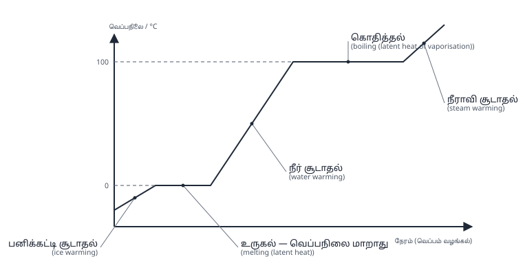

---

## SC11-10: மின் சாதனங்களின் வலுவும் சக்தியும் (Power and energy of electric appliances)

<!-- meta {"type":"chapter_notes","id":"SC11-10","grade":11,"chapter":10,"discipline":"PHY"} -->

*தரம் 11 · அத்தியாயம் 10 · பௌதிகவியல்*

மின் சாதனங்கள் மின்சக்தியை வேறு வடிவங்களாக மாற்றுகின்றன. வலு, சக்தி நுகர்வு, kWh, மின் கட்டணம், பாதுகாப்பு இவ்வத்தியாயத்தில்.

### கற்றல் நோக்கங்கள்

- P = VI, E = Pt ஐப் பயன்படுத்துதல்
- kWh ஐயும் மின் கட்டணத்தையும் கணித்தல்
- சாதனங்களின் வினைத்திறனை ஒப்பிடுதல்
- வீட்டு மின் பாதுகாப்பு

### பிரதான எண்ணக்கருக்கள்

- வலு $P = VI = I^2R = \frac{V^2}{R}$ (W).
- சக்தி $E = Pt$ (J, t செக்கனில்); வணிக அலகு kWh = kW × மணி; 1 kWh = 3.6 × 10⁶ J.
- மின் கட்டணம் = அலகுகள் (kWh) × ஓரலகு விலை.
- LED மின்குமிழ் இழைக் குமிழை விட வினைத்திறன் கூடியது — அதே ஒளிக்குக் குறைந்த வலு (2019 வினாத்தாள் II வி7B).
- உருகி (Fuse): அதிக மின்னோட்டத்தில் உருகிச் சுற்றைத் துண்டிக்கும்; உயிர் வடத்தில் (live) இணைக்கப்படும். புவித்தொடுப்பு (Earthing): உலோக உறையூடு கசிவு மின்னோட்டத்தைப் புவிக்குச் செலுத்தும்.
- வட நிறங்கள் (இலங்கை நியமம்): உயிர் — கபிலம், நடுநிலை — நீலம், புவி — பச்சை/மஞ்சள் (ஆசிரியர் உறுதிப்படுத்துக).
- சுற்று முறிப்பான் (MCB), கசிவு மின்னோட்ட முறிப்பான் (RCCB/ELCB).

### வரைவிலக்கணங்கள்

- **மின்வலு (Electric power):** மின்சக்தி மாற்றப்படும் வீதம்.
- **கிலோவாற் மணித்தியாலம் (kWh):** 1 kW வலு 1 மணிநேரம் நுகரும் சக்தி.
- **உருகி (Fuse):** அதிக மின்னோட்டத்தில் உருகி சுற்றைத் துண்டிக்கும் மெல்லிய கம்பி.

### ஒப்பீட்டு அட்டவணை

| கணியம் | சூத்திரம் | அலகு |
|---|---|---|
| வலு | P = VI | W |
| சக்தி | E = Pt | J அல்லது kWh |
| கட்டணம் | kWh × விலை | ரூ. |

### அன்றாட வாழ்க்கைத் தொடர்புகள்

- 2000 W கேத்தல் 30 நிமிடம் = 1 kWh.
- மின் கட்டணப் பட்டியலில் 'அலகுகள்' = kWh.

### பொதுவான தவறான எண்ணக்கருக்கள்

- ⚠️ அதிக வலுவுடைய சாதனம் எப்போதும் அதிக கட்டணம் — பிழை; பயன்பாட்டு நேரமும் முக்கியம்.
- ⚠️ உருகியை நடுநிலை வடத்தில் இணைக்கலாம் — பிழை; உயிர் வடத்தில்.

### பரீட்சைக் கவனம்

- kWh, கட்டணம், வினைத்திறன் கணிப்புகள் (கோப்பு 5).
- உருகி தெரிவு: I = P/V ஐ விடச் சற்றுக் கூடிய பெறுமானம்.

### தொடர்புடைய வளங்கள்

- கணிப்பு CL-EPOWER — மின்வலு, சக்தி, கட்டணம் (கோப்பு 5)

---

## SC11-11: இலத்திரனியல் (Electronics)

<!-- meta {"type":"chapter_notes","id":"SC11-11","grade":11,"chapter":11,"discipline":"PHY"} -->

*தரம் 11 · அத்தியாயம் 11 · பௌதிகவியல்*

இலத்திரனியல் அரைக்கடத்திச் சாதனங்களான இருவாயி, LED, திரான்சிஸ்டர் ஆகியவற்றையும் அவற்றின் பயன்பாடுகளையும் கற்கிறது.

### கற்றல் நோக்கங்கள்

- அரைக்கடத்திகளையும் மாசூட்டலையும் விளக்குதல்
- இருவாயியின் முற்சார்பு, பின்சார்பு
- திருத்தல் (rectification)
- திரான்சிஸ்டரை ஆளியாகவும் விரியலாக்கியாகவும் பயன்படுத்தல்

### பிரதான எண்ணக்கருக்கள்

- அரைக்கடத்திகள் (Si, Ge): கடத்திக்கும் காவலிக்கும் இடைப்பட்ட கடத்துதிறன்; வெப்பநிலை கூடக் கடத்துதிறன் கூடும்.
- n-வகை: 5 வலுவளவுடைய மாசு (P, As) — மேலதிக இலத்திரன்கள்; p-வகை: 3 வலுவளவுடைய மாசு (B, Al, Ga) — துளைகள் (2025 தவணைத் தேர்வு வினா வகை).
- p–n சந்தி இருவாயி: முற்சார்பில் (p → +) கடத்தும்; பின்சார்பில் கடத்தாது.
- திருத்தல்: AC ஐ DC ஆக்கல் — அரை அலை (ஒரு இருவாயி), முழு அலை (பாலம் — 4 இருவாயிகள்).
- LED: முற்சார்பில் ஒளி வெளியிடும்; குறைந்த வலு.
- திரான்சிஸ்டர் (npn/pnp): காலி (E), அடி (B), சேகரிப்பான் (C); சிறிய அடி மின்னோட்டம் பெரிய சேகரிப்பான் மின்னோட்டத்தைக் கட்டுப்படுத்தும் — விரியலாக்கி, ஆளி.
- பொது அறிவிப்புத் தொகுதி: ஒலிவாங்கி (ஒலி → மின்), விரியலாக்கி, ஒலிபெருக்கி (மின் → ஒலி) (2019 வினாத்தாள் II வி9B).
- LDR (ஒளிச்சார் தடை): ஒளி கூடத் தடை குறையும் — தானியங்கி வீதி விளக்கு.

### வரைவிலக்கணங்கள்

- **அரைக்கடத்தி (Semiconductor):** கடத்தி, காவலி இடைப்பட்ட கடத்துதிறன் உடைய பதார்த்தம்.
- **மாசூட்டல் (Doping):** கடத்துதிறனை மாற்ற அரைக்கடத்தியில் சிறிதளவு மாசு சேர்த்தல்.
- **திருத்தல் (Rectification):** ஆடலோட்டத்தை நேரோட்டமாக மாற்றல்.

### ஒப்பீட்டு அட்டவணை

| மாசு | வலுவளவு | வகை | பெரும்பான்மைக் காவிகள் |
|---|---|---|---|
| P, As | 5 | n-வகை | இலத்திரன்கள் |
| B, Al | 3 | p-வகை | துளைகள் |

### அன்றாட வாழ்க்கைத் தொடர்புகள்

- கைபேசி மின்னேற்றியில் திருத்தி.
- தானியங்கி வீதி விளக்கு — LDR + திரான்சிஸ்டர் ஆளி.

### பொதுவான தவறான எண்ணக்கருக்கள்

- ⚠️ இருவாயி இருதிசையிலும் கடத்தும் — பிழை.
- ⚠️ திரான்சிஸ்டர் சக்தியை உருவாக்கும் — பிழை; மின்வழங்கலின் சக்தியைக் கட்டுப்படுத்தும்.

### பரீட்சைக் கவனம்

- இருவாயிச் சுற்றில் எக்குமிழ் எரியும் எனக் கணித்தல்.
- திரான்சிஸ்டர் முனைகள், விரியலாக்கித் தொகுதி (கோப்பு 6).

### தொடர்புடைய வளங்கள்

- வரிப்படம் PHY-D08 — பொது அறிவிப்புத் தொகுதி (கட்டத் தொகுதி வரிப்படம்) ([பெயரிட்டது](science_assets/physics/PHY-D08_labelled.svg))
- வரிப்படம் PHY-D09 — npn திரான்சிஸ்டர் குறியீடு ([பெயரிட்டது](science_assets/physics/PHY-D09_labelled.svg))

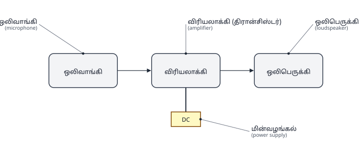

---

## SC11-12: மின்னிரசாயனம் (Electrochemistry)

<!-- meta {"type":"chapter_notes","id":"SC11-12","grade":11,"chapter":12,"discipline":"CHE"} -->

*தரம் 11 · அத்தியாயம் 12 · இரசாயனவியல்*

மின்னிரசாயனம் இரசாயனச் சக்தி–மின்சக்தி மாற்றங்களைக் கற்கிறது: மின்னிரசாயனக் கலங்கள் மின்னை உருவாக்கும்; மின்பகுப்பு மின்னைப் பயன்படுத்தித் தாக்கங்களை நடத்தும்.

### கற்றல் நோக்கங்கள்

- எளிய மின்னிரசாயனக் கலத்தை விளக்குதல்
- மின்பகுப்பில் மின்வாய்த் தாக்கங்களை எழுதுதல்
- மின்முலாமிடல், உலோகப் பிரித்தெடுப்பு
- அரிப்பையும் அதன் தடுப்பையும் விளக்குதல்

### பிரதான எண்ணக்கருக்கள்

- மின்னிரசாயனக் கலம்: தாக்கத்திறன் கூடிய உலோகம் மறைமுனை (அனோட்டு, ஒட்சியேற்றம்) — Zn → Zn²⁺ + 2e⁻; குறைந்தது நேர்முனை — Cu²⁺ + 2e⁻ → Cu.
- மின்பகுப்பு: மின்பகுபொருள் (உருகிய/கரைந்த அயன் சேர்வை) மின்னோட்டத்தால் பிரிகை. அனோட்டு (+) இல் ஒட்சியேற்றம்; கதோட்டு (−) இல் தாழ்த்தல்.
- உருகிய NaCl: கதோட்டு Na⁺ + e⁻ → Na; அனோட்டு 2Cl⁻ → Cl₂ + 2e⁻ (டவுன்ஸ் கலம்).
- நீர்க் NaCl (செறிவான): கதோட்டில் H₂ (கரைசல் காரமாகி பீனோல்ப்தலீன் இளஞ்சிவப்பு), அனோட்டில் Cl₂ (2019 வினாத்தாள் II வி9A).
- மின்முலாமிடல்: முலாமிடவேண்டிய பொருள் கதோட்டு; முலாம் உலோகம் அனோட்டு; அதன் உப்புக் கரைசல் மின்பகுபொருள்.
- இரும்பு துருப்பிடித்தலுக்கு O₂ உம் நீரும் தேவை; தடுப்பு: வர்ணம், கிறீஸ், நாகமுலாமிடல் (galvanizing), தியாக அனோட்டு (Mg/Zn).

### வரைவிலக்கணங்கள்

- **மின்பகுப்பு (Electrolysis):** மின்னோட்டத்தால் மின்பகுபொருள் பிரிகையடைதல்.
- **ஒட்சியேற்றம்:** இலத்திரன் இழப்பு.
- **தாழ்த்தல்:** இலத்திரன் ஏற்பு.
- **அரிப்பு (Corrosion):** சூழலுடன் தாக்கமடைந்து உலோகம் அழிதல்.

### ஒப்பீட்டு அட்டவணை

| மின்பகுபொருள் | கதோட்டு (−) | அனோட்டு (+) |
|---|---|---|
| உருகிய NaCl | Na | Cl₂ |
| நீர்க் NaCl (செறிவு) | H₂ | Cl₂ |
| CuSO₄ (Cu மின்வாய்) | Cu படியும் | Cu கரையும் |

### அன்றாட வாழ்க்கைத் தொடர்புகள்

- வெள்ளி முலாமிட்ட கரண்டிகள்.
- கப்பல் அடிப்பகுதியில் Zn துண்டுகள் — தியாகப் பாதுகாப்பு.

### பொதுவான தவறான எண்ணக்கருக்கள்

- ⚠️ கலத்தில் இலத்திரன்கள் கரைசலினூடு செல்லும் — பிழை; வெளிச் சுற்றினூடு; கரைசலில் அயன்கள் அசையும்.
- ⚠️ அனோட்டு எப்போதும் நேர் — மின்பகுப்பில் நேர், மின்னிரசாயனக் கலத்தில் மறை; பொது வரைவு: ஒட்சியேற்றம் நடைபெறும் மின்வாய்.

### பரீட்சைக் கவனம்

- மின்வாய்த் தாக்கங்களும் அவதானிப்புகளும் (கோப்பு 7).
- துருப்பிடித்தல் பரிசோதனை (கோப்பு 8).

### தொடர்புடைய வளங்கள்

- வரிப்படம் CHE-D02 — மின்பகுப்புக் கலம் ([பெயரிட்டது](science_assets/chemistry/CHE-D02_labelled.svg))
- வரிப்படம் CHE-D06 — எளிய மின்கலம் (Zn–Cu) ([பெயரிட்டது](science_assets/chemistry/CHE-D06_labelled.svg))
- பரிசோதனை EXP-15 — செப்புச் சல்பேற்றுக் கரைசல் மின்பகுப்பு / செப்பு முலாமிடல் (கோப்பு 8)
- பரிசோதனை EXP-16 — இரும்பு துருப்பிடித்தலுக்கான நிபந்தனைகள் (கோப்பு 8)
- சமன்பாடுகள் EQ-046, EQ-047 (கோப்பு 7)

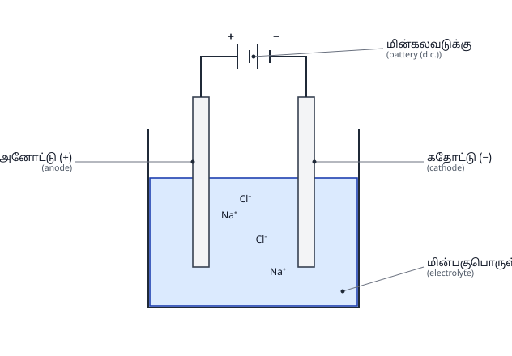

---

## SC11-13: மின் காந்தவியலும் தூண்டலும் (Electromagnetism and electromagnetic induction)

<!-- meta {"type":"chapter_notes","id":"SC11-13","grade":11,"chapter":13,"discipline":"PHY"} -->

*தரம் 11 · அத்தியாயம் 13 · பௌதிகவியல்*

மின்னோட்டம் காந்தப் புலத்தை உருவாக்கும்; காந்தப் புலம் மின்னோட்டக் கடத்தியில் விசை தரும்; மாறும் காந்தப் புலம் மின்னைத் தூண்டும். மோட்டர், பிறப்பாக்கி, நிலைமாற்றி இவற்றின் அடிப்படை.

### கற்றல் நோக்கங்கள்

- காந்தப் புலக் கோடுகளை வரைதல்
- மின்னோட்டத்தின் காந்த விளைவு — வலக்கைப் பிடி விதி
- கடத்தியில் விசை — பிளெமிங்கின் இடக்கை விதி, மோட்டர்
- மின்காந்தத் தூண்டல் — பிறப்பாக்கி, நிலைமாற்றி

### பிரதான எண்ணக்கருக்கள்

- காந்தப் புலக் கோடுகள் வடமுனையிலிருந்து தென்முனைக்கு; நெருக்கமான கோடுகள் = வலிய புலம்.
- நேர்க் கடத்தியைச் சுற்றி வட்டப் புலம் — வலக்கைப் பிடி விதி (பெருவிரல் மின்னோட்டம், விரல்கள் புலம்). வரிச்சுருள் (solenoid) — சட்டக் காந்தம் போன்ற புலம்; மென் இரும்பு அகணி — மின்காந்தம்.
- காந்தப் புலத்திலுள்ள மின்னோட்டக் கடத்தியில் விசை — பிளெமிங்கின் இடக்கை விதி (பெருவிரல் — விசை/இயக்கம், சுட்டுவிரல் — புலம், நடுவிரல் — மின்னோட்டம்) (2019 வினாத்தாள் I வி28). DC மோட்டர், ஒலிபெருக்கி.
- மின்காந்தத் தூண்டல் (பரடே): கடத்தியைக் கடக்கும் காந்தப் பாயம் மாறும்போது மி.இ.வி. தூண்டப்படும்; காந்தத்தை விரைவாக நகர்த்த, சுற்றுகளைக் கூட்ட, வலிய காந்தம் — தூண்டிய மி.இ.வி. கூடும்.
- பிறப்பாக்கி (Generator): பொறிமுறைச் சக்தி → மின்சக்தி.
- நிலைமாற்றி (Transformer): AC யில் மட்டும்; $\frac{V_s}{V_p} = \frac{N_s}{N_p}$; இலட்சிய நிலையில் $V_pI_p = V_sI_s$; ஏற்றும் (step-up), இறக்கும் (step-down). வினைத்திறன் = (Ps/Pp) × 100% (2019 வினாத்தாள் I வி23).

### வரைவிலக்கணங்கள்

- **மின்காந்தத் தூண்டல்:** மாறும் காந்தப் பாயத்தால் கடத்தியில் மி.இ.வி. தூண்டப்படுதல்.
- **நிலைமாற்றி (Transformer):** AC அழுத்தத்தைக் கூட்டும்/குறைக்கும் சாதனம்.
- **மின்காந்தம்:** மின்னோட்டம் பாயும்போது மட்டும் காந்தமாகும் மென் இரும்பு அகணிச் சுருள்.

### ஒப்பீட்டு அட்டவணை

| சாதனம் | சக்தி மாற்றம் | கொள்கை |
|---|---|---|
| மோட்டர் | மின் → பொறிமுறை | கடத்தியில் விசை |
| பிறப்பாக்கி | பொறிமுறை → மின் | மின்காந்தத் தூண்டல் |
| நிலைமாற்றி | AC அழுத்த மாற்றம் | பரஸ்பரத் தூண்டல் |
| ஒலிபெருக்கி | மின் → ஒலி | கடத்தியில் விசை |

### அன்றாட வாழ்க்கைத் தொடர்புகள்

- மின்னுயர்த்தி (crane) மின்காந்தங்கள்.
- மின் விநியோகத்தில் உயர் அழுத்தப் பரிமாற்றம் — ஏற்றும் நிலைமாற்றி, வீடுகளுக்கு இறக்கும் நிலைமாற்றி.
- மின்விசிறி — மோட்டர்.

### பொதுவான தவறான எண்ணக்கருக்கள்

- ⚠️ நிலைமாற்றி DC யில் இயங்கும் — பிழை; மாறும் பாயம் தேவை.
- ⚠️ ஏற்றும் நிலைமாற்றி சக்தியைக் கூட்டும் — பிழை; அழுத்தம் கூடும், மின்னோட்டம் குறையும்.

### பரீட்சைக் கவனம்

- நிலைமாற்றிக் கணிப்புகள் (கோப்பு 5).
- காந்தப் புலக் கோட்டு வரிப்படங்கள் (கோப்பு 6).

### தொடர்புடைய வளங்கள்

- வரிப்படம் PHY-D04 — சட்டக் காந்தத்தின் காந்தப் புலக் கோடுகள் ([பெயரிட்டது](science_assets/physics/PHY-D04_labelled.svg))
- வரிப்படம் PHY-D07 — நிலைமாற்றி ([பெயரிட்டது](science_assets/physics/PHY-D07_labelled.svg))
- வரிப்படம் PHY-D12 — வரிச்சுருளும் மின்காந்தமும் ([பெயரிட்டது](science_assets/physics/PHY-D12_labelled.svg))
- பரிசோதனை EXP-26 — மின்காந்தத் தூண்டல் (காந்தம் + சுருள்) (கோப்பு 8)
- கணிப்பு CL-TRANS — நிலைமாற்றி (கோப்பு 5)

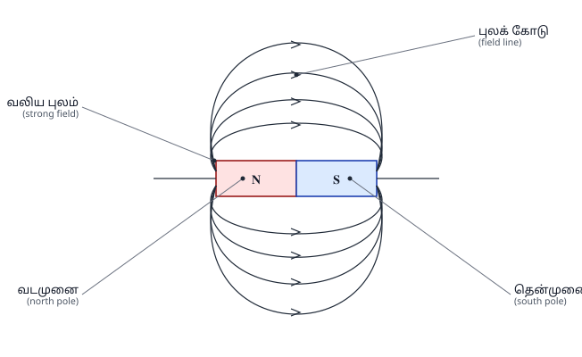

---

## SC11-14: ஐதரோகாபன்களும் அவற்றின் பெறுதிகளும் (Hydrocarbons and their derivatives)

<!-- meta {"type":"chapter_notes","id":"SC11-14","grade":11,"chapter":14,"discipline":"CHE"} -->

*தரம் 11 · அத்தியாயம் 14 · இரசாயனவியல்*

ஐதரோகாபன்கள் C, H மட்டும் கொண்ட சேர்வைகள். அவற்றின் பெறுதிகளான அற்ககோல்கள், காபொட்சிலிக் அமிலங்கள், பல்பகுதியங்கள் அன்றாட வாழ்வில் முக்கியம்.

### கற்றல் நோக்கங்கள்

- அல்கேன், அல்கீன், அல்கைன் தொடர்களை வேறுபடுத்துதல்
- எளிய சேர்வைகளைப் பெயரிடுதல்
- தகனம், கூட்டல் தாக்கங்களை எழுதுதல்
- பல்பகுதியங்களையும் அவற்றின் சூழல் தாக்கத்தையும் விளக்குதல்

### பிரதான எண்ணக்கருக்கள்

- அல்கேன்கள் CₙH₂ₙ₊₂ (தனிப் பிணைப்பு; நிரம்பியவை): மெதேன் CH₄, எதேன் C₂H₆, புரொப்பேன் C₃H₈, பியூற்றேன் C₄H₁₀.
- அல்கீன்கள் CₙH₂ₙ (C=C; நிரம்பாதவை): எதீன் C₂H₄, புரொப்பீன் C₃H₆. அல்கைன்கள் CₙH₂ₙ₋₂ (C≡C): எதைன் C₂H₂.
- முழுத் தகனம்: CH₄ + 2O₂ → CO₂ + 2H₂O; குறைத் தகனம் CO / C (கரி) உருவாக்கும்.
- நிரம்பாமைச் சோதனை: புரோமீன் நீர் (செம்மஞ்சள்) அல்கீனுடன் நிறமற்றதாகும்.
- கூட்டல் பல்பகுதியாக்கம்: n CH₂=CH₂ → —(CH₂—CH₂)ₙ— (பொலித்தீன்); PVC, பொலிஸ்ரைரீன். இயற்கை பல்பகுதியங்கள்: இறப்பர், புரதம், செலுலோசு (2019 வினாத்தாள் I வி27).
- அற்ககோல் தொழிற்பாட்டுக் கூட்டம் –OH (எதனோல் C₂H₅OH); காபொட்சிலிக் அமிலம் –COOH (அசற்றிக்கமிலம் CH₃COOH).
- மசகெண்ணெய் பகுதிபடக் காய்ச்சிவடித்தல்: LP வாயு, பெற்றோல், மண்ணெண்ணெய், டீசல், உராய்வுநீக்கி எண்ணெய், தார்.
- பிளாத்திக்குக் கழிவு உக்காதது — 4R, மீள்சுழற்சி.

### வரைவிலக்கணங்கள்

- **ஐதரோகாபன் (Hydrocarbon):** காபனும் ஐதரசனும் மட்டும் கொண்ட சேர்வை.
- **ஓரினத்தொடர் (Homologous series):** ஒரே பொதுச் சூத்திரமும் ஒத்த இரசாயன இயல்புகளும், அடுத்தடுத்த உறுப்புகள் CH₂ ஆல் வேறுபடும் சேர்வைத் தொடர்.
- **பல்பகுதியாக்கம்:** பல ஒருபகுதியங்கள் இணைந்து பல்பகுதியம் உருவாதல்.

### ஒப்பீட்டு அட்டவணை

| தொடர் | பொதுச் சூத்திரம் | பிணைப்பு | முதல் உறுப்பு |
|---|---|---|---|
| அல்கேன் | CₙH₂ₙ₊₂ | C–C | CH₄ |
| அல்கீன் | CₙH₂ₙ | C=C | C₂H₄ |
| அல்கைன் | CₙH₂ₙ₋₂ | C≡C | C₂H₂ |

### அன்றாட வாழ்க்கைத் தொடர்புகள்

- LP வாயு — புரொப்பேன் + பியூற்றேன்.
- பழங்களைப் பழுக்கவைக்க எதீன்.
- வினாகிரி — ஐதான அசற்றிக்கமிலம்.

### பொதுவான தவறான எண்ணக்கருக்கள்

- ⚠️ பொலித்தீனில் C=C இரட்டைப் பிணைப்புகள் உண்டு — பிழை; பல்பகுதியாக்கத்தின்போது திறந்துவிடும்.
- ⚠️ எதனோல் ஒரு ஐதரோகாபன் — பிழை; O உள்ளதால் பெறுதி.

### பரீட்சைக் கவனம்

- கட்டமைப்புச் சூத்திரங்களிலிருந்து ஓரினத்தொடர் இனங்காணல்.
- தகனச் சமன்பாடுகள் சமன்செய்தல் (கோப்பு 7).

### தொடர்புடைய வளங்கள்

- சமன்பாடுகள் EQ-034, EQ-035, EQ-036, EQ-037, EQ-038, EQ-039, EQ-040 (கோப்பு 7)

---

## SC11-15: உயிர்க் கோளம் (Biosphere (Grade 11))

<!-- meta {"type":"chapter_notes","id":"SC11-15","grade":11,"chapter":15,"discipline":"BIO"} -->

*தரம் 11 · அத்தியாயம் 15 · உயிரியல்*

உயிர்க்கோளத்தின் சமநிலையைப் பேணுதல், மாசடைதல், உலகளாவிய சூழல் பிரச்சினைகள், நிலைபேறான அபிவிருத்தி இவ்வத்தியாயத்தில் அடங்கும்.

### கற்றல் நோக்கங்கள்

- மாசடைதலின் வகைகளையும் விளைவுகளையும் விளக்குதல்
- பச்சை வீட்டு விளைவு, ஓசோன் படை தேய்வு, அமில மழையை விளக்குதல்
- நிலைபேறான அபிவிருத்தி முறைகளை முன்மொழிதல்

### பிரதான எண்ணக்கருக்கள்

- வளி மாசடைதல்: CO, SO₂, NOₓ, துணிக்கைகள்; SO₂ உம் NO₂ உம் அமில மழையை உண்டாக்கும்.
- பச்சை வீட்டு வாயுக்கள்: CO₂, CH₄, N₂O, CFC, நீராவி — பூகோள வெப்பமடைதல்.
- ஓசோன் படை (O₃) UV கதிர்களை உறிஞ்சும்; CFC ஓசோனைச் சிதைக்கும் (2019 வினாத்தாள் I வி35).
- நீர் மாசடைதல்: பசளை வழிந்தோட்டம் → போசணைச் செறிவாக்கம் (Eutrophication) → அல்காப் பெருக்கம் → O₂ குறைவு → மீன்கள் இறப்பு.
- பார உலோகங்கள் (Pb, Hg, Cd, As) உணவுச் சங்கிலியூடு உயிர்ப் பெருக்கமடையும் (Bioaccumulation).
- ஒளி இரசாயனப் புகைப்பனி (Photochemical smog): NOₓ + ஐதரோகாபன்கள் + சூரிய ஒளி.
- 4R: குறைத்தல் (Reduce), மீள்பாவனை (Reuse), மீள்சுழற்சி (Recycle), மறுத்தல் (Refuse); உணவு மைல் (food mileage) குறைத்தல் — CO₂ வெளியீடு குறையும்.
- நிலைபேறான அபிவிருத்தி: எதிர்காலச் சந்ததியின் தேவைகளைப் பாதிக்காமல் இன்றைய தேவைகளை நிறைவேற்றல்.

### வரைவிலக்கணங்கள்

- **பச்சை வீட்டு விளைவு (Greenhouse effect):** வளிமண்டல வாயுக்கள் புவியிலிருந்து வெளியேறும் வெப்பக் கதிர்ப்பைச் சிறைப்படுத்துதல்.
- **போசணைச் செறிவாக்கம் (Eutrophication):** நீர்நிலைகளில் போசணைப் பொருட்கள் அதிகரித்து அல்காப் பெருக்கம் ஏற்படல்.
- **நிலைபேறான அபிவிருத்தி:** எதிர்காலத் தேவைகளைப் பாதிக்காத அபிவிருத்தி.

### ஒப்பீட்டு அட்டவணை

| பிரச்சினை | காரணம் | விளைவு |
|---|---|---|
| அமில மழை | SO₂, NO₂ | கட்டடங்கள், காடுகள், நீர்நிலைகள் பாதிப்பு |
| பூகோள வெப்பமடைதல் | CO₂, CH₄ | கடல் மட்ட உயர்வு, காலநிலை மாற்றம் |
| ஓசோன் தேய்வு | CFC | UV கூடி தோல் புற்றுநோய் |
| போசணைச் செறிவாக்கம் | பசளை, கழிவுநீர் | O₂ குறைவு, மீன் இறப்பு |

### அன்றாட வாழ்க்கைத் தொடர்புகள்

- உள்ளூர் உற்பத்திகளை வாங்குவதால் உணவு மைல் குறையும் (2019 வினாத்தாள் I வி40).
- உயிர்வாயு (biogas) — சேதனக் கழிவிலிருந்து CH₄ (2019 வினாத்தாள் II வி1).

### பொதுவான தவறான எண்ணக்கருக்கள்

- ⚠️ ஓசோன் துளை பூகோள வெப்பமடைதலின் பிரதான காரணம் — பிழை; இரண்டும் வேறுவேறு பிரச்சினைகள்.
- ⚠️ CO₂ நச்சு வாயு என்பதாலேயே பிரச்சினை — பிழை; பச்சை வீட்டு விளைவே பிரச்சினை.

### பரீட்சைக் கவனம்

- மாசுக் காரணி — விளைவு — தீர்வு அட்டவணை.
- முதன்மை, இரண்டாம்நிலை மாசுக்கள் (SO₂ → H₂SO₄).
---

## வரையறைகள் (Limitations)

- குறிப்புகள் NIE பாடத்திட்ட ஆவணத்தையோ பாடநூல்களையோ நேரடியாக வாசித்துத் தயாரிக்கப்படவில்லை; அத்தியாயத் தலைப்புகள் மட்டும் e-thaksalawa வில் சரிபார்க்கப்பட்டன. ஆசிரியர் மீளாய்வு பரிந்துரைக்கப்படுகிறது.
- சில கலைச்சொற்கள் பாடநூல் வழக்குடன் வேறுபடலாம் (உ-ம் வட நிறங்கள், சில உயிரியற் பெயர்கள்) — ஆசிரியர் உறுதிப்படுத்துக.
- 'பரீட்சைக் கவனம்' பகுதியிலுள்ள 2019 குறிப்புகள் தவிர்ந்த ஏனைய வருட வினாத்தாள்கள் இப்பதிப்பில் பகுப்பாய்வு செய்யப்படவில்லை.
