# StudyBuddy — செய்முறைப் பரிசோதனைகள்

> எல்லாப் பரிசோதனைகளும் **பாடசாலை ஆய்வுகூடத்தில், ஆசிரியர் மேற்பார்வையில் மட்டும்**. வீட்டில் செய்யக்கூடாது. அபாயகரமான வீட்டுப் பரிசோதனைகள் சேர்க்கப்படவில்லை.
> 'எதிர்பார்க்கப்படும் அவதானிப்பு' பகுதிகள் உண்மை அளவீடுகள் அல்ல. மெய்நிகர் பரிசோதனை விவரக்குறிப்புகள் இணையத்தள உருவாக்குநர்களுக்கானவை — இந்த Markdown கோப்பு உருவகப்படுத்தல்களை இயக்காது.


---

## EXP-01: உணவில் மாப்பொருள், வெல்லம், புரதம், இலிப்பிட்டு சோதனைகள் (Food tests)

<!-- meta {"type":"experiment","id":"EXP-01","chapter_id":"SC10-01","discipline":"BIO","diagram":null,"teacher_demo_only":false,"has_virtual":false} -->

*உயிரின இரசாயன அடிப்படை (Chemical basis of life)*

**நோக்கம்:** உணவு மாதிரிகளில் உயிரியல் மூலக்கூறுகளை இனங்காணல்.

**உபகரணங்கள்:** சோதனைக் குழாய்கள், நீர்த் தொட்டி, துளிகருவி, வடிதாள்

**இரசாயனங்கள்/பொருட்கள்:** அயடீன் கரைசல், பெனடிக்ற் கரைசல், பையூரெற் சோதனைப்பொருள் (NaOH + CuSO₄), சூடான் III

**பாதுகாப்பு:** பாதுகாப்புக் கண்ணாடி அணிக; ஆசிரியர் மேற்பார்வையில் மட்டும் பாடசாலை ஆய்வுகூடத்தில் செய்க; வீட்டில் செய்ய வேண்டாம். பெனடிக்ற் சோதனையைச் சுடுநீர்த் தொட்டியில் செய்க.

| மாறி வகை | விவரம் |
|---|---|
| சாரா மாறி (independent) | உணவு மாதிரி வகை |
| சார் மாறி (dependent) | நிறமாற்றம் |
| கட்டுப்படுத்திய மாறிகள் (controlled) | மாதிரி அளவு, சோதனைப்பொருள் அளவு, வெப்பநிலை |

**செய்முறை:**

1. மாதிரிகளை நீருடன் அரைத்துச் சாறு தயாரிக்க.
2. மாப்பொருள்: சில துளி அயடீன் — நீல-கறுப்பு.
3. தாழ்த்தும் வெல்லம்: சம அளவு பெனடிக்ற், சுடுநீரில் 3–5 நிமிடம் — செங்கட்டிச் சிவப்பு வீழ்படிவு.
4. புரதம்: NaOH பின் ஐதான CuSO₄ துளிகள் — ஊதா.
5. இலிப்பிட்டு: சூடான் III — சிவப்புப் படை; அல்லது தாளில் கசியும் புள்ளி.

**எதிர்பார்க்கப்படும் அவதானிப்பு:** அரிசிச் சாறு + அயடீன் → நீல-கறுப்பு; முட்டை வெண்கரு + பையூரெற் → ஊதா (எதிர்பார்க்கப்படும் பெறுபேறுகள்).

**முடிவு:** ஒவ்வொரு சோதனையும் குறித்த மூலக்கூற்றுக்கு மட்டும் சிறப்பானது.

**வழுக்களின் மூலங்கள்:** கட்டுப்பாட்டுக் குழாய் (நீர் மட்டும்) இல்லாமை; போதிய வெப்பமாக்கல் இல்லாமை

**பரீட்சை வகை வினாக்கள் (அசல்):** சுக்குரோசு பெனடிக்ற் சோதனைக்கு மறை ஏன்? · கட்டுப்பாட்டுச் சோதனையின் நோக்கம்?

---

## EXP-02: நுணுக்குக்காட்டியில் வெங்காயத் தோல் கலங்கள் (Onion epidermal cells under the microscope)

<!-- meta {"type":"experiment","id":"EXP-02","chapter_id":"SC10-06","discipline":"BIO","diagram":"BIO-D01","teacher_demo_only":false,"has_virtual":false} -->

*தாவரக்கலங்களினதும் விலங்குக்கலங்களினதும் கட்டமைப்பும் தொழிற்பாடும் (Structure and functions of plant and animal cells)*

**நோக்கம்:** தாவரக் கலக் கட்டமைப்புகளை அவதானித்தல்.

**உபகரணங்கள்:** கூட்டு நுணுக்குக்காட்டி, வழுக்கி, மூடித்துண்டு, ஊசி, வெட்டுக்கத்தி

**இரசாயனங்கள்/பொருட்கள்:** அயடீன் கரைசல் அல்லது மெதிலீன் நீலம், நீர்

**பாதுகாப்பு:** வெட்டுக்கத்தியை கவனமாகக் கையாள்க; கண்ணாடி வழுக்கிகள் உடையக்கூடியவை.

| மாறி வகை | விவரம் |
|---|---|
| சாரா மாறி (independent) | உருப்பெருக்கம் (×40 / ×100 / ×400) |
| சார் மாறி (dependent) | அவதானிக்கக்கூடிய கட்டமைப்புகள் |
| கட்டுப்படுத்திய மாறிகள் (controlled) | மாதிரித் தடிப்பு, சாயம் |

**செய்முறை:**

1. வெங்காயச் செதிலின் உட்புறத் தோலை உரித்தெடுக்க.
2. வழுக்கியில் நீர்த் துளியில் விரிக்க; ஒரு துளி அயடீன்.
3. குமிழ்கள் இல்லாமல் மூடித்துண்டை 45° இல் இறக்குக.
4. குறைந்த உருப்பெருக்கத்தில் குவியப்படுத்திப் பின் உயர் உருப்பெருக்கம்.
5. கலங்களை வரைந்து பெயரிடுக (கோப்பு 6: BIO-D01).

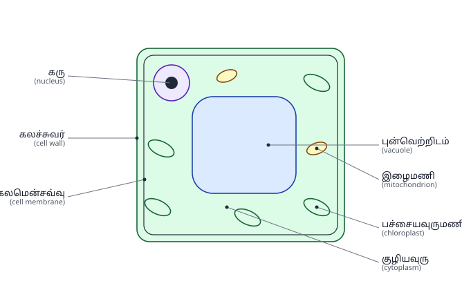

**எதிர்பார்க்கப்படும் அவதானிப்பு:** செவ்வக வடிவக் கலங்கள், கலச்சுவர், கரு தெளிவு; பச்சையவுருமணிகள் இல்லை.

**முடிவு:** வெங்காயத் தோல் ஒளித்தொகுப்பில் ஈடுபடாததால் பச்சையவுருமணி இல்லை.

**வழுக்களின் மூலங்கள்:** காற்றுக் குமிழ்கள்; மாதிரி தடிப்பு

**பரீட்சை வகை வினாக்கள் (அசல்):** பச்சையவுருமணி ஏன் காணப்படவில்லை? · மொத்த உருப்பெருக்கத்தைக் கணிக்க (×10 × ×40).

---

## EXP-03: ஒளித்தொகுப்புக்கு ஒளி அவசியம் (மாப்பொருள் சோதனை) (Light is needed for photosynthesis)

<!-- meta {"type":"experiment","id":"EXP-03","chapter_id":"SC11-02","discipline":"BIO","diagram":"EXP-D01","teacher_demo_only":false,"has_virtual":false} -->

*ஒளித்தொகுப்பு (Photosynthesis)*

**நோக்கம்:** ஒளியின்றி இலையில் மாப்பொருள் உருவாகாது எனக் காட்டல்.

**உபகரணங்கள்:** தொட்டிச் செடி, கறுப்புத் தாள்/அலுமினியத் தகடு, முகவை, கொதிகுழாய், நீர்த் தொட்டி

**இரசாயனங்கள்/பொருட்கள்:** அற்ககோல் (எதனோல்), அயடீன் கரைசல்

**பாதுகாப்பு:** அற்ககோல் எளிதில் தீப்பற்றும் — நேரடிச் சுவாலையில் சூடாக்க வேண்டாம்; சுடுநீர்த் தொட்டி மட்டும்.

| மாறி வகை | விவரம் |
|---|---|
| சாரா மாறி (independent) | ஒளி (மூடிய / மூடாத பகுதி) |
| சார் மாறி (dependent) | அயடீனுடன் நிறம் |
| கட்டுப்படுத்திய மாறிகள் (controlled) | செடி, இலை, நேரம், வெப்பநிலை |

**செய்முறை:**

1. செடியை 48 மணிநேரம் இருட்டில் வைத்து மாப்பொருள் நீக்குக.
2. ஓர் இலையின் பகுதியைக் கறுப்புத் தாளால் மூடுக.
3. 4–6 மணிநேரம் சூரிய ஒளியில் வைக்க.
4. இலையைக் கொதிநீர், சுடு அற்ககோல், சுடுநீர் என்ற படிகளில் செயற்படுத்துக (EXP-D01).
5. அயடீன் சேர்க்க.

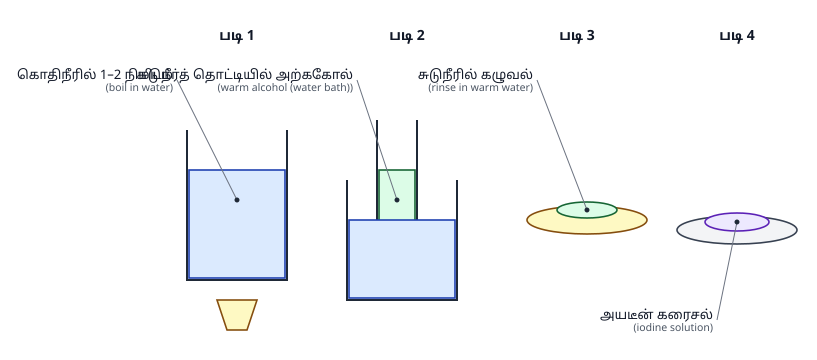

**எதிர்பார்க்கப்படும் அவதானிப்பு:** மூடாத பகுதி நீல-கறுப்பு; மூடிய பகுதி கபில/மஞ்சள்.

**முடிவு:** மாப்பொருள் உருவாக ஒளி அவசியம்.

**வழுக்களின் மூலங்கள்:** மாப்பொருள் முழுமையாக நீக்கப்படாமை; மூடியின் ஓரங்களால் ஒளிக் கசிவு

**பரீட்சை வகை வினாக்கள் (அசல்):** மாப்பொருள் நீக்கம் ஏன்? · அற்ககோலின் பங்கு?

---

## EXP-04: ஒளிச்செறிவும் ஒளித்தொகுப்பு வீதமும் (Hydrilla) (Light intensity and rate of photosynthesis)

<!-- meta {"type":"experiment","id":"EXP-04","chapter_id":"SC11-02","discipline":"BIO","diagram":"EXP-D02","teacher_demo_only":false,"has_virtual":true} -->

*ஒளித்தொகுப்பு (Photosynthesis)*

**நோக்கம்:** ஒளி மூலத்தின் தூரத்துக்கேற்ப O₂ குமிழ் வீதம் மாறுவதை ஆராய்தல்.

**உபகரணங்கள்:** Hydrilla, முகவை, புனல், சோதனைக் குழாய், விளக்கு, மீற்றர் அளவுகோல், நிறுத்தற் கடிகாரம்

**இரசாயனங்கள்/பொருட்கள்:** NaHCO₃ கரைசல் (ஐதானது)

**பாதுகாப்பு:** மின் விளக்கை நீரிலிருந்து தூரத்தில் வைக்க; ஈரக் கைகளால் மின் உபகரணங்களைத் தொட வேண்டாம்.

| மாறி வகை | விவரம் |
|---|---|
| சாரா மாறி (independent) | விளக்கின் தூரம் d |
| சார் மாறி (dependent) | நிமிடத்துக்கான குமிழ் எண்ணிக்கை |
| கட்டுப்படுத்திய மாறிகள் (controlled) | தாவரம், நீர் வெப்பநிலை, CO₂ (NaHCO₃) செறிவு |

**செய்முறை:**

1. அமைப்பை EXP-D02 இன்படி தயாரிக்க.
2. விளக்கை 10 cm இல் வைத்து 5 நிமிடம் சீராக்குக.
3. 1 நிமிடத்தில் குமிழ்களை எண்ணுக; மூன்று முறை.
4. 20, 30, 40 cm இல் மீள்செய்க.
5. வீதம் எதிர் 1/d² வரைபு வரைக.

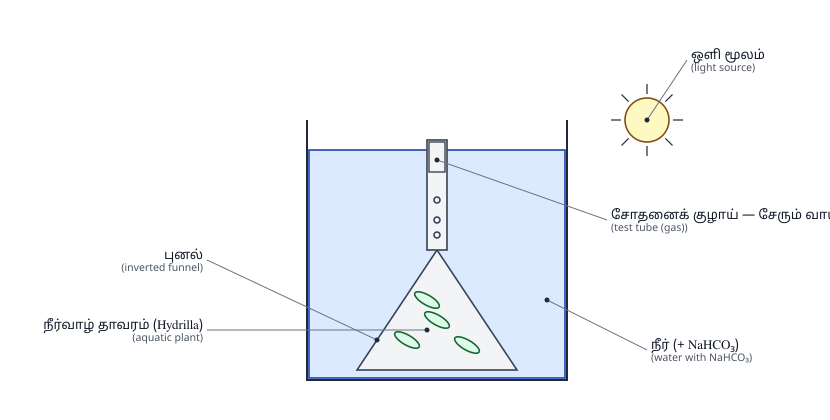

**எதிர்பார்க்கப்படும் அவதானிப்பு:** தூரம் கூடக் குமிழ் வீதம் குறையும் (மாதிரித் தரவு — மாதிரிக் கணிப்பு மட்டும்).

**முடிவு:** ஒளிச்செறிவு கூட ஒளித்தொகுப்பு வீதம் கூடும் — பிற காரணி மட்டுப்படுத்தும் வரை.

**வழுக்களின் மூலங்கள்:** விளக்கின் வெப்பம் நீர் வெப்பநிலையை மாற்றல் — வெப்பக் காப்புக்கு நீர்த் திரை; குமிழ் அளவு சமனின்மை

**பரீட்சை வகை வினாக்கள் (அசல்):** கட்டுப்படுத்தும் காரணி என்றால்? · NaHCO₃ சேர்ப்பதன் நோக்கம்?

<details><summary>மெய்நிகர் பரிசோதனை விவரக்குறிப்பு (உருவாக்குநர்களுக்கு)</summary>

```json
{
 "inputs": [
  {
   "symbol": "d",
   "name": "விளக்குத் தூரம்",
   "unit": "cm",
   "min": 10,
   "max": 50
  }
 ],
 "outputs": [
  {
   "symbol": "rate",
   "name": "குமிழ்கள்/நிமிடம்"
  }
 ],
 "model": "rate = min(Rmax, k / d²); k = 6000, Rmax = 40 (கற்பித்தல் மாதிரி)",
 "test_cases": [
  [
   10,
   40
  ],
  [
   20,
   15
  ],
  [
   30,
   6.666666666666667
  ]
 ],
 "note": "மாதிரி எண்கள் கற்பித்தலுக்கானவை; உண்மை அளவீடுகள் அல்ல."
}
```

சோதனை வழக்குகள் Python இல் மாதிரிச் சமன்பாட்டுக்கு எதிராகச் சரிபார்க்கப்பட்டன.

</details>

---

## EXP-05: அமிலேசு நொதியத்தின் செயற்பாட்டில் வெப்பநிலையின் விளைவு (Effect of temperature on amylase)

<!-- meta {"type":"experiment","id":"EXP-05","chapter_id":"SC10-01","discipline":"BIO","diagram":null,"teacher_demo_only":false,"has_virtual":false} -->

*உயிரின இரசாயன அடிப்படை (Chemical basis of life)*

**நோக்கம்:** உகந்த வெப்பநிலையைக் காணல்.

**உபகரணங்கள்:** சோதனைக் குழாய்கள், நீர்த் தொட்டிகள் (0, 20, 37, 60 °C), வெண்ணிறத் தட்டு, நிறுத்தற் கடிகாரம்

**இரசாயனங்கள்/பொருட்கள்:** 1% மாப்பொருள் கரைசல், அமிலேசு (அல்லது ஐதாக்கிய உமிழ்நீர் — ஆசிரியர் அனுமதியுடன்), அயடீன்

**பாதுகாப்பு:** பாதுகாப்புக் கண்ணாடி அணிக; ஆசிரியர் மேற்பார்வையில் மட்டும் பாடசாலை ஆய்வுகூடத்தில் செய்க; வீட்டில் செய்ய வேண்டாம்.

| மாறி வகை | விவரம் |
|---|---|
| சாரா மாறி (independent) | வெப்பநிலை |
| சார் மாறி (dependent) | அயடீன் நீல-கறுப்பு தராத நேரம் |
| கட்டுப்படுத்திய மாறிகள் (controlled) | மாப்பொருள்/நொதிய அளவு, pH |

**செய்முறை:**

1. ஒவ்வொரு வெப்பநிலையிலும் மாப்பொருளையும் நொதியத்தையும் தனித்தனியே 5 நிமிடம் வைக்க.
2. கலந்து நேரத்தைத் தொடங்குக.
3. ஒவ்வொரு 30 s இலும் ஒரு துளியை அயடீனுடன் சோதிக்க.
4. நீல-கறுப்பு தோன்றாத நேரத்தைப் பதிவு செய்க.

**எதிர்பார்க்கப்படும் அவதானிப்பு:** 37 °C இல் விரைவாக; 0 °C இல் மிக மெதுவாக; 60 °C இல் இயல்பிழப்பு — தாக்கம் இல்லை.

**முடிவு:** நொதியத்துக்கு உகந்த வெப்பநிலை உண்டு.

**வழுக்களின் மூலங்கள்:** மாதிரி எடுக்கும் நேர இடைவெளி பெரிது; வெப்பநிலை மாறுதல்

**பரீட்சை வகை வினாக்கள் (அசல்):** உயர் வெப்பநிலையில் நொதியத்துக்கு என்ன நிகழ்கிறது?

---

## EXP-06: உட்சுவாச, வெளிச்சுவாச வளியில் CO₂ ஒப்பீடு (CO₂ in inhaled vs exhaled air)

<!-- meta {"type":"experiment","id":"EXP-06","chapter_id":"SC11-06","discipline":"BIO","diagram":null,"teacher_demo_only":false,"has_virtual":false} -->

*மனித உடற் செயன்முறைகள் (Biological processes in the human body)*

**நோக்கம்:** வெளிச்சுவாச வளியில் CO₂ அதிகம் எனக் காட்டல்.

**உபகரணங்கள்:** இரு கொதிகுழாய்கள், வளைந்த குழாய்கள், தக்கைகள்

**இரசாயனங்கள்/பொருட்கள்:** தெளிந்த சுண்ணாம்பு நீர்

**பாதுகாப்பு:** குழாயினூடு உறிஞ்சாதீர் — ஊதுதல்/உட்சுவாசம் சரியான குழாயில் மட்டும்; தனிப்பட்ட குழாய் பயன்படுத்துக.

| மாறி வகை | விவரம் |
|---|---|
| சாரா மாறி (independent) | வளி வகை |
| சார் மாறி (dependent) | சுண்ணாம்பு நீர் பால் நிறமாக எடுக்கும் நேரம் |
| கட்டுப்படுத்திய மாறிகள் (controlled) | சுண்ணாம்பு நீர் அளவு, சுவாச எண்ணிக்கை |

**செய்முறை:**

1. இரு குழாய்களிலும் சம அளவு சுண்ணாம்பு நீர்.
2. ஒரு குழாயினூடு மெதுவாக உட்சுவாசம், மற்றதனூடு வெளிச்சுவாசம்.
3. சம எண்ணிக்கை சுவாசங்கள்.
4. பால் நிறத்தை ஒப்பிடுக.

**எதிர்பார்க்கப்படும் அவதானிப்பு:** வெளிச்சுவாசக் குழாய் விரைவாகப் பால் நிறமாகும்.

**முடிவு:** வெளிச்சுவாச வளியில் CO₂ அதிகம்.

**வழுக்களின் மூலங்கள்:** சுவாச ஆழம் வேறுபாடு

**பரீட்சை வகை வினாக்கள் (அசல்):** Ca(OH)₂ + CO₂ சமன்பாட்டை எழுதுக (கோப்பு 7: EQ-033).

---

## EXP-07: வித்து முளைத்தலுக்கான நிபந்தனைகள் (Conditions for seed germination)

<!-- meta {"type":"experiment","id":"EXP-07","chapter_id":"SC10-14","discipline":"BIO","diagram":null,"teacher_demo_only":false,"has_virtual":false} -->

*உயிரின் தொடர்ச்சி (Continuity of life)*

**நோக்கம்:** நீர், ஒட்சிசன், உகந்த வெப்பநிலை அவசியம் எனக் காட்டல்.

**உபகரணங்கள்:** 4 சோதனைக் குழாய்கள், பஞ்சு, பயறு வித்துகள், குளிர்சாதனப் பெட்டி

**இரசாயனங்கள்/பொருட்கள்:** கொதித்து ஆறிய நீர், எண்ணெய்

**பாதுகாப்பு:** குளிர்சாதனப் பெட்டியை ஆசிரியர் அனுமதியுடன் பயன்படுத்துக.

| மாறி வகை | விவரம் |
|---|---|
| சாரா மாறி (independent) | நிபந்தனை (நீர் / O₂ / வெப்பநிலை) |
| சார் மாறி (dependent) | முளைத்தல் (ஆம்/இல்லை) |
| கட்டுப்படுத்திய மாறிகள் (controlled) | வித்து வகை, எண்ணிக்கை |

**செய்முறை:**

1. A: ஈரப் பஞ்சு, அறை வெப்பநிலை (கட்டுப்பாடு).
2. B: உலர் பஞ்சு.
3. C: கொதித்து ஆறிய நீரில் மூழ்கடித்து மேலே எண்ணெய்ப் படை (O₂ இல்லை).
4. D: ஈரப் பஞ்சு, குளிர்சாதனப் பெட்டி.
5. 3–4 நாட்கள் அவதானிக்க.

**எதிர்பார்க்கப்படும் அவதானிப்பு:** A மட்டும் முளைக்கும்.

**முடிவு:** முளைத்தலுக்கு நீர், O₂, உகந்த வெப்பநிலை தேவை.

**வழுக்களின் மூலங்கள்:** வித்துகள் உயிரற்றவையாக இருத்தல்

**பரீட்சை வகை வினாக்கள் (அசல்):** கொதித்த நீர் ஏன்? · எண்ணெய்ப் படையின் பங்கு?

---

## EXP-08: சுவாலைச் சோதனை (Flame test)

<!-- meta {"type":"experiment","id":"EXP-08","chapter_id":"SC10-03","discipline":"CHE","diagram":null,"teacher_demo_only":true,"has_virtual":false} -->

*சடப்பொருள்களின் கட்டமைப்பு (Structure of matter)* · ⚠️ **ஆசிரியர் செய்முறை விளக்கம் மட்டும்**

**நோக்கம்:** உலோக அயன்களைச் சுவாலை நிறத்தால் இனங்காணல்.

**உபகரணங்கள்:** நிக்கல்-குரோமியம் கம்பி / ஈரப் பனைமட்டைக் குச்சி, புன்சன் சுடரடுப்பு, கடிகாரக் கண்ணாடி

**இரசாயனங்கள்/பொருட்கள்:** NaCl, KCl, CaCl₂, CuCl₂ (சிறிதளவு), ஐதான HCl (கம்பி சுத்தமாக்க)

**பாதுகாப்பு:** பாதுகாப்புக் கண்ணாடி அணிக; ஆசிரியர் மேற்பார்வையில் மட்டும் பாடசாலை ஆய்வுகூடத்தில் செய்க; வீட்டில் செய்ய வேண்டாம். ஆசிரியர் செய்முறை விளக்கமாகச் செய்வது சிறந்தது.

| மாறி வகை | விவரம் |
|---|---|
| சாரா மாறி (independent) | உப்பு வகை |
| சார் மாறி (dependent) | சுவாலை நிறம் |
| கட்டுப்படுத்திய மாறிகள் (controlled) | சுவாலை வகை (நீலச் சுவாலை), கம்பி சுத்தம் |

**செய்முறை:**

1. கம்பியை HCl இல் தோய்த்துச் சுவாலையில் நிறமற்றதாகும் வரை சுத்தமாக்குக.
2. உப்பைத் தொட்டு நீலச் சுவாலையில் பிடிக்க.
3. நிறத்தைப் பதிவு செய்க.
4. ஒவ்வொரு உப்புக்கும் இடையில் கம்பியைச் சுத்தமாக்குக.

**எதிர்பார்க்கப்படும் அவதானிப்பு:** Na — பொன்மஞ்சள்; K — ஊதா (lilac); Ca — செங்கட்டிச் சிவப்பு; Cu — நீல-பச்சை.

**முடிவு:** இலத்திரன்கள் சக்தி மட்டங்களுக்கிடையே தாவுவதால் சிறப்பான நிறங்கள்.

**வழுக்களின் மூலங்கள்:** கம்பி மாசு — Na இன் மஞ்சள் பிற நிறங்களை மறைத்தல்

**பரீட்சை வகை வினாக்கள் (அசல்):** K இன் நிறத்தைக் காணக் கோபால்ற் நீலக் கண்ணாடி ஏன்?

---

## EXP-09: வெப்பநிலையும் தாக்கவீதமும் (சோடியம் தயோசல்பேற்று + HCl) (Temperature and rate (thiosulfate–acid))

<!-- meta {"type":"experiment","id":"EXP-09","chapter_id":"SC10-17","discipline":"CHE","diagram":"GR-D03","teacher_demo_only":false,"has_virtual":true} -->

*தாக்கவீதம் (Rate of reactions)*

**நோக்கம்:** வெப்பநிலை கூடத் தாக்கவீதம் கூடுவதைக் காட்டல்.

**உபகரணங்கள்:** கூம்புக் குடுவை, அளவு உருளை, வெப்பமானி, நிறுத்தற் கடிகாரம், 'X' குறித்த வெள்ளைத் தாள்

**இரசாயனங்கள்/பொருட்கள்:** Na₂S₂O₃ கரைசல், ஐதான HCl

**பாதுகாப்பு:** பாதுகாப்புக் கண்ணாடி அணிக; ஆசிரியர் மேற்பார்வையில் மட்டும் பாடசாலை ஆய்வுகூடத்தில் செய்க; வீட்டில் செய்ய வேண்டாம். SO₂ வெளியேறும் — காற்றோட்டமுள்ள இடம்; ஆஸ்துமா உடையோர் கவனம்.

| மாறி வகை | விவரம் |
|---|---|
| சாரா மாறி (independent) | வெப்பநிலை |
| சார் மாறி (dependent) | 'X' மறைய எடுக்கும் நேரம் t |
| கட்டுப்படுத்திய மாறிகள் (controlled) | செறிவுகள், கனவளவுகள், குடுவை |

**செய்முறை:**

1. தயோசல்பேற்றை 20, 30, 40, 50 °C க்குச் சூடாக்குக.
2. 'X' மேல் குடுவை; HCl சேர்த்து நேரம் தொடங்குக.
3. 'X' தெரியாத நேரத்தைப் பதிவு செய்க.
4. 1/t எதிர் வெப்பநிலை வரைபு.

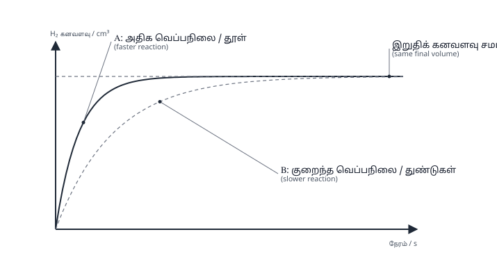

**எதிர்பார்க்கப்படும் அவதானிப்பு:** வெப்பநிலை கூட t குறையும்; 1/t கூடும் (மாதிரி மாதிரி).

**முடிவு:** வெப்பநிலை கூடத் துணிக்கைகளின் இயக்கசக்தியும் வினைத்திறனுள்ள மோதல்களும் கூடும்.

**வழுக்களின் மூலங்கள்:** 'X' மறைவதைத் தீர்மானிப்பதில் அகநிலை

**பரீட்சை வகை வினாக்கள் (அசல்):** 1/t ஏன் வீதத்தின் அளவீடு?

<details><summary>மெய்நிகர் பரிசோதனை விவரக்குறிப்பு (உருவாக்குநர்களுக்கு)</summary>

```json
{
 "inputs": [
  {
   "symbol": "T",
   "name": "வெப்பநிலை",
   "unit": "°C",
   "min": 20,
   "max": 60
  }
 ],
 "outputs": [
  {
   "symbol": "t",
   "name": "நேரம் (s)"
  }
 ],
 "model": "t = 120 / 2^((T − 20)/10) (கற்பித்தல் மாதிரி — ஒவ்வொரு 10 °C க்கும் வீதம் இருமடங்கு)",
 "test_cases": [
  [
   20,
   120
  ],
  [
   30,
   60
  ],
  [
   40,
   30
  ]
 ],
 "note": "அண்ணளவான 'இருமடங்கு விதி' — உண்மைத் தரவு அல்ல."
}
```

சோதனை வழக்குகள் Python இல் மாதிரிச் சமன்பாட்டுக்கு எதிராகச் சரிபார்க்கப்பட்டன.

</details>

---

## EXP-10: பரப்பளவும் தாக்கவீதமும் (CaCO₃ + HCl) (Surface area and rate)

<!-- meta {"type":"experiment","id":"EXP-10","chapter_id":"SC10-17","discipline":"CHE","diagram":"GR-D03","teacher_demo_only":false,"has_virtual":false} -->

*தாக்கவீதம் (Rate of reactions)*

**நோக்கம்:** தூளான CaCO₃ விரைவாகத் தாக்குவதைக் காட்டல்.

**உபகரணங்கள்:** கூம்புக் குடுவை, தராசு, பஞ்சுத் தக்கை, நிறுத்தற் கடிகாரம்

**இரசாயனங்கள்/பொருட்கள்:** சுண்ணக்கல் துண்டுகளும் தூளும், ஐதான HCl

**பாதுகாப்பு:** பாதுகாப்புக் கண்ணாடி அணிக; ஆசிரியர் மேற்பார்வையில் மட்டும் பாடசாலை ஆய்வுகூடத்தில் செய்க; வீட்டில் செய்ய வேண்டாம்.

| மாறி வகை | விவரம் |
|---|---|
| சாரா மாறி (independent) | துணிக்கை அளவு |
| சார் மாறி (dependent) | திணிவு இழப்பு / நேரம் |
| கட்டுப்படுத்திய மாறிகள் (controlled) | CaCO₃ திணிவு, அமில அளவு, செறிவு, வெப்பநிலை |

**செய்முறை:**

1. குடுவையில் அமிலம் + பஞ்சு; தராசில் வைக்க.
2. CaCO₃ துண்டுகளைச் சேர்த்து 30 s க்கு ஒருமுறை திணிவு பதிவு.
3. தூளுடன் மீள்செய்க.
4. திணிவு இழப்பு எதிர் நேரம் வரைக.


**எதிர்பார்க்கப்படும் அவதானிப்பு:** தூள் வளைகோடு செங்குத்தானது; இறுதித் திணிவு இழப்பு சமம்.

**முடிவு:** பரப்பளவு கூட மோதல் மீடிறன் கூடும்.

**வழுக்களின் மூலங்கள்:** CO₂ உடன் நீராவி இழப்பு

**பரீட்சை வகை வினாக்கள் (அசல்):** பஞ்சுத் தக்கையின் பங்கு? · சமன்பாடு: EQ-029

---

## EXP-11: நடுநிலையாக்கல் — காட்டி பயன்படுத்தல் (Neutralisation with an indicator)

<!-- meta {"type":"experiment","id":"EXP-11","chapter_id":"SC11-07","discipline":"CHE","diagram":null,"teacher_demo_only":false,"has_virtual":true} -->

*அமிலம், மூலம், உப்பு (Acids, bases and salts)*

**நோக்கம்:** அமிலத்தை நடுநிலையாக்கத் தேவையான மூல அளவைக் காணல்.

**உபகரணங்கள்:** அளவியல் குழாய் (burette), குழாயி (pipette), கூம்புக் குடுவை, வெண்ணிற ஓடு

**இரசாயனங்கள்/பொருட்கள்:** ஐதான HCl, ஐதான NaOH, பினோத்தலின்

**பாதுகாப்பு:** பாதுகாப்புக் கண்ணாடி அணிக; ஆசிரியர் மேற்பார்வையில் மட்டும் பாடசாலை ஆய்வுகூடத்தில் செய்க; வீட்டில் செய்ய வேண்டாம். NaOH தோலை அரிக்கும் — உடனே நீரால் கழுவுக.

| மாறி வகை | விவரம் |
|---|---|
| சாரா மாறி (independent) | சேர்த்த NaOH கனவளவு |
| சார் மாறி (dependent) | காட்டி நிறம் |
| கட்டுப்படுத்திய மாறிகள் (controlled) | அமில கனவளவு, செறிவுகள் |

**செய்முறை:**

1. 25.0 cm³ HCl ஐக் குடுவையில்; 2 துளி பினோத்தலின்.
2. அளவியல் குழாயிலிருந்து NaOH ஐச் சுழற்றியபடி சேர்க்க.
3. நிலையான மென்சிவப்பு தோன்றும்போது நிறுத்துக.
4. ஒத்திசையும் வாசிப்புகள் வரை மீள்செய்க.

**எதிர்பார்க்கப்படும் அவதானிப்பு:** நிறமற்றது → மென்சிவப்பு (முடிவுப் புள்ளி).

**முடிவு:** H⁺ + OH⁻ → H₂O.

**வழுக்களின் மூலங்கள்:** முடிவுப் புள்ளியைக் கடத்தல்; மேனிஸ்கஸ் வாசிப்பு

**பரீட்சை வகை வினாக்கள் (அசல்):** அமிலநீக்கிகள் எவ்வாறு இயங்குகின்றன?

<details><summary>மெய்நிகர் பரிசோதனை விவரக்குறிப்பு (உருவாக்குநர்களுக்கு)</summary>

```json
{
 "inputs": [
  {
   "symbol": "Va",
   "name": "அமிலக் கனவளவு",
   "unit": "cm³",
   "min": 10,
   "max": 50
  },
  {
   "symbol": "Ca",
   "name": "அமிலச் செறிவு",
   "unit": "mol dm⁻³",
   "min": 0.05,
   "max": 1
  },
  {
   "symbol": "Cb",
   "name": "மூலச் செறிவு",
   "unit": "mol dm⁻³",
   "min": 0.05,
   "max": 1
  }
 ],
 "outputs": [
  {
   "symbol": "Vb",
   "name": "முடிவுப் புள்ளிக் கனவளவு (cm³)"
  }
 ],
 "model": "Vb = Ca·Va / Cb (1:1 விகிதம்)",
 "test_cases": [
  [
   25,
   0.1,
   0.1,
   25
  ],
  [
   25,
   0.2,
   0.1,
   50
  ],
  [
   20,
   0.1,
   0.2,
   10
  ]
 ],
 "note": "HCl–NaOH 1:1."
}
```

சோதனை வழக்குகள் Python இல் மாதிரிச் சமன்பாட்டுக்கு எதிராகச் சரிபார்க்கப்பட்டன.

</details>

---

## EXP-12: ஐதரசன் தயாரிப்பும் சோதனையும் (Preparation and test of hydrogen)

<!-- meta {"type":"experiment","id":"EXP-12","chapter_id":"SC11-07","discipline":"CHE","diagram":"CHE-D03","teacher_demo_only":false,"has_virtual":false} -->

*அமிலம், மூலம், உப்பு (Acids, bases and salts)*

**நோக்கம்:** Zn + HCl இலிருந்து H₂ தயாரித்தல்.

**உபகரணங்கள்:** கூம்புக் குடுவை, முட்புனல், விநியோகக் குழாய், நீர்த் தொட்டி, வாயுச் சாடிகள்

**இரசாயனங்கள்/பொருட்கள்:** நாகத் துண்டுகள், ஐதான HCl

**பாதுகாப்பு:** பாதுகாப்புக் கண்ணாடி அணிக; ஆசிரியர் மேற்பார்வையில் மட்டும் பாடசாலை ஆய்வுகூடத்தில் செய்க; வீட்டில் செய்ய வேண்டாம். H₂–வளிக் கலவை வெடிக்கும்: முதற் சாடிகளை வெளியேற்றுக; சுவாலைகள் தூரத்தில்.

| மாறி வகை | விவரம் |
|---|---|
| சாரா மாறி (independent) | — |
| சார் மாறி (dependent) | வாயுவின் இயல்புகள் |
| கட்டுப்படுத்திய மாறிகள் (controlled) | — |

**செய்முறை:**

1. அமைப்பு CHE-D03.
2. அமிலத்தை முட்புனலினூடு சேர்க்க.
3. முதல் 1–2 சாடி வளிக் கலவையை வெளியேற்றுக.
4. நீரின் கீழ்முக இடப்பெயர்ச்சியால் சேகரிக்க.
5. சோதனைக் குழாயை எரியும் குச்சிக்கு அருகே — 'பொப்'.

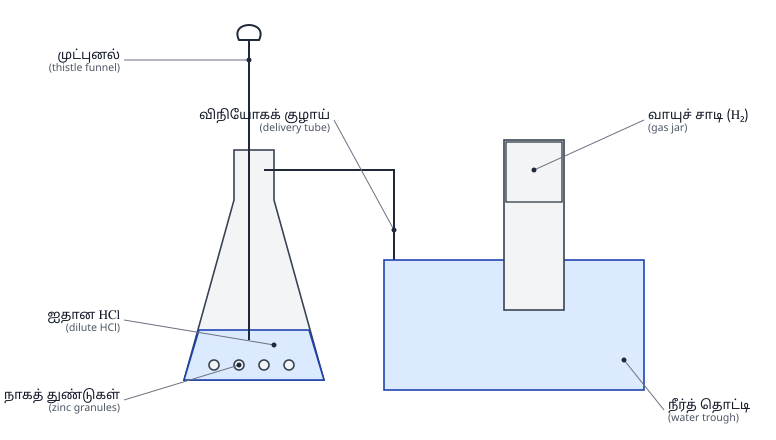

**எதிர்பார்க்கப்படும் அவதானிப்பு:** நுரைத்தல்; 'பொப்' ஒலி.

**முடிவு:** Zn + 2HCl → ZnCl₂ + H₂ (EQ-013).

**வழுக்களின் மூலங்கள்:** வளிக் கலப்பு

**பரீட்சை வகை வினாக்கள் (அசல்):** H₂ ஏன் நீரின் மேல் சேகரிக்கப்படுகிறது?

---

## EXP-13: காய்ச்சிவடித்தலால் உப்பு நீரிலிருந்து தூய நீர் (Distillation of salt water)

<!-- meta {"type":"experiment","id":"EXP-13","chapter_id":"SC11-03","discipline":"CHE","diagram":"CHE-D04","teacher_demo_only":false,"has_virtual":false} -->

*கலவை (Mixtures)*

**நோக்கம்:** கரைசலிலிருந்து கரைப்பானைப் பிரித்தல்.

**உபகரணங்கள்:** வடிகுடுவை, லீபிக் ஒடுக்கி, வெப்பமானி, முகவை, கொதிக்கும் கற்கள்

**இரசாயனங்கள்/பொருட்கள்:** உப்புக் கரைசல்

**பாதுகாப்பு:** பாதுகாப்புக் கண்ணாடி அணிக; ஆசிரியர் மேற்பார்வையில் மட்டும் பாடசாலை ஆய்வுகூடத்தில் செய்க; வீட்டில் செய்ய வேண்டாம். கொதிக்கும் கற்கள் இடுக; மூடிய அமைப்பைச் சூடாக்க வேண்டாம்.

| மாறி வகை | விவரம் |
|---|---|
| சாரா மாறி (independent) | — |
| சார் மாறி (dependent) | வடிதிரவத்தின் தூய்மை (கொதிநிலை 100 °C) |
| கட்டுப்படுத்திய மாறிகள் (controlled) | — |

**செய்முறை:**

1. அமைப்பு CHE-D04.
2. குளிர்நீர் கீழிருந்து மேலே.
3. மெதுவாகச் சூடாக்குக; வெப்பமானி 100 °C.
4. வடிதிரவத்தைச் சேகரித்து உப்புச் சுவை/ஆவியாக்கல் எச்சம் சோதிக்க.

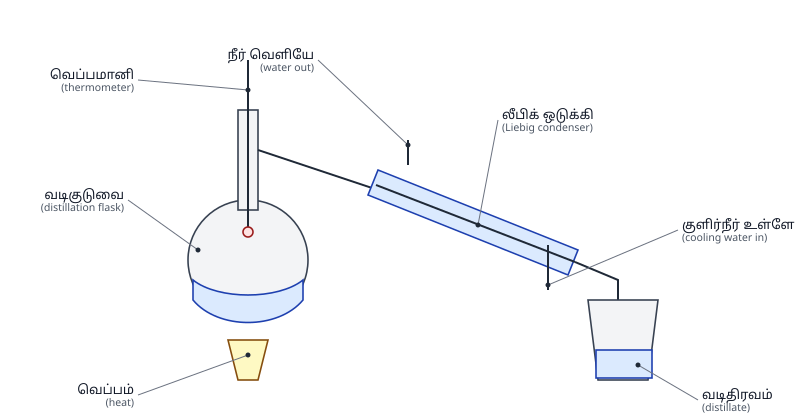

**எதிர்பார்க்கப்படும் அவதானிப்பு:** வடிதிரவம் உப்பற்றது; குடுவையில் உப்பு எஞ்சும்.

**முடிவு:** கொதிநிலை வேறுபாட்டால் பிரிப்பு.

**வழுக்களின் மூலங்கள்:** வெப்பமானி குமிழ் தவறான இடத்தில்

**பரீட்சை வகை வினாக்கள் (அசல்):** குளிர்நீர் ஏன் கீழிருந்து?

---

## EXP-14: காகித நிறப்பகுப்பு (மை நிறமிகள்) (Paper chromatography of inks)

<!-- meta {"type":"experiment","id":"EXP-14","chapter_id":"SC11-03","discipline":"CHE","diagram":null,"teacher_demo_only":false,"has_virtual":true} -->

*கலவை (Mixtures)*

**நோக்கம்:** மையிலுள்ள நிறமிகளைப் பிரித்தல்.

**உபகரணங்கள்:** நிறப்பகுப்புத் தாள், முகவை, பென்சில்

**இரசாயனங்கள்/பொருட்கள்:** நீர்/எதனோல், மைப் புள்ளிகள்

**பாதுகாப்பு:** எதனோல் தீப்பற்றும் — சுவாலை தவிர்.

| மாறி வகை | விவரம் |
|---|---|
| சாரா மாறி (independent) | மை வகை |
| சார் மாறி (dependent) | நிறமிப் புள்ளிகள், Rf |
| கட்டுப்படுத்திய மாறிகள் (controlled) | கரைப்பான், தாள், நேரம் |

**செய்முறை:**

1. பென்சிலால் அடிக்கோடு.
2. மைப் புள்ளிகளை இடுக.
3. கோடு கரைப்பானுக்கு மேலிருக்கும்படி தாளைத் தொங்கவிடுக.
4. கரைப்பான் முன்னணியைக் குறிக்க; Rf = நிறமி தூரம் ÷ கரைப்பான் தூரம்.

**எதிர்பார்க்கப்படும் அவதானிப்பு:** கறுப்பு மை பல நிறங்களாகப் பிரியும்.

**முடிவு:** கரைதிறன், உறிஞ்சல் வேறுபாட்டால் பிரிப்பு.

**வழுக்களின் மூலங்கள்:** அடிக்கோடு பேனாவால்

**பரீட்சை வகை வினாக்கள் (அசல்):** அடிக்கோடு ஏன் பென்சிலால்?

<details><summary>மெய்நிகர் பரிசோதனை விவரக்குறிப்பு (உருவாக்குநர்களுக்கு)</summary>

```json
{
 "inputs": [
  {
   "symbol": "dx",
   "name": "நிறமி தூரம்",
   "unit": "cm",
   "min": 0,
   "max": 10
  },
  {
   "symbol": "ds",
   "name": "கரைப்பான் தூரம்",
   "unit": "cm",
   "min": 1,
   "max": 12
  }
 ],
 "outputs": [
  {
   "symbol": "Rf",
   "name": "Rf"
  }
 ],
 "model": "Rf = dx / ds",
 "test_cases": [
  [
   4,
   8,
   0.5
  ],
  [
   6,
   10,
   0.6
  ]
 ],
 "note": ""
}
```

சோதனை வழக்குகள் Python இல் மாதிரிச் சமன்பாட்டுக்கு எதிராகச் சரிபார்க்கப்பட்டன.

</details>

---

## EXP-15: செப்புச் சல்பேற்றுக் கரைசல் மின்பகுப்பு / செப்பு முலாமிடல் (Copper plating by electrolysis)

<!-- meta {"type":"experiment","id":"EXP-15","chapter_id":"SC11-12","discipline":"CHE","diagram":"CHE-D02","teacher_demo_only":false,"has_virtual":false} -->

*மின்னிரசாயனம் (Electrochemistry)*

**நோக்கம்:** கதோட்டில் செப்புப் படிதலைக் காட்டல்.

**உபகரணங்கள்:** முகவை, காபன்/செப்பு மின்வாய்கள், 6 V DC, அம்பியர்மானி, முதலைக் கவ்விகள்

**இரசாயனங்கள்/பொருட்கள்:** CuSO₄ கரைசல்

**பாதுகாப்பு:** பாதுகாப்புக் கண்ணாடி அணிக; ஆசிரியர் மேற்பார்வையில் மட்டும் பாடசாலை ஆய்வுகூடத்தில் செய்க; வீட்டில் செய்ய வேண்டாம். CuSO₄ தீங்கானது — கைகளைக் கழுவுக.

| மாறி வகை | விவரம் |
|---|---|
| சாரா மாறி (independent) | நேரம் / மின்னோட்டம் |
| சார் மாறி (dependent) | கதோட்டின் திணிவு அதிகரிப்பு |
| கட்டுப்படுத்திய மாறிகள் (controlled) | கரைசல் செறிவு, மின்வாய் பரப்பு |

**செய்முறை:**

1. முலாமிட வேண்டிய பொருளைக் கதோட்டாக (−).
2. செப்புத் தகட்டை அனோட்டாக (+).
3. 10 நிமிடம் மின்னோட்டம் செலுத்துக.
4. கழுவி உலர்த்தி நிறுக்க.

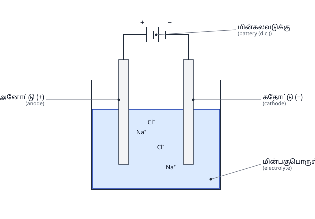

**எதிர்பார்க்கப்படும் அவதானிப்பு:** கதோட்டில் செம்பழுப்புப் படை.

**முடிவு:** Cu²⁺ + 2e⁻ → Cu (HE-03).

**வழுக்களின் மூலங்கள்:** கதோட்டை முறையாகச் சுத்தமாக்காமை

**பரீட்சை வகை வினாக்கள் (அசல்):** முலாமிட வேண்டிய பொருள் ஏன் கதோட்டு?

---

## EXP-16: இரும்பு துருப்பிடித்தலுக்கான நிபந்தனைகள் (Conditions for rusting)

<!-- meta {"type":"experiment","id":"EXP-16","chapter_id":"SC11-12","discipline":"CHE","diagram":null,"teacher_demo_only":false,"has_virtual":false} -->

*மின்னிரசாயனம் (Electrochemistry)*

**நோக்கம்:** நீரும் ஒட்சிசனும் அவசியம் எனக் காட்டல்.

**உபகரணங்கள்:** 3 சோதனைக் குழாய்கள், ஆணிகள், தக்கைகள்

**இரசாயனங்கள்/பொருட்கள்:** கொதித்து ஆறிய நீர், எண்ணெய், நீரற்ற CaCl₂

**பாதுகாப்பு:** பாதுகாப்புக் கண்ணாடி அணிக; ஆசிரியர் மேற்பார்வையில் மட்டும் பாடசாலை ஆய்வுகூடத்தில் செய்க; வீட்டில் செய்ய வேண்டாம்.

| மாறி வகை | விவரம் |
|---|---|
| சாரா மாறி (independent) | நிபந்தனை |
| சார் மாறி (dependent) | துரு தோற்றம் |
| கட்டுப்படுத்திய மாறிகள் (controlled) | ஆணி வகை, நேரம் |

**செய்முறை:**

1. A: குழாய் நீர் (வளியுடன்).
2. B: கொதித்து ஆறிய நீர் + எண்ணெய்ப் படை.
3. C: நீரற்ற CaCl₂ உடன் மூடிய உலர் வளி.
4. ஒரு வாரம் அவதானிக்க.

**எதிர்பார்க்கப்படும் அவதானிப்பு:** A மட்டும் துருப்பிடிக்கும்.

**முடிவு:** துருப்பிடிக்க நீரும் O₂ உம் தேவை.

**வழுக்களின் மூலங்கள்:** தக்கை கசிவு

**பரீட்சை வகை வினாக்கள் (அசல்):** நாகமுலாமிடல் (galvanising) எவ்வாறு பாதுகாக்கிறது?

---

## EXP-17: நடுநிலையாக்கலின் வெப்ப மாற்றம் (Temperature change in neutralisation)

<!-- meta {"type":"experiment","id":"EXP-17","chapter_id":"SC11-08","discipline":"CHE","diagram":"GR-D05","teacher_demo_only":false,"has_virtual":true} -->

*இரசாயனத் தாக்கங்களின் வெப்ப விளைவு (Heat changes associated with chemical reactions)*

**நோக்கம்:** புறவெப்பத் தாக்கத்தை அளத்தல்.

**உபகரணங்கள்:** பொலிஸ்டைரீன் கிண்ணம், வெப்பமானி, அளவு உருளை

**இரசாயனங்கள்/பொருட்கள்:** 1 mol dm⁻³ HCl, NaOH

**பாதுகாப்பு:** பாதுகாப்புக் கண்ணாடி அணிக; ஆசிரியர் மேற்பார்வையில் மட்டும் பாடசாலை ஆய்வுகூடத்தில் செய்க; வீட்டில் செய்ய வேண்டாம்.

| மாறி வகை | விவரம் |
|---|---|
| சாரா மாறி (independent) | சேர்த்த NaOH கனவளவு |
| சார் மாறி (dependent) | வெப்பநிலை உயர்வு |
| கட்டுப்படுத்திய மாறிகள் (controlled) | கனவளவுகள், செறிவுகள், கிண்ணம் |

**செய்முறை:**

1. 50 cm³ HCl இன் வெப்பநிலை பதிவு.
2. 50 cm³ NaOH (அதே வெப்பநிலை) சேர்க்க.
3. கலக்கி உச்ச வெப்பநிலை பதிவு.
4. Q = mcΔθ ஆல் கணிக்க (கோப்பு 5: CL-ENTH).

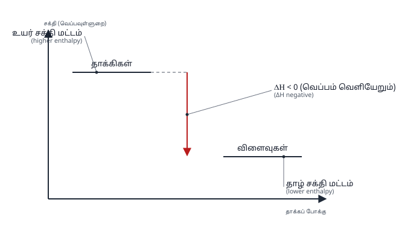

**எதிர்பார்க்கப்படும் அவதானிப்பு:** ≈ 6–7 °C உயர்வு (எதிர்பார்ப்பு).

**முடிவு:** நடுநிலையாக்கல் புறவெப்பம்.

**வழுக்களின் மூலங்கள்:** கிண்ணத்தினூடு வெப்ப இழப்பு

**பரீட்சை வகை வினாக்கள் (அசல்):** பொலிஸ்டைரீன் ஏன்?

<details><summary>மெய்நிகர் பரிசோதனை விவரக்குறிப்பு (உருவாக்குநர்களுக்கு)</summary>

```json
{
 "inputs": [
  {
   "symbol": "n",
   "name": "உருவான நீர் மூல்",
   "unit": "mol",
   "min": 0.01,
   "max": 0.1
  },
  {
   "symbol": "m",
   "name": "கரைசல் திணிவு",
   "unit": "kg",
   "min": 0.05,
   "max": 0.2
  }
 ],
 "outputs": [
  {
   "symbol": "dT",
   "name": "வெப்பநிலை உயர்வு (°C)"
  }
 ],
 "model": "Δθ = n × 57000 / (m × 4200)",
 "test_cases": [
  [
   0.05,
   0.1,
   6.785714285714286
  ]
 ],
 "note": "ΔH ≈ −57 kJ mol⁻¹ கருதப்பட்டது."
}
```

சோதனை வழக்குகள் Python இல் மாதிரிச் சமன்பாட்டுக்கு எதிராகச் சரிபார்க்கப்பட்டன.

</details>

---

## EXP-18: டிக்கர் நாடா / அளவுகோலால் சராசரிக் கதி, ஆர்முடுகல் (Measuring speed and acceleration)

<!-- meta {"type":"experiment","id":"EXP-18","chapter_id":"SC10-02","discipline":"PHY","diagram":"GR-D01","teacher_demo_only":false,"has_virtual":true} -->

*நேர்கோட்டு இயக்கம் (Motion in a straight line)*

**நோக்கம்:** சாய்தளத்தில் உருளும் தள்ளுவண்டியின் ஆர்முடுகலைக் காணல்.

**உபகரணங்கள்:** சாய்தளம், தள்ளுவண்டி, மீற்றர் அளவுகோல், நிறுத்தற் கடிகாரம் (அல்லது டிக்கர் நேரங்காட்டி)

**இரசாயனங்கள்/பொருட்கள்:** —

**பாதுகாப்பு:** சாய்தள முனையில் பிடிப்பான்; கனமான பொருட்கள் கால்களில் விழாமல் கவனம்.

| மாறி வகை | விவரம் |
|---|---|
| சாரா மாறி (independent) | சாய்வுக் கோணம் / உயரம் |
| சார் மாறி (dependent) | குறித்த தூரத்துக்கான நேரம் |
| கட்டுப்படுத்திய மாறிகள் (controlled) | தள்ளுவண்டி, மேற்பரப்பு, தூரம் |

**செய்முறை:**

1. 1.0 m தூரத்தைக் குறிக்க.
2. ஓய்விலிருந்து விடுவித்து நேரம் அளக்க (3 முறை).
3. s = ½at² இலிருந்து a = 2s/t².
4. உயரத்தை மாற்றி மீள்செய்க.

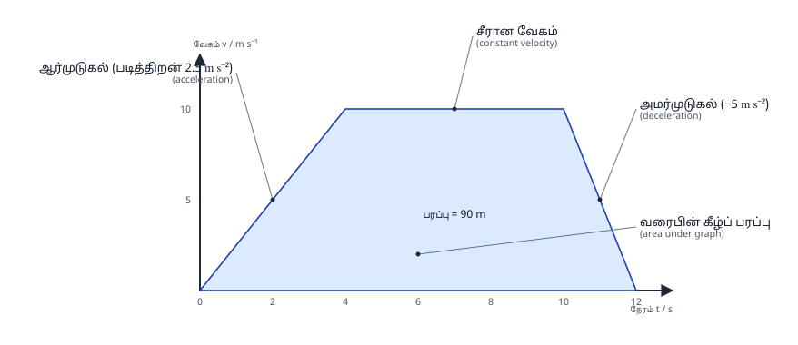

**எதிர்பார்க்கப்படும் அவதானிப்பு:** உயரம் கூட நேரம் குறையும்; a கூடும்.

**முடிவு:** சாய்வு கூட ஆர்முடுகல் கூடும்.

**வழுக்களின் மூலங்கள்:** மனிதப் பிரதிச்செயல் நேரம்

**பரீட்சை வகை வினாக்கள் (அசல்):** v–t வரைபிலிருந்து தூரம்?

<details><summary>மெய்நிகர் பரிசோதனை விவரக்குறிப்பு (உருவாக்குநர்களுக்கு)</summary>

```json
{
 "inputs": [
  {
   "symbol": "s",
   "name": "தூரம்",
   "unit": "m",
   "min": 0.5,
   "max": 2
  },
  {
   "symbol": "t",
   "name": "நேரம்",
   "unit": "s",
   "min": 0.5,
   "max": 5
  }
 ],
 "outputs": [
  {
   "symbol": "a",
   "name": "ஆர்முடுகல் (m s⁻²)"
  }
 ],
 "model": "a = 2s / t²",
 "test_cases": [
  [
   1,
   1,
   2
  ],
  [
   1,
   2,
   0.5
  ]
 ],
 "note": "ஓய்விலிருந்து, சீரான ஆர்முடுகல்."
}
```

சோதனை வழக்குகள் Python இல் மாதிரிச் சமன்பாட்டுக்கு எதிராகச் சரிபார்க்கப்பட்டன.

</details>

---

## EXP-19: எல்லை உராய்வும் செவ்வன் மறுதாக்கமும் (Limiting friction vs normal reaction)

<!-- meta {"type":"experiment","id":"EXP-19","chapter_id":"SC10-05","discipline":"PHY","diagram":"PHY-D06","teacher_demo_only":false,"has_virtual":true} -->

*உராய்வு (Friction)*

**நோக்கம்:** உராய்வு செவ்வன் மறுதாக்கத்துடன் கூடுவதைக் காட்டல்.

**உபகரணங்கள்:** மரக் குற்றி, விற்றராசு, திணிவுகள் (100 g)

**இரசாயனங்கள்/பொருட்கள்:** —

**பாதுகாப்பு:** திணிவுகள் விழாமல் கவனம்.

| மாறி வகை | விவரம் |
|---|---|
| சாரா மாறி (independent) | குற்றி மேலுள்ள திணிவு (R) |
| சார் மாறி (dependent) | அசையத் தொடங்கும் விற்றராசு வாசிப்பு (F) |
| கட்டுப்படுத்திய மாறிகள் (controlled) | மேற்பரப்பு, இழுக்கும் திசை (கிடை) |

**செய்முறை:**

1. குற்றியை விற்றராசால் கிடையாக மெதுவாக இழுக்க.
2. அசையத் தொடங்கும் கணத்தின் வாசிப்பைப் பதிவு.
3. 100 g திணிவுகளைச் சேர்த்து மீள்செய்க.
4. F எதிர் R வரைபு.

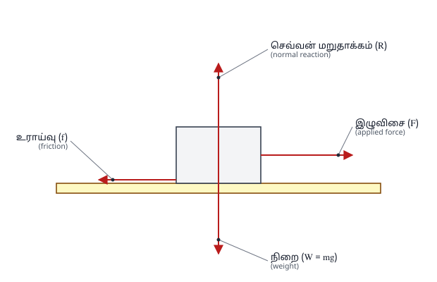

**எதிர்பார்க்கப்படும் அவதானிப்பு:** நேர்கோடு — F ∝ R (மாதிரி).

**முடிவு:** எல்லை உராய்வு செவ்வன் மறுதாக்கத்துக்கு விகிதசமன்.

**வழுக்களின் மூலங்கள்:** இழுக்கும் வேகம் சீரின்மை

**பரீட்சை வகை வினாக்கள் (அசல்):** பரப்பளவை மாற்றினால் (குற்றியைப் பக்கவாட்டில் வைத்தால்)?

<details><summary>மெய்நிகர் பரிசோதனை விவரக்குறிப்பு (உருவாக்குநர்களுக்கு)</summary>

```json
{
 "inputs": [
  {
   "symbol": "R",
   "name": "செவ்வன் மறுதாக்கம்",
   "unit": "N",
   "min": 1,
   "max": 20
  },
  {
   "symbol": "mu",
   "name": "உராய்வுக் குணகம்",
   "unit": "—",
   "min": 0.1,
   "max": 0.8
  }
 ],
 "outputs": [
  {
   "symbol": "F",
   "name": "எல்லை உராய்வு (N)"
  }
 ],
 "model": "F = μR (O/L க்கு அப்பாலான குறியீடு — விகிதசமத்தைக் காட்ட மட்டும்)",
 "test_cases": [
  [
   10,
   0.4,
   4.0
  ]
 ],
 "note": ""
}
```

சோதனை வழக்குகள் Python இல் மாதிரிச் சமன்பாட்டுக்கு எதிராகச் சரிபார்க்கப்பட்டன.

</details>

---

## EXP-20: திருப்பக் கொள்கையைச் சரிபார்த்தல் (மீற்றர் கோல்) (Verifying the principle of moments)

<!-- meta {"type":"experiment","id":"EXP-20","chapter_id":"SC10-11","discipline":"PHY","diagram":"PHY-D11","teacher_demo_only":false,"has_virtual":true} -->

*விசையின் திரும்பல் விளைவு (Turning effect of a force)*

**நோக்கம்:** சமநிலையில் வலஞ்சுழி = இடஞ்சுழி எனக் காட்டல்.

**உபகரணங்கள்:** மீற்றர் கோல், கத்திமுனை ஆதாரம், நூல்கள், அறியப்பட்ட நிறைகள்

**இரசாயனங்கள்/பொருட்கள்:** —

**பாதுகாப்பு:** நிறைகள் விழாமல் கவனம்.

| மாறி வகை | விவரம் |
|---|---|
| சாரா மாறி (independent) | W₁, d₁ |
| சார் மாறி (dependent) | சமநிலைக்கான d₂ |
| கட்டுப்படுத்திய மாறிகள் (controlled) | கோலின் ஈர்ப்பு மையத்தில் ஆதாரம் |

**செய்முறை:**

1. கோலை 50 cm இல் சமநிலைப்படுத்துக.
2. ஒருபக்கம் W₁ ஐ d₁ இல்.
3. மறுபக்கம் W₂ ஐச் சமநிலை வரை நகர்த்தி d₂ அளக்க.
4. W₁d₁, W₂d₂ ஒப்பிடுக.

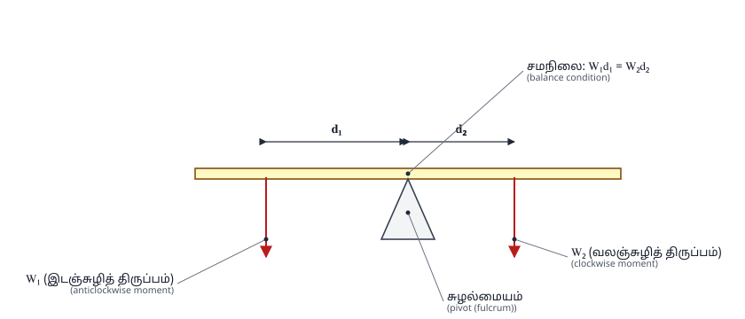

**எதிர்பார்க்கப்படும் அவதானிப்பு:** W₁d₁ ≈ W₂d₂.

**முடிவு:** திருப்பக் கொள்கை உறுதி.

**வழுக்களின் மூலங்கள்:** நூலின் தடிப்பு; கோல் சீரற்றது

**பரீட்சை வகை வினாக்கள் (அசல்):** கோலின் நிறையைக் கருதவேண்டிய சந்தர்ப்பம்? (CL-MOMENT சவால்)

<details><summary>மெய்நிகர் பரிசோதனை விவரக்குறிப்பு (உருவாக்குநர்களுக்கு)</summary>

```json
{
 "inputs": [
  {
   "symbol": "W1",
   "name": "W₁",
   "unit": "N",
   "min": 0.5,
   "max": 5
  },
  {
   "symbol": "d1",
   "name": "d₁",
   "unit": "cm",
   "min": 5,
   "max": 50
  },
  {
   "symbol": "W2",
   "name": "W₂",
   "unit": "N",
   "min": 0.5,
   "max": 5
  }
 ],
 "outputs": [
  {
   "symbol": "d2",
   "name": "d₂ (cm)"
  }
 ],
 "model": "d₂ = W₁d₁ / W₂",
 "test_cases": [
  [
   2,
   30,
   3,
   20
  ]
 ],
 "note": ""
}
```

சோதனை வழக்குகள் Python இல் மாதிரிச் சமன்பாட்டுக்கு எதிராகச் சரிபார்க்கப்பட்டன.

</details>

---

## EXP-21: ஆழத்துடன் திரவ அமுக்கம் (Liquid pressure and depth)

<!-- meta {"type":"experiment","id":"EXP-21","chapter_id":"SC10-15","discipline":"PHY","diagram":"PHY-D10","teacher_demo_only":false,"has_virtual":true} -->

*நீர்நிலையியல் அமுக்கமும் அதன் பிரயோகங்களும் (Hydrostatic pressure and its applications)*

**நோக்கம்:** ஆழம் கூட அமுக்கம் கூடுவதைக் காட்டல்.

**உபகரணங்கள்:** துவாரங்களுடைய பிளாத்திக்குப் போத்தல், நீர், அளவுகோல்

**இரசாயனங்கள்/பொருட்கள்:** —

**பாதுகாப்பு:** நீர் சிந்துவதால் வழுக்கல் — தட்டில் செய்க.

| மாறி வகை | விவரம் |
|---|---|
| சாரா மாறி (independent) | துவாரத்தின் ஆழம் |
| சார் மாறி (dependent) | நீர்ப் பீச்சின் கிடைத் தூரம் |
| கட்டுப்படுத்திய மாறிகள் (controlled) | துவார அளவு, நீர் மட்டம் (நிரப்பிக்கொண்டே) |

**செய்முறை:**

1. மூன்று உயரங்களில் சம அளவுத் துவாரங்கள்.
2. போத்தலை நிரப்பி மட்டத்தைப் பேணுக.
3. பீச்சுத் தூரங்களை ஒப்பிடுக.

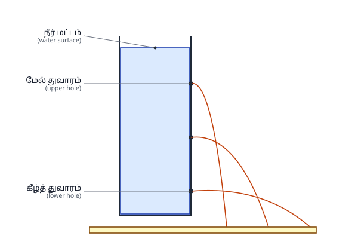

**எதிர்பார்க்கப்படும் அவதானிப்பு:** கீழ்த் துவாரத்தின் பீச்சு அதிக தூரம்.

**முடிவு:** P = hρg — ஆழம் கூட அமுக்கம் கூடும்.

**வழுக்களின் மூலங்கள்:** நீர் மட்டம் குறைதல்

**பரீட்சை வகை வினாக்கள் (அசல்):** அணைக்கட்டின் அடி ஏன் தடிப்பு?

<details><summary>மெய்நிகர் பரிசோதனை விவரக்குறிப்பு (உருவாக்குநர்களுக்கு)</summary>

```json
{
 "inputs": [
  {
   "symbol": "h",
   "name": "ஆழம்",
   "unit": "m",
   "min": 0,
   "max": 10
  },
  {
   "symbol": "rho",
   "name": "அடர்த்தி",
   "unit": "kg m⁻³",
   "min": 700,
   "max": 1300
  }
 ],
 "outputs": [
  {
   "symbol": "P",
   "name": "திரவ அமுக்கம் (Pa)"
  }
 ],
 "model": "P = hρg, g = 10",
 "test_cases": [
  [
   5,
   1000,
   50000
  ],
  [
   2,
   800,
   16000
  ]
 ],
 "note": ""
}
```

சோதனை வழக்குகள் Python இல் மாதிரிச் சமன்பாட்டுக்கு எதிராகச் சரிபார்க்கப்பட்டன.

</details>

---

## EXP-22: ஓமின் விதி (Ohm's law)

<!-- meta {"type":"experiment","id":"EXP-22","chapter_id":"SC10-19","discipline":"PHY","diagram":"GR-D04","teacher_demo_only":false,"has_virtual":true} -->

*ஓட்ட மின்னியல் (Current electricity)*

**நோக்கம்:** கடத்தியின் V–I தொடர்பைக் காணல்.

**உபகரணங்கள்:** மின்கலங்கள், மாறுந்தடை (rheostat), தடையி, அம்பியர்மானி, வோல்ற்மானி, ஆளி, இணைப்புக் கம்பிகள்

**இரசாயனங்கள்/பொருட்கள்:** —

**பாதுகாப்பு:** குறுஞ்சுற்று தவிர்; வாசிப்புகளின் பின் ஆளியைத் திறந்து கம்பி சூடாவதைத் தவிர்.

| மாறி வகை | விவரம் |
|---|---|
| சாரா மாறி (independent) | மின்னோட்டம் (மாறுந்தடையால்) |
| சார் மாறி (dependent) | அழுத்த வேறுபாடு |
| கட்டுப்படுத்திய மாறிகள் (controlled) | வெப்பநிலை, கடத்தி |

**செய்முறை:**

1. சுற்று PHY-D01.
2. மாறுந்தடையை மாற்றி 5–6 (I, V) சோடிகளைப் பதிவு.
3. V எதிர் I வரைபு.
4. படித்திறன் = R.

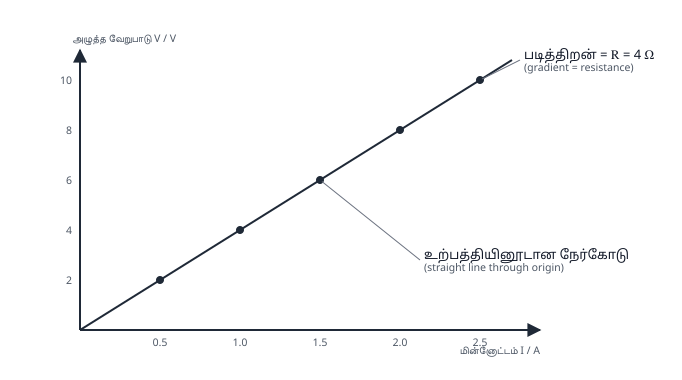

**எதிர்பார்க்கப்படும் அவதானிப்பு:** உற்பத்தியினூடான நேர்கோடு (மாதிரி: R = 4 Ω).

**முடிவு:** V ∝ I — ஓமின் விதி.

**வழுக்களின் மூலங்கள்:** கம்பி சூடாதல்; மானி பூச்சியப் பிழை

**பரீட்சை வகை வினாக்கள் (அசல்):** இழைக் குமிழுக்கு வரைபு ஏன் வளையும்?

<details><summary>மெய்நிகர் பரிசோதனை விவரக்குறிப்பு (உருவாக்குநர்களுக்கு)</summary>

```json
{
 "inputs": [
  {
   "symbol": "V",
   "name": "அழுத்தம்",
   "unit": "V",
   "min": 0,
   "max": 12
  },
  {
   "symbol": "R",
   "name": "தடை",
   "unit": "Ω",
   "min": 1,
   "max": 100
  }
 ],
 "outputs": [
  {
   "symbol": "I",
   "name": "மின்னோட்டம் (A)"
  }
 ],
 "model": "I = V / R",
 "test_cases": [
  [
   12,
   4,
   3
  ],
  [
   6,
   3,
   2
  ]
 ],
 "note": ""
}
```

சோதனை வழக்குகள் Python இல் மாதிரிச் சமன்பாட்டுக்கு எதிராகச் சரிபார்க்கப்பட்டன.

</details>

---

## EXP-23: கம்பியின் நீளமும் தடையும் (Resistance and length of a wire)

<!-- meta {"type":"experiment","id":"EXP-23","chapter_id":"SC10-19","discipline":"PHY","diagram":null,"teacher_demo_only":false,"has_virtual":true} -->

*ஓட்ட மின்னியல் (Current electricity)*

**நோக்கம்:** நீளம் கூடத் தடை கூடுவதைக் காட்டல் (2019 வினாத்தாள் I வி18 வகை).

**உபகரணங்கள்:** நிக்ரோம் கம்பி, மீற்றர் அளவுகோல், அம்பியர்மானி, வோல்ற்மானி, மின்கலம், முதலைக் கவ்விகள்

**இரசாயனங்கள்/பொருட்கள்:** —

**பாதுகாப்பு:** கம்பி சூடாகலாம் — குறுகிய நேரம் மட்டும் மின்னோட்டம்.

| மாறி வகை | விவரம் |
|---|---|
| சாரா மாறி (independent) | நீளம் l |
| சார் மாறி (dependent) | தடை R = V/I |
| கட்டுப்படுத்திய மாறிகள் (controlled) | கம்பித் தடிப்பு, பதார்த்தம், வெப்பநிலை |

**செய்முறை:**

1. 20, 40, 60, 80 cm நீளங்களுக்கு இணைக்க.
2. V, I பதிவு.
3. R கணித்து R எதிர் l வரைக.

**எதிர்பார்க்கப்படும் அவதானிப்பு:** நேர்கோடு — R ∝ l.

**முடிவு:** தடை நீளத்துக்கு நேர் விகிதசமன்.

**வழுக்களின் மூலங்கள்:** தொடுகைத் தடை

**பரீட்சை வகை வினாக்கள் (அசல்):** தடிப்பு இருமடங்கானால்?

<details><summary>மெய்நிகர் பரிசோதனை விவரக்குறிப்பு (உருவாக்குநர்களுக்கு)</summary>

```json
{
 "inputs": [
  {
   "symbol": "l",
   "name": "நீளம்",
   "unit": "m",
   "min": 0.1,
   "max": 1
  },
  {
   "symbol": "k",
   "name": "ஓரலகு நீளத் தடை",
   "unit": "Ω m⁻¹",
   "min": 1,
   "max": 20
  }
 ],
 "outputs": [
  {
   "symbol": "R",
   "name": "தடை (Ω)"
  }
 ],
 "model": "R = k·l",
 "test_cases": [
  [
   0.5,
   10,
   5
  ]
 ],
 "note": ""
}
```

சோதனை வழக்குகள் Python இல் மாதிரிச் சமன்பாட்டுக்கு எதிராகச் சரிபார்க்கப்பட்டன.

</details>

---

## EXP-24: உலோகக் குற்றியின் தன்வெப்பக் கொள்ளளவு (Specific heat capacity of a metal block)

<!-- meta {"type":"experiment","id":"EXP-24","chapter_id":"SC11-09","discipline":"PHY","diagram":"EXP-D03","teacher_demo_only":false,"has_virtual":true} -->

*வெப்பம் (Heat)*

**நோக்கம்:** c ஐ அளத்தல்.

**உபகரணங்கள்:** 1 kg உலோகக் குற்றி, அமிழ்ப்பு வெப்பமாக்கி, வெப்பமானி, ஜூல்மானி அல்லது V, I மானிகள், நிறுத்தற் கடிகாரம், காவலி

**இரசாயனங்கள்/பொருட்கள்:** —

**பாதுகாப்பு:** வெப்பமாக்கியும் குற்றியும் மிகச் சூடாகும் — தொடாதீர்; வெப்பமானித் துளையில் எண்ணெய் துளி.

| மாறி வகை | விவரம் |
|---|---|
| சாரா மாறி (independent) | வழங்கிய சக்தி (நேரம்) |
| சார் மாறி (dependent) | வெப்பநிலை உயர்வு |
| கட்டுப்படுத்திய மாறிகள் (controlled) | திணிவு, காவலி |

**செய்முறை:**

1. ஆரம்ப வெப்பநிலை θ₁.
2. V, I ஐப் பதிவு செய்து 10 நிமிடம் சூடாக்குக.
3. உச்ச வெப்பநிலை θ₂.
4. c = VIt / (m(θ₂ − θ₁)).

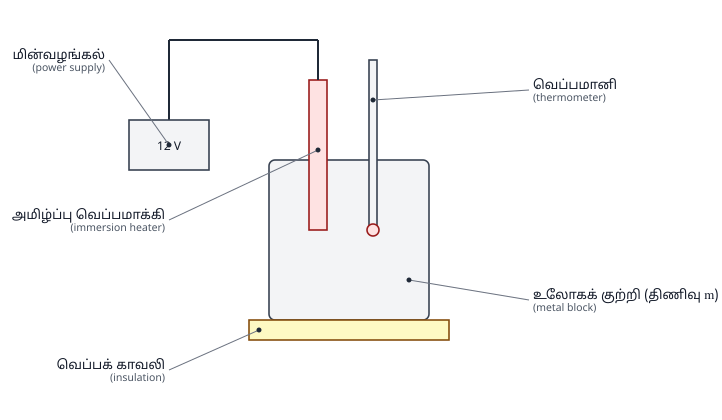

**எதிர்பார்க்கப்படும் அவதானிப்பு:** அலுமினியத்துக்கு ஏறத்தாழ 900 J kg⁻¹ °C⁻¹ (வெப்ப இழப்பால் சற்றுக் கூடிய பெறுமானம் கிடைக்கலாம்).

**முடிவு:** Q = mcΔθ.

**வழுக்களின் மூலங்கள்:** வெப்ப இழப்பு — c மிகைமதிப்பீடு

**பரீட்சை வகை வினாக்கள் (அசல்):** வெப்ப இழப்பு c இன் பெறுமானத்தை எவ்வாறு பாதிக்கும்?

<details><summary>மெய்நிகர் பரிசோதனை விவரக்குறிப்பு (உருவாக்குநர்களுக்கு)</summary>

```json
{
 "inputs": [
  {
   "symbol": "P",
   "name": "வலு",
   "unit": "W",
   "min": 10,
   "max": 100
  },
  {
   "symbol": "t",
   "name": "நேரம்",
   "unit": "s",
   "min": 60,
   "max": 1200
  },
  {
   "symbol": "m",
   "name": "திணிவு",
   "unit": "kg",
   "min": 0.5,
   "max": 2
  },
  {
   "symbol": "c",
   "name": "c",
   "unit": "J kg⁻¹ °C⁻¹",
   "min": 380,
   "max": 4200
  }
 ],
 "outputs": [
  {
   "symbol": "dT",
   "name": "வெப்பநிலை உயர்வு (°C)"
  }
 ],
 "model": "Δθ = Pt / (mc) (வெப்ப இழப்பு இல்லை)",
 "test_cases": [
  [
   50,
   600,
   1,
   900,
   33.333333333333336
  ]
 ],
 "note": ""
}
```

சோதனை வழக்குகள் Python இல் மாதிரிச் சமன்பாட்டுக்கு எதிராகச் சரிபார்க்கப்பட்டன.

</details>

---

## EXP-25: குவிவு வில்லையின் குவியத் தூரம் (அண்ணளவு) (Approximate focal length of a convex lens)

<!-- meta {"type":"experiment","id":"EXP-25","chapter_id":"SC11-05","discipline":"PHY","diagram":"EXP-D04","teacher_demo_only":false,"has_virtual":true} -->

*கேத்திரகணித ஒளியியல் (Geometrical optics)*

**நோக்கம்:** தூரப் பொருள் முறையால் f காணல் (2019 வினாத்தாள் II வி7A வகை).

**உபகரணங்கள்:** குவிவு வில்லை, வில்லைத் தாங்கி, திரை, மீற்றர் அளவுகோல்

**இரசாயனங்கள்/பொருட்கள்:** —

**பாதுகாப்பு:** சூரியனை வில்லையூடு நேரடியாகப் பார்க்க வேண்டாம்; சூரிய ஒளியைக் குவித்துத் தீ மூட்ட வேண்டாம்.

| மாறி வகை | விவரம் |
|---|---|
| சாரா மாறி (independent) | — |
| சார் மாறி (dependent) | வில்லை–திரை தூரம் |
| கட்டுப்படுத்திய மாறிகள் (controlled) | — |

**செய்முறை:**

1. தூரத்திலுள்ள யன்னல்/மரத்தை நோக்கி வில்லை.
2. தெளிவான விம்பம் வரை திரையை நகர்த்துக.
3. வில்லை–திரை தூரம் ≈ f.
4. மூன்று வாசிப்புகளின் சராசரி.

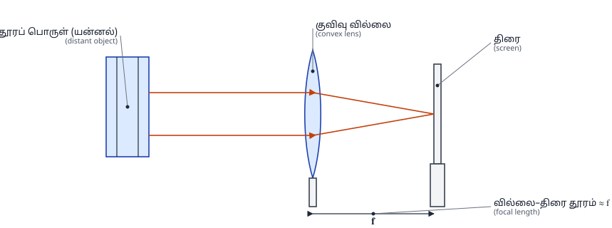

**எதிர்பார்க்கப்படும் அவதானிப்பு:** சிறிய, தலைகீழ், உண்மை விம்பம்.

**முடிவு:** தூரப் பொருளின் கதிர்கள் சமாந்தரம் — குவியத்தில் விம்பம்.

**வழுக்களின் மூலங்கள்:** பொருள் போதிய தூரத்தில் இல்லை

**பரீட்சை வகை வினாக்கள் (அசல்):** விம்பத்தின் மூன்று இயல்புகள்?

<details><summary>மெய்நிகர் பரிசோதனை விவரக்குறிப்பு (உருவாக்குநர்களுக்கு)</summary>

```json
{
 "inputs": [
  {
   "symbol": "f",
   "name": "குவியத் தூரம்",
   "unit": "cm",
   "min": 5,
   "max": 30
  },
  {
   "symbol": "u",
   "name": "பொருள் தூரம்",
   "unit": "cm",
   "min": 6,
   "max": 200
  }
 ],
 "outputs": [
  {
   "symbol": "v",
   "name": "விம்பத் தூரம் (cm)"
  }
 ],
 "model": "1/v = 1/f − 1/u (u > f; பருமன் வடிவம்)",
 "test_cases": [
  [
   10,
   30,
   15
  ],
  [
   10,
   20,
   20
  ]
 ],
 "note": "u ≤ f எனின் மாய விம்பம் — உருவகப்படுத்தி எச்சரிக்கை காட்ட வேண்டும்."
}
```

சோதனை வழக்குகள் Python இல் மாதிரிச் சமன்பாட்டுக்கு எதிராகச் சரிபார்க்கப்பட்டன.

</details>

---

## EXP-26: மின்காந்தத் தூண்டல் (காந்தம் + சுருள்) (Electromagnetic induction)

<!-- meta {"type":"experiment","id":"EXP-26","chapter_id":"SC11-13","discipline":"PHY","diagram":"PHY-D12","teacher_demo_only":false,"has_virtual":false} -->

*மின் காந்தவியலும் தூண்டலும் (Electromagnetism and electromagnetic induction)*

**நோக்கம்:** மாறும் காந்தப் பாயம் மின்னோட்டத்தைத் தூண்டுவதைக் காட்டல்.

**உபகரணங்கள்:** சுருள், சட்டக் காந்தம், நுண்ணம்பியர்மானி / கல்வனோமானி

**இரசாயனங்கள்/பொருட்கள்:** —

**பாதுகாப்பு:** காந்தங்களை இலத்திரனியல் சாதனங்களிலிருந்து தூரத்தில் வைக்க.

| மாறி வகை | விவரம் |
|---|---|
| சாரா மாறி (independent) | காந்த அசைவு வேகம், சுற்றுகள் |
| சார் மாறி (dependent) | கல்வனோமானித் திரும்பல் |
| கட்டுப்படுத்திய மாறிகள் (controlled) | காந்த வலிமை |

**செய்முறை:**

1. காந்தத்தைச் சுருளினுள் செலுத்துக — திரும்பல்.
2. நிலையாக வைக்க — திரும்பல் இல்லை.
3. வெளியே எடுக்க — எதிர்த் திசை.
4. விரைவாக அசைக்க — பெரிய திரும்பல்.

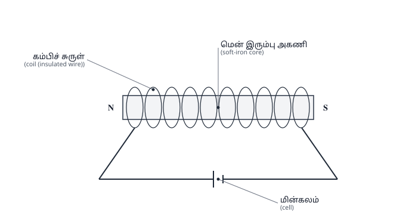

**எதிர்பார்க்கப்படும் அவதானிப்பு:** அசைவின்போது மட்டும் திரும்பல்.

**முடிவு:** மாறும் பாயம் மி.இ.வி. தூண்டும்.

**வழுக்களின் மூலங்கள்:** கல்வனோமானி உணர்திறன் குறைவு

**பரீட்சை வகை வினாக்கள் (அசல்):** பிறப்பாக்கியுடன் தொடர்பு?
---

## வரையறைகள் (Limitations)

- 26 பரிசோதனைகள்; 13 இல் மெய்நிகர் விவரக்குறிப்பு.
- பாடநூலின் உத்தியோகபூர்வ செயற்பாட்டுப் பட்டியலுடன் ஒப்பிடப்படவில்லை — ஆசிரியர் பொருத்துக.
- மெய்நிகர் மாதிரிகளில் சில (ஒளித்தொகுப்பு, தாக்கவீதம்) கற்பித்தல் அண்ணளவுகள்; உண்மைத் தரவு அல்ல.
