# StudyBuddy — அத்தியாய வினாடி வினாக்கள் (MCQ)

> எல்லா வினாக்களும் இப்பதிப்புக்காக எழுதப்பட்ட **அசல் (ORIGINAL)** வினாக்கள். கடந்தகால வினாத்தாள் வினாக்கள் இங்கு இல்லை — அவற்றின் சுருக்கக் குறிப்புகள் கோப்பு 4 இல் `PAST_PAPER_REFERENCE` எனக் குறிக்கப்பட்டுள்ளன.
> கணிப்பு வினாக்களின் விடைகள் Python இல் கணிக்கப்பட்டுச் சரிபார்க்கப்பட்டன; சமன்பாட்டு வினாக்கள் அணு எண்ணிக்கையால் சரிபார்க்கப்பட்டன. ஒவ்வொரு வினாவிலும் 4 விடைகள், ஒரு சரியான விடை.

## SC10-01: உயிரின இரசாயன அடிப்படை (Chemical basis of life)

*தரம் 10 · அத்தியாயம் 1 · உயிரியல் · 26 வினாக்கள்*

<!-- meta {"type":"mcq","id":"SCQ-10-01-001","grade":10,"chapter_id":"SC10-01","discipline":"BIO","difficulty":1,"qtype":"recall","answer":2,"origin":"ORIGINAL","source_ref":"chapter","image":null} -->
**SCQ-10-01-001** · அடிப்படை · நினைவு · `ORIGINAL`

மாப்பொருளை இனங்காணப் பயன்படும் கரைசல் எது?

1. பெனடிக்ற் கரைசல்
2. அயடீன் கரைசல்
3. பையூரெட் கரைசல்
4. சூடான் III

விடையும் விளக்கமும்

**விடை: (2) அயடீன் கரைசல்**

அயடீன் மாப்பொருளுடன் நீல–கருநீல நிறம் தரும்.

<!-- meta {"type":"mcq","id":"SCQ-10-01-002","grade":10,"chapter_id":"SC10-01","discipline":"BIO","difficulty":1,"qtype":"concept","answer":3,"origin":"ORIGINAL","source_ref":"chapter","image":null} -->
**SCQ-10-01-002** · அடிப்படை · எண்ணக்கரு · `ORIGINAL`

புரதங்களில் கட்டாயம் காணப்படும், காபோவைதரேற்றுகளில் காணப்படாத மூலகம் எது?

1. காபன்
2. ஒட்சிசன்
3. நைதரசன்
4. ஐதரசன்

விடையும் விளக்கமும்

**விடை: (3) நைதரசன்**

காபோவைதரேற்று C, H, O மட்டும்; புரதங்களில் N உம் உண்டு.

<!-- meta {"type":"mcq","id":"SCQ-10-01-003","grade":10,"chapter_id":"SC10-01","discipline":"BIO","difficulty":1,"qtype":"experiment","answer":2,"origin":"ORIGINAL","source_ref":"chapter","image":null} -->
**SCQ-10-01-003** · அடிப்படை · பரிசோதனை · `ORIGINAL`

பெனடிக்ற் சோதனையில் நேர் விளைவு பெற அவசியமான நிபந்தனை எது?

1. குளிர்வித்தல்
2. வெப்பமேற்றல்
3. அமிலம் சேர்த்தல்
4. ஒளியில் வைத்தல்

விடையும் விளக்கமும்

**விடை: (2) வெப்பமேற்றல்**

பெனடிக்ற் சோதனை நீர்த்தொட்டியில் வெப்பமேற்றும்போதே செங்கட்டி நிற வீழ்படிவு தரும்.

<!-- meta {"type":"mcq","id":"SCQ-10-01-004","grade":10,"chapter_id":"SC10-01","discipline":"BIO","difficulty":1,"qtype":"recall","answer":3,"origin":"ORIGINAL","source_ref":"chapter","image":null} -->
**SCQ-10-01-004** · அடிப்படை · நினைவு · `ORIGINAL`

விலங்குகளில் காபோவைதரேற்று சேமிக்கப்படும் வடிவம் எது?

1. மாப்பொருள்
2. செலுலோசு
3. கிளைக்கோசன்
4. சுக்குரோசு

விடையும் விளக்கமும்

**விடை: (3) கிளைக்கோசன்**

ஈரலிலும் தசைகளிலும் கிளைக்கோசனாகச் சேமிக்கப்படும்.

<!-- meta {"type":"mcq","id":"SCQ-10-01-005","grade":10,"chapter_id":"SC10-01","discipline":"BIO","difficulty":2,"qtype":"reasoning","answer":2,"origin":"ORIGINAL","source_ref":"chapter","image":null} -->
**SCQ-10-01-005** · இடைநிலை · காரணம் காணல் · `ORIGINAL`

ஒரு நொதியத்தை 80 °C க்கு வெப்பமேற்றிய பின் அதன் செயற்பாடு குறைவதற்குக் காரணம்?

1. நொதியம் ஆவியாதல்
2. நொதியப் புரதம் இயல்பிழத்தல்
3. அடிப்படைப் பொருள் கூடுதல்
4. pH கூடுதல்

விடையும் விளக்கமும்

**விடை: (2) நொதியப் புரதம் இயல்பிழத்தல்**

உயர் வெப்பநிலை புரதக் கட்டமைப்பை மாற்றும் (இயல்பிழப்பு).

<!-- meta {"type":"mcq","id":"SCQ-10-01-006","grade":10,"chapter_id":"SC10-01","discipline":"BIO","difficulty":2,"qtype":"concept","answer":3,"origin":"ORIGINAL","source_ref":"chapter","image":null} -->
**SCQ-10-01-006** · இடைநிலை · எண்ணக்கரு · `ORIGINAL`

பின்வருவனவற்றுள் பல்பகுதியம் அல்லாதது எது?

1. மாப்பொருள்
2. புரதம்
3. குளுக்கோசு
4. DNA

விடையும் விளக்கமும்

**விடை: (3) குளுக்கோசு**

குளுக்கோசு ஒற்றைச்சக்கரைட்டு (ஒருபகுதியம்).

<!-- meta {"type":"mcq","id":"SCQ-10-01-007","grade":10,"chapter_id":"SC10-01","discipline":"BIO","difficulty":2,"qtype":"experiment","answer":2,"origin":"ORIGINAL","source_ref":"chapter","image":null} -->
**SCQ-10-01-007** · இடைநிலை · பரிசோதனை · `ORIGINAL`

ஒரு உணவு மாதிரி பையூரெட் சோதனையில் ஊதா, அயடீன் சோதனையில் கபில நிறம் தந்தது. அம்மாதிரியில் இருப்பது?

1. மாப்பொருள் மட்டும்
2. புரதம் மட்டும்
3. புரதமும் மாப்பொருளும்
4. இலிப்பிட்டு மட்டும்

விடையும் விளக்கமும்

**விடை: (2) புரதம் மட்டும்**

ஊதா → புரதம் உண்டு; அயடீன் நிறம் மாறவில்லை → மாப்பொருள் இல்லை.

<!-- meta {"type":"mcq","id":"SCQ-10-01-008","grade":10,"chapter_id":"SC10-01","discipline":"BIO","difficulty":1,"qtype":"concept","answer":2,"origin":"ORIGINAL","source_ref":"chapter","image":null} -->
**SCQ-10-01-008** · அடிப்படை · எண்ணக்கரு · `ORIGINAL`

நீர் சிறந்த கரைப்பானாக இருப்பதன் உயிரியல் முக்கியத்துவம்?

1. உடலைக் குளிர்விக்கும்
2. பொருட்களைக் கடத்தவும் தாக்கங்களுக்கு ஊடகமாகவும் உதவும்
3. சக்தியைச் சேமிக்கும்
4. நொதியங்களை அழிக்கும்

விடையும் விளக்கமும்

**விடை: (2) பொருட்களைக் கடத்தவும் தாக்கங்களுக்கு ஊடகமாகவும் உதவும்**

கரைந்த நிலையிலேயே பொருட்கள் கடத்தப்பட்டுத் தாக்கமடைகின்றன.

<!-- meta {"type":"mcq","id":"SCQ-10-01-009","grade":10,"chapter_id":"SC10-01","discipline":"BIO","difficulty":2,"qtype":"concept","answer":1,"origin":"ORIGINAL","source_ref":"chapter","image":null} -->
**SCQ-10-01-009** · இடைநிலை · எண்ணக்கரு · `ORIGINAL`

கொழுப்புகள் நீரில் கரையாததால் அவை முக்கியமானவையாக இருப்பது?

1. கலமென்சவ்வின் கூறாக
2. நொதியமாக
3. ஓமோனாக மட்டும்
4. பரம்பரைப் பொருளாக

விடையும் விளக்கமும்

**விடை: (1) கலமென்சவ்வின் கூறாக**

இலிப்பிட்டுகள் மென்சவ்வுகளின் பிரதான கூறு.

<!-- meta {"type":"mcq","id":"SCQ-10-01-010","grade":10,"chapter_id":"SC10-01","discipline":"BIO","difficulty":2,"qtype":"recall","answer":2,"origin":"ORIGINAL","source_ref":"chapter","image":null} -->
**SCQ-10-01-010** · இடைநிலை · நினைவு · `ORIGINAL`

மனித உமிழ்நீரிலுள்ள அமைலேசு மாப்பொருளை எதாக மாற்றும்?

1. குளுக்கோசு
2. மால்ற்றோசு
3. சுக்குரோசு
4. கிளைக்கோசன்

விடையும் விளக்கமும்

**விடை: (2) மால்ற்றோசு**

அமைலேசு மாப்பொருளை மால்ற்றோசு (இருசக்கரைட்டு) ஆக்கும்.

<!-- meta {"type":"mcq","id":"SCQ-10-01-011","grade":10,"chapter_id":"SC10-01","discipline":"BIO","difficulty":2,"qtype":"equation","answer":2,"origin":"ORIGINAL","source_ref":"EQ-042","image":null} -->
**SCQ-10-01-011** · இடைநிலை · சமன்பாடு · `ORIGINAL`

C₆H₁₂O₆ + O₂ → CO₂ + H₂O — இச்சமன்பாட்டை மிகச்சிறிய முழு எண் குணகங்களால் சமன்செய்யும்போது O₂ இன் குணகம்?

1. 12
2. 6
3. 5
4. 7

விடையும் விளக்கமும்

**விடை: (2) 6**

C₆H₁₂O₆ + 6O₂ → 6CO₂ + 6H₂O (அணு எண்ணிக்கை சரிபார்க்கப்பட்டது; கோப்பு 7: EQ-042).

<!-- meta {"type":"mcq","id":"SCQ-10-01-012","grade":10,"chapter_id":"SC10-01","discipline":"BIO","difficulty":1,"qtype":"recall","answer":2,"origin":"ORIGINAL","source_ref":"extra-SC10-01-1","image":null} -->
**SCQ-10-01-012** · அடிப்படை · நினைவு · `ORIGINAL`

உடலில் அதிக அளவில் காணப்படும் சேர்வை?

1. குளுக்கோசு
2. நீர்
3. புரதம்
4. கொழுப்பு

விடையும் விளக்கமும்

**விடை: (2) நீர்**

உடல் திணிவின் ஏறத்தாழ 60–70% நீர்.

<!-- meta {"type":"mcq","id":"SCQ-10-01-013","grade":10,"chapter_id":"SC10-01","discipline":"BIO","difficulty":1,"qtype":"recall","answer":4,"origin":"ORIGINAL","source_ref":"extra-SC10-01-2","image":null} -->
**SCQ-10-01-013** · அடிப்படை · நினைவு · `ORIGINAL`

புரதங்களின் கட்டமைப்பு அலகு?

1. குளுக்கோசு
2. கொழுப்பமிலம்
3. நியூக்கிளியோரைட்டு
4. அமினோவமிலம்

விடையும் விளக்கமும்

**விடை: (4) அமினோவமிலம்**

அமினோவமிலங்கள் பெப்ரைட்டுப் பிணைப்பால் இணையும்.

<!-- meta {"type":"mcq","id":"SCQ-10-01-014","grade":10,"chapter_id":"SC10-01","discipline":"BIO","difficulty":2,"qtype":"concept","answer":4,"origin":"ORIGINAL","source_ref":"extra-SC10-01-3","image":null} -->
**SCQ-10-01-014** · இடைநிலை · எண்ணக்கரு · `ORIGINAL`

இலிப்பிட்டுகள் நீர்ப்பகுப்படையும்போது பெறப்படுவன?

1. அமினோவமிலங்கள்
2. குளுக்கோசு மட்டும்
3. யூரியா
4. கொழுப்பமிலங்களும் கிளிசரோலும்

விடையும் விளக்கமும்

**விடை: (4) கொழுப்பமிலங்களும் கிளிசரோலும்**

இலிப்பேசு இலிப்பிட்டுகளைப் பிரிக்கும்.

<!-- meta {"type":"mcq","id":"SCQ-10-01-015","grade":10,"chapter_id":"SC10-01","discipline":"BIO","difficulty":1,"qtype":"recall","answer":1,"origin":"ORIGINAL","source_ref":"extra-SC10-01-4","image":null} -->
**SCQ-10-01-015** · அடிப்படை · நினைவு · `ORIGINAL`

DNA, RNA எவ்வகை உயிரியல் மூலக்கூறுகள்?

1. நியூக்கிளிக்கமிலங்கள்
2. இலிப்பிட்டுகள்
3. புரதங்கள்
4. காபோவைதரேற்றுகள்

விடையும் விளக்கமும்

**விடை: (1) நியூக்கிளிக்கமிலங்கள்**

நியூக்கிளியோரைட்டுகளாலான பல்பகுதியங்கள்.

<!-- meta {"type":"mcq","id":"SCQ-10-01-016","grade":10,"chapter_id":"SC10-01","discipline":"BIO","difficulty":1,"qtype":"experiment","answer":4,"origin":"ORIGINAL","source_ref":"extra-SC10-01-5","image":null} -->
**SCQ-10-01-016** · அடிப்படை · பரிசோதனை · `ORIGINAL`

மாப்பொருளை நீல-கறுப்பாக்கும் சோதனைப்பொருள்?

1. சூடான் III
2. பையூரெற்
3. பெனடிக்ற் கரைசல்
4. அயடீன் கரைசல்

விடையும் விளக்கமும்

**விடை: (4) அயடீன் கரைசல்**

அயடீன் — மாப்பொருள் சோதனை.

<!-- meta {"type":"mcq","id":"SCQ-10-01-017","grade":10,"chapter_id":"SC10-01","discipline":"BIO","difficulty":3,"qtype":"reasoning","answer":1,"origin":"ORIGINAL","source_ref":"extra-SC10-01-6","image":null} -->
**SCQ-10-01-017** · கடினம் · காரணம் காணல் · `ORIGINAL`

பெனடிக்ற் சோதனைக்கு நேர்ப் பெறுபேறு தராதது?

1. சுக்குரோசு
2. மோல்டோசு
3. பிரக்டோசு
4. குளுக்கோசு

விடையும் விளக்கமும்

**விடை: (1) சுக்குரோசு**

சுக்குரோசு தாழ்த்தாத வெல்லம்.

<!-- meta {"type":"mcq","id":"SCQ-10-01-018","grade":10,"chapter_id":"SC10-01","discipline":"BIO","difficulty":2,"qtype":"recall","answer":1,"origin":"ORIGINAL","source_ref":"extra-SC10-01-7","image":null} -->
**SCQ-10-01-018** · இடைநிலை · நினைவு · `ORIGINAL`

விலங்குகளில் சேமிப்புப் பல்சக்கரைட்டு?

1. கிளைக்கோசன்
2. மாப்பொருள்
3. சுக்குரோசு
4. செலுலோசு

விடையும் விளக்கமும்

**விடை: (1) கிளைக்கோசன்**

ஈரலிலும் தசைகளிலும் கிளைக்கோசன்.

<!-- meta {"type":"mcq","id":"SCQ-10-01-019","grade":10,"chapter_id":"SC10-01","discipline":"BIO","difficulty":1,"qtype":"recall","answer":4,"origin":"ORIGINAL","source_ref":"extra-SC10-01-8","image":null} -->
**SCQ-10-01-019** · அடிப்படை · நினைவு · `ORIGINAL`

நொதியங்கள் எவ்வகை மூலக்கூறுகள்?

1. கனியுப்புகள்
2. இலிப்பிட்டுகள்
3. காபோவைதரேற்றுகள்
4. புரதங்கள்

விடையும் விளக்கமும்

**விடை: (4) புரதங்கள்**

உயிரியல் ஊக்கிகள் — புரதங்கள்.

<!-- meta {"type":"mcq","id":"SCQ-10-01-020","grade":10,"chapter_id":"SC10-01","discipline":"BIO","difficulty":2,"qtype":"application","answer":1,"origin":"ORIGINAL","source_ref":"extra-SC10-01-9","image":null} -->
**SCQ-10-01-020** · இடைநிலை · பிரயோகம் · `ORIGINAL`

கல்சியம் குறைபாட்டால் சிறுவர்களில் ஏற்படக்கூடியது?

1. என்புகள், பற்கள் பலவீனம் (ரிக்கெட்ஸ் உடன் தொடர்பு)
2. ஸ்கேவி
3. கண்டக்கழலை
4. குருதிச் சோகை

விடையும் விளக்கமும்

**விடை: (1) என்புகள், பற்கள் பலவீனம் (ரிக்கெட்ஸ் உடன் தொடர்பு)**

Ca, விற்றமின் D என்பு உருவாக்கத்துக்கு.

<!-- meta {"type":"mcq","id":"SCQ-10-01-021","grade":10,"chapter_id":"SC10-01","discipline":"BIO","difficulty":1,"qtype":"recall","answer":3,"origin":"ORIGINAL","source_ref":"extra-SC10-01-10","image":null} -->
**SCQ-10-01-021** · அடிப்படை · நினைவு · `ORIGINAL`

அயடீன் குறைபாட்டு நோய்?

1. ஸ்கேவி
2. பெரிபெரி
3. கண்டக்கழலை (goitre)
4. மாலைக்கண்

விடையும் விளக்கமும்

**விடை: (3) கண்டக்கழலை (goitre)**

தைரொட்சின் உற்பத்திக்கு அயடீன்.

<!-- meta {"type":"mcq","id":"SCQ-10-01-022","grade":10,"chapter_id":"SC10-01","discipline":"BIO","difficulty":1,"qtype":"recall","answer":3,"origin":"ORIGINAL","source_ref":"extra-SC10-01-11","image":null} -->
**SCQ-10-01-022** · அடிப்படை · நினைவு · `ORIGINAL`

விற்றமின் A குறைபாட்டு அறிகுறி?

1. ரிக்கெட்ஸ்
2. குருதி உறையாமை
3. மாலைக்கண் நோய்
4. முரசு இரத்தம் வடிதல்

விடையும் விளக்கமும்

**விடை: (3) மாலைக்கண் நோய்**

விழித்திரை நிறப்பொருளுக்கு விற்றமின் A.

<!-- meta {"type":"mcq","id":"SCQ-10-01-023","grade":10,"chapter_id":"SC10-01","discipline":"BIO","difficulty":2,"qtype":"concept","answer":3,"origin":"ORIGINAL","source_ref":"extra-SC10-01-12","image":null} -->
**SCQ-10-01-023** · இடைநிலை · எண்ணக்கரு · `ORIGINAL`

ஒரே திணிவில் அதிக சக்தி தரும் உணவுக் கூறு?

1. நீர்
2. காபோவைதரேற்று
3. இலிப்பிட்டு
4. புரதம்

விடையும் விளக்கமும்

**விடை: (3) இலிப்பிட்டு**

இலிப்பிட்டுகள் ஏறத்தாழ இருமடங்கு சக்தி.

<!-- meta {"type":"mcq","id":"SCQ-10-01-024","grade":10,"chapter_id":"SC10-01","discipline":"BIO","difficulty":2,"qtype":"concept","answer":1,"origin":"ORIGINAL","source_ref":"extra-SC10-01-13","image":null} -->
**SCQ-10-01-024** · இடைநிலை · எண்ணக்கரு · `ORIGINAL`

நொதியம் உயர் வெப்பநிலையில் செயலிழப்பது?

1. இயல்பிழப்பால் (denaturation)
2. பெருகுவதால்
3. உறைவதால்
4. கரைவதால்

விடையும் விளக்கமும்

**விடை: (1) இயல்பிழப்பால் (denaturation)**

முப்பரிமாண வடிவம் சிதைகிறது.

<!-- meta {"type":"mcq","id":"SCQ-10-01-025","grade":10,"chapter_id":"SC10-01","discipline":"BIO","difficulty":2,"qtype":"reasoning","answer":3,"origin":"ORIGINAL","source_ref":"extra-SC10-01-14","image":null} -->
**SCQ-10-01-025** · இடைநிலை · காரணம் காணல் · `ORIGINAL`

நீரின் ஓர் உயிரியல் முக்கியத்துவம் அல்லாதது?

1. கரைப்பான்
2. வெப்பநிலைச் சீராக்கம்
3. பிரதான சக்தி மூலம்
4. கடத்தல் ஊடகம்

விடையும் விளக்கமும்

**விடை: (3) பிரதான சக்தி மூலம்**

நீர் சக்தி தராது.

<!-- meta {"type":"mcq","id":"SCQ-10-01-026","grade":10,"chapter_id":"SC10-01","discipline":"BIO","difficulty":1,"qtype":"experiment","answer":4,"origin":"ORIGINAL","source_ref":"extra-SC10-01-15","image":null} -->
**SCQ-10-01-026** · அடிப்படை · பரிசோதனை · `ORIGINAL`

பையூரெற் சோதனையின் நேர்ப் பெறுபேறு காட்டுவது?

1. இலிப்பிட்டு உண்டு
2. மாப்பொருள் உண்டு
3. குளுக்கோசு உண்டு
4. புரதம் உண்டு

விடையும் விளக்கமும்

**விடை: (4) புரதம் உண்டு**

ஊதா நிறம் — பெப்ரைட்டுப் பிணைப்பு.

## SC10-02: நேர்கோட்டு இயக்கம் (Motion in a straight line)

*தரம் 10 · அத்தியாயம் 2 · பௌதிகவியல் · 25 வினாக்கள்*

<!-- meta {"type":"mcq","id":"SCQ-10-02-001","grade":10,"chapter_id":"SC10-02","discipline":"PHY","difficulty":1,"qtype":"recall","answer":3,"origin":"ORIGINAL","source_ref":"chapter","image":null} -->
**SCQ-10-02-001** · அடிப்படை · நினைவு · `ORIGINAL`

பின்வருவனவற்றுள் காவிக் கணியம்?

1. கதி
2. திணிவு
3. இடப்பெயர்ச்சி
4. நேரம்

விடையும் விளக்கமும்

**விடை: (3) இடப்பெயர்ச்சி**

இடப்பெயர்ச்சிக்குத் திசை உண்டு.

<!-- meta {"type":"mcq","id":"SCQ-10-02-002","grade":10,"chapter_id":"SC10-02","discipline":"PHY","difficulty":1,"qtype":"calculation","answer":1,"origin":"ORIGINAL","source_ref":"chapter","image":null} -->
**SCQ-10-02-002** · அடிப்படை · கணிப்பு · `ORIGINAL`

ஒரு கார் 5 s இல் 0 இலிருந்து 20 m s⁻¹ ஆக ஆர்முடுகுகிறது. ஆர்முடுகல்?

1. 4 m s⁻²
2. 100 m s⁻²
3. 0.25 m s⁻²
4. 25 m s⁻²

விடையும் விளக்கமும்

**விடை: (1) 4 m s⁻²**

a = (20 − 0)/5 = 4 m s⁻².

<!-- meta {"type":"mcq","id":"SCQ-10-02-003","grade":10,"chapter_id":"SC10-02","discipline":"PHY","difficulty":2,"qtype":"graph","answer":2,"origin":"ORIGINAL","source_ref":"chapter","image":null} -->
**SCQ-10-02-003** · இடைநிலை · வரைபு · `ORIGINAL`

v–t வரைபில் 0–10 s இல் வேகம் 0 இலிருந்து 10 m s⁻¹ ஆகச் சீராகக் கூடுகிறது. இடப்பெயர்ச்சி?

1. 100 m
2. 50 m
3. 10 m
4. 1 m

விடையும் விளக்கமும்

**விடை: (2) 50 m**

முக்கோணப் பரப்பு = ½ × 10 × 10 = 50 m.

<!-- meta {"type":"mcq","id":"SCQ-10-02-004","grade":10,"chapter_id":"SC10-02","discipline":"PHY","difficulty":1,"qtype":"graph","answer":2,"origin":"ORIGINAL","source_ref":"chapter","image":null} -->
**SCQ-10-02-004** · அடிப்படை · வரைபு · `ORIGINAL`

s–t வரைபு கிடையாக இருந்தால் பொருள்?

1. சீரான வேகத்தில்
2. ஓய்வில்
3. ஆர்முடுகுகிறது
4. அமர்முடுகுகிறது

விடையும் விளக்கமும்

**விடை: (2) ஓய்வில்**

இடப்பெயர்ச்சி மாறவில்லை.

<!-- meta {"type":"mcq","id":"SCQ-10-02-005","grade":10,"chapter_id":"SC10-02","discipline":"PHY","difficulty":2,"qtype":"calculation","answer":2,"origin":"ORIGINAL","source_ref":"chapter","image":null} -->
**SCQ-10-02-005** · இடைநிலை · கணிப்பு · `ORIGINAL`

ஒருவர் 3 km கிழக்கே, பின் 4 km வடக்கே நடந்தார். இடப்பெயர்ச்சிப் பருமன்?

1. 7 km
2. 5 km
3. 1 km
4. 12 km

விடையும் விளக்கமும்

**விடை: (2) 5 km**

√(3² + 4²) = 5 km.

<!-- meta {"type":"mcq","id":"SCQ-10-02-006","grade":10,"chapter_id":"SC10-02","discipline":"PHY","difficulty":2,"qtype":"calculation","answer":2,"origin":"ORIGINAL","source_ref":"chapter","image":null} -->
**SCQ-10-02-006** · இடைநிலை · கணிப்பு · `ORIGINAL`

20 m s⁻¹ இல் செல்லும் கார் 4 s இல் நிற்கிறது. அமர்முடுகல்?

1. 5 m s⁻²
2. −5 m s⁻²
3. 80 m s⁻²
4. 0.2 m s⁻²

விடையும் விளக்கமும்

**விடை: (2) −5 m s⁻²**

a = (0 − 20)/4 = −5 m s⁻².

<!-- meta {"type":"mcq","id":"SCQ-10-02-007","grade":10,"chapter_id":"SC10-02","discipline":"PHY","difficulty":1,"qtype":"graph","answer":2,"origin":"ORIGINAL","source_ref":"chapter","image":null} -->
**SCQ-10-02-007** · அடிப்படை · வரைபு · `ORIGINAL`

v–t வரைபின் படித்திறன் மறையாக இருந்தால்?

1. ஆர்முடுகல்
2. அமர்முடுகல்
3. சீரான வேகம்
4. ஓய்வு

விடையும் விளக்கமும்

**விடை: (2) அமர்முடுகல்**

வேகம் குறைகிறது.

<!-- meta {"type":"mcq","id":"SCQ-10-02-008","grade":10,"chapter_id":"SC10-02","discipline":"PHY","difficulty":2,"qtype":"calculation","answer":3,"origin":"ORIGINAL","source_ref":"chapter","image":null} -->
**SCQ-10-02-008** · இடைநிலை · கணிப்பு · `ORIGINAL`

சுயாதீனமாக விழும் பொருளின் வேகம் 3 s இல்? (g = 10 m s⁻², ஓய்விலிருந்து)

1. 3 m s⁻¹
2. 10 m s⁻¹
3. 30 m s⁻¹
4. 90 m s⁻¹

விடையும் விளக்கமும்

**விடை: (3) 30 m s⁻¹**

v = u + gt = 0 + 10 × 3.

<!-- meta {"type":"mcq","id":"SCQ-10-02-009","grade":10,"chapter_id":"SC10-02","discipline":"PHY","difficulty":1,"qtype":"recall","answer":4,"origin":"ORIGINAL","source_ref":"chapter","image":null} -->
**SCQ-10-02-009** · அடிப்படை · நினைவு · `ORIGINAL`

பின்வருவனவற்றுள் எண்ணிக் கணியம்?

1. விசை
2. வேகம்
3. ஆர்முடுகல்
4. கதி

விடையும் விளக்கமும்

**விடை: (4) கதி**

கதிக்குத் திசை இல்லை.

<!-- meta {"type":"mcq","id":"SCQ-10-02-010","grade":10,"chapter_id":"SC10-02","discipline":"PHY","difficulty":2,"qtype":"calculation","answer":1,"origin":"ORIGINAL","source_ref":"chapter","image":null} -->
**SCQ-10-02-010** · இடைநிலை · கணிப்பு · `ORIGINAL`

400 m ஓடுபாதையை 50 s இல் ஒரு சுற்று ஓடினால் சராசரிக் கதி?

1. 8 m s⁻¹
2. 0 m s⁻¹
3. 20 000 m s⁻¹
4. 0.125 m s⁻¹

விடையும் விளக்கமும்

**விடை: (1) 8 m s⁻¹**

400/50 = 8 m s⁻¹ (சராசரி வேகம் 0).

<!-- meta {"type":"mcq","id":"SCQ-10-02-011","grade":10,"chapter_id":"SC10-02","discipline":"PHY","difficulty":1,"qtype":"calculation","answer":1,"origin":"ORIGINAL","source_ref":"CL-ACCEL-1","image":null} -->
**SCQ-10-02-011** · அடிப்படை · கணிப்பு · `ORIGINAL`

ஓய்விலிருந்து தொடங்கிய கார் 6 s இல் 18 m s⁻¹ வேகத்தை அடைகிறது. ஆர்முடுகல்?

1. 3 m s⁻²
2. 6 m s⁻²
3. 30 m s⁻²
4. 1.5 m s⁻²

விடையும் விளக்கமும்

**விடை: (1) 3 m s⁻²**

சரியான விடை 3 m s⁻². கோப்பு 5 இல் CL-ACCEL (அடிப்படை) எட்டுப் படித் தீர்வைப் பார்க்க.

<!-- meta {"type":"mcq","id":"SCQ-10-02-012","grade":10,"chapter_id":"SC10-02","discipline":"PHY","difficulty":2,"qtype":"calculation","answer":2,"origin":"ORIGINAL","source_ref":"CL-ACCEL-3","image":null} -->
**SCQ-10-02-012** · இடைநிலை · கணிப்பு · `ORIGINAL`

4 m s⁻¹ இல் செல்லும் பொருள் 2.5 m s⁻² இல் 8 s ஆர்முடுகுகிறது. இறுதி வேகம்?

1. 240 m s⁻¹
2. 24 m s⁻¹
3. 12 m s⁻¹
4. 48 m s⁻¹

விடையும் விளக்கமும்

**விடை: (2) 24 m s⁻¹**

சரியான விடை 24 m s⁻¹. கோப்பு 5 இல் CL-ACCEL (பரீட்சைத் தரம்) எட்டுப் படித் தீர்வைப் பார்க்க.

<!-- meta {"type":"mcq","id":"SCQ-10-02-013","grade":10,"chapter_id":"SC10-02","discipline":"PHY","difficulty":1,"qtype":"calculation","answer":3,"origin":"ORIGINAL","source_ref":"param-SC10-02-1","image":null} -->
**SCQ-10-02-013** · அடிப்படை · கணிப்பு · `ORIGINAL`

ஒரு பொருள் 150 m ஐ 30 s இல் கடக்கிறது. சராசரிக் கதி?

1. 0.2 m s⁻¹
2. 10 m s⁻¹
3. 5 m s⁻¹
4. 4500 m s⁻¹

விடையும் விளக்கமும்

**விடை: (3) 5 m s⁻¹**

v = s/t = 150/30 = 5 m s⁻¹.

<!-- meta {"type":"mcq","id":"SCQ-10-02-014","grade":10,"chapter_id":"SC10-02","discipline":"PHY","difficulty":1,"qtype":"calculation","answer":3,"origin":"ORIGINAL","source_ref":"param-SC10-02-2","image":null} -->
**SCQ-10-02-014** · அடிப்படை · கணிப்பு · `ORIGINAL`

ஒரு பொருள் 240 m ஐ 16 s இல் கடக்கிறது. சராசரிக் கதி?

1. 0.0667 m s⁻¹
2. 3840 m s⁻¹
3. 15 m s⁻¹
4. 30 m s⁻¹

விடையும் விளக்கமும்

**விடை: (3) 15 m s⁻¹**

v = s/t = 240/16 = 15 m s⁻¹.

<!-- meta {"type":"mcq","id":"SCQ-10-02-015","grade":10,"chapter_id":"SC10-02","discipline":"PHY","difficulty":1,"qtype":"calculation","answer":3,"origin":"ORIGINAL","source_ref":"param-SC10-02-3","image":null} -->
**SCQ-10-02-015** · அடிப்படை · கணிப்பு · `ORIGINAL`

ஒரு பொருள் 90 m ஐ 18 s இல் கடக்கிறது. சராசரிக் கதி?

1. 0.2 m s⁻¹
2. 1620 m s⁻¹
3. 5 m s⁻¹
4. 10 m s⁻¹

விடையும் விளக்கமும்

**விடை: (3) 5 m s⁻¹**

v = s/t = 90/18 = 5 m s⁻¹.

<!-- meta {"type":"mcq","id":"SCQ-10-02-016","grade":10,"chapter_id":"SC10-02","discipline":"PHY","difficulty":1,"qtype":"calculation","answer":3,"origin":"ORIGINAL","source_ref":"param-SC10-02-4","image":null} -->
**SCQ-10-02-016** · அடிப்படை · கணிப்பு · `ORIGINAL`

ஒரு பொருள் 420 m ஐ 35 s இல் கடக்கிறது. சராசரிக் கதி?

1. 0.0833 m s⁻¹
2. 14700 m s⁻¹
3. 12 m s⁻¹
4. 24 m s⁻¹

விடையும் விளக்கமும்

**விடை: (3) 12 m s⁻¹**

v = s/t = 420/35 = 12 m s⁻¹.

<!-- meta {"type":"mcq","id":"SCQ-10-02-017","grade":10,"chapter_id":"SC10-02","discipline":"PHY","difficulty":1,"qtype":"calculation","answer":1,"origin":"ORIGINAL","source_ref":"param-SC10-02-5","image":null} -->
**SCQ-10-02-017** · அடிப்படை · கணிப்பு · `ORIGINAL`

ஒரு பொருள் 75 m ஐ 5 s இல் கடக்கிறது. சராசரிக் கதி?

1. 15 m s⁻¹
2. 0.0667 m s⁻¹
3. 375 m s⁻¹
4. 30 m s⁻¹

விடையும் விளக்கமும்

**விடை: (1) 15 m s⁻¹**

v = s/t = 75/5 = 15 m s⁻¹.

<!-- meta {"type":"mcq","id":"SCQ-10-02-018","grade":10,"chapter_id":"SC10-02","discipline":"PHY","difficulty":2,"qtype":"calculation","answer":4,"origin":"ORIGINAL","source_ref":"param-SC10-02-6","image":null} -->
**SCQ-10-02-018** · இடைநிலை · கணிப்பு · `ORIGINAL`

ஒரு வாகனத்தின் வேகம் 4 s இல் 5 m s⁻¹ இலிருந்து 25 m s⁻¹ ஆக மாறுகிறது. ஆர்முடுகல்?

1. 7.5 m s⁻²
2. 6.25 m s⁻²
3. 80 m s⁻²
4. 5 m s⁻²

விடையும் விளக்கமும்

**விடை: (4) 5 m s⁻²**

a = (v − u)/t = (25 − 5)/4 = 5 m s⁻².

<!-- meta {"type":"mcq","id":"SCQ-10-02-019","grade":10,"chapter_id":"SC10-02","discipline":"PHY","difficulty":2,"qtype":"calculation","answer":3,"origin":"ORIGINAL","source_ref":"param-SC10-02-7","image":null} -->
**SCQ-10-02-019** · இடைநிலை · கணிப்பு · `ORIGINAL`

ஒரு வாகனத்தின் வேகம் 6 s இல் 0 m s⁻¹ இலிருந்து 30 m s⁻¹ ஆக மாறுகிறது. ஆர்முடுகல்?

1. 10 m s⁻²
2. 2.5 m s⁻²
3. 5 m s⁻²
4. 180 m s⁻²

விடையும் விளக்கமும்

**விடை: (3) 5 m s⁻²**

a = (v − u)/t = (30 − 0)/6 = 5 m s⁻².

<!-- meta {"type":"mcq","id":"SCQ-10-02-020","grade":10,"chapter_id":"SC10-02","discipline":"PHY","difficulty":2,"qtype":"calculation","answer":1,"origin":"ORIGINAL","source_ref":"param-SC10-02-8","image":null} -->
**SCQ-10-02-020** · இடைநிலை · கணிப்பு · `ORIGINAL`

ஒரு வாகனத்தின் வேகம் 2 s இல் 12 m s⁻¹ இலிருந்து 4 m s⁻¹ ஆக மாறுகிறது. ஆர்முடுகல்?

1. -4 m s⁻²
2. -16 m s⁻²
3. 8 m s⁻²
4. 2 m s⁻²

விடையும் விளக்கமும்

**விடை: (1) -4 m s⁻²**

a = (v − u)/t = (4 − 12)/2 = -4 m s⁻².

<!-- meta {"type":"mcq","id":"SCQ-10-02-021","grade":10,"chapter_id":"SC10-02","discipline":"PHY","difficulty":2,"qtype":"calculation","answer":4,"origin":"ORIGINAL","source_ref":"param-SC10-02-9","image":null} -->
**SCQ-10-02-021** · இடைநிலை · கணிப்பு · `ORIGINAL`

ஒரு வாகனத்தின் வேகம் 3 s இல் 8 m s⁻¹ இலிருந்து 20 m s⁻¹ ஆக மாறுகிறது. ஆர்முடுகல்?

1. 9.3333 m s⁻²
2. 6.6667 m s⁻²
3. 36 m s⁻²
4. 4 m s⁻²

விடையும் விளக்கமும்

**விடை: (4) 4 m s⁻²**

a = (v − u)/t = (20 − 8)/3 = 4 m s⁻².

<!-- meta {"type":"mcq","id":"SCQ-10-02-022","grade":10,"chapter_id":"SC10-02","discipline":"PHY","difficulty":1,"qtype":"calculation","answer":2,"origin":"ORIGINAL","source_ref":"param-SC10-02-10","image":null} -->
**SCQ-10-02-022** · அடிப்படை · கணிப்பு · `ORIGINAL`

36 km h⁻¹ இதற்குச் சமமான m s⁻¹?

1. 0.6 m s⁻¹
2. 10 m s⁻¹
3. 600 m s⁻¹
4. 129.6 m s⁻¹

விடையும் விளக்கமும்

**விடை: (2) 10 m s⁻¹**

36 × 1000/3600 = 10.

<!-- meta {"type":"mcq","id":"SCQ-10-02-023","grade":10,"chapter_id":"SC10-02","discipline":"PHY","difficulty":1,"qtype":"calculation","answer":2,"origin":"ORIGINAL","source_ref":"param-SC10-02-11","image":null} -->
**SCQ-10-02-023** · அடிப்படை · கணிப்பு · `ORIGINAL`

90 km h⁻¹ இதற்குச் சமமான m s⁻¹?

1. 1500 m s⁻¹
2. 25 m s⁻¹
3. 324 m s⁻¹
4. 1.5 m s⁻¹

விடையும் விளக்கமும்

**விடை: (2) 25 m s⁻¹**

90 × 1000/3600 = 25.

<!-- meta {"type":"mcq","id":"SCQ-10-02-024","grade":10,"chapter_id":"SC10-02","discipline":"PHY","difficulty":1,"qtype":"calculation","answer":4,"origin":"ORIGINAL","source_ref":"param-SC10-02-12","image":null} -->
**SCQ-10-02-024** · அடிப்படை · கணிப்பு · `ORIGINAL`

108 km h⁻¹ இதற்குச் சமமான m s⁻¹?

1. 1800 m s⁻¹
2. 388.8 m s⁻¹
3. 1.8 m s⁻¹
4. 30 m s⁻¹

விடையும் விளக்கமும்

**விடை: (4) 30 m s⁻¹**

108 × 1000/3600 = 30.

<!-- meta {"type":"mcq","id":"SCQ-10-02-025","grade":10,"chapter_id":"SC10-02","discipline":"PHY","difficulty":1,"qtype":"calculation","answer":3,"origin":"ORIGINAL","source_ref":"param-SC10-02-13","image":null} -->
**SCQ-10-02-025** · அடிப்படை · கணிப்பு · `ORIGINAL`

18 km h⁻¹ இதற்குச் சமமான m s⁻¹?

1. 64.8 m s⁻¹
2. 0.3 m s⁻¹
3. 5 m s⁻¹
4. 300 m s⁻¹

விடையும் விளக்கமும்

**விடை: (3) 5 m s⁻¹**

18 × 1000/3600 = 5.

## SC10-03: சடப்பொருள்களின் கட்டமைப்பு (Structure of matter)

*தரம் 10 · அத்தியாயம் 3 · இரசாயனவியல் · 28 வினாக்கள்*

<!-- meta {"type":"mcq","id":"SCQ-10-03-001","grade":10,"chapter_id":"SC10-03","discipline":"CHE","difficulty":1,"qtype":"calculation","answer":2,"origin":"ORIGINAL","source_ref":"chapter","image":null} -->
**SCQ-10-03-001** · அடிப்படை · கணிப்பு · `ORIGINAL`

$^{37}_{17}Cl$ அணுவில் நியூத்திரன் எண்ணிக்கை?

1. 17
2. 20
3. 37
4. 54

விடையும் விளக்கமும்

**விடை: (2) 20**

37 − 17 = 20.

<!-- meta {"type":"mcq","id":"SCQ-10-03-002","grade":10,"chapter_id":"SC10-03","discipline":"CHE","difficulty":2,"qtype":"reasoning","answer":2,"origin":"ORIGINAL","source_ref":"chapter","image":null} -->
**SCQ-10-03-002** · இடைநிலை · காரணம் காணல் · `ORIGINAL`

ஒரு அணுவின் இலத்திரன் நிலையமைப்பு 2, 8, 3. அது எக்கூட்டத்தையும் ஆவர்த்தனத்தையும் சேர்ந்தது?

1. கூட்டம் 3, ஆவர்த்தனம் 2
2. கூட்டம் 13, ஆவர்த்தனம் 3
3. கூட்டம் 3, ஆவர்த்தனம் 3
4. கூட்டம் 13, ஆவர்த்தனம் 2

விடையும் விளக்கமும்

**விடை: (2) கூட்டம் 13, ஆவர்த்தனம் 3**

3 வெளி இலத்திரன் → கூட்டம் 13 (Al); 3 மட்டங்கள் → ஆவர்த்தனம் 3.

<!-- meta {"type":"mcq","id":"SCQ-10-03-003","grade":10,"chapter_id":"SC10-03","discipline":"CHE","difficulty":1,"qtype":"recall","answer":3,"origin":"ORIGINAL","source_ref":"chapter","image":null} -->
**SCQ-10-03-003** · அடிப்படை · நினைவு · `ORIGINAL`

சமதானிகள் வேறுபடுவது?

1. புரோத்தன் எண்
2. இலத்திரன் எண்
3. நியூத்திரன் எண்
4. அணுவெண்

விடையும் விளக்கமும்

**விடை: (3) நியூத்திரன் எண்**

ஒரே Z; நியூத்திரன் வேறு.

<!-- meta {"type":"mcq","id":"SCQ-10-03-004","grade":10,"chapter_id":"SC10-03","discipline":"CHE","difficulty":1,"qtype":"concept","answer":2,"origin":"ORIGINAL","source_ref":"chapter","image":null} -->
**SCQ-10-03-004** · அடிப்படை · எண்ணக்கரு · `ORIGINAL`

அணுவின் திணிவு பெரும்பாலும் செறிந்துள்ள இடம்?

1. இலத்திரன் முகில்
2. கரு
3. சக்தி மட்டம்
4. சமமாகப் பரந்துள்ளது

விடையும் விளக்கமும்

**விடை: (2) கரு**

புரோத்தனும் நியூத்திரனும் கருவில்.

<!-- meta {"type":"mcq","id":"SCQ-10-03-005","grade":10,"chapter_id":"SC10-03","discipline":"CHE","difficulty":2,"qtype":"concept","answer":2,"origin":"ORIGINAL","source_ref":"chapter","image":null} -->
**SCQ-10-03-005** · இடைநிலை · எண்ணக்கரு · `ORIGINAL`

ஆவர்த்தனம் 2 இல் இடமிருந்து வலமாகச் செல்லும்போது பொதுவாக?

1. அணு ஆரை கூடும்
2. மின்னெதிர்த்தன்மை கூடும்
3. உலோக இயல்பு கூடும்
4. அயனாக்கற் சக்தி குறையும்

விடையும் விளக்கமும்

**விடை: (2) மின்னெதிர்த்தன்மை கூடும்**

கருவேற்றம் கூடுவதால் இலத்திரன்கள் கவரப்படும்.

<!-- meta {"type":"mcq","id":"SCQ-10-03-006","grade":10,"chapter_id":"SC10-03","discipline":"CHE","difficulty":2,"qtype":"reasoning","answer":2,"origin":"ORIGINAL","source_ref":"chapter","image":null} -->
**SCQ-10-03-006** · இடைநிலை · காரணம் காணல் · `ORIGINAL`

Mg²⁺ அயனின் இலத்திரன் நிலையமைப்பு?

1. 2, 8, 2
2. 2, 8
3. 2, 8, 8
4. 2, 6

விடையும் விளக்கமும்

**விடை: (2) 2, 8**

Mg (2,8,2) இரு இலத்திரன்களை இழக்கும் → 2,8.

<!-- meta {"type":"mcq","id":"SCQ-10-03-007","grade":10,"chapter_id":"SC10-03","discipline":"CHE","difficulty":3,"qtype":"reasoning","answer":2,"origin":"ORIGINAL","source_ref":"chapter","image":null} -->
**SCQ-10-03-007** · கடினம் · காரணம் காணல் · `ORIGINAL`

$^{24}_{12}Mg$ உம் $^{26}_{12}Mg$ உம் ஒரே இரசாயன இயல்புகளைக் காட்டக் காரணம்?

1. ஒரே திணிவெண்
2. ஒரே இலத்திரன் நிலையமைப்பு
3. ஒரே நியூத்திரன் எண்
4. ஒரே அடர்த்தி

விடையும் விளக்கமும்

**விடை: (2) ஒரே இலத்திரன் நிலையமைப்பு**

இரசாயன இயல்பு இலத்திரன்களைச் சார்ந்தது.

<!-- meta {"type":"mcq","id":"SCQ-10-03-008","grade":10,"chapter_id":"SC10-03","discipline":"CHE","difficulty":1,"qtype":"recall","answer":4,"origin":"ORIGINAL","source_ref":"chapter","image":null} -->
**SCQ-10-03-008** · அடிப்படை · நினைவு · `ORIGINAL`

கூட்டம் 18 மூலகம் அல்லாதது?

1. He
2. Ne
3. Ar
4. N

விடையும் விளக்கமும்

**விடை: (4) N**

N கூட்டம் 15.

<!-- meta {"type":"mcq","id":"SCQ-10-03-009","grade":10,"chapter_id":"SC10-03","discipline":"CHE","difficulty":2,"qtype":"calculation","answer":1,"origin":"ORIGINAL","source_ref":"chapter","image":null} -->
**SCQ-10-03-009** · இடைநிலை · கணிப்பு · `ORIGINAL`

அணுவெண் 19 உடைய மூலகத்தின் வெளி இலத்திரன்கள்?

1. 1
2. 2
3. 7
4. 9

விடையும் விளக்கமும்

**விடை: (1) 1**

K: 2, 8, 8, 1.

<!-- meta {"type":"mcq","id":"SCQ-10-03-010","grade":10,"chapter_id":"SC10-03","discipline":"CHE","difficulty":3,"qtype":"graph","answer":1,"origin":"ORIGINAL","source_ref":"chapter","image":null} -->
**SCQ-10-03-010** · கடினம் · வரைபு · `ORIGINAL`

Ne இலிருந்து Na க்குச் செல்லும்போது முதலாம் அயனாக்கற் சக்தி திடீரெனக் குறைவதற்குக் காரணம்?

1. Na இன் வெளி இலத்திரன் புதிய (தூரமான) மட்டத்தில்
2. Na இல் புரோத்தன் குறைவு
3. Na வாயு
4. Ne உலோகம்

விடையும் விளக்கமும்

**விடை: (1) Na இன் வெளி இலத்திரன் புதிய (தூரமான) மட்டத்தில்**

புதிய சக்தி மட்டம் — கருவிலிருந்து தூரம்.

<!-- meta {"type":"mcq","id":"SCQ-10-03-011","grade":10,"chapter_id":"SC10-03","discipline":"CHE","difficulty":1,"qtype":"diagram","answer":1,"origin":"ORIGINAL","source_ref":"CHE-D01","image":"science_assets/chemistry/CHE-D01_labelled.svg"} -->
**SCQ-10-03-011** · அடிப்படை · வரிப்படம் · `ORIGINAL`

சோடியம் அணுவின் இலத்திரன் நிலையமைப்பு (2,8,1) வரிப்படத்தில் 'கரு' (nucleus) இன் தொழில்?

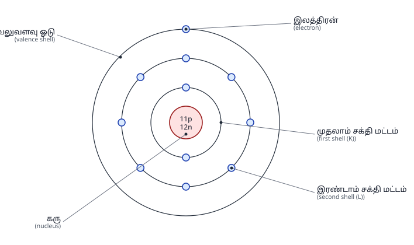

1. புரோத்தன்களும் நியூத்திரன்களும்
2. மறையேற்றம்; ஓடுகளில்
3. உச்சம் 8
4. உச்சம் 2 இலத்திரன்கள்

விடையும் விளக்கமும்

**விடை: (1) புரோத்தன்களும் நியூத்திரன்களும்**

கரு: புரோத்தன்களும் நியூத்திரன்களும் (கோப்பு 6: CHE-D01).

<!-- meta {"type":"mcq","id":"SCQ-10-03-012","grade":10,"chapter_id":"SC10-03","discipline":"CHE","difficulty":1,"qtype":"diagram","answer":1,"origin":"ORIGINAL","source_ref":"CHE-D01","image":"science_assets/chemistry/CHE-D01_labelled.svg"} -->
**SCQ-10-03-012** · அடிப்படை · வரிப்படம் · `ORIGINAL`

சோடியம் அணுவின் இலத்திரன் நிலையமைப்பு (2,8,1) வரிப்படத்தில் 'இலத்திரன்' (electron) இன் தொழில்?

1. மறையேற்றம்; ஓடுகளில்
2. உச்சம் 2 இலத்திரன்கள்
3. புரோத்தன்களும் நியூத்திரன்களும்
4. உச்சம் 8

விடையும் விளக்கமும்

**விடை: (1) மறையேற்றம்; ஓடுகளில்**

இலத்திரன்: மறையேற்றம்; ஓடுகளில் (கோப்பு 6: CHE-D01).

<!-- meta {"type":"mcq","id":"SCQ-10-03-013","grade":10,"chapter_id":"SC10-03","discipline":"CHE","difficulty":1,"qtype":"diagram","answer":4,"origin":"ORIGINAL","source_ref":"CHE-D01","image":"science_assets/chemistry/CHE-D01_labelled.svg"} -->
**SCQ-10-03-013** · அடிப்படை · வரிப்படம் · `ORIGINAL`

சோடியம் அணுவின் இலத்திரன் நிலையமைப்பு (2,8,1) வரிப்படத்தில் 'முதலாம் சக்தி மட்டம்' (first shell (K)) இன் தொழில்?

1. மறையேற்றம்; ஓடுகளில்
2. புரோத்தன்களும் நியூத்திரன்களும்
3. உச்சம் 8
4. உச்சம் 2 இலத்திரன்கள்

விடையும் விளக்கமும்

**விடை: (4) உச்சம் 2 இலத்திரன்கள்**

முதலாம் சக்தி மட்டம்: உச்சம் 2 இலத்திரன்கள் (கோப்பு 6: CHE-D01).

<!-- meta {"type":"mcq","id":"SCQ-10-03-014","grade":10,"chapter_id":"SC10-03","discipline":"CHE","difficulty":1,"qtype":"calculation","answer":1,"origin":"ORIGINAL","source_ref":"param-SC10-03-1","image":null} -->
**SCQ-10-03-014** · அடிப்படை · கணிப்பு · `ORIGINAL`

23Na அணுவில் (அணுவெண் 11) நியூத்திரன்களின் எண்ணிக்கை?

1. 12
2. 11
3. 34
4. 23

விடையும் விளக்கமும்

**விடை: (1) 12**

நியூத்திரன் = திணிவெண் − அணுவெண் = 23 − 11.

<!-- meta {"type":"mcq","id":"SCQ-10-03-015","grade":10,"chapter_id":"SC10-03","discipline":"CHE","difficulty":1,"qtype":"calculation","answer":2,"origin":"ORIGINAL","source_ref":"param-SC10-03-2","image":null} -->
**SCQ-10-03-015** · அடிப்படை · கணிப்பு · `ORIGINAL`

27Al அணுவில் (அணுவெண் 13) நியூத்திரன்களின் எண்ணிக்கை?

1. 27
2. 14
3. 13
4. 40

விடையும் விளக்கமும்

**விடை: (2) 14**

நியூத்திரன் = திணிவெண் − அணுவெண் = 27 − 13.

<!-- meta {"type":"mcq","id":"SCQ-10-03-016","grade":10,"chapter_id":"SC10-03","discipline":"CHE","difficulty":1,"qtype":"calculation","answer":3,"origin":"ORIGINAL","source_ref":"param-SC10-03-3","image":null} -->
**SCQ-10-03-016** · அடிப்படை · கணிப்பு · `ORIGINAL`

35Cl அணுவில் (அணுவெண் 17) நியூத்திரன்களின் எண்ணிக்கை?

1. 17
2. 52
3. 18
4. 35

விடையும் விளக்கமும்

**விடை: (3) 18**

நியூத்திரன் = திணிவெண் − அணுவெண் = 35 − 17.

<!-- meta {"type":"mcq","id":"SCQ-10-03-017","grade":10,"chapter_id":"SC10-03","discipline":"CHE","difficulty":1,"qtype":"calculation","answer":2,"origin":"ORIGINAL","source_ref":"param-SC10-03-4","image":null} -->
**SCQ-10-03-017** · அடிப்படை · கணிப்பு · `ORIGINAL`

39K அணுவில் (அணுவெண் 19) நியூத்திரன்களின் எண்ணிக்கை?

1. 19
2. 20
3. 39
4. 58

விடையும் விளக்கமும்

**விடை: (2) 20**

நியூத்திரன் = திணிவெண் − அணுவெண் = 39 − 19.

<!-- meta {"type":"mcq","id":"SCQ-10-03-018","grade":10,"chapter_id":"SC10-03","discipline":"CHE","difficulty":1,"qtype":"calculation","answer":3,"origin":"ORIGINAL","source_ref":"param-SC10-03-5","image":null} -->
**SCQ-10-03-018** · அடிப்படை · கணிப்பு · `ORIGINAL`

40Ca அணுவில் (அணுவெண் 20) நியூத்திரன்களின் எண்ணிக்கை?

1. 10
2. 60
3. 20
4. 40

விடையும் விளக்கமும்

**விடை: (3) 20**

நியூத்திரன் = திணிவெண் − அணுவெண் = 40 − 20.

<!-- meta {"type":"mcq","id":"SCQ-10-03-019","grade":10,"chapter_id":"SC10-03","discipline":"CHE","difficulty":1,"qtype":"calculation","answer":2,"origin":"ORIGINAL","source_ref":"param-SC10-03-6","image":null} -->
**SCQ-10-03-019** · அடிப்படை · கணிப்பு · `ORIGINAL`

31P அணுவில் (அணுவெண் 15) நியூத்திரன்களின் எண்ணிக்கை?

1. 31
2. 16
3. 15
4. 46

விடையும் விளக்கமும்

**விடை: (2) 16**

நியூத்திரன் = திணிவெண் − அணுவெண் = 31 − 15.

<!-- meta {"type":"mcq","id":"SCQ-10-03-020","grade":10,"chapter_id":"SC10-03","discipline":"CHE","difficulty":2,"qtype":"concept","answer":1,"origin":"ORIGINAL","source_ref":"param-SC10-03-7","image":null} -->
**SCQ-10-03-020** · இடைநிலை · எண்ணக்கரு · `ORIGINAL`

N (அணுவெண் 7) இன் இலத்திரன் நிலையமைப்பு?

1. 2,5
2. 1,2,4
3. 7
4. 5,2

விடையும் விளக்கமும்

**விடை: (1) 2,5**

ஓடுகள் 2, 8, 8 ஆக நிரம்பும் → 2,5.

<!-- meta {"type":"mcq","id":"SCQ-10-03-021","grade":10,"chapter_id":"SC10-03","discipline":"CHE","difficulty":2,"qtype":"concept","answer":1,"origin":"ORIGINAL","source_ref":"param-SC10-03-8","image":null} -->
**SCQ-10-03-021** · இடைநிலை · எண்ணக்கரு · `ORIGINAL`

Al (அணுவெண் 13) இன் இலத்திரன் நிலையமைப்பு?

1. 2,8,3
2. 11,2
3. 2,6,5
4. 1,2,8,2

விடையும் விளக்கமும்

**விடை: (1) 2,8,3**

ஓடுகள் 2, 8, 8 ஆக நிரம்பும் → 2,8,3.

<!-- meta {"type":"mcq","id":"SCQ-10-03-022","grade":10,"chapter_id":"SC10-03","discipline":"CHE","difficulty":2,"qtype":"concept","answer":2,"origin":"ORIGINAL","source_ref":"param-SC10-03-9","image":null} -->
**SCQ-10-03-022** · இடைநிலை · எண்ணக்கரு · `ORIGINAL`

S (அணுவெண் 16) இன் இலத்திரன் நிலையமைப்பு?

1. 14,2
2. 2,8,6
3. 2,6,8
4. 1,2,8,5

விடையும் விளக்கமும்

**விடை: (2) 2,8,6**

ஓடுகள் 2, 8, 8 ஆக நிரம்பும் → 2,8,6.

<!-- meta {"type":"mcq","id":"SCQ-10-03-023","grade":10,"chapter_id":"SC10-03","discipline":"CHE","difficulty":2,"qtype":"concept","answer":4,"origin":"ORIGINAL","source_ref":"param-SC10-03-10","image":null} -->
**SCQ-10-03-023** · இடைநிலை · எண்ணக்கரு · `ORIGINAL`

K (அணுவெண் 19) இன் இலத்திரன் நிலையமைப்பு?

1. 8,2,8,1
2. 17,2
3. 2,6,11
4. 2,8,8,1

விடையும் விளக்கமும்

**விடை: (4) 2,8,8,1**

ஓடுகள் 2, 8, 8 ஆக நிரம்பும் → 2,8,8,1.

<!-- meta {"type":"mcq","id":"SCQ-10-03-024","grade":10,"chapter_id":"SC10-03","discipline":"CHE","difficulty":2,"qtype":"concept","answer":4,"origin":"ORIGINAL","source_ref":"param-SC10-03-11","image":null} -->
**SCQ-10-03-024** · இடைநிலை · எண்ணக்கரு · `ORIGINAL`

Ca (அணுவெண் 20) இன் இலத்திரன் நிலையமைப்பு?

1. 2,6,12
2. 18,2
3. 8,2,8,2
4. 2,8,8,2

விடையும் விளக்கமும்

**விடை: (4) 2,8,8,2**

ஓடுகள் 2, 8, 8 ஆக நிரம்பும் → 2,8,8,2.

<!-- meta {"type":"mcq","id":"SCQ-10-03-025","grade":10,"chapter_id":"SC10-03","discipline":"CHE","difficulty":2,"qtype":"concept","answer":4,"origin":"ORIGINAL","source_ref":"param-SC10-03-12","image":null} -->
**SCQ-10-03-025** · இடைநிலை · எண்ணக்கரு · `ORIGINAL`

Ne (அணுவெண் 10) இன் இலத்திரன் நிலையமைப்பு?

1. 8,2
2. 1,2,7
3. 2,8,2
4. 2,8

விடையும் விளக்கமும்

**விடை: (4) 2,8**

ஓடுகள் 2, 8, 8 ஆக நிரம்பும் → 2,8.

<!-- meta {"type":"mcq","id":"SCQ-10-03-026","grade":10,"chapter_id":"SC10-03","discipline":"CHE","difficulty":2,"qtype":"reasoning","answer":1,"origin":"ORIGINAL","source_ref":"param-SC10-03-13","image":null} -->
**SCQ-10-03-026** · இடைநிலை · காரணம் காணல் · `ORIGINAL`

Mg²⁺ அயனிலுள்ள இலத்திரன்களின் எண்ணிக்கை? (அணுவெண் 12)

1. 10
2. 12
3. 18
4. 14

விடையும் விளக்கமும்

**விடை: (1) 10**

அயன் ஏற்றத்துக்கேற்ப இலத்திரன்கள் இழக்கப்படும்/பெறப்படும்.

<!-- meta {"type":"mcq","id":"SCQ-10-03-027","grade":10,"chapter_id":"SC10-03","discipline":"CHE","difficulty":2,"qtype":"reasoning","answer":2,"origin":"ORIGINAL","source_ref":"param-SC10-03-14","image":null} -->
**SCQ-10-03-027** · இடைநிலை · காரணம் காணல் · `ORIGINAL`

Cl⁻ அயனிலுள்ள இலத்திரன்களின் எண்ணிக்கை? (அணுவெண் 17)

1. 26
2. 18
3. 15
4. 17

விடையும் விளக்கமும்

**விடை: (2) 18**

அயன் ஏற்றத்துக்கேற்ப இலத்திரன்கள் இழக்கப்படும்/பெறப்படும்.

<!-- meta {"type":"mcq","id":"SCQ-10-03-028","grade":10,"chapter_id":"SC10-03","discipline":"CHE","difficulty":2,"qtype":"reasoning","answer":4,"origin":"ORIGINAL","source_ref":"param-SC10-03-15","image":null} -->
**SCQ-10-03-028** · இடைநிலை · காரணம் காணல் · `ORIGINAL`

O²⁻ அயனிலுள்ள இலத்திரன்களின் எண்ணிக்கை? (அணுவெண் 8)

1. 18
2. 8
3. 6
4. 10

விடையும் விளக்கமும்

**விடை: (4) 10**

அயன் ஏற்றத்துக்கேற்ப இலத்திரன்கள் இழக்கப்படும்/பெறப்படும்.

## SC10-04: நியூற்றனின் இயக்க விதிகள் (Newton's laws of motion)

*தரம் 10 · அத்தியாயம் 4 · பௌதிகவியல் · 27 வினாக்கள்*

<!-- meta {"type":"mcq","id":"SCQ-10-04-001","grade":10,"chapter_id":"SC10-04","discipline":"PHY","difficulty":1,"qtype":"calculation","answer":3,"origin":"ORIGINAL","source_ref":"chapter","image":null} -->
**SCQ-10-04-001** · அடிப்படை · கணிப்பு · `ORIGINAL`

2 kg பொருளுக்கு 3 m s⁻² ஆர்முடுகல் தரத் தேவையான விசை?

1. 1.5 N
2. 5 N
3. 6 N
4. 0.67 N

விடையும் விளக்கமும்

**விடை: (3) 6 N**

F = 2 × 3 = 6 N.

<!-- meta {"type":"mcq","id":"SCQ-10-04-002","grade":10,"chapter_id":"SC10-04","discipline":"PHY","difficulty":1,"qtype":"application","answer":1,"origin":"ORIGINAL","source_ref":"chapter","image":null} -->
**SCQ-10-04-002** · அடிப்படை · பிரயோகம் · `ORIGINAL`

பேருந்து திடீரென நிற்கும்போது பயணிகள் முன்னோக்கிச் சாய்வதை விளக்குவது?

1. முதலாம் விதி
2. இரண்டாம் விதி
3. மூன்றாம் விதி
4. ஈர்ப்பு விதி

விடையும் விளக்கமும்

**விடை: (1) முதலாம் விதி**

சடத்துவம்.

<!-- meta {"type":"mcq","id":"SCQ-10-04-003","grade":10,"chapter_id":"SC10-04","discipline":"PHY","difficulty":1,"qtype":"calculation","answer":3,"origin":"ORIGINAL","source_ref":"chapter","image":null} -->
**SCQ-10-04-003** · அடிப்படை · கணிப்பு · `ORIGINAL`

5 kg திணிவுடைய பொருளின் நிறை? (g = 10 m s⁻²)

1. 0.5 N
2. 5 N
3. 50 N
4. 15 N

விடையும் விளக்கமும்

**விடை: (3) 50 N**

W = mg = 50 N.

<!-- meta {"type":"mcq","id":"SCQ-10-04-004","grade":10,"chapter_id":"SC10-04","discipline":"PHY","difficulty":1,"qtype":"calculation","answer":2,"origin":"ORIGINAL","source_ref":"chapter","image":null} -->
**SCQ-10-04-004** · அடிப்படை · கணிப்பு · `ORIGINAL`

1000 kg கார் 20 m s⁻¹ இல் செல்கிறது. உந்தம்?

1. 50 kg m s⁻¹
2. 20 000 kg m s⁻¹
3. 1020 kg m s⁻¹
4. 200 kg m s⁻¹

விடையும் விளக்கமும்

**விடை: (2) 20 000 kg m s⁻¹**

p = 1000 × 20.

<!-- meta {"type":"mcq","id":"SCQ-10-04-005","grade":10,"chapter_id":"SC10-04","discipline":"PHY","difficulty":2,"qtype":"application","answer":2,"origin":"ORIGINAL","source_ref":"chapter","image":null} -->
**SCQ-10-04-005** · இடைநிலை · பிரயோகம் · `ORIGINAL`

துப்பாக்கி சுடும்போது பின்னோக்கித் தள்ளப்படுவதை விளக்குவது?

1. முதலாம் விதி
2. மூன்றாம் விதி
3. இரண்டாம் விதி மட்டும்
4. ஆக்கிமிடீசு

விடையும் விளக்கமும்

**விடை: (2) மூன்றாம் விதி**

தாக்கம் — மறுதாக்கம்.

<!-- meta {"type":"mcq","id":"SCQ-10-04-006","grade":10,"chapter_id":"SC10-04","discipline":"PHY","difficulty":2,"qtype":"concept","answer":1,"origin":"ORIGINAL","source_ref":"chapter","image":null} -->
**SCQ-10-04-006** · இடைநிலை · எண்ணக்கரு · `ORIGINAL`

சந்திரனில் (g = 1.6 m s⁻²) 60 kg விண்வெளி வீரரின் திணிவு?

1. 60 kg
2. 96 kg
3. 10 kg
4. 600 kg

விடையும் விளக்கமும்

**விடை: (1) 60 kg**

திணிவு இடத்தைச் சார்ந்ததல்ல.

<!-- meta {"type":"mcq","id":"SCQ-10-04-007","grade":10,"chapter_id":"SC10-04","discipline":"PHY","difficulty":2,"qtype":"reasoning","answer":2,"origin":"ORIGINAL","source_ref":"chapter","image":null} -->
**SCQ-10-04-007** · இடைநிலை · காரணம் காணல் · `ORIGINAL`

ஒரே விசை இரு பொருட்களில் (2 kg, 4 kg) தாக்கினால் 2 kg இன் ஆர்முடுகல்?

1. அரைவாசி
2. இருமடங்கு
3. சமம்
4. நான்கு மடங்கு

விடையும் விளக்கமும்

**விடை: (2) இருமடங்கு**

a = F/m; திணிவு அரைவாசி.

<!-- meta {"type":"mcq","id":"SCQ-10-04-008","grade":10,"chapter_id":"SC10-04","discipline":"PHY","difficulty":3,"qtype":"reasoning","answer":2,"origin":"ORIGINAL","source_ref":"chapter","image":null} -->
**SCQ-10-04-008** · கடினம் · காரணம் காணல் · `ORIGINAL`

மேசையில் புத்தகம் வைக்கப்பட்டுள்ளது. புத்தகத்தின் நிறைக்கான மறுதாக்கம்?

1. மேசை புத்தகத்தில் செலுத்தும் செவ்வன் விசை
2. புத்தகம் புவியைக் கவரும் விசை
3. உராய்வு
4. வளியமுக்கம்

விடையும் விளக்கமும்

**விடை: (2) புத்தகம் புவியைக் கவரும் விசை**

புவி → புத்தகம் (நிறை); புத்தகம் → புவி (மறுதாக்கம்).

<!-- meta {"type":"mcq","id":"SCQ-10-04-009","grade":10,"chapter_id":"SC10-04","discipline":"PHY","difficulty":2,"qtype":"concept","answer":2,"origin":"ORIGINAL","source_ref":"chapter","image":null} -->
**SCQ-10-04-009** · இடைநிலை · எண்ணக்கரு · `ORIGINAL`

ஒரு பொருள் சீரான வேகத்தில் செல்லும்போது அதன்மீதான தேறிய விசை?

1. அதன் நிறை
2. பூச்சியம்
3. இயக்கத் திசையில்
4. எதிர்த் திசையில்

விடையும் விளக்கமும்

**விடை: (2) பூச்சியம்**

முதலாம் விதி.

<!-- meta {"type":"mcq","id":"SCQ-10-04-010","grade":10,"chapter_id":"SC10-04","discipline":"PHY","difficulty":1,"qtype":"calculation","answer":2,"origin":"ORIGINAL","source_ref":"chapter","image":null} -->
**SCQ-10-04-010** · அடிப்படை · கணிப்பு · `ORIGINAL`

600 N நிறையுடையவரின் திணிவு? (g = 10)

1. 6000 kg
2. 60 kg
3. 6 kg
4. 600 kg

விடையும் விளக்கமும்

**விடை: (2) 60 kg**

m = W/g.

<!-- meta {"type":"mcq","id":"SCQ-10-04-011","grade":10,"chapter_id":"SC10-04","discipline":"PHY","difficulty":1,"qtype":"calculation","answer":3,"origin":"ORIGINAL","source_ref":"CL-WMOM-1","image":null} -->
**SCQ-10-04-011** · அடிப்படை · கணிப்பு · `ORIGINAL`

45 kg மாணவனின் நிறை? (g = 10 m s⁻²)

1. 225 N
2. 4500 N
3. 450 N
4. 900 N

விடையும் விளக்கமும்

**விடை: (3) 450 N**

சரியான விடை 450 N. கோப்பு 5 இல் CL-WMOM (அடிப்படை) எட்டுப் படித் தீர்வைப் பார்க்க.

<!-- meta {"type":"mcq","id":"SCQ-10-04-012","grade":10,"chapter_id":"SC10-04","discipline":"PHY","difficulty":1,"qtype":"calculation","answer":3,"origin":"ORIGINAL","source_ref":"CL-FMA-1","image":null} -->
**SCQ-10-04-012** · அடிப்படை · கணிப்பு · `ORIGINAL`

1200 kg கார் 2 m s⁻² இல் ஆர்முடுக தேவையான விளையுள் விசை?

1. 24000 N
2. 1200 N
3. 2400 N
4. 4800 N

விடையும் விளக்கமும்

**விடை: (3) 2400 N**

சரியான விடை 2400 N. கோப்பு 5 இல் CL-FMA (அடிப்படை) எட்டுப் படித் தீர்வைப் பார்க்க.

<!-- meta {"type":"mcq","id":"SCQ-10-04-013","grade":10,"chapter_id":"SC10-04","discipline":"PHY","difficulty":2,"qtype":"calculation","answer":2,"origin":"ORIGINAL","source_ref":"CL-WMOM-2","image":null} -->
**SCQ-10-04-013** · இடைநிலை · கணிப்பு · `ORIGINAL`

0.15 kg கிரிக்கெற் பந்து 40 m s⁻¹ இல் செல்கிறது. உந்தம்?

1. 12 kg m s⁻¹
2. 6 kg m s⁻¹
3. 3 kg m s⁻¹
4. 60 kg m s⁻¹

விடையும் விளக்கமும்

**விடை: (2) 6 kg m s⁻¹**

சரியான விடை 6 kg m s⁻¹. கோப்பு 5 இல் CL-WMOM (இடைநிலை) எட்டுப் படித் தீர்வைப் பார்க்க.

<!-- meta {"type":"mcq","id":"SCQ-10-04-014","grade":10,"chapter_id":"SC10-04","discipline":"PHY","difficulty":2,"qtype":"calculation","answer":3,"origin":"ORIGINAL","source_ref":"CL-FMA-3","image":null} -->
**SCQ-10-04-014** · இடைநிலை · கணிப்பு · `ORIGINAL`

50 kg பெட்டியை 300 N விசையால் இழுக்கிறார்கள்; உராய்வு 100 N. ஆர்முடுகல்?

1. 40 m s⁻²
2. 2 m s⁻²
3. 4 m s⁻²
4. 8 m s⁻²

விடையும் விளக்கமும்

**விடை: (3) 4 m s⁻²**

சரியான விடை 4 m s⁻². கோப்பு 5 இல் CL-FMA (பரீட்சைத் தரம்) எட்டுப் படித் தீர்வைப் பார்க்க.

<!-- meta {"type":"mcq","id":"SCQ-10-04-015","grade":10,"chapter_id":"SC10-04","discipline":"PHY","difficulty":1,"qtype":"calculation","answer":4,"origin":"ORIGINAL","source_ref":"param-SC10-04-1","image":null} -->
**SCQ-10-04-015** · அடிப்படை · கணிப்பு · `ORIGINAL`

3 kg பொருளுக்கு 4 m s⁻² ஆர்முடுகல் தரத் தேவையான விளையுள் விசை?

1. 24 N
2. 7 N
3. 0.75 N
4. 12 N

விடையும் விளக்கமும்

**விடை: (4) 12 N**

F = ma = 3 × 4.

<!-- meta {"type":"mcq","id":"SCQ-10-04-016","grade":10,"chapter_id":"SC10-04","discipline":"PHY","difficulty":1,"qtype":"calculation","answer":4,"origin":"ORIGINAL","source_ref":"param-SC10-04-2","image":null} -->
**SCQ-10-04-016** · அடிப்படை · கணிப்பு · `ORIGINAL`

1500 kg பொருளுக்கு 2 m s⁻² ஆர்முடுகல் தரத் தேவையான விளையுள் விசை?

1. 750 N
2. 1502 N
3. 6000 N
4. 3000 N

விடையும் விளக்கமும்

**விடை: (4) 3000 N**

F = ma = 1500 × 2.

<!-- meta {"type":"mcq","id":"SCQ-10-04-017","grade":10,"chapter_id":"SC10-04","discipline":"PHY","difficulty":1,"qtype":"calculation","answer":3,"origin":"ORIGINAL","source_ref":"param-SC10-04-3","image":null} -->
**SCQ-10-04-017** · அடிப்படை · கணிப்பு · `ORIGINAL`

0.5 kg பொருளுக்கு 8 m s⁻² ஆர்முடுகல் தரத் தேவையான விளையுள் விசை?

1. 8 N
2. 8.5 N
3. 4 N
4. 0.0625 N

விடையும் விளக்கமும்

**விடை: (3) 4 N**

F = ma = 0.5 × 8.

<!-- meta {"type":"mcq","id":"SCQ-10-04-018","grade":10,"chapter_id":"SC10-04","discipline":"PHY","difficulty":1,"qtype":"calculation","answer":4,"origin":"ORIGINAL","source_ref":"param-SC10-04-4","image":null} -->
**SCQ-10-04-018** · அடிப்படை · கணிப்பு · `ORIGINAL`

70 kg பொருளுக்கு 1.5 m s⁻² ஆர்முடுகல் தரத் தேவையான விளையுள் விசை?

1. 71.5 N
2. 210 N
3. 46.6667 N
4. 105 N

விடையும் விளக்கமும்

**விடை: (4) 105 N**

F = ma = 70 × 1.5.

<!-- meta {"type":"mcq","id":"SCQ-10-04-019","grade":10,"chapter_id":"SC10-04","discipline":"PHY","difficulty":1,"qtype":"calculation","answer":1,"origin":"ORIGINAL","source_ref":"param-SC10-04-5","image":null} -->
**SCQ-10-04-019** · அடிப்படை · கணிப்பு · `ORIGINAL`

36 N விளையுள் விசை 12 kg பொருளில் தாக்குகிறது. ஆர்முடுகல்?

1. 3 m s⁻²
2. 0.3333 m s⁻²
3. 6 m s⁻²
4. 432 m s⁻²

விடையும் விளக்கமும்

**விடை: (1) 3 m s⁻²**

a = F/m = 3.

<!-- meta {"type":"mcq","id":"SCQ-10-04-020","grade":10,"chapter_id":"SC10-04","discipline":"PHY","difficulty":1,"qtype":"calculation","answer":1,"origin":"ORIGINAL","source_ref":"param-SC10-04-6","image":null} -->
**SCQ-10-04-020** · அடிப்படை · கணிப்பு · `ORIGINAL`

250 N விளையுள் விசை 50 kg பொருளில் தாக்குகிறது. ஆர்முடுகல்?

1. 5 m s⁻²
2. 12500 m s⁻²
3. 0.2 m s⁻²
4. 10 m s⁻²

விடையும் விளக்கமும்

**விடை: (1) 5 m s⁻²**

a = F/m = 5.

<!-- meta {"type":"mcq","id":"SCQ-10-04-021","grade":10,"chapter_id":"SC10-04","discipline":"PHY","difficulty":1,"qtype":"calculation","answer":1,"origin":"ORIGINAL","source_ref":"param-SC10-04-7","image":null} -->
**SCQ-10-04-021** · அடிப்படை · கணிப்பு · `ORIGINAL`

9 N விளையுள் விசை 0.3 kg பொருளில் தாக்குகிறது. ஆர்முடுகல்?

1. 30 m s⁻²
2. 0.0333 m s⁻²
3. 60 m s⁻²
4. 2.7 m s⁻²

விடையும் விளக்கமும்

**விடை: (1) 30 m s⁻²**

a = F/m = 30.

<!-- meta {"type":"mcq","id":"SCQ-10-04-022","grade":10,"chapter_id":"SC10-04","discipline":"PHY","difficulty":1,"qtype":"calculation","answer":3,"origin":"ORIGINAL","source_ref":"param-SC10-04-8","image":null} -->
**SCQ-10-04-022** · அடிப்படை · கணிப்பு · `ORIGINAL`

0.2 kg பொருள் 15 m s⁻¹ இல் செல்கிறது. உந்தம்?

1. 6 kg m s⁻¹
2. 0.0133 kg m s⁻¹
3. 3 kg m s⁻¹
4. 22.5 kg m s⁻¹

விடையும் விளக்கமும்

**விடை: (3) 3 kg m s⁻¹**

p = mv = 3.

<!-- meta {"type":"mcq","id":"SCQ-10-04-023","grade":10,"chapter_id":"SC10-04","discipline":"PHY","difficulty":1,"qtype":"calculation","answer":4,"origin":"ORIGINAL","source_ref":"param-SC10-04-9","image":null} -->
**SCQ-10-04-023** · அடிப்படை · கணிப்பு · `ORIGINAL`

60 kg பொருள் 5 m s⁻¹ இல் செல்கிறது. உந்தம்?

1. 600 kg m s⁻¹
2. 12 kg m s⁻¹
3. 750 kg m s⁻¹
4. 300 kg m s⁻¹

விடையும் விளக்கமும்

**விடை: (4) 300 kg m s⁻¹**

p = mv = 300.

<!-- meta {"type":"mcq","id":"SCQ-10-04-024","grade":10,"chapter_id":"SC10-04","discipline":"PHY","difficulty":1,"qtype":"calculation","answer":2,"origin":"ORIGINAL","source_ref":"param-SC10-04-10","image":null} -->
**SCQ-10-04-024** · அடிப்படை · கணிப்பு · `ORIGINAL`

2000 kg பொருள் 25 m s⁻¹ இல் செல்கிறது. உந்தம்?

1. 100000 kg m s⁻¹
2. 50000 kg m s⁻¹
3. 80 kg m s⁻¹
4. 625000 kg m s⁻¹

விடையும் விளக்கமும்

**விடை: (2) 50000 kg m s⁻¹**

p = mv = 50000.

<!-- meta {"type":"mcq","id":"SCQ-10-04-025","grade":10,"chapter_id":"SC10-04","discipline":"PHY","difficulty":1,"qtype":"calculation","answer":4,"origin":"ORIGINAL","source_ref":"param-SC10-04-11","image":null} -->
**SCQ-10-04-025** · அடிப்படை · கணிப்பு · `ORIGINAL`

நிறை 450 N உடைய பொருளின் திணிவு? (g = 10 m s⁻²)

1. 450 kg
2. 4500 kg
3. 90 kg
4. 45 kg

விடையும் விளக்கமும்

**விடை: (4) 45 kg**

m = W/g = 45 kg.

<!-- meta {"type":"mcq","id":"SCQ-10-04-026","grade":10,"chapter_id":"SC10-04","discipline":"PHY","difficulty":1,"qtype":"calculation","answer":2,"origin":"ORIGINAL","source_ref":"param-SC10-04-12","image":null} -->
**SCQ-10-04-026** · அடிப்படை · கணிப்பு · `ORIGINAL`

நிறை 80 N உடைய பொருளின் திணிவு? (g = 10 m s⁻²)

1. 800 kg
2. 8 kg
3. 80 kg
4. 16 kg

விடையும் விளக்கமும்

**விடை: (2) 8 kg**

m = W/g = 8 kg.

<!-- meta {"type":"mcq","id":"SCQ-10-04-027","grade":10,"chapter_id":"SC10-04","discipline":"PHY","difficulty":1,"qtype":"calculation","answer":1,"origin":"ORIGINAL","source_ref":"param-SC10-04-13","image":null} -->
**SCQ-10-04-027** · அடிப்படை · கணிப்பு · `ORIGINAL`

நிறை 1200 N உடைய பொருளின் திணிவு? (g = 10 m s⁻²)

1. 120 kg
2. 1200 kg
3. 240 kg
4. 12000 kg

விடையும் விளக்கமும்

**விடை: (1) 120 kg**

m = W/g = 120 kg.

## SC10-05: உராய்வு (Friction)

*தரம் 10 · அத்தியாயம் 5 · பௌதிகவியல் · 25 வினாக்கள்*

<!-- meta {"type":"mcq","id":"SCQ-10-05-001","grade":10,"chapter_id":"SC10-05","discipline":"PHY","difficulty":2,"qtype":"reasoning","answer":2,"origin":"ORIGINAL","source_ref":"chapter","image":null} -->
**SCQ-10-05-001** · இடைநிலை · காரணம் காணல் · `ORIGINAL`

மேசையில் உள்ள பெட்டியை 5 N விசையால் தள்ளியும் அசையவில்லை. நிலையியல் உராய்வு?

1. 0 N
2. 5 N
3. 5 N இலும் கூட
4. 10 N

விடையும் விளக்கமும்

**விடை: (2) 5 N**

சமநிலை: உராய்வு = பிரயோக விசை.

<!-- meta {"type":"mcq","id":"SCQ-10-05-002","grade":10,"chapter_id":"SC10-05","discipline":"PHY","difficulty":1,"qtype":"concept","answer":3,"origin":"ORIGINAL","source_ref":"chapter","image":null} -->
**SCQ-10-05-002** · அடிப்படை · எண்ணக்கரு · `ORIGINAL`

உராய்வைக் குறைக்கும் முறை அல்லாதது?

1. உராய்வுநீக்கி
2. பந்துப் போதிகை
3. மேற்பரப்பை முரடாக்கல்
4. மழமழப்பாக்கல்

விடையும் விளக்கமும்

**விடை: (3) மேற்பரப்பை முரடாக்கல்**

முரடாக்கல் உராய்வைக் கூட்டும்.

<!-- meta {"type":"mcq","id":"SCQ-10-05-003","grade":10,"chapter_id":"SC10-05","discipline":"PHY","difficulty":2,"qtype":"reasoning","answer":1,"origin":"ORIGINAL","source_ref":"chapter","image":null} -->
**SCQ-10-05-003** · இடைநிலை · காரணம் காணல் · `ORIGINAL`

அசைந்துகொண்டிருக்கும் பொருளை இழுக்கத் தேவையான விசை, அசையத் தொடங்கத் தேவையானதை விடக் குறைவு. காரணம்?

1. இயக்க உராய்வு எல்லை உராய்வை விடக் குறைவு
2. திணிவு குறைகிறது
3. ஈர்ப்பு குறைகிறது
4. வளி உதவுகிறது

விடையும் விளக்கமும்

**விடை: (1) இயக்க உராய்வு எல்லை உராய்வை விடக் குறைவு**

இயக்க உராய்வு < எல்லை உராய்வு.

<!-- meta {"type":"mcq","id":"SCQ-10-05-004","grade":10,"chapter_id":"SC10-05","discipline":"PHY","difficulty":1,"qtype":"application","answer":2,"origin":"ORIGINAL","source_ref":"chapter","image":null} -->
**SCQ-10-05-004** · அடிப்படை · பிரயோகம் · `ORIGINAL`

மழைநாளில் வாகனம் வழுக்குவதற்குக் காரணம்?

1. உராய்வு கூடுதல்
2. உராய்வு குறைதல்
3. திணிவு கூடுதல்
4. வேகம் குறைதல்

விடையும் விளக்கமும்

**விடை: (2) உராய்வு குறைதல்**

நீர்ப்படை உராய்வுநீக்கியாகச் செயற்படும்.

<!-- meta {"type":"mcq","id":"SCQ-10-05-005","grade":10,"chapter_id":"SC10-05","discipline":"PHY","difficulty":2,"qtype":"reasoning","answer":2,"origin":"ORIGINAL","source_ref":"chapter","image":null} -->
**SCQ-10-05-005** · இடைநிலை · காரணம் காணல் · `ORIGINAL`

பெட்டியின் மேல் மற்றொரு பெட்டி வைத்தால் உராய்வு?

1. குறையும்
2. கூடும்
3. மாறாது
4. 0

விடையும் விளக்கமும்

**விடை: (2) கூடும்**

செவ்வன் மறுதாக்கம் கூடும்.

<!-- meta {"type":"mcq","id":"SCQ-10-05-006","grade":10,"chapter_id":"SC10-05","discipline":"PHY","difficulty":1,"qtype":"application","answer":1,"origin":"ORIGINAL","source_ref":"chapter","image":null} -->
**SCQ-10-05-006** · அடிப்படை · பிரயோகம் · `ORIGINAL`

விமானங்களின் நீள்பொழிவு வடிவத்தின் நோக்கம்?

1. வளித் தடையைக் குறைத்தல்
2. நிறையைக் கூட்டல்
3. உராய்வைக் கூட்டல்
4. அழகுக்கு

விடையும் விளக்கமும்

**விடை: (1) வளித் தடையைக் குறைத்தல்**

வளி எதிர்ப்பு குறையும்.

<!-- meta {"type":"mcq","id":"SCQ-10-05-007","grade":10,"chapter_id":"SC10-05","discipline":"PHY","difficulty":2,"qtype":"graph","answer":2,"origin":"ORIGINAL","source_ref":"chapter","image":null} -->
**SCQ-10-05-007** · இடைநிலை · வரைபு · `ORIGINAL`

பிரயோக விசை–உராய்வு வரைபில் உச்சப் புள்ளி?

1. இயக்க உராய்வு
2. எல்லை உராய்வு
3. நிலையியல் 0
4. நிறை

விடையும் விளக்கமும்

**விடை: (2) எல்லை உராய்வு**

அசையத் தொடங்கும் கணம்.

<!-- meta {"type":"mcq","id":"SCQ-10-05-008","grade":10,"chapter_id":"SC10-05","discipline":"PHY","difficulty":3,"qtype":"reasoning","answer":1,"origin":"ORIGINAL","source_ref":"chapter","image":null} -->
**SCQ-10-05-008** · கடினம் · காரணம் காணல் · `ORIGINAL`

நடக்கும்போது முன்னோக்கித் தள்ளும் விசை?

1. கால் நிலத்தைப் பின்னோக்கித் தள்ளுவதற்கான உராய்வு மறுதாக்கம் (முன்னோக்கி)
2. வளியமுக்கம்
3. நிறை
4. காந்தம்

விடையும் விளக்கமும்

**விடை: (1) கால் நிலத்தைப் பின்னோக்கித் தள்ளுவதற்கான உராய்வு மறுதாக்கம் (முன்னோக்கி)**

உராய்வு இல்லையெனின் நடக்க முடியாது.

<!-- meta {"type":"mcq","id":"SCQ-10-05-009","grade":10,"chapter_id":"SC10-05","discipline":"PHY","difficulty":2,"qtype":"concept","answer":1,"origin":"ORIGINAL","source_ref":"chapter","image":null} -->
**SCQ-10-05-009** · இடைநிலை · எண்ணக்கரு · `ORIGINAL`

பந்துப் போதிகை உராய்வைக் குறைப்பது எவ்வாறு?

1. வழுக்கும் உராய்வை உருளும் உராய்வாக்கல்
2. திணிவைக் குறைத்தல்
3. வெப்பத்தைக் கூட்டல்
4. காந்தத்தால்

விடையும் விளக்கமும்

**விடை: (1) வழுக்கும் உராய்வை உருளும் உராய்வாக்கல்**

உருளும் உராய்வு குறைவு.

<!-- meta {"type":"mcq","id":"SCQ-10-05-010","grade":10,"chapter_id":"SC10-05","discipline":"PHY","difficulty":1,"qtype":"concept","answer":2,"origin":"ORIGINAL","source_ref":"chapter","image":null} -->
**SCQ-10-05-010** · அடிப்படை · எண்ணக்கரு · `ORIGINAL`

உராய்வால் சக்தி பெரும்பாலும் மாறுவது?

1. ஒலி மட்டும்
2. வெப்பம்
3. ஒளி
4. மின்

விடையும் விளக்கமும்

**விடை: (2) வெப்பம்**

தேய்த்தல் வெப்பம் தரும்.

<!-- meta {"type":"mcq","id":"SCQ-10-05-011","grade":10,"chapter_id":"SC10-05","discipline":"PHY","difficulty":2,"qtype":"reasoning","answer":4,"origin":"ORIGINAL","source_ref":"extra-SC10-05-1","image":null} -->
**SCQ-10-05-011** · இடைநிலை · காரணம் காணல் · `ORIGINAL`

உராய்வு இல்லாத உலகில் நிகழக்கூடியது?

1. எழுத முடியும்
2. ஆணிகள் இறுகும்
3. வாகனங்கள் எளிதில் நிறுத்தப்படும்
4. நடக்க முடியாது

விடையும் விளக்கமும்

**விடை: (4) நடக்க முடியாது**

பிடிப்பு இல்லை.

<!-- meta {"type":"mcq","id":"SCQ-10-05-012","grade":10,"chapter_id":"SC10-05","discipline":"PHY","difficulty":1,"qtype":"application","answer":2,"origin":"ORIGINAL","source_ref":"extra-SC10-05-2","image":null} -->
**SCQ-10-05-012** · அடிப்படை · பிரயோகம் · `ORIGINAL`

பனிக்கட்டியில் சறுக்குவது எளிதானதற்கான காரணம்?

1. வளி இல்லை
2. மிகக் குறைந்த உராய்வு
3. ஈர்ப்பு இல்லை
4. அதிக உராய்வு

விடையும் விளக்கமும்

**விடை: (2) மிகக் குறைந்த உராய்வு**

மழமழப்பான மேற்பரப்பு, நீர்ப்படை.

<!-- meta {"type":"mcq","id":"SCQ-10-05-013","grade":10,"chapter_id":"SC10-05","discipline":"PHY","difficulty":1,"qtype":"application","answer":4,"origin":"ORIGINAL","source_ref":"extra-SC10-05-3","image":null} -->
**SCQ-10-05-013** · அடிப்படை · பிரயோகம் · `ORIGINAL`

வாகன இயந்திரத்தில் உராய்வுநீக்கி எண்ணெயின் நோக்கம்?

1. நிறம்
2. வேகம் குறைத்தல்
3. எரிபொருள்
4. தேய்வையும் வெப்பத்தையும் குறைத்தல்

விடையும் விளக்கமும்

**விடை: (4) தேய்வையும் வெப்பத்தையும் குறைத்தல்**

பகுதிகளுக்கிடையே படை.

<!-- meta {"type":"mcq","id":"SCQ-10-05-014","grade":10,"chapter_id":"SC10-05","discipline":"PHY","difficulty":1,"qtype":"application","answer":3,"origin":"ORIGINAL","source_ref":"extra-SC10-05-4","image":null} -->
**SCQ-10-05-014** · அடிப்படை · பிரயோகம் · `ORIGINAL`

விளையாட்டுச் சப்பாத்துகளின் அடியில் முட்கள் (spikes)?

1. வேகம் குறைக்க
2. நிறையைக் குறைக்க
3. பிடிப்பைக் கூட்ட
4. அழகுக்கு

விடையும் விளக்கமும்

**விடை: (3) பிடிப்பைக் கூட்ட**

உராய்வு கூடும்.

<!-- meta {"type":"mcq","id":"SCQ-10-05-015","grade":10,"chapter_id":"SC10-05","discipline":"PHY","difficulty":2,"qtype":"concept","answer":3,"origin":"ORIGINAL","source_ref":"extra-SC10-05-5","image":null} -->
**SCQ-10-05-015** · இடைநிலை · எண்ணக்கரு · `ORIGINAL`

நீரில் நீந்துபவர் உணரும் எதிர்ப்பு?

1. காந்த விசை
2. மிதப்பு மட்டும்
3. பாய்ம உராய்வு (இழுவை)
4. நிலையியல் உராய்வு

விடையும் விளக்கமும்

**விடை: (3) பாய்ம உராய்வு (இழுவை)**

பாய்மங்களிலும் உராய்வு.

<!-- meta {"type":"mcq","id":"SCQ-10-05-016","grade":10,"chapter_id":"SC10-05","discipline":"PHY","difficulty":2,"qtype":"reasoning","answer":1,"origin":"ORIGINAL","source_ref":"extra-SC10-05-6","image":null} -->
**SCQ-10-05-016** · இடைநிலை · காரணம் காணல் · `ORIGINAL`

விண்கலம் வளிமண்டலத்துக்குள் மீளும்போது சூடாவதற்கான காரணம்?

1. வளியுடனான உராய்வு
2. காந்தம்
3. சூரியன்
4. அணுக்கரு

விடையும் விளக்கமும்

**விடை: (1) வளியுடனான உராய்வு**

இயக்கசக்தி வெப்பமாகும்.

<!-- meta {"type":"mcq","id":"SCQ-10-05-017","grade":10,"chapter_id":"SC10-05","discipline":"PHY","difficulty":3,"qtype":"concept","answer":1,"origin":"ORIGINAL","source_ref":"extra-SC10-05-7","image":null} -->
**SCQ-10-05-017** · கடினம் · எண்ணக்கரு · `ORIGINAL`

இயக்க உராய்வின் பருமன் பொதுவாக?

1. வேகத்தைப் (மிதமான வீச்சில்) பெரிதும் சாராது
2. வேகத்துடன் இருமடங்காகும்
3. நிறைக்கு எதிர்விகிதம்
4. எப்போதும் 0

விடையும் விளக்கமும்

**விடை: (1) வேகத்தைப் (மிதமான வீச்சில்) பெரிதும் சாராது**

O/L மட்டத்தில் ஏறத்தாழ மாறிலி.

<!-- meta {"type":"mcq","id":"SCQ-10-05-018","grade":10,"chapter_id":"SC10-05","discipline":"PHY","difficulty":1,"qtype":"application","answer":4,"origin":"ORIGINAL","source_ref":"extra-SC10-05-8","image":null} -->
**SCQ-10-05-018** · அடிப்படை · பிரயோகம் · `ORIGINAL`

தீக்குச்சி பற்றுவது எதனால்?

1. காந்தம்
2. ஒளி
3. மின்
4. உராய்வால் உருவாகும் வெப்பம்

விடையும் விளக்கமும்

**விடை: (4) உராய்வால் உருவாகும் வெப்பம்**

உராய்வு வெப்பம் தகனத்தைத் தொடங்கும்.

<!-- meta {"type":"mcq","id":"SCQ-10-05-019","grade":10,"chapter_id":"SC10-05","discipline":"PHY","difficulty":2,"qtype":"calculation","answer":1,"origin":"ORIGINAL","source_ref":"param-SC10-05-1","image":null} -->
**SCQ-10-05-019** · இடைநிலை · கணிப்பு · `ORIGINAL`

10 kg பெட்டியை 50 N கிடை விசையால் இழுக்கும்போது இயக்க உராய்வு 20 N. ஆர்முடுகல்?

1. 3 m s⁻²
2. 7 m s⁻²
3. 5 m s⁻²
4. 300 m s⁻²

விடையும் விளக்கமும்

**விடை: (1) 3 m s⁻²**

a = (F − f)/m = (50 − 20)/10 = 3.

<!-- meta {"type":"mcq","id":"SCQ-10-05-020","grade":10,"chapter_id":"SC10-05","discipline":"PHY","difficulty":2,"qtype":"calculation","answer":2,"origin":"ORIGINAL","source_ref":"param-SC10-05-2","image":null} -->
**SCQ-10-05-020** · இடைநிலை · கணிப்பு · `ORIGINAL`

4 kg பெட்டியை 30 N கிடை விசையால் இழுக்கும்போது இயக்க உராய்வு 6 N. ஆர்முடுகல்?

1. 9 m s⁻²
2. 6 m s⁻²
3. 7.5 m s⁻²
4. 96 m s⁻²

விடையும் விளக்கமும்

**விடை: (2) 6 m s⁻²**

a = (F − f)/m = (30 − 6)/4 = 6.

<!-- meta {"type":"mcq","id":"SCQ-10-05-021","grade":10,"chapter_id":"SC10-05","discipline":"PHY","difficulty":2,"qtype":"calculation","answer":4,"origin":"ORIGINAL","source_ref":"param-SC10-05-3","image":null} -->
**SCQ-10-05-021** · இடைநிலை · கணிப்பு · `ORIGINAL`

25 kg பெட்டியை 200 N கிடை விசையால் இழுக்கும்போது இயக்க உராய்வு 75 N. ஆர்முடுகல்?

1. 3125 m s⁻²
2. 8 m s⁻²
3. 11 m s⁻²
4. 5 m s⁻²

விடையும் விளக்கமும்

**விடை: (4) 5 m s⁻²**

a = (F − f)/m = (200 − 75)/25 = 5.

<!-- meta {"type":"mcq","id":"SCQ-10-05-022","grade":10,"chapter_id":"SC10-05","discipline":"PHY","difficulty":2,"qtype":"calculation","answer":4,"origin":"ORIGINAL","source_ref":"param-SC10-05-4","image":null} -->
**SCQ-10-05-022** · இடைநிலை · கணிப்பு · `ORIGINAL`

8 kg பெட்டியை 40 N கிடை விசையால் இழுக்கும்போது இயக்க உராய்வு 40 N. ஆர்முடுகல்?

1. 1 m s⁻²
2. 5 m s⁻²
3. 10 m s⁻²
4. 0 m s⁻²

விடையும் விளக்கமும்

**விடை: (4) 0 m s⁻²**

a = (F − f)/m = (40 − 40)/8 = 0.

<!-- meta {"type":"mcq","id":"SCQ-10-05-023","grade":10,"chapter_id":"SC10-05","discipline":"PHY","difficulty":2,"qtype":"reasoning","answer":3,"origin":"ORIGINAL","source_ref":"param-SC10-05-5","image":null} -->
**SCQ-10-05-023** · இடைநிலை · காரணம் காணல் · `ORIGINAL`

கனமான பெட்டியை 15 N இனால் தள்ளியும் அசையவில்லை. நிலையியல் உராய்வின் பருமன்?

1. 30 N
2. 0 N
3. 15 N
4. 7.5 N

விடையும் விளக்கமும்

**விடை: (3) 15 N**

சமநிலை: உராய்வு = பிரயோக விசை.

<!-- meta {"type":"mcq","id":"SCQ-10-05-024","grade":10,"chapter_id":"SC10-05","discipline":"PHY","difficulty":2,"qtype":"reasoning","answer":1,"origin":"ORIGINAL","source_ref":"param-SC10-05-6","image":null} -->
**SCQ-10-05-024** · இடைநிலை · காரணம் காணல் · `ORIGINAL`

கனமான பெட்டியை 35 N இனால் தள்ளியும் அசையவில்லை. நிலையியல் உராய்வின் பருமன்?

1. 35 N
2. 0 N
3. 70 N
4. 17.5 N

விடையும் விளக்கமும்

**விடை: (1) 35 N**

சமநிலை: உராய்வு = பிரயோக விசை.

<!-- meta {"type":"mcq","id":"SCQ-10-05-025","grade":10,"chapter_id":"SC10-05","discipline":"PHY","difficulty":2,"qtype":"reasoning","answer":4,"origin":"ORIGINAL","source_ref":"param-SC10-05-7","image":null} -->
**SCQ-10-05-025** · இடைநிலை · காரணம் காணல் · `ORIGINAL`

கனமான பெட்டியை 60 N இனால் தள்ளியும் அசையவில்லை. நிலையியல் உராய்வின் பருமன்?

1. 0 N
2. 30 N
3. 120 N
4. 60 N

விடையும் விளக்கமும்

**விடை: (4) 60 N**

சமநிலை: உராய்வு = பிரயோக விசை.

## SC10-06: தாவரக்கலங்களினதும் விலங்குக்கலங்களினதும் கட்டமைப்பும் தொழிற்பாடும் (Structure and functions of plant and animal cells)

*தரம் 10 · அத்தியாயம் 6 · உயிரியல் · 28 வினாக்கள்*

<!-- meta {"type":"mcq","id":"SCQ-10-06-001","grade":10,"chapter_id":"SC10-06","discipline":"BIO","difficulty":1,"qtype":"recall","answer":2,"origin":"ORIGINAL","source_ref":"chapter","image":null} -->
**SCQ-10-06-001** · அடிப்படை · நினைவு · `ORIGINAL`

தாவரக் கலத்தில் உள்ள, விலங்குக் கலத்தில் இல்லாத இரு பகுதிகள்?

1. கரு, இழைமணி
2. கலச்சுவர், பச்சையவுருமணி
3. கலமென்சவ்வு, இறைபோசோம்
4. குழியவுரு, கரு

விடையும் விளக்கமும்

**விடை: (2) கலச்சுவர், பச்சையவுருமணி**

கலச்சுவரும் பச்சையவுருமணியும் தாவரக் கலத்துக்குத் தனித்துவமானவை.

<!-- meta {"type":"mcq","id":"SCQ-10-06-002","grade":10,"chapter_id":"SC10-06","discipline":"BIO","difficulty":1,"qtype":"recall","answer":3,"origin":"ORIGINAL","source_ref":"chapter","image":null} -->
**SCQ-10-06-002** · அடிப்படை · நினைவு · `ORIGINAL`

ATP உற்பத்தியின் பிரதான இடம்?

1. கரு
2. இறைபோசோம்
3. இழைமணி
4. கலச்சுவர்

விடையும் விளக்கமும்

**விடை: (3) இழைமணி**

காற்றுச் சுவாசம் இழைமணியில் நடைபெற்று ATP உருவாகும்.

<!-- meta {"type":"mcq","id":"SCQ-10-06-003","grade":10,"chapter_id":"SC10-06","discipline":"BIO","difficulty":1,"qtype":"concept","answer":2,"origin":"ORIGINAL","source_ref":"chapter","image":null} -->
**SCQ-10-06-003** · அடிப்படை · எண்ணக்கரு · `ORIGINAL`

கலத்துக்குள் செல்லும் பதார்த்தங்களைக் கட்டுப்படுத்துவது?

1. கலச்சுவர்
2. கலமென்சவ்வு
3. புன்வெற்றிடம்
4. கரு

விடையும் விளக்கமும்

**விடை: (2) கலமென்சவ்வு**

கலமென்சவ்வு தேர்ந்து புகவிடும்.

<!-- meta {"type":"mcq","id":"SCQ-10-06-004","grade":10,"chapter_id":"SC10-06","discipline":"BIO","difficulty":1,"qtype":"recall","answer":2,"origin":"ORIGINAL","source_ref":"chapter","image":null} -->
**SCQ-10-06-004** · அடிப்படை · நினைவு · `ORIGINAL`

இறைபோசோம்களின் தொழில்?

1. இலிப்பிட்டுத் தொகுப்பு
2. புரதத் தொகுப்பு
3. ஒளித்தொகுப்பு
4. சுவாசம்

விடையும் விளக்கமும்

**விடை: (2) புரதத் தொகுப்பு**

இறைபோசோம்கள் அமினோ அமிலங்களை இணைத்துப் புரதம் தொகுக்கும்.

<!-- meta {"type":"mcq","id":"SCQ-10-06-005","grade":10,"chapter_id":"SC10-06","discipline":"BIO","difficulty":2,"qtype":"reasoning","answer":2,"origin":"ORIGINAL","source_ref":"chapter","image":null} -->
**SCQ-10-06-005** · இடைநிலை · காரணம் காணல் · `ORIGINAL`

தசைக் கலங்களில் இழைமணிகள் அதிகமாக இருப்பதற்குக் காரணம்?

1. கலம் பெரியது
2. அதிக சக்தி தேவை
3. ஒளித்தொகுப்புக்கு
4. நீர் சேமிக்க

விடையும் விளக்கமும்

**விடை: (2) அதிக சக்தி தேவை**

தசைச் சுருக்கத்துக்கு அதிக ATP தேவை.

<!-- meta {"type":"mcq","id":"SCQ-10-06-006","grade":10,"chapter_id":"SC10-06","discipline":"BIO","difficulty":2,"qtype":"reasoning","answer":1,"origin":"ORIGINAL","source_ref":"chapter","image":null} -->
**SCQ-10-06-006** · இடைநிலை · காரணம் காணல் · `ORIGINAL`

வேர்க் கலங்களில் பச்சையவுருமணி இல்லாததற்குக் காரணம்?

1. ஒளி கிடைக்காததால் ஒளித்தொகுப்பு தேவையில்லை
2. நீர் இல்லாததால்
3. கலச்சுவர் இல்லாததால்
4. கரு இல்லாததால்

விடையும் விளக்கமும்

**விடை: (1) ஒளி கிடைக்காததால் ஒளித்தொகுப்பு தேவையில்லை**

மண்ணின் கீழ் ஒளி இல்லை; பச்சையவுருமணி தேவையில்லை.

<!-- meta {"type":"mcq","id":"SCQ-10-06-007","grade":10,"chapter_id":"SC10-06","discipline":"BIO","difficulty":2,"qtype":"concept","answer":2,"origin":"ORIGINAL","source_ref":"chapter","image":null} -->
**SCQ-10-06-007** · இடைநிலை · எண்ணக்கரு · `ORIGINAL`

கலச்சுவரும் கலமென்சவ்வும் — சரியான கூற்று?

1. இரண்டும் தேர்ந்து புகவிடும்
2. கலச்சுவர் முழுமையாகப் புகவிடும், கலமென்சவ்வு தேர்ந்து புகவிடும்
3. கலச்சுவர் தேர்ந்து புகவிடும்
4. இரண்டும் புகவிடாது

விடையும் விளக்கமும்

**விடை: (2) கலச்சுவர் முழுமையாகப் புகவிடும், கலமென்சவ்வு தேர்ந்து புகவிடும்**

கலச்சுவர் செலுலோசு வலை — முழுமையாகப் புகவிடும்.

<!-- meta {"type":"mcq","id":"SCQ-10-06-008","grade":10,"chapter_id":"SC10-06","discipline":"BIO","difficulty":2,"qtype":"recall","answer":1,"origin":"ORIGINAL","source_ref":"chapter","image":null} -->
**SCQ-10-06-008** · இடைநிலை · நினைவு · `ORIGINAL`

பின்வருவனவற்றுள் விலங்குக் கலத்துக்கு மட்டும் உரியது?

1. புன்மையத்தி
2. கலச்சுவர்
3. பச்சையவுருமணி
4. பெரிய மத்திய புன்வெற்றிடம்

விடையும் விளக்கமும்

**விடை: (1) புன்மையத்தி**

புன்மையத்தி கலப்பிரிவில் உதவும்; பொதுவாக உயர் தாவரங்களில் இல்லை.

<!-- meta {"type":"mcq","id":"SCQ-10-06-009","grade":10,"chapter_id":"SC10-06","discipline":"BIO","difficulty":3,"qtype":"application","answer":1,"origin":"ORIGINAL","source_ref":"chapter","image":null} -->
**SCQ-10-06-009** · கடினம் · பிரயோகம் · `ORIGINAL`

சுரப்புக் கலங்களில் (எ.கா. நொதியம் சுரக்கும்) நன்கு விருத்தியடைந்திருப்பது?

1. கொல்கி உபகரணம்
2. பச்சையவுருமணி
3. கலச்சுவர்
4. புன்வெற்றிடம்

விடையும் விளக்கமும்

**விடை: (1) கொல்கி உபகரணம்**

கொல்கி உபகரணம் பொதியிட்டுச் சுரக்கும்.

<!-- meta {"type":"mcq","id":"SCQ-10-06-010","grade":10,"chapter_id":"SC10-06","discipline":"BIO","difficulty":3,"qtype":"experiment","answer":3,"origin":"ORIGINAL","source_ref":"chapter","image":null} -->
**SCQ-10-06-010** · கடினம் · பரிசோதனை · `ORIGINAL`

ஒளி நுணுக்குக்காட்டியில் வெங்காயத் தோல் கலங்களைப் பார்க்கும்போது தெளிவாகத் தெரியாதது?

1. கலச்சுவர்
2. கரு (சாயமிட்டபின்)
3. இறைபோசோம்
4. குழியவுரு

விடையும் விளக்கமும்

**விடை: (3) இறைபோசோம்**

இறைபோசோம்கள் மிகச் சிறியவை; இலத்திரன் நுணுக்குக்காட்டி தேவை.

<!-- meta {"type":"mcq","id":"SCQ-10-06-011","grade":10,"chapter_id":"SC10-06","discipline":"BIO","difficulty":1,"qtype":"diagram","answer":4,"origin":"ORIGINAL","source_ref":"BIO-D01","image":"science_assets/biology/BIO-D01_labelled.svg"} -->
**SCQ-10-06-011** · அடிப்படை · வரிப்படம் · `ORIGINAL`

தாவரக் கலம் வரிப்படத்தில் 'கலச்சுவர்' (cell wall) இன் தொழில்?

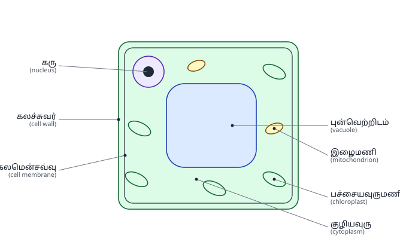

1. பதார்த்தங்களின் உட்செல்கை/வெளிச்செல்கையைக் கட்டுப்படுத்தல்
2. கலத் தொழிற்பாடுகளைக் கட்டுப்படுத்தல்; DNA
3. கலச்சாறு சேமிப்பு; வீக்கம் பேணல்
4. பொறிமுறை ஆதாரம், வடிவம்

விடையும் விளக்கமும்

**விடை: (4) பொறிமுறை ஆதாரம், வடிவம்**

கலச்சுவர்: பொறிமுறை ஆதாரம், வடிவம் (கோப்பு 6: BIO-D01).

<!-- meta {"type":"mcq","id":"SCQ-10-06-012","grade":10,"chapter_id":"SC10-06","discipline":"BIO","difficulty":1,"qtype":"diagram","answer":4,"origin":"ORIGINAL","source_ref":"BIO-D01","image":"science_assets/biology/BIO-D01_labelled.svg"} -->
**SCQ-10-06-012** · அடிப்படை · வரிப்படம் · `ORIGINAL`

தாவரக் கலம் வரிப்படத்தில் 'கலமென்சவ்வு' (cell membrane) இன் தொழில்?

1. பொறிமுறை ஆதாரம், வடிவம்
2. கலத் தொழிற்பாடுகளைக் கட்டுப்படுத்தல்; DNA
3. கலச்சாறு சேமிப்பு; வீக்கம் பேணல்
4. பதார்த்தங்களின் உட்செல்கை/வெளிச்செல்கையைக் கட்டுப்படுத்தல்

விடையும் விளக்கமும்

**விடை: (4) பதார்த்தங்களின் உட்செல்கை/வெளிச்செல்கையைக் கட்டுப்படுத்தல்**

கலமென்சவ்வு: பதார்த்தங்களின் உட்செல்கை/வெளிச்செல்கையைக் கட்டுப்படுத்தல் (கோப்பு 6: BIO-D01).

<!-- meta {"type":"mcq","id":"SCQ-10-06-013","grade":10,"chapter_id":"SC10-06","discipline":"BIO","difficulty":1,"qtype":"diagram","answer":1,"origin":"ORIGINAL","source_ref":"BIO-D01","image":"science_assets/biology/BIO-D01_labelled.svg"} -->
**SCQ-10-06-013** · அடிப்படை · வரிப்படம் · `ORIGINAL`

தாவரக் கலம் வரிப்படத்தில் 'கரு' (nucleus) இன் தொழில்?

1. கலத் தொழிற்பாடுகளைக் கட்டுப்படுத்தல்; DNA
2. பதார்த்தங்களின் உட்செல்கை/வெளிச்செல்கையைக் கட்டுப்படுத்தல்
3. பொறிமுறை ஆதாரம், வடிவம்
4. கலச்சாறு சேமிப்பு; வீக்கம் பேணல்

விடையும் விளக்கமும்

**விடை: (1) கலத் தொழிற்பாடுகளைக் கட்டுப்படுத்தல்; DNA**

கரு: கலத் தொழிற்பாடுகளைக் கட்டுப்படுத்தல்; DNA (கோப்பு 6: BIO-D01).

<!-- meta {"type":"mcq","id":"SCQ-10-06-014","grade":10,"chapter_id":"SC10-06","discipline":"BIO","difficulty":1,"qtype":"diagram","answer":1,"origin":"ORIGINAL","source_ref":"BIO-D02","image":"science_assets/biology/BIO-D02_labelled.svg"} -->
**SCQ-10-06-014** · அடிப்படை · வரிப்படம் · `ORIGINAL`

விலங்குக் கலம் வரிப்படத்தில் 'கலமென்சவ்வு' (cell membrane) இன் தொழில்?

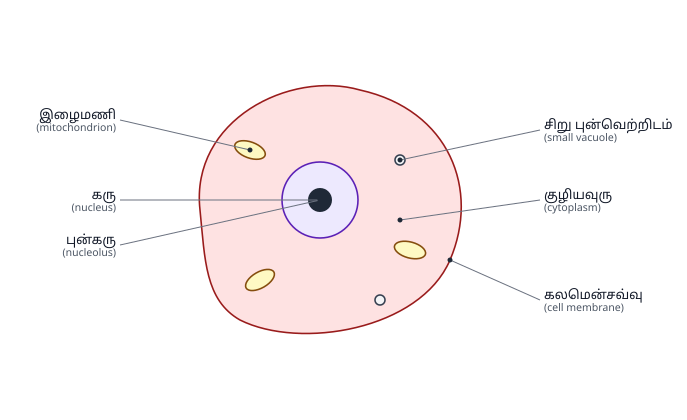

1. உட்செல்கை/வெளிச்செல்கைக் கட்டுப்பாடு
2. கட்டுப்பாட்டு மையம்
3. சக்தி (ATP) உற்பத்தி
4. இறைபோசோம் உருவாக்கம்

விடையும் விளக்கமும்

**விடை: (1) உட்செல்கை/வெளிச்செல்கைக் கட்டுப்பாடு**

கலமென்சவ்வு: உட்செல்கை/வெளிச்செல்கைக் கட்டுப்பாடு (கோப்பு 6: BIO-D02).

<!-- meta {"type":"mcq","id":"SCQ-10-06-015","grade":10,"chapter_id":"SC10-06","discipline":"BIO","difficulty":1,"qtype":"diagram","answer":4,"origin":"ORIGINAL","source_ref":"BIO-D02","image":"science_assets/biology/BIO-D02_labelled.svg"} -->
**SCQ-10-06-015** · அடிப்படை · வரிப்படம் · `ORIGINAL`

விலங்குக் கலம் வரிப்படத்தில் 'கரு' (nucleus) இன் தொழில்?

1. இறைபோசோம் உருவாக்கம்
2. சக்தி (ATP) உற்பத்தி
3. உட்செல்கை/வெளிச்செல்கைக் கட்டுப்பாடு
4. கட்டுப்பாட்டு மையம்

விடையும் விளக்கமும்

**விடை: (4) கட்டுப்பாட்டு மையம்**

கரு: கட்டுப்பாட்டு மையம் (கோப்பு 6: BIO-D02).

<!-- meta {"type":"mcq","id":"SCQ-10-06-016","grade":10,"chapter_id":"SC10-06","discipline":"BIO","difficulty":1,"qtype":"diagram","answer":2,"origin":"ORIGINAL","source_ref":"BIO-D02","image":"science_assets/biology/BIO-D02_labelled.svg"} -->
**SCQ-10-06-016** · அடிப்படை · வரிப்படம் · `ORIGINAL`

விலங்குக் கலம் வரிப்படத்தில் 'புன்கரு' (nucleolus) இன் தொழில்?

1. உட்செல்கை/வெளிச்செல்கைக் கட்டுப்பாடு
2. இறைபோசோம் உருவாக்கம்
3. கட்டுப்பாட்டு மையம்
4. சக்தி (ATP) உற்பத்தி

விடையும் விளக்கமும்

**விடை: (2) இறைபோசோம் உருவாக்கம்**

புன்கரு: இறைபோசோம் உருவாக்கம் (கோப்பு 6: BIO-D02).

<!-- meta {"type":"mcq","id":"SCQ-10-06-017","grade":10,"chapter_id":"SC10-06","discipline":"BIO","difficulty":1,"qtype":"recall","answer":3,"origin":"ORIGINAL","source_ref":"extra-SC10-06-1","image":null} -->
**SCQ-10-06-017** · அடிப்படை · நினைவு · `ORIGINAL`

இறைபோசோமின் தொழில்?

1. ஒளித்தொகுப்பு
2. சுவாசம்
3. புரதத் தொகுப்பு
4. கழிவகற்றல்

விடையும் விளக்கமும்

**விடை: (3) புரதத் தொகுப்பு**

இறைபோசோம்கள் புரதங்களை உருவாக்கும்.

<!-- meta {"type":"mcq","id":"SCQ-10-06-018","grade":10,"chapter_id":"SC10-06","discipline":"BIO","difficulty":1,"qtype":"concept","answer":3,"origin":"ORIGINAL","source_ref":"extra-SC10-06-2","image":null} -->
**SCQ-10-06-018** · அடிப்படை · எண்ணக்கரு · `ORIGINAL`

கலமென்சவ்வினூடு நீரின் அசைவு?

1. பகுப்பு
2. தொடுகை
3. பிரசாரணம்
4. ஒடுக்கம்

விடையும் விளக்கமும்

**விடை: (3) பிரசாரணம்**

அரைபுகவிடும் மென்சவ்வினூடு நீர் அசைவு.

<!-- meta {"type":"mcq","id":"SCQ-10-06-019","grade":10,"chapter_id":"SC10-06","discipline":"BIO","difficulty":1,"qtype":"concept","answer":3,"origin":"ORIGINAL","source_ref":"extra-SC10-06-3","image":null} -->
**SCQ-10-06-019** · அடிப்படை · எண்ணக்கரு · `ORIGINAL`

செறிவு கூடிய இடத்திலிருந்து குறைந்த இடத்துக்குத் துணிக்கைகள் அசைதல்?

1. உயிர்ப்பான கடத்தல்
2. ஆவியாதல்
3. பரவல்
4. பிரசாரணம் மட்டும்

விடையும் விளக்கமும்

**விடை: (3) பரவல்**

சக்தி தேவையற்ற பரவல்.

<!-- meta {"type":"mcq","id":"SCQ-10-06-020","grade":10,"chapter_id":"SC10-06","discipline":"BIO","difficulty":2,"qtype":"concept","answer":4,"origin":"ORIGINAL","source_ref":"extra-SC10-06-4","image":null} -->
**SCQ-10-06-020** · இடைநிலை · எண்ணக்கரு · `ORIGINAL`

செறிவுப் படித்திறனுக்கு எதிராக அசைய ATP தேவைப்படும் செயன்முறை?

1. பிரசாரணம்
2. பரவல்
3. வடிகட்டல்
4. உயிர்ப்பான கடத்தல்

விடையும் விளக்கமும்

**விடை: (4) உயிர்ப்பான கடத்தல்**

சக்தி பயன்படுத்தும் கடத்தல்.

<!-- meta {"type":"mcq","id":"SCQ-10-06-021","grade":10,"chapter_id":"SC10-06","discipline":"BIO","difficulty":3,"qtype":"reasoning","answer":3,"origin":"ORIGINAL","source_ref":"extra-SC10-06-5","image":null} -->
**SCQ-10-06-021** · கடினம் · காரணம் காணல் · `ORIGINAL`

செங்குருதிச் சிறுதுணிக்கையை நீரில் இட்டால்?

1. பிரியும்
2. மாற்றமில்லை
3. நீர் உட்சென்று வெடிக்கும்
4. சுருங்கும்

விடையும் விளக்கமும்

**விடை: (3) நீர் உட்சென்று வெடிக்கும்**

கலச்சுவர் இல்லை — பிரசாரணத்தால் வீங்கி வெடிக்கும்.

<!-- meta {"type":"mcq","id":"SCQ-10-06-022","grade":10,"chapter_id":"SC10-06","discipline":"BIO","difficulty":2,"qtype":"recall","answer":4,"origin":"ORIGINAL","source_ref":"extra-SC10-06-6","image":null} -->
**SCQ-10-06-022** · இடைநிலை · நினைவு · `ORIGINAL`

கோல்கி உடலத்தின் தொழில்?

1. ஒளித்தொகுப்பு
2. DNA சேமிப்பு
3. கலப்பிரிவு
4. பதார்த்தங்களைப் பொதியிட்டு சுரத்தல்

விடையும் விளக்கமும்

**விடை: (4) பதார்த்தங்களைப் பொதியிட்டு சுரத்தல்**

சுரப்புகளைச் செயற்படுத்தல்.

<!-- meta {"type":"mcq","id":"SCQ-10-06-023","grade":10,"chapter_id":"SC10-06","discipline":"BIO","difficulty":2,"qtype":"calculation","answer":3,"origin":"ORIGINAL","source_ref":"param-SC10-06-1","image":null} -->
**SCQ-10-06-023** · இடைநிலை · கணிப்பு · `ORIGINAL`

×300 உருப்பெருக்கத்தில் ஒரு கலத்தின் விம்ப நீளம் 6 mm. உண்மை நீளம் (µm)?

1. 1800 µm
2. 0.02 µm
3. 20 µm
4. 1.8 µm

விடையும் விளக்கமும்

**விடை: (3) 20 µm**

உண்மை = விம்பம் ÷ M; mm → µm ×1000.

<!-- meta {"type":"mcq","id":"SCQ-10-06-024","grade":10,"chapter_id":"SC10-06","discipline":"BIO","difficulty":2,"qtype":"calculation","answer":1,"origin":"ORIGINAL","source_ref":"param-SC10-06-2","image":null} -->
**SCQ-10-06-024** · இடைநிலை · கணிப்பு · `ORIGINAL`

×1000 உருப்பெருக்கத்தில் ஒரு கலத்தின் விம்ப நீளம் 20 mm. உண்மை நீளம் (µm)?

1. 20 µm
2. 20000 µm
3. 40 µm
4. 0.02 µm

விடையும் விளக்கமும்

**விடை: (1) 20 µm**

உண்மை = விம்பம் ÷ M; mm → µm ×1000.

<!-- meta {"type":"mcq","id":"SCQ-10-06-025","grade":10,"chapter_id":"SC10-06","discipline":"BIO","difficulty":2,"qtype":"calculation","answer":2,"origin":"ORIGINAL","source_ref":"param-SC10-06-3","image":null} -->
**SCQ-10-06-025** · இடைநிலை · கணிப்பு · `ORIGINAL`

×450 உருப்பெருக்கத்தில் ஒரு கலத்தின் விம்ப நீளம் 9 mm. உண்மை நீளம் (µm)?

1. 4050 µm
2. 20 µm
3. 0.02 µm
4. 4.05 µm

விடையும் விளக்கமும்

**விடை: (2) 20 µm**

உண்மை = விம்பம் ÷ M; mm → µm ×1000.

<!-- meta {"type":"mcq","id":"SCQ-10-06-026","grade":10,"chapter_id":"SC10-06","discipline":"BIO","difficulty":1,"qtype":"calculation","answer":4,"origin":"ORIGINAL","source_ref":"param-SC10-06-4","image":null} -->
**SCQ-10-06-026** · அடிப்படை · கணிப்பு · `ORIGINAL`

பார்வைத்துண்டு ×10, பொருள்வில்லை ×10. மொத்த உருப்பெருக்கம்?

1. 200 மடங்கு
2. 20 மடங்கு
3. 1 மடங்கு
4. 100 மடங்கு

விடையும் விளக்கமும்

**விடை: (4) 100 மடங்கு**

M = Mₑ × Mₒ.

<!-- meta {"type":"mcq","id":"SCQ-10-06-027","grade":10,"chapter_id":"SC10-06","discipline":"BIO","difficulty":1,"qtype":"calculation","answer":4,"origin":"ORIGINAL","source_ref":"param-SC10-06-5","image":null} -->
**SCQ-10-06-027** · அடிப்படை · கணிப்பு · `ORIGINAL`

பார்வைத்துண்டு ×15, பொருள்வில்லை ×40. மொத்த உருப்பெருக்கம்?

1. 55 மடங்கு
2. 1200 மடங்கு
3. 2.6667 மடங்கு
4. 600 மடங்கு

விடையும் விளக்கமும்

**விடை: (4) 600 மடங்கு**

M = Mₑ × Mₒ.

<!-- meta {"type":"mcq","id":"SCQ-10-06-028","grade":10,"chapter_id":"SC10-06","discipline":"BIO","difficulty":1,"qtype":"calculation","answer":4,"origin":"ORIGINAL","source_ref":"param-SC10-06-6","image":null} -->
**SCQ-10-06-028** · அடிப்படை · கணிப்பு · `ORIGINAL`

பார்வைத்துண்டு ×5, பொருள்வில்லை ×100. மொத்த உருப்பெருக்கம்?

1. 105 மடங்கு
2. 1000 மடங்கு
3. 20 மடங்கு
4. 500 மடங்கு

விடையும் விளக்கமும்

**விடை: (4) 500 மடங்கு**

M = Mₑ × Mₒ.

## SC10-07: மூலகங்களினதும் சேர்வைகளினதும் அளவறிதல் (Quantification of elements and compounds)

*தரம் 10 · அத்தியாயம் 7 · இரசாயனவியல் · 25 வினாக்கள்*

<!-- meta {"type":"mcq","id":"SCQ-10-07-001","grade":10,"chapter_id":"SC10-07","discipline":"CHE","difficulty":1,"qtype":"calculation","answer":2,"origin":"ORIGINAL","source_ref":"chapter","image":null} -->
**SCQ-10-07-001** · அடிப்படை · கணிப்பு · `ORIGINAL`

H₂SO₄ இன் சார்பு மூலக்கூற்றுத் திணிவு? (H=1, S=32, O=16)

1. 49
2. 98
3. 96
4. 50

விடையும் விளக்கமும்

**விடை: (2) 98**

2(1) + 32 + 4(16) = 98.

<!-- meta {"type":"mcq","id":"SCQ-10-07-002","grade":10,"chapter_id":"SC10-07","discipline":"CHE","difficulty":1,"qtype":"calculation","answer":2,"origin":"ORIGINAL","source_ref":"chapter","image":null} -->
**SCQ-10-07-002** · அடிப்படை · கணிப்பு · `ORIGINAL`

88 g CO₂ இலுள்ள மூல் எண்? (C=12, O=16)

1. 1
2. 2
3. 0.5
4. 4

விடையும் விளக்கமும்

**விடை: (2) 2**

M = 44; n = 88/44 = 2 mol.

<!-- meta {"type":"mcq","id":"SCQ-10-07-003","grade":10,"chapter_id":"SC10-07","discipline":"CHE","difficulty":2,"qtype":"calculation","answer":1,"origin":"ORIGINAL","source_ref":"chapter","image":null} -->
**SCQ-10-07-003** · இடைநிலை · கணிப்பு · `ORIGINAL`

0.5 mol நீர் மூலக்கூறுகளின் எண்ணிக்கை?

1. 3.011 × 10²³
2. 6.022 × 10²³
3. 1.2044 × 10²⁴
4. 0.5

விடையும் விளக்கமும்

**விடை: (1) 3.011 × 10²³**

0.5 × 6.022 × 10²³ = 3.011 × 10²³.

<!-- meta {"type":"mcq","id":"SCQ-10-07-004","grade":10,"chapter_id":"SC10-07","discipline":"CHE","difficulty":2,"qtype":"calculation","answer":2,"origin":"ORIGINAL","source_ref":"chapter","image":null} -->
**SCQ-10-07-004** · இடைநிலை · கணிப்பு · `ORIGINAL`

250 cm³ கரைசலில் 0.1 mol NaCl உள்ளது. செறிவு?

1. 0.025 mol dm⁻³
2. 0.4 mol dm⁻³
3. 0.1 mol dm⁻³
4. 25 mol dm⁻³

விடையும் விளக்கமும்

**விடை: (2) 0.4 mol dm⁻³**

V = 0.25 dm³; C = 0.1/0.25 = 0.4.

<!-- meta {"type":"mcq","id":"SCQ-10-07-005","grade":10,"chapter_id":"SC10-07","discipline":"CHE","difficulty":2,"qtype":"concept","answer":2,"origin":"ORIGINAL","source_ref":"chapter","image":null} -->
**SCQ-10-07-005** · இடைநிலை · எண்ணக்கரு · `ORIGINAL`

1 mol N₂ உம் 1 mol O₂ உம் — சமமானது?

1. திணிவு
2. மூலக்கூற்று எண்ணிக்கை
3. அணுத்திணிவு
4. அடர்த்தி

விடையும் விளக்கமும்

**விடை: (2) மூலக்கூற்று எண்ணிக்கை**

இரண்டிலும் 6.022 × 10²³ மூலக்கூறுகள்.

<!-- meta {"type":"mcq","id":"SCQ-10-07-006","grade":10,"chapter_id":"SC10-07","discipline":"CHE","difficulty":2,"qtype":"calculation","answer":2,"origin":"ORIGINAL","source_ref":"chapter","image":null} -->
**SCQ-10-07-006** · இடைநிலை · கணிப்பு · `ORIGINAL`

1 mol dm⁻³ NaOH கரைசல் 500 cm³ தயாரிக்கத் தேவையான NaOH திணிவு? (NaOH = 40)

1. 40 g
2. 20 g
3. 10 g
4. 80 g

விடையும் விளக்கமும்

**விடை: (2) 20 g**

n = 1 × 0.5 = 0.5 mol; m = 0.5 × 40 = 20 g.

<!-- meta {"type":"mcq","id":"SCQ-10-07-007","grade":10,"chapter_id":"SC10-07","discipline":"CHE","difficulty":2,"qtype":"equation","answer":1,"origin":"ORIGINAL","source_ref":"chapter","image":null} -->
**SCQ-10-07-007** · இடைநிலை · சமன்பாடு · `ORIGINAL`

2KMnO₄ → K₂MnO₄ + MnO₂ + O₂. 2 mol KMnO₄ இலிருந்து உருவாகும் O₂ மூல்?

1. 1
2. 2
3. 0.5
4. 4

விடையும் விளக்கமும்

**விடை: (1) 1**

2 : 1 மூல் விகிதம்.

<!-- meta {"type":"mcq","id":"SCQ-10-07-008","grade":10,"chapter_id":"SC10-07","discipline":"CHE","difficulty":3,"qtype":"calculation","answer":2,"origin":"ORIGINAL","source_ref":"chapter","image":null} -->
**SCQ-10-07-008** · கடினம் · கணிப்பு · `ORIGINAL`

C₂H₄ + 3O₂ → 2CO₂ + 2H₂O. 28 g எதீன் முழுமையாக எரிந்தால் உருவாகும் நீர்த் திணிவு? (C=12,H=1,O=16)

1. 18 g
2. 36 g
3. 9 g
4. 28 g

விடையும் விளக்கமும்

**விடை: (2) 36 g**

28 g = 1 mol C₂H₄ → 2 mol H₂O = 36 g.

<!-- meta {"type":"mcq","id":"SCQ-10-07-009","grade":10,"chapter_id":"SC10-07","discipline":"CHE","difficulty":2,"qtype":"concept","answer":3,"origin":"ORIGINAL","source_ref":"chapter","image":null} -->
**SCQ-10-07-009** · இடைநிலை · எண்ணக்கரு · `ORIGINAL`

சார்பு அணுத்திணிவுக்கு அலகு?

1. g
2. g mol⁻¹
3. அலகு இல்லை
4. kg

விடையும் விளக்கமும்

**விடை: (3) அலகு இல்லை**

இது ஒப்பீட்டு விகிதம்.

<!-- meta {"type":"mcq","id":"SCQ-10-07-010","grade":10,"chapter_id":"SC10-07","discipline":"CHE","difficulty":1,"qtype":"calculation","answer":1,"origin":"ORIGINAL","source_ref":"chapter","image":null} -->
**SCQ-10-07-010** · அடிப்படை · கணிப்பு · `ORIGINAL`

6.022 × 10²³ Na அணுக்களின் திணிவு? (Na = 23)

1. 23 g
2. 6.022 g
3. 1 g
4. 11 g

விடையும் விளக்கமும்

**விடை: (1) 23 g**

1 mol Na = 23 g.

<!-- meta {"type":"mcq","id":"SCQ-10-07-011","grade":10,"chapter_id":"SC10-07","discipline":"CHE","difficulty":1,"qtype":"calculation","answer":4,"origin":"ORIGINAL","source_ref":"CL-MOLE-1","image":null} -->
**SCQ-10-07-011** · அடிப்படை · கணிப்பு · `ORIGINAL`

36 g நீரிலுள்ள மூல் எண்ணிக்கை? (H₂O = 18 g mol⁻¹)

1. 20 mol
2. 1 mol
3. 4 mol
4. 2 mol

விடையும் விளக்கமும்

**விடை: (4) 2 mol**

சரியான விடை 2 mol. கோப்பு 5 இல் CL-MOLE (அடிப்படை) எட்டுப் படித் தீர்வைப் பார்க்க.

<!-- meta {"type":"mcq","id":"SCQ-10-07-012","grade":10,"chapter_id":"SC10-07","discipline":"CHE","difficulty":2,"qtype":"calculation","answer":4,"origin":"ORIGINAL","source_ref":"param-SC10-07-1","image":null} -->
**SCQ-10-07-012** · இடைநிலை · கணிப்பு · `ORIGINAL`

NaOH இன் சார் மூலக்கூற்றுத் திணிவு? (H 1, C 12, N 14, O 16, Na 23, Mg 24, Al 27, S 32, Cl 35.5, Ca 40)

1. 80
2. 56
3. 39
4. 40

விடையும் விளக்கமும்

**விடை: (4) 40**

அணுத்திணிவுகளின் கூட்டு = 40.

<!-- meta {"type":"mcq","id":"SCQ-10-07-013","grade":10,"chapter_id":"SC10-07","discipline":"CHE","difficulty":2,"qtype":"calculation","answer":4,"origin":"ORIGINAL","source_ref":"param-SC10-07-2","image":null} -->
**SCQ-10-07-013** · இடைநிலை · கணிப்பு · `ORIGINAL`

H₂SO₄ இன் சார் மூலக்கூற்றுத் திணிவு? (H 1, C 12, N 14, O 16, Na 23, Mg 24, Al 27, S 32, Cl 35.5, Ca 40)

1. 114
2. 82
3. 49
4. 98

விடையும் விளக்கமும்

**விடை: (4) 98**

அணுத்திணிவுகளின் கூட்டு = 98.

<!-- meta {"type":"mcq","id":"SCQ-10-07-014","grade":10,"chapter_id":"SC10-07","discipline":"CHE","difficulty":2,"qtype":"calculation","answer":4,"origin":"ORIGINAL","source_ref":"param-SC10-07-3","image":null} -->
**SCQ-10-07-014** · இடைநிலை · கணிப்பு · `ORIGINAL`

CaCO₃ இன் சார் மூலக்கூற்றுத் திணிவு? (H 1, C 12, N 14, O 16, Na 23, Mg 24, Al 27, S 32, Cl 35.5, Ca 40)

1. 84
2. 116
3. 68
4. 100

விடையும் விளக்கமும்

**விடை: (4) 100**

அணுத்திணிவுகளின் கூட்டு = 100.

<!-- meta {"type":"mcq","id":"SCQ-10-07-015","grade":10,"chapter_id":"SC10-07","discipline":"CHE","difficulty":2,"qtype":"calculation","answer":1,"origin":"ORIGINAL","source_ref":"param-SC10-07-4","image":null} -->
**SCQ-10-07-015** · இடைநிலை · கணிப்பு · `ORIGINAL`

Mg(OH)₂ இன் சார் மூலக்கூற்றுத் திணிவு? (H 1, C 12, N 14, O 16, Na 23, Mg 24, Al 27, S 32, Cl 35.5, Ca 40)

1. 58
2. 74
3. 41
4. 57

விடையும் விளக்கமும்

**விடை: (1) 58**

அணுத்திணிவுகளின் கூட்டு = 58.

<!-- meta {"type":"mcq","id":"SCQ-10-07-016","grade":10,"chapter_id":"SC10-07","discipline":"CHE","difficulty":2,"qtype":"calculation","answer":3,"origin":"ORIGINAL","source_ref":"param-SC10-07-5","image":null} -->
**SCQ-10-07-016** · இடைநிலை · கணிப்பு · `ORIGINAL`

NH₄Cl இன் சார் மூலக்கூற்றுத் திணிவு? (H 1, C 12, N 14, O 16, Na 23, Mg 24, Al 27, S 32, Cl 35.5, Ca 40)

1. 50.5
2. 69.5
3. 53.5
4. 18

விடையும் விளக்கமும்

**விடை: (3) 53.5**

அணுத்திணிவுகளின் கூட்டு = 53.5.

<!-- meta {"type":"mcq","id":"SCQ-10-07-017","grade":10,"chapter_id":"SC10-07","discipline":"CHE","difficulty":2,"qtype":"calculation","answer":2,"origin":"ORIGINAL","source_ref":"param-SC10-07-6","image":null} -->
**SCQ-10-07-017** · இடைநிலை · கணிப்பு · `ORIGINAL`

Al₂O₃ இன் சார் மூலக்கூற்றுத் திணிவு? (H 1, C 12, N 14, O 16, Na 23, Mg 24, Al 27, S 32, Cl 35.5, Ca 40)

1. 118
2. 102
3. 43
4. 86

விடையும் விளக்கமும்

**விடை: (2) 102**

அணுத்திணிவுகளின் கூட்டு = 102.

<!-- meta {"type":"mcq","id":"SCQ-10-07-018","grade":10,"chapter_id":"SC10-07","discipline":"CHE","difficulty":2,"qtype":"calculation","answer":4,"origin":"ORIGINAL","source_ref":"param-SC10-07-7","image":null} -->
**SCQ-10-07-018** · இடைநிலை · கணிப்பு · `ORIGINAL`

C₆H₁₂O₆ இன் சார் மூலக்கூற்றுத் திணிவு? (H 1, C 12, N 14, O 16, Na 23, Mg 24, Al 27, S 32, Cl 35.5, Ca 40)

1. 196
2. 164
3. 29
4. 180

விடையும் விளக்கமும்

**விடை: (4) 180**

அணுத்திணிவுகளின் கூட்டு = 180.

<!-- meta {"type":"mcq","id":"SCQ-10-07-019","grade":10,"chapter_id":"SC10-07","discipline":"CHE","difficulty":1,"qtype":"calculation","answer":2,"origin":"ORIGINAL","source_ref":"param-SC10-07-8","image":null} -->
**SCQ-10-07-019** · அடிப்படை · கணிப்பு · `ORIGINAL`

10 g NaOH இலுள்ள மூல்? (மூலர்த் திணிவு 40 g mol⁻¹)

1. 4 mol
2. 0.25 mol
3. 400 mol
4. 0.5 mol

விடையும் விளக்கமும்

**விடை: (2) 0.25 mol**

n = m/M.

<!-- meta {"type":"mcq","id":"SCQ-10-07-020","grade":10,"chapter_id":"SC10-07","discipline":"CHE","difficulty":1,"qtype":"calculation","answer":1,"origin":"ORIGINAL","source_ref":"param-SC10-07-9","image":null} -->
**SCQ-10-07-020** · அடிப்படை · கணிப்பு · `ORIGINAL`

88 g CO₂ இலுள்ள மூல்? (மூலர்த் திணிவு 44 g mol⁻¹)

1. 2 mol
2. 0.5 mol
3. 3872 mol
4. 4 mol

விடையும் விளக்கமும்

**விடை: (1) 2 mol**

n = m/M.

<!-- meta {"type":"mcq","id":"SCQ-10-07-021","grade":10,"chapter_id":"SC10-07","discipline":"CHE","difficulty":1,"qtype":"calculation","answer":3,"origin":"ORIGINAL","source_ref":"param-SC10-07-10","image":null} -->
**SCQ-10-07-021** · அடிப்படை · கணிப்பு · `ORIGINAL`

9 g H₂O இலுள்ள மூல்? (மூலர்த் திணிவு 18 g mol⁻¹)

1. 2 mol
2. 162 mol
3. 0.5 mol
4. 1 mol

விடையும் விளக்கமும்

**விடை: (3) 0.5 mol**

n = m/M.

<!-- meta {"type":"mcq","id":"SCQ-10-07-022","grade":10,"chapter_id":"SC10-07","discipline":"CHE","difficulty":1,"qtype":"calculation","answer":2,"origin":"ORIGINAL","source_ref":"param-SC10-07-11","image":null} -->
**SCQ-10-07-022** · அடிப்படை · கணிப்பு · `ORIGINAL`

250 g CaCO₃ இலுள்ள மூல்? (மூலர்த் திணிவு 100 g mol⁻¹)

1. 25000 mol
2. 2.5 mol
3. 0.4 mol
4. 5 mol

விடையும் விளக்கமும்

**விடை: (2) 2.5 mol**

n = m/M.

<!-- meta {"type":"mcq","id":"SCQ-10-07-023","grade":10,"chapter_id":"SC10-07","discipline":"CHE","difficulty":1,"qtype":"calculation","answer":1,"origin":"ORIGINAL","source_ref":"param-SC10-07-12","image":null} -->
**SCQ-10-07-023** · அடிப்படை · கணிப்பு · `ORIGINAL`

0.25 mol O₂ இன் திணிவு? (M = 32 g mol⁻¹)

1. 8 g
2. 0.0078 g
3. 128 g
4. 16 g

விடையும் விளக்கமும்

**விடை: (1) 8 g**

m = nM.

<!-- meta {"type":"mcq","id":"SCQ-10-07-024","grade":10,"chapter_id":"SC10-07","discipline":"CHE","difficulty":1,"qtype":"calculation","answer":1,"origin":"ORIGINAL","source_ref":"param-SC10-07-13","image":null} -->
**SCQ-10-07-024** · அடிப்படை · கணிப்பு · `ORIGINAL`

2 mol NaCl இன் திணிவு? (M = 58.5 g mol⁻¹)

1. 117 g
2. 0.0342 g
3. 234 g
4. 29.25 g

விடையும் விளக்கமும்

**விடை: (1) 117 g**

m = nM.

<!-- meta {"type":"mcq","id":"SCQ-10-07-025","grade":10,"chapter_id":"SC10-07","discipline":"CHE","difficulty":1,"qtype":"calculation","answer":2,"origin":"ORIGINAL","source_ref":"param-SC10-07-14","image":null} -->
**SCQ-10-07-025** · அடிப்படை · கணிப்பு · `ORIGINAL`

0.1 mol H₂SO₄ இன் திணிவு? (M = 98 g mol⁻¹)

1. 0.001 g
2. 9.8 g
3. 980 g
4. 19.6 g

விடையும் விளக்கமும்

**விடை: (2) 9.8 g**

m = nM.

## SC10-08: அங்கிகளின் சிறப்பியல்புகள் (Characteristics of living organisms)

*தரம் 10 · அத்தியாயம் 8 · உயிரியல் · 25 வினாக்கள்*

<!-- meta {"type":"mcq","id":"SCQ-10-08-001","grade":10,"chapter_id":"SC10-08","discipline":"BIO","difficulty":1,"qtype":"recall","answer":2,"origin":"ORIGINAL","source_ref":"chapter","image":null} -->
**SCQ-10-08-001** · அடிப்படை · நினைவு · `ORIGINAL`

இருசொற் பெயரீட்டு முறையைச் சரியாக எழுதியது எது?

1. homo Sapiens
2. Homo sapiens
3. Homo Sapiens
4. homo sapiens

விடையும் விளக்கமும்

**விடை: (2) Homo sapiens**

சாதிப் பெயர் பெரிய எழுத்தில், இனப் பெயர் சிறிய எழுத்தில்.

<!-- meta {"type":"mcq","id":"SCQ-10-08-002","grade":10,"chapter_id":"SC10-08","discipline":"BIO","difficulty":1,"qtype":"recall","answer":2,"origin":"ORIGINAL","source_ref":"chapter","image":null} -->
**SCQ-10-08-002** · அடிப்படை · நினைவு · `ORIGINAL`

மண்புழு எந்தக் கணத்தைச் சேர்ந்தது?

1. மொலஸ்கா
2. வளையப்புழு
3. ஆத்திரப்போடா
4. நைடேரியா

விடையும் விளக்கமும்

**விடை: (2) வளையப்புழு**

வளையங்களாகப் பிரிந்த உடல் — வளையப்புழு (Annelida).

<!-- meta {"type":"mcq","id":"SCQ-10-08-003","grade":10,"chapter_id":"SC10-08","discipline":"BIO","difficulty":2,"qtype":"concept","answer":2,"origin":"ORIGINAL","source_ref":"chapter","image":null} -->
**SCQ-10-08-003** · இடைநிலை · எண்ணக்கரு · `ORIGINAL`

பக்ரீரியாக்களை யூக்கரியாவிலிருந்து வேறுபடுத்துவது?

1. கலச்சுவர் உண்மை
2. மென்சவ்வால் சூழப்பட்ட கரு இல்லாமை
3. DNA உண்மை
4. இறைபோசோம் உண்மை

விடையும் விளக்கமும்

**விடை: (2) மென்சவ்வால் சூழப்பட்ட கரு இல்லாமை**

பக்ரீரியா புரோக்கரியோற்றுகள் — உண்மையான கரு இல்லை.

<!-- meta {"type":"mcq","id":"SCQ-10-08-004","grade":10,"chapter_id":"SC10-08","discipline":"BIO","difficulty":1,"qtype":"concept","answer":2,"origin":"ORIGINAL","source_ref":"chapter","image":null} -->
**SCQ-10-08-004** · அடிப்படை · எண்ணக்கரு · `ORIGINAL`

நண்டு, சிலந்தி, பூச்சி — பொதுவான இயல்பு?

1. மென்மையான உடல்
2. மூட்டுள்ள கால்கள்
3. குழாய்ப் பாதங்கள்
4. கொட்டும் கலங்கள்

விடையும் விளக்கமும்

**விடை: (2) மூட்டுள்ள கால்கள்**

ஆத்திரப்போடா: மூட்டுள்ள கால்கள், புறவன்கூடு.

<!-- meta {"type":"mcq","id":"SCQ-10-08-005","grade":10,"chapter_id":"SC10-08","discipline":"BIO","difficulty":2,"qtype":"concept","answer":2,"origin":"ORIGINAL","source_ref":"chapter","image":null} -->
**SCQ-10-08-005** · இடைநிலை · எண்ணக்கரு · `ORIGINAL`

நட்சத்திர மீன் எக்கணத்தைச் சேர்ந்தது?

1. மீன்கள்
2. எக்கினோடேமேற்றா
3. மொலஸ்கா
4. நைடேரியா

விடையும் விளக்கமும்

**விடை: (2) எக்கினோடேமேற்றா**

பெயரில் 'மீன்' இருந்தாலும் அது முட்தோலி.

<!-- meta {"type":"mcq","id":"SCQ-10-08-006","grade":10,"chapter_id":"SC10-08","discipline":"BIO","difficulty":1,"qtype":"concept","answer":3,"origin":"ORIGINAL","source_ref":"chapter","image":null} -->
**SCQ-10-08-006** · அடிப்படை · எண்ணக்கரு · `ORIGINAL`

அங்கிகளின் சிறப்பியல்பு அல்லாதது?

1. இனப்பெருக்கம்
2. சுவாசம்
3. படிகமாதல்
4. கழிவகற்றல்

விடையும் விளக்கமும்

**விடை: (3) படிகமாதல்**

படிகமாதல் உயிரற்ற பொருட்களிலும் நடைபெறும்.

<!-- meta {"type":"mcq","id":"SCQ-10-08-007","grade":10,"chapter_id":"SC10-08","discipline":"BIO","difficulty":2,"qtype":"concept","answer":2,"origin":"ORIGINAL","source_ref":"chapter","image":null} -->
**SCQ-10-08-007** · இடைநிலை · எண்ணக்கரு · `ORIGINAL`

பங்கசுகள் தாவரங்களிலிருந்து வேறுபடுவது?

1. கலச்சுவர் இல்லை
2. பச்சையம் இல்லாததால் பிறபோசணை
3. கரு இல்லை
4. சுவாசிக்காது

விடையும் விளக்கமும்

**விடை: (2) பச்சையம் இல்லாததால் பிறபோசணை**

பங்கசுகள் ஒளித்தொகுப்புச் செய்யாது; உக்கலுண்ணிகள்.

<!-- meta {"type":"mcq","id":"SCQ-10-08-008","grade":10,"chapter_id":"SC10-08","discipline":"BIO","difficulty":3,"qtype":"reasoning","answer":2,"origin":"ORIGINAL","source_ref":"chapter","image":null} -->
**SCQ-10-08-008** · கடினம் · காரணம் காணல் · `ORIGINAL`

ஒரே சாதியைச் சேர்ந்த இரு அங்கிகள் கட்டாயம் ஒரே … ஐச் சேர்ந்தவை.

1. இனம்
2. குடும்பம்
3. இருசொற் பெயர்
4. இனம், குடும்பம் இரண்டும்

விடையும் விளக்கமும்

**விடை: (2) குடும்பம்**

சாதி குடும்பத்துக்குள் அடங்கும்; இனம் வேறாகலாம்.

<!-- meta {"type":"mcq","id":"SCQ-10-08-009","grade":10,"chapter_id":"SC10-08","discipline":"BIO","difficulty":2,"qtype":"reasoning","answer":2,"origin":"ORIGINAL","source_ref":"chapter","image":null} -->
**SCQ-10-08-009** · இடைநிலை · காரணம் காணல் · `ORIGINAL`

வெளவால் பறவையல்ல, முலையூட்டி எனக் கூறக் காரணம்?

1. இறக்கைகள் உண்டு
2. குட்டி ஈன்று பாலூட்டல், மயிர் உண்மை
3. முட்டையிடும்
4. செதில்கள் உண்டு

விடையும் விளக்கமும்

**விடை: (2) குட்டி ஈன்று பாலூட்டல், மயிர் உண்மை**

முலையூட்டிகளின் தனித்துவ இயல்புகள்.

<!-- meta {"type":"mcq","id":"SCQ-10-08-010","grade":10,"chapter_id":"SC10-08","discipline":"BIO","difficulty":1,"qtype":"application","answer":2,"origin":"ORIGINAL","source_ref":"chapter","image":null} -->
**SCQ-10-08-010** · அடிப்படை · பிரயோகம் · `ORIGINAL`

தொட்டாற்சிணுங்கி இலை மூடுதல் காட்டும் இயல்பு?

1. வளர்ச்சி
2. உறுத்துணர்ச்சி
3. சுவாசம்
4. கழிவகற்றல்

விடையும் விளக்கமும்

**விடை: (2) உறுத்துணர்ச்சி**

தொடுகைத் தூண்டலுக்குத் துலங்கல்.

<!-- meta {"type":"mcq","id":"SCQ-10-08-011","grade":10,"chapter_id":"SC10-08","discipline":"BIO","difficulty":1,"qtype":"recall","answer":4,"origin":"ORIGINAL","source_ref":"extra-SC10-08-1","image":null} -->
**SCQ-10-08-011** · அடிப்படை · நினைவு · `ORIGINAL`

இருசொற் பெயரீட்டு முறையை அறிமுகப்படுத்தியவர்?

1. லூயி பாஸ்டர்
2. சார்ள்ஸ் டார்வின்
3. கிரகர் மென்டல்
4. கரோலஸ் லின்னேயஸ்

விடையும் விளக்கமும்

**விடை: (4) கரோலஸ் லின்னேயஸ்**

லின்னேயஸ் — பேரினம் + இனம்.

<!-- meta {"type":"mcq","id":"SCQ-10-08-012","grade":10,"chapter_id":"SC10-08","discipline":"BIO","difficulty":2,"qtype":"concept","answer":4,"origin":"ORIGINAL","source_ref":"extra-SC10-08-2","image":null} -->
**SCQ-10-08-012** · இடைநிலை · எண்ணக்கரு · `ORIGINAL`

விஞ்ஞானப் பெயர் எழுதும் சரியான முறை?

1. HOMO SAPIENS
2. homo Sapiens
3. Homo Sapiens
4. Homo sapiens

விடையும் விளக்கமும்

**விடை: (4) Homo sapiens**

பேரினம் பெரிய எழுத்தில் தொடக்கம்; இனம் சிறிய எழுத்து; சாய்வெழுத்து.

<!-- meta {"type":"mcq","id":"SCQ-10-08-013","grade":10,"chapter_id":"SC10-08","discipline":"BIO","difficulty":1,"qtype":"recall","answer":4,"origin":"ORIGINAL","source_ref":"extra-SC10-08-3","image":null} -->
**SCQ-10-08-013** · அடிப்படை · நினைவு · `ORIGINAL`

வகைப்பாட்டின் மிகச்சிறிய அலகு?

1. கணம்
2. குடும்பம்
3. பேரினம்
4. இனம்

விடையும் விளக்கமும்

**விடை: (4) இனம்**

இனப்பெருக்கம் செய்து வளமான சந்ததி தரும் குழு.

<!-- meta {"type":"mcq","id":"SCQ-10-08-014","grade":10,"chapter_id":"SC10-08","discipline":"BIO","difficulty":1,"qtype":"concept","answer":4,"origin":"ORIGINAL","source_ref":"extra-SC10-08-4","image":null} -->
**SCQ-10-08-014** · அடிப்படை · எண்ணக்கரு · `ORIGINAL`

பின்வருவனவற்றுள் முள்ளந்தண்டிலி?

1. பாம்பு
2. வௌவால்
3. தவளை
4. நத்தை

விடையும் விளக்கமும்

**விடை: (4) நத்தை**

நத்தை மொலஸ்கா.

<!-- meta {"type":"mcq","id":"SCQ-10-08-015","grade":10,"chapter_id":"SC10-08","discipline":"BIO","difficulty":1,"qtype":"recall","answer":2,"origin":"ORIGINAL","source_ref":"extra-SC10-08-5","image":null} -->
**SCQ-10-08-015** · அடிப்படை · நினைவு · `ORIGINAL`

ஈரூடகவாழிகளின் இயல்பு?

1. இறகுகள்
2. ஈரமான, செதிலற்ற தோல்
3. முலைச்சுரப்பிகள்
4. உலர் செதில்கள்

விடையும் விளக்கமும்

**விடை: (2) ஈரமான, செதிலற்ற தோல்**

தோலினூடும் வாயுப் பரிமாற்றம்.

<!-- meta {"type":"mcq","id":"SCQ-10-08-016","grade":10,"chapter_id":"SC10-08","discipline":"BIO","difficulty":1,"qtype":"recall","answer":4,"origin":"ORIGINAL","source_ref":"extra-SC10-08-6","image":null} -->
**SCQ-10-08-016** · அடிப்படை · நினைவு · `ORIGINAL`

முலையூட்டிகளுக்குச் சிறப்பான இயல்பு?

1. செவுள்கள் மட்டும்
2. பூக்கள்
3. செதில்கள்
4. முலைச்சுரப்பிகளும் மயிரும்

விடையும் விளக்கமும்

**விடை: (4) முலைச்சுரப்பிகளும் மயிரும்**

குட்டிகளுக்குப் பால் ஊட்டல்.

<!-- meta {"type":"mcq","id":"SCQ-10-08-017","grade":10,"chapter_id":"SC10-08","discipline":"BIO","difficulty":2,"qtype":"concept","answer":1,"origin":"ORIGINAL","source_ref":"extra-SC10-08-7","image":null} -->
**SCQ-10-08-017** · இடைநிலை · எண்ணக்கரு · `ORIGINAL`

பூக்காத, வித்துகள் வெளிப்படையாகக் காணப்படும் தாவரக் கூட்டம்?

1. வித்துமூடியிலிகள் (Gymnosperms)
2. பாசிகள்
3. பன்னங்கள்
4. பூக்குந்தாவரங்கள்

விடையும் விளக்கமும்

**விடை: (1) வித்துமூடியிலிகள் (Gymnosperms)**

உ-ம் சைக்கஸ், பைனஸ்.

<!-- meta {"type":"mcq","id":"SCQ-10-08-018","grade":10,"chapter_id":"SC10-08","discipline":"BIO","difficulty":2,"qtype":"concept","answer":2,"origin":"ORIGINAL","source_ref":"extra-SC10-08-8","image":null} -->
**SCQ-10-08-018** · இடைநிலை · எண்ணக்கரு · `ORIGINAL`

இலைக்கு வலைநரம்பமைப்பு, ஆணிவேர் உடைய தாவரம்?

1. பாசி
2. இருவித்திலைத் தாவரம்
3. பன்னம்
4. ஒருவித்திலைத் தாவரம்

விடையும் விளக்கமும்

**விடை: (2) இருவித்திலைத் தாவரம்**

இருவித்திலை இயல்புகள்.

<!-- meta {"type":"mcq","id":"SCQ-10-08-019","grade":10,"chapter_id":"SC10-08","discipline":"BIO","difficulty":1,"qtype":"application","answer":4,"origin":"ORIGINAL","source_ref":"extra-SC10-08-9","image":null} -->
**SCQ-10-08-019** · அடிப்படை · பிரயோகம் · `ORIGINAL`

ஒருவித்திலைத் தாவரத்துக்கு உதாரணம்?

1. மா
2. அவரை
3. பலா
4. நெல்

விடையும் விளக்கமும்

**விடை: (4) நெல்**

நெல் — புல் குடும்பம்.

<!-- meta {"type":"mcq","id":"SCQ-10-08-020","grade":10,"chapter_id":"SC10-08","discipline":"BIO","difficulty":1,"qtype":"recall","answer":4,"origin":"ORIGINAL","source_ref":"extra-SC10-08-10","image":null} -->
**SCQ-10-08-020** · அடிப்படை · நினைவு · `ORIGINAL`

பூச்சிகளுக்கு உள்ள கால்கள் எண்ணிக்கை?

1. 8
2. 10
3. 4
4. 6

விடையும் விளக்கமும்

**விடை: (4) 6**

மூன்று சோடி கால்கள்.

<!-- meta {"type":"mcq","id":"SCQ-10-08-021","grade":10,"chapter_id":"SC10-08","discipline":"BIO","difficulty":2,"qtype":"reasoning","answer":2,"origin":"ORIGINAL","source_ref":"extra-SC10-08-11","image":null} -->
**SCQ-10-08-021** · இடைநிலை · காரணம் காணல் · `ORIGINAL`

சிலந்தி பூச்சி அல்ல என்பதற்கான காரணம்?

1. இறகுகள் உண்டு
2. 8 கால்கள், இரு உடற் பகுதிகள்
3. செவுள்கள் உண்டு
4. முள்ளந்தண்டு உண்டு

விடையும் விளக்கமும்

**விடை: (2) 8 கால்கள், இரு உடற் பகுதிகள்**

சிலந்தி — அரக்னிடா.

<!-- meta {"type":"mcq","id":"SCQ-10-08-022","grade":10,"chapter_id":"SC10-08","discipline":"BIO","difficulty":1,"qtype":"application","answer":2,"origin":"ORIGINAL","source_ref":"extra-SC10-08-12","image":null} -->
**SCQ-10-08-022** · அடிப்படை · பிரயோகம் · `ORIGINAL`

உணர்திறன் என்ற சிறப்பியல்புக்கு உதாரணம்?

1. இலை உதிர்தல்
2. தொட்டாற்சிணுங்கி இலைகள் மூடுதல்
3. பழம் பழுத்தல்
4. வித்து உலர்தல்

விடையும் விளக்கமும்

**விடை: (2) தொட்டாற்சிணுங்கி இலைகள் மூடுதல்**

தூண்டலுக்குத் துலங்கல்.

<!-- meta {"type":"mcq","id":"SCQ-10-08-023","grade":10,"chapter_id":"SC10-08","discipline":"BIO","difficulty":3,"qtype":"reasoning","answer":4,"origin":"ORIGINAL","source_ref":"extra-SC10-08-13","image":null} -->
**SCQ-10-08-023** · கடினம் · காரணம் காணல் · `ORIGINAL`

வைரசுகள் உயிருள்ளவை எனக் கூற முடியாததற்கான ஒரு காரணம்?

1. DNA/RNA இல்லை
2. பச்சையம் உண்டு
3. மிகப் பெரியவை
4. விருந்துவழங்கி கலத்துக்கு வெளியே இனம்பெருகாது

விடையும் விளக்கமும்

**விடை: (4) விருந்துவழங்கி கலத்துக்கு வெளியே இனம்பெருகாது**

கட்டாய ஒட்டுண்ணிகள்.

<!-- meta {"type":"mcq","id":"SCQ-10-08-024","grade":10,"chapter_id":"SC10-08","discipline":"BIO","difficulty":3,"qtype":"concept","answer":4,"origin":"ORIGINAL","source_ref":"extra-SC10-08-14","image":null} -->
**SCQ-10-08-024** · கடினம் · எண்ணக்கரு · `ORIGINAL`

இருபக்கச் சமச்சீரும் கண்டங்களும் உடைய புழு வகை?

1. கடற்பஞ்சு
2. நாடாப்புழு
3. நிடேரியா
4. அனெலிடா (மண்புழு)

விடையும் விளக்கமும்

**விடை: (4) அனெலிடா (மண்புழு)**

வளையப் புழுக்கள்.

<!-- meta {"type":"mcq","id":"SCQ-10-08-025","grade":10,"chapter_id":"SC10-08","discipline":"BIO","difficulty":2,"qtype":"application","answer":2,"origin":"ORIGINAL","source_ref":"extra-SC10-08-15","image":null} -->
**SCQ-10-08-025** · இடைநிலை · பிரயோகம் · `ORIGINAL`

இருகுறிச் சாவியின் (dichotomous key) நோக்கம்?

1. வயது காணல்
2. அங்கிகளை இனங்காணல்
3. நிறை காணல்
4. DNA வாசித்தல்

விடையும் விளக்கமும்

**விடை: (2) அங்கிகளை இனங்காணல்**

இரு தெரிவுகளாகப் படிப்படியாகப் பிரித்தல்.

## SC10-09: விளையுள் விசை (Resultant force)

*தரம் 10 · அத்தியாயம் 9 · பௌதிகவியல் · 25 வினாக்கள்*

<!-- meta {"type":"mcq","id":"SCQ-10-09-001","grade":10,"chapter_id":"SC10-09","discipline":"PHY","difficulty":1,"qtype":"calculation","answer":2,"origin":"ORIGINAL","source_ref":"chapter","image":null} -->
**SCQ-10-09-001** · அடிப்படை · கணிப்பு · `ORIGINAL`

8 N வலது, 5 N இடது விசைகளின் விளையுள்?

1. 13 N வலது
2. 3 N வலது
3. 3 N இடது
4. 40 N

விடையும் விளக்கமும்

**விடை: (2) 3 N வலது**

8 − 5 = 3 N, பெரிய விசையின் திசை.

<!-- meta {"type":"mcq","id":"SCQ-10-09-002","grade":10,"chapter_id":"SC10-09","discipline":"PHY","difficulty":2,"qtype":"calculation","answer":3,"origin":"ORIGINAL","source_ref":"chapter","image":null} -->
**SCQ-10-09-002** · இடைநிலை · கணிப்பு · `ORIGINAL`

6 N, 8 N விசைகள் செங்குத்தாகத் தாக்கின். விளையுள்?

1. 14 N
2. 2 N
3. 10 N
4. 48 N

விடையும் விளக்கமும்

**விடை: (3) 10 N**

√(36 + 64) = 10 N.

<!-- meta {"type":"mcq","id":"SCQ-10-09-003","grade":10,"chapter_id":"SC10-09","discipline":"PHY","difficulty":2,"qtype":"calculation","answer":2,"origin":"ORIGINAL","source_ref":"chapter","image":null} -->
**SCQ-10-09-003** · இடைநிலை · கணிப்பு · `ORIGINAL`

2 kg பொருளில் 10 N வலதும் 4 N இடதும் தாக்கின. ஆர்முடுகல்?

1. 7 m s⁻²
2. 3 m s⁻²
3. 5 m s⁻²
4. 2 m s⁻²

விடையும் விளக்கமும்

**விடை: (2) 3 m s⁻²**

விளையுள் 6 N; a = 6/2 = 3.

<!-- meta {"type":"mcq","id":"SCQ-10-09-004","grade":10,"chapter_id":"SC10-09","discipline":"PHY","difficulty":3,"qtype":"reasoning","answer":4,"origin":"ORIGINAL","source_ref":"chapter","image":null} -->
**SCQ-10-09-004** · கடினம் · காரணம் காணல் · `ORIGINAL`

5 N, 12 N விசைகளின் விளையுள் இருக்க முடியாதது?

1. 7 N
2. 13 N
3. 17 N
4. 20 N

விடையும் விளக்கமும்

**விடை: (4) 20 N**

வீச்சு 7 N முதல் 17 N வரை.

<!-- meta {"type":"mcq","id":"SCQ-10-09-005","grade":10,"chapter_id":"SC10-09","discipline":"PHY","difficulty":2,"qtype":"concept","answer":2,"origin":"ORIGINAL","source_ref":"chapter","image":null} -->
**SCQ-10-09-005** · இடைநிலை · எண்ணக்கரு · `ORIGINAL`

இணைகர விதியில் விளையுளைக் குறிப்பது?

1. ஒரு பக்கம்
2. பொதுப் புள்ளியிலிருந்தான மூலைவிட்டம்
3. மற்ற மூலைவிட்டம்
4. சுற்றளவு

விடையும் விளக்கமும்

**விடை: (2) பொதுப் புள்ளியிலிருந்தான மூலைவிட்டம்**

இணைகர விதி.

<!-- meta {"type":"mcq","id":"SCQ-10-09-006","grade":10,"chapter_id":"SC10-09","discipline":"PHY","difficulty":1,"qtype":"concept","answer":2,"origin":"ORIGINAL","source_ref":"chapter","image":null} -->
**SCQ-10-09-006** · அடிப்படை · எண்ணக்கரு · `ORIGINAL`

ஒரு பொருளின் மீதான விளையுள் விசை பூச்சியம். பொருள்?

1. ஆர்முடுகும்
2. ஓய்வில் அல்லது சீரான வேகத்தில்
3. அமர்முடுகும்
4. சுழலும்

விடையும் விளக்கமும்

**விடை: (2) ஓய்வில் அல்லது சீரான வேகத்தில்**

முதலாம் விதி.

<!-- meta {"type":"mcq","id":"SCQ-10-09-007","grade":10,"chapter_id":"SC10-09","discipline":"PHY","difficulty":3,"qtype":"calculation","answer":2,"origin":"ORIGINAL","source_ref":"chapter","image":null} -->
**SCQ-10-09-007** · கடினம் · கணிப்பு · `ORIGINAL`

இரு சம 10 N விசைகள் 90° இல். விளையுளின் பருமன் ஏறத்தாழ?

1. 20 N
2. 14.1 N
3. 10 N
4. 0 N

விடையும் விளக்கமும்

**விடை: (2) 14.1 N**

√200 ≈ 14.1 N.

<!-- meta {"type":"mcq","id":"SCQ-10-09-008","grade":10,"chapter_id":"SC10-09","discipline":"PHY","difficulty":1,"qtype":"calculation","answer":2,"origin":"ORIGINAL","source_ref":"chapter","image":null} -->
**SCQ-10-09-008** · அடிப்படை · கணிப்பு · `ORIGINAL`

கயிறிழுப்பில் A அணி 500 N, B அணி 450 N. விளையுள்?

1. 950 N A திசை
2. 50 N A திசை
3. 50 N B திசை
4. 0

விடையும் விளக்கமும்

**விடை: (2) 50 N A திசை**

500 − 450.

<!-- meta {"type":"mcq","id":"SCQ-10-09-009","grade":10,"chapter_id":"SC10-09","discipline":"PHY","difficulty":2,"qtype":"calculation","answer":1,"origin":"ORIGINAL","source_ref":"chapter","image":null} -->
**SCQ-10-09-009** · இடைநிலை · கணிப்பு · `ORIGINAL`

அளவிடை 1 cm : 5 N. விளையுள் 6.4 cm. விசை?

1. 32 N
2. 6.4 N
3. 1.28 N
4. 11.4 N

விடையும் விளக்கமும்

**விடை: (1) 32 N**

6.4 × 5 = 32 N.

<!-- meta {"type":"mcq","id":"SCQ-10-09-010","grade":10,"chapter_id":"SC10-09","discipline":"PHY","difficulty":1,"qtype":"concept","answer":1,"origin":"ORIGINAL","source_ref":"chapter","image":null} -->
**SCQ-10-09-010** · அடிப்படை · எண்ணக்கரு · `ORIGINAL`

விசை ஒரு காவிக் கணியம் என்பதால்?

1. கூட்டும்போது திசையைக் கருத்திற் கொள்ள வேண்டும்
2. எப்போதும் கூட்டலாம்
3. திசை முக்கியமில்லை
4. அலகு இல்லை

விடையும் விளக்கமும்

**விடை: (1) கூட்டும்போது திசையைக் கருத்திற் கொள்ள வேண்டும்**

காவிக் கூட்டல்.

<!-- meta {"type":"mcq","id":"SCQ-10-09-011","grade":10,"chapter_id":"SC10-09","discipline":"PHY","difficulty":2,"qtype":"calculation","answer":4,"origin":"ORIGINAL","source_ref":"CL-RESULT-2","image":null} -->
**SCQ-10-09-011** · இடைநிலை · கணிப்பு · `ORIGINAL`

9 N உம் 12 N உம் செங்குத்தாகத் தாக்குகின்றன. விளையுள்?

1. 30 N
2. 150 N
3. 7.5 N
4. 15 N

விடையும் விளக்கமும்

**விடை: (4) 15 N**

சரியான விடை 15 N. கோப்பு 5 இல் CL-RESULT (இடைநிலை) எட்டுப் படித் தீர்வைப் பார்க்க.

<!-- meta {"type":"mcq","id":"SCQ-10-09-012","grade":10,"chapter_id":"SC10-09","discipline":"PHY","difficulty":2,"qtype":"calculation","answer":4,"origin":"ORIGINAL","source_ref":"param-SC10-09-1","image":null} -->
**SCQ-10-09-012** · இடைநிலை · கணிப்பு · `ORIGINAL`

5 N, 12 N விசைகள் செங்குத்தாகத் தாக்குகின்றன. விளையுளின் பருமன்?

1. 17 N
2. 60 N
3. 7 N
4. 13 N

விடையும் விளக்கமும்

**விடை: (4) 13 N**

√(5² + 12²) = 13 N.

<!-- meta {"type":"mcq","id":"SCQ-10-09-013","grade":10,"chapter_id":"SC10-09","discipline":"PHY","difficulty":2,"qtype":"calculation","answer":3,"origin":"ORIGINAL","source_ref":"param-SC10-09-2","image":null} -->
**SCQ-10-09-013** · இடைநிலை · கணிப்பு · `ORIGINAL`

8 N, 15 N விசைகள் செங்குத்தாகத் தாக்குகின்றன. விளையுளின் பருமன்?

1. 7 N
2. 120 N
3. 17 N
4. 23 N

விடையும் விளக்கமும்

**விடை: (3) 17 N**

√(8² + 15²) = 17 N.

<!-- meta {"type":"mcq","id":"SCQ-10-09-014","grade":10,"chapter_id":"SC10-09","discipline":"PHY","difficulty":2,"qtype":"calculation","answer":3,"origin":"ORIGINAL","source_ref":"param-SC10-09-3","image":null} -->
**SCQ-10-09-014** · இடைநிலை · கணிப்பு · `ORIGINAL`

7 N, 24 N விசைகள் செங்குத்தாகத் தாக்குகின்றன. விளையுளின் பருமன்?

1. 17 N
2. 168 N
3. 25 N
4. 31 N

விடையும் விளக்கமும்

**விடை: (3) 25 N**

√(7² + 24²) = 25 N.

<!-- meta {"type":"mcq","id":"SCQ-10-09-015","grade":10,"chapter_id":"SC10-09","discipline":"PHY","difficulty":2,"qtype":"calculation","answer":2,"origin":"ORIGINAL","source_ref":"param-SC10-09-4","image":null} -->
**SCQ-10-09-015** · இடைநிலை · கணிப்பு · `ORIGINAL`

20 N, 21 N விசைகள் செங்குத்தாகத் தாக்குகின்றன. விளையுளின் பருமன்?

1. 420 N
2. 29 N
3. 1 N
4. 41 N

விடையும் விளக்கமும்

**விடை: (2) 29 N**

√(20² + 21²) = 29 N.

<!-- meta {"type":"mcq","id":"SCQ-10-09-016","grade":10,"chapter_id":"SC10-09","discipline":"PHY","difficulty":1,"qtype":"calculation","answer":4,"origin":"ORIGINAL","source_ref":"param-SC10-09-5","image":null} -->
**SCQ-10-09-016** · அடிப்படை · கணிப்பு · `ORIGINAL`

14 N வலது, 9 N இடது விசைகளின் விளையுளின் பருமன்?

1. 16.6433 N
2. 12.5 N
3. 23 N
4. 5 N

விடையும் விளக்கமும்

**விடை: (4) 5 N**

எதிர்த் திசை — வித்தியாசம்.

<!-- meta {"type":"mcq","id":"SCQ-10-09-017","grade":10,"chapter_id":"SC10-09","discipline":"PHY","difficulty":1,"qtype":"calculation","answer":4,"origin":"ORIGINAL","source_ref":"param-SC10-09-6","image":null} -->
**SCQ-10-09-017** · அடிப்படை · கணிப்பு · `ORIGINAL`

30 N வலது, 45 N இடது விசைகளின் விளையுளின் பருமன்?

1. 75 N
2. 54.0833 N
3. 38.5 N
4. 15 N

விடையும் விளக்கமும்

**விடை: (4) 15 N**

எதிர்த் திசை — வித்தியாசம்.

<!-- meta {"type":"mcq","id":"SCQ-10-09-018","grade":10,"chapter_id":"SC10-09","discipline":"PHY","difficulty":1,"qtype":"calculation","answer":4,"origin":"ORIGINAL","source_ref":"param-SC10-09-7","image":null} -->
**SCQ-10-09-018** · அடிப்படை · கணிப்பு · `ORIGINAL`

6 N வலது, 6 N இடது விசைகளின் விளையுளின் பருமன்?

1. 7 N
2. 13 N
3. 12 N
4. 0 N

விடையும் விளக்கமும்

**விடை: (4) 0 N**

எதிர்த் திசை — வித்தியாசம்.

<!-- meta {"type":"mcq","id":"SCQ-10-09-019","grade":10,"chapter_id":"SC10-09","discipline":"PHY","difficulty":2,"qtype":"calculation","answer":3,"origin":"ORIGINAL","source_ref":"param-SC10-09-8","image":null} -->
**SCQ-10-09-019** · இடைநிலை · கணிப்பு · `ORIGINAL`

5 kg பொருளில் 30 N ஒரு திசையிலும் 10 N எதிர்த் திசையிலும் தாக்குகின்றன. ஆர்முடுகல்?

1. 100 m s⁻²
2. 6 m s⁻²
3. 4 m s⁻²
4. 8 m s⁻²

விடையும் விளக்கமும்

**விடை: (3) 4 m s⁻²**

(30 − 10)/5.

<!-- meta {"type":"mcq","id":"SCQ-10-09-020","grade":10,"chapter_id":"SC10-09","discipline":"PHY","difficulty":2,"qtype":"calculation","answer":1,"origin":"ORIGINAL","source_ref":"param-SC10-09-9","image":null} -->
**SCQ-10-09-020** · இடைநிலை · கணிப்பு · `ORIGINAL`

2 kg பொருளில் 8 N ஒரு திசையிலும் 3 N எதிர்த் திசையிலும் தாக்குகின்றன. ஆர்முடுகல்?

1. 2.5 m s⁻²
2. 10 m s⁻²
3. 4 m s⁻²
4. 5.5 m s⁻²

விடையும் விளக்கமும்

**விடை: (1) 2.5 m s⁻²**

(8 − 3)/2.

<!-- meta {"type":"mcq","id":"SCQ-10-09-021","grade":10,"chapter_id":"SC10-09","discipline":"PHY","difficulty":2,"qtype":"calculation","answer":3,"origin":"ORIGINAL","source_ref":"param-SC10-09-10","image":null} -->
**SCQ-10-09-021** · இடைநிலை · கணிப்பு · `ORIGINAL`

10 kg பொருளில் 45 N ஒரு திசையிலும் 15 N எதிர்த் திசையிலும் தாக்குகின்றன. ஆர்முடுகல்?

1. 6 m s⁻²
2. 300 m s⁻²
3. 3 m s⁻²
4. 4.5 m s⁻²

விடையும் விளக்கமும்

**விடை: (3) 3 m s⁻²**

(45 − 15)/10.

<!-- meta {"type":"mcq","id":"SCQ-10-09-022","grade":10,"chapter_id":"SC10-09","discipline":"PHY","difficulty":2,"qtype":"calculation","answer":4,"origin":"ORIGINAL","source_ref":"param-SC10-09-11","image":null} -->
**SCQ-10-09-022** · இடைநிலை · கணிப்பு · `ORIGINAL`

படகு 9 N கிழக்கேயும் காற்று 40 N வடக்கேயும் தள்ளுகின்றன. விளையுள் விசையின் பருமன்?

1. 31 N
2. 49 N
3. 24.5 N
4. 41 N

விடையும் விளக்கமும்

**விடை: (4) 41 N**

செங்குத்தான விசைகள் — பைதகரசு.

<!-- meta {"type":"mcq","id":"SCQ-10-09-023","grade":10,"chapter_id":"SC10-09","discipline":"PHY","difficulty":2,"qtype":"calculation","answer":1,"origin":"ORIGINAL","source_ref":"param-SC10-09-12","image":null} -->
**SCQ-10-09-023** · இடைநிலை · கணிப்பு · `ORIGINAL`

படகு 12 N கிழக்கேயும் காற்று 35 N வடக்கேயும் தள்ளுகின்றன. விளையுள் விசையின் பருமன்?

1. 37 N
2. 47 N
3. 23.5 N
4. 23 N

விடையும் விளக்கமும்

**விடை: (1) 37 N**

செங்குத்தான விசைகள் — பைதகரசு.

<!-- meta {"type":"mcq","id":"SCQ-10-09-024","grade":10,"chapter_id":"SC10-09","discipline":"PHY","difficulty":2,"qtype":"calculation","answer":1,"origin":"ORIGINAL","source_ref":"param-SC10-09-13","image":null} -->
**SCQ-10-09-024** · இடைநிலை · கணிப்பு · `ORIGINAL`

படகு 16 N கிழக்கேயும் காற்று 30 N வடக்கேயும் தள்ளுகின்றன. விளையுள் விசையின் பருமன்?

1. 34 N
2. 46 N
3. 23 N
4. 14 N

விடையும் விளக்கமும்

**விடை: (1) 34 N**

செங்குத்தான விசைகள் — பைதகரசு.

<!-- meta {"type":"mcq","id":"SCQ-10-09-025","grade":10,"chapter_id":"SC10-09","discipline":"PHY","difficulty":2,"qtype":"calculation","answer":1,"origin":"ORIGINAL","source_ref":"param-SC10-09-14","image":null} -->
**SCQ-10-09-025** · இடைநிலை · கணிப்பு · `ORIGINAL`

படகு 24 N கிழக்கேயும் காற்று 7 N வடக்கேயும் தள்ளுகின்றன. விளையுள் விசையின் பருமன்?

1. 25 N
2. -17 N
3. 15.5 N
4. 31 N

விடையும் விளக்கமும்

**விடை: (1) 25 N**

செங்குத்தான விசைகள் — பைதகரசு.

## SC10-10: இரசாயனப் பிணைப்புகள் (Chemical bonds)

*தரம் 10 · அத்தியாயம் 10 · இரசாயனவியல் · 25 வினாக்கள்*

<!-- meta {"type":"mcq","id":"SCQ-10-10-001","grade":10,"chapter_id":"SC10-10","discipline":"CHE","difficulty":1,"qtype":"concept","answer":3,"origin":"ORIGINAL","source_ref":"chapter","image":null} -->
**SCQ-10-10-001** · அடிப்படை · எண்ணக்கரு · `ORIGINAL`

பின்வருவனவற்றுள் அயன் சேர்வை?

1. CH₄
2. HCl
3. MgCl₂
4. CO₂

விடையும் விளக்கமும்

**விடை: (3) MgCl₂**

உலோகம் (Mg) + அல்லுலோகம் (Cl).

<!-- meta {"type":"mcq","id":"SCQ-10-10-002","grade":10,"chapter_id":"SC10-10","discipline":"CHE","difficulty":1,"qtype":"recall","answer":3,"origin":"ORIGINAL","source_ref":"chapter","image":null} -->
**SCQ-10-10-002** · அடிப்படை · நினைவு · `ORIGINAL`

NH₃ மூலக்கூறிலுள்ள பங்கீட்டுவலுப் பிணைப்புகள்?

1. 1
2. 2
3. 3
4. 4

விடையும் விளக்கமும்

**விடை: (3) 3**

N மூன்று H உடன் தனிப் பிணைப்புகள்.

<!-- meta {"type":"mcq","id":"SCQ-10-10-003","grade":10,"chapter_id":"SC10-10","discipline":"CHE","difficulty":2,"qtype":"reasoning","answer":2,"origin":"ORIGINAL","source_ref":"chapter","image":null} -->
**SCQ-10-10-003** · இடைநிலை · காரணம் காணல் · `ORIGINAL`

உருகிய NaCl மின்னைக் கடத்தக் காரணம்?

1. சுயாதீன இலத்திரன்கள்
2. அசையக்கூடிய அயன்கள்
3. மூலக்கூறுகள்
4. நீர்

விடையும் விளக்கமும்

**விடை: (2) அசையக்கூடிய அயன்கள்**

உருகியபோது அயன்கள் அசையும்.

<!-- meta {"type":"mcq","id":"SCQ-10-10-004","grade":10,"chapter_id":"SC10-10","discipline":"CHE","difficulty":2,"qtype":"recall","answer":3,"origin":"ORIGINAL","source_ref":"chapter","image":null} -->
**SCQ-10-10-004** · இடைநிலை · நினைவு · `ORIGINAL`

N₂ மூலக்கூறிலுள்ள பிணைப்பு வகை?

1. தனி
2. இரட்டை
3. மும்மை
4. அயன்

விடையும் விளக்கமும்

**விடை: (3) மும்மை**

ஒவ்வொரு N உம் 3 இலத்திரன்களைப் பங்கிடும்.

<!-- meta {"type":"mcq","id":"SCQ-10-10-005","grade":10,"chapter_id":"SC10-10","discipline":"CHE","difficulty":2,"qtype":"reasoning","answer":1,"origin":"ORIGINAL","source_ref":"chapter","image":null} -->
**SCQ-10-10-005** · இடைநிலை · காரணம் காணல் · `ORIGINAL`

H₂O இல் O அணுவில் பகுதி மறையேற்றம் (δ−) ஏற்படக் காரணம்?

1. O இன் மின்னெதிர்த்தன்மை H ஐ விட அதிகம்
2. O இல் அதிக புரோத்தன்
3. H உலோகம்
4. O அயன்

விடையும் விளக்கமும்

**விடை: (1) O இன் மின்னெதிர்த்தன்மை H ஐ விட அதிகம்**

பிணைப்பு இலத்திரன்கள் O நோக்கி இழுக்கப்படும்.

<!-- meta {"type":"mcq","id":"SCQ-10-10-006","grade":10,"chapter_id":"SC10-10","discipline":"CHE","difficulty":1,"qtype":"concept","answer":2,"origin":"ORIGINAL","source_ref":"chapter","image":null} -->
**SCQ-10-10-006** · அடிப்படை · எண்ணக்கரு · `ORIGINAL`

Na உம் Cl உம் சேர்ந்து NaCl உருவாகும்போது?

1. Na இலத்திரனை ஏற்கும்
2. Na ஒரு இலத்திரனை Cl க்குக் கொடுக்கும்
3. இலத்திரன்களைப் பங்கிடும்
4. புரோத்தன் இடமாறும்

விடையும் விளக்கமும்

**விடை: (2) Na ஒரு இலத்திரனை Cl க்குக் கொடுக்கும்**

Na → Na⁺ + e⁻; Cl + e⁻ → Cl⁻.

<!-- meta {"type":"mcq","id":"SCQ-10-10-007","grade":10,"chapter_id":"SC10-10","discipline":"CHE","difficulty":2,"qtype":"equation","answer":2,"origin":"ORIGINAL","source_ref":"chapter","image":null} -->
**SCQ-10-10-007** · இடைநிலை · சமன்பாடு · `ORIGINAL`

அலுமினியம் ஒட்சைட்டின் சூத்திரம் (Al³⁺, O²⁻)?

1. AlO
2. Al₂O₃
3. Al₃O₂
4. AlO₃

விடையும் விளக்கமும்

**விடை: (2) Al₂O₃**

ஏற்றங்களைச் சமப்படுத்த: 2(+3) + 3(−2) = 0.

<!-- meta {"type":"mcq","id":"SCQ-10-10-008","grade":10,"chapter_id":"SC10-10","discipline":"CHE","difficulty":2,"qtype":"reasoning","answer":1,"origin":"ORIGINAL","source_ref":"chapter","image":null} -->
**SCQ-10-10-008** · இடைநிலை · காரணம் காணல் · `ORIGINAL`

சீனிக் கரைசல் மின்னைக் கடத்தாமைக்குக் காரணம்?

1. சீனி பங்கீட்டுவலு மூலக்கூறு — அயன்கள் இல்லை
2. சீனி உலோகம்
3. நீர் கடத்தாது
4. சீனி கரையாது

விடையும் விளக்கமும்

**விடை: (1) சீனி பங்கீட்டுவலு மூலக்கூறு — அயன்கள் இல்லை**

அயனாக்கம் நடைபெறாது.

<!-- meta {"type":"mcq","id":"SCQ-10-10-009","grade":10,"chapter_id":"SC10-10","discipline":"CHE","difficulty":3,"qtype":"reasoning","answer":2,"origin":"ORIGINAL","source_ref":"chapter","image":null} -->
**SCQ-10-10-009** · கடினம் · காரணம் காணல் · `ORIGINAL`

CO₂ இல் மொத்தம் பங்கிடப்பட்ட இலத்திரன் சோடிகள்?

1. 2
2. 4
3. 6
4. 8

விடையும் விளக்கமும்

**விடை: (2) 4**

O=C=O: இரு இரட்டைப் பிணைப்புகள் = 4 சோடிகள்.

<!-- meta {"type":"mcq","id":"SCQ-10-10-010","grade":10,"chapter_id":"SC10-10","discipline":"CHE","difficulty":1,"qtype":"concept","answer":2,"origin":"ORIGINAL","source_ref":"chapter","image":null} -->
**SCQ-10-10-010** · அடிப்படை · எண்ணக்கரு · `ORIGINAL`

உலோகங்கள் மின்னைக் கடத்தக் காரணம்?

1. அயன்கள் அசைவதால்
2. இடம்பெயர் இலத்திரன்கள்
3. மூலக்கூறுகள்
4. புரோத்தன் அசைவு

விடையும் விளக்கமும்

**விடை: (2) இடம்பெயர் இலத்திரன்கள்**

இலத்திரன் கடல்.

<!-- meta {"type":"mcq","id":"SCQ-10-10-011","grade":10,"chapter_id":"SC10-10","discipline":"CHE","difficulty":2,"qtype":"equation","answer":2,"origin":"ORIGINAL","source_ref":"VAL-02","image":null} -->
**SCQ-10-10-011** · இடைநிலை · சமன்பாடு · `ORIGINAL`

Mg²⁺ உம் Cl⁻ உம் சேர்ந்து உருவாகும் சேர்வையின் சூத்திரம்?

1. Mg₂Cl
2. MgCl₂
3. MgCl
4. Mg₂Cl₃

விடையும் விளக்கமும்

**விடை: (2) MgCl₂**

வலுவளவுகள் 2, 1; மொத்த நேர் ஏற்றம் = மொத்த மறை ஏற்றம் → MgCl₂.

<!-- meta {"type":"mcq","id":"SCQ-10-10-012","grade":10,"chapter_id":"SC10-10","discipline":"CHE","difficulty":2,"qtype":"equation","answer":4,"origin":"ORIGINAL","source_ref":"VAL-03","image":null} -->
**SCQ-10-10-012** · இடைநிலை · சமன்பாடு · `ORIGINAL`

Al³⁺ உம் O²⁻ உம் சேர்ந்து உருவாகும் சேர்வையின் சூத்திரம்?

1. Al₃O₂
2. AlO
3. Al₂O
4. Al₂O₃

விடையும் விளக்கமும்

**விடை: (4) Al₂O₃**

வலுவளவுகள் 3, 2; மொத்த நேர் ஏற்றம் = மொத்த மறை ஏற்றம் → Al₂O₃.

<!-- meta {"type":"mcq","id":"SCQ-10-10-013","grade":10,"chapter_id":"SC10-10","discipline":"CHE","difficulty":2,"qtype":"equation","answer":3,"origin":"ORIGINAL","source_ref":"VAL-04","image":null} -->
**SCQ-10-10-013** · இடைநிலை · சமன்பாடு · `ORIGINAL`

Ca²⁺ உம் SO₄²⁻ உம் சேர்ந்து உருவாகும் சேர்வையின் சூத்திரம்?

1. Ca₂(SO₄)₂
2. Ca₂(SO₄)₃
3. CaSO₄
4. Ca₃(SO₄)₂

விடையும் விளக்கமும்

**விடை: (3) CaSO₄**

வலுவளவுகள் 2, 2; மொத்த நேர் ஏற்றம் = மொத்த மறை ஏற்றம் → CaSO₄.

<!-- meta {"type":"mcq","id":"SCQ-10-10-014","grade":10,"chapter_id":"SC10-10","discipline":"CHE","difficulty":2,"qtype":"equation","answer":1,"origin":"ORIGINAL","source_ref":"VAL-05","image":null} -->
**SCQ-10-10-014** · இடைநிலை · சமன்பாடு · `ORIGINAL`

Al³⁺ உம் SO₄²⁻ உம் சேர்ந்து உருவாகும் சேர்வையின் சூத்திரம்?

1. Al₂(SO₄)₃
2. Al₃(SO₄)₂
3. AlSO₄
4. Al₂SO₄

விடையும் விளக்கமும்

**விடை: (1) Al₂(SO₄)₃**

வலுவளவுகள் 3, 2; மொத்த நேர் ஏற்றம் = மொத்த மறை ஏற்றம் → Al₂(SO₄)₃.

<!-- meta {"type":"mcq","id":"SCQ-10-10-015","grade":10,"chapter_id":"SC10-10","discipline":"CHE","difficulty":2,"qtype":"equation","answer":3,"origin":"ORIGINAL","source_ref":"VAL-06","image":null} -->
**SCQ-10-10-015** · இடைநிலை · சமன்பாடு · `ORIGINAL`

Fe³⁺ உம் OH⁻ உம் சேர்ந்து உருவாகும் சேர்வையின் சூத்திரம்?

1. Fe₃OH
2. FeOH
3. Fe(OH)₃
4. Fe₂(OH)₃

விடையும் விளக்கமும்

**விடை: (3) Fe(OH)₃**

வலுவளவுகள் 3, 1; மொத்த நேர் ஏற்றம் = மொத்த மறை ஏற்றம் → Fe(OH)₃.

<!-- meta {"type":"mcq","id":"SCQ-10-10-016","grade":10,"chapter_id":"SC10-10","discipline":"CHE","difficulty":2,"qtype":"equation","answer":1,"origin":"ORIGINAL","source_ref":"VAL-07","image":null} -->
**SCQ-10-10-016** · இடைநிலை · சமன்பாடு · `ORIGINAL`

Cu²⁺ உம் SO₄²⁻ உம் சேர்ந்து உருவாகும் சேர்வையின் சூத்திரம்?

1. CuSO₄
2. Cu₂(SO₄)₃
3. Cu₂(SO₄)₂
4. Cu₃(SO₄)₂

விடையும் விளக்கமும்

**விடை: (1) CuSO₄**

வலுவளவுகள் 2, 2; மொத்த நேர் ஏற்றம் = மொத்த மறை ஏற்றம் → CuSO₄.

<!-- meta {"type":"mcq","id":"SCQ-10-10-017","grade":10,"chapter_id":"SC10-10","discipline":"CHE","difficulty":2,"qtype":"equation","answer":4,"origin":"ORIGINAL","source_ref":"VAL-09","image":null} -->
**SCQ-10-10-017** · இடைநிலை · சமன்பாடு · `ORIGINAL`

Mg²⁺ உம் CO₃²⁻ உம் சேர்ந்து உருவாகும் சேர்வையின் சூத்திரம்?

1. Mg₂(CO₃)₂
2. Mg₃(CO₃)₂
3. Mg₂(CO₃)₃
4. MgCO₃

விடையும் விளக்கமும்

**விடை: (4) MgCO₃**

வலுவளவுகள் 2, 2; மொத்த நேர் ஏற்றம் = மொத்த மறை ஏற்றம் → MgCO₃.

<!-- meta {"type":"mcq","id":"SCQ-10-10-018","grade":10,"chapter_id":"SC10-10","discipline":"CHE","difficulty":2,"qtype":"equation","answer":2,"origin":"ORIGINAL","source_ref":"VAL-10","image":null} -->
**SCQ-10-10-018** · இடைநிலை · சமன்பாடு · `ORIGINAL`

Al³⁺ உம் PO₄³⁻ உம் சேர்ந்து உருவாகும் சேர்வையின் சூத்திரம்?

1. Al₂(PO₄)₃
2. AlPO₄
3. Al₃(PO₄)₃
4. Al₃(PO₄)₂

விடையும் விளக்கமும்

**விடை: (2) AlPO₄**

வலுவளவுகள் 3, 3; மொத்த நேர் ஏற்றம் = மொத்த மறை ஏற்றம் → AlPO₄.

<!-- meta {"type":"mcq","id":"SCQ-10-10-019","grade":10,"chapter_id":"SC10-10","discipline":"CHE","difficulty":2,"qtype":"equation","answer":3,"origin":"ORIGINAL","source_ref":"VAL-11","image":null} -->
**SCQ-10-10-019** · இடைநிலை · சமன்பாடு · `ORIGINAL`

NH₄⁺ உம் SO₄²⁻ உம் சேர்ந்து உருவாகும் சேர்வையின் சூத்திரம்?

1. NH₄SO₄
2. (NH₄)₂(SO₄)₃
3. (NH₄)₂SO₄
4. NH₄(SO₄)₂

விடையும் விளக்கமும்

**விடை: (3) (NH₄)₂SO₄**

வலுவளவுகள் 1, 2; மொத்த நேர் ஏற்றம் = மொத்த மறை ஏற்றம் → (NH₄)₂SO₄.

<!-- meta {"type":"mcq","id":"SCQ-10-10-020","grade":10,"chapter_id":"SC10-10","discipline":"CHE","difficulty":2,"qtype":"equation","answer":2,"origin":"ORIGINAL","source_ref":"VAL-12","image":null} -->
**SCQ-10-10-020** · இடைநிலை · சமன்பாடு · `ORIGINAL`

Ca²⁺ உம் S²⁻ உம் சேர்ந்து உருவாகும் சேர்வையின் சூத்திரம்?

1. Ca₃S₂
2. CaS
3. Ca₂S₃
4. Ca₂S₂

விடையும் விளக்கமும்

**விடை: (2) CaS**

வலுவளவுகள் 2, 2; மொத்த நேர் ஏற்றம் = மொத்த மறை ஏற்றம் → CaS.

<!-- meta {"type":"mcq","id":"SCQ-10-10-021","grade":10,"chapter_id":"SC10-10","discipline":"CHE","difficulty":2,"qtype":"equation","answer":2,"origin":"ORIGINAL","source_ref":"VAL-13","image":null} -->
**SCQ-10-10-021** · இடைநிலை · சமன்பாடு · `ORIGINAL`

Na⁺ உம் PO₄³⁻ உம் சேர்ந்து உருவாகும் சேர்வையின் சூத்திரம்?

1. Na₂(PO₄)₃
2. Na₃PO₄
3. Na(PO₄)₃
4. NaPO₄

விடையும் விளக்கமும்

**விடை: (2) Na₃PO₄**

வலுவளவுகள் 1, 3; மொத்த நேர் ஏற்றம் = மொத்த மறை ஏற்றம் → Na₃PO₄.

<!-- meta {"type":"mcq","id":"SCQ-10-10-022","grade":10,"chapter_id":"SC10-10","discipline":"CHE","difficulty":2,"qtype":"equation","answer":3,"origin":"ORIGINAL","source_ref":"VAL-14","image":null} -->
**SCQ-10-10-022** · இடைநிலை · சமன்பாடு · `ORIGINAL`

Fe³⁺ உம் NO₃⁻ உம் சேர்ந்து உருவாகும் சேர்வையின் சூத்திரம்?

1. Fe₃NO₃
2. Fe₂(NO₃)₃
3. Fe(NO₃)₃
4. FeNO₃

விடையும் விளக்கமும்

**விடை: (3) Fe(NO₃)₃**

வலுவளவுகள் 3, 1; மொத்த நேர் ஏற்றம் = மொத்த மறை ஏற்றம் → Fe(NO₃)₃.

<!-- meta {"type":"mcq","id":"SCQ-10-10-023","grade":10,"chapter_id":"SC10-10","discipline":"CHE","difficulty":2,"qtype":"equation","answer":2,"origin":"ORIGINAL","source_ref":"VAL-15","image":null} -->
**SCQ-10-10-023** · இடைநிலை · சமன்பாடு · `ORIGINAL`

NH₄⁺ உம் CO₃²⁻ உம் சேர்ந்து உருவாகும் சேர்வையின் சூத்திரம்?

1. NH₄CO₃
2. (NH₄)₂CO₃
3. NH₄(CO₃)₂
4. (NH₄)₂(CO₃)₃

விடையும் விளக்கமும்

**விடை: (2) (NH₄)₂CO₃**

வலுவளவுகள் 1, 2; மொத்த நேர் ஏற்றம் = மொத்த மறை ஏற்றம் → (NH₄)₂CO₃.

<!-- meta {"type":"mcq","id":"SCQ-10-10-024","grade":10,"chapter_id":"SC10-10","discipline":"CHE","difficulty":2,"qtype":"equation","answer":4,"origin":"ORIGINAL","source_ref":"VAL-16","image":null} -->
**SCQ-10-10-024** · இடைநிலை · சமன்பாடு · `ORIGINAL`

Zn²⁺ உம் O²⁻ உம் சேர்ந்து உருவாகும் சேர்வையின் சூத்திரம்?

1. Zn₂O₃
2. Zn₂O₂
3. Zn₃O₂
4. ZnO

விடையும் விளக்கமும்

**விடை: (4) ZnO**

வலுவளவுகள் 2, 2; மொத்த நேர் ஏற்றம் = மொத்த மறை ஏற்றம் → ZnO.

<!-- meta {"type":"mcq","id":"SCQ-10-10-025","grade":10,"chapter_id":"SC10-10","discipline":"CHE","difficulty":2,"qtype":"equation","answer":4,"origin":"ORIGINAL","source_ref":"VAL-17","image":null} -->
**SCQ-10-10-025** · இடைநிலை · சமன்பாடு · `ORIGINAL`

Mg²⁺ உம் OH⁻ உம் சேர்ந்து உருவாகும் சேர்வையின் சூத்திரம்?

1. Mg₂(OH)₃
2. MgOH
3. Mg₂OH
4. Mg(OH)₂

விடையும் விளக்கமும்

**விடை: (4) Mg(OH)₂**

வலுவளவுகள் 2, 1; மொத்த நேர் ஏற்றம் = மொத்த மறை ஏற்றம் → Mg(OH)₂.

## SC10-11: விசையின் திரும்பல் விளைவு (Turning effect of a force)

*தரம் 10 · அத்தியாயம் 11 · பௌதிகவியல் · 25 வினாக்கள்*

<!-- meta {"type":"mcq","id":"SCQ-10-11-001","grade":10,"chapter_id":"SC10-11","discipline":"PHY","difficulty":1,"qtype":"calculation","answer":1,"origin":"ORIGINAL","source_ref":"chapter","image":null} -->
**SCQ-10-11-001** · அடிப்படை · கணிப்பு · `ORIGINAL`

20 N விசை சுழல்மையத்திலிருந்து 0.3 m இல் செங்குத்தாகத் தாக்குகிறது. திருப்பம்?

1. 6 N m
2. 66.7 N m
3. 20.3 N m
4. 0.015 N m

விடையும் விளக்கமும்

**விடை: (1) 6 N m**

20 × 0.3 = 6 N m.

<!-- meta {"type":"mcq","id":"SCQ-10-11-002","grade":10,"chapter_id":"SC10-11","discipline":"PHY","difficulty":2,"qtype":"calculation","answer":1,"origin":"ORIGINAL","source_ref":"chapter","image":null} -->
**SCQ-10-11-002** · இடைநிலை · கணிப்பு · `ORIGINAL`

சீசோவில் 400 N பிள்ளை மையத்திலிருந்து 1.5 m இல். 600 N பிள்ளை சமநிலைப்படுத்த அமர வேண்டிய தூரம்?

1. 1 m
2. 2.25 m
3. 1.5 m
4. 0.67 m

விடையும் விளக்கமும்

**விடை: (1) 1 m**

400 × 1.5 = 600 × d → d = 1 m.

<!-- meta {"type":"mcq","id":"SCQ-10-11-003","grade":10,"chapter_id":"SC10-11","discipline":"PHY","difficulty":1,"qtype":"reasoning","answer":1,"origin":"ORIGINAL","source_ref":"chapter","image":null} -->
**SCQ-10-11-003** · அடிப்படை · காரணம் காணல் · `ORIGINAL`

கதவைச் சுழல்மையத்துக்கு அருகில் தள்ளுவது கடினம். காரணம்?

1. d சிறிது — அதிக விசை தேவை
2. கதவு கனம்
3. உராய்வு
4. வளி

விடையும் விளக்கமும்

**விடை: (1) d சிறிது — அதிக விசை தேவை**

M = F × d.

<!-- meta {"type":"mcq","id":"SCQ-10-11-004","grade":10,"chapter_id":"SC10-11","discipline":"PHY","difficulty":2,"qtype":"concept","answer":2,"origin":"ORIGINAL","source_ref":"chapter","image":null} -->
**SCQ-10-11-004** · இடைநிலை · எண்ணக்கரு · `ORIGINAL`

இணையின் பண்பு?

1. பொருளை நேர்கோட்டில் நகர்த்தும்
2. சுழற்சி மட்டும் தரும்
3. விளையுள் விசை உண்டு
4. ஒரு விசை மட்டும்

விடையும் விளக்கமும்

**விடை: (2) சுழற்சி மட்டும் தரும்**

விளையுள் விசை 0.

<!-- meta {"type":"mcq","id":"SCQ-10-11-005","grade":10,"chapter_id":"SC10-11","discipline":"PHY","difficulty":2,"qtype":"concept","answer":2,"origin":"ORIGINAL","source_ref":"chapter","image":null} -->
**SCQ-10-11-005** · இடைநிலை · எண்ணக்கரு · `ORIGINAL`

சுழல்மையத்தினூடு செல்லும் விசையின் திருப்பம்?

1. உச்சம்
2. பூச்சியம்
3. விசைக்குச் சமம்
4. எதிர்

விடையும் விளக்கமும்

**விடை: (2) பூச்சியம்**

d = 0.

<!-- meta {"type":"mcq","id":"SCQ-10-11-006","grade":10,"chapter_id":"SC10-11","discipline":"PHY","difficulty":2,"qtype":"calculation","answer":1,"origin":"ORIGINAL","source_ref":"chapter","image":null} -->
**SCQ-10-11-006** · இடைநிலை · கணிப்பு · `ORIGINAL`

மீற்றர் கோல் 50 cm இல் சமநிலையில். 20 cm குறியில் 3 N. 80 cm குறியில் தேவையான விசை?

1. 3 N
2. 2 N
3. 6 N
4. 1.5 N

விடையும் விளக்கமும்

**விடை: (1) 3 N**

3 × 30 = F × 30 → 3 N.

<!-- meta {"type":"mcq","id":"SCQ-10-11-007","grade":10,"chapter_id":"SC10-11","discipline":"PHY","difficulty":1,"qtype":"application","answer":1,"origin":"ORIGINAL","source_ref":"chapter","image":null} -->
**SCQ-10-11-007** · அடிப்படை · பிரயோகம் · `ORIGINAL`

நீண்ட குறடு (spanner) நட்டைக் கழற்ற உதவக் காரணம்?

1. திருப்பம் கூடும்
2. விசை குறையும்
3. உராய்வு குறையும்
4. நிறை கூடும்

விடையும் விளக்கமும்

**விடை: (1) திருப்பம் கூடும்**

d கூட M கூடும்.

<!-- meta {"type":"mcq","id":"SCQ-10-11-008","grade":10,"chapter_id":"SC10-11","discipline":"PHY","difficulty":3,"qtype":"calculation","answer":1,"origin":"ORIGINAL","source_ref":"chapter","image":null} -->
**SCQ-10-11-008** · கடினம் · கணிப்பு · `ORIGINAL`

10 N இணை விசைகள் 0.4 m இடைத்தூரத்தில். இணையின் திருப்பம்?

1. 4 N m
2. 8 N m
3. 2 N m
4. 25 N m

விடையும் விளக்கமும்

**விடை: (1) 4 N m**

F × இடைத்தூரம் = 10 × 0.4.

<!-- meta {"type":"mcq","id":"SCQ-10-11-009","grade":10,"chapter_id":"SC10-11","discipline":"PHY","difficulty":1,"qtype":"recall","answer":2,"origin":"ORIGINAL","source_ref":"chapter","image":null} -->
**SCQ-10-11-009** · அடிப்படை · நினைவு · `ORIGINAL`

திருப்பத்தின் அலகு?

1. N
2. N m
3. N m⁻¹
4. J s

விடையும் விளக்கமும்

**விடை: (2) N m**

விசை × தூரம்.

<!-- meta {"type":"mcq","id":"SCQ-10-11-010","grade":10,"chapter_id":"SC10-11","discipline":"PHY","difficulty":1,"qtype":"reasoning","answer":1,"origin":"ORIGINAL","source_ref":"chapter","image":null} -->
**SCQ-10-11-010** · அடிப்படை · காரணம் காணல் · `ORIGINAL`

சீசோவில் கனமான பிள்ளை சமநிலைக்கு?

1. மையத்துக்கு அருகே அமர வேண்டும்
2. முனையில் அமர வேண்டும்
3. எங்கும்
4. நிற்க வேண்டும்

விடையும் விளக்கமும்

**விடை: (1) மையத்துக்கு அருகே அமர வேண்டும்**

சிறிய d பெரிய F ஐ ஈடுசெய்யும்.

<!-- meta {"type":"mcq","id":"SCQ-10-11-011","grade":10,"chapter_id":"SC10-11","discipline":"PHY","difficulty":2,"qtype":"calculation","answer":2,"origin":"ORIGINAL","source_ref":"CL-MOMENT-3","image":null} -->
**SCQ-10-11-011** · இடைநிலை · கணிப்பு · `ORIGINAL`

சீசோவில் 300 N பிள்ளை மையத்திலிருந்து 2 m இல். 400 N பிள்ளை சமநிலைக்கு எங்கு அமர வேண்டும்?

1. 15 m
2. 1.5 m
3. 0.75 m
4. 3 m

விடையும் விளக்கமும்

**விடை: (2) 1.5 m**

சரியான விடை 1.5 m. கோப்பு 5 இல் CL-MOMENT (பரீட்சைத் தரம்) எட்டுப் படித் தீர்வைப் பார்க்க.

<!-- meta {"type":"mcq","id":"SCQ-10-11-012","grade":10,"chapter_id":"SC10-11","discipline":"PHY","difficulty":1,"qtype":"calculation","answer":2,"origin":"ORIGINAL","source_ref":"param-SC10-11-1","image":null} -->
**SCQ-10-11-012** · அடிப்படை · கணிப்பு · `ORIGINAL`

15 N விசை சுழல்மையத்திலிருந்து 0.4 m இல் செங்குத்தாகத் தாக்குகிறது. திருப்பம்?

1. 37.5 N m
2. 6 N m
3. 12 N m
4. 15.4 N m

விடையும் விளக்கமும்

**விடை: (2) 6 N m**

M = Fd = 6 N m.

<!-- meta {"type":"mcq","id":"SCQ-10-11-013","grade":10,"chapter_id":"SC10-11","discipline":"PHY","difficulty":1,"qtype":"calculation","answer":1,"origin":"ORIGINAL","source_ref":"param-SC10-11-2","image":null} -->
**SCQ-10-11-013** · அடிப்படை · கணிப்பு · `ORIGINAL`

60 N விசை சுழல்மையத்திலிருந்து 0.25 m இல் செங்குத்தாகத் தாக்குகிறது. திருப்பம்?

1. 15 N m
2. 240 N m
3. 30 N m
4. 60.25 N m

விடையும் விளக்கமும்

**விடை: (1) 15 N m**

M = Fd = 15 N m.

<!-- meta {"type":"mcq","id":"SCQ-10-11-014","grade":10,"chapter_id":"SC10-11","discipline":"PHY","difficulty":1,"qtype":"calculation","answer":1,"origin":"ORIGINAL","source_ref":"param-SC10-11-3","image":null} -->
**SCQ-10-11-014** · அடிப்படை · கணிப்பு · `ORIGINAL`

8 N விசை சுழல்மையத்திலிருந்து 1.5 m இல் செங்குத்தாகத் தாக்குகிறது. திருப்பம்?

1. 12 N m
2. 24 N m
3. 5.3333 N m
4. 9.5 N m

விடையும் விளக்கமும்

**விடை: (1) 12 N m**

M = Fd = 12 N m.

<!-- meta {"type":"mcq","id":"SCQ-10-11-015","grade":10,"chapter_id":"SC10-11","discipline":"PHY","difficulty":1,"qtype":"calculation","answer":1,"origin":"ORIGINAL","source_ref":"param-SC10-11-4","image":null} -->
**SCQ-10-11-015** · அடிப்படை · கணிப்பு · `ORIGINAL`

120 N விசை சுழல்மையத்திலிருந்து 0.05 m இல் செங்குத்தாகத் தாக்குகிறது. திருப்பம்?

1. 6 N m
2. 120.05 N m
3. 2400 N m
4. 12 N m

விடையும் விளக்கமும்

**விடை: (1) 6 N m**

M = Fd = 6 N m.

<!-- meta {"type":"mcq","id":"SCQ-10-11-016","grade":10,"chapter_id":"SC10-11","discipline":"PHY","difficulty":2,"qtype":"calculation","answer":1,"origin":"ORIGINAL","source_ref":"param-SC10-11-5","image":null} -->
**SCQ-10-11-016** · இடைநிலை · கணிப்பு · `ORIGINAL`

சீசோவில் 200 N பிள்ளை மையத்திலிருந்து 1.5 m இல். 300 N பிள்ளை சமநிலைக்கு எத்தூரத்தில் அமர வேண்டும்?

1. 1 m
2. 1.5 m
3. 2.25 m
4. 40000 m

விடையும் விளக்கமும்

**விடை: (1) 1 m**

d₂ = W₁d₁/W₂ = 1 m.

<!-- meta {"type":"mcq","id":"SCQ-10-11-017","grade":10,"chapter_id":"SC10-11","discipline":"PHY","difficulty":2,"qtype":"calculation","answer":4,"origin":"ORIGINAL","source_ref":"param-SC10-11-6","image":null} -->
**SCQ-10-11-017** · இடைநிலை · கணிப்பு · `ORIGINAL`

சீசோவில் 450 N பிள்ளை மையத்திலிருந்து 0.8 m இல். 600 N பிள்ளை சமநிலைக்கு எத்தூரத்தில் அமர வேண்டும்?

1. 1.0667 m
2. 337500 m
3. 0.8 m
4. 0.6 m

விடையும் விளக்கமும்

**விடை: (4) 0.6 m**

d₂ = W₁d₁/W₂ = 0.6 m.

<!-- meta {"type":"mcq","id":"SCQ-10-11-018","grade":10,"chapter_id":"SC10-11","discipline":"PHY","difficulty":2,"qtype":"calculation","answer":1,"origin":"ORIGINAL","source_ref":"param-SC10-11-7","image":null} -->
**SCQ-10-11-018** · இடைநிலை · கணிப்பு · `ORIGINAL`

சீசோவில் 40 N பிள்ளை மையத்திலிருந்து 30 m இல். 60 N பிள்ளை சமநிலைக்கு எத்தூரத்தில் அமர வேண்டும்?

1. 20 m
2. 30 m
3. 80 m
4. 45 m

விடையும் விளக்கமும்

**விடை: (1) 20 m**

d₂ = W₁d₁/W₂ = 20 m.

<!-- meta {"type":"mcq","id":"SCQ-10-11-019","grade":10,"chapter_id":"SC10-11","discipline":"PHY","difficulty":2,"qtype":"calculation","answer":3,"origin":"ORIGINAL","source_ref":"param-SC10-11-8","image":null} -->
**SCQ-10-11-019** · இடைநிலை · கணிப்பு · `ORIGINAL`

சீசோவில் 250 N பிள்ளை மையத்திலிருந்து 2 m இல். 500 N பிள்ளை சமநிலைக்கு எத்தூரத்தில் அமர வேண்டும்?

1. 62500 m
2. 2 m
3. 1 m
4. 4 m

விடையும் விளக்கமும்

**விடை: (3) 1 m**

d₂ = W₁d₁/W₂ = 1 m.

<!-- meta {"type":"mcq","id":"SCQ-10-11-020","grade":10,"chapter_id":"SC10-11","discipline":"PHY","difficulty":2,"qtype":"calculation","answer":3,"origin":"ORIGINAL","source_ref":"param-SC10-11-9","image":null} -->
**SCQ-10-11-020** · இடைநிலை · கணிப்பு · `ORIGINAL`

30 N m திருப்பம் பெற சுழல்மையத்திலிருந்து 0.6 m இல் தேவையான செங்குத்து விசை?

1. 100 N
2. 18 N
3. 50 N
4. 0.02 N

விடையும் விளக்கமும்

**விடை: (3) 50 N**

F = M/d.

<!-- meta {"type":"mcq","id":"SCQ-10-11-021","grade":10,"chapter_id":"SC10-11","discipline":"PHY","difficulty":2,"qtype":"calculation","answer":4,"origin":"ORIGINAL","source_ref":"param-SC10-11-10","image":null} -->
**SCQ-10-11-021** · இடைநிலை · கணிப்பு · `ORIGINAL`

12 N m திருப்பம் பெற சுழல்மையத்திலிருந்து 0.15 m இல் தேவையான செங்குத்து விசை?

1. 0.0125 N
2. 160 N
3. 1.8 N
4. 80 N

விடையும் விளக்கமும்

**விடை: (4) 80 N**

F = M/d.

<!-- meta {"type":"mcq","id":"SCQ-10-11-022","grade":10,"chapter_id":"SC10-11","discipline":"PHY","difficulty":2,"qtype":"calculation","answer":2,"origin":"ORIGINAL","source_ref":"param-SC10-11-11","image":null} -->
**SCQ-10-11-022** · இடைநிலை · கணிப்பு · `ORIGINAL`

50 N m திருப்பம் பெற சுழல்மையத்திலிருந்து 2.5 m இல் தேவையான செங்குத்து விசை?

1. 0.05 N
2. 20 N
3. 40 N
4. 125 N

விடையும் விளக்கமும்

**விடை: (2) 20 N**

F = M/d.

<!-- meta {"type":"mcq","id":"SCQ-10-11-023","grade":10,"chapter_id":"SC10-11","discipline":"PHY","difficulty":1,"qtype":"calculation","answer":2,"origin":"ORIGINAL","source_ref":"param-SC10-11-12","image":null} -->
**SCQ-10-11-023** · அடிப்படை · கணிப்பு · `ORIGINAL`

கதவுக் கைப்பிடி சுழல்மையத்திலிருந்து 0.12 m இல். 250 N செங்குத்து விசையால் திருப்பம்?

1. 60 N m
2. 30 N m
3. 2083.3333 N m
4. 250.12 N m

விடையும் விளக்கமும்

**விடை: (2) 30 N m**

M = Fd.

<!-- meta {"type":"mcq","id":"SCQ-10-11-024","grade":10,"chapter_id":"SC10-11","discipline":"PHY","difficulty":1,"qtype":"calculation","answer":2,"origin":"ORIGINAL","source_ref":"param-SC10-11-13","image":null} -->
**SCQ-10-11-024** · அடிப்படை · கணிப்பு · `ORIGINAL`

கதவுக் கைப்பிடி சுழல்மையத்திலிருந்து 0.9 m இல். 18 N செங்குத்து விசையால் திருப்பம்?

1. 18.9 N m
2. 16.2 N m
3. 32.4 N m
4. 20 N m

விடையும் விளக்கமும்

**விடை: (2) 16.2 N m**

M = Fd.

<!-- meta {"type":"mcq","id":"SCQ-10-11-025","grade":10,"chapter_id":"SC10-11","discipline":"PHY","difficulty":1,"qtype":"calculation","answer":4,"origin":"ORIGINAL","source_ref":"param-SC10-11-14","image":null} -->
**SCQ-10-11-025** · அடிப்படை · கணிப்பு · `ORIGINAL`

கதவுக் கைப்பிடி சுழல்மையத்திலிருந்து 0.6 m இல். 75 N செங்குத்து விசையால் திருப்பம்?

1. 75.6 N m
2. 90 N m
3. 125 N m
4. 45 N m

விடையும் விளக்கமும்

**விடை: (4) 45 N m**

M = Fd.

## SC10-12: விசைகளின் சமநிலை (Equilibrium of forces)

*தரம் 10 · அத்தியாயம் 12 · பௌதிகவியல் · 25 வினாக்கள்*

<!-- meta {"type":"mcq","id":"SCQ-10-12-001","grade":10,"chapter_id":"SC10-12","discipline":"PHY","difficulty":1,"qtype":"concept","answer":4,"origin":"ORIGINAL","source_ref":"chapter","image":null} -->
**SCQ-10-12-001** · அடிப்படை · எண்ணக்கரு · `ORIGINAL`

இரு விசைகள் ஒரு பொருளைச் சமநிலையில் வைக்கத் தேவையற்ற நிபந்தனை?

1. சமன் பருமன்
2. எதிர்த் திசை
3. ஒரே தாக்கக் கோடு
4. ஒரே திசை

விடையும் விளக்கமும்

**விடை: (4) ஒரே திசை**

ஒரே திசையெனின் விளையுள் 0 அல்ல.

<!-- meta {"type":"mcq","id":"SCQ-10-12-002","grade":10,"chapter_id":"SC10-12","discipline":"PHY","difficulty":2,"qtype":"concept","answer":2,"origin":"ORIGINAL","source_ref":"chapter","image":null} -->
**SCQ-10-12-002** · இடைநிலை · எண்ணக்கரு · `ORIGINAL`

மூன்று விசைகள் சமநிலையில் இருக்க அவை?

1. சமாந்தரமாக இருக்க வேண்டும்
2. ஒரு புள்ளியில் சந்திக்க (ஒருங்கமை) வேண்டும்
3. சமனாக இருக்க வேண்டும்
4. செங்குத்தாக இருக்க வேண்டும்

விடையும் விளக்கமும்

**விடை: (2) ஒரு புள்ளியில் சந்திக்க (ஒருங்கமை) வேண்டும்**

ஒருங்கமை நிபந்தனை (சமாந்தரமல்லாதவை).

<!-- meta {"type":"mcq","id":"SCQ-10-12-003","grade":10,"chapter_id":"SC10-12","discipline":"PHY","difficulty":1,"qtype":"experiment","answer":2,"origin":"ORIGINAL","source_ref":"chapter","image":null} -->
**SCQ-10-12-003** · அடிப்படை · பரிசோதனை · `ORIGINAL`

ஒழுங்கற்ற அட்டைத் தகட்டின் ஈர்ப்பு மையம் காண?

1. அளவுகோலால் அளத்தல்
2. இரு புள்ளிகளிலிருந்து தொங்கவிட்டு குண்டுநூல் கோடுகள் வெட்டுமிடம்
3. நிறுத்தல்
4. நீரில் இடல்

விடையும் விளக்கமும்

**விடை: (2) இரு புள்ளிகளிலிருந்து தொங்கவிட்டு குண்டுநூல் கோடுகள் வெட்டுமிடம்**

குண்டுநூல் முறை.

<!-- meta {"type":"mcq","id":"SCQ-10-12-004","grade":10,"chapter_id":"SC10-12","discipline":"PHY","difficulty":2,"qtype":"application","answer":1,"origin":"ORIGINAL","source_ref":"chapter","image":null} -->
**SCQ-10-12-004** · இடைநிலை · பிரயோகம் · `ORIGINAL`

பேருந்தின் கூரையில் கனமான சுமைகள் வைப்பது ஆபத்தானது ஏன்?

1. ஈர்ப்பு மையம் உயர்ந்து உறுதி குறையும்
2. உராய்வு கூடும்
3. வேகம் குறையும்
4. எரிபொருள் கூடும்

விடையும் விளக்கமும்

**விடை: (1) ஈர்ப்பு மையம் உயர்ந்து உறுதி குறையும்**

கவிழ்தல் அபாயம்.

<!-- meta {"type":"mcq","id":"SCQ-10-12-005","grade":10,"chapter_id":"SC10-12","discipline":"PHY","difficulty":1,"qtype":"concept","answer":2,"origin":"ORIGINAL","source_ref":"chapter","image":null} -->
**SCQ-10-12-005** · அடிப்படை · எண்ணக்கரு · `ORIGINAL`

சமநிலையிலுள்ள பொருளின் மீது?

1. விசைகள் இல்லை
2. விளையுள் விசையும் தேறிய திருப்பமும் பூச்சியம்
3. நிறை இல்லை
4. ஒரு விசை மட்டும்

விடையும் விளக்கமும்

**விடை: (2) விளையுள் விசையும் தேறிய திருப்பமும் பூச்சியம்**

சமநிலை வரைவிலக்கணம்.

<!-- meta {"type":"mcq","id":"SCQ-10-12-006","grade":10,"chapter_id":"SC10-12","discipline":"PHY","difficulty":1,"qtype":"application","answer":2,"origin":"ORIGINAL","source_ref":"chapter","image":null} -->
**SCQ-10-12-006** · அடிப்படை · பிரயோகம் · `ORIGINAL`

மேசை விளக்கின் அடி கனமாகவும் அகலமாகவும் செய்யப்படுவது?

1. அழகுக்கு
2. உறுதிக்கு — ஈர்ப்பு மையம் தாழ்வு
3. மின்னுக்கு
4. வெப்பத்துக்கு

விடையும் விளக்கமும்

**விடை: (2) உறுதிக்கு — ஈர்ப்பு மையம் தாழ்வு**

உறுதியைக் கூட்டல்.

<!-- meta {"type":"mcq","id":"SCQ-10-12-007","grade":10,"chapter_id":"SC10-12","discipline":"PHY","difficulty":3,"qtype":"reasoning","answer":1,"origin":"ORIGINAL","source_ref":"chapter","image":null} -->
**SCQ-10-12-007** · கடினம் · காரணம் காணல் · `ORIGINAL`

5 N, 5 N விசைகள் 120° இல் தாக்குகின்றன; சமநிலைக்கு மூன்றாம் விசை?

1. 5 N
2. 10 N
3. 0 N
4. 8.7 N

விடையும் விளக்கமும்

**விடை: (1) 5 N**

120° இல் இரு சம விசைகளின் விளையுள் அதே பருமன்.

<!-- meta {"type":"mcq","id":"SCQ-10-12-008","grade":10,"chapter_id":"SC10-12","discipline":"PHY","difficulty":2,"qtype":"concept","answer":2,"origin":"ORIGINAL","source_ref":"chapter","image":null} -->
**SCQ-10-12-008** · இடைநிலை · எண்ணக்கரு · `ORIGINAL`

கூம்பை அதன் முனையில் நிறுத்தினால் சமநிலை வகை?

1. உறுதியான
2. உறுதியற்ற
3. நடுநிலை
4. எதுவுமில்லை

விடையும் விளக்கமும்

**விடை: (2) உறுதியற்ற**

சிறிய இடப்பெயர்ச்சியில் கவிழும்.

<!-- meta {"type":"mcq","id":"SCQ-10-12-009","grade":10,"chapter_id":"SC10-12","discipline":"PHY","difficulty":2,"qtype":"concept","answer":2,"origin":"ORIGINAL","source_ref":"chapter","image":null} -->
**SCQ-10-12-009** · இடைநிலை · எண்ணக்கரு · `ORIGINAL`

வளையத்தின் ஈர்ப்பு மையம்?

1. வளையத்தின் மேல்
2. வளையத்துக்கு வெளியே, மையத்தில்
3. இல்லை
4. அடியில்

விடையும் விளக்கமும்

**விடை: (2) வளையத்துக்கு வெளியே, மையத்தில்**

பொருளுக்கு வெளியே இருக்கலாம்.

<!-- meta {"type":"mcq","id":"SCQ-10-12-010","grade":10,"chapter_id":"SC10-12","discipline":"PHY","difficulty":3,"qtype":"application","answer":1,"origin":"ORIGINAL","source_ref":"chapter","image":null} -->
**SCQ-10-12-010** · கடினம் · பிரயோகம் · `ORIGINAL`

சுவரில் சாய்ந்த ஏணியில் தாக்கும் மூன்று விசைகள்?

1. நிறை, சுவரின் மறுதாக்கம், தரையின் மறுதாக்கம்
2. நிறை மட்டும்
3. உராய்வு மட்டும்
4. வளியமுக்கம்

விடையும் விளக்கமும்

**விடை: (1) நிறை, சுவரின் மறுதாக்கம், தரையின் மறுதாக்கம்**

மூன்று விசைச் சமநிலை.

<!-- meta {"type":"mcq","id":"SCQ-10-12-011","grade":10,"chapter_id":"SC10-12","discipline":"PHY","difficulty":1,"qtype":"concept","answer":1,"origin":"ORIGINAL","source_ref":"extra-SC10-12-1","image":null} -->
**SCQ-10-12-011** · அடிப்படை · எண்ணக்கரு · `ORIGINAL`

சமநிலையிலுள்ள பொருளின் ஆர்முடுகல்?

1. பூச்சியம்
2. g
3. முடிவிலி
4. விசைக்குச் சமம்

விடையும் விளக்கமும்

**விடை: (1) பூச்சியம்**

விளையுள் விசை 0.

<!-- meta {"type":"mcq","id":"SCQ-10-12-012","grade":10,"chapter_id":"SC10-12","discipline":"PHY","difficulty":2,"qtype":"reasoning","answer":4,"origin":"ORIGINAL","source_ref":"extra-SC10-12-2","image":null} -->
**SCQ-10-12-012** · இடைநிலை · காரணம் காணல் · `ORIGINAL`

ஒரு பொருள் சீரான வேகத்தில் நேர்கோட்டில் செல்கிறது. அது?

1. ஓய்வில்
2. சமநிலையில் இல்லை
3. ஆர்முடுகுகிறது
4. இயக்கச் சமநிலையில்

விடையும் விளக்கமும்

**விடை: (4) இயக்கச் சமநிலையில்**

விளையுள் விசை 0.

<!-- meta {"type":"mcq","id":"SCQ-10-12-013","grade":10,"chapter_id":"SC10-12","discipline":"PHY","difficulty":1,"qtype":"application","answer":3,"origin":"ORIGINAL","source_ref":"extra-SC10-12-3","image":null} -->
**SCQ-10-12-013** · அடிப்படை · பிரயோகம் · `ORIGINAL`

நூலில் தொங்கும் பந்தில் தாக்கும் இரு விசைகள்?

1. இழுவையும் உந்தமும்
2. நிறையும் உராய்வும்
3. நிறையும் இழுவையும் (tension)
4. காந்தமும் நிறையும்

விடையும் விளக்கமும்

**விடை: (3) நிறையும் இழுவையும் (tension)**

சமனும் எதிருமானவை.

<!-- meta {"type":"mcq","id":"SCQ-10-12-014","grade":10,"chapter_id":"SC10-12","discipline":"PHY","difficulty":1,"qtype":"calculation","answer":3,"origin":"ORIGINAL","source_ref":"extra-SC10-12-4","image":null} -->
**SCQ-10-12-014** · அடிப்படை · கணிப்பு · `ORIGINAL`

ஓய்வில் தொங்கும் 20 N விளக்கின் நூல் இழுவை?

1. 0 N
2. 10 N
3. 20 N
4. 40 N

விடையும் விளக்கமும்

**விடை: (3) 20 N**

இரு விசைச் சமநிலை.

<!-- meta {"type":"mcq","id":"SCQ-10-12-015","grade":10,"chapter_id":"SC10-12","discipline":"PHY","difficulty":2,"qtype":"concept","answer":4,"origin":"ORIGINAL","source_ref":"extra-SC10-12-5","image":null} -->
**SCQ-10-12-015** · இடைநிலை · எண்ணக்கரு · `ORIGINAL`

மேசை விளக்கை அதன் அடியிலிருந்து சற்றுச் சாய்த்து விட்டால் மீண்டும் நிமிர்வது?

1. சமநிலையல்ல
2. நடுநிலைச் சமநிலை
3. உறுதியற்ற சமநிலை
4. உறுதியான சமநிலை

விடையும் விளக்கமும்

**விடை: (4) உறுதியான சமநிலை**

மீட்கும் திருப்பம்.

<!-- meta {"type":"mcq","id":"SCQ-10-12-016","grade":10,"chapter_id":"SC10-12","discipline":"PHY","difficulty":3,"qtype":"application","answer":3,"origin":"ORIGINAL","source_ref":"extra-SC10-12-6","image":null} -->
**SCQ-10-12-016** · கடினம் · பிரயோகம் · `ORIGINAL`

கயிற்றில் நடப்பவர் நீண்ட கோலைப் பிடிப்பதன் நோக்கம்?

1. வேகம் கூட்டல்
2. அழகு
3. ஈர்ப்பு மையத்தைச் சீராக்கி உறுதி பேணல்
4. நிறை குறைத்தல்

விடையும் விளக்கமும்

**விடை: (3) ஈர்ப்பு மையத்தைச் சீராக்கி உறுதி பேணல்**

சடத்துவத் திருப்பம் கூடும், சமநிலை எளிது.

<!-- meta {"type":"mcq","id":"SCQ-10-12-017","grade":10,"chapter_id":"SC10-12","discipline":"PHY","difficulty":3,"qtype":"reasoning","answer":4,"origin":"ORIGINAL","source_ref":"extra-SC10-12-7","image":null} -->
**SCQ-10-12-017** · கடினம் · காரணம் காணல் · `ORIGINAL`

இரு விசைகள் சமனும் எதிருமானவை, ஆனால் ஒரே கோட்டில் இல்லை. விளைவு?

1. எதுவுமில்லை
2. சமநிலை
3. நேர்கோட்டு ஆர்முடுகல்
4. சுழற்சி (இணை)

விடையும் விளக்கமும்

**விடை: (4) சுழற்சி (இணை)**

இணை உருவாகும்.

<!-- meta {"type":"mcq","id":"SCQ-10-12-018","grade":10,"chapter_id":"SC10-12","discipline":"PHY","difficulty":2,"qtype":"application","answer":4,"origin":"ORIGINAL","source_ref":"extra-SC10-12-8","image":null} -->
**SCQ-10-12-018** · இடைநிலை · பிரயோகம் · `ORIGINAL`

கப்பலின் அடியில் நிலைப்படுத்தும் கனமான பாரம் (ballast) இடப்படுவதன் நோக்கம்?

1. வேகம்
2. திசை
3. மிதப்பு குறைத்தல்
4. ஈர்ப்பு மையத்தைத் தாழ்த்தல்

விடையும் விளக்கமும்

**விடை: (4) ஈர்ப்பு மையத்தைத் தாழ்த்தல்**

உறுதிநிலை.

<!-- meta {"type":"mcq","id":"SCQ-10-12-019","grade":10,"chapter_id":"SC10-12","discipline":"PHY","difficulty":2,"qtype":"calculation","answer":2,"origin":"ORIGINAL","source_ref":"param-SC10-12-1","image":null} -->
**SCQ-10-12-019** · இடைநிலை · கணிப்பு · `ORIGINAL`

6 N, 8 N விசைகள் ஒரு புள்ளியில் செங்குத்தாகத் தாக்குகின்றன. சமநிலைக்குத் தேவையான மூன்றாம் விசையின் பருமன்?

1. 2 N
2. 10 N
3. 14 N
4. 4.8 N

விடையும் விளக்கமும்

**விடை: (2) 10 N**

சமநிலைப்படுத்தும் விசை = விளையுளின் பருமன், எதிர்த் திசை.

<!-- meta {"type":"mcq","id":"SCQ-10-12-020","grade":10,"chapter_id":"SC10-12","discipline":"PHY","difficulty":2,"qtype":"calculation","answer":2,"origin":"ORIGINAL","source_ref":"param-SC10-12-2","image":null} -->
**SCQ-10-12-020** · இடைநிலை · கணிப்பு · `ORIGINAL`

9 N, 12 N விசைகள் ஒரு புள்ளியில் செங்குத்தாகத் தாக்குகின்றன. சமநிலைக்குத் தேவையான மூன்றாம் விசையின் பருமன்?

1. 21 N
2. 15 N
3. 3 N
4. 10.8 N

விடையும் விளக்கமும்

**விடை: (2) 15 N**

சமநிலைப்படுத்தும் விசை = விளையுளின் பருமன், எதிர்த் திசை.

<!-- meta {"type":"mcq","id":"SCQ-10-12-021","grade":10,"chapter_id":"SC10-12","discipline":"PHY","difficulty":2,"qtype":"calculation","answer":2,"origin":"ORIGINAL","source_ref":"param-SC10-12-3","image":null} -->
**SCQ-10-12-021** · இடைநிலை · கணிப்பு · `ORIGINAL`

15 N, 20 N விசைகள் ஒரு புள்ளியில் செங்குத்தாகத் தாக்குகின்றன. சமநிலைக்குத் தேவையான மூன்றாம் விசையின் பருமன்?

1. 5 N
2. 25 N
3. 30 N
4. 35 N

விடையும் விளக்கமும்

**விடை: (2) 25 N**

சமநிலைப்படுத்தும் விசை = விளையுளின் பருமன், எதிர்த் திசை.

<!-- meta {"type":"mcq","id":"SCQ-10-12-022","grade":10,"chapter_id":"SC10-12","discipline":"PHY","difficulty":2,"qtype":"calculation","answer":1,"origin":"ORIGINAL","source_ref":"param-SC10-12-4","image":null} -->
**SCQ-10-12-022** · இடைநிலை · கணிப்பு · `ORIGINAL`

5 N, 12 N விசைகள் ஒரு புள்ளியில் செங்குத்தாகத் தாக்குகின்றன. சமநிலைக்குத் தேவையான மூன்றாம் விசையின் பருமன்?

1. 13 N
2. 7 N
3. 6 N
4. 17 N

விடையும் விளக்கமும்

**விடை: (1) 13 N**

சமநிலைப்படுத்தும் விசை = விளையுளின் பருமன், எதிர்த் திசை.

<!-- meta {"type":"mcq","id":"SCQ-10-12-023","grade":10,"chapter_id":"SC10-12","discipline":"PHY","difficulty":2,"qtype":"calculation","answer":1,"origin":"ORIGINAL","source_ref":"param-SC10-12-5","image":null} -->
**SCQ-10-12-023** · இடைநிலை · கணிப்பு · `ORIGINAL`

ஒரு பொருளில் 25 N கிழக்கு, 10 N மேற்கு. சமநிலைக்கு மேலும் தேவையான விசையின் பருமன் (கிழக்கு-மேற்குக் கோட்டில்)?

1. 15 N
2. 25 N
3. 17.5 N
4. 35 N

விடையும் விளக்கமும்

**விடை: (1) 15 N**

25 − 10; மேற்கு நோக்கி.

<!-- meta {"type":"mcq","id":"SCQ-10-12-024","grade":10,"chapter_id":"SC10-12","discipline":"PHY","difficulty":2,"qtype":"calculation","answer":2,"origin":"ORIGINAL","source_ref":"param-SC10-12-6","image":null} -->
**SCQ-10-12-024** · இடைநிலை · கணிப்பு · `ORIGINAL`

ஒரு பொருளில் 40 N கிழக்கு, 15 N மேற்கு. சமநிலைக்கு மேலும் தேவையான விசையின் பருமன் (கிழக்கு-மேற்குக் கோட்டில்)?

1. 55 N
2. 25 N
3. 27.5 N
4. 40 N

விடையும் விளக்கமும்

**விடை: (2) 25 N**

40 − 15; மேற்கு நோக்கி.

<!-- meta {"type":"mcq","id":"SCQ-10-12-025","grade":10,"chapter_id":"SC10-12","discipline":"PHY","difficulty":2,"qtype":"calculation","answer":3,"origin":"ORIGINAL","source_ref":"param-SC10-12-7","image":null} -->
**SCQ-10-12-025** · இடைநிலை · கணிப்பு · `ORIGINAL`

ஒரு பொருளில் 18 N கிழக்கு, 18 N மேற்கு. சமநிலைக்கு மேலும் தேவையான விசையின் பருமன் (கிழக்கு-மேற்குக் கோட்டில்)?

1. 18 N
2. 1 N
3. 0 N
4. 36 N

விடையும் விளக்கமும்

**விடை: (3) 0 N**

18 − 18; மேற்கு நோக்கி.

## SC10-13: உயிர்க்கோளம் (Biosphere)

*தரம் 10 · அத்தியாயம் 13 · உயிரியல் · 25 வினாக்கள்*

<!-- meta {"type":"mcq","id":"SCQ-10-13-001","grade":10,"chapter_id":"SC10-13","discipline":"BIO","difficulty":1,"qtype":"concept","answer":3,"origin":"ORIGINAL","source_ref":"chapter","image":null} -->
**SCQ-10-13-001** · அடிப்படை · எண்ணக்கரு · `ORIGINAL`

புல் → வெட்டுக்கிளி → தவளை → பாம்பு. இரண்டாம் நிலை நுகர்வோர்?

1. புல்
2. வெட்டுக்கிளி
3. தவளை
4. பாம்பு

விடையும் விளக்கமும்

**விடை: (3) தவளை**

வெட்டுக்கிளி முதல் நிலை; தவளை இரண்டாம் நிலை.

<!-- meta {"type":"mcq","id":"SCQ-10-13-002","grade":10,"chapter_id":"SC10-13","discipline":"BIO","difficulty":1,"qtype":"concept","answer":2,"origin":"ORIGINAL","source_ref":"chapter","image":null} -->
**SCQ-10-13-002** · அடிப்படை · எண்ணக்கரு · `ORIGINAL`

உணவுச் சங்கிலியில் அம்புக்குறி காட்டுவது?

1. உண்பவனிலிருந்து உண்ணப்படுவதற்கு
2. சக்தி செல்லும் திசை
3. அங்கியின் அளவு
4. நீர்ப் பாய்ச்சல்

விடையும் விளக்கமும்

**விடை: (2) சக்தி செல்லும் திசை**

சக்தி உண்ணப்படுவதிலிருந்து உண்பவனுக்குச் செல்லும்.

<!-- meta {"type":"mcq","id":"SCQ-10-13-003","grade":10,"chapter_id":"SC10-13","discipline":"BIO","difficulty":2,"qtype":"calculation","answer":2,"origin":"ORIGINAL","source_ref":"chapter","image":null} -->
**SCQ-10-13-003** · இடைநிலை · கணிப்பு · `ORIGINAL`

உற்பத்தியாளரிடம் 10 000 kJ சக்தி இருந்தால், 10% விதிப்படி இரண்டாம் நிலை நுகர்வோருக்குக் கிடைப்பது?

1. 1000 kJ
2. 100 kJ
3. 10 kJ
4. 5000 kJ

விடையும் விளக்கமும்

**விடை: (2) 100 kJ**

10 000 × 0.1 = 1000 (முதல் நிலை); 1000 × 0.1 = 100 kJ.

<!-- meta {"type":"mcq","id":"SCQ-10-13-004","grade":10,"chapter_id":"SC10-13","discipline":"BIO","difficulty":2,"qtype":"recall","answer":1,"origin":"ORIGINAL","source_ref":"chapter","image":null} -->
**SCQ-10-13-004** · இடைநிலை · நினைவு · `ORIGINAL`

வளிமண்டல N₂ ஐ தாவரங்கள் பயன்படுத்தக்கூடிய வடிவாக மாற்றுவது?

1. நைதரசன் பதித்தல்
2. நைதரசனகற்றல்
3. சுவாசம்
4. ஆவியுயிர்ப்பு

விடையும் விளக்கமும்

**விடை: (1) நைதரசன் பதித்தல்**

Rhizobium போன்றவை N₂ ஐப் பதிக்கும்.

<!-- meta {"type":"mcq","id":"SCQ-10-13-005","grade":10,"chapter_id":"SC10-13","discipline":"BIO","difficulty":1,"qtype":"concept","answer":2,"origin":"ORIGINAL","source_ref":"chapter","image":null} -->
**SCQ-10-13-005** · அடிப்படை · எண்ணக்கரு · `ORIGINAL`

பின்வருவனவற்றுள் சூழற்றொகுதியின் உயிரற்ற கூறு?

1. பங்கசு
2. மண் pH
3. புல்
4. மண்புழு

விடையும் விளக்கமும்

**விடை: (2) மண் pH**

pH ஒரு பௌதிக–இரசாயனக் காரணி.

<!-- meta {"type":"mcq","id":"SCQ-10-13-006","grade":10,"chapter_id":"SC10-13","discipline":"BIO","difficulty":2,"qtype":"reasoning","answer":1,"origin":"ORIGINAL","source_ref":"chapter","image":null} -->
**SCQ-10-13-006** · இடைநிலை · காரணம் காணல் · `ORIGINAL`

பிரிகையாக்கிகள் இல்லாவிட்டால் ஏற்படுவது?

1. போசணைப் பொருட்கள் மீள்சுழற்சியாகாது
2. ஒளித்தொகுப்பு கூடும்
3. சக்தி கூடும்
4. மழை குறையும்

விடையும் விளக்கமும்

**விடை: (1) போசணைப் பொருட்கள் மீள்சுழற்சியாகாது**

பிரிகையாக்கிகள் கனிப்பொருட்களை மண்ணுக்குத் திருப்பும்.

<!-- meta {"type":"mcq","id":"SCQ-10-13-007","grade":10,"chapter_id":"SC10-13","discipline":"BIO","difficulty":2,"qtype":"application","answer":2,"origin":"ORIGINAL","source_ref":"chapter","image":null} -->
**SCQ-10-13-007** · இடைநிலை · பிரயோகம் · `ORIGINAL`

பசு தன் இரைப்பையிலுள்ள செலுலோசு சமிபாட்டுப் பக்ரீரியாவுடன் கொண்டுள்ள தொடர்பு?

1. ஒட்டுண்ணி
2. ஒன்றுக்கொன்று உதவி
3. கொன்றுண்ணல்
4. போட்டி

விடையும் விளக்கமும்

**விடை: (2) ஒன்றுக்கொன்று உதவி**

இரண்டும் நன்மை பெறுகின்றன.

<!-- meta {"type":"mcq","id":"SCQ-10-13-008","grade":10,"chapter_id":"SC10-13","discipline":"BIO","difficulty":1,"qtype":"concept","answer":2,"origin":"ORIGINAL","source_ref":"chapter","image":null} -->
**SCQ-10-13-008** · அடிப்படை · எண்ணக்கரு · `ORIGINAL`

காபன் வட்டத்தில் CO₂ ஐ வளிக்குச் சேர்க்காதது?

1. சுவாசம்
2. ஒளித்தொகுப்பு
3. தகனம்
4. பிரிகை

விடையும் விளக்கமும்

**விடை: (2) ஒளித்தொகுப்பு**

ஒளித்தொகுப்பு CO₂ ஐ உள்ளெடுக்கும்.

<!-- meta {"type":"mcq","id":"SCQ-10-13-009","grade":10,"chapter_id":"SC10-13","discipline":"BIO","difficulty":3,"qtype":"reasoning","answer":2,"origin":"ORIGINAL","source_ref":"chapter","image":null} -->
**SCQ-10-13-009** · கடினம் · காரணம் காணல் · `ORIGINAL`

உணவுச் சங்கிலியில் மட்டங்கள் பொதுவாக 4–5 க்கு மேல் இல்லாததற்குக் காரணம்?

1. இடப் பற்றாக்குறை
2. ஒவ்வொரு மட்டத்திலும் சக்தி இழப்பு
3. நீர்ப் பற்றாக்குறை
4. ஒளி குறைவு

விடையும் விளக்கமும்

**விடை: (2) ஒவ்வொரு மட்டத்திலும் சக்தி இழப்பு**

மேல் மட்டங்களுக்குப் போதிய சக்தி இருக்காது.

<!-- meta {"type":"mcq","id":"SCQ-10-13-010","grade":10,"chapter_id":"SC10-13","discipline":"BIO","difficulty":1,"qtype":"application","answer":2,"origin":"ORIGINAL","source_ref":"chapter","image":null} -->
**SCQ-10-13-010** · அடிப்படை · பிரயோகம் · `ORIGINAL`

ஒரு குளத்தில் நீர்த்தாவரங்கள் பகலில் வெளியிடும் வாயு?

1. CO₂
2. O₂
3. N₂
4. CH₄

விடையும் விளக்கமும்

**விடை: (2) O₂**

ஒளித்தொகுப்பால் O₂ வெளியேறும்.

<!-- meta {"type":"mcq","id":"SCQ-10-13-011","grade":10,"chapter_id":"SC10-13","discipline":"BIO","difficulty":1,"qtype":"recall","answer":2,"origin":"ORIGINAL","source_ref":"extra-SC10-13-1","image":null} -->
**SCQ-10-13-011** · அடிப்படை · நினைவு · `ORIGINAL`

சூழல்தொகுதியில் சக்தியின் முதன்மை மூலம்?

1. மண்
2. சூரியன்
3. காற்று
4. நீர்

விடையும் விளக்கமும்

**விடை: (2) சூரியன்**

உற்பத்தியாளர் ஒளிச்சக்தியை உறிஞ்சுவர்.

<!-- meta {"type":"mcq","id":"SCQ-10-13-012","grade":10,"chapter_id":"SC10-13","discipline":"BIO","difficulty":1,"qtype":"application","answer":2,"origin":"ORIGINAL","source_ref":"extra-SC10-13-2","image":null} -->
**SCQ-10-13-012** · அடிப்படை · பிரயோகம் · `ORIGINAL`

ஊனுண்ணிக்கு உதாரணம்?

1. மான்
2. சிறுத்தை
3. முயல்
4. வெட்டுக்கிளி

விடையும் விளக்கமும்

**விடை: (2) சிறுத்தை**

பிற விலங்குகளை உண்ணல்.

<!-- meta {"type":"mcq","id":"SCQ-10-13-013","grade":10,"chapter_id":"SC10-13","discipline":"BIO","difficulty":2,"qtype":"concept","answer":4,"origin":"ORIGINAL","source_ref":"extra-SC10-13-3","image":null} -->
**SCQ-10-13-013** · இடைநிலை · எண்ணக்கரு · `ORIGINAL`

ஒரே இனத்தைச் சேர்ந்த, ஒரே இடத்தில் வாழும் அங்கிகளின் கூட்டம்?

1. சூழல்தொகுதி
2. உயிர்க்கோளம்
3. சமுதாயம்
4. குடித்தொகை

விடையும் விளக்கமும்

**விடை: (4) குடித்தொகை**

குடித்தொகை வரைவிலக்கணம்.

<!-- meta {"type":"mcq","id":"SCQ-10-13-014","grade":10,"chapter_id":"SC10-13","discipline":"BIO","difficulty":3,"qtype":"reasoning","answer":3,"origin":"ORIGINAL","source_ref":"extra-SC10-13-4","image":null} -->
**SCQ-10-13-014** · கடினம் · காரணம் காணல் · `ORIGINAL`

சக்திக் கூம்பகம் எப்போதும் நேராக (அகன்ற அடி) இருக்கக் காரணம்?

1. நீர் சுழல்வதால்
2. உற்பத்தியாளர் சிறியவை
3. ஒவ்வொரு மட்டத்திலும் சக்தி இழக்கப்படுவதால்
4. ஊனுண்ணிகள் அதிகம்

விடையும் விளக்கமும்

**விடை: (3) ஒவ்வொரு மட்டத்திலும் சக்தி இழக்கப்படுவதால்**

~90% இழப்பு.

<!-- meta {"type":"mcq","id":"SCQ-10-13-015","grade":10,"chapter_id":"SC10-13","discipline":"BIO","difficulty":2,"qtype":"concept","answer":4,"origin":"ORIGINAL","source_ref":"extra-SC10-13-5","image":null} -->
**SCQ-10-13-015** · இடைநிலை · எண்ணக்கரு · `ORIGINAL`

ஒன்றுக்கொன்று நன்மை பெறும் தொடர்பு?

1. வேட்டையாடல்
2. போட்டி
3. ஒட்டுண்ணி வாழ்வு
4. ஒன்றிய வாழ்வு (mutualism)

விடையும் விளக்கமும்

**விடை: (4) ஒன்றிய வாழ்வு (mutualism)**

உ-ம் வேர்முடிச்சுப் பற்றீரியாவும் அவரையும்.

<!-- meta {"type":"mcq","id":"SCQ-10-13-016","grade":10,"chapter_id":"SC10-13","discipline":"BIO","difficulty":1,"qtype":"application","answer":4,"origin":"ORIGINAL","source_ref":"extra-SC10-13-6","image":null} -->
**SCQ-10-13-016** · அடிப்படை · பிரயோகம் · `ORIGINAL`

நாடாப்புழுவும் மனிதனும் இடையிலான தொடர்பு?

1. ஒருபக்க நன்மை வாழ்வு
2. போட்டி
3. ஒன்றிய வாழ்வு
4. ஒட்டுண்ணி வாழ்வு

விடையும் விளக்கமும்

**விடை: (4) ஒட்டுண்ணி வாழ்வு**

ஒன்று நன்மை, மற்றது தீமை.

<!-- meta {"type":"mcq","id":"SCQ-10-13-017","grade":10,"chapter_id":"SC10-13","discipline":"BIO","difficulty":3,"qtype":"reasoning","answer":3,"origin":"ORIGINAL","source_ref":"extra-SC10-13-7","image":null} -->
**SCQ-10-13-017** · கடினம் · காரணம் காணல் · `ORIGINAL`

நைதரசன் பதித்தலைச் செய்யாதது?

1. வேர்முடிச்சுப் பற்றீரியா
2. கைத்தொழில் (ஏபர்) முறை
3. நைதரசன் நீக்கும் பற்றீரியா
4. மின்னல்

விடையும் விளக்கமும்

**விடை: (3) நைதரசன் நீக்கும் பற்றீரியா**

நைதரசன் நீக்கிகள் N₂ ஐ விடுவிக்கும்.

<!-- meta {"type":"mcq","id":"SCQ-10-13-018","grade":10,"chapter_id":"SC10-13","discipline":"BIO","difficulty":3,"qtype":"concept","answer":1,"origin":"ORIGINAL","source_ref":"extra-SC10-13-8","image":null} -->
**SCQ-10-13-018** · கடினம் · எண்ணக்கரு · `ORIGINAL`

உயிர்த் திரட்சி (biomagnification) இல் உணவுச் சங்கிலியின் மேல்நோக்கிக் கூடுவது?

1. சிதைவடையாத நச்சுப் பொருட்களின் செறிவு
2. சக்தி
3. அங்கிகளின் எண்ணிக்கை
4. நீர்

விடையும் விளக்கமும்

**விடை: (1) சிதைவடையாத நச்சுப் பொருட்களின் செறிவு**

DDT, பாதரசம் போன்றவை.

<!-- meta {"type":"mcq","id":"SCQ-10-13-019","grade":10,"chapter_id":"SC10-13","discipline":"BIO","difficulty":1,"qtype":"recall","answer":3,"origin":"ORIGINAL","source_ref":"extra-SC10-13-9","image":null} -->
**SCQ-10-13-019** · அடிப்படை · நினைவு · `ORIGINAL`

நீர் வட்டத்தில் தாவரங்களின் பங்களிப்பு?

1. ஒடுக்கம்
2. படிவாக்கல்
3. ஆவியுயிர்ப்பு
4. உறைதல்

விடையும் விளக்கமும்

**விடை: (3) ஆவியுயிர்ப்பு**

இலைகளினூடு நீராவி.

<!-- meta {"type":"mcq","id":"SCQ-10-13-020","grade":10,"chapter_id":"SC10-13","discipline":"BIO","difficulty":1,"qtype":"recall","answer":1,"origin":"ORIGINAL","source_ref":"extra-SC10-13-10","image":null} -->
**SCQ-10-13-020** · அடிப்படை · நினைவு · `ORIGINAL`

சூழல்தொகுதியின் உயிரற்ற கூறு?

1. வெப்பநிலை
2. பூஞ்சணம்
3. பற்றீரியா
4. புல்

விடையும் விளக்கமும்

**விடை: (1) வெப்பநிலை**

உயிரற்ற காரணிகள்.

<!-- meta {"type":"mcq","id":"SCQ-10-13-021","grade":10,"chapter_id":"SC10-13","discipline":"BIO","difficulty":2,"qtype":"calculation","answer":4,"origin":"ORIGINAL","source_ref":"param-SC10-13-1","image":null} -->
**SCQ-10-13-021** · இடைநிலை · கணிப்பு · `ORIGINAL`

உற்பத்தியாளரிடம் 80000 kJ சக்தி. 10% விதிப்படி 2 ஆம் நிலை நுகர்வோருக்குக் கிடைப்பது?

1. 8000 kJ
2. 64800 kJ
3. 80 kJ
4. 800 kJ

விடையும் விளக்கமும்

**விடை: (4) 800 kJ**

× 0.1, 2 முறை.

<!-- meta {"type":"mcq","id":"SCQ-10-13-022","grade":10,"chapter_id":"SC10-13","discipline":"BIO","difficulty":2,"qtype":"calculation","answer":3,"origin":"ORIGINAL","source_ref":"param-SC10-13-2","image":null} -->
**SCQ-10-13-022** · இடைநிலை · கணிப்பு · `ORIGINAL`

உற்பத்தியாளரிடம் 10000 kJ சக்தி. 10% விதிப்படி 3 ஆம் நிலை நுகர்வோருக்குக் கிடைப்பது?

1. 7290 kJ
2. 100 kJ
3. 10 kJ
4. 1 kJ

விடையும் விளக்கமும்

**விடை: (3) 10 kJ**

× 0.1, 3 முறை.

<!-- meta {"type":"mcq","id":"SCQ-10-13-023","grade":10,"chapter_id":"SC10-13","discipline":"BIO","difficulty":2,"qtype":"calculation","answer":2,"origin":"ORIGINAL","source_ref":"param-SC10-13-3","image":null} -->
**SCQ-10-13-023** · இடைநிலை · கணிப்பு · `ORIGINAL`

உற்பத்தியாளரிடம் 5000 kJ சக்தி. 10% விதிப்படி 1 ஆம் நிலை நுகர்வோருக்குக் கிடைப்பது?

1. 4500 kJ
2. 500 kJ
3. 50 kJ
4. 1000 kJ

விடையும் விளக்கமும்

**விடை: (2) 500 kJ**

× 0.1, 1 முறை.

<!-- meta {"type":"mcq","id":"SCQ-10-13-024","grade":10,"chapter_id":"SC10-13","discipline":"BIO","difficulty":2,"qtype":"calculation","answer":3,"origin":"ORIGINAL","source_ref":"param-SC10-13-4","image":null} -->
**SCQ-10-13-024** · இடைநிலை · கணிப்பு · `ORIGINAL`

உற்பத்தியாளரிடம் 600000 kJ சக்தி. 10% விதிப்படி 3 ஆம் நிலை நுகர்வோருக்குக் கிடைப்பது?

1. 60 kJ
2. 437400 kJ
3. 600 kJ
4. 6000 kJ

விடையும் விளக்கமும்

**விடை: (3) 600 kJ**

× 0.1, 3 முறை.

<!-- meta {"type":"mcq","id":"SCQ-10-13-025","grade":10,"chapter_id":"SC10-13","discipline":"BIO","difficulty":3,"qtype":"calculation","answer":3,"origin":"ORIGINAL","source_ref":"param-SC10-13-5","image":null} -->
**SCQ-10-13-025** · கடினம் · கணிப்பு · `ORIGINAL`

இரண்டாம் நிலை நுகர்வோருக்கு 60 kJ கிடைக்கிறது. 10% விதிப்படி உற்பத்தியாளரிடம் இருந்த சக்தி?

1. 6 kJ
2. 60000 kJ
3. 6000 kJ
4. 600 kJ

விடையும் விளக்கமும்

**விடை: (3) 6000 kJ**

60 ÷ 0.1 ÷ 0.1.

## SC10-14: உயிரின் தொடர்ச்சி (Continuity of life)

*தரம் 10 · அத்தியாயம் 14 · உயிரியல் · 25 வினாக்கள்*

<!-- meta {"type":"mcq","id":"SCQ-10-14-001","grade":10,"chapter_id":"SC10-14","discipline":"BIO","difficulty":1,"qtype":"recall","answer":2,"origin":"ORIGINAL","source_ref":"chapter","image":null} -->
**SCQ-10-14-001** · அடிப்படை · நினைவு · `ORIGINAL`

மனித விந்துக் கலத்திலுள்ள நிறமூர்த்த எண்ணிக்கை?

1. 46
2. 23
3. 92
4. 22

விடையும் விளக்கமும்

**விடை: (2) 23**

புணரிகள் ஒருமடியம்: 46 ÷ 2 = 23.

<!-- meta {"type":"mcq","id":"SCQ-10-14-002","grade":10,"chapter_id":"SC10-14","discipline":"BIO","difficulty":1,"qtype":"concept","answer":2,"origin":"ORIGINAL","source_ref":"chapter","image":null} -->
**SCQ-10-14-002** · அடிப்படை · எண்ணக்கரு · `ORIGINAL`

ஒடுக்கற்பிரிவின் விளைவு?

1. 2 இருமடிய ஒத்த கலங்கள்
2. 4 ஒருமடிய வேறுபட்ட கலங்கள்
3. 4 இருமடியக் கலங்கள்
4. 2 ஒருமடியக் கலங்கள்

விடையும் விளக்கமும்

**விடை: (2) 4 ஒருமடிய வேறுபட்ட கலங்கள்**

நிறமூர்த்த எண் அரைவாசி; 4 கலங்கள்; வேறுபாடுகள்.

<!-- meta {"type":"mcq","id":"SCQ-10-14-003","grade":10,"chapter_id":"SC10-14","discipline":"BIO","difficulty":1,"qtype":"application","answer":2,"origin":"ORIGINAL","source_ref":"chapter","image":null} -->
**SCQ-10-14-003** · அடிப்படை · பிரயோகம் · `ORIGINAL`

காயம் ஆறுதலுக்கு உதவும் கலப்பிரிவு?

1. ஒடுக்கற்பிரிவு
2. இழையுருப்பிரிவு
3. இரண்டும்
4. எதுவுமில்லை

விடையும் விளக்கமும்

**விடை: (2) இழையுருப்பிரிவு**

திருத்தமும் வளர்ச்சியும் இழையுருப்பிரிவால்.

<!-- meta {"type":"mcq","id":"SCQ-10-14-004","grade":10,"chapter_id":"SC10-14","discipline":"BIO","difficulty":1,"qtype":"recall","answer":3,"origin":"ORIGINAL","source_ref":"chapter","image":null} -->
**SCQ-10-14-004** · அடிப்படை · நினைவு · `ORIGINAL`

மனிதக் கருக்கட்டல் பொதுவாக நடைபெறும் இடம்?

1. கருப்பை
2. சூலகம்
3. பலோப்பியன் குழாய்
4. யோனி

விடையும் விளக்கமும்

**விடை: (3) பலோப்பியன் குழாய்**

முட்டை பலோப்பியன் குழாயில் விந்துடன் இணையும்.

<!-- meta {"type":"mcq","id":"SCQ-10-14-005","grade":10,"chapter_id":"SC10-14","discipline":"BIO","difficulty":1,"qtype":"recall","answer":2,"origin":"ORIGINAL","source_ref":"chapter","image":null} -->
**SCQ-10-14-005** · அடிப்படை · நினைவு · `ORIGINAL`

பூவில் மகரந்தமணிகளை ஏற்கும் பகுதி?

1. மகரந்தக் கூடு
2. குறி
3. சூலகப்பை
4. அல்லி

விடையும் விளக்கமும்

**விடை: (2) குறி**

குறி ஒட்டும் தன்மையுடையது.

<!-- meta {"type":"mcq","id":"SCQ-10-14-006","grade":10,"chapter_id":"SC10-14","discipline":"BIO","difficulty":2,"qtype":"reasoning","answer":2,"origin":"ORIGINAL","source_ref":"chapter","image":null} -->
**SCQ-10-14-006** · இடைநிலை · காரணம் காணல் · `ORIGINAL`

காற்றால் மகரந்தச் சேர்க்கையடையும் பூக்களின் இயல்பு?

1. பிரகாசமான அல்லிகள், தேன்
2. சிறிய, மங்கலான பூக்கள், அதிக இலேசான மகரந்தம்
3. நறுமணம்
4. பெரிய ஒட்டும் மகரந்தம்

விடையும் விளக்கமும்

**விடை: (2) சிறிய, மங்கலான பூக்கள், அதிக இலேசான மகரந்தம்**

காற்று மகரந்தச் சேர்க்கைக்கு இசைவாக்கம்.

<!-- meta {"type":"mcq","id":"SCQ-10-14-007","grade":10,"chapter_id":"SC10-14","discipline":"BIO","difficulty":2,"qtype":"application","answer":2,"origin":"ORIGINAL","source_ref":"chapter","image":null} -->
**SCQ-10-14-007** · இடைநிலை · பிரயோகம் · `ORIGINAL`

ஒரு தோட்டக்காரர் சிறந்த மாம்பழ இயல்புகளை மாற்றமின்றிப் பெற பயன்படுத்துவது?

1. விதை நடுதல்
2. ஒட்டுதல்
3. மகரந்தச் சேர்க்கை
4. கருக்கட்டல்

விடையும் விளக்கமும்

**விடை: (2) ஒட்டுதல்**

இலிங்கமில் முறை பெற்றார் இயல்புகளைப் பேணும்.

<!-- meta {"type":"mcq","id":"SCQ-10-14-008","grade":10,"chapter_id":"SC10-14","discipline":"BIO","difficulty":2,"qtype":"concept","answer":3,"origin":"ORIGINAL","source_ref":"chapter","image":null} -->
**SCQ-10-14-008** · இடைநிலை · எண்ணக்கரு · `ORIGINAL`

இலிங்க இனப்பெருக்கத்தின் பிரதான நன்மை?

1. விரைவானது
2. ஒரு பெற்றார் போதும்
3. சந்ததிகளில் வேறுபாடுகள்
4. சக்தி குறைவு

விடையும் விளக்கமும்

**விடை: (3) சந்ததிகளில் வேறுபாடுகள்**

வேறுபாடுகள் சூழல் மாற்றங்களுக்கு இசைய உதவும்.

<!-- meta {"type":"mcq","id":"SCQ-10-14-009","grade":10,"chapter_id":"SC10-14","discipline":"BIO","difficulty":2,"qtype":"recall","answer":3,"origin":"ORIGINAL","source_ref":"chapter","image":null} -->
**SCQ-10-14-009** · இடைநிலை · நினைவு · `ORIGINAL`

28 நாள் மாதவிடாய்ச் சக்கரத்தில் முட்டை வெளியேற்றம் ஏறத்தாழ?

1. 1 ஆம் நாள்
2. 7 ஆம் நாள்
3. 14 ஆம் நாள்
4. 28 ஆம் நாள்

விடையும் விளக்கமும்

**விடை: (3) 14 ஆம் நாள்**

சக்கரத்தின் நடுப்பகுதி.

<!-- meta {"type":"mcq","id":"SCQ-10-14-010","grade":10,"chapter_id":"SC10-14","discipline":"BIO","difficulty":3,"qtype":"concept","answer":2,"origin":"ORIGINAL","source_ref":"chapter","image":null} -->
**SCQ-10-14-010** · கடினம் · எண்ணக்கரு · `ORIGINAL`

இழையுருப்பிரிவு, ஒடுக்கற்பிரிவு இரண்டிலும் நடைபெறுவது?

1. நிறமூர்த்த எண் அரைவாசியாதல்
2. DNA இரட்டித்தல்
3. 4 கலங்கள்
4. புணரி உருவாக்கம்

விடையும் விளக்கமும்

**விடை: (2) DNA இரட்டித்தல்**

இரண்டுக்கும் முன் DNA இரட்டிக்கும்.

<!-- meta {"type":"mcq","id":"SCQ-10-14-011","grade":10,"chapter_id":"SC10-14","discipline":"BIO","difficulty":1,"qtype":"diagram","answer":2,"origin":"ORIGINAL","source_ref":"BIO-D08","image":"science_assets/biology/BIO-D08_labelled.svg"} -->
**SCQ-10-14-011** · அடிப்படை · வரிப்படம் · `ORIGINAL`

பூவின் நெடுக்குவெட்டு வரிப்படத்தில் 'சூலகமுடி' (stigma) இன் தொழில்?

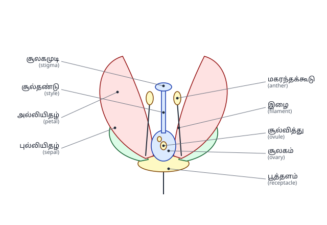

1. சூல்வித்துகளைக் கொண்டது; பழமாகும்
2. மகரந்தமணிகளைப் பெறல்
3. கருக்கட்டலின் பின் வித்தாகும்
4. மகரந்தக் குழாய் வளரும் பாதை

விடையும் விளக்கமும்

**விடை: (2) மகரந்தமணிகளைப் பெறல்**

சூலகமுடி: மகரந்தமணிகளைப் பெறல் (கோப்பு 6: BIO-D08).

<!-- meta {"type":"mcq","id":"SCQ-10-14-012","grade":10,"chapter_id":"SC10-14","discipline":"BIO","difficulty":1,"qtype":"diagram","answer":1,"origin":"ORIGINAL","source_ref":"BIO-D08","image":"science_assets/biology/BIO-D08_labelled.svg"} -->
**SCQ-10-14-012** · அடிப்படை · வரிப்படம் · `ORIGINAL`

பூவின் நெடுக்குவெட்டு வரிப்படத்தில் 'சூல்தண்டு' (style) இன் தொழில்?

1. மகரந்தக் குழாய் வளரும் பாதை
2. கருக்கட்டலின் பின் வித்தாகும்
3. மகரந்தமணிகளைப் பெறல்
4. சூல்வித்துகளைக் கொண்டது; பழமாகும்

விடையும் விளக்கமும்

**விடை: (1) மகரந்தக் குழாய் வளரும் பாதை**

சூல்தண்டு: மகரந்தக் குழாய் வளரும் பாதை (கோப்பு 6: BIO-D08).

<!-- meta {"type":"mcq","id":"SCQ-10-14-013","grade":10,"chapter_id":"SC10-14","discipline":"BIO","difficulty":1,"qtype":"diagram","answer":3,"origin":"ORIGINAL","source_ref":"BIO-D08","image":"science_assets/biology/BIO-D08_labelled.svg"} -->
**SCQ-10-14-013** · அடிப்படை · வரிப்படம் · `ORIGINAL`

பூவின் நெடுக்குவெட்டு வரிப்படத்தில் 'சூலகம்' (ovary) இன் தொழில்?

1. மகரந்தக் குழாய் வளரும் பாதை
2. கருக்கட்டலின் பின் வித்தாகும்
3. சூல்வித்துகளைக் கொண்டது; பழமாகும்
4. மகரந்தமணிகளைப் பெறல்

விடையும் விளக்கமும்

**விடை: (3) சூல்வித்துகளைக் கொண்டது; பழமாகும்**

சூலகம்: சூல்வித்துகளைக் கொண்டது; பழமாகும் (கோப்பு 6: BIO-D08).

<!-- meta {"type":"mcq","id":"SCQ-10-14-014","grade":10,"chapter_id":"SC10-14","discipline":"BIO","difficulty":1,"qtype":"concept","answer":3,"origin":"ORIGINAL","source_ref":"extra-SC10-14-1","image":null} -->
**SCQ-10-14-014** · அடிப்படை · எண்ணக்கரு · `ORIGINAL`

இழையுருப்பிரிவின் விளைவு?

1. நான்கு புணரிகள்
2. ஒரு கலம்
3. தாய்க்கலத்தை ஒத்த இரு மகட்கலங்கள்
4. நிறமூர்த்த எண் அரைவாசி

விடையும் விளக்கமும்

**விடை: (3) தாய்க்கலத்தை ஒத்த இரு மகட்கலங்கள்**

வளர்ச்சி, பழுதுபார்த்தல்.

<!-- meta {"type":"mcq","id":"SCQ-10-14-015","grade":10,"chapter_id":"SC10-14","discipline":"BIO","difficulty":1,"qtype":"recall","answer":3,"origin":"ORIGINAL","source_ref":"extra-SC10-14-2","image":null} -->
**SCQ-10-14-015** · அடிப்படை · நினைவு · `ORIGINAL`

ஒடுக்கற்பிரிவு நடைபெறும் இடம் (மனிதன்)?

1. எலும்பு மச்சை
2. தோல்
3. சூலகம், விதை
4. ஈரல்

விடையும் விளக்கமும்

**விடை: (3) சூலகம், விதை**

புணரி உருவாக்கம்.

<!-- meta {"type":"mcq","id":"SCQ-10-14-016","grade":10,"chapter_id":"SC10-14","discipline":"BIO","difficulty":1,"qtype":"recall","answer":2,"origin":"ORIGINAL","source_ref":"extra-SC10-14-3","image":null} -->
**SCQ-10-14-016** · அடிப்படை · நினைவு · `ORIGINAL`

மனித விந்தில் உள்ள நிறமூர்த்தங்கள்?

1. 22
2. 23
3. 46
4. 92

விடையும் விளக்கமும்

**விடை: (2) 23**

ஒருமடிய புணரி.

<!-- meta {"type":"mcq","id":"SCQ-10-14-017","grade":10,"chapter_id":"SC10-14","discipline":"BIO","difficulty":2,"qtype":"recall","answer":1,"origin":"ORIGINAL","source_ref":"extra-SC10-14-4","image":null} -->
**SCQ-10-14-017** · இடைநிலை · நினைவு · `ORIGINAL`

மாதவிடாய் வட்டத்தில் சூல்கொள்ளல் (ovulation) ஏறத்தாழ நிகழும் நாள் (28 நாள் வட்டம்)?

1. 14 ஆம் நாள்
2. 28 ஆம் நாள்
3. 7 ஆம் நாள்
4. 1 ஆம் நாள்

விடையும் விளக்கமும்

**விடை: (1) 14 ஆம் நாள்**

வட்டத்தின் நடுப்பகுதி.

<!-- meta {"type":"mcq","id":"SCQ-10-14-018","grade":10,"chapter_id":"SC10-14","discipline":"BIO","difficulty":1,"qtype":"recall","answer":2,"origin":"ORIGINAL","source_ref":"extra-SC10-14-5","image":null} -->
**SCQ-10-14-018** · அடிப்படை · நினைவு · `ORIGINAL`

சிசுவுக்கும் தாய்க்குமிடையே பதார்த்தப் பரிமாற்றம் நிகழும் அமைப்பு?

1. பலோப்பியன் குழாய்
2. சூல்வித்தகம் (placenta)
3. கருப்பைக் கழுத்து
4. சூலகம்

விடையும் விளக்கமும்

**விடை: (2) சூல்வித்தகம் (placenta)**

O₂, போசணை உள்ளே; CO₂, கழிவு வெளியே.

<!-- meta {"type":"mcq","id":"SCQ-10-14-019","grade":10,"chapter_id":"SC10-14","discipline":"BIO","difficulty":2,"qtype":"concept","answer":2,"origin":"ORIGINAL","source_ref":"extra-SC10-14-6","image":null} -->
**SCQ-10-14-019** · இடைநிலை · எண்ணக்கரு · `ORIGINAL`

காற்றால் மகரந்தச் சேர்க்கையடையும் பூவின் இயல்பு?

1. தேன்
2. இலேசான, அதிக மகரந்தமணிகள்
3. மணமுள்ள அல்லியிதழ்கள்
4. பெரிய நிறமுள்ள இதழ்கள்

விடையும் விளக்கமும்

**விடை: (2) இலேசான, அதிக மகரந்தமணிகள்**

உ-ம் புல், நெல்.

<!-- meta {"type":"mcq","id":"SCQ-10-14-020","grade":10,"chapter_id":"SC10-14","discipline":"BIO","difficulty":1,"qtype":"recall","answer":3,"origin":"ORIGINAL","source_ref":"extra-SC10-14-7","image":null} -->
**SCQ-10-14-020** · அடிப்படை · நினைவு · `ORIGINAL`

கருக்கட்டலின் பின் சூலகம் விருத்தியடைவது?

1. இலை
2. வேர்
3. பழம்
4. வித்து

விடையும் விளக்கமும்

**விடை: (3) பழம்**

சூல்வித்து → வித்து; சூலகம் → பழம்.

<!-- meta {"type":"mcq","id":"SCQ-10-14-021","grade":10,"chapter_id":"SC10-14","discipline":"BIO","difficulty":2,"qtype":"application","answer":2,"origin":"ORIGINAL","source_ref":"extra-SC10-14-8","image":null} -->
**SCQ-10-14-021** · இடைநிலை · பிரயோகம் · `ORIGINAL`

இழைய வளர்ப்பின் (tissue culture) நன்மை?

1. மண் தேவையில்லை மட்டும்
2. குறுகிய காலத்தில் ஒத்த பல தாவரங்கள்
3. வித்துகள் உருவாக்கம்
4. புதிய இயல்புகள்

விடையும் விளக்கமும்

**விடை: (2) குறுகிய காலத்தில் ஒத்த பல தாவரங்கள்**

பிறப்புரிமையில் ஒத்தவை.

<!-- meta {"type":"mcq","id":"SCQ-10-14-022","grade":10,"chapter_id":"SC10-14","discipline":"BIO","difficulty":2,"qtype":"concept","answer":2,"origin":"ORIGINAL","source_ref":"extra-SC10-14-9","image":null} -->
**SCQ-10-14-022** · இடைநிலை · எண்ணக்கரு · `ORIGINAL`

ஒட்டுதலில் (grafting) வேர்த்தொகுதியைத் தரும் பகுதி?

1. இலை
2. அடிக்கட்டை (stock)
3. அரும்பு
4. ஒட்டுக்கிளை (scion)

விடையும் விளக்கமும்

**விடை: (2) அடிக்கட்டை (stock)**

ஒட்டுக்கிளை விரும்பிய இயல்பு தரும்.

<!-- meta {"type":"mcq","id":"SCQ-10-14-023","grade":10,"chapter_id":"SC10-14","discipline":"BIO","difficulty":2,"qtype":"reasoning","answer":1,"origin":"ORIGINAL","source_ref":"extra-SC10-14-10","image":null} -->
**SCQ-10-14-023** · இடைநிலை · காரணம் காணல் · `ORIGINAL`

இலிங்க இனப்பெருக்கத்தின் நன்மை?

1. மாறல்கள் (variation) உருவாதல்
2. ஒத்த சந்ததி
3. விரைவானது
4. ஒரு பெற்றோர் போதும்

விடையும் விளக்கமும்

**விடை: (1) மாறல்கள் (variation) உருவாதல்**

சூழல் மாற்றங்களுக்கு இசைவு.

<!-- meta {"type":"mcq","id":"SCQ-10-14-024","grade":10,"chapter_id":"SC10-14","discipline":"BIO","difficulty":2,"qtype":"recall","answer":1,"origin":"ORIGINAL","source_ref":"extra-SC10-14-11","image":null} -->
**SCQ-10-14-024** · இடைநிலை · நினைவு · `ORIGINAL`

பருவமடைதலில் ஆண்களில் இரண்டாம் நிலை இலிங்க இயல்புகளைக் கட்டுப்படுத்தும் ஓமோன்?

1. தெஸ்தெஸ்தரோன்
2. ஈஸ்ரஜன்
3. இன்சுலின்
4. அட்ரினலின்

விடையும் விளக்கமும்

**விடை: (1) தெஸ்தெஸ்தரோன்**

விதைகளில் சுரக்கப்படும்.

<!-- meta {"type":"mcq","id":"SCQ-10-14-025","grade":10,"chapter_id":"SC10-14","discipline":"BIO","difficulty":1,"qtype":"recall","answer":4,"origin":"ORIGINAL","source_ref":"extra-SC10-14-12","image":null} -->
**SCQ-10-14-025** · அடிப்படை · நினைவு · `ORIGINAL`

பாலியல் மூலம் பரவும் நோய்?

1. டெங்கு
2. மலேரியா
3. காசநோய்
4. கொனோறியா

விடையும் விளக்கமும்

**விடை: (4) கொனோறியா**

STD — பாதுகாப்பு நடைமுறைகள் அவசியம்.

## SC10-15: நீர்நிலையியல் அமுக்கமும் அதன் பிரயோகங்களும் (Hydrostatic pressure and its applications)

*தரம் 10 · அத்தியாயம் 15 · பௌதிகவியல் · 25 வினாக்கள்*

<!-- meta {"type":"mcq","id":"SCQ-10-15-001","grade":10,"chapter_id":"SC10-15","discipline":"PHY","difficulty":1,"qtype":"calculation","answer":2,"origin":"ORIGINAL","source_ref":"chapter","image":null} -->
**SCQ-10-15-001** · அடிப்படை · கணிப்பு · `ORIGINAL`

நீரின் 5 m ஆழத்திலுள்ள திரவ அமுக்கம்? (ρ = 1000 kg m⁻³, g = 10)

1. 5000 Pa
2. 50 000 Pa
3. 500 Pa
4. 2000 Pa

விடையும் விளக்கமும்

**விடை: (2) 50 000 Pa**

P = 5 × 1000 × 10.

<!-- meta {"type":"mcq","id":"SCQ-10-15-002","grade":10,"chapter_id":"SC10-15","discipline":"PHY","difficulty":1,"qtype":"calculation","answer":2,"origin":"ORIGINAL","source_ref":"chapter","image":null} -->
**SCQ-10-15-002** · அடிப்படை · கணிப்பு · `ORIGINAL`

600 N நிறையுடையவர் 0.03 m² பரப்பில் நிற்கிறார். அமுக்கம்?

1. 18 Pa
2. 20 000 Pa
3. 600 Pa
4. 200 Pa

விடையும் விளக்கமும்

**விடை: (2) 20 000 Pa**

600/0.03 = 20 000 Pa.

<!-- meta {"type":"mcq","id":"SCQ-10-15-003","grade":10,"chapter_id":"SC10-15","discipline":"PHY","difficulty":2,"qtype":"calculation","answer":2,"origin":"ORIGINAL","source_ref":"chapter","image":null} -->
**SCQ-10-15-003** · இடைநிலை · கணிப்பு · `ORIGINAL`

நீரியல் அழுத்தியில் A₁ = 0.01 m², A₂ = 0.5 m², F₁ = 100 N. F₂?

1. 2 N
2. 5000 N
3. 50 N
4. 500 N

விடையும் விளக்கமும்

**விடை: (2) 5000 N**

F₂ = 100 × 0.5/0.01.

<!-- meta {"type":"mcq","id":"SCQ-10-15-004","grade":10,"chapter_id":"SC10-15","discipline":"PHY","difficulty":2,"qtype":"concept","answer":3,"origin":"ORIGINAL","source_ref":"chapter","image":null} -->
**SCQ-10-15-004** · இடைநிலை · எண்ணக்கரு · `ORIGINAL`

வெவ்வேறு வடிவப் பாத்திரங்களில் ஒரே உயரத்துக்கு நீர். அடியிலுள்ள அமுக்கம்?

1. அகன்றதில் அதிகம்
2. ஒடுங்கியதில் அதிகம்
3. எல்லாவற்றிலும் சமம்
4. கனவளவைப் பொறுத்தது

விடையும் விளக்கமும்

**விடை: (3) எல்லாவற்றிலும் சமம்**

P = hρg; வடிவத்தைச் சாராது.

<!-- meta {"type":"mcq","id":"SCQ-10-15-005","grade":10,"chapter_id":"SC10-15","discipline":"PHY","difficulty":2,"qtype":"application","answer":1,"origin":"ORIGINAL","source_ref":"chapter","image":null} -->
**SCQ-10-15-005** · இடைநிலை · பிரயோகம் · `ORIGINAL`

உயரமான மலையில் பயணிக்கும்போது காதுகளில் அசௌகரியம் ஏற்படக் காரணம்?

1. வெளி வளியமுக்கம் குறைதல்
2. வெப்பநிலை
3. ஒலி
4. ஈரப்பதன்

விடையும் விளக்கமும்

**விடை: (1) வெளி வளியமுக்கம் குறைதல்**

செவிப்பறையின் இருபுறமும் அமுக்க வேறுபாடு.

<!-- meta {"type":"mcq","id":"SCQ-10-15-006","grade":10,"chapter_id":"SC10-15","discipline":"PHY","difficulty":2,"qtype":"reasoning","answer":2,"origin":"ORIGINAL","source_ref":"chapter","image":null} -->
**SCQ-10-15-006** · இடைநிலை · காரணம் காணல் · `ORIGINAL`

இரும்புக் கப்பல் மிதப்பதற்குக் காரணம்?

1. இரும்பு இலேசானது
2. அதிக நீரை இடம்பெயர்த்து மேலுதைப்பு நிறைக்குச் சமனாதல்
3. வளி தள்ளுவதால்
4. காந்தம்

விடையும் விளக்கமும்

**விடை: (2) அதிக நீரை இடம்பெயர்த்து மேலுதைப்பு நிறைக்குச் சமனாதல்**

குழிவான வடிவம் அதிக கனவளவை இடம்பெயர்க்கும்.

<!-- meta {"type":"mcq","id":"SCQ-10-15-007","grade":10,"chapter_id":"SC10-15","discipline":"PHY","difficulty":1,"qtype":"recall","answer":2,"origin":"ORIGINAL","source_ref":"chapter","image":null} -->
**SCQ-10-15-007** · அடிப்படை · நினைவு · `ORIGINAL`

அமுக்கத்தின் அலகு?

1. N
2. N m⁻²
3. N m
4. kg m⁻³

விடையும் விளக்கமும்

**விடை: (2) N m⁻²**

Pa = N m⁻².

<!-- meta {"type":"mcq","id":"SCQ-10-15-008","grade":10,"chapter_id":"SC10-15","discipline":"PHY","difficulty":2,"qtype":"calculation","answer":1,"origin":"ORIGINAL","source_ref":"chapter","image":null} -->
**SCQ-10-15-008** · இடைநிலை · கணிப்பு · `ORIGINAL`

கடல் நீர் (ρ = 1030 kg m⁻³) 10 m ஆழத்தில் திரவ அமுக்கம்? (g = 10)

1. 103 000 Pa
2. 10 300 Pa
3. 1030 Pa
4. 100 000 Pa

விடையும் விளக்கமும்

**விடை: (1) 103 000 Pa**

10 × 1030 × 10.

<!-- meta {"type":"mcq","id":"SCQ-10-15-009","grade":10,"chapter_id":"SC10-15","discipline":"PHY","difficulty":1,"qtype":"application","answer":2,"origin":"ORIGINAL","source_ref":"chapter","image":null} -->
**SCQ-10-15-009** · அடிப்படை · பிரயோகம் · `ORIGINAL`

வாகன நீரியல் தடுப்பு இயங்கும் கொள்கை?

1. ஆக்கிமிடீசு
2. பஸ்கால்
3. நியூற்றனின் முதலாம் விதி
4. ஓமின் விதி

விடையும் விளக்கமும்

**விடை: (2) பஸ்கால்**

அமுக்கம் கடத்தல்.

<!-- meta {"type":"mcq","id":"SCQ-10-15-010","grade":10,"chapter_id":"SC10-15","discipline":"PHY","difficulty":1,"qtype":"application","answer":1,"origin":"ORIGINAL","source_ref":"chapter","image":null} -->
**SCQ-10-15-010** · அடிப்படை · பிரயோகம் · `ORIGINAL`

யானையின் கால்கள் அகன்றவை; இதன் நன்மை?

1. அமுக்கம் குறைந்து புதையாமை
2. அமுக்கம் கூடல்
3. வேகம்
4. நிறை குறைவு

விடையும் விளக்கமும்

**விடை: (1) அமுக்கம் குறைந்து புதையாமை**

பரப்பு கூட அமுக்கம் குறையும்.

<!-- meta {"type":"mcq","id":"SCQ-10-15-011","grade":10,"chapter_id":"SC10-15","discipline":"PHY","difficulty":1,"qtype":"calculation","answer":3,"origin":"ORIGINAL","source_ref":"param-SC10-15-1","image":null} -->
**SCQ-10-15-011** · அடிப்படை · கணிப்பு · `ORIGINAL`

500 N விசை 0.25 m² பரப்பில் செங்குத்தாகத் தாக்குகிறது. அமுக்கம்?

1. 4000 Pa
2. 5 × 10⁻⁴ Pa
3. 2000 Pa
4. 125 Pa

விடையும் விளக்கமும்

**விடை: (3) 2000 Pa**

P = F/A = 2000 Pa.

<!-- meta {"type":"mcq","id":"SCQ-10-15-012","grade":10,"chapter_id":"SC10-15","discipline":"PHY","difficulty":1,"qtype":"calculation","answer":4,"origin":"ORIGINAL","source_ref":"param-SC10-15-2","image":null} -->
**SCQ-10-15-012** · அடிப்படை · கணிப்பு · `ORIGINAL`

120 N விசை 0.004 m² பரப்பில் செங்குத்தாகத் தாக்குகிறது. அமுக்கம்?

1. 3.333 × 10⁻⁵ Pa
2. 0.48 Pa
3. 60000 Pa
4. 30000 Pa

விடையும் விளக்கமும்

**விடை: (4) 30000 Pa**

P = F/A = 30000 Pa.

<!-- meta {"type":"mcq","id":"SCQ-10-15-013","grade":10,"chapter_id":"SC10-15","discipline":"PHY","difficulty":1,"qtype":"calculation","answer":4,"origin":"ORIGINAL","source_ref":"param-SC10-15-3","image":null} -->
**SCQ-10-15-013** · அடிப்படை · கணிப்பு · `ORIGINAL`

2000 N விசை 0.5 m² பரப்பில் செங்குத்தாகத் தாக்குகிறது. அமுக்கம்?

1. 1000 Pa
2. 2.5 × 10⁻⁴ Pa
3. 8000 Pa
4. 4000 Pa

விடையும் விளக்கமும்

**விடை: (4) 4000 Pa**

P = F/A = 4000 Pa.

<!-- meta {"type":"mcq","id":"SCQ-10-15-014","grade":10,"chapter_id":"SC10-15","discipline":"PHY","difficulty":1,"qtype":"calculation","answer":1,"origin":"ORIGINAL","source_ref":"param-SC10-15-4","image":null} -->
**SCQ-10-15-014** · அடிப்படை · கணிப்பு · `ORIGINAL`

36 N விசை 0.012 m² பரப்பில் செங்குத்தாகத் தாக்குகிறது. அமுக்கம்?

1. 3000 Pa
2. 0.432 Pa
3. 3.333 × 10⁻⁴ Pa
4. 6000 Pa

விடையும் விளக்கமும்

**விடை: (1) 3000 Pa**

P = F/A = 3000 Pa.

<!-- meta {"type":"mcq","id":"SCQ-10-15-015","grade":10,"chapter_id":"SC10-15","discipline":"PHY","difficulty":2,"qtype":"calculation","answer":1,"origin":"ORIGINAL","source_ref":"param-SC10-15-5","image":null} -->
**SCQ-10-15-015** · இடைநிலை · கணிப்பு · `ORIGINAL`

அடர்த்தி 1000 kg m⁻³ உடைய திரவத்தில் 3 m ஆழத்திலுள்ள திரவ அமுக்கம்? (g = 10)

1. 30000 Pa
2. 30 Pa
3. 3333.3333 Pa
4. 3000 Pa

விடையும் விளக்கமும்

**விடை: (1) 30000 Pa**

hρg = 30000 Pa.

<!-- meta {"type":"mcq","id":"SCQ-10-15-016","grade":10,"chapter_id":"SC10-15","discipline":"PHY","difficulty":2,"qtype":"calculation","answer":1,"origin":"ORIGINAL","source_ref":"param-SC10-15-6","image":null} -->
**SCQ-10-15-016** · இடைநிலை · கணிப்பு · `ORIGINAL`

அடர்த்தி 1000 kg m⁻³ உடைய திரவத்தில் 20 m ஆழத்திலுள்ள திரவ அமுக்கம்? (g = 10)

1. 200000 Pa
2. 500 Pa
3. 200 Pa
4. 20000 Pa

விடையும் விளக்கமும்

**விடை: (1) 200000 Pa**

hρg = 200000 Pa.

<!-- meta {"type":"mcq","id":"SCQ-10-15-017","grade":10,"chapter_id":"SC10-15","discipline":"PHY","difficulty":2,"qtype":"calculation","answer":3,"origin":"ORIGINAL","source_ref":"param-SC10-15-7","image":null} -->
**SCQ-10-15-017** · இடைநிலை · கணிப்பு · `ORIGINAL`

அடர்த்தி 13600 kg m⁻³ உடைய திரவத்தில் 0.5 m ஆழத்திலுள்ள திரவ அமுக்கம்? (g = 10)

1. 6800 Pa
2. 272000 Pa
3. 68000 Pa
4. 5 Pa

விடையும் விளக்கமும்

**விடை: (3) 68000 Pa**

hρg = 68000 Pa.

<!-- meta {"type":"mcq","id":"SCQ-10-15-018","grade":10,"chapter_id":"SC10-15","discipline":"PHY","difficulty":2,"qtype":"calculation","answer":2,"origin":"ORIGINAL","source_ref":"param-SC10-15-8","image":null} -->
**SCQ-10-15-018** · இடைநிலை · கணிப்பு · `ORIGINAL`

அடர்த்தி 800 kg m⁻³ உடைய திரவத்தில் 4 m ஆழத்திலுள்ள திரவ அமுக்கம்? (g = 10)

1. 40 Pa
2. 32000 Pa
3. 2000 Pa
4. 3200 Pa

விடையும் விளக்கமும்

**விடை: (2) 32000 Pa**

hρg = 32000 Pa.

<!-- meta {"type":"mcq","id":"SCQ-10-15-019","grade":10,"chapter_id":"SC10-15","discipline":"PHY","difficulty":2,"qtype":"calculation","answer":3,"origin":"ORIGINAL","source_ref":"param-SC10-15-9","image":null} -->
**SCQ-10-15-019** · இடைநிலை · கணிப்பு · `ORIGINAL`

அடர்த்தி 1030 kg m⁻³ உடைய திரவத்தில் 15 m ஆழத்திலுள்ள திரவ அமுக்கம்? (g = 10)

1. 150 Pa
2. 15450 Pa
3. 154500 Pa
4. 686.6667 Pa

விடையும் விளக்கமும்

**விடை: (3) 154500 Pa**

hρg = 154500 Pa.

<!-- meta {"type":"mcq","id":"SCQ-10-15-020","grade":10,"chapter_id":"SC10-15","discipline":"PHY","difficulty":2,"qtype":"calculation","answer":4,"origin":"ORIGINAL","source_ref":"param-SC10-15-10","image":null} -->
**SCQ-10-15-020** · இடைநிலை · கணிப்பு · `ORIGINAL`

நீரியல் அழுத்தியில் சிறிய முசலம் 4 cm², பெரியது 200 cm². சிறியதில் 20 N. பெரியதில் விசை?

1. 20 N
2. 4000 N
3. 0.4 N
4. 1000 N

விடையும் விளக்கமும்

**விடை: (4) 1000 N**

F₂ = F₁ × A₂/A₁ (பஸ்கால்).

<!-- meta {"type":"mcq","id":"SCQ-10-15-021","grade":10,"chapter_id":"SC10-15","discipline":"PHY","difficulty":2,"qtype":"calculation","answer":1,"origin":"ORIGINAL","source_ref":"param-SC10-15-11","image":null} -->
**SCQ-10-15-021** · இடைநிலை · கணிப்பு · `ORIGINAL`

நீரியல் அழுத்தியில் சிறிய முசலம் 10 cm², பெரியது 300 cm². சிறியதில் 100 N. பெரியதில் விசை?

1. 3000 N
2. 30000 N
3. 3.3333 N
4. 100 N

விடையும் விளக்கமும்

**விடை: (1) 3000 N**

F₂ = F₁ × A₂/A₁ (பஸ்கால்).

<!-- meta {"type":"mcq","id":"SCQ-10-15-022","grade":10,"chapter_id":"SC10-15","discipline":"PHY","difficulty":2,"qtype":"calculation","answer":4,"origin":"ORIGINAL","source_ref":"param-SC10-15-12","image":null} -->
**SCQ-10-15-022** · இடைநிலை · கணிப்பு · `ORIGINAL`

நீரியல் அழுத்தியில் சிறிய முசலம் 2 cm², பெரியது 50 cm². சிறியதில் 40 N. பெரியதில் விசை?

1. 40 N
2. 2000 N
3. 1.6 N
4. 1000 N

விடையும் விளக்கமும்

**விடை: (4) 1000 N**

F₂ = F₁ × A₂/A₁ (பஸ்கால்).

<!-- meta {"type":"mcq","id":"SCQ-10-15-023","grade":10,"chapter_id":"SC10-15","discipline":"PHY","difficulty":1,"qtype":"calculation","answer":2,"origin":"ORIGINAL","source_ref":"param-SC10-15-13","image":null} -->
**SCQ-10-15-023** · அடிப்படை · கணிப்பு · `ORIGINAL`

ஒரு பொருளின் நிறை வளியில் 15 N, நீரில் முற்றாக அமிழ்ந்தபோது 9 N. மேலுதைப்பு?

1. 9 N
2. 6 N
3. 15 N
4. 24 N

விடையும் விளக்கமும்

**விடை: (2) 6 N**

மேலுதைப்பு = நிறை இழப்பு.

<!-- meta {"type":"mcq","id":"SCQ-10-15-024","grade":10,"chapter_id":"SC10-15","discipline":"PHY","difficulty":1,"qtype":"calculation","answer":2,"origin":"ORIGINAL","source_ref":"param-SC10-15-14","image":null} -->
**SCQ-10-15-024** · அடிப்படை · கணிப்பு · `ORIGINAL`

ஒரு பொருளின் நிறை வளியில் 4.5 N, நீரில் முற்றாக அமிழ்ந்தபோது 3 N. மேலுதைப்பு?

1. 4.5 N
2. 1.5 N
3. 3 N
4. 7.5 N

விடையும் விளக்கமும்

**விடை: (2) 1.5 N**

மேலுதைப்பு = நிறை இழப்பு.

<!-- meta {"type":"mcq","id":"SCQ-10-15-025","grade":10,"chapter_id":"SC10-15","discipline":"PHY","difficulty":1,"qtype":"calculation","answer":3,"origin":"ORIGINAL","source_ref":"param-SC10-15-15","image":null} -->
**SCQ-10-15-025** · அடிப்படை · கணிப்பு · `ORIGINAL`

ஒரு பொருளின் நிறை வளியில் 30 N, நீரில் முற்றாக அமிழ்ந்தபோது 22 N. மேலுதைப்பு?

1. 22 N
2. 30 N
3. 8 N
4. 52 N

விடையும் விளக்கமும்

**விடை: (3) 8 N**

மேலுதைப்பு = நிறை இழப்பு.

## SC10-16: சடப்பொருள்களில் ஏற்படும் மாற்றம் (Changes in matter)

*தரம் 10 · அத்தியாயம் 16 · இரசாயனவியல் · 30 வினாக்கள்*

<!-- meta {"type":"mcq","id":"SCQ-10-16-001","grade":10,"chapter_id":"SC10-16","discipline":"CHE","difficulty":1,"qtype":"concept","answer":3,"origin":"ORIGINAL","source_ref":"chapter","image":null} -->
**SCQ-10-16-001** · அடிப்படை · எண்ணக்கரு · `ORIGINAL`

பின்வருவனவற்றுள் இரசாயன மாற்றம்?

1. மெழுகு உருகல்
2. சீனி கரைதல்
3. இரும்பு துருப்பிடித்தல்
4. நீர் ஆவியாதல்

விடையும் விளக்கமும்

**விடை: (3) இரும்பு துருப்பிடித்தல்**

Fe₂O₃·xH₂O எனும் புதிய பதார்த்தம்.

<!-- meta {"type":"mcq","id":"SCQ-10-16-002","grade":10,"chapter_id":"SC10-16","discipline":"CHE","difficulty":2,"qtype":"experiment","answer":2,"origin":"ORIGINAL","source_ref":"chapter","image":null} -->
**SCQ-10-16-002** · இடைநிலை · பரிசோதனை · `ORIGINAL`

CuSO₄ கரைசலில் Zn துண்டை இட்டால் அவதானிப்பு?

1. மாற்றம் இல்லை
2. நீல நிறம் மங்கி செம்பழுப்புப் படிவு
3. H₂ குமிழ்கள்
4. கரைசல் பச்சையாகும்

விடையும் விளக்கமும்

**விடை: (2) நீல நிறம் மங்கி செம்பழுப்புப் படிவு**

Zn > Cu; Cu இடம்பெயர்க்கப்படும்.

<!-- meta {"type":"mcq","id":"SCQ-10-16-003","grade":10,"chapter_id":"SC10-16","discipline":"CHE","difficulty":1,"qtype":"recall","answer":4,"origin":"ORIGINAL","source_ref":"chapter","image":null} -->
**SCQ-10-16-003** · அடிப்படை · நினைவு · `ORIGINAL`

ஐதான HCl உடன் தாக்கமடையாத உலோகம்?

1. Mg
2. Zn
3. Fe
4. Cu

விடையும் விளக்கமும்

**விடை: (4) Cu**

Cu தாக்கத்திறன் தொடரில் H க்குக் கீழே.

<!-- meta {"type":"mcq","id":"SCQ-10-16-004","grade":10,"chapter_id":"SC10-16","discipline":"CHE","difficulty":1,"qtype":"concept","answer":2,"origin":"ORIGINAL","source_ref":"chapter","image":null} -->
**SCQ-10-16-004** · அடிப்படை · எண்ணக்கரு · `ORIGINAL`

2H₂O₂ → 2H₂O + O₂ தாக்க வகை?

1. சேர்க்கை
2. பிரிகை
3. இடப்பெயர்ச்சி
4. நடுநிலையாக்கம்

விடையும் விளக்கமும்

**விடை: (2) பிரிகை**

ஒரு பதார்த்தம் இரண்டாகப் பிரிகை.

<!-- meta {"type":"mcq","id":"SCQ-10-16-005","grade":10,"chapter_id":"SC10-16","discipline":"CHE","difficulty":2,"qtype":"recall","answer":2,"origin":"ORIGINAL","source_ref":"chapter","image":null} -->
**SCQ-10-16-005** · இடைநிலை · நினைவு · `ORIGINAL`

ஊதுலையில் சுண்ணக்கல் சேர்க்கப்படுவதன் நோக்கம்?

1. இரும்பைத் தாழ்த்த
2. சிலிக்கா மாசுகளை அகற்ற
3. எரிபொருளாக
4. CO₂ தர

விடையும் விளக்கமும்

**விடை: (2) சிலிக்கா மாசுகளை அகற்ற**

CaO + SiO₂ → CaSiO₃ (கசடு).

<!-- meta {"type":"mcq","id":"SCQ-10-16-006","grade":10,"chapter_id":"SC10-16","discipline":"CHE","difficulty":2,"qtype":"recall","answer":1,"origin":"ORIGINAL","source_ref":"chapter","image":null} -->
**SCQ-10-16-006** · இடைநிலை · நினைவு · `ORIGINAL`

Mg, Zn, Cu, Fe ஐ தாக்கத்திறன் இறங்கு வரிசையில்?

1. Mg > Zn > Fe > Cu
2. Cu > Fe > Zn > Mg
3. Zn > Mg > Fe > Cu
4. Mg > Fe > Zn > Cu

விடையும் விளக்கமும்

**விடை: (1) Mg > Zn > Fe > Cu**

தாக்கத்திறன் தொடர்.

<!-- meta {"type":"mcq","id":"SCQ-10-16-007","grade":10,"chapter_id":"SC10-16","discipline":"CHE","difficulty":2,"qtype":"concept","answer":2,"origin":"ORIGINAL","source_ref":"chapter","image":null} -->
**SCQ-10-16-007** · இடைநிலை · எண்ணக்கரு · `ORIGINAL`

AgNO₃(aq) + NaCl(aq) → AgCl(s) + NaNO₃(aq) தாக்க வகை?

1. தனி இடப்பெயர்ச்சி
2. இரட்டை இடப்பெயர்ச்சி
3. பிரிகை
4. சேர்க்கை

விடையும் விளக்கமும்

**விடை: (2) இரட்டை இடப்பெயர்ச்சி**

அயன் பரிமாற்றம்; வெண் வீழ்படிவு.

<!-- meta {"type":"mcq","id":"SCQ-10-16-008","grade":10,"chapter_id":"SC10-16","discipline":"CHE","difficulty":2,"qtype":"application","answer":1,"origin":"ORIGINAL","source_ref":"chapter","image":null} -->
**SCQ-10-16-008** · இடைநிலை · பிரயோகம் · `ORIGINAL`

Na ஐ மண்ணெண்ணெயில் சேமிப்பதன் காரணம்?

1. நீர், O₂ உடன் தீவிரமாகத் தாக்கமடைவதால்
2. ஆவியாவதால்
3. கரைவதால்
4. நிறம் மாறுவதால்

விடையும் விளக்கமும்

**விடை: (1) நீர், O₂ உடன் தீவிரமாகத் தாக்கமடைவதால்**

Na மிகத் தாக்கத்திறனுடையது.

<!-- meta {"type":"mcq","id":"SCQ-10-16-009","grade":10,"chapter_id":"SC10-16","discipline":"CHE","difficulty":2,"qtype":"reasoning","answer":2,"origin":"ORIGINAL","source_ref":"chapter","image":null} -->
**SCQ-10-16-009** · இடைநிலை · காரணம் காணல் · `ORIGINAL`

Cu துண்டை ZnSO₄ கரைசலில் இட்டால்?

1. Zn படியும்
2. தாக்கம் இல்லை
3. H₂ வெளியேறும்
4. கரைசல் நீலமாகும்

விடையும் விளக்கமும்

**விடை: (2) தாக்கம் இல்லை**

Cu, Zn ஐ விடத் தாக்கத்திறன் குறைவு.

<!-- meta {"type":"mcq","id":"SCQ-10-16-010","grade":10,"chapter_id":"SC10-16","discipline":"CHE","difficulty":3,"qtype":"concept","answer":2,"origin":"ORIGINAL","source_ref":"chapter","image":null} -->
**SCQ-10-16-010** · கடினம் · எண்ணக்கரு · `ORIGINAL`

Fe₂O₃ + 3CO → 2Fe + 3CO₂ இல் Fe₂O₃ க்கு நடப்பது?

1. ஒட்சியேற்றம்
2. தாழ்த்தல்
3. நடுநிலையாக்கம்
4. கரைதல்

விடையும் விளக்கமும்

**விடை: (2) தாழ்த்தல்**

ஒட்சிசன் இழக்கப்படுகிறது.

<!-- meta {"type":"mcq","id":"SCQ-10-16-011","grade":10,"chapter_id":"SC10-16","discipline":"CHE","difficulty":2,"qtype":"equation","answer":1,"origin":"ORIGINAL","source_ref":"EQ-001","image":null} -->
**SCQ-10-16-011** · இடைநிலை · சமன்பாடு · `ORIGINAL`

Mg + O₂ → MgO — இச்சமன்பாட்டை மிகச்சிறிய முழு எண் குணகங்களால் சமன்செய்யும்போது Mg இன் குணகம்?

1. 2
2. 7
3. 3
4. 4

விடையும் விளக்கமும்

**விடை: (1) 2**

2Mg + O₂ → 2MgO (அணு எண்ணிக்கை சரிபார்க்கப்பட்டது; கோப்பு 7: EQ-001).

<!-- meta {"type":"mcq","id":"SCQ-10-16-012","grade":10,"chapter_id":"SC10-16","discipline":"CHE","difficulty":2,"qtype":"equation","answer":3,"origin":"ORIGINAL","source_ref":"EQ-002","image":null} -->
**SCQ-10-16-012** · இடைநிலை · சமன்பாடு · `ORIGINAL`

H₂ + O₂ → H₂O — இச்சமன்பாட்டை மிகச்சிறிய முழு எண் குணகங்களால் சமன்செய்யும்போது H₂ இன் குணகம்?

1. 4
2. 7
3. 2
4. 3

விடையும் விளக்கமும்

**விடை: (3) 2**

2H₂ + O₂ → 2H₂O (அணு எண்ணிக்கை சரிபார்க்கப்பட்டது; கோப்பு 7: EQ-002).

<!-- meta {"type":"mcq","id":"SCQ-10-16-013","grade":10,"chapter_id":"SC10-16","discipline":"CHE","difficulty":2,"qtype":"equation","answer":2,"origin":"ORIGINAL","source_ref":"EQ-005","image":null} -->
**SCQ-10-16-013** · இடைநிலை · சமன்பாடு · `ORIGINAL`

Fe + O₂ → Fe₂O₃ — இச்சமன்பாட்டை மிகச்சிறிய முழு எண் குணகங்களால் சமன்செய்யும்போது Fe இன் குணகம்?

1. 5
2. 4
3. 8
4. 3

விடையும் விளக்கமும்

**விடை: (2) 4**

4Fe + 3O₂ → 2Fe₂O₃ (அணு எண்ணிக்கை சரிபார்க்கப்பட்டது; கோப்பு 7: EQ-005).

<!-- meta {"type":"mcq","id":"SCQ-10-16-014","grade":10,"chapter_id":"SC10-16","discipline":"CHE","difficulty":2,"qtype":"equation","answer":2,"origin":"ORIGINAL","source_ref":"EQ-006","image":null} -->
**SCQ-10-16-014** · இடைநிலை · சமன்பாடு · `ORIGINAL`

Na + Cl₂ → NaCl — இச்சமன்பாட்டை மிகச்சிறிய முழு எண் குணகங்களால் சமன்செய்யும்போது Na இன் குணகம்?

1. 3
2. 2
3. 7
4. 4

விடையும் விளக்கமும்

**விடை: (2) 2**

2Na + Cl₂ → 2NaCl (அணு எண்ணிக்கை சரிபார்க்கப்பட்டது; கோப்பு 7: EQ-006).

<!-- meta {"type":"mcq","id":"SCQ-10-16-015","grade":10,"chapter_id":"SC10-16","discipline":"CHE","difficulty":2,"qtype":"equation","answer":4,"origin":"ORIGINAL","source_ref":"EQ-009","image":null} -->
**SCQ-10-16-015** · இடைநிலை · சமன்பாடு · `ORIGINAL`

H₂O₂ → H₂O + O₂ — இச்சமன்பாட்டை மிகச்சிறிய முழு எண் குணகங்களால் சமன்செய்யும்போது H₂O₂ இன் குணகம்?

1. 3
2. 7
3. 4
4. 2

விடையும் விளக்கமும்

**விடை: (4) 2**

2H₂O₂ → 2H₂O + O₂ (அணு எண்ணிக்கை சரிபார்க்கப்பட்டது; கோப்பு 7: EQ-009).

<!-- meta {"type":"mcq","id":"SCQ-10-16-016","grade":10,"chapter_id":"SC10-16","discipline":"CHE","difficulty":2,"qtype":"equation","answer":3,"origin":"ORIGINAL","source_ref":"EQ-010","image":null} -->
**SCQ-10-16-016** · இடைநிலை · சமன்பாடு · `ORIGINAL`

KClO₃ → KCl + O₂ — இச்சமன்பாட்டை மிகச்சிறிய முழு எண் குணகங்களால் சமன்செய்யும்போது O₂ இன் குணகம்?

1. 4
2. 6
3. 3
4. 2

விடையும் விளக்கமும்

**விடை: (3) 3**

2KClO₃ → 2KCl + 3O₂ (அணு எண்ணிக்கை சரிபார்க்கப்பட்டது; கோப்பு 7: EQ-010).

<!-- meta {"type":"mcq","id":"SCQ-10-16-017","grade":10,"chapter_id":"SC10-16","discipline":"CHE","difficulty":2,"qtype":"equation","answer":1,"origin":"ORIGINAL","source_ref":"EQ-012","image":null} -->
**SCQ-10-16-017** · இடைநிலை · சமன்பாடு · `ORIGINAL`

NaHCO₃ → Na₂CO₃ + H₂O + CO₂ — இச்சமன்பாட்டை மிகச்சிறிய முழு எண் குணகங்களால் சமன்செய்யும்போது NaHCO₃ இன் குணகம்?

1. 2
2. 7
3. 4
4. 3

விடையும் விளக்கமும்

**விடை: (1) 2**

2NaHCO₃ → Na₂CO₃ + H₂O + CO₂ (அணு எண்ணிக்கை சரிபார்க்கப்பட்டது; கோப்பு 7: EQ-012).

<!-- meta {"type":"mcq","id":"SCQ-10-16-018","grade":10,"chapter_id":"SC10-16","discipline":"CHE","difficulty":2,"qtype":"equation","answer":2,"origin":"ORIGINAL","source_ref":"EQ-013","image":null} -->
**SCQ-10-16-018** · இடைநிலை · சமன்பாடு · `ORIGINAL`

Zn + HCl → ZnCl₂ + H₂ — இச்சமன்பாட்டை மிகச்சிறிய முழு எண் குணகங்களால் சமன்செய்யும்போது HCl இன் குணகம்?

1. 3
2. 2
3. 7
4. 4

விடையும் விளக்கமும்

**விடை: (2) 2**

Zn + 2HCl → ZnCl₂ + H₂ (அணு எண்ணிக்கை சரிபார்க்கப்பட்டது; கோப்பு 7: EQ-013).

<!-- meta {"type":"mcq","id":"SCQ-10-16-019","grade":10,"chapter_id":"SC10-16","discipline":"CHE","difficulty":2,"qtype":"equation","answer":3,"origin":"ORIGINAL","source_ref":"EQ-014","image":null} -->
**SCQ-10-16-019** · இடைநிலை · சமன்பாடு · `ORIGINAL`

Mg + HCl → MgCl₂ + H₂ — இச்சமன்பாட்டை மிகச்சிறிய முழு எண் குணகங்களால் சமன்செய்யும்போது HCl இன் குணகம்?

1. 3
2. 4
3. 2
4. 7

விடையும் விளக்கமும்

**விடை: (3) 2**

Mg + 2HCl → MgCl₂ + H₂ (அணு எண்ணிக்கை சரிபார்க்கப்பட்டது; கோப்பு 7: EQ-014).

<!-- meta {"type":"mcq","id":"SCQ-10-16-020","grade":10,"chapter_id":"SC10-16","discipline":"CHE","difficulty":2,"qtype":"equation","answer":2,"origin":"ORIGINAL","source_ref":"EQ-018","image":null} -->
**SCQ-10-16-020** · இடைநிலை · சமன்பாடு · `ORIGINAL`

Na + H₂O → NaOH + H₂ — இச்சமன்பாட்டை மிகச்சிறிய முழு எண் குணகங்களால் சமன்செய்யும்போது Na இன் குணகம்?

1. 3
2. 2
3. 4
4. 7

விடையும் விளக்கமும்

**விடை: (2) 2**

2Na + 2H₂O → 2NaOH + H₂ (அணு எண்ணிக்கை சரிபார்க்கப்பட்டது; கோப்பு 7: EQ-018).

<!-- meta {"type":"mcq","id":"SCQ-10-16-021","grade":10,"chapter_id":"SC10-16","discipline":"CHE","difficulty":2,"qtype":"equation","answer":2,"origin":"ORIGINAL","source_ref":"EQ-019","image":null} -->
**SCQ-10-16-021** · இடைநிலை · சமன்பாடு · `ORIGINAL`

Mg + H₂O → Mg(OH)₂ + H₂ — இச்சமன்பாட்டை மிகச்சிறிய முழு எண் குணகங்களால் சமன்செய்யும்போது H₂O இன் குணகம்?

1. 4
2. 2
3. 7
4. 3

விடையும் விளக்கமும்

**விடை: (2) 2**

Mg + 2H₂O → Mg(OH)₂ + H₂ (அணு எண்ணிக்கை சரிபார்க்கப்பட்டது; கோப்பு 7: EQ-019).

<!-- meta {"type":"mcq","id":"SCQ-10-16-022","grade":10,"chapter_id":"SC10-16","discipline":"CHE","difficulty":2,"qtype":"equation","answer":1,"origin":"ORIGINAL","source_ref":"EQ-020","image":null} -->
**SCQ-10-16-022** · இடைநிலை · சமன்பாடு · `ORIGINAL`

Cl₂ + KBr → KCl + Br₂ — இச்சமன்பாட்டை மிகச்சிறிய முழு எண் குணகங்களால் சமன்செய்யும்போது KBr இன் குணகம்?

1. 2
2. 7
3. 4
4. 3

விடையும் விளக்கமும்

**விடை: (1) 2**

Cl₂ + 2KBr → 2KCl + Br₂ (அணு எண்ணிக்கை சரிபார்க்கப்பட்டது; கோப்பு 7: EQ-020).

<!-- meta {"type":"mcq","id":"SCQ-10-16-023","grade":10,"chapter_id":"SC10-16","discipline":"CHE","difficulty":2,"qtype":"equation","answer":3,"origin":"ORIGINAL","source_ref":"EQ-022","image":null} -->
**SCQ-10-16-023** · இடைநிலை · சமன்பாடு · `ORIGINAL`

BaCl₂ + Na₂SO₄ → BaSO₄ + NaCl — இச்சமன்பாட்டை மிகச்சிறிய முழு எண் குணகங்களால் சமன்செய்யும்போது NaCl இன் குணகம்?

1. 4
2. 7
3. 2
4. 3

விடையும் விளக்கமும்

**விடை: (3) 2**

BaCl₂ + Na₂SO₄ → BaSO₄ + 2NaCl (அணு எண்ணிக்கை சரிபார்க்கப்பட்டது; கோப்பு 7: EQ-022).

<!-- meta {"type":"mcq","id":"SCQ-10-16-024","grade":10,"chapter_id":"SC10-16","discipline":"CHE","difficulty":2,"qtype":"equation","answer":4,"origin":"ORIGINAL","source_ref":"EQ-023","image":null} -->
**SCQ-10-16-024** · இடைநிலை · சமன்பாடு · `ORIGINAL`

Pb(NO₃)₂ + KI → PbI₂ + KNO₃ — இச்சமன்பாட்டை மிகச்சிறிய முழு எண் குணகங்களால் சமன்செய்யும்போது KI இன் குணகம்?

1. 7
2. 4
3. 3
4. 2

விடையும் விளக்கமும்

**விடை: (4) 2**

Pb(NO₃)₂ + 2KI → PbI₂ + 2KNO₃ (அணு எண்ணிக்கை சரிபார்க்கப்பட்டது; கோப்பு 7: EQ-023).

<!-- meta {"type":"mcq","id":"SCQ-10-16-025","grade":10,"chapter_id":"SC10-16","discipline":"CHE","difficulty":2,"qtype":"equation","answer":2,"origin":"ORIGINAL","source_ref":"EQ-024","image":null} -->
**SCQ-10-16-025** · இடைநிலை · சமன்பாடு · `ORIGINAL`

CuSO₄ + NaOH → Cu(OH)₂ + Na₂SO₄ — இச்சமன்பாட்டை மிகச்சிறிய முழு எண் குணகங்களால் சமன்செய்யும்போது NaOH இன் குணகம்?

1. 7
2. 2
3. 3
4. 4

விடையும் விளக்கமும்

**விடை: (2) 2**

CuSO₄ + 2NaOH → Cu(OH)₂ + Na₂SO₄ (அணு எண்ணிக்கை சரிபார்க்கப்பட்டது; கோப்பு 7: EQ-024).

<!-- meta {"type":"mcq","id":"SCQ-10-16-026","grade":10,"chapter_id":"SC10-16","discipline":"CHE","difficulty":2,"qtype":"equation","answer":1,"origin":"ORIGINAL","source_ref":"EQ-043","image":null} -->
**SCQ-10-16-026** · இடைநிலை · சமன்பாடு · `ORIGINAL`

Fe₂O₃ + CO → Fe + CO₂ — இச்சமன்பாட்டை மிகச்சிறிய முழு எண் குணகங்களால் சமன்செய்யும்போது CO இன் குணகம்?

1. 3
2. 2
3. 4
4. 6

விடையும் விளக்கமும்

**விடை: (1) 3**

Fe₂O₃ + 3CO → 2Fe + 3CO₂ (அணு எண்ணிக்கை சரிபார்க்கப்பட்டது; கோப்பு 7: EQ-043).

<!-- meta {"type":"mcq","id":"SCQ-10-16-027","grade":10,"chapter_id":"SC10-16","discipline":"CHE","difficulty":2,"qtype":"equation","answer":1,"origin":"ORIGINAL","source_ref":"EQ-045","image":null} -->
**SCQ-10-16-027** · இடைநிலை · சமன்பாடு · `ORIGINAL`

CuO + C → Cu + CO₂ — இச்சமன்பாட்டை மிகச்சிறிய முழு எண் குணகங்களால் சமன்செய்யும்போது CuO இன் குணகம்?

1. 2
2. 4
3. 7
4. 3

விடையும் விளக்கமும்

**விடை: (1) 2**

2CuO + C → 2Cu + CO₂ (அணு எண்ணிக்கை சரிபார்க்கப்பட்டது; கோப்பு 7: EQ-045).

<!-- meta {"type":"mcq","id":"SCQ-10-16-028","grade":10,"chapter_id":"SC10-16","discipline":"CHE","difficulty":1,"qtype":"diagram","answer":1,"origin":"ORIGINAL","source_ref":"CHE-D05","image":"science_assets/chemistry/CHE-D05_labelled.svg"} -->
**SCQ-10-16-028** · அடிப்படை · வரிப்படம் · `ORIGINAL`

ஊதுலை (திட்டப் படம்) வரிப்படத்தில் 'சூடான வளி' (hot air blast) இன் தொழில்?

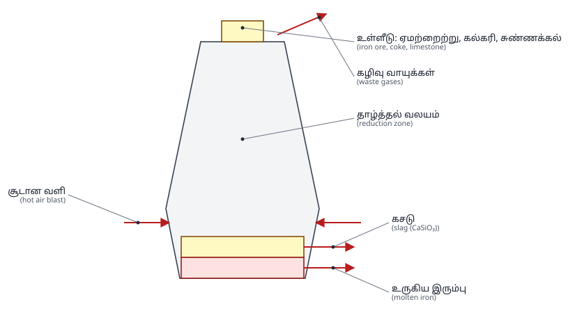

1. C + O₂ → CO₂ — அதிக வெப்பம்
2. அடியில் சேகரிக்கப்படும்
3. Fe₂O₃ + 3CO → 2Fe + 3CO₂
4. மாசுகளை நீக்கும்; உருகிய இரும்பின் மேல் மிதக்கும்

விடையும் விளக்கமும்

**விடை: (1) C + O₂ → CO₂ — அதிக வெப்பம்**

சூடான வளி: C + O₂ → CO₂ — அதிக வெப்பம் (கோப்பு 6: CHE-D05).

<!-- meta {"type":"mcq","id":"SCQ-10-16-029","grade":10,"chapter_id":"SC10-16","discipline":"CHE","difficulty":1,"qtype":"diagram","answer":2,"origin":"ORIGINAL","source_ref":"CHE-D05","image":"science_assets/chemistry/CHE-D05_labelled.svg"} -->
**SCQ-10-16-029** · அடிப்படை · வரிப்படம் · `ORIGINAL`

ஊதுலை (திட்டப் படம்) வரிப்படத்தில் 'தாழ்த்தல் வலயம்' (reduction zone) இன் தொழில்?

1. C + O₂ → CO₂ — அதிக வெப்பம்
2. Fe₂O₃ + 3CO → 2Fe + 3CO₂
3. மாசுகளை நீக்கும்; உருகிய இரும்பின் மேல் மிதக்கும்
4. அடியில் சேகரிக்கப்படும்

விடையும் விளக்கமும்

**விடை: (2) Fe₂O₃ + 3CO → 2Fe + 3CO₂**

தாழ்த்தல் வலயம்: Fe₂O₃ + 3CO → 2Fe + 3CO₂ (கோப்பு 6: CHE-D05).

<!-- meta {"type":"mcq","id":"SCQ-10-16-030","grade":10,"chapter_id":"SC10-16","discipline":"CHE","difficulty":1,"qtype":"diagram","answer":4,"origin":"ORIGINAL","source_ref":"CHE-D05","image":"science_assets/chemistry/CHE-D05_labelled.svg"} -->
**SCQ-10-16-030** · அடிப்படை · வரிப்படம் · `ORIGINAL`

ஊதுலை (திட்டப் படம்) வரிப்படத்தில் 'கசடு' (slag (CaSiO₃)) இன் தொழில்?

1. C + O₂ → CO₂ — அதிக வெப்பம்
2. Fe₂O₃ + 3CO → 2Fe + 3CO₂
3. அடியில் சேகரிக்கப்படும்
4. மாசுகளை நீக்கும்; உருகிய இரும்பின் மேல் மிதக்கும்

விடையும் விளக்கமும்

**விடை: (4) மாசுகளை நீக்கும்; உருகிய இரும்பின் மேல் மிதக்கும்**

கசடு: மாசுகளை நீக்கும்; உருகிய இரும்பின் மேல் மிதக்கும் (கோப்பு 6: CHE-D05).

## SC10-17: தாக்கவீதம் (Rate of reactions)

*தரம் 10 · அத்தியாயம் 17 · இரசாயனவியல் · 25 வினாக்கள்*

<!-- meta {"type":"mcq","id":"SCQ-10-17-001","grade":10,"chapter_id":"SC10-17","discipline":"CHE","difficulty":1,"qtype":"concept","answer":2,"origin":"ORIGINAL","source_ref":"chapter","image":null} -->
**SCQ-10-17-001** · அடிப்படை · எண்ணக்கரு · `ORIGINAL`

CaCO₃ துண்டுகளுக்குப் பதிலாகத் தூளைப் பயன்படுத்தினால் HCl உடனான தாக்கவீதம்?

1. குறையும்
2. கூடும்
3. மாறாது
4. நிற்கும்

விடையும் விளக்கமும்

**விடை: (2) கூடும்**

மேற்பரப்பளவு கூடும்.

<!-- meta {"type":"mcq","id":"SCQ-10-17-002","grade":10,"chapter_id":"SC10-17","discipline":"CHE","difficulty":1,"qtype":"recall","answer":2,"origin":"ORIGINAL","source_ref":"chapter","image":null} -->
**SCQ-10-17-002** · அடிப்படை · நினைவு · `ORIGINAL`

H₂O₂ பிரிகையில் MnO₂ இன் பங்கு?

1. தாக்கி
2. ஊக்கி
3. விளைவு
4. நிறங்காட்டி

விடையும் விளக்கமும்

**விடை: (2) ஊக்கி**

MnO₂ மாறாமல் வீதத்தைக் கூட்டும்.

<!-- meta {"type":"mcq","id":"SCQ-10-17-003","grade":10,"chapter_id":"SC10-17","discipline":"CHE","difficulty":2,"qtype":"reasoning","answer":2,"origin":"ORIGINAL","source_ref":"chapter","image":null} -->
**SCQ-10-17-003** · இடைநிலை · காரணம் காணல் · `ORIGINAL`

வெப்பநிலை கூடும்போது வீதம் கூடுவதற்கான சரியான விளக்கம்?

1. துணிக்கைகள் பெரிதாவதால்
2. துணிக்கைகளின் இயக்கசக்தி கூடி வினைத்திறன் மோதல்கள் அதிகரிப்பதால்
3. செறிவு குறைவதால்
4. ஊக்கி உருவாவதால்

விடையும் விளக்கமும்

**விடை: (2) துணிக்கைகளின் இயக்கசக்தி கூடி வினைத்திறன் மோதல்கள் அதிகரிப்பதால்**

மோதற் கொள்கை.

<!-- meta {"type":"mcq","id":"SCQ-10-17-004","grade":10,"chapter_id":"SC10-17","discipline":"CHE","difficulty":2,"qtype":"graph","answer":1,"origin":"ORIGINAL","source_ref":"chapter","image":null} -->
**SCQ-10-17-004** · இடைநிலை · வரைபு · `ORIGINAL`

வாயுக் கனவளவு–நேர வரைபில் ஆரம்பத்தில் படித்திறன் அதிகமாக இருப்பதற்குக் காரணம்?

1. தாக்கிகளின் செறிவு ஆரம்பத்தில் அதிகம்
2. வெப்பநிலை குறைவு
3. ஊக்கி இல்லை
4. விளைவு அதிகம்

விடையும் விளக்கமும்

**விடை: (1) தாக்கிகளின் செறிவு ஆரம்பத்தில் அதிகம்**

காலப்போக்கில் தாக்கிகள் குறையும்.

<!-- meta {"type":"mcq","id":"SCQ-10-17-005","grade":10,"chapter_id":"SC10-17","discipline":"CHE","difficulty":2,"qtype":"reasoning","answer":4,"origin":"ORIGINAL","source_ref":"chapter","image":null} -->
**SCQ-10-17-005** · இடைநிலை · காரணம் காணல் · `ORIGINAL`

Mg + HCl தாக்கவீதத்தைக் கூட்டாதது?

1. HCl செறிவைக் கூட்டல்
2. வெப்பமேற்றல்
3. Mg நாடாவைச் சிறு துண்டுகளாக்கல்
4. அதிக நீர் சேர்த்தல்

விடையும் விளக்கமும்

**விடை: (4) அதிக நீர் சேர்த்தல்**

நீர் சேர்த்தால் செறிவு குறையும்.

<!-- meta {"type":"mcq","id":"SCQ-10-17-006","grade":10,"chapter_id":"SC10-17","discipline":"CHE","difficulty":3,"qtype":"reasoning","answer":2,"origin":"ORIGINAL","source_ref":"chapter","image":null} -->
**SCQ-10-17-006** · கடினம் · காரணம் காணல் · `ORIGINAL`

ஒரே அளவு Mg உடன் 1 mol dm⁻³, 2 mol dm⁻³ HCl (மிகை). இறுதியில் உருவாகும் H₂ கனவளவு?

1. 2 mol dm⁻³ இல் இருமடங்கு
2. சமம்
3. 1 mol dm⁻³ இல் அதிகம்
4. 0

விடையும் விளக்கமும்

**விடை: (2) சமம்**

Mg மட்டுப்படுத்தும் தாக்கி; அளவு ஒன்றே, வீதம் மட்டும் வேறு.

<!-- meta {"type":"mcq","id":"SCQ-10-17-007","grade":10,"chapter_id":"SC10-17","discipline":"CHE","difficulty":2,"qtype":"concept","answer":3,"origin":"ORIGINAL","source_ref":"chapter","image":null} -->
**SCQ-10-17-007** · இடைநிலை · எண்ணக்கரு · `ORIGINAL`

ஊக்கி பற்றிய சரியான கூற்று?

1. தாக்கத்தில் நுகரப்படும்
2. விளைவின் அளவைக் கூட்டும்
3. தாக்கம் முடிவில் மாறாமல் இருக்கும்
4. வெப்பநிலையைக் கூட்டும்

விடையும் விளக்கமும்

**விடை: (3) தாக்கம் முடிவில் மாறாமல் இருக்கும்**

இரசாயன ரீதியாக மாறாது.

<!-- meta {"type":"mcq","id":"SCQ-10-17-008","grade":10,"chapter_id":"SC10-17","discipline":"CHE","difficulty":3,"qtype":"experiment","answer":1,"origin":"ORIGINAL","source_ref":"chapter","image":null} -->
**SCQ-10-17-008** · கடினம் · பரிசோதனை · `ORIGINAL`

Na₂S₂O₃ + HCl தாக்கத்தில் வீதத்தை அளக்க 'X' குறி மறையும் நேரத்தைப் பயன்படுத்தக் காரணம்?

1. கந்தக வீழ்படிவு கலங்கல் உருவாக்கும்
2. நிறம் மாறும்
3. வாயு வெளியேறும்
4. வெப்பம்

விடையும் விளக்கமும்

**விடை: (1) கந்தக வீழ்படிவு கலங்கல் உருவாக்கும்**

வீழ்படிவு கூடக் கூட குறி மறையும்.

<!-- meta {"type":"mcq","id":"SCQ-10-17-009","grade":10,"chapter_id":"SC10-17","discipline":"CHE","difficulty":1,"qtype":"application","answer":2,"origin":"ORIGINAL","source_ref":"chapter","image":null} -->
**SCQ-10-17-009** · அடிப்படை · பிரயோகம் · `ORIGINAL`

உணவைக் குளிரூட்டியில் வைப்பது எக்காரணியைப் பயன்படுத்துகிறது?

1. செறிவு
2. வெப்பநிலை
3. ஊக்கி
4. அமுக்கம்

விடையும் விளக்கமும்

**விடை: (2) வெப்பநிலை**

குறைந்த வெப்பநிலை — தாக்கவீதம் குறைவு.

<!-- meta {"type":"mcq","id":"SCQ-10-17-010","grade":10,"chapter_id":"SC10-17","discipline":"CHE","difficulty":1,"qtype":"calculation","answer":1,"origin":"ORIGINAL","source_ref":"chapter","image":null} -->
**SCQ-10-17-010** · அடிப்படை · கணிப்பு · `ORIGINAL`

60 s இல் 30 cm³ வாயு வெளியேறியது. சராசரி வீதம்?

1. 0.5 cm³ s⁻¹
2. 2 cm³ s⁻¹
3. 30 cm³ s⁻¹
4. 1800 cm³ s⁻¹

விடையும் விளக்கமும்

**விடை: (1) 0.5 cm³ s⁻¹**

30/60 = 0.5 cm³ s⁻¹.

<!-- meta {"type":"mcq","id":"SCQ-10-17-011","grade":10,"chapter_id":"SC10-17","discipline":"CHE","difficulty":3,"qtype":"calculation","answer":1,"origin":"ORIGINAL","source_ref":"CL-RATE-4","image":null} -->
**SCQ-10-17-011** · கடினம் · கணிப்பு · `ORIGINAL`

மேலே வெளியேறிய 0.60 g CO₂ இன் கனவளவு (அறை வெப்பநிலையில் 1 mol வாயு = 24 000 cm³)? (CO₂ = 44)

1. 327.273 cm³
2. 3272.727 cm³
3. 654.545 cm³
4. 163.636 cm³

விடையும் விளக்கமும்

**விடை: (1) 327.273 cm³**

சரியான விடை 327.273 cm³. கோப்பு 5 இல் CL-RATE (சவால்) எட்டுப் படித் தீர்வைப் பார்க்க.

<!-- meta {"type":"mcq","id":"SCQ-10-17-012","grade":10,"chapter_id":"SC10-17","discipline":"CHE","difficulty":1,"qtype":"calculation","answer":1,"origin":"ORIGINAL","source_ref":"param-SC10-17-1","image":null} -->
**SCQ-10-17-012** · அடிப்படை · கணிப்பு · `ORIGINAL`

ஒரு தாக்கம் 120 s இல் 60 cm³ வாயுவைத் தருகிறது. சராசரி வீதம்?

1. 0.5 cm³ s⁻¹
2. 1 cm³ s⁻¹
3. 2 cm³ s⁻¹
4. 7200 cm³ s⁻¹

விடையும் விளக்கமும்

**விடை: (1) 0.5 cm³ s⁻¹**

வீதம் = கனவளவு/நேரம்.

<!-- meta {"type":"mcq","id":"SCQ-10-17-013","grade":10,"chapter_id":"SC10-17","discipline":"CHE","difficulty":1,"qtype":"calculation","answer":4,"origin":"ORIGINAL","source_ref":"param-SC10-17-2","image":null} -->
**SCQ-10-17-013** · அடிப்படை · கணிப்பு · `ORIGINAL`

ஒரு தாக்கம் 30 s இல் 45 cm³ வாயுவைத் தருகிறது. சராசரி வீதம்?

1. 3 cm³ s⁻¹
2. 0.6667 cm³ s⁻¹
3. 1350 cm³ s⁻¹
4. 1.5 cm³ s⁻¹

விடையும் விளக்கமும்

**விடை: (4) 1.5 cm³ s⁻¹**

வீதம் = கனவளவு/நேரம்.

<!-- meta {"type":"mcq","id":"SCQ-10-17-014","grade":10,"chapter_id":"SC10-17","discipline":"CHE","difficulty":1,"qtype":"calculation","answer":4,"origin":"ORIGINAL","source_ref":"param-SC10-17-3","image":null} -->
**SCQ-10-17-014** · அடிப்படை · கணிப்பு · `ORIGINAL`

ஒரு தாக்கம் 300 s இல் 90 cm³ வாயுவைத் தருகிறது. சராசரி வீதம்?

1. 3.3333 cm³ s⁻¹
2. 0.6 cm³ s⁻¹
3. 27000 cm³ s⁻¹
4. 0.3 cm³ s⁻¹

விடையும் விளக்கமும்

**விடை: (4) 0.3 cm³ s⁻¹**

வீதம் = கனவளவு/நேரம்.

<!-- meta {"type":"mcq","id":"SCQ-10-17-015","grade":10,"chapter_id":"SC10-17","discipline":"CHE","difficulty":2,"qtype":"calculation","answer":1,"origin":"ORIGINAL","source_ref":"param-SC10-17-4","image":null} -->
**SCQ-10-17-015** · இடைநிலை · கணிப்பு · `ORIGINAL`

திறந்த குடுவையின் திணிவு 60 s இல் 80.5 g இலிருந்து 79.9 g ஆகக் குறைந்தது. வாயு வெளியேறிய சராசரி வீதம் (g s⁻¹)?

1. 0.01 g s⁻¹
2. 0.6 g s⁻¹
3. 36 g s⁻¹
4. 1.3417 g s⁻¹

விடையும் விளக்கமும்

**விடை: (1) 0.01 g s⁻¹**

திணிவு இழப்பு/நேரம்.

<!-- meta {"type":"mcq","id":"SCQ-10-17-016","grade":10,"chapter_id":"SC10-17","discipline":"CHE","difficulty":2,"qtype":"calculation","answer":3,"origin":"ORIGINAL","source_ref":"param-SC10-17-5","image":null} -->
**SCQ-10-17-016** · இடைநிலை · கணிப்பு · `ORIGINAL`

திறந்த குடுவையின் திணிவு 240 s இல் 102 g இலிருந்து 100.8 g ஆகக் குறைந்தது. வாயு வெளியேறிய சராசரி வீதம் (g s⁻¹)?

1. 0.425 g s⁻¹
2. 288 g s⁻¹
3. 0.005 g s⁻¹
4. 0.3 g s⁻¹

விடையும் விளக்கமும்

**விடை: (3) 0.005 g s⁻¹**

திணிவு இழப்பு/நேரம்.

<!-- meta {"type":"mcq","id":"SCQ-10-17-017","grade":10,"chapter_id":"SC10-17","discipline":"CHE","difficulty":2,"qtype":"calculation","answer":3,"origin":"ORIGINAL","source_ref":"param-SC10-17-6","image":null} -->
**SCQ-10-17-017** · இடைநிலை · கணிப்பு · `ORIGINAL`

திறந்த குடுவையின் திணிவு 50 s இல் 55.25 g இலிருந்து 55 g ஆகக் குறைந்தது. வாயு வெளியேறிய சராசரி வீதம் (g s⁻¹)?

1. 12.5 g s⁻¹
2. 1.105 g s⁻¹
3. 0.005 g s⁻¹
4. 0.3 g s⁻¹

விடையும் விளக்கமும்

**விடை: (3) 0.005 g s⁻¹**

திணிவு இழப்பு/நேரம்.

<!-- meta {"type":"mcq","id":"SCQ-10-17-018","grade":10,"chapter_id":"SC10-17","discipline":"CHE","difficulty":3,"qtype":"reasoning","answer":4,"origin":"ORIGINAL","source_ref":"param-SC10-17-7","image":null} -->
**SCQ-10-17-018** · கடினம் · காரணம் காணல் · `ORIGINAL`

ஒவ்வொரு 10 °C உயர்வுக்கும் தாக்கவீதம் இருமடங்காகும் எனக் கொள்க. 20 °C இல் தாக்கம் 80 s எடுக்கிறது. 40 °C இல் எடுக்கும் நேரம்?

1. 40 s
2. 320 s
3. 160 s
4. 20 s

விடையும் விளக்கமும்

**விடை: (4) 20 s**

20 °C உயர்வு → வீதம் ×4 → நேரம் ÷4.

<!-- meta {"type":"mcq","id":"SCQ-10-17-019","grade":10,"chapter_id":"SC10-17","discipline":"CHE","difficulty":3,"qtype":"reasoning","answer":3,"origin":"ORIGINAL","source_ref":"param-SC10-17-8","image":null} -->
**SCQ-10-17-019** · கடினம் · காரணம் காணல் · `ORIGINAL`

ஒவ்வொரு 10 °C உயர்வுக்கும் தாக்கவீதம் இருமடங்காகும் எனக் கொள்க. 30 °C இல் தாக்கம் 80 s எடுக்கிறது. 50 °C இல் எடுக்கும் நேரம்?

1. 40 s
2. 320 s
3. 20 s
4. 160 s

விடையும் விளக்கமும்

**விடை: (3) 20 s**

20 °C உயர்வு → வீதம் ×4 → நேரம் ÷4.

<!-- meta {"type":"mcq","id":"SCQ-10-17-020","grade":10,"chapter_id":"SC10-17","discipline":"CHE","difficulty":3,"qtype":"reasoning","answer":4,"origin":"ORIGINAL","source_ref":"param-SC10-17-9","image":null} -->
**SCQ-10-17-020** · கடினம் · காரணம் காணல் · `ORIGINAL`

ஒவ்வொரு 10 °C உயர்வுக்கும் தாக்கவீதம் இருமடங்காகும் எனக் கொள்க. 40 °C இல் தாக்கம் 80 s எடுக்கிறது. 60 °C இல் எடுக்கும் நேரம்?

1. 40 s
2. 320 s
3. 160 s
4. 20 s

விடையும் விளக்கமும்

**விடை: (4) 20 s**

20 °C உயர்வு → வீதம் ×4 → நேரம் ÷4.

<!-- meta {"type":"mcq","id":"SCQ-10-17-021","grade":10,"chapter_id":"SC10-17","discipline":"CHE","difficulty":2,"qtype":"calculation","answer":1,"origin":"ORIGINAL","source_ref":"param-SC10-17-10","image":null} -->
**SCQ-10-17-021** · இடைநிலை · கணிப்பு · `ORIGINAL`

ஒரு தாக்கியின் செறிவு 30 s இல் 0.5 mol dm⁻³ ஆல் குறைந்தது. சராசரி வீதம் (mol dm⁻³ s⁻¹)?

1. 0.0167 mol dm⁻³ s⁻¹
2. 1 mol dm⁻³ s⁻¹
3. 60 mol dm⁻³ s⁻¹
4. 15 mol dm⁻³ s⁻¹

விடையும் விளக்கமும்

**விடை: (1) 0.0167 mol dm⁻³ s⁻¹**

செறிவு மாற்றம் ÷ நேரம்.

<!-- meta {"type":"mcq","id":"SCQ-10-17-022","grade":10,"chapter_id":"SC10-17","discipline":"CHE","difficulty":2,"qtype":"calculation","answer":2,"origin":"ORIGINAL","source_ref":"param-SC10-17-11","image":null} -->
**SCQ-10-17-022** · இடைநிலை · கணிப்பு · `ORIGINAL`

ஒரு தாக்கியின் செறிவு 60 s இல் 1.2 mol dm⁻³ ஆல் குறைந்தது. சராசரி வீதம் (mol dm⁻³ s⁻¹)?

1. 50 mol dm⁻³ s⁻¹
2. 0.02 mol dm⁻³ s⁻¹
3. 72 mol dm⁻³ s⁻¹
4. 1.2 mol dm⁻³ s⁻¹

விடையும் விளக்கமும்

**விடை: (2) 0.02 mol dm⁻³ s⁻¹**

செறிவு மாற்றம் ÷ நேரம்.

<!-- meta {"type":"mcq","id":"SCQ-10-17-023","grade":10,"chapter_id":"SC10-17","discipline":"CHE","difficulty":2,"qtype":"calculation","answer":2,"origin":"ORIGINAL","source_ref":"param-SC10-17-12","image":null} -->
**SCQ-10-17-023** · இடைநிலை · கணிப்பு · `ORIGINAL`

ஒரு தாக்கியின் செறிவு 40 s இல் 0.25 mol dm⁻³ ஆல் குறைந்தது. சராசரி வீதம் (mol dm⁻³ s⁻¹)?

1. 160 mol dm⁻³ s⁻¹
2. 0.0063 mol dm⁻³ s⁻¹
3. 10 mol dm⁻³ s⁻¹
4. 0.375 mol dm⁻³ s⁻¹

விடையும் விளக்கமும்

**விடை: (2) 0.0063 mol dm⁻³ s⁻¹**

செறிவு மாற்றம் ÷ நேரம்.

<!-- meta {"type":"mcq","id":"SCQ-10-17-024","grade":10,"chapter_id":"SC10-17","discipline":"CHE","difficulty":2,"qtype":"calculation","answer":2,"origin":"ORIGINAL","source_ref":"param-SC10-17-13","image":null} -->
**SCQ-10-17-024** · இடைநிலை · கணிப்பு · `ORIGINAL`

ஒரு தாக்கியின் செறிவு 80 s இல் 2 mol dm⁻³ ஆல் குறைந்தது. சராசரி வீதம் (mol dm⁻³ s⁻¹)?

1. 160 mol dm⁻³ s⁻¹
2. 0.025 mol dm⁻³ s⁻¹
3. 1.5 mol dm⁻³ s⁻¹
4. 40 mol dm⁻³ s⁻¹

விடையும் விளக்கமும்

**விடை: (2) 0.025 mol dm⁻³ s⁻¹**

செறிவு மாற்றம் ÷ நேரம்.

<!-- meta {"type":"mcq","id":"SCQ-10-17-025","grade":10,"chapter_id":"SC10-17","discipline":"CHE","difficulty":2,"qtype":"calculation","answer":3,"origin":"ORIGINAL","source_ref":"param-SC10-17-14","image":null} -->
**SCQ-10-17-025** · இடைநிலை · கணிப்பு · `ORIGINAL`

ஒரு தாக்கியின் செறிவு 16 s இல் 0.8 mol dm⁻³ ஆல் குறைந்தது. சராசரி வீதம் (mol dm⁻³ s⁻¹)?

1. 20 mol dm⁻³ s⁻¹
2. 12.8 mol dm⁻³ s⁻¹
3. 0.05 mol dm⁻³ s⁻¹
4. 3 mol dm⁻³ s⁻¹

விடையும் விளக்கமும்

**விடை: (3) 0.05 mol dm⁻³ s⁻¹**

செறிவு மாற்றம் ÷ நேரம்.

## SC10-18: வேலை, சக்தி, வலு (Work, energy and power)

*தரம் 10 · அத்தியாயம் 18 · பௌதிகவியல் · 27 வினாக்கள்*

<!-- meta {"type":"mcq","id":"SCQ-10-18-001","grade":10,"chapter_id":"SC10-18","discipline":"PHY","difficulty":1,"qtype":"calculation","answer":2,"origin":"ORIGINAL","source_ref":"chapter","image":null} -->
**SCQ-10-18-001** · அடிப்படை · கணிப்பு · `ORIGINAL`

50 N விசையால் பெட்டியை 4 m நகர்த்திச் செய்த வேலை?

1. 12.5 J
2. 200 J
3. 54 J
4. 46 J

விடையும் விளக்கமும்

**விடை: (2) 200 J**

W = 50 × 4.

<!-- meta {"type":"mcq","id":"SCQ-10-18-002","grade":10,"chapter_id":"SC10-18","discipline":"PHY","difficulty":1,"qtype":"calculation","answer":3,"origin":"ORIGINAL","source_ref":"chapter","image":null} -->
**SCQ-10-18-002** · அடிப்படை · கணிப்பு · `ORIGINAL`

2 kg பொருள் 3 m s⁻¹ இல் — இயக்கசக்தி?

1. 3 J
2. 6 J
3. 9 J
4. 18 J

விடையும் விளக்கமும்

**விடை: (3) 9 J**

½ × 2 × 9 = 9 J.

<!-- meta {"type":"mcq","id":"SCQ-10-18-003","grade":10,"chapter_id":"SC10-18","discipline":"PHY","difficulty":1,"qtype":"calculation","answer":2,"origin":"ORIGINAL","source_ref":"chapter","image":null} -->
**SCQ-10-18-003** · அடிப்படை · கணிப்பு · `ORIGINAL`

5 kg பொருள் 4 m உயரத்தில் — அழுத்தசக்தி? (g = 10)

1. 20 J
2. 200 J
3. 9 J
4. 50 J

விடையும் விளக்கமும்

**விடை: (2) 200 J**

5 × 10 × 4.

<!-- meta {"type":"mcq","id":"SCQ-10-18-004","grade":10,"chapter_id":"SC10-18","discipline":"PHY","difficulty":1,"qtype":"calculation","answer":1,"origin":"ORIGINAL","source_ref":"chapter","image":null} -->
**SCQ-10-18-004** · அடிப்படை · கணிப்பு · `ORIGINAL`

600 J வேலையை 20 s இல் செய்தால் வலு?

1. 30 W
2. 12 000 W
3. 580 W
4. 0.03 W

விடையும் விளக்கமும்

**விடை: (1) 30 W**

600/20.

<!-- meta {"type":"mcq","id":"SCQ-10-18-005","grade":10,"chapter_id":"SC10-18","discipline":"PHY","difficulty":3,"qtype":"calculation","answer":2,"origin":"ORIGINAL","source_ref":"chapter","image":null} -->
**SCQ-10-18-005** · கடினம் · கணிப்பு · `ORIGINAL`

உராய்வின்றி 5 m உயரத்திலிருந்து விழும் பொருள் நிலத்தை அடையும் வேகம்? (g = 10)

1. 5 m s⁻¹
2. 10 m s⁻¹
3. 50 m s⁻¹
4. 25 m s⁻¹

விடையும் விளக்கமும்

**விடை: (2) 10 m s⁻¹**

mgh = ½mv² → v = √(2gh) = √100.

<!-- meta {"type":"mcq","id":"SCQ-10-18-006","grade":10,"chapter_id":"SC10-18","discipline":"PHY","difficulty":2,"qtype":"calculation","answer":1,"origin":"ORIGINAL","source_ref":"chapter","image":null} -->
**SCQ-10-18-006** · இடைநிலை · கணிப்பு · `ORIGINAL`

ஒரு மோட்டர் 1000 J மின்சக்தியிலிருந்து 750 J பொறிமுறை வேலை தருகிறது. வினைத்திறன்?

1. 75%
2. 25%
3. 133%
4. 750%

விடையும் விளக்கமும்

**விடை: (1) 75%**

750/1000 × 100.

<!-- meta {"type":"mcq","id":"SCQ-10-18-007","grade":10,"chapter_id":"SC10-18","discipline":"PHY","difficulty":2,"qtype":"concept","answer":2,"origin":"ORIGINAL","source_ref":"chapter","image":null} -->
**SCQ-10-18-007** · இடைநிலை · எண்ணக்கரு · `ORIGINAL`

சுமையைக் கையில் பிடித்து அசையாமல் நின்றால் சுமையில் செய்யும் வேலை?

1. அதிகம்
2. பூச்சியம்
3. நிறைக்குச் சமம்
4. எதிர்

விடையும் விளக்கமும்

**விடை: (2) பூச்சியம்**

இடப்பெயர்ச்சி 0.

<!-- meta {"type":"mcq","id":"SCQ-10-18-008","grade":10,"chapter_id":"SC10-18","discipline":"PHY","difficulty":2,"qtype":"reasoning","answer":2,"origin":"ORIGINAL","source_ref":"chapter","image":null} -->
**SCQ-10-18-008** · இடைநிலை · காரணம் காணல் · `ORIGINAL`

வேகம் இருமடங்கானால் இயக்கசக்தி?

1. இருமடங்கு
2. நான்கு மடங்கு
3. அரைவாசி
4. மாறாது

விடையும் விளக்கமும்

**விடை: (2) நான்கு மடங்கு**

Ek ∝ v².

<!-- meta {"type":"mcq","id":"SCQ-10-18-009","grade":10,"chapter_id":"SC10-18","discipline":"PHY","difficulty":1,"qtype":"recall","answer":1,"origin":"ORIGINAL","source_ref":"chapter","image":null} -->
**SCQ-10-18-009** · அடிப்படை · நினைவு · `ORIGINAL`

சூரியக் கலம் செய்யும் சக்தி மாற்றம்?

1. ஒளி → மின்
2. மின் → ஒளி
3. வெப்பம் → ஒலி
4. இரசாயனம் → ஒளி

விடையும் விளக்கமும்

**விடை: (1) ஒளி → மின்**

ஒளிமின் மாற்றம்.

<!-- meta {"type":"mcq","id":"SCQ-10-18-010","grade":10,"chapter_id":"SC10-18","discipline":"PHY","difficulty":1,"qtype":"recall","answer":3,"origin":"ORIGINAL","source_ref":"chapter","image":null} -->
**SCQ-10-18-010** · அடிப்படை · நினைவு · `ORIGINAL`

புதுப்பிக்கமுடியாத சக்தி மூலம்?

1. சூரியன்
2. காற்று
3. நிலக்கரி
4. நீர்

விடையும் விளக்கமும்

**விடை: (3) நிலக்கரி**

புதைபடிவ எரிபொருள்.

<!-- meta {"type":"mcq","id":"SCQ-10-18-011","grade":10,"chapter_id":"SC10-18","discipline":"PHY","difficulty":2,"qtype":"calculation","answer":3,"origin":"ORIGINAL","source_ref":"CL-WORK-3","image":null} -->
**SCQ-10-18-011** · இடைநிலை · கணிப்பு · `ORIGINAL`

ஒரு கல் 20 m உயரத்திலிருந்து ஓய்விலிருந்து விழுகிறது (வளித் தடை புறக்கணிப்பு). நிலத்தை அடையும் வேகம்?

1. 200 m s⁻¹
2. 10 m s⁻¹
3. 20 m s⁻¹
4. 40 m s⁻¹

விடையும் விளக்கமும்

**விடை: (3) 20 m s⁻¹**

சரியான விடை 20 m s⁻¹. கோப்பு 5 இல் CL-WORK (பரீட்சைத் தரம்) எட்டுப் படித் தீர்வைப் பார்க்க.

<!-- meta {"type":"mcq","id":"SCQ-10-18-012","grade":10,"chapter_id":"SC10-18","discipline":"PHY","difficulty":3,"qtype":"calculation","answer":2,"origin":"ORIGINAL","source_ref":"CL-WORK-4","image":null} -->
**SCQ-10-18-012** · கடினம் · கணிப்பு · `ORIGINAL`

ஒரு நீர்ப் பம்பி 200 kg நீரை 15 m உயரத்துக்கு 60 s இல் ஏற்றுகிறது. வினைத்திறன் 75% எனின் பம்பியின் உள்ளீட்டு வலு?

1. 333.333 W
2. 666.667 W
3. 6666.667 W
4. 1333.333 W

விடையும் விளக்கமும்

**விடை: (2) 666.667 W**

சரியான விடை 666.667 W. கோப்பு 5 இல் CL-WORK (சவால்) எட்டுப் படித் தீர்வைப் பார்க்க.

<!-- meta {"type":"mcq","id":"SCQ-10-18-013","grade":10,"chapter_id":"SC10-18","discipline":"PHY","difficulty":1,"qtype":"calculation","answer":1,"origin":"ORIGINAL","source_ref":"param-SC10-18-1","image":null} -->
**SCQ-10-18-013** · அடிப்படை · கணிப்பு · `ORIGINAL`

25 N விசை பொருளை விசைத் திசையில் 8 m நகர்த்துகிறது. வேலை?

1. 200 J
2. 400 J
3. 3.125 J
4. 33 J

விடையும் விளக்கமும்

**விடை: (1) 200 J**

W = Fs.

<!-- meta {"type":"mcq","id":"SCQ-10-18-014","grade":10,"chapter_id":"SC10-18","discipline":"PHY","difficulty":1,"qtype":"calculation","answer":3,"origin":"ORIGINAL","source_ref":"param-SC10-18-2","image":null} -->
**SCQ-10-18-014** · அடிப்படை · கணிப்பு · `ORIGINAL`

300 N விசை பொருளை விசைத் திசையில் 2.5 m நகர்த்துகிறது. வேலை?

1. 120 J
2. 302.5 J
3. 750 J
4. 1500 J

விடையும் விளக்கமும்

**விடை: (3) 750 J**

W = Fs.

<!-- meta {"type":"mcq","id":"SCQ-10-18-015","grade":10,"chapter_id":"SC10-18","discipline":"PHY","difficulty":1,"qtype":"calculation","answer":1,"origin":"ORIGINAL","source_ref":"param-SC10-18-3","image":null} -->
**SCQ-10-18-015** · அடிப்படை · கணிப்பு · `ORIGINAL`

12 N விசை பொருளை விசைத் திசையில் 40 m நகர்த்துகிறது. வேலை?

1. 480 J
2. 52 J
3. 0.3 J
4. 960 J

விடையும் விளக்கமும்

**விடை: (1) 480 J**

W = Fs.

<!-- meta {"type":"mcq","id":"SCQ-10-18-016","grade":10,"chapter_id":"SC10-18","discipline":"PHY","difficulty":2,"qtype":"calculation","answer":4,"origin":"ORIGINAL","source_ref":"param-SC10-18-4","image":null} -->
**SCQ-10-18-016** · இடைநிலை · கணிப்பு · `ORIGINAL`

4 kg பொருள் 5 m s⁻¹ இல் — இயக்கசக்தி?

1. 100 J
2. 20 J
3. 10 J
4. 50 J

விடையும் விளக்கமும்

**விடை: (4) 50 J**

Eₖ = ½mv².

<!-- meta {"type":"mcq","id":"SCQ-10-18-017","grade":10,"chapter_id":"SC10-18","discipline":"PHY","difficulty":2,"qtype":"calculation","answer":3,"origin":"ORIGINAL","source_ref":"param-SC10-18-5","image":null} -->
**SCQ-10-18-017** · இடைநிலை · கணிப்பு · `ORIGINAL`

0.1 kg பொருள் 30 m s⁻¹ இல் — இயக்கசக்தி?

1. 90 J
2. 3 J
3. 45 J
4. 1.5 J

விடையும் விளக்கமும்

**விடை: (3) 45 J**

Eₖ = ½mv².

<!-- meta {"type":"mcq","id":"SCQ-10-18-018","grade":10,"chapter_id":"SC10-18","discipline":"PHY","difficulty":2,"qtype":"calculation","answer":2,"origin":"ORIGINAL","source_ref":"param-SC10-18-6","image":null} -->
**SCQ-10-18-018** · இடைநிலை · கணிப்பு · `ORIGINAL`

1200 kg பொருள் 10 m s⁻¹ இல் — இயக்கசக்தி?

1. 6000 J
2. 60000 J
3. 12000 J
4. 120000 J

விடையும் விளக்கமும்

**விடை: (2) 60000 J**

Eₖ = ½mv².

<!-- meta {"type":"mcq","id":"SCQ-10-18-019","grade":10,"chapter_id":"SC10-18","discipline":"PHY","difficulty":1,"qtype":"calculation","answer":1,"origin":"ORIGINAL","source_ref":"param-SC10-18-7","image":null} -->
**SCQ-10-18-019** · அடிப்படை · கணிப்பு · `ORIGINAL`

3 kg பொருள் 12 m உயரத்துக்கு உயர்த்தப்படுகிறது. அழுத்தசக்தி அதிகரிப்பு? (g = 10)

1. 360 J
2. 2.5 J
3. 36 J
4. 180 J

விடையும் விளக்கமும்

**விடை: (1) 360 J**

Eₚ = mgh.

<!-- meta {"type":"mcq","id":"SCQ-10-18-020","grade":10,"chapter_id":"SC10-18","discipline":"PHY","difficulty":1,"qtype":"calculation","answer":3,"origin":"ORIGINAL","source_ref":"param-SC10-18-8","image":null} -->
**SCQ-10-18-020** · அடிப்படை · கணிப்பு · `ORIGINAL`

50 kg பொருள் 2 m உயரத்துக்கு உயர்த்தப்படுகிறது. அழுத்தசக்தி அதிகரிப்பு? (g = 10)

1. 500 J
2. 100 J
3. 1000 J
4. 250 J

விடையும் விளக்கமும்

**விடை: (3) 1000 J**

Eₚ = mgh.

<!-- meta {"type":"mcq","id":"SCQ-10-18-021","grade":10,"chapter_id":"SC10-18","discipline":"PHY","difficulty":1,"qtype":"calculation","answer":2,"origin":"ORIGINAL","source_ref":"param-SC10-18-9","image":null} -->
**SCQ-10-18-021** · அடிப்படை · கணிப்பு · `ORIGINAL`

0.5 kg பொருள் 80 m உயரத்துக்கு உயர்த்தப்படுகிறது. அழுத்தசக்தி அதிகரிப்பு? (g = 10)

1. 0.0625 J
2. 400 J
3. 40 J
4. 200 J

விடையும் விளக்கமும்

**விடை: (2) 400 J**

Eₚ = mgh.

<!-- meta {"type":"mcq","id":"SCQ-10-18-022","grade":10,"chapter_id":"SC10-18","discipline":"PHY","difficulty":1,"qtype":"calculation","answer":3,"origin":"ORIGINAL","source_ref":"param-SC10-18-10","image":null} -->
**SCQ-10-18-022** · அடிப்படை · கணிப்பு · `ORIGINAL`

3000 J வேலை 60 s இல் செய்யப்படுகிறது. வலு?

1. 0.02 W
2. 100 W
3. 50 W
4. 180000 W

விடையும் விளக்கமும்

**விடை: (3) 50 W**

P = W/t.

<!-- meta {"type":"mcq","id":"SCQ-10-18-023","grade":10,"chapter_id":"SC10-18","discipline":"PHY","difficulty":1,"qtype":"calculation","answer":2,"origin":"ORIGINAL","source_ref":"param-SC10-18-11","image":null} -->
**SCQ-10-18-023** · அடிப்படை · கணிப்பு · `ORIGINAL`

450 J வேலை 15 s இல் செய்யப்படுகிறது. வலு?

1. 0.0333 W
2. 30 W
3. 60 W
4. 6750 W

விடையும் விளக்கமும்

**விடை: (2) 30 W**

P = W/t.

<!-- meta {"type":"mcq","id":"SCQ-10-18-024","grade":10,"chapter_id":"SC10-18","discipline":"PHY","difficulty":1,"qtype":"calculation","answer":4,"origin":"ORIGINAL","source_ref":"param-SC10-18-12","image":null} -->
**SCQ-10-18-024** · அடிப்படை · கணிப்பு · `ORIGINAL`

72000 J வேலை 3600 s இல் செய்யப்படுகிறது. வலு?

1. 40 W
2. 0.05 W
3. 2.592 × 10⁸ W
4. 20 W

விடையும் விளக்கமும்

**விடை: (4) 20 W**

P = W/t.

<!-- meta {"type":"mcq","id":"SCQ-10-18-025","grade":10,"chapter_id":"SC10-18","discipline":"PHY","difficulty":2,"qtype":"calculation","answer":3,"origin":"ORIGINAL","source_ref":"param-SC10-18-13","image":null} -->
**SCQ-10-18-025** · இடைநிலை · கணிப்பு · `ORIGINAL`

ஒரு இயந்திரம் 400 J உள்ளீட்டிலிருந்து 300 J பயனுள்ள வெளியீடு தருகிறது. வினைத்திறன்?

1. 150 %
2. 25 %
3. 75 %
4. 133.3333 %

விடையும் விளக்கமும்

**விடை: (3) 75 %**

வெளியீடு/உள்ளீடு × 100.

<!-- meta {"type":"mcq","id":"SCQ-10-18-026","grade":10,"chapter_id":"SC10-18","discipline":"PHY","difficulty":2,"qtype":"calculation","answer":4,"origin":"ORIGINAL","source_ref":"param-SC10-18-14","image":null} -->
**SCQ-10-18-026** · இடைநிலை · கணிப்பு · `ORIGINAL`

ஒரு இயந்திரம் 150 J உள்ளீட்டிலிருந்து 90 J பயனுள்ள வெளியீடு தருகிறது. வினைத்திறன்?

1. 40 %
2. 166.6667 %
3. 120 %
4. 60 %

விடையும் விளக்கமும்

**விடை: (4) 60 %**

வெளியீடு/உள்ளீடு × 100.

<!-- meta {"type":"mcq","id":"SCQ-10-18-027","grade":10,"chapter_id":"SC10-18","discipline":"PHY","difficulty":2,"qtype":"calculation","answer":3,"origin":"ORIGINAL","source_ref":"param-SC10-18-15","image":null} -->
**SCQ-10-18-027** · இடைநிலை · கணிப்பு · `ORIGINAL`

ஒரு இயந்திரம் 900 J உள்ளீட்டிலிருந்து 720 J பயனுள்ள வெளியீடு தருகிறது. வினைத்திறன்?

1. 160 %
2. 125 %
3. 80 %
4. 20 %

விடையும் விளக்கமும்

**விடை: (3) 80 %**

வெளியீடு/உள்ளீடு × 100.

## SC10-19: ஓட்ட மின்னியல் (Current electricity)

*தரம் 10 · அத்தியாயம் 19 · பௌதிகவியல் · 27 வினாக்கள்*

<!-- meta {"type":"mcq","id":"SCQ-10-19-001","grade":10,"chapter_id":"SC10-19","discipline":"PHY","difficulty":1,"qtype":"calculation","answer":2,"origin":"ORIGINAL","source_ref":"chapter","image":null} -->
**SCQ-10-19-001** · அடிப்படை · கணிப்பு · `ORIGINAL`

12 V மின்கலத்துடன் 4 Ω தடை. மின்னோட்டம்?

1. 48 A
2. 3 A
3. 0.33 A
4. 16 A

விடையும் விளக்கமும்

**விடை: (2) 3 A**

I = 12/4.

<!-- meta {"type":"mcq","id":"SCQ-10-19-002","grade":10,"chapter_id":"SC10-19","discipline":"PHY","difficulty":1,"qtype":"calculation","answer":1,"origin":"ORIGINAL","source_ref":"chapter","image":null} -->
**SCQ-10-19-002** · அடிப்படை · கணிப்பு · `ORIGINAL`

2 Ω, 3 Ω, 5 Ω தொடராக. மொத்தத் தடை?

1. 10 Ω
2. 0.97 Ω
3. 30 Ω
4. 5 Ω

விடையும் விளக்கமும்

**விடை: (1) 10 Ω**

2 + 3 + 5.

<!-- meta {"type":"mcq","id":"SCQ-10-19-003","grade":10,"chapter_id":"SC10-19","discipline":"PHY","difficulty":2,"qtype":"calculation","answer":2,"origin":"ORIGINAL","source_ref":"chapter","image":null} -->
**SCQ-10-19-003** · இடைநிலை · கணிப்பு · `ORIGINAL`

6 Ω, 3 Ω சமாந்தரமாக. மொத்தத் தடை?

1. 9 Ω
2. 2 Ω
3. 18 Ω
4. 4.5 Ω

விடையும் விளக்கமும்

**விடை: (2) 2 Ω**

1/R = 1/6 + 1/3 = 1/2.

<!-- meta {"type":"mcq","id":"SCQ-10-19-004","grade":10,"chapter_id":"SC10-19","discipline":"PHY","difficulty":2,"qtype":"reasoning","answer":2,"origin":"ORIGINAL","source_ref":"chapter","image":null} -->
**SCQ-10-19-004** · இடைநிலை · காரணம் காணல் · `ORIGINAL`

கம்பியின் நீளத்தை இருமடங்காக்கினால் தடை?

1. அரைவாசி
2. இருமடங்கு
3. நான்கு மடங்கு
4. மாறாது

விடையும் விளக்கமும்

**விடை: (2) இருமடங்கு**

R ∝ l.

<!-- meta {"type":"mcq","id":"SCQ-10-19-005","grade":10,"chapter_id":"SC10-19","discipline":"PHY","difficulty":1,"qtype":"recall","answer":2,"origin":"ORIGINAL","source_ref":"chapter","image":null} -->
**SCQ-10-19-005** · அடிப்படை · நினைவு · `ORIGINAL`

வோல்ற்மானி சரியாக இணைக்கப்படுவது?

1. தொடராக
2. கூறுக்குச் சமாந்தரமாக
3. மின்கலத்துக்குள்
4. எங்கும்

விடையும் விளக்கமும்

**விடை: (2) கூறுக்குச் சமாந்தரமாக**

அழுத்த வேறுபாட்டை அளக்க.

<!-- meta {"type":"mcq","id":"SCQ-10-19-006","grade":10,"chapter_id":"SC10-19","discipline":"PHY","difficulty":1,"qtype":"application","answer":2,"origin":"ORIGINAL","source_ref":"chapter","image":null} -->
**SCQ-10-19-006** · அடிப்படை · பிரயோகம் · `ORIGINAL`

வீட்டில் ஒரு குமிழ் பழுதடைந்தாலும் மற்றவை எரியக் காரணம்?

1. தொடர்ச் சுற்று
2. சமாந்தரச் சுற்று
3. உயர் தடை
4. AC

விடையும் விளக்கமும்

**விடை: (2) சமாந்தரச் சுற்று**

ஒவ்வொரு கிளையும் தனிப் பாதை.

<!-- meta {"type":"mcq","id":"SCQ-10-19-007","grade":10,"chapter_id":"SC10-19","discipline":"PHY","difficulty":2,"qtype":"graph","answer":2,"origin":"ORIGINAL","source_ref":"chapter","image":null} -->
**SCQ-10-19-007** · இடைநிலை · வரைபு · `ORIGINAL`

V–I வரைபு உற்பத்தியினூடு நேர்கோடு; V = 6 V இல் I = 0.5 A. தடை?

1. 3 Ω
2. 12 Ω
3. 6.5 Ω
4. 0.083 Ω

விடையும் விளக்கமும்

**விடை: (2) 12 Ω**

R = 6/0.5.

<!-- meta {"type":"mcq","id":"SCQ-10-19-008","grade":10,"chapter_id":"SC10-19","discipline":"PHY","difficulty":3,"qtype":"calculation","answer":2,"origin":"ORIGINAL","source_ref":"chapter","image":null} -->
**SCQ-10-19-008** · கடினம் · கணிப்பு · `ORIGINAL`

தொடர்ச் சுற்றில் 2 Ω, 4 Ω, 12 V மின்கலம். 4 Ω இன் அழுத்த வேறுபாடு?

1. 4 V
2. 8 V
3. 12 V
4. 6 V

விடையும் விளக்கமும்

**விடை: (2) 8 V**

I = 12/6 = 2 A; V = 2 × 4.

<!-- meta {"type":"mcq","id":"SCQ-10-19-009","grade":10,"chapter_id":"SC10-19","discipline":"PHY","difficulty":2,"qtype":"reasoning","answer":2,"origin":"ORIGINAL","source_ref":"chapter","image":null} -->
**SCQ-10-19-009** · இடைநிலை · காரணம் காணல் · `ORIGINAL`

இரு சம தடைகள் R சமாந்தரமாக. மொத்தம்?

1. 2R
2. R/2
3. R
4. R²

விடையும் விளக்கமும்

**விடை: (2) R/2**

1/R + 1/R = 2/R.

<!-- meta {"type":"mcq","id":"SCQ-10-19-010","grade":10,"chapter_id":"SC10-19","discipline":"PHY","difficulty":1,"qtype":"concept","answer":4,"origin":"ORIGINAL","source_ref":"chapter","image":null} -->
**SCQ-10-19-010** · அடிப்படை · எண்ணக்கரு · `ORIGINAL`

தடை சாராதது?

1. நீளம்
2. பரப்பு
3. பதார்த்தம்
4. கம்பியின் நிறம்

விடையும் விளக்கமும்

**விடை: (4) கம்பியின் நிறம்**

நிறம் தடையைப் பாதிக்காது.

<!-- meta {"type":"mcq","id":"SCQ-10-19-011","grade":10,"chapter_id":"SC10-19","discipline":"PHY","difficulty":1,"qtype":"diagram","answer":3,"origin":"ORIGINAL","source_ref":"PHY-D01","image":"science_assets/physics/PHY-D01_labelled.svg"} -->
**SCQ-10-19-011** · அடிப்படை · வரிப்படம் · `ORIGINAL`

தொடர்ச் சுற்று (அம்பியர்மானி, வோல்ற்மானி) வரிப்படத்தில் 'மின்கலம்' (cell) இன் தொழில்?

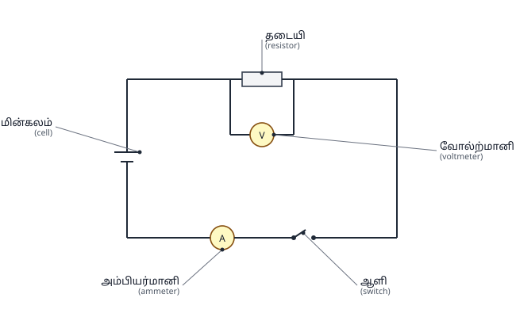

1. சமாந்தரமாக — அழுத்த வேறுபாடு
2. தொடராக — மின்னோட்டம் அளத்தல்
3. மின்னியக்க விசை வழங்கல்
4. மின்னோட்டத்தை எதிர்த்தல்

விடையும் விளக்கமும்

**விடை: (3) மின்னியக்க விசை வழங்கல்**

மின்கலம்: மின்னியக்க விசை வழங்கல் (கோப்பு 6: PHY-D01).

<!-- meta {"type":"mcq","id":"SCQ-10-19-012","grade":10,"chapter_id":"SC10-19","discipline":"PHY","difficulty":1,"qtype":"diagram","answer":1,"origin":"ORIGINAL","source_ref":"PHY-D01","image":"science_assets/physics/PHY-D01_labelled.svg"} -->
**SCQ-10-19-012** · அடிப்படை · வரிப்படம் · `ORIGINAL`

தொடர்ச் சுற்று (அம்பியர்மானி, வோல்ற்மானி) வரிப்படத்தில் 'தடையி' (resistor) இன் தொழில்?

1. மின்னோட்டத்தை எதிர்த்தல்
2. சமாந்தரமாக — அழுத்த வேறுபாடு
3. மின்னியக்க விசை வழங்கல்
4. தொடராக — மின்னோட்டம் அளத்தல்

விடையும் விளக்கமும்

**விடை: (1) மின்னோட்டத்தை எதிர்த்தல்**

தடையி: மின்னோட்டத்தை எதிர்த்தல் (கோப்பு 6: PHY-D01).

<!-- meta {"type":"mcq","id":"SCQ-10-19-013","grade":10,"chapter_id":"SC10-19","discipline":"PHY","difficulty":1,"qtype":"diagram","answer":2,"origin":"ORIGINAL","source_ref":"PHY-D01","image":"science_assets/physics/PHY-D01_labelled.svg"} -->
**SCQ-10-19-013** · அடிப்படை · வரிப்படம் · `ORIGINAL`

தொடர்ச் சுற்று (அம்பியர்மானி, வோல்ற்மானி) வரிப்படத்தில் 'அம்பியர்மானி' (ammeter) இன் தொழில்?

1. மின்னியக்க விசை வழங்கல்
2. தொடராக — மின்னோட்டம் அளத்தல்
3. மின்னோட்டத்தை எதிர்த்தல்
4. சமாந்தரமாக — அழுத்த வேறுபாடு

விடையும் விளக்கமும்

**விடை: (2) தொடராக — மின்னோட்டம் அளத்தல்**

அம்பியர்மானி: தொடராக — மின்னோட்டம் அளத்தல் (கோப்பு 6: PHY-D01).

<!-- meta {"type":"mcq","id":"SCQ-10-19-014","grade":10,"chapter_id":"SC10-19","discipline":"PHY","difficulty":1,"qtype":"diagram","answer":1,"origin":"ORIGINAL","source_ref":"PHY-D02","image":"science_assets/physics/PHY-D02_labelled.svg"} -->
**SCQ-10-19-014** · அடிப்படை · வரிப்படம் · `ORIGINAL`

சமாந்தரச் சுற்று வரிப்படத்தில் 'கிளை 1 (R₁)' (branch 1) இன் தொழில்?

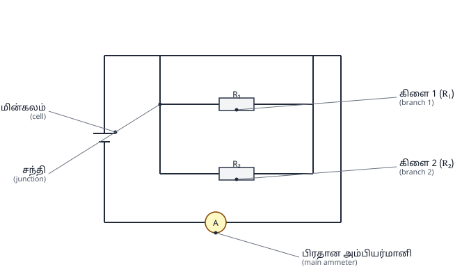

1. அழுத்த வேறுபாடு மின்கலத்துக்குச் சமம்
2. மின்னோட்டம் பிரியும்/சேரும் புள்ளி
3. கிளை மின்னோட்டங்களின் கூட்டு = மொத்தம்
4. மொத்த மின்னோட்டம்

விடையும் விளக்கமும்

**விடை: (1) அழுத்த வேறுபாடு மின்கலத்துக்குச் சமம்**

கிளை 1 (R₁): அழுத்த வேறுபாடு மின்கலத்துக்குச் சமம் (கோப்பு 6: PHY-D02).

<!-- meta {"type":"mcq","id":"SCQ-10-19-015","grade":10,"chapter_id":"SC10-19","discipline":"PHY","difficulty":1,"qtype":"diagram","answer":1,"origin":"ORIGINAL","source_ref":"PHY-D02","image":"science_assets/physics/PHY-D02_labelled.svg"} -->
**SCQ-10-19-015** · அடிப்படை · வரிப்படம் · `ORIGINAL`

சமாந்தரச் சுற்று வரிப்படத்தில் 'கிளை 2 (R₂)' (branch 2) இன் தொழில்?

1. கிளை மின்னோட்டங்களின் கூட்டு = மொத்தம்
2. மின்னோட்டம் பிரியும்/சேரும் புள்ளி
3. அழுத்த வேறுபாடு மின்கலத்துக்குச் சமம்
4. மொத்த மின்னோட்டம்

விடையும் விளக்கமும்

**விடை: (1) கிளை மின்னோட்டங்களின் கூட்டு = மொத்தம்**

கிளை 2 (R₂): கிளை மின்னோட்டங்களின் கூட்டு = மொத்தம் (கோப்பு 6: PHY-D02).

<!-- meta {"type":"mcq","id":"SCQ-10-19-016","grade":10,"chapter_id":"SC10-19","discipline":"PHY","difficulty":1,"qtype":"diagram","answer":1,"origin":"ORIGINAL","source_ref":"PHY-D02","image":"science_assets/physics/PHY-D02_labelled.svg"} -->
**SCQ-10-19-016** · அடிப்படை · வரிப்படம் · `ORIGINAL`

சமாந்தரச் சுற்று வரிப்படத்தில் 'சந்தி' (junction) இன் தொழில்?

1. மின்னோட்டம் பிரியும்/சேரும் புள்ளி
2. அழுத்த வேறுபாடு மின்கலத்துக்குச் சமம்
3. மொத்த மின்னோட்டம்
4. கிளை மின்னோட்டங்களின் கூட்டு = மொத்தம்

விடையும் விளக்கமும்

**விடை: (1) மின்னோட்டம் பிரியும்/சேரும் புள்ளி**

சந்தி: மின்னோட்டம் பிரியும்/சேரும் புள்ளி (கோப்பு 6: PHY-D02).

<!-- meta {"type":"mcq","id":"SCQ-10-19-017","grade":10,"chapter_id":"SC10-19","discipline":"PHY","difficulty":1,"qtype":"calculation","answer":2,"origin":"ORIGINAL","source_ref":"param-SC10-19-1","image":null} -->
**SCQ-10-19-017** · அடிப்படை · கணிப்பு · `ORIGINAL`

6 V அழுத்த வேறுபாட்டில் 2 Ω தடையினூடான மின்னோட்டம்?

1. 6 A
2. 3 A
3. 0.3333 A
4. 12 A

விடையும் விளக்கமும்

**விடை: (2) 3 A**

I = V/R.

<!-- meta {"type":"mcq","id":"SCQ-10-19-018","grade":10,"chapter_id":"SC10-19","discipline":"PHY","difficulty":1,"qtype":"calculation","answer":4,"origin":"ORIGINAL","source_ref":"param-SC10-19-2","image":null} -->
**SCQ-10-19-018** · அடிப்படை · கணிப்பு · `ORIGINAL`

230 V அழுத்த வேறுபாட்டில் 46 Ω தடையினூடான மின்னோட்டம்?

1. 10580 A
2. 0.2 A
3. 10 A
4. 5 A

விடையும் விளக்கமும்

**விடை: (4) 5 A**

I = V/R.

<!-- meta {"type":"mcq","id":"SCQ-10-19-019","grade":10,"chapter_id":"SC10-19","discipline":"PHY","difficulty":1,"qtype":"calculation","answer":1,"origin":"ORIGINAL","source_ref":"param-SC10-19-3","image":null} -->
**SCQ-10-19-019** · அடிப்படை · கணிப்பு · `ORIGINAL`

9 V அழுத்த வேறுபாட்டில் 18 Ω தடையினூடான மின்னோட்டம்?

1. 0.5 A
2. 1 A
3. 2 A
4. 162 A

விடையும் விளக்கமும்

**விடை: (1) 0.5 A**

I = V/R.

<!-- meta {"type":"mcq","id":"SCQ-10-19-020","grade":10,"chapter_id":"SC10-19","discipline":"PHY","difficulty":1,"qtype":"calculation","answer":3,"origin":"ORIGINAL","source_ref":"param-SC10-19-4","image":null} -->
**SCQ-10-19-020** · அடிப்படை · கணிப்பு · `ORIGINAL`

1.5 V அழுத்த வேறுபாட்டில் 0.5 Ω தடையினூடான மின்னோட்டம்?

1. 6 A
2. 0.3333 A
3. 3 A
4. 0.75 A

விடையும் விளக்கமும்

**விடை: (3) 3 A**

I = V/R.

<!-- meta {"type":"mcq","id":"SCQ-10-19-021","grade":10,"chapter_id":"SC10-19","discipline":"PHY","difficulty":2,"qtype":"calculation","answer":2,"origin":"ORIGINAL","source_ref":"param-SC10-19-5","image":null} -->
**SCQ-10-19-021** · இடைநிலை · கணிப்பு · `ORIGINAL`

4 Ω உம் 12 Ω உம் சமாந்தரமாக. விளையுள் தடை?

1. 8 Ω
2. 3 Ω
3. 16 Ω
4. 6 Ω

விடையும் விளக்கமும்

**விடை: (2) 3 Ω**

R = R₁R₂/(R₁ + R₂).

<!-- meta {"type":"mcq","id":"SCQ-10-19-022","grade":10,"chapter_id":"SC10-19","discipline":"PHY","difficulty":2,"qtype":"calculation","answer":4,"origin":"ORIGINAL","source_ref":"param-SC10-19-6","image":null} -->
**SCQ-10-19-022** · இடைநிலை · கணிப்பு · `ORIGINAL`

10 Ω உம் 10 Ω உம் சமாந்தரமாக. விளையுள் தடை?

1. 20 Ω
2. 2.5 Ω
3. 10 Ω
4. 5 Ω

விடையும் விளக்கமும்

**விடை: (4) 5 Ω**

R = R₁R₂/(R₁ + R₂).

<!-- meta {"type":"mcq","id":"SCQ-10-19-023","grade":10,"chapter_id":"SC10-19","discipline":"PHY","difficulty":2,"qtype":"calculation","answer":1,"origin":"ORIGINAL","source_ref":"param-SC10-19-7","image":null} -->
**SCQ-10-19-023** · இடைநிலை · கணிப்பு · `ORIGINAL`

20 Ω உம் 30 Ω உம் சமாந்தரமாக. விளையுள் தடை?

1. 12 Ω
2. 25 Ω
3. 10 Ω
4. 50 Ω

விடையும் விளக்கமும்

**விடை: (1) 12 Ω**

R = R₁R₂/(R₁ + R₂).

<!-- meta {"type":"mcq","id":"SCQ-10-19-024","grade":10,"chapter_id":"SC10-19","discipline":"PHY","difficulty":2,"qtype":"calculation","answer":1,"origin":"ORIGINAL","source_ref":"param-SC10-19-8","image":null} -->
**SCQ-10-19-024** · இடைநிலை · கணிப்பு · `ORIGINAL`

2 Ω உம் 3 Ω உம் சமாந்தரமாக. விளையுள் தடை?

1. 1.2 Ω
2. 2.5 Ω
3. 5 Ω
4. 1 Ω

விடையும் விளக்கமும்

**விடை: (1) 1.2 Ω**

R = R₁R₂/(R₁ + R₂).

<!-- meta {"type":"mcq","id":"SCQ-10-19-025","grade":10,"chapter_id":"SC10-19","discipline":"PHY","difficulty":1,"qtype":"calculation","answer":2,"origin":"ORIGINAL","source_ref":"param-SC10-19-9","image":null} -->
**SCQ-10-19-025** · அடிப்படை · கணிப்பு · `ORIGINAL`

24 Ω தடையினூடு 0.5 A பாய்கிறது. அழுத்த வேறுபாடு?

1. 24 V
2. 12 V
3. 48 V
4. 0.0208 V

விடையும் விளக்கமும்

**விடை: (2) 12 V**

V = IR.

<!-- meta {"type":"mcq","id":"SCQ-10-19-026","grade":10,"chapter_id":"SC10-19","discipline":"PHY","difficulty":1,"qtype":"calculation","answer":3,"origin":"ORIGINAL","source_ref":"param-SC10-19-10","image":null} -->
**SCQ-10-19-026** · அடிப்படை · கணிப்பு · `ORIGINAL`

115 Ω தடையினூடு 2 A பாய்கிறது. அழுத்த வேறுபாடு?

1. 57.5 V
2. 460 V
3. 230 V
4. 0.0174 V

விடையும் விளக்கமும்

**விடை: (3) 230 V**

V = IR.

<!-- meta {"type":"mcq","id":"SCQ-10-19-027","grade":10,"chapter_id":"SC10-19","discipline":"PHY","difficulty":1,"qtype":"calculation","answer":1,"origin":"ORIGINAL","source_ref":"param-SC10-19-11","image":null} -->
**SCQ-10-19-027** · அடிப்படை · கணிப்பு · `ORIGINAL`

1000 Ω தடையினூடு 0.02 A பாய்கிறது. அழுத்த வேறுபாடு?

1. 20 V
2. 50000 V
3. 2 × 10⁻⁵ V
4. 40 V

விடையும் விளக்கமும்

**விடை: (1) 20 V**

V = IR.

## SC10-20: தலைமுறையுரிமை (Inheritance)

*தரம் 10 · அத்தியாயம் 20 · உயிரியல் · 27 வினாக்கள்*

<!-- meta {"type":"mcq","id":"SCQ-10-20-001","grade":10,"chapter_id":"SC10-20","discipline":"BIO","difficulty":1,"qtype":"concept","answer":2,"origin":"ORIGINAL","source_ref":"chapter","image":null} -->
**SCQ-10-20-001** · அடிப்படை · எண்ணக்கரு · `ORIGINAL`

உயரமான (TT) தாவரம் குட்டையான (tt) தாவரத்துடன் கலந்தால் F1?

1. எல்லாம் TT
2. எல்லாம் Tt — உயரம்
3. 1:1
4. 3:1

விடையும் விளக்கமும்

**விடை: (2) எல்லாம் Tt — உயரம்**

எல்லாச் சந்ததியும் Tt; T ஆட்சியுடையதால் உயரம்.

<!-- meta {"type":"mcq","id":"SCQ-10-20-002","grade":10,"chapter_id":"SC10-20","discipline":"BIO","difficulty":1,"qtype":"calculation","answer":1,"origin":"ORIGINAL","source_ref":"chapter","image":null} -->
**SCQ-10-20-002** · அடிப்படை · கணிப்பு · `ORIGINAL`

Tt × Tt கலப்பில் குட்டைத் தாவரங்களின் விகிதம்?

1. ¼
2. ½
3. ¾
4. 0

விடையும் விளக்கமும்

**விடை: (1) ¼**

tt மட்டும் குட்டை: 4 இல் 1.

<!-- meta {"type":"mcq","id":"SCQ-10-20-003","grade":10,"chapter_id":"SC10-20","discipline":"BIO","difficulty":2,"qtype":"calculation","answer":3,"origin":"ORIGINAL","source_ref":"chapter","image":null} -->
**SCQ-10-20-003** · இடைநிலை · கணிப்பு · `ORIGINAL`

Tt × Tt இலிருந்து 400 தாவரங்கள். உயரமானவை எதிர்பார்க்கப்படுவது?

1. 100
2. 200
3. 300
4. 400

விடையும் விளக்கமும்

**விடை: (3) 300**

¾ × 400 = 300.

<!-- meta {"type":"mcq","id":"SCQ-10-20-004","grade":10,"chapter_id":"SC10-20","discipline":"BIO","difficulty":1,"qtype":"recall","answer":3,"origin":"ORIGINAL","source_ref":"chapter","image":null} -->
**SCQ-10-20-004** · அடிப்படை · நினைவு · `ORIGINAL`

பல்லினநுகப் பிறப்புரிமையமைப்பு?

1. TT
2. tt
3. Tt
4. T

விடையும் விளக்கமும்

**விடை: (3) Tt**

இரு வேறுபட்ட எதிருருக்கள்.

<!-- meta {"type":"mcq","id":"SCQ-10-20-005","grade":10,"chapter_id":"SC10-20","discipline":"BIO","difficulty":1,"qtype":"concept","answer":2,"origin":"ORIGINAL","source_ref":"chapter","image":null} -->
**SCQ-10-20-005** · அடிப்படை · எண்ணக்கரு · `ORIGINAL`

ஆண் பிள்ளை பிறப்பது தந்தையின் எந்த நிறமூர்த்தத்தால்?

1. X
2. Y
3. XX
4. தாயின் X

விடையும் விளக்கமும்

**விடை: (2) Y**

Y கொண்ட விந்து → XY.

<!-- meta {"type":"mcq","id":"SCQ-10-20-006","grade":10,"chapter_id":"SC10-20","discipline":"BIO","difficulty":3,"qtype":"reasoning","answer":3,"origin":"ORIGINAL","source_ref":"chapter","image":null} -->
**SCQ-10-20-006** · கடினம் · காரணம் காணல் · `ORIGINAL`

உயரமான தாவரம் TT ஆ Tt ஆ எனக் கண்டறிய அதை எதனுடன் கலக்க வேண்டும்?

1. TT
2. Tt
3. tt
4. எதுவுமில்லை

விடையும் விளக்கமும்

**விடை: (3) tt**

சோதனைக் கலப்பு: tt உடன்; குட்டைச் சந்ததி வந்தால் Tt.

<!-- meta {"type":"mcq","id":"SCQ-10-20-007","grade":10,"chapter_id":"SC10-20","discipline":"BIO","difficulty":2,"qtype":"calculation","answer":2,"origin":"ORIGINAL","source_ref":"chapter","image":null} -->
**SCQ-10-20-007** · இடைநிலை · கணிப்பு · `ORIGINAL`

Tt × tt தோற்றவமைப்பு விகிதம் (உயரம் : குட்டை)?

1. 3:1
2. 1:1
3. 1:2:1
4. எல்லாம் உயரம்

விடையும் விளக்கமும்

**விடை: (2) 1:1**

Tt, Tt, tt, tt → 1:1.

<!-- meta {"type":"mcq","id":"SCQ-10-20-008","grade":10,"chapter_id":"SC10-20","discipline":"BIO","difficulty":3,"qtype":"reasoning","answer":2,"origin":"ORIGINAL","source_ref":"chapter","image":null} -->
**SCQ-10-20-008** · கடினம் · காரணம் காணல் · `ORIGINAL`

நிறக்குருடு ஆண்களில் அதிகமாவதற்குக் காரணம்?

1. Y இல் உள்ள பரம்பரை அலகு
2. X இணைந்த பின்னடைவான அலகு; ஆணுக்கு ஒரு X மட்டும்
3. தாயின் வயது
4. சூழல்

விடையும் விளக்கமும்

**விடை: (2) X இணைந்த பின்னடைவான அலகு; ஆணுக்கு ஒரு X மட்டும்**

ஆணில் ஒரு பின்னடைவு எதிருரு போதும்.

<!-- meta {"type":"mcq","id":"SCQ-10-20-009","grade":10,"chapter_id":"SC10-20","discipline":"BIO","difficulty":3,"qtype":"concept","answer":2,"origin":"ORIGINAL","source_ref":"chapter","image":null} -->
**SCQ-10-20-009** · கடினம் · எண்ணக்கரு · `ORIGINAL`

தோற்றவமைப்பு தீர்மானிக்கப்படுவது?

1. பிறப்புரிமையமைப்பால் மட்டும்
2. பிறப்புரிமையமைப்பும் சூழலும்
3. சூழலால் மட்டும்
4. இலிங்கத்தால் மட்டும்

விடையும் விளக்கமும்

**விடை: (2) பிறப்புரிமையமைப்பும் சூழலும்**

இரண்டும் பங்களிக்கும்.

<!-- meta {"type":"mcq","id":"SCQ-10-20-010","grade":10,"chapter_id":"SC10-20","discipline":"BIO","difficulty":3,"qtype":"calculation","answer":2,"origin":"ORIGINAL","source_ref":"chapter","image":null} -->
**SCQ-10-20-010** · கடினம் · கணிப்பு · `ORIGINAL`

இரு தலசீமியா காவிகள் (Tt). பிள்ளை காவியாக இருக்கும் நிகழ்தகவு?

1. ¼
2. ½
3. ¾
4. 1

விடையும் விளக்கமும்

**விடை: (2) ½**

Tt × Tt → Tt = 2/4 = ½.

<!-- meta {"type":"mcq","id":"SCQ-10-20-011","grade":10,"chapter_id":"SC10-20","discipline":"BIO","difficulty":1,"qtype":"calculation","answer":3,"origin":"ORIGINAL","source_ref":"CL-GENE-1","image":null} -->
**SCQ-10-20-011** · அடிப்படை · கணிப்பு · `ORIGINAL`

Tt × Tt கலப்பில் 800 தாவரங்கள். எதிர்பார்க்கும் உயரத் தாவரங்கள்?

1. 6000 தாவரங்கள்
2. 300 தாவரங்கள்
3. 600 தாவரங்கள்
4. 1200 தாவரங்கள்

விடையும் விளக்கமும்

**விடை: (3) 600 தாவரங்கள்**

சரியான விடை 600 தாவரங்கள். கோப்பு 5 இல் CL-GENE (அடிப்படை) எட்டுப் படித் தீர்வைப் பார்க்க.

<!-- meta {"type":"mcq","id":"SCQ-10-20-012","grade":10,"chapter_id":"SC10-20","discipline":"BIO","difficulty":3,"qtype":"calculation","answer":2,"origin":"ORIGINAL","source_ref":"CL-GENE-4","image":null} -->
**SCQ-10-20-012** · கடினம் · கணிப்பு · `ORIGINAL`

இரு தலசீமியா காவிகள் (Tt). அடுத்த பிள்ளை நோயுள்ள (tt) ஆண் பிள்ளையாக இருக்கும் நிகழ்தகவு?

1. 1.25 
2. 0.125 
3. 0.062 
4. 0.25 

விடையும் விளக்கமும்

**விடை: (2) 0.125 **

சரியான விடை 0.125 . கோப்பு 5 இல் CL-GENE (சவால்) எட்டுப் படித் தீர்வைப் பார்க்க.

<!-- meta {"type":"mcq","id":"SCQ-10-20-013","grade":10,"chapter_id":"SC10-20","discipline":"BIO","difficulty":1,"qtype":"concept","answer":3,"origin":"ORIGINAL","source_ref":"extra-SC10-20-1","image":null} -->
**SCQ-10-20-013** · அடிப்படை · எண்ணக்கரு · `ORIGINAL`

பிறப்புரிமையமைப்பு (genotype) என்பது?

1. வெளித்தோற்றம்
2. உயரம் மட்டும்
3. அங்கியின் மரபணுச் சேர்க்கை
4. சூழல்

விடையும் விளக்கமும்

**விடை: (3) அங்கியின் மரபணுச் சேர்க்கை**

உ-ம் Tt.

<!-- meta {"type":"mcq","id":"SCQ-10-20-014","grade":10,"chapter_id":"SC10-20","discipline":"BIO","difficulty":1,"qtype":"recall","answer":4,"origin":"ORIGINAL","source_ref":"extra-SC10-20-2","image":null} -->
**SCQ-10-20-014** · அடிப்படை · நினைவு · `ORIGINAL`

ஒரு மரபணுவின் மாற்று வடிவங்கள்?

1. கருக்கள்
2. நிறமூர்த்தங்கள்
3. புணரிகள்
4. எதிருருக்கள் (alleles)

விடையும் விளக்கமும்

**விடை: (4) எதிருருக்கள் (alleles)**

T, t.

<!-- meta {"type":"mcq","id":"SCQ-10-20-015","grade":10,"chapter_id":"SC10-20","discipline":"BIO","difficulty":1,"qtype":"recall","answer":2,"origin":"ORIGINAL","source_ref":"extra-SC10-20-3","image":null} -->
**SCQ-10-20-015** · அடிப்படை · நினைவு · `ORIGINAL`

மென்டல் தனது பரிசோதனைகளுக்குப் பயன்படுத்திய தாவரம்?

1. அவரை
2. பட்டாணி
3. நெல்
4. சோளம்

விடையும் விளக்கமும்

**விடை: (2) பட்டாணி**

Pisum sativum.

<!-- meta {"type":"mcq","id":"SCQ-10-20-016","grade":10,"chapter_id":"SC10-20","discipline":"BIO","difficulty":3,"qtype":"reasoning","answer":4,"origin":"ORIGINAL","source_ref":"extra-SC10-20-4","image":null} -->
**SCQ-10-20-016** · கடினம் · காரணம் காணல் · `ORIGINAL`

தோற்றவமைப்பு உயரமாக உள்ள தாவரத்தின் பிறப்புரிமையமைப்பைக் காணும் சோதனைக் கலப்பு?

1. தன் மகரந்தச் சேர்க்கை மட்டும்
2. உயர (TT) உடன் கலத்தல்
3. Tt உடன்
4. குட்டை (tt) உடன் கலத்தல்

விடையும் விளக்கமும்

**விடை: (4) குட்டை (tt) உடன் கலத்தல்**

குட்டைச் சந்ததி தோன்றினால் Tt.

<!-- meta {"type":"mcq","id":"SCQ-10-20-017","grade":10,"chapter_id":"SC10-20","discipline":"BIO","difficulty":2,"qtype":"reasoning","answer":3,"origin":"ORIGINAL","source_ref":"extra-SC10-20-5","image":null} -->
**SCQ-10-20-017** · இடைநிலை · காரணம் காணல் · `ORIGINAL`

மனிதனில் பால் தீர்மானிக்கப்படுவது?

1. சூழல்
2. தாயின் முட்டை
3. தந்தையின் விந்து (X அல்லது Y)
4. உணவு

விடையும் விளக்கமும்

**விடை: (3) தந்தையின் விந்து (X அல்லது Y)**

முட்டையில் எப்போதும் X.

<!-- meta {"type":"mcq","id":"SCQ-10-20-018","grade":10,"chapter_id":"SC10-20","discipline":"BIO","difficulty":3,"qtype":"reasoning","answer":3,"origin":"ORIGINAL","source_ref":"extra-SC10-20-6","image":null} -->
**SCQ-10-20-018** · கடினம் · காரணம் காணல் · `ORIGINAL`

நிறக்குருடு போன்ற X-இணைந்த பின்னிடைவு இயல்புகள் ஆண்களில் அதிகம் காணப்படக் காரணம்?

1. Y பெரியது
2. சூழல்
3. ஆண்களிடம் ஒரு X மட்டும்
4. இரு X உண்டு

விடையும் விளக்கமும்

**விடை: (3) ஆண்களிடம் ஒரு X மட்டும்**

ஒரே எதிருரு போதும்.

<!-- meta {"type":"mcq","id":"SCQ-10-20-019","grade":10,"chapter_id":"SC10-20","discipline":"BIO","difficulty":2,"qtype":"recall","answer":3,"origin":"ORIGINAL","source_ref":"extra-SC10-20-7","image":null} -->
**SCQ-10-20-019** · இடைநிலை · நினைவு · `ORIGINAL`

DNA யின் இரட்டைச் சுருளி மாதிரியை முன்வைத்தவர்கள்?

1. மென்டல், டார்வின்
2. பரடே, நியூற்றன்
3. வாட்சன், கிறிக்
4. லின்னேயஸ், ஹூக்

விடையும் விளக்கமும்

**விடை: (3) வாட்சன், கிறிக்**

1953.

<!-- meta {"type":"mcq","id":"SCQ-10-20-020","grade":10,"chapter_id":"SC10-20","discipline":"BIO","difficulty":1,"qtype":"concept","answer":4,"origin":"ORIGINAL","source_ref":"extra-SC10-20-8","image":null} -->
**SCQ-10-20-020** · அடிப்படை · எண்ணக்கரு · `ORIGINAL`

பரம்பரை நோய் அல்லாதது?

1. நிறக்குருடு
2. தலசீமியா
3. ஈமோபீலியா
4. டெங்கு

விடையும் விளக்கமும்

**விடை: (4) டெங்கு**

டெங்கு வைரசு நோய்.

<!-- meta {"type":"mcq","id":"SCQ-10-20-021","grade":10,"chapter_id":"SC10-20","discipline":"BIO","difficulty":2,"qtype":"calculation","answer":1,"origin":"ORIGINAL","source_ref":"param-SC10-20-1","image":null} -->
**SCQ-10-20-021** · இடைநிலை · கணிப்பு · `ORIGINAL`

Tt × Tt கலப்பில் 1200 சந்ததிகள். எதிர்பார்க்கும் பின்னிடைவுத் தோற்றவமைப்புடையவை?

1. 300
2. 400
3. 600
4. 900

விடையும் விளக்கமும்

**விடை: (1) 300**

tt = ¼.

<!-- meta {"type":"mcq","id":"SCQ-10-20-022","grade":10,"chapter_id":"SC10-20","discipline":"BIO","difficulty":2,"qtype":"calculation","answer":1,"origin":"ORIGINAL","source_ref":"param-SC10-20-2","image":null} -->
**SCQ-10-20-022** · இடைநிலை · கணிப்பு · `ORIGINAL`

Tt × Tt கலப்பில் 360 சந்ததிகள். எதிர்பார்க்கும் பின்னிடைவுத் தோற்றவமைப்புடையவை?

1. 90
2. 120
3. 270
4. 180

விடையும் விளக்கமும்

**விடை: (1) 90**

tt = ¼.

<!-- meta {"type":"mcq","id":"SCQ-10-20-023","grade":10,"chapter_id":"SC10-20","discipline":"BIO","difficulty":2,"qtype":"calculation","answer":2,"origin":"ORIGINAL","source_ref":"param-SC10-20-3","image":null} -->
**SCQ-10-20-023** · இடைநிலை · கணிப்பு · `ORIGINAL`

Tt × Tt கலப்பில் 840 சந்ததிகள். எதிர்பார்க்கும் பின்னிடைவுத் தோற்றவமைப்புடையவை?

1. 280
2. 210
3. 630
4. 420

விடையும் விளக்கமும்

**விடை: (2) 210**

tt = ¼.

<!-- meta {"type":"mcq","id":"SCQ-10-20-024","grade":10,"chapter_id":"SC10-20","discipline":"BIO","difficulty":2,"qtype":"calculation","answer":1,"origin":"ORIGINAL","source_ref":"param-SC10-20-4","image":null} -->
**SCQ-10-20-024** · இடைநிலை · கணிப்பு · `ORIGINAL`

Tt × tt கலப்பில் 500 சந்ததிகள். எதிர்பார்க்கும் பல்லினநுகச் சந்ததிகள்?

1. 250
2. 125
3. 500
4. 375

விடையும் விளக்கமும்

**விடை: (1) 250**

Tt × tt → 1 Tt : 1 tt.

<!-- meta {"type":"mcq","id":"SCQ-10-20-025","grade":10,"chapter_id":"SC10-20","discipline":"BIO","difficulty":2,"qtype":"calculation","answer":4,"origin":"ORIGINAL","source_ref":"param-SC10-20-5","image":null} -->
**SCQ-10-20-025** · இடைநிலை · கணிப்பு · `ORIGINAL`

Tt × tt கலப்பில் 250 சந்ததிகள். எதிர்பார்க்கும் பல்லினநுகச் சந்ததிகள்?

1. 187.5
2. 62.5
3. 250
4. 125

விடையும் விளக்கமும்

**விடை: (4) 125**

Tt × tt → 1 Tt : 1 tt.

<!-- meta {"type":"mcq","id":"SCQ-10-20-026","grade":10,"chapter_id":"SC10-20","discipline":"BIO","difficulty":3,"qtype":"reasoning","answer":3,"origin":"ORIGINAL","source_ref":"param-SC10-20-6","image":null} -->
**SCQ-10-20-026** · கடினம் · காரணம் காணல் · `ORIGINAL`

TT × tt கலப்பில் 400 சந்ததிகள். குட்டைத் தோற்றவமைப்புடையவை?

1. 400
2. 200
3. 0
4. 100

விடையும் விளக்கமும்

**விடை: (3) 0**

எல்லாச் சந்ததிகளும் Tt — உயரம்.

<!-- meta {"type":"mcq","id":"SCQ-10-20-027","grade":10,"chapter_id":"SC10-20","discipline":"BIO","difficulty":3,"qtype":"reasoning","answer":2,"origin":"ORIGINAL","source_ref":"param-SC10-20-7","image":null} -->
**SCQ-10-20-027** · கடினம் · காரணம் காணல் · `ORIGINAL`

TT × tt கலப்பில் 160 சந்ததிகள். குட்டைத் தோற்றவமைப்புடையவை?

1. 160
2. 0
3. 80
4. 40

விடையும் விளக்கமும்

**விடை: (2) 0**

எல்லாச் சந்ததிகளும் Tt — உயரம்.

## SC11-01: தாவர இழையங்களும் விலங்கு இழையங்களும் (Living tissues)

*தரம் 11 · அத்தியாயம் 1 · உயிரியல் · 25 வினாக்கள்*

<!-- meta {"type":"mcq","id":"SCQ-11-01-001","grade":11,"chapter_id":"SC11-01","discipline":"BIO","difficulty":1,"qtype":"recall","answer":2,"origin":"ORIGINAL","source_ref":"chapter","image":null} -->
**SCQ-11-01-001** · அடிப்படை · நினைவு · `ORIGINAL`

தாவரத்தில் நீரையும் கனிப்பொருட்களையும் வேரிலிருந்து இலைக்குக் கடத்துவது?

1. உரியம்
2. காழ்
3. புடைக்கலவிழையம்
4. பிரியிழையம்

விடையும் விளக்கமும்

**விடை: (2) காழ்**

காழ்க் குழாய்கள் நீரை மேல்நோக்கிக் கடத்தும்.

<!-- meta {"type":"mcq","id":"SCQ-11-01-002","grade":11,"chapter_id":"SC11-01","discipline":"BIO","difficulty":1,"qtype":"recall","answer":2,"origin":"ORIGINAL","source_ref":"chapter","image":null} -->
**SCQ-11-01-002** · அடிப்படை · நினைவு · `ORIGINAL`

இதயத் தசையின் சிறப்பியல்பு?

1. விருப்பத்துக்குரியது
2. சோர்வடையாமல் வாழ்நாள் முழுதும் சுருங்கும்
3. எலும்புடன் இணைந்தது
4. கிளைகள் இல்லை

விடையும் விளக்கமும்

**விடை: (2) சோர்வடையாமல் வாழ்நாள் முழுதும் சுருங்கும்**

இதயத் தசை தொடர்ந்து சுருங்கும்.

<!-- meta {"type":"mcq","id":"SCQ-11-01-003","grade":11,"chapter_id":"SC11-01","discipline":"BIO","difficulty":2,"qtype":"recall","answer":2,"origin":"ORIGINAL","source_ref":"chapter","image":null} -->
**SCQ-11-01-003** · இடைநிலை · நினைவு · `ORIGINAL`

பல்கருவுள்ள கலங்களுக்கு உதாரணம்?

1. இரத்தச் சிவப்புக் கலம்
2. வன்கூட்டுத் தசைக் கலம்
3. நியூரோன்
4. மேலணிக் கலம்

விடையும் விளக்கமும்

**விடை: (2) வன்கூட்டுத் தசைக் கலம்**

வன்கூட்டுத் தசை நார்கள் பல கருக்களுடையவை.

<!-- meta {"type":"mcq","id":"SCQ-11-01-004","grade":11,"chapter_id":"SC11-01","discipline":"BIO","difficulty":1,"qtype":"concept","answer":1,"origin":"ORIGINAL","source_ref":"chapter","image":null} -->
**SCQ-11-01-004** · அடிப்படை · எண்ணக்கரு · `ORIGINAL`

தாவரத் தண்டின் நுனியில் நீள்வளர்ச்சிக்குக் காரணமான இழையம்?

1. நுனிப் பிரியிழையம்
2. காழ்
3. உரியம்
4. ஒட்டுக்கலவிழையம்

விடையும் விளக்கமும்

**விடை: (1) நுனிப் பிரியிழையம்**

நுனிப் பிரியிழையம் நீளவளர்ச்சி தரும்.

<!-- meta {"type":"mcq","id":"SCQ-11-01-005","grade":11,"chapter_id":"SC11-01","discipline":"BIO","difficulty":2,"qtype":"experiment","answer":2,"origin":"ORIGINAL","source_ref":"chapter","image":null} -->
**SCQ-11-01-005** · இடைநிலை · பரிசோதனை · `ORIGINAL`

வெள்ளைப் பூந்தண்டை சிவப்புச் சாயக் கரைசலில் வைத்தபின் இதழ்கள் சிவப்பானதற்குக் காரணம்?

1. உரியம் சாயத்தைக் கடத்தியது
2. காழ் நீருடன் சாயத்தைக் கடத்தியது
3. பிரசாரணம்
4. ஒளித்தொகுப்பு

விடையும் விளக்கமும்

**விடை: (2) காழ் நீருடன் சாயத்தைக் கடத்தியது**

காழ் நீரை மேல்நோக்கிக் கடத்தும்.

<!-- meta {"type":"mcq","id":"SCQ-11-01-006","grade":11,"chapter_id":"SC11-01","discipline":"BIO","difficulty":3,"qtype":"concept","answer":1,"origin":"ORIGINAL","source_ref":"chapter","image":null} -->
**SCQ-11-01-006** · கடினம் · எண்ணக்கரு · `ORIGINAL`

இரத்தம் தொடுப்பிழையமாகக் கருதப்படக் காரணம்?

1. கலங்கள் ஒரு திரவ ஊடகத்தில் (முதலுரு) உள்ளன
2. சுருங்குவதால்
3. கணத்தாக்கம் கடத்துவதால்
4. மேற்பரப்பை மூடுவதால்

விடையும் விளக்கமும்

**விடை: (1) கலங்கள் ஒரு திரவ ஊடகத்தில் (முதலுரு) உள்ளன**

தொடுப்பிழையம்: கலங்கள் + இடைக்கலப் பொருள்.

<!-- meta {"type":"mcq","id":"SCQ-11-01-007","grade":11,"chapter_id":"SC11-01","discipline":"BIO","difficulty":2,"qtype":"application","answer":3,"origin":"ORIGINAL","source_ref":"chapter","image":null} -->
**SCQ-11-01-007** · இடைநிலை · பிரயோகம் · `ORIGINAL`

உணவுக்கால்வாயில் குடலசைவுக்குக் காரணமான தசை?

1. வன்கூட்டுத் தசை
2. இதயத் தசை
3. மழமழப்பான தசை
4. எதுவுமில்லை

விடையும் விளக்கமும்

**விடை: (3) மழமழப்பான தசை**

மழமழப்பான தசை தன்னிச்சையின்றிச் சுருங்கும்.

<!-- meta {"type":"mcq","id":"SCQ-11-01-008","grade":11,"chapter_id":"SC11-01","discipline":"BIO","difficulty":3,"qtype":"recall","answer":1,"origin":"ORIGINAL","source_ref":"chapter","image":null} -->
**SCQ-11-01-008** · கடினம் · நினைவு · `ORIGINAL`

உரியத்தின் நெய்யரிக் குழாய்களுக்குச் சக்தி வழங்கும் கலங்கள்?

1. தோழமைக் கலங்கள்
2. காழ்க் குழாய்கள்
3. புடைக்கலங்கள்
4. காவற்கலங்கள்

விடையும் விளக்கமும்

**விடை: (1) தோழமைக் கலங்கள்**

நெய்யரிக் குழாய்களில் கரு இல்லை; தோழமைக் கலங்கள் உதவும்.

<!-- meta {"type":"mcq","id":"SCQ-11-01-009","grade":11,"chapter_id":"SC11-01","discipline":"BIO","difficulty":2,"qtype":"concept","answer":2,"origin":"ORIGINAL","source_ref":"chapter","image":null} -->
**SCQ-11-01-009** · இடைநிலை · எண்ணக்கரு · `ORIGINAL`

காழ்க் கலங்களின் இயல்பு?

1. உயிருள்ளவை
2. இறந்தவை, இலிக்னின் சுவருடையவை
3. பச்சையவுருமணி உண்டு
4. கரு உண்டு

விடையும் விளக்கமும்

**விடை: (2) இறந்தவை, இலிக்னின் சுவருடையவை**

முதிர்ந்த காழ்க் குழாய்கள் இறந்தவை.

<!-- meta {"type":"mcq","id":"SCQ-11-01-010","grade":11,"chapter_id":"SC11-01","discipline":"BIO","difficulty":1,"qtype":"recall","answer":1,"origin":"ORIGINAL","source_ref":"chapter","image":null} -->
**SCQ-11-01-010** · அடிப்படை · நினைவு · `ORIGINAL`

தோலின் மேற்பரப்பையும் உணவுக்கால்வாயின் உட்பரப்பையும் மூடும் இழையம்?

1. மேலணி
2. நரம்பு
3. தசை
4. என்பு

விடையும் விளக்கமும்

**விடை: (1) மேலணி**

மேலணி இழையம் மூடும்/காக்கும்.

<!-- meta {"type":"mcq","id":"SCQ-11-01-011","grade":11,"chapter_id":"SC11-01","discipline":"BIO","difficulty":1,"qtype":"recall","answer":1,"origin":"ORIGINAL","source_ref":"extra-SC11-01-1","image":null} -->
**SCQ-11-01-011** · அடிப்படை · நினைவு · `ORIGINAL`

தாவர வேர், தண்டு நுனிகளில் கலப்பிரிவு நடைபெறும் இழையம்?

1. நுனிப் பிரியிழையம்
2. மேற்றோல்
3. புடைக்கலவிழையம்
4. காழ்

விடையும் விளக்கமும்

**விடை: (1) நுனிப் பிரியிழையம்**

நீள்பக்க வளர்ச்சி.

<!-- meta {"type":"mcq","id":"SCQ-11-01-012","grade":11,"chapter_id":"SC11-01","discipline":"BIO","difficulty":2,"qtype":"concept","answer":3,"origin":"ORIGINAL","source_ref":"extra-SC11-01-2","image":null} -->
**SCQ-11-01-012** · இடைநிலை · எண்ணக்கரு · `ORIGINAL`

தாவரங்களுக்கு வலிமை தரும் தடித்த லிக்னின் சுவருடைய இறந்த கலங்கள்?

1. புடைக்கலவிழையம்
2. பிரியிழையம்
3. வல்லருகுக்கலவிழையம்
4. உரியம்

விடையும் விளக்கமும்

**விடை: (3) வல்லருகுக்கலவிழையம்**

நார்கள், கற்கலங்கள்.

<!-- meta {"type":"mcq","id":"SCQ-11-01-013","grade":11,"chapter_id":"SC11-01","discipline":"BIO","difficulty":2,"qtype":"recall","answer":2,"origin":"ORIGINAL","source_ref":"extra-SC11-01-3","image":null} -->
**SCQ-11-01-013** · இடைநிலை · நினைவு · `ORIGINAL`

உரியத்தில் உணவு கடத்தும் கலங்கள்?

1. குழற்போலிகள்
2. நெய்யரிக் குழாய்கள்
3. கலன்கள்
4. காவற்கலங்கள்

விடையும் விளக்கமும்

**விடை: (2) நெய்யரிக் குழாய்கள்**

துணைக்கலங்களுடன்.

<!-- meta {"type":"mcq","id":"SCQ-11-01-014","grade":11,"chapter_id":"SC11-01","discipline":"BIO","difficulty":2,"qtype":"application","answer":3,"origin":"ORIGINAL","source_ref":"extra-SC11-01-4","image":null} -->
**SCQ-11-01-014** · இடைநிலை · பிரயோகம் · `ORIGINAL`

சுவாசப் பாதையில் தூசியை அகற்றும் இழையம்?

1. செதின் மேலணி
2. என்பு
3. பிசிர் மேலணி (ciliated epithelium)
4. கசியிழையம்

விடையும் விளக்கமும்

**விடை: (3) பிசிர் மேலணி (ciliated epithelium)**

பிசிர்கள் சளியை நகர்த்தும்.

<!-- meta {"type":"mcq","id":"SCQ-11-01-015","grade":11,"chapter_id":"SC11-01","discipline":"BIO","difficulty":1,"qtype":"concept","answer":2,"origin":"ORIGINAL","source_ref":"extra-SC11-01-5","image":null} -->
**SCQ-11-01-015** · அடிப்படை · எண்ணக்கரு · `ORIGINAL`

இச்சையின்றிச் செயற்படும், களைப்படையாத தசை?

1. வன்கூட்டுத் தசை
2. இதயத் தசை
3. இருதலைத் தசை
4. கழுத்துத் தசை

விடையும் விளக்கமும்

**விடை: (2) இதயத் தசை**

தொடர்ச்சியான சுருக்கம்.

<!-- meta {"type":"mcq","id":"SCQ-11-01-016","grade":11,"chapter_id":"SC11-01","discipline":"BIO","difficulty":2,"qtype":"application","answer":4,"origin":"ORIGINAL","source_ref":"extra-SC11-01-6","image":null} -->
**SCQ-11-01-016** · இடைநிலை · பிரயோகம் · `ORIGINAL`

உணவுக்கால்வாய்ச் சுவரின் சுற்றுச் சுருக்க அசைவுக்குக் காரணமான தசை?

1. இணைப்பிழையம்
2. வன்கூட்டுத் தசை
3. இதயத் தசை
4. மழமழப்பான தசை

விடையும் விளக்கமும்

**விடை: (4) மழமழப்பான தசை**

இச்சையின்றிய தசை.

<!-- meta {"type":"mcq","id":"SCQ-11-01-017","grade":11,"chapter_id":"SC11-01","discipline":"BIO","difficulty":2,"qtype":"recall","answer":2,"origin":"ORIGINAL","source_ref":"extra-SC11-01-7","image":null} -->
**SCQ-11-01-017** · இடைநிலை · நினைவு · `ORIGINAL`

என்புகளை இணைக்கும் இணைப்பிழையம்?

1. தசைநாண்
2. இணையம் (ligament)
3. கொழுப்பிழையம்
4. கசியிழையம் மட்டும்

விடையும் விளக்கமும்

**விடை: (2) இணையம் (ligament)**

தசைநாண் தசையை என்புடன் இணைக்கும்.

<!-- meta {"type":"mcq","id":"SCQ-11-01-018","grade":11,"chapter_id":"SC11-01","discipline":"BIO","difficulty":2,"qtype":"concept","answer":1,"origin":"ORIGINAL","source_ref":"extra-SC11-01-8","image":null} -->
**SCQ-11-01-018** · இடைநிலை · எண்ணக்கரு · `ORIGINAL`

நரம்புக் கணத்தாக்கங்களைக் கலவுடலிலிருந்து விலகிக் கடத்தும் பகுதி?

1. நரம்புமுளை (axon)
2. மயலின் இல்லாத பகுதி மட்டும்
3. கிளைமுளை
4. கரு

விடையும் விளக்கமும்

**விடை: (1) நரம்புமுளை (axon)**

கணத்தாக்கம் வெளிச்செல்லும்.

<!-- meta {"type":"mcq","id":"SCQ-11-01-019","grade":11,"chapter_id":"SC11-01","discipline":"BIO","difficulty":3,"qtype":"concept","answer":1,"origin":"ORIGINAL","source_ref":"extra-SC11-01-9","image":null} -->
**SCQ-11-01-019** · கடினம் · எண்ணக்கரு · `ORIGINAL`

மயலின் உறையின் பங்கு?

1. கணத்தாக்கக் கடத்தலை விரைவாக்கல்
2. குருதி வழங்கல்
3. சுருக்கம்
4. உணவு சேமிப்பு

விடையும் விளக்கமும்

**விடை: (1) கணத்தாக்கக் கடத்தலை விரைவாக்கல்**

காவலியாகச் செயற்படும்.

<!-- meta {"type":"mcq","id":"SCQ-11-01-020","grade":11,"chapter_id":"SC11-01","discipline":"BIO","difficulty":1,"qtype":"recall","answer":2,"origin":"ORIGINAL","source_ref":"extra-SC11-01-10","image":null} -->
**SCQ-11-01-020** · அடிப்படை · நினைவு · `ORIGINAL`

கொழுப்பிழையத்தின் ஒரு தொழில்?

1. ஒளித்தொகுப்பு
2. வெப்பக் காவலும் சக்தி சேமிப்பும்
3. குருதி உறைதல்
4. கணத்தாக்கக் கடத்தல்

விடையும் விளக்கமும்

**விடை: (2) வெப்பக் காவலும் சக்தி சேமிப்பும்**

தோலின் கீழ்.

<!-- meta {"type":"mcq","id":"SCQ-11-01-021","grade":11,"chapter_id":"SC11-01","discipline":"BIO","difficulty":3,"qtype":"reasoning","answer":1,"origin":"ORIGINAL","source_ref":"extra-SC11-01-11","image":null} -->
**SCQ-11-01-021** · கடினம் · காரணம் காணல் · `ORIGINAL`

குருதி திரவ இணைப்பிழையம் எனப்படக் காரணம்?

1. கலங்கள் திரவ மூலவுருவில் (முதலுரு) காணப்படுதல்
2. திண்மமாக இருப்பதால்
3. நரம்புகளைக் கொண்டிருப்பதால்
4. தசைகளை இணைப்பதால்

விடையும் விளக்கமும்

**விடை: (1) கலங்கள் திரவ மூலவுருவில் (முதலுரு) காணப்படுதல்**

முதலுரு = மூலவுரு.

<!-- meta {"type":"mcq","id":"SCQ-11-01-022","grade":11,"chapter_id":"SC11-01","discipline":"BIO","difficulty":1,"qtype":"recall","answer":2,"origin":"ORIGINAL","source_ref":"extra-SC11-01-12","image":null} -->
**SCQ-11-01-022** · அடிப்படை · நினைவு · `ORIGINAL`

தாவரத்தின் புறத்தோல் இழையத்தின் தொழில்?

1. ஒளித்தொகுப்பு பிரதானமாக
2. பாதுகாப்பு, நீரிழப்புக் குறைப்பு
3. உணவு கடத்தல்
4. கலப்பிரிவு

விடையும் விளக்கமும்

**விடை: (2) பாதுகாப்பு, நீரிழப்புக் குறைப்பு**

புறத்தோல் படை (cuticle) உடன்.

<!-- meta {"type":"mcq","id":"SCQ-11-01-023","grade":11,"chapter_id":"SC11-01","discipline":"BIO","difficulty":2,"qtype":"recall","answer":3,"origin":"ORIGINAL","source_ref":"extra-SC11-01-13","image":null} -->
**SCQ-11-01-023** · இடைநிலை · நினைவு · `ORIGINAL`

காழ்க் கலன்களின் சுவர்களில் படியும் பதார்த்தம்?

1. செலுலோசு மட்டும்
2. கைற்றின்
3. லிக்னின்
4. சுபரின் மட்டும்

விடையும் விளக்கமும்

**விடை: (3) லிக்னின்**

வலிமையும் நீர்க்காப்பும்.

<!-- meta {"type":"mcq","id":"SCQ-11-01-024","grade":11,"chapter_id":"SC11-01","discipline":"BIO","difficulty":3,"qtype":"concept","answer":3,"origin":"ORIGINAL","source_ref":"extra-SC11-01-14","image":null} -->
**SCQ-11-01-024** · கடினம் · எண்ணக்கரு · `ORIGINAL`

ஒட்டுக்கலவிழையம் (collenchyma) காணப்படும் இடம்?

1. வேர் நுனி
2. வித்து
3. இளம் தண்டுகளின் மேற்றோலுக்குக் கீழ்
4. காழ்

விடையும் விளக்கமும்

**விடை: (3) இளம் தண்டுகளின் மேற்றோலுக்குக் கீழ்**

நெகிழ்வான ஆதாரம்.

<!-- meta {"type":"mcq","id":"SCQ-11-01-025","grade":11,"chapter_id":"SC11-01","discipline":"BIO","difficulty":2,"qtype":"recall","answer":4,"origin":"ORIGINAL","source_ref":"extra-SC11-01-15","image":null} -->
**SCQ-11-01-025** · இடைநிலை · நினைவு · `ORIGINAL`

தோலின் மேற்பகுதியில் காணப்படும் மேலணி?

1. பிசிர் மேலணி
2. கனவுரு மேலணி
3. நிரல் மேலணி
4. படைகொண்ட செதின் மேலணி

விடையும் விளக்கமும்

**விடை: (4) படைகொண்ட செதின் மேலணி**

பல படைகள் — பாதுகாப்பு.

## SC11-02: ஒளித்தொகுப்பு (Photosynthesis)

*தரம் 11 · அத்தியாயம் 2 · உயிரியல் · 25 வினாக்கள்*

<!-- meta {"type":"mcq","id":"SCQ-11-02-001","grade":11,"chapter_id":"SC11-02","discipline":"BIO","difficulty":1,"qtype":"recall","answer":2,"origin":"ORIGINAL","source_ref":"chapter","image":null} -->
**SCQ-11-02-001** · அடிப்படை · நினைவு · `ORIGINAL`

ஒளித்தொகுப்பின் விளைவுகள்?

1. CO₂, நீர்
2. குளுக்கோசு, O₂
3. மாப்பொருள், CO₂
4. O₂, CO₂

விடையும் விளக்கமும்

**விடை: (2) குளுக்கோசு, O₂**

C₆H₁₂O₆ உம் O₂ உம் உருவாகும்.

<!-- meta {"type":"mcq","id":"SCQ-11-02-002","grade":11,"chapter_id":"SC11-02","discipline":"BIO","difficulty":2,"qtype":"experiment","answer":2,"origin":"ORIGINAL","source_ref":"chapter","image":null} -->
**SCQ-11-02-002** · இடைநிலை · பரிசோதனை · `ORIGINAL`

மாப்பொருட் சோதனைக்கு முன் இலையை கொதிநீரில் இடுவதன் நோக்கம்?

1. பச்சையத்தை அகற்ற
2. கலங்களைக் கொன்று நொதியச் செயலை நிறுத்தி, மென்மையாக்க
3. நிறம் தர
4. மாப்பொருளைக் கூட்ட

விடையும் விளக்கமும்

**விடை: (2) கலங்களைக் கொன்று நொதியச் செயலை நிறுத்தி, மென்மையாக்க**

கலங்கள் இறந்து மென்சவ்வுகள் உடைந்து அயடீன் உட்புகும்.

<!-- meta {"type":"mcq","id":"SCQ-11-02-003","grade":11,"chapter_id":"SC11-02","discipline":"BIO","difficulty":2,"qtype":"experiment","answer":2,"origin":"ORIGINAL","source_ref":"chapter","image":null} -->
**SCQ-11-02-003** · இடைநிலை · பரிசோதனை · `ORIGINAL`

CO₂ தேவை எனக் காட்டும் பரிசோதனையில் KOH இன் பங்கு?

1. O₂ ஐ அகற்றல்
2. CO₂ ஐ உறிஞ்சல்
3. நீரை உறிஞ்சல்
4. ஒளியைத் தடுத்தல்

விடையும் விளக்கமும்

**விடை: (2) CO₂ ஐ உறிஞ்சல்**

KOH CO₂ ஐ உறிஞ்சும்.

<!-- meta {"type":"mcq","id":"SCQ-11-02-004","grade":11,"chapter_id":"SC11-02","discipline":"BIO","difficulty":1,"qtype":"experiment","answer":2,"origin":"ORIGINAL","source_ref":"chapter","image":null} -->
**SCQ-11-02-004** · அடிப்படை · பரிசோதனை · `ORIGINAL`

பல்வண்ண இலையில் அயடீன் சோதனைக்குப் பின் கருநீலமாவது?

1. வெள்ளைப் பகுதி
2. பச்சைப் பகுதி
3. இரண்டும்
4. எதுவுமில்லை

விடையும் விளக்கமும்

**விடை: (2) பச்சைப் பகுதி**

பச்சையம் உள்ள பகுதியில் மட்டும் மாப்பொருள்.

<!-- meta {"type":"mcq","id":"SCQ-11-02-005","grade":11,"chapter_id":"SC11-02","discipline":"BIO","difficulty":3,"qtype":"graph","answer":2,"origin":"ORIGINAL","source_ref":"chapter","image":null} -->
**SCQ-11-02-005** · கடினம் · வரைபு · `ORIGINAL`

ஒளிச்செறிவு கூடும்போது ஒளித்தொகுப்பு வீதம் ஒரு கட்டத்தில் மாறாமல் இருப்பதற்குக் காரணம்?

1. ஒளி அதிகம்
2. வேறு காரணி (CO₂/வெப்பநிலை) மட்டுப்படுத்துகிறது
3. தாவரம் இறந்தது
4. நீர் அதிகம்

விடையும் விளக்கமும்

**விடை: (2) வேறு காரணி (CO₂/வெப்பநிலை) மட்டுப்படுத்துகிறது**

மட்டுப்படுத்தும் காரணி மாறுகிறது.

<!-- meta {"type":"mcq","id":"SCQ-11-02-006","grade":11,"chapter_id":"SC11-02","discipline":"BIO","difficulty":2,"qtype":"reasoning","answer":1,"origin":"ORIGINAL","source_ref":"chapter","image":null} -->
**SCQ-11-02-006** · இடைநிலை · காரணம் காணல் · `ORIGINAL`

வேலிக்கற்புடைக்கலங்கள் இலையின் மேற்புறத்துக்கு அருகில் இருப்பதன் நன்மை?

1. அதிக ஒளியைப் பெற
2. நீர் சேமிக்க
3. CO₂ ஐ வெளியேற்ற
4. உணவைக் கடத்த

விடையும் விளக்கமும்

**விடை: (1) அதிக ஒளியைப் பெற**

அதிக பச்சையவுருமணிகள் ஒளியைப் பெறும்.

<!-- meta {"type":"mcq","id":"SCQ-11-02-007","grade":11,"chapter_id":"SC11-02","discipline":"BIO","difficulty":3,"qtype":"concept","answer":2,"origin":"ORIGINAL","source_ref":"chapter","image":null} -->
**SCQ-11-02-007** · கடினம் · எண்ணக்கரு · `ORIGINAL`

ஒளித்தொகுப்பில் வெளியேறும் O₂ இன் மூலம்?

1. CO₂
2. நீர்
3. குளுக்கோசு
4. மண்

விடையும் விளக்கமும்

**விடை: (2) நீர்**

நீர் மூலக்கூறுகள் பிரிக்கப்பட்டு O₂ வெளியேறும்.

<!-- meta {"type":"mcq","id":"SCQ-11-02-008","grade":11,"chapter_id":"SC11-02","discipline":"BIO","difficulty":2,"qtype":"experiment","answer":1,"origin":"ORIGINAL","source_ref":"chapter","image":null} -->
**SCQ-11-02-008** · இடைநிலை · பரிசோதனை · `ORIGINAL`

பச்சையத்தை அகற்ற எதனோலை நீர்த்தொட்டியில் வெப்பமேற்றக் காரணம்?

1. எதனோல் எளிதில் தீப்பற்றும்
2. நீர் அதிக வெப்பம் தரும்
3. எதனோல் உறையும்
4. வேகம் கூட

விடையும் விளக்கமும்

**விடை: (1) எதனோல் எளிதில் தீப்பற்றும்**

பாதுகாப்பு — நேரடித் தீயிலிருந்து விலக்கு.

<!-- meta {"type":"mcq","id":"SCQ-11-02-009","grade":11,"chapter_id":"SC11-02","discipline":"BIO","difficulty":2,"qtype":"application","answer":2,"origin":"ORIGINAL","source_ref":"chapter","image":null} -->
**SCQ-11-02-009** · இடைநிலை · பிரயோகம் · `ORIGINAL`

பசுமைக் கூடத்தில் CO₂ செறிவைக் கூட்டுவதன் விளைவு?

1. விளைச்சல் குறையும்
2. ஒளித்தொகுப்பு வீதம் கூடி விளைச்சல் அதிகரிக்கும்
3. சுவாசம் நிற்கும்
4. இலைகள் வாடும்

விடையும் விளக்கமும்

**விடை: (2) ஒளித்தொகுப்பு வீதம் கூடி விளைச்சல் அதிகரிக்கும்**

CO₂ மட்டுப்படுத்தும் காரணியாக இருந்தால்.

<!-- meta {"type":"mcq","id":"SCQ-11-02-010","grade":11,"chapter_id":"SC11-02","discipline":"BIO","difficulty":2,"qtype":"calculation","answer":1,"origin":"ORIGINAL","source_ref":"chapter","image":null} -->
**SCQ-11-02-010** · இடைநிலை · கணிப்பு · `ORIGINAL`

6 CO₂ மூலக்கூறுகள் பயன்படும்போது உருவாகும் குளுக்கோசு மூலக்கூறுகள்?

1. 1
2. 6
3. 12
4. 3

விடையும் விளக்கமும்

**விடை: (1) 1**

சமன்பாட்டின்படி 6CO₂ → 1 C₆H₁₂O₆.

<!-- meta {"type":"mcq","id":"SCQ-11-02-011","grade":11,"chapter_id":"SC11-02","discipline":"BIO","difficulty":2,"qtype":"equation","answer":2,"origin":"ORIGINAL","source_ref":"EQ-041","image":null} -->
**SCQ-11-02-011** · இடைநிலை · சமன்பாடு · `ORIGINAL`

CO₂ + H₂O → C₆H₁₂O₆ + O₂ — இச்சமன்பாட்டை மிகச்சிறிய முழு எண் குணகங்களால் சமன்செய்யும்போது CO₂ இன் குணகம்?

1. 7
2. 6
3. 12
4. 5

விடையும் விளக்கமும்

**விடை: (2) 6**

6CO₂ + 6H₂O → C₆H₁₂O₆ + 6O₂ (அணு எண்ணிக்கை சரிபார்க்கப்பட்டது; கோப்பு 7: EQ-041).

<!-- meta {"type":"mcq","id":"SCQ-11-02-012","grade":11,"chapter_id":"SC11-02","discipline":"BIO","difficulty":1,"qtype":"diagram","answer":2,"origin":"ORIGINAL","source_ref":"BIO-D03","image":"science_assets/biology/BIO-D03_labelled.svg"} -->
**SCQ-11-02-012** · அடிப்படை · வரிப்படம் · `ORIGINAL`

இலையின் குறுக்குவெட்டு வரிப்படத்தில் 'புறத்தோல் படை' (waxy cuticle) இன் தொழில்?

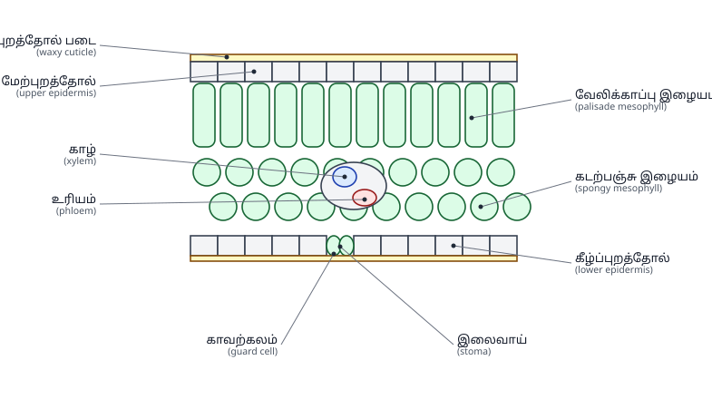

1. பிரதான ஒளித்தொகுப்பு
2. நீரிழப்பைக் குறைத்தல்
3. வாயுப் பரிமாற்றம் — காற்று இடைவெளிகள்
4. பாதுகாப்பு; ஒளி ஊடுபுகல்

விடையும் விளக்கமும்

**விடை: (2) நீரிழப்பைக் குறைத்தல்**

புறத்தோல் படை: நீரிழப்பைக் குறைத்தல் (கோப்பு 6: BIO-D03).

<!-- meta {"type":"mcq","id":"SCQ-11-02-013","grade":11,"chapter_id":"SC11-02","discipline":"BIO","difficulty":1,"qtype":"diagram","answer":3,"origin":"ORIGINAL","source_ref":"BIO-D03","image":"science_assets/biology/BIO-D03_labelled.svg"} -->
**SCQ-11-02-013** · அடிப்படை · வரிப்படம் · `ORIGINAL`

இலையின் குறுக்குவெட்டு வரிப்படத்தில் 'மேற்புறத்தோல்' (upper epidermis) இன் தொழில்?

1. நீரிழப்பைக் குறைத்தல்
2. பிரதான ஒளித்தொகுப்பு
3. பாதுகாப்பு; ஒளி ஊடுபுகல்
4. வாயுப் பரிமாற்றம் — காற்று இடைவெளிகள்

விடையும் விளக்கமும்

**விடை: (3) பாதுகாப்பு; ஒளி ஊடுபுகல்**

மேற்புறத்தோல்: பாதுகாப்பு; ஒளி ஊடுபுகல் (கோப்பு 6: BIO-D03).

<!-- meta {"type":"mcq","id":"SCQ-11-02-014","grade":11,"chapter_id":"SC11-02","discipline":"BIO","difficulty":1,"qtype":"diagram","answer":2,"origin":"ORIGINAL","source_ref":"BIO-D03","image":"science_assets/biology/BIO-D03_labelled.svg"} -->
**SCQ-11-02-014** · அடிப்படை · வரிப்படம் · `ORIGINAL`

இலையின் குறுக்குவெட்டு வரிப்படத்தில் 'வேலிக்காப்பு இழையம்' (palisade mesophyll) இன் தொழில்?

1. வாயுப் பரிமாற்றம் — காற்று இடைவெளிகள்
2. பிரதான ஒளித்தொகுப்பு
3. பாதுகாப்பு; ஒளி ஊடுபுகல்
4. நீரிழப்பைக் குறைத்தல்

விடையும் விளக்கமும்

**விடை: (2) பிரதான ஒளித்தொகுப்பு**

வேலிக்காப்பு இழையம்: பிரதான ஒளித்தொகுப்பு (கோப்பு 6: BIO-D03).

<!-- meta {"type":"mcq","id":"SCQ-11-02-015","grade":11,"chapter_id":"SC11-02","discipline":"BIO","difficulty":1,"qtype":"diagram","answer":1,"origin":"ORIGINAL","source_ref":"EXP-D01","image":"science_assets/experiments/EXP-D01_labelled.svg"} -->
**SCQ-11-02-015** · அடிப்படை · வரிப்படம் · `ORIGINAL`

இலையில் மாப்பொருள் சோதனை வரிப்படத்தில் 'கொதிநீரில் 1–2 நிமிடம்' (boil in water) இன் தொழில்?

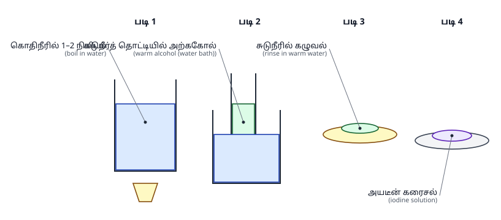

1. கலங்களைக் கொல்லல், நொதியங்கள் செயலிழப்பு
2. பச்சையம் நீக்கல் — நேரடிச் சுவாலை தவிர்
3. இலையை மென்மையாக்கல்
4. மாப்பொருள் இருப்பின் நீல-கறுப்பு

விடையும் விளக்கமும்

**விடை: (1) கலங்களைக் கொல்லல், நொதியங்கள் செயலிழப்பு**

கொதிநீரில் 1–2 நிமிடம்: கலங்களைக் கொல்லல், நொதியங்கள் செயலிழப்பு (கோப்பு 6: EXP-D01).

<!-- meta {"type":"mcq","id":"SCQ-11-02-016","grade":11,"chapter_id":"SC11-02","discipline":"BIO","difficulty":1,"qtype":"diagram","answer":4,"origin":"ORIGINAL","source_ref":"EXP-D01","image":"science_assets/experiments/EXP-D01_labelled.svg"} -->
**SCQ-11-02-016** · அடிப்படை · வரிப்படம் · `ORIGINAL`

இலையில் மாப்பொருள் சோதனை வரிப்படத்தில் 'சுடுநீர்த் தொட்டியில் அற்ககோல்' (warm alcohol (water bath)) இன் தொழில்?

1. இலையை மென்மையாக்கல்
2. கலங்களைக் கொல்லல், நொதியங்கள் செயலிழப்பு
3. மாப்பொருள் இருப்பின் நீல-கறுப்பு
4. பச்சையம் நீக்கல் — நேரடிச் சுவாலை தவிர்

விடையும் விளக்கமும்

**விடை: (4) பச்சையம் நீக்கல் — நேரடிச் சுவாலை தவிர்**

சுடுநீர்த் தொட்டியில் அற்ககோல்: பச்சையம் நீக்கல் — நேரடிச் சுவாலை தவிர் (கோப்பு 6: EXP-D01).

<!-- meta {"type":"mcq","id":"SCQ-11-02-017","grade":11,"chapter_id":"SC11-02","discipline":"BIO","difficulty":1,"qtype":"diagram","answer":2,"origin":"ORIGINAL","source_ref":"EXP-D01","image":"science_assets/experiments/EXP-D01_labelled.svg"} -->
**SCQ-11-02-017** · அடிப்படை · வரிப்படம் · `ORIGINAL`

இலையில் மாப்பொருள் சோதனை வரிப்படத்தில் 'சுடுநீரில் கழுவல்' (rinse in warm water) இன் தொழில்?

1. பச்சையம் நீக்கல் — நேரடிச் சுவாலை தவிர்
2. இலையை மென்மையாக்கல்
3. மாப்பொருள் இருப்பின் நீல-கறுப்பு
4. கலங்களைக் கொல்லல், நொதியங்கள் செயலிழப்பு

விடையும் விளக்கமும்

**விடை: (2) இலையை மென்மையாக்கல்**

சுடுநீரில் கழுவல்: இலையை மென்மையாக்கல் (கோப்பு 6: EXP-D01).

<!-- meta {"type":"mcq","id":"SCQ-11-02-018","grade":11,"chapter_id":"SC11-02","discipline":"BIO","difficulty":2,"qtype":"concept","answer":3,"origin":"ORIGINAL","source_ref":"extra-SC11-02-1","image":null} -->
**SCQ-11-02-018** · இடைநிலை · எண்ணக்கரு · `ORIGINAL`

ஒளித்தொகுப்பில் பிரிகையடையும் நீரிலிருந்து வெளியேறுவது?

1. நைதரசன்
2. ஐதரசன் வாயு
3. ஒட்சிசன்
4. காபனீரொட்சைட்டு

விடையும் விளக்கமும்

**விடை: (3) ஒட்சிசன்**

நீரின் ஒளிப்பகுப்பு.

<!-- meta {"type":"mcq","id":"SCQ-11-02-019","grade":11,"chapter_id":"SC11-02","discipline":"BIO","difficulty":3,"qtype":"recall","answer":2,"origin":"ORIGINAL","source_ref":"extra-SC11-02-2","image":null} -->
**SCQ-11-02-019** · கடினம் · நினைவு · `ORIGINAL`

C₄ தாவரத்துக்கு உதாரணம்?

1. அவரை
2. சோளம்
3. மா
4. நெல்

விடையும் விளக்கமும்

**விடை: (2) சோளம்**

வெப்பவலயத் தாவரங்கள்.

<!-- meta {"type":"mcq","id":"SCQ-11-02-020","grade":11,"chapter_id":"SC11-02","discipline":"BIO","difficulty":2,"qtype":"reasoning","answer":2,"origin":"ORIGINAL","source_ref":"extra-SC11-02-3","image":null} -->
**SCQ-11-02-020** · இடைநிலை · காரணம் காணல் · `ORIGINAL`

இலை அகலமாகவும் மெல்லியதாகவும் இருப்பதன் நன்மை?

1. பூச்சிகளைக் கவர
2. அதிக ஒளி உறிஞ்சல், குறுகிய பரவல் தூரம்
3. நிறை குறைவு
4. நீர் சேமிப்பு

விடையும் விளக்கமும்

**விடை: (2) அதிக ஒளி உறிஞ்சல், குறுகிய பரவல் தூரம்**

ஒளித்தொகுப்பு இசைவாக்கம்.

<!-- meta {"type":"mcq","id":"SCQ-11-02-021","grade":11,"chapter_id":"SC11-02","discipline":"BIO","difficulty":2,"qtype":"concept","answer":2,"origin":"ORIGINAL","source_ref":"extra-SC11-02-4","image":null} -->
**SCQ-11-02-021** · இடைநிலை · எண்ணக்கரு · `ORIGINAL`

பச்சையம் பிரதானமாக உறிஞ்சும் ஒளி?

1. பச்சை
2. சிவப்பு, நீலம்
3. அகச்சிவப்பு மட்டும்
4. புற ஊதா மட்டும்

விடையும் விளக்கமும்

**விடை: (2) சிவப்பு, நீலம்**

பச்சை தெறிக்கப்படுவதால் இலை பச்சையாகத் தெரியும்.

<!-- meta {"type":"mcq","id":"SCQ-11-02-022","grade":11,"chapter_id":"SC11-02","discipline":"BIO","difficulty":3,"qtype":"experiment","answer":4,"origin":"ORIGINAL","source_ref":"extra-SC11-02-5","image":null} -->
**SCQ-11-02-022** · கடினம் · பரிசோதனை · `ORIGINAL`

ஒளித்தொகுப்புக்கு CO₂ அவசியம் எனக் காட்ட இலையைச் சுற்றி வைக்கப்படுவது?

1. சீனி
2. நீர்
3. அயடீன்
4. KOH (CO₂ உறிஞ்சி)

விடையும் விளக்கமும்

**விடை: (4) KOH (CO₂ உறிஞ்சி)**

KOH CO₂ ஐ அகற்றும்.

<!-- meta {"type":"mcq","id":"SCQ-11-02-023","grade":11,"chapter_id":"SC11-02","discipline":"BIO","difficulty":3,"qtype":"graph","answer":1,"origin":"ORIGINAL","source_ref":"extra-SC11-02-6","image":null} -->
**SCQ-11-02-023** · கடினம் · வரைபு · `ORIGINAL`

ஒளிச்செறிவு கூடினாலும் ஒளித்தொகுப்பு வீதம் கூடாத நிலையில் கட்டுப்படுத்தும் காரணி?

1. CO₂ செறிவு அல்லது வெப்பநிலை
2. மண்
3. இலை நிறம்
4. ஒளி

விடையும் விளக்கமும்

**விடை: (1) CO₂ செறிவு அல்லது வெப்பநிலை**

கட்டுப்படுத்தும் காரணி.

<!-- meta {"type":"mcq","id":"SCQ-11-02-024","grade":11,"chapter_id":"SC11-02","discipline":"BIO","difficulty":3,"qtype":"reasoning","answer":3,"origin":"ORIGINAL","source_ref":"extra-SC11-02-7","image":null} -->
**SCQ-11-02-024** · கடினம் · காரணம் காணல் · `ORIGINAL`

குளுக்கோசு சேமிப்புக்காக மாப்பொருளாக மாற்றப்படக் காரணம்?

1. நிறம்
2. இனிப்பு
3. கரையாதது — பிரசாரணத்தைப் பாதிக்காது
4. இலேசு

விடையும் விளக்கமும்

**விடை: (3) கரையாதது — பிரசாரணத்தைப் பாதிக்காது**

கரையாத சேமிப்பு.

<!-- meta {"type":"mcq","id":"SCQ-11-02-025","grade":11,"chapter_id":"SC11-02","discipline":"BIO","difficulty":1,"qtype":"recall","answer":4,"origin":"ORIGINAL","source_ref":"extra-SC11-02-8","image":null} -->
**SCQ-11-02-025** · அடிப்படை · நினைவு · `ORIGINAL`

ஒளித்தொகுப்பு நிகழும் புன்னங்கம்?

1. கரு
2. இழைமணி
3. இறைபோசோம்
4. பச்சையவுருமணி

விடையும் விளக்கமும்

**விடை: (4) பச்சையவுருமணி**

பச்சையம் உண்டு.

## SC11-03: கலவை (Mixtures)

*தரம் 11 · அத்தியாயம் 3 · இரசாயனவியல் · 25 வினாக்கள்*

<!-- meta {"type":"mcq","id":"SCQ-11-03-001","grade":11,"chapter_id":"SC11-03","discipline":"CHE","difficulty":1,"qtype":"concept","answer":2,"origin":"ORIGINAL","source_ref":"chapter","image":null} -->
**SCQ-11-03-001** · அடிப்படை · எண்ணக்கரு · `ORIGINAL`

உப்புக் கரைசலிலிருந்து தூய நீரைப் பெறச் சிறந்த முறை?

1. வடிகட்டல்
2. காய்ச்சிவடித்தல்
3. நிறப்பகுப்பு
4. பிரிபுனல்

விடையும் விளக்கமும்

**விடை: (2) காய்ச்சிவடித்தல்**

நீர் ஆவியாகி ஒடுங்கும்; உப்பு எஞ்சும்.

<!-- meta {"type":"mcq","id":"SCQ-11-03-002","grade":11,"chapter_id":"SC11-03","discipline":"CHE","difficulty":1,"qtype":"calculation","answer":1,"origin":"ORIGINAL","source_ref":"chapter","image":null} -->
**SCQ-11-03-002** · அடிப்படை · கணிப்பு · `ORIGINAL`

200 g கரைசலில் 10 g சீனி உள்ளது. திணிவுப் பின்னம் (%)?

1. 5%
2. 10%
3. 20%
4. 2%

விடையும் விளக்கமும்

**விடை: (1) 5%**

10/200 × 100 = 5%.

<!-- meta {"type":"mcq","id":"SCQ-11-03-003","grade":11,"chapter_id":"SC11-03","discipline":"CHE","difficulty":2,"qtype":"calculation","answer":1,"origin":"ORIGINAL","source_ref":"chapter","image":null} -->
**SCQ-11-03-003** · இடைநிலை · கணிப்பு · `ORIGINAL`

அடர்த்தி 1.05 g cm⁻³ உடைய 500 cm³ வினாகிரியின் திணிவு?

1. 525 g
2. 476 g
3. 500 g
4. 1050 g

விடையும் விளக்கமும்

**விடை: (1) 525 g**

m = ρV = 1.05 × 500 = 525 g.

<!-- meta {"type":"mcq","id":"SCQ-11-03-004","grade":11,"chapter_id":"SC11-03","discipline":"CHE","difficulty":2,"qtype":"recall","answer":2,"origin":"ORIGINAL","source_ref":"chapter","image":null} -->
**SCQ-11-03-004** · இடைநிலை · நினைவு · `ORIGINAL`

கறுவா இலை எண்ணெய் பிரித்தெடுக்கப் பயன்படுவது?

1. பகுதிபடக் காய்ச்சிவடித்தல்
2. நீராவிக் காய்ச்சிவடித்தல்
3. வடிகட்டல்
4. ஆவியாக்கல்

விடையும் விளக்கமும்

**விடை: (2) நீராவிக் காய்ச்சிவடித்தல்**

வெப்பத்தால் சிதையக்கூடிய ஆவியாகும் எண்ணெய்கள்.

<!-- meta {"type":"mcq","id":"SCQ-11-03-005","grade":11,"chapter_id":"SC11-03","discipline":"CHE","difficulty":2,"qtype":"application","answer":1,"origin":"ORIGINAL","source_ref":"chapter","image":null} -->
**SCQ-11-03-005** · இடைநிலை · பிரயோகம் · `ORIGINAL`

குளிர்ந்த சோடா திறந்தவுடன் குமிழ்கள் வெளியேறக் காரணம்?

1. அமுக்கம் குறைய CO₂ கரைதிறன் குறைதல்
2. வெப்பநிலை கூடல்
3. நீர் ஆவியாதல்
4. தாக்கம்

விடையும் விளக்கமும்

**விடை: (1) அமுக்கம் குறைய CO₂ கரைதிறன் குறைதல்**

அமுக்கம் குறைய வாயுக் கரைதிறன் குறையும்.

<!-- meta {"type":"mcq","id":"SCQ-11-03-006","grade":11,"chapter_id":"SC11-03","discipline":"CHE","difficulty":1,"qtype":"concept","answer":2,"origin":"ORIGINAL","source_ref":"chapter","image":null} -->
**SCQ-11-03-006** · அடிப்படை · எண்ணக்கரு · `ORIGINAL`

எதனோல் (78 °C), நீர் (100 °C) கலவையைப் பிரிக்கும் முறையின் அடிப்படை?

1. அடர்த்தி
2. கொதிநிலை வேறுபாடு
3. கரைதிறன்
4. நிறம்

விடையும் விளக்கமும்

**விடை: (2) கொதிநிலை வேறுபாடு**

பகுதிபடக் காய்ச்சிவடித்தல்.

<!-- meta {"type":"mcq","id":"SCQ-11-03-007","grade":11,"chapter_id":"SC11-03","discipline":"CHE","difficulty":1,"qtype":"concept","answer":3,"origin":"ORIGINAL","source_ref":"chapter","image":null} -->
**SCQ-11-03-007** · அடிப்படை · எண்ணக்கரு · `ORIGINAL`

பின்வருவனவற்றுள் சீரற்ற கலவை?

1. வளி
2. உப்புக் கரைசல்
3. மணல் கலந்த நீர்
4. பித்தளை

விடையும் விளக்கமும்

**விடை: (3) மணல் கலந்த நீர்**

இரு அவத்தைகள் தெரியும்.

<!-- meta {"type":"mcq","id":"SCQ-11-03-008","grade":11,"chapter_id":"SC11-03","discipline":"CHE","difficulty":2,"qtype":"calculation","answer":1,"origin":"ORIGINAL","source_ref":"chapter","image":null} -->
**SCQ-11-03-008** · இடைநிலை · கணிப்பு · `ORIGINAL`

0.2 mol கரையம் 400 cm³ கரைசலில் — செறிவு?

1. 0.5 mol dm⁻³
2. 0.05 mol dm⁻³
3. 80 mol dm⁻³
4. 2 mol dm⁻³

விடையும் விளக்கமும்

**விடை: (1) 0.5 mol dm⁻³**

0.2/0.4 = 0.5.

<!-- meta {"type":"mcq","id":"SCQ-11-03-009","grade":11,"chapter_id":"SC11-03","discipline":"CHE","difficulty":3,"qtype":"reasoning","answer":2,"origin":"ORIGINAL","source_ref":"chapter","image":null} -->
**SCQ-11-03-009** · கடினம் · காரணம் காணல் · `ORIGINAL`

நிறப்பகுப்பில் கூறுகள் வேறுபட்ட தூரம் செல்லக் காரணம்?

1. நிறம்
2. கரைப்பானில் கரைதிறனும் தாளுடனான ஈர்ப்பும் வேறுபடல்
3. திணிவு
4. கொதிநிலை

விடையும் விளக்கமும்

**விடை: (2) கரைப்பானில் கரைதிறனும் தாளுடனான ஈர்ப்பும் வேறுபடல்**

அசைவு வேறுபாடு.

<!-- meta {"type":"mcq","id":"SCQ-11-03-010","grade":11,"chapter_id":"SC11-03","discipline":"CHE","difficulty":2,"qtype":"application","answer":1,"origin":"ORIGINAL","source_ref":"chapter","image":null} -->
**SCQ-11-03-010** · இடைநிலை · பிரயோகம் · `ORIGINAL`

வெப்பமான நீரில் மீன்களுக்கு O₂ பற்றாக்குறை ஏற்படக் காரணம்?

1. வெப்பநிலை கூட O₂ கரைதிறன் குறையும்
2. O₂ கூடும்
3. pH மாறும்
4. அல்கா இறக்கும்

விடையும் விளக்கமும்

**விடை: (1) வெப்பநிலை கூட O₂ கரைதிறன் குறையும்**

வாயுக் கரைதிறன் வெப்பத்துடன் குறையும்.

<!-- meta {"type":"mcq","id":"SCQ-11-03-011","grade":11,"chapter_id":"SC11-03","discipline":"CHE","difficulty":2,"qtype":"calculation","answer":2,"origin":"ORIGINAL","source_ref":"CL-CONC-2","image":null} -->
**SCQ-11-03-011** · இடைநிலை · கணிப்பு · `ORIGINAL`

0.5 mol dm⁻³ NaOH கரைசல் 250 cm³ தயாரிக்கத் தேவையான NaOH திணிவு? (NaOH = 40)

1. 10 g
2. 5 g
3. 50 g
4. 2.5 g

விடையும் விளக்கமும்

**விடை: (2) 5 g**

சரியான விடை 5 g. கோப்பு 5 இல் CL-CONC (இடைநிலை) எட்டுப் படித் தீர்வைப் பார்க்க.

<!-- meta {"type":"mcq","id":"SCQ-11-03-012","grade":11,"chapter_id":"SC11-03","discipline":"CHE","difficulty":1,"qtype":"diagram","answer":2,"origin":"ORIGINAL","source_ref":"CHE-D04","image":"science_assets/chemistry/CHE-D04_labelled.svg"} -->
**SCQ-11-03-012** · அடிப்படை · வரிப்படம் · `ORIGINAL`

காய்ச்சிவடித்தல் வரிப்படத்தில் 'வடிகுடுவை' (distillation flask) இன் தொழில்?

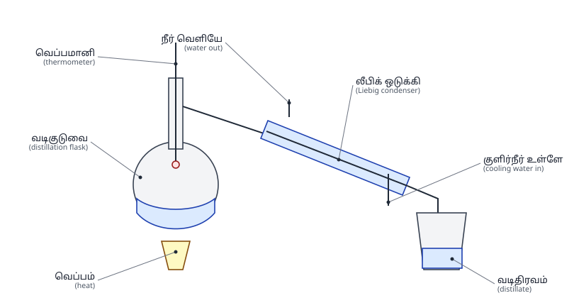

1. கீழிருந்து மேலாக
2. கலவையைச் சூடாக்கல்
3. குமிழ் பக்கக் குழாய் மட்டத்தில் — ஆவியின் கொதிநிலை
4. ஆவியைக் குளிர்வித்து ஒடுக்கல்

விடையும் விளக்கமும்

**விடை: (2) கலவையைச் சூடாக்கல்**

வடிகுடுவை: கலவையைச் சூடாக்கல் (கோப்பு 6: CHE-D04).

<!-- meta {"type":"mcq","id":"SCQ-11-03-013","grade":11,"chapter_id":"SC11-03","discipline":"CHE","difficulty":1,"qtype":"diagram","answer":4,"origin":"ORIGINAL","source_ref":"CHE-D04","image":"science_assets/chemistry/CHE-D04_labelled.svg"} -->
**SCQ-11-03-013** · அடிப்படை · வரிப்படம் · `ORIGINAL`

காய்ச்சிவடித்தல் வரிப்படத்தில் 'வெப்பமானி' (thermometer) இன் தொழில்?

1. ஆவியைக் குளிர்வித்து ஒடுக்கல்
2. கீழிருந்து மேலாக
3. கலவையைச் சூடாக்கல்
4. குமிழ் பக்கக் குழாய் மட்டத்தில் — ஆவியின் கொதிநிலை

விடையும் விளக்கமும்

**விடை: (4) குமிழ் பக்கக் குழாய் மட்டத்தில் — ஆவியின் கொதிநிலை**

வெப்பமானி: குமிழ் பக்கக் குழாய் மட்டத்தில் — ஆவியின் கொதிநிலை (கோப்பு 6: CHE-D04).

<!-- meta {"type":"mcq","id":"SCQ-11-03-014","grade":11,"chapter_id":"SC11-03","discipline":"CHE","difficulty":1,"qtype":"diagram","answer":1,"origin":"ORIGINAL","source_ref":"CHE-D04","image":"science_assets/chemistry/CHE-D04_labelled.svg"} -->
**SCQ-11-03-014** · அடிப்படை · வரிப்படம் · `ORIGINAL`

காய்ச்சிவடித்தல் வரிப்படத்தில் 'லீபிக் ஒடுக்கி' (Liebig condenser) இன் தொழில்?

1. ஆவியைக் குளிர்வித்து ஒடுக்கல்
2. கீழிருந்து மேலாக
3. குமிழ் பக்கக் குழாய் மட்டத்தில் — ஆவியின் கொதிநிலை
4. கலவையைச் சூடாக்கல்

விடையும் விளக்கமும்

**விடை: (1) ஆவியைக் குளிர்வித்து ஒடுக்கல்**

லீபிக் ஒடுக்கி: ஆவியைக் குளிர்வித்து ஒடுக்கல் (கோப்பு 6: CHE-D04).

<!-- meta {"type":"mcq","id":"SCQ-11-03-015","grade":11,"chapter_id":"SC11-03","discipline":"CHE","difficulty":2,"qtype":"calculation","answer":1,"origin":"ORIGINAL","source_ref":"param-SC11-03-1","image":null} -->
**SCQ-11-03-015** · இடைநிலை · கணிப்பு · `ORIGINAL`

0.1 mol கரையம் 250 cm³ கரைசலில். செறிவு (mol dm⁻³)?

1. 0.4 mol dm⁻³
2. 25 mol dm⁻³
3. 4 × 10⁻⁴ mol dm⁻³
4. 0.025 mol dm⁻³

விடையும் விளக்கமும்

**விடை: (1) 0.4 mol dm⁻³**

C = n/V (dm³).

<!-- meta {"type":"mcq","id":"SCQ-11-03-016","grade":11,"chapter_id":"SC11-03","discipline":"CHE","difficulty":2,"qtype":"calculation","answer":1,"origin":"ORIGINAL","source_ref":"param-SC11-03-2","image":null} -->
**SCQ-11-03-016** · இடைநிலை · கணிப்பு · `ORIGINAL`

0.5 mol கரையம் 2000 cm³ கரைசலில். செறிவு (mol dm⁻³)?

1. 0.25 mol dm⁻³
2. 1 mol dm⁻³
3. 1000 mol dm⁻³
4. 2.5 × 10⁻⁴ mol dm⁻³

விடையும் விளக்கமும்

**விடை: (1) 0.25 mol dm⁻³**

C = n/V (dm³).

<!-- meta {"type":"mcq","id":"SCQ-11-03-017","grade":11,"chapter_id":"SC11-03","discipline":"CHE","difficulty":2,"qtype":"calculation","answer":1,"origin":"ORIGINAL","source_ref":"param-SC11-03-3","image":null} -->
**SCQ-11-03-017** · இடைநிலை · கணிப்பு · `ORIGINAL`

0.02 mol கரையம் 100 cm³ கரைசலில். செறிவு (mol dm⁻³)?

1. 0.2 mol dm⁻³
2. 2 × 10⁻⁴ mol dm⁻³
3. 2 mol dm⁻³
4. 0.002 mol dm⁻³

விடையும் விளக்கமும்

**விடை: (1) 0.2 mol dm⁻³**

C = n/V (dm³).

<!-- meta {"type":"mcq","id":"SCQ-11-03-018","grade":11,"chapter_id":"SC11-03","discipline":"CHE","difficulty":3,"qtype":"calculation","answer":3,"origin":"ORIGINAL","source_ref":"param-SC11-03-4","image":null} -->
**SCQ-11-03-018** · கடினம் · கணிப்பு · `ORIGINAL`

0.2 mol dm⁻³ NaCl கரைசல் 500 cm³ தயாரிக்கத் தேவையான திணிவு? (M = 58.5)

1. 0.1 g
2. 5850 g
3. 5.85 g
4. 11.7 g

விடையும் விளக்கமும்

**விடை: (3) 5.85 g**

m = CVM.

<!-- meta {"type":"mcq","id":"SCQ-11-03-019","grade":11,"chapter_id":"SC11-03","discipline":"CHE","difficulty":3,"qtype":"calculation","answer":1,"origin":"ORIGINAL","source_ref":"param-SC11-03-5","image":null} -->
**SCQ-11-03-019** · கடினம் · கணிப்பு · `ORIGINAL`

1 mol dm⁻³ NaOH கரைசல் 100 cm³ தயாரிக்கத் தேவையான திணிவு? (M = 40)

1. 4 g
2. 0.1 g
3. 4000 g
4. 40 g

விடையும் விளக்கமும்

**விடை: (1) 4 g**

m = CVM.

<!-- meta {"type":"mcq","id":"SCQ-11-03-020","grade":11,"chapter_id":"SC11-03","discipline":"CHE","difficulty":3,"qtype":"calculation","answer":2,"origin":"ORIGINAL","source_ref":"param-SC11-03-6","image":null} -->
**SCQ-11-03-020** · கடினம் · கணிப்பு · `ORIGINAL`

0.05 mol dm⁻³ KMnO₄ கரைசல் 250 cm³ தயாரிக்கத் தேவையான திணிவு? (M = 158)

1. 1975 g
2. 1.975 g
3. 7.9 g
4. 0.0125 g

விடையும் விளக்கமும்

**விடை: (2) 1.975 g**

m = CVM.

<!-- meta {"type":"mcq","id":"SCQ-11-03-021","grade":11,"chapter_id":"SC11-03","discipline":"CHE","difficulty":2,"qtype":"calculation","answer":2,"origin":"ORIGINAL","source_ref":"param-SC11-03-7","image":null} -->
**SCQ-11-03-021** · இடைநிலை · கணிப்பு · `ORIGINAL`

180 g நீரில் 20 g கரையம் கரைக்கப்பட்டது. திணிவுப் பின்ன %?

1. 20 %
2. 10 %
3. 11.1111 %
4. 90 %

விடையும் விளக்கமும்

**விடை: (2) 10 %**

கரையம்/கரைசல் × 100.

<!-- meta {"type":"mcq","id":"SCQ-11-03-022","grade":11,"chapter_id":"SC11-03","discipline":"CHE","difficulty":2,"qtype":"calculation","answer":1,"origin":"ORIGINAL","source_ref":"param-SC11-03-8","image":null} -->
**SCQ-11-03-022** · இடைநிலை · கணிப்பு · `ORIGINAL`

45 g நீரில் 5 g கரையம் கரைக்கப்பட்டது. திணிவுப் பின்ன %?

1. 10 %
2. 11.1111 %
3. 20 %
4. 90 %

விடையும் விளக்கமும்

**விடை: (1) 10 %**

கரையம்/கரைசல் × 100.

<!-- meta {"type":"mcq","id":"SCQ-11-03-023","grade":11,"chapter_id":"SC11-03","discipline":"CHE","difficulty":2,"qtype":"calculation","answer":1,"origin":"ORIGINAL","source_ref":"param-SC11-03-9","image":null} -->
**SCQ-11-03-023** · இடைநிலை · கணிப்பு · `ORIGINAL`

120 g நீரில் 30 g கரையம் கரைக்கப்பட்டது. திணிவுப் பின்ன %?

1. 20 %
2. 40 %
3. 80 %
4. 25 %

விடையும் விளக்கமும்

**விடை: (1) 20 %**

கரையம்/கரைசல் × 100.

<!-- meta {"type":"mcq","id":"SCQ-11-03-024","grade":11,"chapter_id":"SC11-03","discipline":"CHE","difficulty":3,"qtype":"calculation","answer":2,"origin":"ORIGINAL","source_ref":"param-SC11-03-10","image":null} -->
**SCQ-11-03-024** · கடினம் · கணிப்பு · `ORIGINAL`

2 mol dm⁻³ கரைசல் 50 cm³ ஐ நீரால் 200 cm³ ஆக ஐதாக்கினால் புதிய செறிவு?

1. 100 mol dm⁻³
2. 0.5 mol dm⁻³
3. 8 mol dm⁻³
4. 2 mol dm⁻³

விடையும் விளக்கமும்

**விடை: (2) 0.5 mol dm⁻³**

C₁V₁ = C₂V₂.

<!-- meta {"type":"mcq","id":"SCQ-11-03-025","grade":11,"chapter_id":"SC11-03","discipline":"CHE","difficulty":3,"qtype":"calculation","answer":3,"origin":"ORIGINAL","source_ref":"param-SC11-03-11","image":null} -->
**SCQ-11-03-025** · கடினம் · கணிப்பு · `ORIGINAL`

1 mol dm⁻³ கரைசல் 25 cm³ ஐ நீரால் 250 cm³ ஆக ஐதாக்கினால் புதிய செறிவு?

1. 25 mol dm⁻³
2. 10 mol dm⁻³
3. 0.1 mol dm⁻³
4. 1 mol dm⁻³

விடையும் விளக்கமும்

**விடை: (3) 0.1 mol dm⁻³**

C₁V₁ = C₂V₂.

## SC11-04: அலைகளும் அவற்றின் பயன்பாடுகளும் (Waves and their applications)

*தரம் 11 · அத்தியாயம் 4 · பௌதிகவியல் · 25 வினாக்கள்*

<!-- meta {"type":"mcq","id":"SCQ-11-04-001","grade":11,"chapter_id":"SC11-04","discipline":"PHY","difficulty":1,"qtype":"calculation","answer":2,"origin":"ORIGINAL","source_ref":"chapter","image":null} -->
**SCQ-11-04-001** · அடிப்படை · கணிப்பு · `ORIGINAL`

ஓர் அலையின் மீடிறன் 50 Hz, அலைநீளம் 2 m. வேகம்?

1. 25 m s⁻¹
2. 100 m s⁻¹
3. 52 m s⁻¹
4. 0.04 m s⁻¹

விடையும் விளக்கமும்

**விடை: (2) 100 m s⁻¹**

v = 50 × 2.

<!-- meta {"type":"mcq","id":"SCQ-11-04-002","grade":11,"chapter_id":"SC11-04","discipline":"PHY","difficulty":1,"qtype":"concept","answer":1,"origin":"ORIGINAL","source_ref":"chapter","image":null} -->
**SCQ-11-04-002** · அடிப்படை · எண்ணக்கரு · `ORIGINAL`

ஒலி ஒரு நெட்டாங்கு அலை என்பதன் பொருள்?

1. துணிக்கைகள் செலுத்தத் திசைக்குச் சமாந்தரமாக அதிரும்
2. செங்குத்தாக அதிரும்
3. அதிராது
4. வெற்றிடத்தில் செல்லும்

விடையும் விளக்கமும்

**விடை: (1) துணிக்கைகள் செலுத்தத் திசைக்குச் சமாந்தரமாக அதிரும்**

நெருக்கம், ஐதாக்கம்.

<!-- meta {"type":"mcq","id":"SCQ-11-04-003","grade":11,"chapter_id":"SC11-04","discipline":"PHY","difficulty":2,"qtype":"calculation","answer":1,"origin":"ORIGINAL","source_ref":"chapter","image":null} -->
**SCQ-11-04-003** · இடைநிலை · கணிப்பு · `ORIGINAL`

வளியில் 340 m s⁻¹ ஒலி, 680 Hz. அலைநீளம்?

1. 0.5 m
2. 2 m
3. 1020 m
4. 231 200 m

விடையும் விளக்கமும்

**விடை: (1) 0.5 m**

λ = 340/680.

<!-- meta {"type":"mcq","id":"SCQ-11-04-004","grade":11,"chapter_id":"SC11-04","discipline":"PHY","difficulty":2,"qtype":"calculation","answer":2,"origin":"ORIGINAL","source_ref":"chapter","image":null} -->
**SCQ-11-04-004** · இடைநிலை · கணிப்பு · `ORIGINAL`

மின்னல் தெரிந்து 3 s பின் இடி கேட்டது. தூரம் ஏறத்தாழ? (ஒலி 340 m s⁻¹)

1. 113 m
2. 1020 m
3. 340 m
4. 3 m

விடையும் விளக்கமும்

**விடை: (2) 1020 m**

s = 340 × 3.

<!-- meta {"type":"mcq","id":"SCQ-11-04-005","grade":11,"chapter_id":"SC11-04","discipline":"PHY","difficulty":1,"qtype":"application","answer":1,"origin":"ORIGINAL","source_ref":"chapter","image":null} -->
**SCQ-11-04-005** · அடிப்படை · பிரயோகம் · `ORIGINAL`

சந்திரனில் விண்வெளி வீரர்கள் நேரடியாகப் பேசிக் கேட்க முடியாததற்குக் காரணம்?

1. வெற்றிடம் — ஒலிக்கு ஊடகம் இல்லை
2. குளிர்
3. ஒளி இல்லை
4. ஈர்ப்பு

விடையும் விளக்கமும்

**விடை: (1) வெற்றிடம் — ஒலிக்கு ஊடகம் இல்லை**

ஒலிக்கு ஊடகம் தேவை.

<!-- meta {"type":"mcq","id":"SCQ-11-04-006","grade":11,"chapter_id":"SC11-04","discipline":"PHY","difficulty":2,"qtype":"concept","answer":2,"origin":"ORIGINAL","source_ref":"chapter","image":null} -->
**SCQ-11-04-006** · இடைநிலை · எண்ணக்கரு · `ORIGINAL`

உரத்த ஒலிக்கும் மென்மையான ஒலிக்குமான வேறுபாடு?

1. மீடிறன்
2. வீச்சம்
3. வேகம்
4. அலைநீளம்

விடையும் விளக்கமும்

**விடை: (2) வீச்சம்**

உரப்பு வீச்சத்தைச் சார்ந்தது.

<!-- meta {"type":"mcq","id":"SCQ-11-04-007","grade":11,"chapter_id":"SC11-04","discipline":"PHY","difficulty":1,"qtype":"application","answer":2,"origin":"ORIGINAL","source_ref":"chapter","image":null} -->
**SCQ-11-04-007** · அடிப்படை · பிரயோகம் · `ORIGINAL`

கருப்பையிலுள்ள சிசுவைப் பார்க்கப் பயன்படுவது?

1. X கதிர்
2. மீயொலி
3. காமா
4. நுண்ணலை

விடையும் விளக்கமும்

**விடை: (2) மீயொலி**

மீயொலி பாதுகாப்பானது.

<!-- meta {"type":"mcq","id":"SCQ-11-04-008","grade":11,"chapter_id":"SC11-04","discipline":"PHY","difficulty":1,"qtype":"concept","answer":1,"origin":"ORIGINAL","source_ref":"chapter","image":null} -->
**SCQ-11-04-008** · அடிப்படை · எண்ணக்கரு · `ORIGINAL`

அதிக சுருதியுடைய ஒலி?

1. அதிக மீடிறன்
2. அதிக வீச்சம்
3. குறைந்த மீடிறன்
4. குறைந்த வேகம்

விடையும் விளக்கமும்

**விடை: (1) அதிக மீடிறன்**

சுருதி ∝ மீடிறன்.

<!-- meta {"type":"mcq","id":"SCQ-11-04-009","grade":11,"chapter_id":"SC11-04","discipline":"PHY","difficulty":1,"qtype":"concept","answer":3,"origin":"ORIGINAL","source_ref":"chapter","image":null} -->
**SCQ-11-04-009** · அடிப்படை · எண்ணக்கரு · `ORIGINAL`

மின்காந்த அலையல்லாதது?

1. ஒளி
2. X கதிர்
3. ஒலி
4. வானொலி அலை

விடையும் விளக்கமும்

**விடை: (3) ஒலி**

ஒலி பொறிமுறை அலை.

<!-- meta {"type":"mcq","id":"SCQ-11-04-010","grade":11,"chapter_id":"SC11-04","discipline":"PHY","difficulty":2,"qtype":"calculation","answer":2,"origin":"ORIGINAL","source_ref":"chapter","image":null} -->
**SCQ-11-04-010** · இடைநிலை · கணிப்பு · `ORIGINAL`

ஒரு அலையின் காலம் 0.02 s. மீடிறன்?

1. 0.02 Hz
2. 50 Hz
3. 20 Hz
4. 2 Hz

விடையும் விளக்கமும்

**விடை: (2) 50 Hz**

f = 1/T.

<!-- meta {"type":"mcq","id":"SCQ-11-04-011","grade":11,"chapter_id":"SC11-04","discipline":"PHY","difficulty":1,"qtype":"diagram","answer":2,"origin":"ORIGINAL","source_ref":"PHY-D05","image":"science_assets/physics/PHY-D05_labelled.svg"} -->
**SCQ-11-04-011** · அடிப்படை · வரிப்படம் · `ORIGINAL`

குறுக்கலை வரிப்படத்தில் 'முடி' (crest) இன் தொழில்?

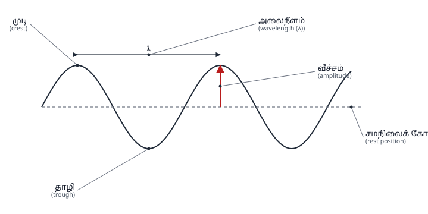

1. அடுத்தடுத்த இரு முடிகளுக்கிடையிலான தூரம்
2. உச்ச மேல் இடப்பெயர்ச்சி
3. உச்சக் கீழ் இடப்பெயர்ச்சி
4. சமநிலையிலிருந்து உச்ச இடப்பெயர்ச்சி

விடையும் விளக்கமும்

**விடை: (2) உச்ச மேல் இடப்பெயர்ச்சி**

முடி: உச்ச மேல் இடப்பெயர்ச்சி (கோப்பு 6: PHY-D05).

<!-- meta {"type":"mcq","id":"SCQ-11-04-012","grade":11,"chapter_id":"SC11-04","discipline":"PHY","difficulty":1,"qtype":"diagram","answer":3,"origin":"ORIGINAL","source_ref":"PHY-D05","image":"science_assets/physics/PHY-D05_labelled.svg"} -->
**SCQ-11-04-012** · அடிப்படை · வரிப்படம் · `ORIGINAL`

குறுக்கலை வரிப்படத்தில் 'தாழி' (trough) இன் தொழில்?

1. உச்ச மேல் இடப்பெயர்ச்சி
2. அடுத்தடுத்த இரு முடிகளுக்கிடையிலான தூரம்
3. உச்சக் கீழ் இடப்பெயர்ச்சி
4. சமநிலையிலிருந்து உச்ச இடப்பெயர்ச்சி

விடையும் விளக்கமும்

**விடை: (3) உச்சக் கீழ் இடப்பெயர்ச்சி**

தாழி: உச்சக் கீழ் இடப்பெயர்ச்சி (கோப்பு 6: PHY-D05).

<!-- meta {"type":"mcq","id":"SCQ-11-04-013","grade":11,"chapter_id":"SC11-04","discipline":"PHY","difficulty":1,"qtype":"diagram","answer":1,"origin":"ORIGINAL","source_ref":"PHY-D05","image":"science_assets/physics/PHY-D05_labelled.svg"} -->
**SCQ-11-04-013** · அடிப்படை · வரிப்படம் · `ORIGINAL`

குறுக்கலை வரிப்படத்தில் 'அலைநீளம்' (wavelength (λ)) இன் தொழில்?

1. அடுத்தடுத்த இரு முடிகளுக்கிடையிலான தூரம்
2. சமநிலையிலிருந்து உச்ச இடப்பெயர்ச்சி
3. உச்ச மேல் இடப்பெயர்ச்சி
4. உச்சக் கீழ் இடப்பெயர்ச்சி

விடையும் விளக்கமும்

**விடை: (1) அடுத்தடுத்த இரு முடிகளுக்கிடையிலான தூரம்**

அலைநீளம்: அடுத்தடுத்த இரு முடிகளுக்கிடையிலான தூரம் (கோப்பு 6: PHY-D05).

<!-- meta {"type":"mcq","id":"SCQ-11-04-014","grade":11,"chapter_id":"SC11-04","discipline":"PHY","difficulty":1,"qtype":"calculation","answer":2,"origin":"ORIGINAL","source_ref":"param-SC11-04-1","image":null} -->
**SCQ-11-04-014** · அடிப்படை · கணிப்பு · `ORIGINAL`

மீடிறன் 200 Hz, அலைநீளம் 1.7 m உடைய அலையின் வேகம்?

1. 680 m s⁻¹
2. 340 m s⁻¹
3. 0.0085 m s⁻¹
4. 117.6471 m s⁻¹

விடையும் விளக்கமும்

**விடை: (2) 340 m s⁻¹**

v = fλ.

<!-- meta {"type":"mcq","id":"SCQ-11-04-015","grade":11,"chapter_id":"SC11-04","discipline":"PHY","difficulty":1,"qtype":"calculation","answer":1,"origin":"ORIGINAL","source_ref":"param-SC11-04-2","image":null} -->
**SCQ-11-04-015** · அடிப்படை · கணிப்பு · `ORIGINAL`

மீடிறன் 50 Hz, அலைநீளம் 0.4 m உடைய அலையின் வேகம்?

1. 20 m s⁻¹
2. 125 m s⁻¹
3. 0.008 m s⁻¹
4. 40 m s⁻¹

விடையும் விளக்கமும்

**விடை: (1) 20 m s⁻¹**

v = fλ.

<!-- meta {"type":"mcq","id":"SCQ-11-04-016","grade":11,"chapter_id":"SC11-04","discipline":"PHY","difficulty":1,"qtype":"calculation","answer":1,"origin":"ORIGINAL","source_ref":"param-SC11-04-3","image":null} -->
**SCQ-11-04-016** · அடிப்படை · கணிப்பு · `ORIGINAL`

மீடிறன் 1000 Hz, அலைநீளம் 0.34 m உடைய அலையின் வேகம்?

1. 340 m s⁻¹
2. 680 m s⁻¹
3. 2941.1765 m s⁻¹
4. 3.4 × 10⁻⁴ m s⁻¹

விடையும் விளக்கமும்

**விடை: (1) 340 m s⁻¹**

v = fλ.

<!-- meta {"type":"mcq","id":"SCQ-11-04-017","grade":11,"chapter_id":"SC11-04","discipline":"PHY","difficulty":2,"qtype":"calculation","answer":1,"origin":"ORIGINAL","source_ref":"param-SC11-04-4","image":null} -->
**SCQ-11-04-017** · இடைநிலை · கணிப்பு · `ORIGINAL`

வேகம் 340 m s⁻¹, மீடிறன் 170 Hz. அலைநீளம்?

1. 2 m
2. 0.5 m
3. 57800 m
4. 4 m

விடையும் விளக்கமும்

**விடை: (1) 2 m**

λ = v/f.

<!-- meta {"type":"mcq","id":"SCQ-11-04-018","grade":11,"chapter_id":"SC11-04","discipline":"PHY","difficulty":2,"qtype":"calculation","answer":1,"origin":"ORIGINAL","source_ref":"param-SC11-04-5","image":null} -->
**SCQ-11-04-018** · இடைநிலை · கணிப்பு · `ORIGINAL`

வேகம் 1500 m s⁻¹, மீடிறன் 3000 Hz. அலைநீளம்?

1. 0.5 m
2. 2 m
3. 1 m
4. 4.5 × 10⁶ m

விடையும் விளக்கமும்

**விடை: (1) 0.5 m**

λ = v/f.

<!-- meta {"type":"mcq","id":"SCQ-11-04-019","grade":11,"chapter_id":"SC11-04","discipline":"PHY","difficulty":2,"qtype":"calculation","answer":2,"origin":"ORIGINAL","source_ref":"param-SC11-04-6","image":null} -->
**SCQ-11-04-019** · இடைநிலை · கணிப்பு · `ORIGINAL`

வேகம் 340 m s⁻¹, மீடிறன் 1360 Hz. அலைநீளம்?

1. 4 m
2. 0.25 m
3. 0.5 m
4. 462400 m

விடையும் விளக்கமும்

**விடை: (2) 0.25 m**

λ = v/f.

<!-- meta {"type":"mcq","id":"SCQ-11-04-020","grade":11,"chapter_id":"SC11-04","discipline":"PHY","difficulty":2,"qtype":"calculation","answer":2,"origin":"ORIGINAL","source_ref":"param-SC11-04-7","image":null} -->
**SCQ-11-04-020** · இடைநிலை · கணிப்பு · `ORIGINAL`

ஓர் அலையின் காலம் 0.04 s. மீடிறன்?

1. 0.04 Hz
2. 25 Hz
3. 4 Hz
4. 50 Hz

விடையும் விளக்கமும்

**விடை: (2) 25 Hz**

f = 1/T.

<!-- meta {"type":"mcq","id":"SCQ-11-04-021","grade":11,"chapter_id":"SC11-04","discipline":"PHY","difficulty":2,"qtype":"calculation","answer":4,"origin":"ORIGINAL","source_ref":"param-SC11-04-8","image":null} -->
**SCQ-11-04-021** · இடைநிலை · கணிப்பு · `ORIGINAL`

ஓர் அலையின் காலம் 0.5 s. மீடிறன்?

1. 4 Hz
2. 50 Hz
3. 0.5 Hz
4. 2 Hz

விடையும் விளக்கமும்

**விடை: (4) 2 Hz**

f = 1/T.

<!-- meta {"type":"mcq","id":"SCQ-11-04-022","grade":11,"chapter_id":"SC11-04","discipline":"PHY","difficulty":2,"qtype":"calculation","answer":2,"origin":"ORIGINAL","source_ref":"param-SC11-04-9","image":null} -->
**SCQ-11-04-022** · இடைநிலை · கணிப்பு · `ORIGINAL`

ஓர் அலையின் காலம் 0.002 s. மீடிறன்?

1. 1000 Hz
2. 500 Hz
3. 0.2 Hz
4. 0.002 Hz

விடையும் விளக்கமும்

**விடை: (2) 500 Hz**

f = 1/T.

<!-- meta {"type":"mcq","id":"SCQ-11-04-023","grade":11,"chapter_id":"SC11-04","discipline":"PHY","difficulty":2,"qtype":"calculation","answer":3,"origin":"ORIGINAL","source_ref":"param-SC11-04-10","image":null} -->
**SCQ-11-04-023** · இடைநிலை · கணிப்பு · `ORIGINAL`

ஒருவர் குன்றை நோக்கிக் கூவி 1.2 s இல் எதிரொலி கேட்கிறார் (ஒலி 340 m s⁻¹). குன்றின் தூரம்?

1. 408 m
2. 283.3333 m
3. 204 m
4. 102 m

விடையும் விளக்கமும்

**விடை: (3) 204 m**

d = vt/2 (போய் வருதல்).

<!-- meta {"type":"mcq","id":"SCQ-11-04-024","grade":11,"chapter_id":"SC11-04","discipline":"PHY","difficulty":2,"qtype":"calculation","answer":1,"origin":"ORIGINAL","source_ref":"param-SC11-04-11","image":null} -->
**SCQ-11-04-024** · இடைநிலை · கணிப்பு · `ORIGINAL`

ஒருவர் குன்றை நோக்கிக் கூவி 0.4 s இல் எதிரொலி கேட்கிறார் (ஒலி 340 m s⁻¹). குன்றின் தூரம்?

1. 68 m
2. 34 m
3. 136 m
4. 850 m

விடையும் விளக்கமும்

**விடை: (1) 68 m**

d = vt/2 (போய் வருதல்).

<!-- meta {"type":"mcq","id":"SCQ-11-04-025","grade":11,"chapter_id":"SC11-04","discipline":"PHY","difficulty":2,"qtype":"calculation","answer":3,"origin":"ORIGINAL","source_ref":"param-SC11-04-12","image":null} -->
**SCQ-11-04-025** · இடைநிலை · கணிப்பு · `ORIGINAL`

ஒருவர் குன்றை நோக்கிக் கூவி 2 s இல் எதிரொலி கேட்கிறார் (ஒலி 340 m s⁻¹). குன்றின் தூரம்?

1. 3400 m
2. 170 m
3. 340 m
4. 680 m

விடையும் விளக்கமும்

**விடை: (3) 340 m**

d = vt/2 (போய் வருதல்).

## SC11-05: கேத்திரகணித ஒளியியல் (Geometrical optics)

*தரம் 11 · அத்தியாயம் 5 · பௌதிகவியல் · 28 வினாக்கள்*

<!-- meta {"type":"mcq","id":"SCQ-11-05-001","grade":11,"chapter_id":"SC11-05","discipline":"PHY","difficulty":1,"qtype":"recall","answer":2,"origin":"ORIGINAL","source_ref":"chapter","image":null} -->
**SCQ-11-05-001** · அடிப்படை · நினைவு · `ORIGINAL`

படுகோணம் 35° எனின் தெறிகோணம்?

1. 55°
2. 35°
3. 70°
4. 90°

விடையும் விளக்கமும்

**விடை: (2) 35°**

தெறிப்பு விதி.

<!-- meta {"type":"mcq","id":"SCQ-11-05-002","grade":11,"chapter_id":"SC11-05","discipline":"PHY","difficulty":2,"qtype":"concept","answer":2,"origin":"ORIGINAL","source_ref":"chapter","image":null} -->
**SCQ-11-05-002** · இடைநிலை · எண்ணக்கரு · `ORIGINAL`

குவிவு வில்லையின் 2F க்கு அப்பால் பொருள். விம்பம்?

1. மாய, நேரான, பெரிய
2. உண்மை, தலைகீழ், சிறிய
3. உண்மை, நேரான, பெரிய
4. விம்பம் இல்லை

விடையும் விளக்கமும்

**விடை: (2) உண்மை, தலைகீழ், சிறிய**

F–2F இடையில் சிறிய விம்பம்.

<!-- meta {"type":"mcq","id":"SCQ-11-05-003","grade":11,"chapter_id":"SC11-05","discipline":"PHY","difficulty":2,"qtype":"application","answer":3,"origin":"ORIGINAL","source_ref":"chapter","image":null} -->
**SCQ-11-05-003** · இடைநிலை · பிரயோகம் · `ORIGINAL`

உருப்பெருக்கும் கண்ணாடியாகக் குவிவு வில்லையைப் பயன்படுத்தப் பொருள் வைக்கப்படுவது?

1. 2F க்கு அப்பால்
2. 2F இல்
3. F க்கும் வில்லைக்கும் இடையில்
4. F இல்

விடையும் விளக்கமும்

**விடை: (3) F க்கும் வில்லைக்கும் இடையில்**

மாய, நேரான, பெரிய விம்பம்.

<!-- meta {"type":"mcq","id":"SCQ-11-05-004","grade":11,"chapter_id":"SC11-05","discipline":"PHY","difficulty":1,"qtype":"concept","answer":2,"origin":"ORIGINAL","source_ref":"chapter","image":null} -->
**SCQ-11-05-004** · அடிப்படை · எண்ணக்கரு · `ORIGINAL`

ஒளி வளியிலிருந்து கண்ணாடிக்குச் செல்லும்போது?

1. செவ்வனிலிருந்து விலகும்
2. செவ்வனை நோக்கி வளையும்
3. வளையாது
4. தெறிக்கும் மட்டும்

விடையும் விளக்கமும்

**விடை: (2) செவ்வனை நோக்கி வளையும்**

அடர்த்தியான ஊடகத்தில் வேகம் குறையும்.

<!-- meta {"type":"mcq","id":"SCQ-11-05-005","grade":11,"chapter_id":"SC11-05","discipline":"PHY","difficulty":2,"qtype":"application","answer":2,"origin":"ORIGINAL","source_ref":"chapter","image":null} -->
**SCQ-11-05-005** · இடைநிலை · பிரயோகம் · `ORIGINAL`

அண்மைப் பார்வைக் குறைபாட்டைத் திருத்த?

1. குவிவு வில்லை
2. குழிவு வில்லை
3. தளவாடி
4. அரியம்

விடையும் விளக்கமும்

**விடை: (2) குழிவு வில்லை**

விம்பம் விழித்திரைக்கு முன் விழுவதைத் திருத்த விரிக்கும் வில்லை.

<!-- meta {"type":"mcq","id":"SCQ-11-05-006","grade":11,"chapter_id":"SC11-05","discipline":"PHY","difficulty":2,"qtype":"concept","answer":2,"origin":"ORIGINAL","source_ref":"chapter","image":null} -->
**SCQ-11-05-006** · இடைநிலை · எண்ணக்கரு · `ORIGINAL`

முழு அகத்தெறிப்பு நடைபெற ஒளி செல்ல வேண்டியது?

1. ஐதானதிலிருந்து அடர்த்திக்கு
2. அடர்த்தியிலிருந்து ஐதானதுக்கு, அவதிக் கோணத்தை மீறி
3. எந்தத் திசையிலும்
4. வெற்றிடத்தில்

விடையும் விளக்கமும்

**விடை: (2) அடர்த்தியிலிருந்து ஐதானதுக்கு, அவதிக் கோணத்தை மீறி**

இரு நிபந்தனைகள்.

<!-- meta {"type":"mcq","id":"SCQ-11-05-007","grade":11,"chapter_id":"SC11-05","discipline":"PHY","difficulty":3,"qtype":"calculation","answer":1,"origin":"ORIGINAL","source_ref":"chapter","image":null} -->
**SCQ-11-05-007** · கடினம் · கணிப்பு · `ORIGINAL`

i = 60°, r = 35° (sin 60 = 0.866, sin 35 = 0.574). முறிவுச் சுட்டி ஏறத்தாழ?

1. 1.51
2. 0.66
3. 1.71
4. 25

விடையும் விளக்கமும்

**விடை: (1) 1.51**

0.866/0.574 ≈ 1.51.

<!-- meta {"type":"mcq","id":"SCQ-11-05-008","grade":11,"chapter_id":"SC11-05","discipline":"PHY","difficulty":1,"qtype":"recall","answer":2,"origin":"ORIGINAL","source_ref":"chapter","image":null} -->
**SCQ-11-05-008** · அடிப்படை · நினைவு · `ORIGINAL`

குழிவு வில்லையின் விம்பம் எப்போதும்?

1. உண்மை, தலைகீழ்
2. மாய, நேரான, சிறிய
3. மாய, பெரிய
4. உண்மை, பெரிய

விடையும் விளக்கமும்

**விடை: (2) மாய, நேரான, சிறிய**

விரிக்கும் வில்லை.

<!-- meta {"type":"mcq","id":"SCQ-11-05-009","grade":11,"chapter_id":"SC11-05","discipline":"PHY","difficulty":2,"qtype":"experiment","answer":1,"origin":"ORIGINAL","source_ref":"chapter","image":null} -->
**SCQ-11-05-009** · இடைநிலை · பரிசோதனை · `ORIGINAL`

குவிவு வில்லையின் குவியத் தூரத்தை அண்ணளவாகக் காண எளிய முறை?

1. தூரப் பொருளின் (யன்னல்) தெளிவான விம்பத்தைத் திரையில் பெற்று வில்லை–திரை தூரம் அளத்தல்
2. வில்லையை நிறுத்தல்
3. நீரில் இடல்
4. சூடாக்கல்

விடையும் விளக்கமும்

**விடை: (1) தூரப் பொருளின் (யன்னல்) தெளிவான விம்பத்தைத் திரையில் பெற்று வில்லை–திரை தூரம் அளத்தல்**

தூரப் பொருளின் விம்பம் குவியத்தில் (2019 வினாத்தாள் II வி7A வகை).

<!-- meta {"type":"mcq","id":"SCQ-11-05-010","grade":11,"chapter_id":"SC11-05","discipline":"PHY","difficulty":3,"qtype":"calculation","answer":1,"origin":"ORIGINAL","source_ref":"chapter","image":null} -->
**SCQ-11-05-010** · கடினம் · கணிப்பு · `ORIGINAL`

f = 10 cm குவிவு வில்லை; பொருள் 30 cm இல். விம்பத் தூரம்?

1. 15 cm
2. 20 cm
3. 7.5 cm
4. 30 cm

விடையும் விளக்கமும்

**விடை: (1) 15 cm**

1/v = 1/10 − 1/30 = 2/30 → v = 15 cm (உண்மை).

<!-- meta {"type":"mcq","id":"SCQ-11-05-011","grade":11,"chapter_id":"SC11-05","discipline":"PHY","difficulty":1,"qtype":"calculation","answer":1,"origin":"ORIGINAL","source_ref":"CL-OPTICS-1","image":null} -->
**SCQ-11-05-011** · அடிப்படை · கணிப்பு · `ORIGINAL`

ஒளி வளியிலிருந்து கண்ணாடிக்குள் 50° படுகோணத்தில் சென்று 30° இல் முறிகிறது. முறிவுச் சுட்டி? (sin 50° = 0.766, sin 30° = 0.5)

1. 1.532
2. 0.766
3. 15.32
4. 3.064

விடையும் விளக்கமும்

**விடை: (1) 1.532**

சரியான விடை 1.532. கோப்பு 5 இல் CL-OPTICS (அடிப்படை) எட்டுப் படித் தீர்வைப் பார்க்க.

<!-- meta {"type":"mcq","id":"SCQ-11-05-012","grade":11,"chapter_id":"SC11-05","discipline":"PHY","difficulty":1,"qtype":"diagram","answer":1,"origin":"ORIGINAL","source_ref":"BIO-D11","image":"science_assets/biology/BIO-D11_labelled.svg"} -->
**SCQ-11-05-012** · அடிப்படை · வரிப்படம் · `ORIGINAL`

மனிதக் கண் (திட்டப் படம்) வரிப்படத்தில் 'விழிவெண்படலம்' (cornea) இன் தொழில்?

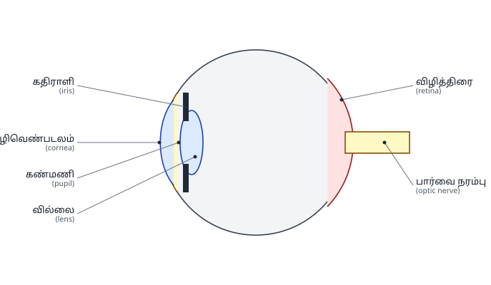

1. ஒளியை முறித்தல் — பெரும்பகுதி
2. ஒளி உட்செல்லும் துவாரம்
3. கண்மணியின் அளவைக் கட்டுப்படுத்தல்
4. குவியத் தூரத்தைச் சீராக்கல்

விடையும் விளக்கமும்

**விடை: (1) ஒளியை முறித்தல் — பெரும்பகுதி**

விழிவெண்படலம்: ஒளியை முறித்தல் — பெரும்பகுதி (கோப்பு 6: BIO-D11).

<!-- meta {"type":"mcq","id":"SCQ-11-05-013","grade":11,"chapter_id":"SC11-05","discipline":"PHY","difficulty":1,"qtype":"diagram","answer":4,"origin":"ORIGINAL","source_ref":"BIO-D11","image":"science_assets/biology/BIO-D11_labelled.svg"} -->
**SCQ-11-05-013** · அடிப்படை · வரிப்படம் · `ORIGINAL`

மனிதக் கண் (திட்டப் படம்) வரிப்படத்தில் 'கதிராளி' (iris) இன் தொழில்?

1. ஒளி உட்செல்லும் துவாரம்
2. குவியத் தூரத்தைச் சீராக்கல்
3. ஒளியை முறித்தல் — பெரும்பகுதி
4. கண்மணியின் அளவைக் கட்டுப்படுத்தல்

விடையும் விளக்கமும்

**விடை: (4) கண்மணியின் அளவைக் கட்டுப்படுத்தல்**

கதிராளி: கண்மணியின் அளவைக் கட்டுப்படுத்தல் (கோப்பு 6: BIO-D11).

<!-- meta {"type":"mcq","id":"SCQ-11-05-014","grade":11,"chapter_id":"SC11-05","discipline":"PHY","difficulty":1,"qtype":"diagram","answer":4,"origin":"ORIGINAL","source_ref":"BIO-D11","image":"science_assets/biology/BIO-D11_labelled.svg"} -->
**SCQ-11-05-014** · அடிப்படை · வரிப்படம் · `ORIGINAL`

மனிதக் கண் (திட்டப் படம்) வரிப்படத்தில் 'கண்மணி' (pupil) இன் தொழில்?

1. ஒளியை முறித்தல் — பெரும்பகுதி
2. கண்மணியின் அளவைக் கட்டுப்படுத்தல்
3. குவியத் தூரத்தைச் சீராக்கல்
4. ஒளி உட்செல்லும் துவாரம்

விடையும் விளக்கமும்

**விடை: (4) ஒளி உட்செல்லும் துவாரம்**

கண்மணி: ஒளி உட்செல்லும் துவாரம் (கோப்பு 6: BIO-D11).

<!-- meta {"type":"mcq","id":"SCQ-11-05-015","grade":11,"chapter_id":"SC11-05","discipline":"PHY","difficulty":1,"qtype":"diagram","answer":3,"origin":"ORIGINAL","source_ref":"PHY-D03","image":"science_assets/physics/PHY-D03_labelled.svg"} -->
**SCQ-11-05-015** · அடிப்படை · வரிப்படம் · `ORIGINAL`

குவிவு வில்லை: பொருள் 2F க்கு அப்பால் வரிப்படத்தில் 'பொருள்' (object) இன் தொழில்?

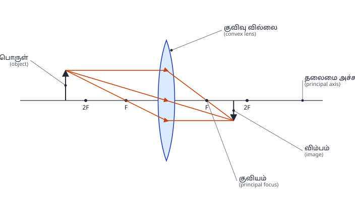

1. ஒருங்கச் செய்யும்
2. சமாந்தரக் கதிர்கள் சந்திக்கும் புள்ளி
3. 2F க்கு அப்பால்
4. உண்மை, தலைகீழ், சிறியது; F–2F இடையில்

விடையும் விளக்கமும்

**விடை: (3) 2F க்கு அப்பால்**

பொருள்: 2F க்கு அப்பால் (கோப்பு 6: PHY-D03).

<!-- meta {"type":"mcq","id":"SCQ-11-05-016","grade":11,"chapter_id":"SC11-05","discipline":"PHY","difficulty":1,"qtype":"diagram","answer":4,"origin":"ORIGINAL","source_ref":"PHY-D03","image":"science_assets/physics/PHY-D03_labelled.svg"} -->
**SCQ-11-05-016** · அடிப்படை · வரிப்படம் · `ORIGINAL`

குவிவு வில்லை: பொருள் 2F க்கு அப்பால் வரிப்படத்தில் 'விம்பம்' (image) இன் தொழில்?

1. சமாந்தரக் கதிர்கள் சந்திக்கும் புள்ளி
2. ஒருங்கச் செய்யும்
3. 2F க்கு அப்பால்
4. உண்மை, தலைகீழ், சிறியது; F–2F இடையில்

விடையும் விளக்கமும்

**விடை: (4) உண்மை, தலைகீழ், சிறியது; F–2F இடையில்**

விம்பம்: உண்மை, தலைகீழ், சிறியது; F–2F இடையில் (கோப்பு 6: PHY-D03).

<!-- meta {"type":"mcq","id":"SCQ-11-05-017","grade":11,"chapter_id":"SC11-05","discipline":"PHY","difficulty":1,"qtype":"diagram","answer":4,"origin":"ORIGINAL","source_ref":"PHY-D03","image":"science_assets/physics/PHY-D03_labelled.svg"} -->
**SCQ-11-05-017** · அடிப்படை · வரிப்படம் · `ORIGINAL`

குவிவு வில்லை: பொருள் 2F க்கு அப்பால் வரிப்படத்தில் 'குவிவு வில்லை' (convex lens) இன் தொழில்?

1. 2F க்கு அப்பால்
2. சமாந்தரக் கதிர்கள் சந்திக்கும் புள்ளி
3. உண்மை, தலைகீழ், சிறியது; F–2F இடையில்
4. ஒருங்கச் செய்யும்

விடையும் விளக்கமும்

**விடை: (4) ஒருங்கச் செய்யும்**

குவிவு வில்லை: ஒருங்கச் செய்யும் (கோப்பு 6: PHY-D03).

<!-- meta {"type":"mcq","id":"SCQ-11-05-018","grade":11,"chapter_id":"SC11-05","discipline":"PHY","difficulty":1,"qtype":"recall","answer":3,"origin":"ORIGINAL","source_ref":"extra-SC11-05-1","image":null} -->
**SCQ-11-05-018** · அடிப்படை · நினைவு · `ORIGINAL`

தளவாடியின் விம்பம்?

1. உண்மை, பெரிய
2. உண்மை, தலைகீழ்
3. மாய, நேரான, சம அளவு, பக்க நேர்மாறல்
4. மாய, சிறிய

விடையும் விளக்கமும்

**விடை: (3) மாய, நேரான, சம அளவு, பக்க நேர்மாறல்**

தளவாடி இயல்புகள்.

<!-- meta {"type":"mcq","id":"SCQ-11-05-019","grade":11,"chapter_id":"SC11-05","discipline":"PHY","difficulty":2,"qtype":"concept","answer":2,"origin":"ORIGINAL","source_ref":"extra-SC11-05-2","image":null} -->
**SCQ-11-05-019** · இடைநிலை · எண்ணக்கரு · `ORIGINAL`

வானவில் உருவாவதற்கான செயன்முறை?

1. முழு அகத்தெறிப்பு மட்டும்
2. நீர்த்துளிகளில் முறிவும் நிறப்பிரிகையும்
3. உறிஞ்சல்
4. தெறிப்பு மட்டும்

விடையும் விளக்கமும்

**விடை: (2) நீர்த்துளிகளில் முறிவும் நிறப்பிரிகையும்**

வெண்ணொளி பிரிகை.

<!-- meta {"type":"mcq","id":"SCQ-11-05-020","grade":11,"chapter_id":"SC11-05","discipline":"PHY","difficulty":2,"qtype":"application","answer":2,"origin":"ORIGINAL","source_ref":"extra-SC11-05-3","image":null} -->
**SCQ-11-05-020** · இடைநிலை · பிரயோகம் · `ORIGINAL`

பெரிஸ்கோப்பில் பயன்படுத்தக்கூடியது?

1. குழிவு வில்லை
2. 45° அரியங்கள் அல்லது தளவாடிகள்
3. குவிவு வில்லை மட்டும்
4. திரை

விடையும் விளக்கமும்

**விடை: (2) 45° அரியங்கள் அல்லது தளவாடிகள்**

முழு அகத்தெறிப்பு அரியங்கள்.

<!-- meta {"type":"mcq","id":"SCQ-11-05-021","grade":11,"chapter_id":"SC11-05","discipline":"PHY","difficulty":2,"qtype":"concept","answer":4,"origin":"ORIGINAL","source_ref":"extra-SC11-05-4","image":null} -->
**SCQ-11-05-021** · இடைநிலை · எண்ணக்கரு · `ORIGINAL`

சேய்மைப் பார்வைக் குறைபாட்டில் விம்பம் விழுவது?

1. விழித்திரைக்கு முன்
2. வில்லையில்
3. விழித்திரையில்
4. விழித்திரைக்குப் பின்

விடையும் விளக்கமும்

**விடை: (4) விழித்திரைக்குப் பின்**

குவிவு வில்லையால் திருத்தல்.

<!-- meta {"type":"mcq","id":"SCQ-11-05-022","grade":11,"chapter_id":"SC11-05","discipline":"PHY","difficulty":2,"qtype":"calculation","answer":2,"origin":"ORIGINAL","source_ref":"param-SC11-05-1","image":null} -->
**SCQ-11-05-022** · இடைநிலை · கணிப்பு · `ORIGINAL`

முறிவுச் சுட்டி 1.33 உடைய ஊடகத்தில் ஒளியின் வேகம்? (c = 3 × 10⁸ m s⁻¹)

1. 4.511 × 10⁸ m s⁻¹
2. 2.256 × 10⁸ m s⁻¹
3. 3.99 × 10⁸ m s⁻¹
4. 3 × 10⁸ m s⁻¹

விடையும் விளக்கமும்

**விடை: (2) 2.256 × 10⁸ m s⁻¹**

v = c/n.

<!-- meta {"type":"mcq","id":"SCQ-11-05-023","grade":11,"chapter_id":"SC11-05","discipline":"PHY","difficulty":2,"qtype":"calculation","answer":3,"origin":"ORIGINAL","source_ref":"param-SC11-05-2","image":null} -->
**SCQ-11-05-023** · இடைநிலை · கணிப்பு · `ORIGINAL`

முறிவுச் சுட்டி 2 உடைய ஊடகத்தில் ஒளியின் வேகம்? (c = 3 × 10⁸ m s⁻¹)

1. 7.5 × 10⁷ m s⁻¹
2. 3 × 10⁸ m s⁻¹
3. 1.5 × 10⁸ m s⁻¹
4. 6 × 10⁸ m s⁻¹

விடையும் விளக்கமும்

**விடை: (3) 1.5 × 10⁸ m s⁻¹**

v = c/n.

<!-- meta {"type":"mcq","id":"SCQ-11-05-024","grade":11,"chapter_id":"SC11-05","discipline":"PHY","difficulty":2,"qtype":"calculation","answer":1,"origin":"ORIGINAL","source_ref":"param-SC11-05-3","image":null} -->
**SCQ-11-05-024** · இடைநிலை · கணிப்பு · `ORIGINAL`

முறிவுச் சுட்டி 1.25 உடைய ஊடகத்தில் ஒளியின் வேகம்? (c = 3 × 10⁸ m s⁻¹)

1. 2.4 × 10⁸ m s⁻¹
2. 4.8 × 10⁸ m s⁻¹
3. 3 × 10⁸ m s⁻¹
4. 3.75 × 10⁸ m s⁻¹

விடையும் விளக்கமும்

**விடை: (1) 2.4 × 10⁸ m s⁻¹**

v = c/n.

<!-- meta {"type":"mcq","id":"SCQ-11-05-025","grade":11,"chapter_id":"SC11-05","discipline":"PHY","difficulty":3,"qtype":"calculation","answer":4,"origin":"ORIGINAL","source_ref":"param-SC11-05-4","image":null} -->
**SCQ-11-05-025** · கடினம் · கணிப்பு · `ORIGINAL`

குவியத் தூரம் 10 cm குவிவு வில்லைக்கு முன் 20 cm இல் பொருள். உண்மை விம்பத்தின் தூரம்? (1/f = 1/u + 1/v)

1. 10 cm
2. 6.6667 cm
3. 30 cm
4. 20 cm

விடையும் விளக்கமும்

**விடை: (4) 20 cm**

1/v = 1/10 − 1/20 → v = 20 cm.

<!-- meta {"type":"mcq","id":"SCQ-11-05-026","grade":11,"chapter_id":"SC11-05","discipline":"PHY","difficulty":3,"qtype":"calculation","answer":2,"origin":"ORIGINAL","source_ref":"param-SC11-05-5","image":null} -->
**SCQ-11-05-026** · கடினம் · கணிப்பு · `ORIGINAL`

குவியத் தூரம் 20 cm குவிவு வில்லைக்கு முன் 60 cm இல் பொருள். உண்மை விம்பத்தின் தூரம்? (1/f = 1/u + 1/v)

1. 15 cm
2. 30 cm
3. 80 cm
4. 40 cm

விடையும் விளக்கமும்

**விடை: (2) 30 cm**

1/v = 1/20 − 1/60 → v = 30 cm.

<!-- meta {"type":"mcq","id":"SCQ-11-05-027","grade":11,"chapter_id":"SC11-05","discipline":"PHY","difficulty":3,"qtype":"calculation","answer":3,"origin":"ORIGINAL","source_ref":"param-SC11-05-6","image":null} -->
**SCQ-11-05-027** · கடினம் · கணிப்பு · `ORIGINAL`

குவியத் தூரம் 5 cm குவிவு வில்லைக்கு முன் 15 cm இல் பொருள். உண்மை விம்பத்தின் தூரம்? (1/f = 1/u + 1/v)

1. 20 cm
2. 10 cm
3. 7.5 cm
4. 3.75 cm

விடையும் விளக்கமும்

**விடை: (3) 7.5 cm**

1/v = 1/5 − 1/15 → v = 7.5 cm.

<!-- meta {"type":"mcq","id":"SCQ-11-05-028","grade":11,"chapter_id":"SC11-05","discipline":"PHY","difficulty":3,"qtype":"calculation","answer":2,"origin":"ORIGINAL","source_ref":"param-SC11-05-7","image":null} -->
**SCQ-11-05-028** · கடினம் · கணிப்பு · `ORIGINAL`

குவியத் தூரம் 12 cm குவிவு வில்லைக்கு முன் 36 cm இல் பொருள். உண்மை விம்பத்தின் தூரம்? (1/f = 1/u + 1/v)

1. 9 cm
2. 18 cm
3. 48 cm
4. 24 cm

விடையும் விளக்கமும்

**விடை: (2) 18 cm**

1/v = 1/12 − 1/36 → v = 18 cm.

## SC11-06: மனித உடற் செயன்முறைகள் (Biological processes in the human body)

*தரம் 11 · அத்தியாயம் 6 · உயிரியல் · 26 வினாக்கள்*

<!-- meta {"type":"mcq","id":"SCQ-11-06-001","grade":11,"chapter_id":"SC11-06","discipline":"BIO","difficulty":1,"qtype":"recall","answer":4,"origin":"ORIGINAL","source_ref":"chapter","image":null} -->
**SCQ-11-06-001** · அடிப்படை · நினைவு · `ORIGINAL`

இதயத்தின் எந்த அறை உடல் முழுவதற்கும் குருதியைப் பம்புகிறது?

1. வலது சோணையறை
2. வலது இதயவறை
3. இடது சோணையறை
4. இடது இதயவறை

விடையும் விளக்கமும்

**விடை: (4) இடது இதயவறை**

இடது இதயவறை தடித்த சுவருடன் தொகுதிச் சுற்றோட்டத்துக்குப் பம்பும்.

<!-- meta {"type":"mcq","id":"SCQ-11-06-002","grade":11,"chapter_id":"SC11-06","discipline":"BIO","difficulty":2,"qtype":"reasoning","answer":3,"origin":"ORIGINAL","source_ref":"chapter","image":null} -->
**SCQ-11-06-002** · இடைநிலை · காரணம் காணல் · `ORIGINAL`

சிறுகுடல் உறிஞ்சலுக்கு இசைவாக்கமாக இல்லாதது?

1. சடைமுளைகள்
2. மெல்லிய மேலணி
3. தடித்த தசைச் சுவர் மட்டும்
4. நிறைய மயிர்த்துளைக் குழாய்கள்

விடையும் விளக்கமும்

**விடை: (3) தடித்த தசைச் சுவர் மட்டும்**

உறிஞ்சல் மேற்பரப்பு, மெல்லிய சுவர், குருதி வழங்கலைச் சார்ந்தது.

<!-- meta {"type":"mcq","id":"SCQ-11-06-003","grade":11,"chapter_id":"SC11-06","discipline":"BIO","difficulty":2,"qtype":"concept","answer":2,"origin":"ORIGINAL","source_ref":"chapter","image":null} -->
**SCQ-11-06-003** · இடைநிலை · எண்ணக்கரு · `ORIGINAL`

பெப்சின் தொழிற்பட உகந்த சூழல்?

1. கார ஊடகம்
2. அமில ஊடகம் (HCl)
3. நடுநிலை
4. எந்த pH உம்

விடையும் விளக்கமும்

**விடை: (2) அமில ஊடகம் (HCl)**

இரைப்பையின் HCl அமில pH தரும்.

<!-- meta {"type":"mcq","id":"SCQ-11-06-004","grade":11,"chapter_id":"SC11-06","discipline":"BIO","difficulty":2,"qtype":"reasoning","answer":2,"origin":"ORIGINAL","source_ref":"chapter","image":null} -->
**SCQ-11-06-004** · இடைநிலை · காரணம் காணல் · `ORIGINAL`

சுவாசச் சிற்றறைகள் வாயுப் பரிமாற்றத்துக்கு ஏற்றவையாவதற்குக் காரணம்?

1. தடித்த சுவர்
2. பெரிய மேற்பரப்பு, மெல்லிய ஈரலிப்பான சுவர், மயிர்த்துளைக் குழாய் வலை
3. குருதி இல்லாமை
4. சிறிய மேற்பரப்பு

விடையும் விளக்கமும்

**விடை: (2) பெரிய மேற்பரப்பு, மெல்லிய ஈரலிப்பான சுவர், மயிர்த்துளைக் குழாய் வலை**

பரவலுக்கு உகந்த இயல்புகள்.

<!-- meta {"type":"mcq","id":"SCQ-11-06-005","grade":11,"chapter_id":"SC11-06","discipline":"BIO","difficulty":2,"qtype":"application","answer":2,"origin":"ORIGINAL","source_ref":"chapter","image":null} -->
**SCQ-11-06-005** · இடைநிலை · பிரயோகம் · `ORIGINAL`

கடும் ஓட்டத்தின்பின் தசைப்பிடிப்புக்குக் காரணம்?

1. CO₂ அதிகரிப்பு
2. இலற்றிக்கமிலம் சேருதல்
3. குளுக்கோசு அதிகரிப்பு
4. நீர் அதிகம்

விடையும் விளக்கமும்

**விடை: (2) இலற்றிக்கமிலம் சேருதல்**

O₂ பற்றாக்குறையில் காற்றின்றிச் சுவாசம்.

<!-- meta {"type":"mcq","id":"SCQ-11-06-006","grade":11,"chapter_id":"SC11-06","discipline":"BIO","difficulty":2,"qtype":"application","answer":1,"origin":"ORIGINAL","source_ref":"chapter","image":null} -->
**SCQ-11-06-006** · இடைநிலை · பிரயோகம் · `ORIGINAL`

இரத்தச்சோகைக்கு (anaemia) வழிவகுக்கக்கூடிய குறைபாடு?

1. இரும்பு
2. கல்சியம்
3. அயடீன்
4. சோடியம்

விடையும் விளக்கமும்

**விடை: (1) இரும்பு**

ஈமோகுளோபின் தொகுப்புக்கு இரும்பு தேவை.

<!-- meta {"type":"mcq","id":"SCQ-11-06-007","grade":11,"chapter_id":"SC11-06","discipline":"BIO","difficulty":2,"qtype":"recall","answer":1,"origin":"ORIGINAL","source_ref":"chapter","image":null} -->
**SCQ-11-06-007** · இடைநிலை · நினைவு · `ORIGINAL`

சிறுநீரகத்தியில் வடிகட்டல் நடைபெறும் இடம்?

1. கலன்கோளம் (Glomerulus)
2. சேர்க்கும் கான்
3. சிறுநீர்க்குழாய்
4. சிறுநீர்ப்பை

விடையும் விளக்கமும்

**விடை: (1) கலன்கோளம் (Glomerulus)**

உயர் அமுக்கத்தில் வடிகட்டல்.

<!-- meta {"type":"mcq","id":"SCQ-11-06-008","grade":11,"chapter_id":"SC11-06","discipline":"BIO","difficulty":3,"qtype":"concept","answer":2,"origin":"ORIGINAL","source_ref":"chapter","image":null} -->
**SCQ-11-06-008** · கடினம் · எண்ணக்கரு · `ORIGINAL`

சுவாசப்பை நாளம் (pulmonary vein) காவும் குருதி?

1. O₂ குறைந்தது, இதயத்திலிருந்து
2. O₂ நிறைந்தது, இதயத்துக்கு
3. O₂ குறைந்தது, இதயத்துக்கு
4. O₂ நிறைந்தது, இதயத்திலிருந்து

விடையும் விளக்கமும்

**விடை: (2) O₂ நிறைந்தது, இதயத்துக்கு**

சுவாசப்பையிலிருந்து இடது சோணையறைக்கு O₂ நிறைந்த குருதி.

<!-- meta {"type":"mcq","id":"SCQ-11-06-009","grade":11,"chapter_id":"SC11-06","discipline":"BIO","difficulty":1,"qtype":"application","answer":2,"origin":"ORIGINAL","source_ref":"chapter","image":null} -->
**SCQ-11-06-009** · அடிப்படை · பிரயோகம் · `ORIGINAL`

சூடான பொருளைத் தொட்டதும் கையை உடனே இழுப்பது?

1. விருப்பச் செயல்
2. தெறிவினை
3. ஓமோன் துலங்கல்
4. கற்ற நடத்தை

விடையும் விளக்கமும்

**விடை: (2) தெறிவினை**

முண்ணாண் வழியான தெறிவினை.

<!-- meta {"type":"mcq","id":"SCQ-11-06-010","grade":11,"chapter_id":"SC11-06","discipline":"BIO","difficulty":2,"qtype":"recall","answer":2,"origin":"ORIGINAL","source_ref":"chapter","image":null} -->
**SCQ-11-06-010** · இடைநிலை · நினைவு · `ORIGINAL`

சமநிலை, தசை ஒருங்கிணைப்பைக் கட்டுப்படுத்தும் மூளைப் பகுதி?

1. பெருமூளை
2. சிறுமூளை
3. நீள்வளைய மையவிழையம்
4. கீழ்மூளையம்

விடையும் விளக்கமும்

**விடை: (2) சிறுமூளை**

சிறுமூளை சமநிலை, அசைவு ஒருங்கிணைப்பு.

<!-- meta {"type":"mcq","id":"SCQ-11-06-011","grade":11,"chapter_id":"SC11-06","discipline":"BIO","difficulty":1,"qtype":"diagram","answer":2,"origin":"ORIGINAL","source_ref":"BIO-D04","image":"science_assets/biology/BIO-D04_labelled.svg"} -->
**SCQ-11-06-011** · அடிப்படை · வரிப்படம் · `ORIGINAL`

மனித இதயம் (திட்டப் படம்) வரிப்படத்தில் 'வலது சோணையறை' (right atrium) இன் தொழில்?

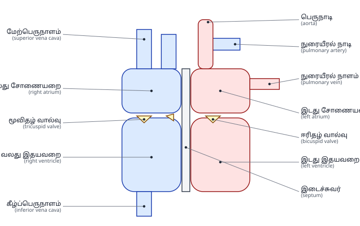

1. நுரையீரலுக்குக் குருதியைப் பம்புதல்
2. உடலிலிருந்து ஒட்சிசனற்ற குருதியைப் பெறல்
3. உடலுக்குப் பம்புதல் — தடித்த சுவர்
4. நுரையீரலிலிருந்து ஒட்சிசனுள்ள குருதி

விடையும் விளக்கமும்

**விடை: (2) உடலிலிருந்து ஒட்சிசனற்ற குருதியைப் பெறல்**

வலது சோணையறை: உடலிலிருந்து ஒட்சிசனற்ற குருதியைப் பெறல் (கோப்பு 6: BIO-D04).

<!-- meta {"type":"mcq","id":"SCQ-11-06-012","grade":11,"chapter_id":"SC11-06","discipline":"BIO","difficulty":1,"qtype":"diagram","answer":1,"origin":"ORIGINAL","source_ref":"BIO-D04","image":"science_assets/biology/BIO-D04_labelled.svg"} -->
**SCQ-11-06-012** · அடிப்படை · வரிப்படம் · `ORIGINAL`

மனித இதயம் (திட்டப் படம்) வரிப்படத்தில் 'வலது இதயவறை' (right ventricle) இன் தொழில்?

1. நுரையீரலுக்குக் குருதியைப் பம்புதல்
2. உடலிலிருந்து ஒட்சிசனற்ற குருதியைப் பெறல்
3. நுரையீரலிலிருந்து ஒட்சிசனுள்ள குருதி
4. உடலுக்குப் பம்புதல் — தடித்த சுவர்

விடையும் விளக்கமும்

**விடை: (1) நுரையீரலுக்குக் குருதியைப் பம்புதல்**

வலது இதயவறை: நுரையீரலுக்குக் குருதியைப் பம்புதல் (கோப்பு 6: BIO-D04).

<!-- meta {"type":"mcq","id":"SCQ-11-06-013","grade":11,"chapter_id":"SC11-06","discipline":"BIO","difficulty":1,"qtype":"diagram","answer":2,"origin":"ORIGINAL","source_ref":"BIO-D04","image":"science_assets/biology/BIO-D04_labelled.svg"} -->
**SCQ-11-06-013** · அடிப்படை · வரிப்படம் · `ORIGINAL`

மனித இதயம் (திட்டப் படம்) வரிப்படத்தில் 'இடது சோணையறை' (left atrium) இன் தொழில்?

1. உடலிலிருந்து ஒட்சிசனற்ற குருதியைப் பெறல்
2. நுரையீரலிலிருந்து ஒட்சிசனுள்ள குருதி
3. நுரையீரலுக்குக் குருதியைப் பம்புதல்
4. உடலுக்குப் பம்புதல் — தடித்த சுவர்

விடையும் விளக்கமும்

**விடை: (2) நுரையீரலிலிருந்து ஒட்சிசனுள்ள குருதி**

இடது சோணையறை: நுரையீரலிலிருந்து ஒட்சிசனுள்ள குருதி (கோப்பு 6: BIO-D04).

<!-- meta {"type":"mcq","id":"SCQ-11-06-014","grade":11,"chapter_id":"SC11-06","discipline":"BIO","difficulty":1,"qtype":"diagram","answer":2,"origin":"ORIGINAL","source_ref":"BIO-D05","image":"science_assets/biology/BIO-D05_labelled.svg"} -->
**SCQ-11-06-014** · அடிப்படை · வரிப்படம் · `ORIGINAL`

சமிபாட்டுத் தொகுதி (திட்டப் படம்) வரிப்படத்தில் 'வாய்க்குழி' (buccal cavity) இன் தொழில்?

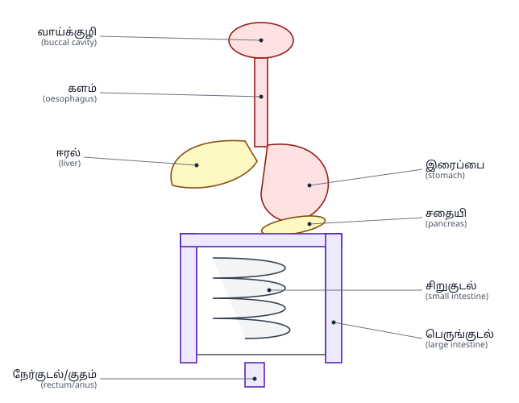

1. சுற்றுச் சுருக்க அசைவால் உணவு கடத்தல்
2. மெல்லுதல்; உமிழ்நீர் அமிலேசு
3. பெப்சின், HCl — புரதச் சமிபாடு
4. பித்தம் உற்பத்தி

விடையும் விளக்கமும்

**விடை: (2) மெல்லுதல்; உமிழ்நீர் அமிலேசு**

வாய்க்குழி: மெல்லுதல்; உமிழ்நீர் அமிலேசு (கோப்பு 6: BIO-D05).

<!-- meta {"type":"mcq","id":"SCQ-11-06-015","grade":11,"chapter_id":"SC11-06","discipline":"BIO","difficulty":1,"qtype":"diagram","answer":4,"origin":"ORIGINAL","source_ref":"BIO-D05","image":"science_assets/biology/BIO-D05_labelled.svg"} -->
**SCQ-11-06-015** · அடிப்படை · வரிப்படம் · `ORIGINAL`

சமிபாட்டுத் தொகுதி (திட்டப் படம்) வரிப்படத்தில் 'களம்' (oesophagus) இன் தொழில்?

1. மெல்லுதல்; உமிழ்நீர் அமிலேசு
2. பெப்சின், HCl — புரதச் சமிபாடு
3. பித்தம் உற்பத்தி
4. சுற்றுச் சுருக்க அசைவால் உணவு கடத்தல்

விடையும் விளக்கமும்

**விடை: (4) சுற்றுச் சுருக்க அசைவால் உணவு கடத்தல்**

களம்: சுற்றுச் சுருக்க அசைவால் உணவு கடத்தல் (கோப்பு 6: BIO-D05).

<!-- meta {"type":"mcq","id":"SCQ-11-06-016","grade":11,"chapter_id":"SC11-06","discipline":"BIO","difficulty":1,"qtype":"diagram","answer":2,"origin":"ORIGINAL","source_ref":"BIO-D05","image":"science_assets/biology/BIO-D05_labelled.svg"} -->
**SCQ-11-06-016** · அடிப்படை · வரிப்படம் · `ORIGINAL`

சமிபாட்டுத் தொகுதி (திட்டப் படம்) வரிப்படத்தில் 'ஈரல்' (liver) இன் தொழில்?

1. மெல்லுதல்; உமிழ்நீர் அமிலேசு
2. பித்தம் உற்பத்தி
3. பெப்சின், HCl — புரதச் சமிபாடு
4. சுற்றுச் சுருக்க அசைவால் உணவு கடத்தல்

விடையும் விளக்கமும்

**விடை: (2) பித்தம் உற்பத்தி**

ஈரல்: பித்தம் உற்பத்தி (கோப்பு 6: BIO-D05).

<!-- meta {"type":"mcq","id":"SCQ-11-06-017","grade":11,"chapter_id":"SC11-06","discipline":"BIO","difficulty":1,"qtype":"diagram","answer":1,"origin":"ORIGINAL","source_ref":"BIO-D06","image":"science_assets/biology/BIO-D06_labelled.svg"} -->
**SCQ-11-06-017** · அடிப்படை · வரிப்படம் · `ORIGINAL`

சுவாசத் தொகுதி வரிப்படத்தில் 'வாதனாளி' (trachea) இன் தொழில்?

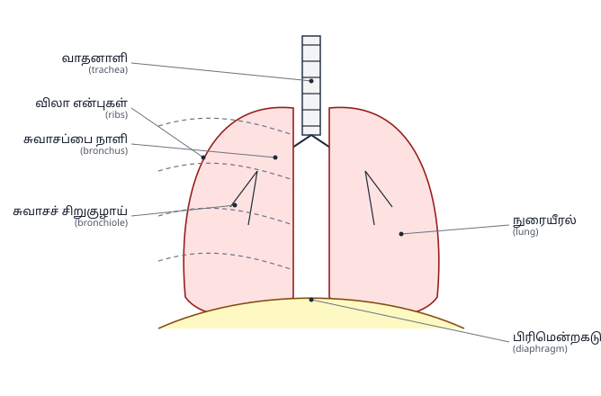

1. C வடிவக் கசியிழை வளையங்கள் — திறந்திருக்கும்
2. வாயுப் பரிமாற்றம் (சிற்றறைகள்)
3. வளியை நுரையீரலுக்குக் கடத்தல்
4. சிற்றறைகளுக்கு வளி

விடையும் விளக்கமும்

**விடை: (1) C வடிவக் கசியிழை வளையங்கள் — திறந்திருக்கும்**

வாதனாளி: C வடிவக் கசியிழை வளையங்கள் — திறந்திருக்கும் (கோப்பு 6: BIO-D06).

<!-- meta {"type":"mcq","id":"SCQ-11-06-018","grade":11,"chapter_id":"SC11-06","discipline":"BIO","difficulty":1,"qtype":"diagram","answer":3,"origin":"ORIGINAL","source_ref":"BIO-D06","image":"science_assets/biology/BIO-D06_labelled.svg"} -->
**SCQ-11-06-018** · அடிப்படை · வரிப்படம் · `ORIGINAL`

சுவாசத் தொகுதி வரிப்படத்தில் 'சுவாசப்பை நாளி' (bronchus) இன் தொழில்?

1. C வடிவக் கசியிழை வளையங்கள் — திறந்திருக்கும்
2. சிற்றறைகளுக்கு வளி
3. வளியை நுரையீரலுக்குக் கடத்தல்
4. வாயுப் பரிமாற்றம் (சிற்றறைகள்)

விடையும் விளக்கமும்

**விடை: (3) வளியை நுரையீரலுக்குக் கடத்தல்**

சுவாசப்பை நாளி: வளியை நுரையீரலுக்குக் கடத்தல் (கோப்பு 6: BIO-D06).

<!-- meta {"type":"mcq","id":"SCQ-11-06-019","grade":11,"chapter_id":"SC11-06","discipline":"BIO","difficulty":1,"qtype":"diagram","answer":3,"origin":"ORIGINAL","source_ref":"BIO-D06","image":"science_assets/biology/BIO-D06_labelled.svg"} -->
**SCQ-11-06-019** · அடிப்படை · வரிப்படம் · `ORIGINAL`

சுவாசத் தொகுதி வரிப்படத்தில் 'சுவாசச் சிறுகுழாய்' (bronchiole) இன் தொழில்?

1. C வடிவக் கசியிழை வளையங்கள் — திறந்திருக்கும்
2. வளியை நுரையீரலுக்குக் கடத்தல்
3. சிற்றறைகளுக்கு வளி
4. வாயுப் பரிமாற்றம் (சிற்றறைகள்)

விடையும் விளக்கமும்

**விடை: (3) சிற்றறைகளுக்கு வளி**

சுவாசச் சிறுகுழாய்: சிற்றறைகளுக்கு வளி (கோப்பு 6: BIO-D06).

<!-- meta {"type":"mcq","id":"SCQ-11-06-020","grade":11,"chapter_id":"SC11-06","discipline":"BIO","difficulty":1,"qtype":"diagram","answer":2,"origin":"ORIGINAL","source_ref":"BIO-D07","image":"science_assets/biology/BIO-D07_labelled.svg"} -->
**SCQ-11-06-020** · அடிப்படை · வரிப்படம் · `ORIGINAL`

நெப்பிரோன் (திட்டப் படம்) வரிப்படத்தில் 'கலனுருச்சிறுதிரள்' (glomerulus) இன் தொழில்?

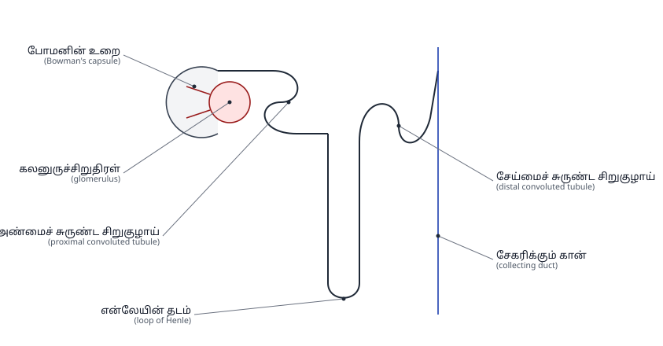

1. நீர், உப்பு மீளுறிஞ்சல்
2. அமுக்க வடிகட்டல் (மீவடிகட்டல்)
3. குளுக்கோசு, அமினோவமில மீளுறிஞ்சல்
4. வடிதிரவத்தைச் சேகரித்தல்

விடையும் விளக்கமும்

**விடை: (2) அமுக்க வடிகட்டல் (மீவடிகட்டல்)**

கலனுருச்சிறுதிரள்: அமுக்க வடிகட்டல் (மீவடிகட்டல்) (கோப்பு 6: BIO-D07).

<!-- meta {"type":"mcq","id":"SCQ-11-06-021","grade":11,"chapter_id":"SC11-06","discipline":"BIO","difficulty":1,"qtype":"diagram","answer":3,"origin":"ORIGINAL","source_ref":"BIO-D07","image":"science_assets/biology/BIO-D07_labelled.svg"} -->
**SCQ-11-06-021** · அடிப்படை · வரிப்படம் · `ORIGINAL`

நெப்பிரோன் (திட்டப் படம்) வரிப்படத்தில் 'போமனின் உறை' (Bowman's capsule) இன் தொழில்?

1. குளுக்கோசு, அமினோவமில மீளுறிஞ்சல்
2. நீர், உப்பு மீளுறிஞ்சல்
3. வடிதிரவத்தைச் சேகரித்தல்
4. அமுக்க வடிகட்டல் (மீவடிகட்டல்)

விடையும் விளக்கமும்

**விடை: (3) வடிதிரவத்தைச் சேகரித்தல்**

போமனின் உறை: வடிதிரவத்தைச் சேகரித்தல் (கோப்பு 6: BIO-D07).

<!-- meta {"type":"mcq","id":"SCQ-11-06-022","grade":11,"chapter_id":"SC11-06","discipline":"BIO","difficulty":1,"qtype":"diagram","answer":2,"origin":"ORIGINAL","source_ref":"BIO-D07","image":"science_assets/biology/BIO-D07_labelled.svg"} -->
**SCQ-11-06-022** · அடிப்படை · வரிப்படம் · `ORIGINAL`

நெப்பிரோன் (திட்டப் படம்) வரிப்படத்தில் 'அண்மைச் சுருண்ட சிறுகுழாய்' (proximal convoluted tubule) இன் தொழில்?

1. அமுக்க வடிகட்டல் (மீவடிகட்டல்)
2. குளுக்கோசு, அமினோவமில மீளுறிஞ்சல்
3. வடிதிரவத்தைச் சேகரித்தல்
4. நீர், உப்பு மீளுறிஞ்சல்

விடையும் விளக்கமும்

**விடை: (2) குளுக்கோசு, அமினோவமில மீளுறிஞ்சல்**

அண்மைச் சுருண்ட சிறுகுழாய்: குளுக்கோசு, அமினோவமில மீளுறிஞ்சல் (கோப்பு 6: BIO-D07).

<!-- meta {"type":"mcq","id":"SCQ-11-06-023","grade":11,"chapter_id":"SC11-06","discipline":"BIO","difficulty":1,"qtype":"recall","answer":2,"origin":"ORIGINAL","source_ref":"extra-SC11-06-1","image":null} -->
**SCQ-11-06-023** · அடிப்படை · நினைவு · `ORIGINAL`

இன்சுலினைச் சுரக்கும் சுரப்பி?

1. அதிரீனல்
2. சதையி
3. கபச்சுரப்பி
4. ஈரல்

விடையும் விளக்கமும்

**விடை: (2) சதையி**

குருதிக் குளுக்கோசைக் குறைக்கும்.

<!-- meta {"type":"mcq","id":"SCQ-11-06-024","grade":11,"chapter_id":"SC11-06","discipline":"BIO","difficulty":1,"qtype":"recall","answer":2,"origin":"ORIGINAL","source_ref":"extra-SC11-06-2","image":null} -->
**SCQ-11-06-024** · அடிப்படை · நினைவு · `ORIGINAL`

'சண்டை அல்லது ஓட்டம்' ஓமோன்?

1. இன்சுலின்
2. அட்ரினலின்
3. தைரொட்சின்
4. ஈஸ்ரஜன்

விடையும் விளக்கமும்

**விடை: (2) அட்ரினலின்**

அதிரீனல் சுரப்பி.

<!-- meta {"type":"mcq","id":"SCQ-11-06-025","grade":11,"chapter_id":"SC11-06","discipline":"BIO","difficulty":1,"qtype":"recall","answer":3,"origin":"ORIGINAL","source_ref":"extra-SC11-06-3","image":null} -->
**SCQ-11-06-025** · அடிப்படை · நினைவு · `ORIGINAL`

சமிபாடடைந்த உணவு உறிஞ்சப்படும் சிறுகுடல் அமைப்புகள்?

1. இலைவாய்கள்
2. நெப்பிரோன்கள்
3. சடைமுளைகள் (villi)
4. சிற்றறைகள்

விடையும் விளக்கமும்

**விடை: (3) சடைமுளைகள் (villi)**

மேற்பரப்பைக் கூட்டும்.

<!-- meta {"type":"mcq","id":"SCQ-11-06-026","grade":11,"chapter_id":"SC11-06","discipline":"BIO","difficulty":2,"qtype":"concept","answer":4,"origin":"ORIGINAL","source_ref":"extra-SC11-06-4","image":null} -->
**SCQ-11-06-026** · இடைநிலை · எண்ணக்கரு · `ORIGINAL`

நுரையீரல் சிற்றறையில் O₂ குருதிக்குச் செல்லும் முறை?

1. உயிர்ப்பான கடத்தல்
2. வடிகட்டல்
3. பிரசாரணம்
4. பரவல்

விடையும் விளக்கமும்

**விடை: (4) பரவல்**

செறிவுப் படித்திறன்.

## SC11-07: அமிலம், மூலம், உப்பு (Acids, bases and salts)

*தரம் 11 · அத்தியாயம் 7 · இரசாயனவியல் · 25 வினாக்கள்*

<!-- meta {"type":"mcq","id":"SCQ-11-07-001","grade":11,"chapter_id":"SC11-07","discipline":"CHE","difficulty":1,"qtype":"recall","answer":2,"origin":"ORIGINAL","source_ref":"chapter","image":null} -->
**SCQ-11-07-001** · அடிப்படை · நினைவு · `ORIGINAL`

pH 2 உடைய கரைசல்?

1. வன் காரம்
2. வன் அமிலம்
3. நடுநிலை
4. மென் காரம்

விடையும் விளக்கமும்

**விடை: (2) வன் அமிலம்**

pH மிகக் குறைவு.

<!-- meta {"type":"mcq","id":"SCQ-11-07-002","grade":11,"chapter_id":"SC11-07","discipline":"CHE","difficulty":1,"qtype":"equation","answer":2,"origin":"ORIGINAL","source_ref":"chapter","image":null} -->
**SCQ-11-07-002** · அடிப்படை · சமன்பாடு · `ORIGINAL`

HCl உம் NaOH உம் தாக்கமடைந்து உருவாக்குவது?

1. NaCl + H₂
2. NaCl + H₂O
3. NaOH + Cl₂
4. NaH + HCl

விடையும் விளக்கமும்

**விடை: (2) NaCl + H₂O**

நடுநிலையாக்கம்.

<!-- meta {"type":"mcq","id":"SCQ-11-07-003","grade":11,"chapter_id":"SC11-07","discipline":"CHE","difficulty":2,"qtype":"reasoning","answer":1,"origin":"ORIGINAL","source_ref":"chapter","image":null} -->
**SCQ-11-07-003** · இடைநிலை · காரணம் காணல் · `ORIGINAL`

ஒரே செறிவுடைய HCl, CH₃COOH இல் HCl இன் pH குறைவாக இருப்பதற்குக் காரணம்?

1. HCl முழுமையாக அயனாக்கமடைவதால் H⁺ செறிவு அதிகம்
2. HCl ஆவியாவதால்
3. CH₃COOH காரம்
4. HCl அதிக திணிவு

விடையும் விளக்கமும்

**விடை: (1) HCl முழுமையாக அயனாக்கமடைவதால் H⁺ செறிவு அதிகம்**

வன்னமிலம்.

<!-- meta {"type":"mcq","id":"SCQ-11-07-004","grade":11,"chapter_id":"SC11-07","discipline":"CHE","difficulty":1,"qtype":"experiment","answer":1,"origin":"ORIGINAL","source_ref":"chapter","image":null} -->
**SCQ-11-07-004** · அடிப்படை · பரிசோதனை · `ORIGINAL`

Na₂CO₃ கரைசலுடன் HCl சேர்த்தபோது வெளியேறும் வாயுவைச் சுண்ணாம்புநீரினூடு செலுத்தினால்?

1. பாற்றன்மை
2. பச்சை நிறம்
3. மாற்றம் இல்லை
4. நீலநிறம்

விடையும் விளக்கமும்

**விடை: (1) பாற்றன்மை**

CO₂ சுண்ணாம்புநீரைப் பாற்றன்மையாக்கும்.

<!-- meta {"type":"mcq","id":"SCQ-11-07-005","grade":11,"chapter_id":"SC11-07","discipline":"CHE","difficulty":2,"qtype":"equation","answer":2,"origin":"ORIGINAL","source_ref":"chapter","image":null} -->
**SCQ-11-07-005** · இடைநிலை · சமன்பாடு · `ORIGINAL`

Mg(OH)₂ + 2HCl → MgCl₂ + 2H₂O. 1 mol Mg(OH)₂ இலிருந்து நீர்?

1. 1 mol
2. 2 mol
3. 0.5 mol
4. 3 mol

விடையும் விளக்கமும்

**விடை: (2) 2 mol**

குணகம் 2.

<!-- meta {"type":"mcq","id":"SCQ-11-07-006","grade":11,"chapter_id":"SC11-07","discipline":"CHE","difficulty":2,"qtype":"experiment","answer":1,"origin":"ORIGINAL","source_ref":"chapter","image":null} -->
**SCQ-11-07-006** · இடைநிலை · பரிசோதனை · `ORIGINAL`

பீனோல்ப்தலீன் சேர்த்த NaOH கரைசலுக்கு HCl ஐ மெதுவாகச் சேர்க்கும்போது நடுநிலைப் புள்ளியில்?

1. இளஞ்சிவப்பு → நிறமற்றது
2. நிறமற்றது → இளஞ்சிவப்பு
3. நீலம் → சிவப்பு
4. மாற்றம் இல்லை

விடையும் விளக்கமும்

**விடை: (1) இளஞ்சிவப்பு → நிறமற்றது**

காரம் நடுநிலையாகும்போது நிறம் மறையும்.

<!-- meta {"type":"mcq","id":"SCQ-11-07-007","grade":11,"chapter_id":"SC11-07","discipline":"CHE","difficulty":2,"qtype":"application","answer":3,"origin":"ORIGINAL","source_ref":"chapter","image":null} -->
**SCQ-11-07-007** · இடைநிலை · பிரயோகம் · `ORIGINAL`

தேனீக் கொட்டுக்கு (அமிலம்) பொருத்தமான முதலுதவி?

1. வினாகிரி
2. எலுமிச்சைச்சாறு
3. சமையல் சோடா (NaHCO₃)
4. HCl

விடையும் விளக்கமும்

**விடை: (3) சமையல் சோடா (NaHCO₃)**

மென் மூலம் அமிலத்தை நடுநிலையாக்கும்.

<!-- meta {"type":"mcq","id":"SCQ-11-07-008","grade":11,"chapter_id":"SC11-07","discipline":"CHE","difficulty":1,"qtype":"recall","answer":1,"origin":"ORIGINAL","source_ref":"chapter","image":null} -->
**SCQ-11-07-008** · அடிப்படை · நினைவு · `ORIGINAL`

காரம் என்பது?

1. நீரில் கரையும் மூலம்
2. எந்த அமிலமும்
3. உப்பு
4. நடுநிலைப் பதார்த்தம்

விடையும் விளக்கமும்

**விடை: (1) நீரில் கரையும் மூலம்**

உ-ம் NaOH, KOH.

<!-- meta {"type":"mcq","id":"SCQ-11-07-009","grade":11,"chapter_id":"SC11-07","discipline":"CHE","difficulty":2,"qtype":"equation","answer":1,"origin":"ORIGINAL","source_ref":"chapter","image":null} -->
**SCQ-11-07-009** · இடைநிலை · சமன்பாடு · `ORIGINAL`

H₂SO₄ + 2NaOH → ?

1. Na₂SO₄ + 2H₂O
2. NaSO₄ + H₂O
3. Na₂SO₄ + H₂
4. NaHSO₄ + O₂

விடையும் விளக்கமும்

**விடை: (1) Na₂SO₄ + 2H₂O**

சமன்செய்த நடுநிலையாக்கம்.

<!-- meta {"type":"mcq","id":"SCQ-11-07-010","grade":11,"chapter_id":"SC11-07","discipline":"CHE","difficulty":2,"qtype":"concept","answer":2,"origin":"ORIGINAL","source_ref":"chapter","image":null} -->
**SCQ-11-07-010** · இடைநிலை · எண்ணக்கரு · `ORIGINAL`

நடுநிலையாக்கத்தின்போது கரைசலின் வெப்பநிலை?

1. குறையும்
2. கூடும்
3. மாறாது
4. 0 °C ஆகும்

விடையும் விளக்கமும்

**விடை: (2) கூடும்**

புறவெப்பத் தாக்கம் (SC11-08).

<!-- meta {"type":"mcq","id":"SCQ-11-07-011","grade":11,"chapter_id":"SC11-07","discipline":"CHE","difficulty":2,"qtype":"equation","answer":2,"origin":"ORIGINAL","source_ref":"EQ-026","image":null} -->
**SCQ-11-07-011** · இடைநிலை · சமன்பாடு · `ORIGINAL`

H₂SO₄ + NaOH → Na₂SO₄ + H₂O — இச்சமன்பாட்டை மிகச்சிறிய முழு எண் குணகங்களால் சமன்செய்யும்போது NaOH இன் குணகம்?

1. 7
2. 2
3. 4
4. 3

விடையும் விளக்கமும்

**விடை: (2) 2**

H₂SO₄ + 2NaOH → Na₂SO₄ + 2H₂O (அணு எண்ணிக்கை சரிபார்க்கப்பட்டது; கோப்பு 7: EQ-026).

<!-- meta {"type":"mcq","id":"SCQ-11-07-012","grade":11,"chapter_id":"SC11-07","discipline":"CHE","difficulty":2,"qtype":"equation","answer":3,"origin":"ORIGINAL","source_ref":"EQ-027","image":null} -->
**SCQ-11-07-012** · இடைநிலை · சமன்பாடு · `ORIGINAL`

HCl + Mg(OH)₂ → MgCl₂ + H₂O — இச்சமன்பாட்டை மிகச்சிறிய முழு எண் குணகங்களால் சமன்செய்யும்போது HCl இன் குணகம்?

1. 7
2. 3
3. 2
4. 4

விடையும் விளக்கமும்

**விடை: (3) 2**

2HCl + Mg(OH)₂ → MgCl₂ + 2H₂O (அணு எண்ணிக்கை சரிபார்க்கப்பட்டது; கோப்பு 7: EQ-027).

<!-- meta {"type":"mcq","id":"SCQ-11-07-013","grade":11,"chapter_id":"SC11-07","discipline":"CHE","difficulty":2,"qtype":"equation","answer":1,"origin":"ORIGINAL","source_ref":"EQ-029","image":null} -->
**SCQ-11-07-013** · இடைநிலை · சமன்பாடு · `ORIGINAL`

CaCO₃ + HCl → CaCl₂ + H₂O + CO₂ — இச்சமன்பாட்டை மிகச்சிறிய முழு எண் குணகங்களால் சமன்செய்யும்போது HCl இன் குணகம்?

1. 2
2. 7
3. 3
4. 4

விடையும் விளக்கமும்

**விடை: (1) 2**

CaCO₃ + 2HCl → CaCl₂ + H₂O + CO₂ (அணு எண்ணிக்கை சரிபார்க்கப்பட்டது; கோப்பு 7: EQ-029).

<!-- meta {"type":"mcq","id":"SCQ-11-07-014","grade":11,"chapter_id":"SC11-07","discipline":"CHE","difficulty":2,"qtype":"equation","answer":2,"origin":"ORIGINAL","source_ref":"EQ-030","image":null} -->
**SCQ-11-07-014** · இடைநிலை · சமன்பாடு · `ORIGINAL`

Na₂CO₃ + HCl → NaCl + H₂O + CO₂ — இச்சமன்பாட்டை மிகச்சிறிய முழு எண் குணகங்களால் சமன்செய்யும்போது HCl இன் குணகம்?

1. 3
2. 2
3. 4
4. 7

விடையும் விளக்கமும்

**விடை: (2) 2**

Na₂CO₃ + 2HCl → 2NaCl + H₂O + CO₂ (அணு எண்ணிக்கை சரிபார்க்கப்பட்டது; கோப்பு 7: EQ-030).

<!-- meta {"type":"mcq","id":"SCQ-11-07-015","grade":11,"chapter_id":"SC11-07","discipline":"CHE","difficulty":1,"qtype":"diagram","answer":1,"origin":"ORIGINAL","source_ref":"CHE-D03","image":"science_assets/chemistry/CHE-D03_labelled.svg"} -->
**SCQ-11-07-015** · அடிப்படை · வரிப்படம் · `ORIGINAL`

ஐதரசன் தயாரிப்பு — நீரின் கீழ்முக இடப்பெயர்ச்சி வரிப்படத்தில் 'முட்புனல்' (thistle funnel) இன் தொழில்?

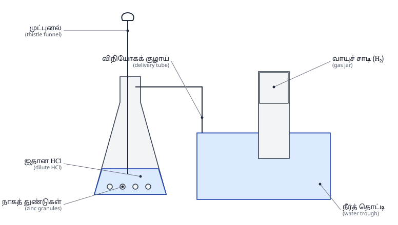

1. அமிலத்தைச் சேர்த்தல்
2. வாயுவைக் கடத்தல்
3. Zn + 2HCl → ZnCl₂ + H₂
4. தாக்கி

விடையும் விளக்கமும்

**விடை: (1) அமிலத்தைச் சேர்த்தல்**

முட்புனல்: அமிலத்தைச் சேர்த்தல் (கோப்பு 6: CHE-D03).

<!-- meta {"type":"mcq","id":"SCQ-11-07-016","grade":11,"chapter_id":"SC11-07","discipline":"CHE","difficulty":1,"qtype":"diagram","answer":3,"origin":"ORIGINAL","source_ref":"CHE-D03","image":"science_assets/chemistry/CHE-D03_labelled.svg"} -->
**SCQ-11-07-016** · அடிப்படை · வரிப்படம் · `ORIGINAL`

ஐதரசன் தயாரிப்பு — நீரின் கீழ்முக இடப்பெயர்ச்சி வரிப்படத்தில் 'ஐதான HCl' (dilute HCl) இன் தொழில்?

1. Zn + 2HCl → ZnCl₂ + H₂
2. அமிலத்தைச் சேர்த்தல்
3. தாக்கி
4. வாயுவைக் கடத்தல்

விடையும் விளக்கமும்

**விடை: (3) தாக்கி**

ஐதான HCl: தாக்கி (கோப்பு 6: CHE-D03).

<!-- meta {"type":"mcq","id":"SCQ-11-07-017","grade":11,"chapter_id":"SC11-07","discipline":"CHE","difficulty":1,"qtype":"diagram","answer":3,"origin":"ORIGINAL","source_ref":"CHE-D03","image":"science_assets/chemistry/CHE-D03_labelled.svg"} -->
**SCQ-11-07-017** · அடிப்படை · வரிப்படம் · `ORIGINAL`

ஐதரசன் தயாரிப்பு — நீரின் கீழ்முக இடப்பெயர்ச்சி வரிப்படத்தில் 'நாகத் துண்டுகள்' (zinc granules) இன் தொழில்?

1. அமிலத்தைச் சேர்த்தல்
2. வாயுவைக் கடத்தல்
3. Zn + 2HCl → ZnCl₂ + H₂
4. தாக்கி

விடையும் விளக்கமும்

**விடை: (3) Zn + 2HCl → ZnCl₂ + H₂**

நாகத் துண்டுகள்: Zn + 2HCl → ZnCl₂ + H₂ (கோப்பு 6: CHE-D03).

<!-- meta {"type":"mcq","id":"SCQ-11-07-018","grade":11,"chapter_id":"SC11-07","discipline":"CHE","difficulty":1,"qtype":"recall","answer":4,"origin":"ORIGINAL","source_ref":"extra-SC11-07-1","image":null} -->
**SCQ-11-07-018** · அடிப்படை · நினைவு · `ORIGINAL`

பினோத்தலின் மூலக் கரைசலில் காட்டும் நிறம்?

1. நீலம்
2. நிறமற்றது
3. மஞ்சள்
4. மென்சிவப்பு

விடையும் விளக்கமும்

**விடை: (4) மென்சிவப்பு**

அமிலத்தில் நிறமற்றது.

<!-- meta {"type":"mcq","id":"SCQ-11-07-019","grade":11,"chapter_id":"SC11-07","discipline":"CHE","difficulty":2,"qtype":"recall","answer":4,"origin":"ORIGINAL","source_ref":"extra-SC11-07-2","image":null} -->
**SCQ-11-07-019** · இடைநிலை · நினைவு · `ORIGINAL`

மெதில் செம்மஞ்சள் அமிலத்தில் காட்டும் நிறம்?

1. மஞ்சள்
2. நீலம்
3. பச்சை
4. சிவப்பு

விடையும் விளக்கமும்

**விடை: (4) சிவப்பு**

மூலத்தில் மஞ்சள்.

<!-- meta {"type":"mcq","id":"SCQ-11-07-020","grade":11,"chapter_id":"SC11-07","discipline":"CHE","difficulty":2,"qtype":"concept","answer":2,"origin":"ORIGINAL","source_ref":"extra-SC11-07-3","image":null} -->
**SCQ-11-07-020** · இடைநிலை · எண்ணக்கரு · `ORIGINAL`

உலோக ஒட்சைட்டுகள் பொதுவாக?

1. வாயுக்கள்
2. மூல இயல்புடையவை
3. அமில இயல்புடையவை
4. நடுநிலை எப்போதும்

விடையும் விளக்கமும்

**விடை: (2) மூல இயல்புடையவை**

உ-ம் CaO, MgO.

<!-- meta {"type":"mcq","id":"SCQ-11-07-021","grade":11,"chapter_id":"SC11-07","discipline":"CHE","difficulty":2,"qtype":"concept","answer":4,"origin":"ORIGINAL","source_ref":"extra-SC11-07-4","image":null} -->
**SCQ-11-07-021** · இடைநிலை · எண்ணக்கரு · `ORIGINAL`

அல்லுலோக ஒட்சைட்டுகள் நீரில் கரைந்து?

1. நடுநிலை எப்போதும்
2. திண்மமாகும்
3. மூலக் கரைசல் தரும்
4. அமிலக் கரைசல் தரும்

விடையும் விளக்கமும்

**விடை: (4) அமிலக் கரைசல் தரும்**

உ-ம் CO₂ → H₂CO₃.

<!-- meta {"type":"mcq","id":"SCQ-11-07-022","grade":11,"chapter_id":"SC11-07","discipline":"CHE","difficulty":2,"qtype":"application","answer":1,"origin":"ORIGINAL","source_ref":"extra-SC11-07-5","image":null} -->
**SCQ-11-07-022** · இடைநிலை · பிரயோகம் · `ORIGINAL`

செறிந்த சல்பூரிக்கமிலத்தை ஐதாக்கும் பாதுகாப்பான முறை?

1. அமிலத்தை மெதுவாக நீருக்குள் ஊற்றல்
2. நீரை அமிலத்துக்குள் ஊற்றல்
3. சூடாக்கி ஊற்றல்
4. இரண்டையும் ஒரே நேரத்தில்

விடையும் விளக்கமும்

**விடை: (1) அமிலத்தை மெதுவாக நீருக்குள் ஊற்றல்**

அதிக வெப்பம் — தெறிப்பு தவிர்.

<!-- meta {"type":"mcq","id":"SCQ-11-07-023","grade":11,"chapter_id":"SC11-07","discipline":"CHE","difficulty":2,"qtype":"concept","answer":4,"origin":"ORIGINAL","source_ref":"extra-SC11-07-6","image":null} -->
**SCQ-11-07-023** · இடைநிலை · எண்ணக்கரு · `ORIGINAL`

வலிய அமிலம்?

1. H₂CO₃
2. சிற்றிக்கமிலம்
3. CH₃COOH
4. HCl

விடையும் விளக்கமும்

**விடை: (4) HCl**

முற்றாக அயனாக்கமடையும்.

<!-- meta {"type":"mcq","id":"SCQ-11-07-024","grade":11,"chapter_id":"SC11-07","discipline":"CHE","difficulty":1,"qtype":"application","answer":4,"origin":"ORIGINAL","source_ref":"extra-SC11-07-7","image":null} -->
**SCQ-11-07-024** · அடிப்படை · பிரயோகம் · `ORIGINAL`

சவர்க்காரக் கரைசலின் pH பொதுவாக?

1. 7 இலும் குறைவு
2. 7
3. 0
4. 7 இலும் கூட

விடையும் விளக்கமும்

**விடை: (4) 7 இலும் கூட**

மூல இயல்பு.

<!-- meta {"type":"mcq","id":"SCQ-11-07-025","grade":11,"chapter_id":"SC11-07","discipline":"CHE","difficulty":1,"qtype":"recall","answer":2,"origin":"ORIGINAL","source_ref":"extra-SC11-07-8","image":null} -->
**SCQ-11-07-025** · அடிப்படை · நினைவு · `ORIGINAL`

நீல பாசிச்சாயத்தாளை அமிலம்?

1. வெள்ளையாக்கும்
2. சிவப்பாக்கும்
3. நீலமாகவே வைக்கும்
4. பச்சையாக்கும்

விடையும் விளக்கமும்

**விடை: (2) சிவப்பாக்கும்**

அமிலக் காட்டி.

## SC11-08: இரசாயனத் தாக்கங்களின் வெப்ப விளைவு (Heat changes associated with chemical reactions)

*தரம் 11 · அத்தியாயம் 8 · இரசாயனவியல் · 25 வினாக்கள்*

<!-- meta {"type":"mcq","id":"SCQ-11-08-001","grade":11,"chapter_id":"SC11-08","discipline":"CHE","difficulty":1,"qtype":"concept","answer":3,"origin":"ORIGINAL","source_ref":"chapter","image":null} -->
**SCQ-11-08-001** · அடிப்படை · எண்ணக்கரு · `ORIGINAL`

பின்வருவனவற்றுள் அகவெப்பத் தாக்கம்?

1. மெதேன் தகனம்
2. HCl + NaOH
3. CaCO₃ இன் வெப்பப் பிரிகை
4. Mg + O₂

விடையும் விளக்கமும்

**விடை: (3) CaCO₃ இன் வெப்பப் பிரிகை**

வெப்பம் உறிஞ்சப்படும்.

<!-- meta {"type":"mcq","id":"SCQ-11-08-002","grade":11,"chapter_id":"SC11-08","discipline":"CHE","difficulty":1,"qtype":"experiment","answer":2,"origin":"ORIGINAL","source_ref":"chapter","image":null} -->
**SCQ-11-08-002** · அடிப்படை · பரிசோதனை · `ORIGINAL`

ஒரு தாக்கத்தின்போது சோதனைக் குழாய் குளிர்ந்தது. அத்தாக்கம்?

1. புறவெப்பம்
2. அகவெப்பம்
3. நடுநிலை
4. தகனம்

விடையும் விளக்கமும்

**விடை: (2) அகவெப்பம்**

சூழலிலிருந்து வெப்பம் உறிஞ்சப்பட்டது.

<!-- meta {"type":"mcq","id":"SCQ-11-08-003","grade":11,"chapter_id":"SC11-08","discipline":"CHE","difficulty":2,"qtype":"graph","answer":2,"origin":"ORIGINAL","source_ref":"chapter","image":null} -->
**SCQ-11-08-003** · இடைநிலை · வரைபு · `ORIGINAL`

புறவெப்பத் தாக்கத்தின் சக்தி மட்ட வரிப்படத்தில்?

1. விளைவுகள் உயர் மட்டத்தில்
2. விளைவுகள் தாழ் மட்டத்தில்
3. இரண்டும் சமம்
4. ΔH நேர்

விடையும் விளக்கமும்

**விடை: (2) விளைவுகள் தாழ் மட்டத்தில்**

சக்தி வெளியேறியதால்.

<!-- meta {"type":"mcq","id":"SCQ-11-08-004","grade":11,"chapter_id":"SC11-08","discipline":"CHE","difficulty":2,"qtype":"calculation","answer":2,"origin":"ORIGINAL","source_ref":"chapter","image":null} -->
**SCQ-11-08-004** · இடைநிலை · கணிப்பு · `ORIGINAL`

C₂H₄ + 3O₂ → 2CO₂ + 2H₂O; ΔH = −1400 kJ mol⁻¹. 14 g எதீன் (M = 28) எரியும்போது வெளியேறும் வெப்பம்?

1. 1400 kJ
2. 700 kJ
3. 2800 kJ
4. 350 kJ

விடையும் விளக்கமும்

**விடை: (2) 700 kJ**

14/28 = 0.5 mol; 0.5 × 1400 = 700 kJ.

<!-- meta {"type":"mcq","id":"SCQ-11-08-005","grade":11,"chapter_id":"SC11-08","discipline":"CHE","difficulty":3,"qtype":"reasoning","answer":2,"origin":"ORIGINAL","source_ref":"chapter","image":null} -->
**SCQ-11-08-005** · கடினம் · காரணம் காணல் · `ORIGINAL`

தாக்கத்தில் பிணைப்பு உருவாகும்போது வெளியேறும் சக்தி, உடைக்கத் தேவையானதை விட அதிகமெனின் தாக்கம்?

1. அகவெப்பம்
2. புறவெப்பம்
3. நடுநிலை
4. எதுவுமில்லை

விடையும் விளக்கமும்

**விடை: (2) புறவெப்பம்**

தேறிய சக்தி வெளியேறும்.

<!-- meta {"type":"mcq","id":"SCQ-11-08-006","grade":11,"chapter_id":"SC11-08","discipline":"CHE","difficulty":2,"qtype":"application","answer":1,"origin":"ORIGINAL","source_ref":"chapter","image":null} -->
**SCQ-11-08-006** · இடைநிலை · பிரயோகம் · `ORIGINAL`

உடனடி குளிர்ப்பொதியில் பயன்படும் செயன்முறை?

1. அமோனியம் நைத்திரேற்றுக் கரைதல் (அகவெப்பம்)
2. தகனம்
3. நடுநிலையாக்கம்
4. துருப்பிடித்தல்

விடையும் விளக்கமும்

**விடை: (1) அமோனியம் நைத்திரேற்றுக் கரைதல் (அகவெப்பம்)**

சூழலிலிருந்து வெப்பம் உறிஞ்சல்.

<!-- meta {"type":"mcq","id":"SCQ-11-08-007","grade":11,"chapter_id":"SC11-08","discipline":"CHE","difficulty":1,"qtype":"concept","answer":2,"origin":"ORIGINAL","source_ref":"chapter","image":null} -->
**SCQ-11-08-007** · அடிப்படை · எண்ணக்கரு · `ORIGINAL`

ΔH = +178 kJ mol⁻¹ உடைய தாக்கம்?

1. வெப்பத்தை வெளியிடும்
2. வெப்பத்தை உறிஞ்சும்
3. சக்தி மாற்றம் இல்லை
4. ஒளி வெளியிடும்

விடையும் விளக்கமும்

**விடை: (2) வெப்பத்தை உறிஞ்சும்**

நேர் ΔH → அகவெப்பம்.

<!-- meta {"type":"mcq","id":"SCQ-11-08-008","grade":11,"chapter_id":"SC11-08","discipline":"CHE","difficulty":3,"qtype":"calculation","answer":1,"origin":"ORIGINAL","source_ref":"chapter","image":null} -->
**SCQ-11-08-008** · கடினம் · கணிப்பு · `ORIGINAL`

50 g நீரின் வெப்பநிலை நடுநிலையாக்கத்தால் 6 °C கூடியது. வெளியேறிய வெப்பம்? (c = 4200 J kg⁻¹ °C⁻¹)

1. 1260 J
2. 12 600 J
3. 126 J
4. 1 260 000 J

விடையும் விளக்கமும்

**விடை: (1) 1260 J**

Q = 0.05 × 4200 × 6 = 1260 J.

<!-- meta {"type":"mcq","id":"SCQ-11-08-009","grade":11,"chapter_id":"SC11-08","discipline":"CHE","difficulty":2,"qtype":"application","answer":1,"origin":"ORIGINAL","source_ref":"chapter","image":null} -->
**SCQ-11-08-009** · இடைநிலை · பிரயோகம் · `ORIGINAL`

சுவாசம் புறவெப்பமாக இருப்பதன் முக்கியத்துவம்?

1. உடல் வெப்பநிலையைப் பேண
2. O₂ உருவாக்க
3. நீரை உறிஞ்ச
4. குளுக்கோசு தயாரிக்க

விடையும் விளக்கமும்

**விடை: (1) உடல் வெப்பநிலையைப் பேண**

வெளியேறும் சக்தி உடல் வெப்பமாகும்.

<!-- meta {"type":"mcq","id":"SCQ-11-08-010","grade":11,"chapter_id":"SC11-08","discipline":"CHE","difficulty":3,"qtype":"reasoning","answer":3,"origin":"ORIGINAL","source_ref":"chapter","image":null} -->
**SCQ-11-08-010** · கடினம் · காரணம் காணல் · `ORIGINAL`

பின்வருவனவற்றுள் புறவெப்பமானது?

1. பனி உருகல்
2. நீர் ஆவியாதல்
3. நீராவி ஒடுங்கல்
4. NH₄Cl கரைதல்

விடையும் விளக்கமும்

**விடை: (3) நீராவி ஒடுங்கல்**

ஒடுங்கலில் மறைவெப்பம் வெளியேறும்.

<!-- meta {"type":"mcq","id":"SCQ-11-08-011","grade":11,"chapter_id":"SC11-08","discipline":"CHE","difficulty":2,"qtype":"equation","answer":1,"origin":"ORIGINAL","source_ref":"EQ-048","image":null} -->
**SCQ-11-08-011** · இடைநிலை · சமன்பாடு · `ORIGINAL`

N₂ + H₂ → NH₃ — இச்சமன்பாட்டை மிகச்சிறிய முழு எண் குணகங்களால் சமன்செய்யும்போது H₂ இன் குணகம்?

1. 3
2. 4
3. 6
4. 2

விடையும் விளக்கமும்

**விடை: (1) 3**

N₂ + 3H₂ → 2NH₃ (அணு எண்ணிக்கை சரிபார்க்கப்பட்டது; கோப்பு 7: EQ-048).

<!-- meta {"type":"mcq","id":"SCQ-11-08-012","grade":11,"chapter_id":"SC11-08","discipline":"CHE","difficulty":2,"qtype":"equation","answer":1,"origin":"ORIGINAL","source_ref":"EQ-050","image":null} -->
**SCQ-11-08-012** · இடைநிலை · சமன்பாடு · `ORIGINAL`

SO₂ + O₂ → SO₃ — இச்சமன்பாட்டை மிகச்சிறிய முழு எண் குணகங்களால் சமன்செய்யும்போது SO₂ இன் குணகம்?

1. 2
2. 7
3. 4
4. 3

விடையும் விளக்கமும்

**விடை: (1) 2**

2SO₂ + O₂ → 2SO₃ (அணு எண்ணிக்கை சரிபார்க்கப்பட்டது; கோப்பு 7: EQ-050).

<!-- meta {"type":"mcq","id":"SCQ-11-08-013","grade":11,"chapter_id":"SC11-08","discipline":"CHE","difficulty":2,"qtype":"calculation","answer":1,"origin":"ORIGINAL","source_ref":"param-SC11-08-1","image":null} -->
**SCQ-11-08-013** · இடைநிலை · கணிப்பு · `ORIGINAL`

ΔH = −890 kJ mol⁻¹ உடைய தகனத்தில் 0.5 mol எரியும்போது வெளியேறும் வெப்பம்?

1. 445 kJ
2. 1780 kJ
3. 890 kJ
4. 222.5 kJ

விடையும் விளக்கமும்

**விடை: (1) 445 kJ**

q = n|ΔH|.

<!-- meta {"type":"mcq","id":"SCQ-11-08-014","grade":11,"chapter_id":"SC11-08","discipline":"CHE","difficulty":2,"qtype":"calculation","answer":1,"origin":"ORIGINAL","source_ref":"param-SC11-08-2","image":null} -->
**SCQ-11-08-014** · இடைநிலை · கணிப்பு · `ORIGINAL`

ΔH = −286 kJ mol⁻¹ உடைய தகனத்தில் 3 mol எரியும்போது வெளியேறும் வெப்பம்?

1. 858 kJ
2. 95.3333 kJ
3. 1716 kJ
4. 286 kJ

விடையும் விளக்கமும்

**விடை: (1) 858 kJ**

q = n|ΔH|.

<!-- meta {"type":"mcq","id":"SCQ-11-08-015","grade":11,"chapter_id":"SC11-08","discipline":"CHE","difficulty":2,"qtype":"calculation","answer":1,"origin":"ORIGINAL","source_ref":"param-SC11-08-3","image":null} -->
**SCQ-11-08-015** · இடைநிலை · கணிப்பு · `ORIGINAL`

ΔH = −1400 kJ mol⁻¹ உடைய தகனத்தில் 0.25 mol எரியும்போது வெளியேறும் வெப்பம்?

1. 350 kJ
2. 700 kJ
3. 5600 kJ
4. 1400 kJ

விடையும் விளக்கமும்

**விடை: (1) 350 kJ**

q = n|ΔH|.

<!-- meta {"type":"mcq","id":"SCQ-11-08-016","grade":11,"chapter_id":"SC11-08","discipline":"CHE","difficulty":2,"qtype":"calculation","answer":1,"origin":"ORIGINAL","source_ref":"param-SC11-08-4","image":null} -->
**SCQ-11-08-016** · இடைநிலை · கணிப்பு · `ORIGINAL`

0.05 kg கரைசலின் வெப்பநிலை தாக்கத்தால் 8 °C உயர்ந்தது (c = 4200). வெளியேறிய வெப்பம்?

1. 1680 J
2. 0.4 J
3. 33600 J
4. 210 J

விடையும் விளக்கமும்

**விடை: (1) 1680 J**

Q = mcΔθ.

<!-- meta {"type":"mcq","id":"SCQ-11-08-017","grade":11,"chapter_id":"SC11-08","discipline":"CHE","difficulty":2,"qtype":"calculation","answer":4,"origin":"ORIGINAL","source_ref":"param-SC11-08-5","image":null} -->
**SCQ-11-08-017** · இடைநிலை · கணிப்பு · `ORIGINAL`

0.2 kg கரைசலின் வெப்பநிலை தாக்கத்தால் 3.5 °C உயர்ந்தது (c = 4200). வெளியேறிய வெப்பம்?

1. 840 J
2. 0.7 J
3. 14700 J
4. 2940 J

விடையும் விளக்கமும்

**விடை: (4) 2940 J**

Q = mcΔθ.

<!-- meta {"type":"mcq","id":"SCQ-11-08-018","grade":11,"chapter_id":"SC11-08","discipline":"CHE","difficulty":2,"qtype":"calculation","answer":1,"origin":"ORIGINAL","source_ref":"param-SC11-08-6","image":null} -->
**SCQ-11-08-018** · இடைநிலை · கணிப்பு · `ORIGINAL`

0.1 kg கரைசலின் வெப்பநிலை தாக்கத்தால் 12 °C உயர்ந்தது (c = 4200). வெளியேறிய வெப்பம்?

1. 5040 J
2. 420 J
3. 1.2 J
4. 50400 J

விடையும் விளக்கமும்

**விடை: (1) 5040 J**

Q = mcΔθ.

<!-- meta {"type":"mcq","id":"SCQ-11-08-019","grade":11,"chapter_id":"SC11-08","discipline":"CHE","difficulty":3,"qtype":"calculation","answer":1,"origin":"ORIGINAL","source_ref":"param-SC11-08-7","image":null} -->
**SCQ-11-08-019** · கடினம் · கணிப்பு · `ORIGINAL`

வெளியேறிய வெப்பம் 5.7 kJ, உருவான நீர் 0.1 mol. நடுநிலையாக்க வெப்பவுள்ளுறை மாற்றத்தின் பருமன் (kJ mol⁻¹)?

1. 57 kJ mol⁻¹
2. 0.57 kJ mol⁻¹
3. 114 kJ mol⁻¹
4. 0.0175 kJ mol⁻¹

விடையும் விளக்கமும்

**விடை: (1) 57 kJ mol⁻¹**

|ΔH| = q/n.

<!-- meta {"type":"mcq","id":"SCQ-11-08-020","grade":11,"chapter_id":"SC11-08","discipline":"CHE","difficulty":3,"qtype":"calculation","answer":3,"origin":"ORIGINAL","source_ref":"param-SC11-08-8","image":null} -->
**SCQ-11-08-020** · கடினம் · கணிப்பு · `ORIGINAL`

வெளியேறிய வெப்பம் 28.5 kJ, உருவான நீர் 0.5 mol. நடுநிலையாக்க வெப்பவுள்ளுறை மாற்றத்தின் பருமன் (kJ mol⁻¹)?

1. 0.0175 kJ mol⁻¹
2. 114 kJ mol⁻¹
3. 57 kJ mol⁻¹
4. 14.25 kJ mol⁻¹

விடையும் விளக்கமும்

**விடை: (3) 57 kJ mol⁻¹**

|ΔH| = q/n.

<!-- meta {"type":"mcq","id":"SCQ-11-08-021","grade":11,"chapter_id":"SC11-08","discipline":"CHE","difficulty":3,"qtype":"calculation","answer":2,"origin":"ORIGINAL","source_ref":"param-SC11-08-9","image":null} -->
**SCQ-11-08-021** · கடினம் · கணிப்பு · `ORIGINAL`

மூலர்த் திணிவு 16 g mol⁻¹, தகன ΔH = −890 kJ mol⁻¹. 4 g எரியும்போது வெளியேறும் வெப்பம்?

1. 3560 kJ
2. 222.5 kJ
3. 445 kJ
4. 111.25 kJ

விடையும் விளக்கமும்

**விடை: (2) 222.5 kJ**

n = m/M; q = n|ΔH|.

<!-- meta {"type":"mcq","id":"SCQ-11-08-022","grade":11,"chapter_id":"SC11-08","discipline":"CHE","difficulty":3,"qtype":"calculation","answer":1,"origin":"ORIGINAL","source_ref":"param-SC11-08-10","image":null} -->
**SCQ-11-08-022** · கடினம் · கணிப்பு · `ORIGINAL`

மூலர்த் திணிவு 46 g mol⁻¹, தகன ΔH = −1370 kJ mol⁻¹. 23 g எரியும்போது வெளியேறும் வெப்பம்?

1. 685 kJ
2. 59.5652 kJ
3. 2740 kJ
4. 31510 kJ

விடையும் விளக்கமும்

**விடை: (1) 685 kJ**

n = m/M; q = n|ΔH|.

<!-- meta {"type":"mcq","id":"SCQ-11-08-023","grade":11,"chapter_id":"SC11-08","discipline":"CHE","difficulty":3,"qtype":"calculation","answer":2,"origin":"ORIGINAL","source_ref":"param-SC11-08-11","image":null} -->
**SCQ-11-08-023** · கடினம் · கணிப்பு · `ORIGINAL`

மூலர்த் திணிவு 44 g mol⁻¹, தகன ΔH = −2220 kJ mol⁻¹. 11 g எரியும்போது வெளியேறும் வெப்பம்?

1. 201.8182 kJ
2. 555 kJ
3. 24420 kJ
4. 8880 kJ

விடையும் விளக்கமும்

**விடை: (2) 555 kJ**

n = m/M; q = n|ΔH|.

<!-- meta {"type":"mcq","id":"SCQ-11-08-024","grade":11,"chapter_id":"SC11-08","discipline":"CHE","difficulty":3,"qtype":"calculation","answer":3,"origin":"ORIGINAL","source_ref":"param-SC11-08-12","image":null} -->
**SCQ-11-08-024** · கடினம் · கணிப்பு · `ORIGINAL`

மூலர்த் திணிவு 2 g mol⁻¹, தகன ΔH = −286 kJ mol⁻¹. 2 g எரியும்போது வெளியேறும் வெப்பம்?

1. 572 kJ
2. 2860 kJ
3. 286 kJ
4. 143 kJ

விடையும் விளக்கமும்

**விடை: (3) 286 kJ**

n = m/M; q = n|ΔH|.

<!-- meta {"type":"mcq","id":"SCQ-11-08-025","grade":11,"chapter_id":"SC11-08","discipline":"CHE","difficulty":3,"qtype":"calculation","answer":1,"origin":"ORIGINAL","source_ref":"param-SC11-08-13","image":null} -->
**SCQ-11-08-025** · கடினம் · கணிப்பு · `ORIGINAL`

மூலர்த் திணிவு 28 g mol⁻¹, தகன ΔH = −1410 kJ mol⁻¹. 7 g எரியும்போது வெளியேறும் வெப்பம்?

1. 352.5 kJ
2. 5640 kJ
3. 201.4286 kJ
4. 9870 kJ

விடையும் விளக்கமும்

**விடை: (1) 352.5 kJ**

n = m/M; q = n|ΔH|.

## SC11-09: வெப்பம் (Heat)

*தரம் 11 · அத்தியாயம் 9 · பௌதிகவியல் · 25 வினாக்கள்*

<!-- meta {"type":"mcq","id":"SCQ-11-09-001","grade":11,"chapter_id":"SC11-09","discipline":"PHY","difficulty":1,"qtype":"calculation","answer":2,"origin":"ORIGINAL","source_ref":"chapter","image":null} -->
**SCQ-11-09-001** · அடிப்படை · கணிப்பு · `ORIGINAL`

2 kg நீரின் வெப்பநிலையை 10 °C உயர்த்தத் தேவையான வெப்பம்? (c = 4200)

1. 8400 J
2. 84 000 J
3. 42 000 J
4. 840 J

விடையும் விளக்கமும்

**விடை: (2) 84 000 J**

2 × 4200 × 10.

<!-- meta {"type":"mcq","id":"SCQ-11-09-002","grade":11,"chapter_id":"SC11-09","discipline":"PHY","difficulty":1,"qtype":"calculation","answer":2,"origin":"ORIGINAL","source_ref":"chapter","image":null} -->
**SCQ-11-09-002** · அடிப்படை · கணிப்பு · `ORIGINAL`

27 °C கெல்வினில்?

1. 246 K
2. 300 K
3. 27 K
4. 273 K

விடையும் விளக்கமும்

**விடை: (2) 300 K**

27 + 273.

<!-- meta {"type":"mcq","id":"SCQ-11-09-003","grade":11,"chapter_id":"SC11-09","discipline":"PHY","difficulty":1,"qtype":"concept","answer":3,"origin":"ORIGINAL","source_ref":"chapter","image":null} -->
**SCQ-11-09-003** · அடிப்படை · எண்ணக்கரு · `ORIGINAL`

கொதிக்கும் நீருக்குத் தொடர்ந்து வெப்பம் தந்தால் வெப்பநிலை?

1. கூடும்
2. குறையும்
3. மாறாது
4. 0 ஆகும்

விடையும் விளக்கமும்

**விடை: (3) மாறாது**

மறைவெப்பம் நிலை மாற்றத்துக்கு.

<!-- meta {"type":"mcq","id":"SCQ-11-09-004","grade":11,"chapter_id":"SC11-09","discipline":"PHY","difficulty":2,"qtype":"reasoning","answer":1,"origin":"ORIGINAL","source_ref":"chapter","image":null} -->
**SCQ-11-09-004** · இடைநிலை · காரணம் காணல் · `ORIGINAL`

ஒரே திணிவுடைய A (c = 2000), B (c = 4000) திரவங்களுக்கு ஒரே வெப்பம். வெப்பநிலை அதிகம் கூடுவது?

1. A
2. B
3. சமம்
4. தீர்மானிக்க முடியாது

விடையும் விளக்கமும்

**விடை: (1) A**

θ = Q/(mc); c குறைந்தது அதிகம் கூடும்.

<!-- meta {"type":"mcq","id":"SCQ-11-09-005","grade":11,"chapter_id":"SC11-09","discipline":"PHY","difficulty":2,"qtype":"application","answer":1,"origin":"ORIGINAL","source_ref":"chapter","image":null} -->
**SCQ-11-09-005** · இடைநிலை · பிரயோகம் · `ORIGINAL`

வாகன இயந்திரக் குளிர்விப்பானாக நீர் சிறந்தது ஏன்?

1. உயர் தன்வெப்பக் கொள்ளளவு
2. தாழ் கொதிநிலை
3. நிறம்
4. அடர்த்தி குறைவு

விடையும் விளக்கமும்

**விடை: (1) உயர் தன்வெப்பக் கொள்ளளவு**

அதிக வெப்பத்தை உறிஞ்சும்.

<!-- meta {"type":"mcq","id":"SCQ-11-09-006","grade":11,"chapter_id":"SC11-09","discipline":"PHY","difficulty":2,"qtype":"calculation","answer":1,"origin":"ORIGINAL","source_ref":"chapter","image":null} -->
**SCQ-11-09-006** · இடைநிலை · கணிப்பு · `ORIGINAL`

0.5 kg பனிக்கட்டியை 0 °C இல் உருக்கத் தேவையான வெப்பம்? (L = 336 000 J kg⁻¹)

1. 168 000 J
2. 672 000 J
3. 336 000 J
4. 84 000 J

விடையும் விளக்கமும்

**விடை: (1) 168 000 J**

Q = 0.5 × 336 000.

<!-- meta {"type":"mcq","id":"SCQ-11-09-007","grade":11,"chapter_id":"SC11-09","discipline":"PHY","difficulty":1,"qtype":"application","answer":1,"origin":"ORIGINAL","source_ref":"chapter","image":null} -->
**SCQ-11-09-007** · அடிப்படை · பிரயோகம் · `ORIGINAL`

வியர்வை உடலைக் குளிர்விப்பது?

1. ஆவியாதல் மறைவெப்பத்தை எடுப்பதால்
2. கடத்தல்
3. கதிர்ப்பு
4. மேற்காவுகை

விடையும் விளக்கமும்

**விடை: (1) ஆவியாதல் மறைவெப்பத்தை எடுப்பதால்**

ஆவியாதல் குளிர்விக்கும்.

<!-- meta {"type":"mcq","id":"SCQ-11-09-008","grade":11,"chapter_id":"SC11-09","discipline":"PHY","difficulty":1,"qtype":"concept","answer":3,"origin":"ORIGINAL","source_ref":"chapter","image":null} -->
**SCQ-11-09-008** · அடிப்படை · எண்ணக்கரு · `ORIGINAL`

சூரியனிலிருந்து புவிக்கு வெப்பம் வருவது?

1. கடத்தல்
2. மேற்காவுகை
3. கதிர்ப்பு
4. ஆவியாதல்

விடையும் விளக்கமும்

**விடை: (3) கதிர்ப்பு**

வெற்றிடத்தினூடு.

<!-- meta {"type":"mcq","id":"SCQ-11-09-009","grade":11,"chapter_id":"SC11-09","discipline":"PHY","difficulty":3,"qtype":"reasoning","answer":1,"origin":"ORIGINAL","source_ref":"chapter","image":null} -->
**SCQ-11-09-009** · கடினம் · காரணம் காணல் · `ORIGINAL`

பகலில் கடலிலிருந்து நிலத்துக்குக் காற்று வீசக் காரணம்?

1. நிலம் விரைவாகச் சூடாகி மேலுள்ள காற்று மேலெழல் (மேற்காவுகை)
2. கடல் சூடாதல்
3. ஈர்ப்பு
4. சந்திரன்

விடையும் விளக்கமும்

**விடை: (1) நிலம் விரைவாகச் சூடாகி மேலுள்ள காற்று மேலெழல் (மேற்காவுகை)**

நிலத்தின் c குறைவு.

<!-- meta {"type":"mcq","id":"SCQ-11-09-010","grade":11,"chapter_id":"SC11-09","discipline":"PHY","difficulty":2,"qtype":"concept","answer":2,"origin":"ORIGINAL","source_ref":"chapter","image":null} -->
**SCQ-11-09-010** · இடைநிலை · எண்ணக்கரு · `ORIGINAL`

ஆவியாதல் பற்றிய சரியான கூற்று?

1. கொதிநிலையில் மட்டும்
2. மேற்பரப்பில் எந்த வெப்பநிலையிலும்
3. குமிழ்கள் உருவாகும்
4. வெப்பநிலை கூடும்

விடையும் விளக்கமும்

**விடை: (2) மேற்பரப்பில் எந்த வெப்பநிலையிலும்**

மேற்பரப்புச் செயன்முறை.

<!-- meta {"type":"mcq","id":"SCQ-11-09-011","grade":11,"chapter_id":"SC11-09","discipline":"PHY","difficulty":1,"qtype":"calculation","answer":3,"origin":"ORIGINAL","source_ref":"CL-TEMP-1","image":null} -->
**SCQ-11-09-011** · அடிப்படை · கணிப்பு · `ORIGINAL`

மனித உடல் வெப்பநிலை 37 °C ஐக் கெல்வினில்?

1. 3100 K
2. 155 K
3. 310 K
4. 620 K

விடையும் விளக்கமும்

**விடை: (3) 310 K**

சரியான விடை 310 K. கோப்பு 5 இல் CL-TEMP (அடிப்படை) எட்டுப் படித் தீர்வைப் பார்க்க.

<!-- meta {"type":"mcq","id":"SCQ-11-09-012","grade":11,"chapter_id":"SC11-09","discipline":"PHY","difficulty":1,"qtype":"calculation","answer":4,"origin":"ORIGINAL","source_ref":"param-SC11-09-1","image":null} -->
**SCQ-11-09-012** · அடிப்படை · கணிப்பு · `ORIGINAL`

0.25 kg பதார்த்தத்தை (c = 4200 J kg⁻¹ °C⁻¹) 40 °C ஆல் சூடாக்கத் தேவையான வெப்பம்?

1. 168000 J
2. 1050 J
3. 10 J
4. 42000 J

விடையும் விளக்கமும்

**விடை: (4) 42000 J**

Q = mcΔθ.

<!-- meta {"type":"mcq","id":"SCQ-11-09-013","grade":11,"chapter_id":"SC11-09","discipline":"PHY","difficulty":1,"qtype":"calculation","answer":4,"origin":"ORIGINAL","source_ref":"param-SC11-09-2","image":null} -->
**SCQ-11-09-013** · அடிப்படை · கணிப்பு · `ORIGINAL`

2 kg பதார்த்தத்தை (c = 900 J kg⁻¹ °C⁻¹) 15 °C ஆல் சூடாக்கத் தேவையான வெப்பம்?

1. 30 J
2. 13500 J
3. 1800 J
4. 27000 J

விடையும் விளக்கமும்

**விடை: (4) 27000 J**

Q = mcΔθ.

<!-- meta {"type":"mcq","id":"SCQ-11-09-014","grade":11,"chapter_id":"SC11-09","discipline":"PHY","difficulty":1,"qtype":"calculation","answer":2,"origin":"ORIGINAL","source_ref":"param-SC11-09-3","image":null} -->
**SCQ-11-09-014** · அடிப்படை · கணிப்பு · `ORIGINAL`

0.5 kg பதார்த்தத்தை (c = 380 J kg⁻¹ °C⁻¹) 100 °C ஆல் சூடாக்கத் தேவையான வெப்பம்?

1. 190 J
2. 19000 J
3. 38000 J
4. 50 J

விடையும் விளக்கமும்

**விடை: (2) 19000 J**

Q = mcΔθ.

<!-- meta {"type":"mcq","id":"SCQ-11-09-015","grade":11,"chapter_id":"SC11-09","discipline":"PHY","difficulty":1,"qtype":"calculation","answer":2,"origin":"ORIGINAL","source_ref":"param-SC11-09-4","image":null} -->
**SCQ-11-09-015** · அடிப்படை · கணிப்பு · `ORIGINAL`

3 kg பதார்த்தத்தை (c = 4200 J kg⁻¹ °C⁻¹) 5 °C ஆல் சூடாக்கத் தேவையான வெப்பம்?

1. 15 J
2. 63000 J
3. 21000 J
4. 12600 J

விடையும் விளக்கமும்

**விடை: (2) 63000 J**

Q = mcΔθ.

<!-- meta {"type":"mcq","id":"SCQ-11-09-016","grade":11,"chapter_id":"SC11-09","discipline":"PHY","difficulty":2,"qtype":"calculation","answer":4,"origin":"ORIGINAL","source_ref":"param-SC11-09-5","image":null} -->
**SCQ-11-09-016** · இடைநிலை · கணிப்பு · `ORIGINAL`

0.2 kg பதார்த்தத்தை வெப்பநிலை மாறாமல் நிலைமாற்றத் தேவையான வெப்பம் (L = 336000 J kg⁻¹)?

1. 1.68 × 10⁶ J
2. 134400 J
3. 336000 J
4. 67200 J

விடையும் விளக்கமும்

**விடை: (4) 67200 J**

Q = mL.

<!-- meta {"type":"mcq","id":"SCQ-11-09-017","grade":11,"chapter_id":"SC11-09","discipline":"PHY","difficulty":2,"qtype":"calculation","answer":2,"origin":"ORIGINAL","source_ref":"param-SC11-09-6","image":null} -->
**SCQ-11-09-017** · இடைநிலை · கணிப்பு · `ORIGINAL`

0.05 kg பதார்த்தத்தை வெப்பநிலை மாறாமல் நிலைமாற்றத் தேவையான வெப்பம் (L = 2260000 J kg⁻¹)?

1. 2.26 × 10⁶ J
2. 113000 J
3. 4.52 × 10⁷ J
4. 226000 J

விடையும் விளக்கமும்

**விடை: (2) 113000 J**

Q = mL.

<!-- meta {"type":"mcq","id":"SCQ-11-09-018","grade":11,"chapter_id":"SC11-09","discipline":"PHY","difficulty":2,"qtype":"calculation","answer":1,"origin":"ORIGINAL","source_ref":"param-SC11-09-7","image":null} -->
**SCQ-11-09-018** · இடைநிலை · கணிப்பு · `ORIGINAL`

1.5 kg பதார்த்தத்தை வெப்பநிலை மாறாமல் நிலைமாற்றத் தேவையான வெப்பம் (L = 336000 J kg⁻¹)?

1. 504000 J
2. 1.008 × 10⁶ J
3. 336000 J
4. 224000 J

விடையும் விளக்கமும்

**விடை: (1) 504000 J**

Q = mL.

<!-- meta {"type":"mcq","id":"SCQ-11-09-019","grade":11,"chapter_id":"SC11-09","discipline":"PHY","difficulty":1,"qtype":"calculation","answer":4,"origin":"ORIGINAL","source_ref":"param-SC11-09-8","image":null} -->
**SCQ-11-09-019** · அடிப்படை · கணிப்பு · `ORIGINAL`

-23 °C கெல்வினில்?

1. 500 K
2. -296 K
3. 296 K
4. 250 K

விடையும் விளக்கமும்

**விடை: (4) 250 K**

T = θ + 273.

<!-- meta {"type":"mcq","id":"SCQ-11-09-020","grade":11,"chapter_id":"SC11-09","discipline":"PHY","difficulty":1,"qtype":"calculation","answer":4,"origin":"ORIGINAL","source_ref":"param-SC11-09-9","image":null} -->
**SCQ-11-09-020** · அடிப்படை · கணிப்பு · `ORIGINAL`

100 °C கெல்வினில்?

1. 746 K
2. -173 K
3. 173 K
4. 373 K

விடையும் விளக்கமும்

**விடை: (4) 373 K**

T = θ + 273.

<!-- meta {"type":"mcq","id":"SCQ-11-09-021","grade":11,"chapter_id":"SC11-09","discipline":"PHY","difficulty":1,"qtype":"calculation","answer":1,"origin":"ORIGINAL","source_ref":"param-SC11-09-10","image":null} -->
**SCQ-11-09-021** · அடிப்படை · கணிப்பு · `ORIGINAL`

57 °C கெல்வினில்?

1. 330 K
2. 216 K
3. 660 K
4. -216 K

விடையும் விளக்கமும்

**விடை: (1) 330 K**

T = θ + 273.

<!-- meta {"type":"mcq","id":"SCQ-11-09-022","grade":11,"chapter_id":"SC11-09","discipline":"PHY","difficulty":2,"qtype":"calculation","answer":3,"origin":"ORIGINAL","source_ref":"param-SC11-09-11","image":null} -->
**SCQ-11-09-022** · இடைநிலை · கணிப்பு · `ORIGINAL`

0.5 kg பொருளுக்கு 13500 J வெப்பம் தர 30 °C உயர்ந்தது. தன்வெப்பக் கொள்ளளவு?

1. 450 J kg⁻¹ °C⁻¹
2. 27000 J kg⁻¹ °C⁻¹
3. 900 J kg⁻¹ °C⁻¹
4. 202500 J kg⁻¹ °C⁻¹

விடையும் விளக்கமும்

**விடை: (3) 900 J kg⁻¹ °C⁻¹**

c = Q/(mΔθ).

<!-- meta {"type":"mcq","id":"SCQ-11-09-023","grade":11,"chapter_id":"SC11-09","discipline":"PHY","difficulty":2,"qtype":"calculation","answer":4,"origin":"ORIGINAL","source_ref":"param-SC11-09-12","image":null} -->
**SCQ-11-09-023** · இடைநிலை · கணிப்பு · `ORIGINAL`

0.2 kg பொருளுக்கு 8400 J வெப்பம் தர 10 °C உயர்ந்தது. தன்வெப்பக் கொள்ளளவு?

1. 16800 J kg⁻¹ °C⁻¹
2. 42000 J kg⁻¹ °C⁻¹
3. 840 J kg⁻¹ °C⁻¹
4. 4200 J kg⁻¹ °C⁻¹

விடையும் விளக்கமும்

**விடை: (4) 4200 J kg⁻¹ °C⁻¹**

c = Q/(mΔθ).

<!-- meta {"type":"mcq","id":"SCQ-11-09-024","grade":11,"chapter_id":"SC11-09","discipline":"PHY","difficulty":2,"qtype":"calculation","answer":3,"origin":"ORIGINAL","source_ref":"param-SC11-09-13","image":null} -->
**SCQ-11-09-024** · இடைநிலை · கணிப்பு · `ORIGINAL`

0.4 kg 100 °C நீரை 100 °C நீராவியாக மாற்றத் தேவையான வெப்பம்? (L = 2260000 J kg⁻¹)

1. 2.26 × 10⁶ J
2. 5.65 × 10⁶ J
3. 904000 J
4. 1.808 × 10⁶ J

விடையும் விளக்கமும்

**விடை: (3) 904000 J**

Q = mL.

<!-- meta {"type":"mcq","id":"SCQ-11-09-025","grade":11,"chapter_id":"SC11-09","discipline":"PHY","difficulty":2,"qtype":"calculation","answer":3,"origin":"ORIGINAL","source_ref":"param-SC11-09-14","image":null} -->
**SCQ-11-09-025** · இடைநிலை · கணிப்பு · `ORIGINAL`

2 kg 0 °C பனிக்கட்டியை 0 °C நீராக மாற்றத் தேவையான வெப்பம்? (L = 336000 J kg⁻¹)

1. 168000 J
2. 1.344 × 10⁶ J
3. 672000 J
4. 336000 J

விடையும் விளக்கமும்

**விடை: (3) 672000 J**

Q = mL.

## SC11-10: மின் சாதனங்களின் வலுவும் சக்தியும் (Power and energy of electric appliances)

*தரம் 11 · அத்தியாயம் 10 · பௌதிகவியல் · 25 வினாக்கள்*

<!-- meta {"type":"mcq","id":"SCQ-11-10-001","grade":11,"chapter_id":"SC11-10","discipline":"PHY","difficulty":1,"qtype":"calculation","answer":2,"origin":"ORIGINAL","source_ref":"chapter","image":null} -->
**SCQ-11-10-001** · அடிப்படை · கணிப்பு · `ORIGINAL`

230 V இல் 2 A மின்னோட்டம் பெறும் சாதனத்தின் வலு?

1. 115 W
2. 460 W
3. 232 W
4. 0.0087 W

விடையும் விளக்கமும்

**விடை: (2) 460 W**

P = 230 × 2.

<!-- meta {"type":"mcq","id":"SCQ-11-10-002","grade":11,"chapter_id":"SC11-10","discipline":"PHY","difficulty":1,"qtype":"calculation","answer":2,"origin":"ORIGINAL","source_ref":"chapter","image":null} -->
**SCQ-11-10-002** · அடிப்படை · கணிப்பு · `ORIGINAL`

100 W குமிழ் 10 மணிநேரம் எரிந்தால் நுகர்ந்த சக்தி?

1. 1000 kWh
2. 1 kWh
3. 10 kWh
4. 0.1 kWh

விடையும் விளக்கமும்

**விடை: (2) 1 kWh**

0.1 kW × 10 h.

<!-- meta {"type":"mcq","id":"SCQ-11-10-003","grade":11,"chapter_id":"SC11-10","discipline":"PHY","difficulty":2,"qtype":"calculation","answer":2,"origin":"ORIGINAL","source_ref":"chapter","image":null} -->
**SCQ-11-10-003** · இடைநிலை · கணிப்பு · `ORIGINAL`

ஓரலகுக்கு ரூ. 30 எனின் 2 kW சூடாக்கி 3 மணிநேரம் இயங்கும் கட்டணம்?

1. ரூ. 60
2. ரூ. 180
3. ரூ. 90
4. ரூ. 6

விடையும் விளக்கமும்

**விடை: (2) ரூ. 180**

6 kWh × 30.

<!-- meta {"type":"mcq","id":"SCQ-11-10-004","grade":11,"chapter_id":"SC11-10","discipline":"PHY","difficulty":2,"qtype":"calculation","answer":3,"origin":"ORIGINAL","source_ref":"chapter","image":null} -->
**SCQ-11-10-004** · இடைநிலை · கணிப்பு · `ORIGINAL`

1 kWh இல் உள்ள ஜூல்?

1. 1000 J
2. 3600 J
3. 3.6 × 10⁶ J
4. 60 000 J

விடையும் விளக்கமும்

**விடை: (3) 3.6 × 10⁶ J**

1000 W × 3600 s.

<!-- meta {"type":"mcq","id":"SCQ-11-10-005","grade":11,"chapter_id":"SC11-10","discipline":"PHY","difficulty":3,"qtype":"application","answer":3,"origin":"ORIGINAL","source_ref":"chapter","image":null} -->
**SCQ-11-10-005** · கடினம் · பிரயோகம் · `ORIGINAL`

230 V, 1150 W கேத்தலுக்குப் பொருத்தமான உருகி?

1. 1 A
2. 3 A
3. 6 A
4. 30 A

விடையும் விளக்கமும்

**விடை: (3) 6 A**

I = 5 A; சற்றுக் கூடிய 6 A.

<!-- meta {"type":"mcq","id":"SCQ-11-10-006","grade":11,"chapter_id":"SC11-10","discipline":"PHY","difficulty":1,"qtype":"application","answer":1,"origin":"ORIGINAL","source_ref":"chapter","image":null} -->
**SCQ-11-10-006** · அடிப்படை · பிரயோகம் · `ORIGINAL`

உலோக உறையுடைய சாதனங்களுக்குப் புவித்தொடுப்பு அவசியம் ஏன்?

1. மின் அதிர்ச்சியைத் தடுக்க
2. வலுவைக் கூட்ட
3. கட்டணம் குறைக்க
4. ஒளி கூட்ட

விடையும் விளக்கமும்

**விடை: (1) மின் அதிர்ச்சியைத் தடுக்க**

கசிவு மின்னோட்டம் புவிக்குச் செல்லும்.

<!-- meta {"type":"mcq","id":"SCQ-11-10-007","grade":11,"chapter_id":"SC11-10","discipline":"PHY","difficulty":3,"qtype":"calculation","answer":1,"origin":"ORIGINAL","source_ref":"chapter","image":null} -->
**SCQ-11-10-007** · கடினம் · கணிப்பு · `ORIGINAL`

ஒரே ஒளி தர 60 W இழைக் குமிழ் அல்லது 9 W LED. 1000 மணிநேரத்தில் LED சேமிக்கும் சக்தி?

1. 51 kWh
2. 60 kWh
3. 9 kWh
4. 51 000 kWh

விடையும் விளக்கமும்

**விடை: (1) 51 kWh**

(60 − 9) W × 1000 h = 51 kWh.

<!-- meta {"type":"mcq","id":"SCQ-11-10-008","grade":11,"chapter_id":"SC11-10","discipline":"PHY","difficulty":2,"qtype":"reasoning","answer":1,"origin":"ORIGINAL","source_ref":"chapter","image":null} -->
**SCQ-11-10-008** · இடைநிலை · காரணம் காணல் · `ORIGINAL`

இழைக் குமிழின் வினைத்திறன் குறைவு ஏன்?

1. பெரும்பாலான சக்தி வெப்பமாக இழக்கப்படுவதால்
2. ஒளி அதிகம்
3. வோல்ற்றளவு குறைவு
4. LED உள்ளதால்

விடையும் விளக்கமும்

**விடை: (1) பெரும்பாலான சக்தி வெப்பமாக இழக்கப்படுவதால்**

வெப்பமாக்கல் விளைவு.

<!-- meta {"type":"mcq","id":"SCQ-11-10-009","grade":11,"chapter_id":"SC11-10","discipline":"PHY","difficulty":3,"qtype":"calculation","answer":1,"origin":"ORIGINAL","source_ref":"chapter","image":null} -->
**SCQ-11-10-009** · கடினம் · கணிப்பு · `ORIGINAL`

P = V²/R. 230 V, 46 Ω சூடாக்கியின் வலு?

1. 1150 W
2. 5 W
3. 10 580 W
4. 276 W

விடையும் விளக்கமும்

**விடை: (1) 1150 W**

52 900/46 = 1150 W.

<!-- meta {"type":"mcq","id":"SCQ-11-10-010","grade":11,"chapter_id":"SC11-10","discipline":"PHY","difficulty":3,"qtype":"reasoning","answer":1,"origin":"ORIGINAL","source_ref":"chapter","image":null} -->
**SCQ-11-10-010** · கடினம் · காரணம் காணல் · `ORIGINAL`

உருகி உயிர் வடத்தில் இணைக்கப்படக் காரணம்?

1. உருகியபின் சாதனம் உயர் அழுத்தத்திலிருந்து துண்டிக்கப்பட
2. அழகுக்கு
3. நடுநிலை சூடாவதால்
4. புவி பாதுகாப்பு

விடையும் விளக்கமும்

**விடை: (1) உருகியபின் சாதனம் உயர் அழுத்தத்திலிருந்து துண்டிக்கப்பட**

பாதுகாப்பு.

<!-- meta {"type":"mcq","id":"SCQ-11-10-011","grade":11,"chapter_id":"SC11-10","discipline":"PHY","difficulty":1,"qtype":"calculation","answer":4,"origin":"ORIGINAL","source_ref":"param-SC11-10-1","image":null} -->
**SCQ-11-10-011** · அடிப்படை · கணிப்பு · `ORIGINAL`

230 V இல் 0.5 A மின்னோட்டம் பெறும் சாதனத்தின் வலு?

1. 460 W
2. 0.0022 W
3. 230 W
4. 115 W

விடையும் விளக்கமும்

**விடை: (4) 115 W**

P = VI.

<!-- meta {"type":"mcq","id":"SCQ-11-10-012","grade":11,"chapter_id":"SC11-10","discipline":"PHY","difficulty":1,"qtype":"calculation","answer":1,"origin":"ORIGINAL","source_ref":"param-SC11-10-2","image":null} -->
**SCQ-11-10-012** · அடிப்படை · கணிப்பு · `ORIGINAL`

12 V இல் 3 A மின்னோட்டம் பெறும் சாதனத்தின் வலு?

1. 36 W
2. 72 W
3. 4 W
4. 0.25 W

விடையும் விளக்கமும்

**விடை: (1) 36 W**

P = VI.

<!-- meta {"type":"mcq","id":"SCQ-11-10-013","grade":11,"chapter_id":"SC11-10","discipline":"PHY","difficulty":1,"qtype":"calculation","answer":2,"origin":"ORIGINAL","source_ref":"param-SC11-10-3","image":null} -->
**SCQ-11-10-013** · அடிப்படை · கணிப்பு · `ORIGINAL`

230 V இல் 8 A மின்னோட்டம் பெறும் சாதனத்தின் வலு?

1. 28.75 W
2. 1840 W
3. 3680 W
4. 0.0348 W

விடையும் விளக்கமும்

**விடை: (2) 1840 W**

P = VI.

<!-- meta {"type":"mcq","id":"SCQ-11-10-014","grade":11,"chapter_id":"SC11-10","discipline":"PHY","difficulty":1,"qtype":"calculation","answer":4,"origin":"ORIGINAL","source_ref":"param-SC11-10-4","image":null} -->
**SCQ-11-10-014** · அடிப்படை · கணிப்பு · `ORIGINAL`

230 V, 2300 W சாதனத்தின் மின்னோட்டம்?

1. 0.1 A
2. 529000 A
3. 20 A
4. 10 A

விடையும் விளக்கமும்

**விடை: (4) 10 A**

I = P/V.

<!-- meta {"type":"mcq","id":"SCQ-11-10-015","grade":11,"chapter_id":"SC11-10","discipline":"PHY","difficulty":1,"qtype":"calculation","answer":4,"origin":"ORIGINAL","source_ref":"param-SC11-10-5","image":null} -->
**SCQ-11-10-015** · அடிப்படை · கணிப்பு · `ORIGINAL`

12 V, 60 W சாதனத்தின் மின்னோட்டம்?

1. 0.2 A
2. 10 A
3. 720 A
4. 5 A

விடையும் விளக்கமும்

**விடை: (4) 5 A**

I = P/V.

<!-- meta {"type":"mcq","id":"SCQ-11-10-016","grade":11,"chapter_id":"SC11-10","discipline":"PHY","difficulty":1,"qtype":"calculation","answer":2,"origin":"ORIGINAL","source_ref":"param-SC11-10-6","image":null} -->
**SCQ-11-10-016** · அடிப்படை · கணிப்பு · `ORIGINAL`

230 V, 690 W சாதனத்தின் மின்னோட்டம்?

1. 0.3333 A
2. 3 A
3. 158700 A
4. 6 A

விடையும் விளக்கமும்

**விடை: (2) 3 A**

I = P/V.

<!-- meta {"type":"mcq","id":"SCQ-11-10-017","grade":11,"chapter_id":"SC11-10","discipline":"PHY","difficulty":2,"qtype":"calculation","answer":3,"origin":"ORIGINAL","source_ref":"param-SC11-10-7","image":null} -->
**SCQ-11-10-017** · இடைநிலை · கணிப்பு · `ORIGINAL`

1500 W சாதனம் 4 மணிநேரம் இயங்கினால் நுகரும் சக்தி (kWh)?

1. 0.375 kWh
2. 1.5 kWh
3. 6 kWh
4. 6000 kWh

விடையும் விளக்கமும்

**விடை: (3) 6 kWh**

kWh = kW × h.

<!-- meta {"type":"mcq","id":"SCQ-11-10-018","grade":11,"chapter_id":"SC11-10","discipline":"PHY","difficulty":2,"qtype":"calculation","answer":1,"origin":"ORIGINAL","source_ref":"param-SC11-10-8","image":null} -->
**SCQ-11-10-018** · இடைநிலை · கணிப்பு · `ORIGINAL`

40 W சாதனம் 25 மணிநேரம் இயங்கினால் நுகரும் சக்தி (kWh)?

1. 1 kWh
2. 0.04 kWh
3. 0.0016 kWh
4. 1000 kWh

விடையும் விளக்கமும்

**விடை: (1) 1 kWh**

kWh = kW × h.

<!-- meta {"type":"mcq","id":"SCQ-11-10-019","grade":11,"chapter_id":"SC11-10","discipline":"PHY","difficulty":2,"qtype":"calculation","answer":2,"origin":"ORIGINAL","source_ref":"param-SC11-10-9","image":null} -->
**SCQ-11-10-019** · இடைநிலை · கணிப்பு · `ORIGINAL`

750 W சாதனம் 2 மணிநேரம் இயங்கினால் நுகரும் சக்தி (kWh)?

1. 0.75 kWh
2. 1.5 kWh
3. 1500 kWh
4. 0.375 kWh

விடையும் விளக்கமும்

**விடை: (2) 1.5 kWh**

kWh = kW × h.

<!-- meta {"type":"mcq","id":"SCQ-11-10-020","grade":11,"chapter_id":"SC11-10","discipline":"PHY","difficulty":2,"qtype":"calculation","answer":4,"origin":"ORIGINAL","source_ref":"param-SC11-10-10","image":null} -->
**SCQ-11-10-020** · இடைநிலை · கணிப்பு · `ORIGINAL`

2000 W சாதனம் 0.5 மணிநேரம் இயங்கினால் நுகரும் சக்தி (kWh)?

1. 1000 kWh
2. 2 kWh
3. 4 kWh
4. 1 kWh

விடையும் விளக்கமும்

**விடை: (4) 1 kWh**

kWh = kW × h.

<!-- meta {"type":"mcq","id":"SCQ-11-10-021","grade":11,"chapter_id":"SC11-10","discipline":"PHY","difficulty":1,"qtype":"calculation","answer":2,"origin":"ORIGINAL","source_ref":"param-SC11-10-11","image":null} -->
**SCQ-11-10-021** · அடிப்படை · கணிப்பு · `ORIGINAL`

ஒரு மாதத்தில் 85 அலகுகள், அலகு ஒன்று ரூ. 30. கட்டணம் (ரூ.)?

1. 255
2. 2550
3. 5100
4. 115

விடையும் விளக்கமும்

**விடை: (2) 2550**

அலகுகள் × விலை.

<!-- meta {"type":"mcq","id":"SCQ-11-10-022","grade":11,"chapter_id":"SC11-10","discipline":"PHY","difficulty":1,"qtype":"calculation","answer":4,"origin":"ORIGINAL","source_ref":"param-SC11-10-12","image":null} -->
**SCQ-11-10-022** · அடிப்படை · கணிப்பு · `ORIGINAL`

ஒரு மாதத்தில் 140 அலகுகள், அலகு ஒன்று ரூ. 25. கட்டணம் (ரூ.)?

1. 165
2. 350
3. 7000
4. 3500

விடையும் விளக்கமும்

**விடை: (4) 3500**

அலகுகள் × விலை.

<!-- meta {"type":"mcq","id":"SCQ-11-10-023","grade":11,"chapter_id":"SC11-10","discipline":"PHY","difficulty":1,"qtype":"calculation","answer":1,"origin":"ORIGINAL","source_ref":"param-SC11-10-13","image":null} -->
**SCQ-11-10-023** · அடிப்படை · கணிப்பு · `ORIGINAL`

ஒரு மாதத்தில் 60 அலகுகள், அலகு ஒன்று ரூ. 42. கட்டணம் (ரூ.)?

1. 2520
2. 5040
3. 102
4. 252

விடையும் விளக்கமும்

**விடை: (1) 2520**

அலகுகள் × விலை.

<!-- meta {"type":"mcq","id":"SCQ-11-10-024","grade":11,"chapter_id":"SC11-10","discipline":"PHY","difficulty":1,"qtype":"calculation","answer":2,"origin":"ORIGINAL","source_ref":"param-SC11-10-14","image":null} -->
**SCQ-11-10-024** · அடிப்படை · கணிப்பு · `ORIGINAL`

100 W சாதனம் 60 s இல் மாற்றும் சக்தி?

1. 1.6667 J
2. 6000 J
3. 12000 J
4. 6 J

விடையும் விளக்கமும்

**விடை: (2) 6000 J**

E = Pt.

<!-- meta {"type":"mcq","id":"SCQ-11-10-025","grade":11,"chapter_id":"SC11-10","discipline":"PHY","difficulty":1,"qtype":"calculation","answer":3,"origin":"ORIGINAL","source_ref":"param-SC11-10-15","image":null} -->
**SCQ-11-10-025** · அடிப்படை · கணிப்பு · `ORIGINAL`

2000 W சாதனம் 30 s இல் மாற்றும் சக்தி?

1. 66.6667 J
2. 60 J
3. 60000 J
4. 120000 J

விடையும் விளக்கமும்

**விடை: (3) 60000 J**

E = Pt.

## SC11-11: இலத்திரனியல் (Electronics)

*தரம் 11 · அத்தியாயம் 11 · பௌதிகவியல் · 25 வினாக்கள்*

<!-- meta {"type":"mcq","id":"SCQ-11-11-001","grade":11,"chapter_id":"SC11-11","discipline":"PHY","difficulty":2,"qtype":"recall","answer":2,"origin":"ORIGINAL","source_ref":"chapter","image":null} -->
**SCQ-11-11-001** · இடைநிலை · நினைவு · `ORIGINAL`

n-வகை அரைக்கடத்தி தயாரிக்கச் சிலிக்கனில் சேர்க்கப்படுவது?

1. போரன்
2. பொசுபரசு
3. அலுமினியம்
4. காலியம்

விடையும் விளக்கமும்

**விடை: (2) பொசுபரசு**

5 வலுவளவு → மேலதிக இலத்திரன்.

<!-- meta {"type":"mcq","id":"SCQ-11-11-002","grade":11,"chapter_id":"SC11-11","discipline":"PHY","difficulty":1,"qtype":"concept","answer":1,"origin":"ORIGINAL","source_ref":"chapter","image":null} -->
**SCQ-11-11-002** · அடிப்படை · எண்ணக்கரு · `ORIGINAL`

இருவாயி முற்சார்பில் இணைக்கப்படுவது?

1. p பக்கம் நேர்முனைக்கு
2. n பக்கம் நேர்முனைக்கு
3. இரண்டும் மறைக்கு
4. எதுவுமில்லை

விடையும் விளக்கமும்

**விடை: (1) p பக்கம் நேர்முனைக்கு**

p → +, n → −.

<!-- meta {"type":"mcq","id":"SCQ-11-11-003","grade":11,"chapter_id":"SC11-11","discipline":"PHY","difficulty":1,"qtype":"recall","answer":2,"origin":"ORIGINAL","source_ref":"chapter","image":null} -->
**SCQ-11-11-003** · அடிப்படை · நினைவு · `ORIGINAL`

AC ஐ DC ஆக்கும் செயன்முறை?

1. விரியலாக்கம்
2. திருத்தல்
3. தூண்டல்
4. மாசூட்டல்

விடையும் விளக்கமும்

**விடை: (2) திருத்தல்**

இருவாயிகளால் திருத்தல்.

<!-- meta {"type":"mcq","id":"SCQ-11-11-004","grade":11,"chapter_id":"SC11-11","discipline":"PHY","difficulty":2,"qtype":"concept","answer":1,"origin":"ORIGINAL","source_ref":"chapter","image":null} -->
**SCQ-11-11-004** · இடைநிலை · எண்ணக்கரு · `ORIGINAL`

திரான்சிஸ்டர் விரியலாக்கியில் சிறிய அடி மின்னோட்டத்தின் விளைவு?

1. பெரிய சேகரிப்பான் மின்னோட்டத்தைக் கட்டுப்படுத்தும்
2. மின்னோட்டத்தை நிறுத்தும்
3. AC தரும்
4. வெப்பம் மட்டும்

விடையும் விளக்கமும்

**விடை: (1) பெரிய சேகரிப்பான் மின்னோட்டத்தைக் கட்டுப்படுத்தும்**

மின்னோட்ட விரியலாக்கம்.

<!-- meta {"type":"mcq","id":"SCQ-11-11-005","grade":11,"chapter_id":"SC11-11","discipline":"PHY","difficulty":2,"qtype":"application","answer":1,"origin":"ORIGINAL","source_ref":"chapter","image":null} -->
**SCQ-11-11-005** · இடைநிலை · பிரயோகம் · `ORIGINAL`

தானியங்கி வீதி விளக்கில் இருட்டானதும் விளக்கு எரியக் காரணமான உணரி?

1. LDR
2. LED
3. இருவாயி
4. உருகி

விடையும் விளக்கமும்

**விடை: (1) LDR**

இருட்டில் LDR தடை கூடும்.

<!-- meta {"type":"mcq","id":"SCQ-11-11-006","grade":11,"chapter_id":"SC11-11","discipline":"PHY","difficulty":1,"qtype":"concept","answer":2,"origin":"ORIGINAL","source_ref":"chapter","image":null} -->
**SCQ-11-11-006** · அடிப்படை · எண்ணக்கரு · `ORIGINAL`

பொது அறிவிப்புத் தொகுதியின் சரியான ஒழுங்கு?

1. ஒலிபெருக்கி → விரியலாக்கி → ஒலிவாங்கி
2. ஒலிவாங்கி → விரியலாக்கி → ஒலிபெருக்கி
3. விரியலாக்கி → ஒலிவாங்கி → ஒலிபெருக்கி
4. ஒலிவாங்கி → ஒலிபெருக்கி → விரியலாக்கி

விடையும் விளக்கமும்

**விடை: (2) ஒலிவாங்கி → விரியலாக்கி → ஒலிபெருக்கி**

ஒலி → மின் → விரியல் → ஒலி.

<!-- meta {"type":"mcq","id":"SCQ-11-11-007","grade":11,"chapter_id":"SC11-11","discipline":"PHY","difficulty":2,"qtype":"recall","answer":3,"origin":"ORIGINAL","source_ref":"chapter","image":null} -->
**SCQ-11-11-007** · இடைநிலை · நினைவு · `ORIGINAL`

பாலத் திருத்தியில் இருவாயிகளின் எண்ணிக்கை?

1. 1
2. 2
3. 4
4. 6

விடையும் விளக்கமும்

**விடை: (3) 4**

முழு அலைத் திருத்தல்.

<!-- meta {"type":"mcq","id":"SCQ-11-11-008","grade":11,"chapter_id":"SC11-11","discipline":"PHY","difficulty":2,"qtype":"concept","answer":2,"origin":"ORIGINAL","source_ref":"chapter","image":null} -->
**SCQ-11-11-008** · இடைநிலை · எண்ணக்கரு · `ORIGINAL`

p-வகை அரைக்கடத்தியில் பெரும்பான்மைக் காவிகள்?

1. இலத்திரன்கள்
2. துளைகள்
3. அயன்கள்
4. புரோத்தன்கள்

விடையும் விளக்கமும்

**விடை: (2) துளைகள்**

3 வலுவளவு மாசு — துளைகள்.

<!-- meta {"type":"mcq","id":"SCQ-11-11-009","grade":11,"chapter_id":"SC11-11","discipline":"PHY","difficulty":1,"qtype":"reasoning","answer":2,"origin":"ORIGINAL","source_ref":"chapter","image":null} -->
**SCQ-11-11-009** · அடிப்படை · காரணம் காணல் · `ORIGINAL`

இருவாயிப் பின்சார்பில் குமிழ்?

1. பிரகாசமாக எரியும்
2. எரியாது
3. மங்கலாக
4. வெடிக்கும்

விடையும் விளக்கமும்

**விடை: (2) எரியாது**

மின்னோட்டம் இல்லை.

<!-- meta {"type":"mcq","id":"SCQ-11-11-010","grade":11,"chapter_id":"SC11-11","discipline":"PHY","difficulty":3,"qtype":"graph","answer":2,"origin":"ORIGINAL","source_ref":"chapter","image":null} -->
**SCQ-11-11-010** · கடினம் · வரைபு · `ORIGINAL`

அரை அலைத் திருத்தியின் வெளியீடு?

1. தொடர் நேரோட்டம்
2. ஒருதிசைத் துடிப்புகள் (அரைச் சுழல்கள் மட்டும்)
3. ஆடலோட்டம்
4. பூச்சியம்

விடையும் விளக்கமும்

**விடை: (2) ஒருதிசைத் துடிப்புகள் (அரைச் சுழல்கள் மட்டும்)**

ஒரு அரைச் சுழல் தடுக்கப்படும்.

<!-- meta {"type":"mcq","id":"SCQ-11-11-011","grade":11,"chapter_id":"SC11-11","discipline":"PHY","difficulty":1,"qtype":"diagram","answer":4,"origin":"ORIGINAL","source_ref":"PHY-D08","image":"science_assets/physics/PHY-D08_labelled.svg"} -->
**SCQ-11-11-011** · அடிப்படை · வரிப்படம் · `ORIGINAL`

பொது அறிவிப்புத் தொகுதி (கட்டத் தொகுதி வரிப்படம்) வரிப்படத்தில் 'ஒலிவாங்கி' (microphone) இன் தொழில்?

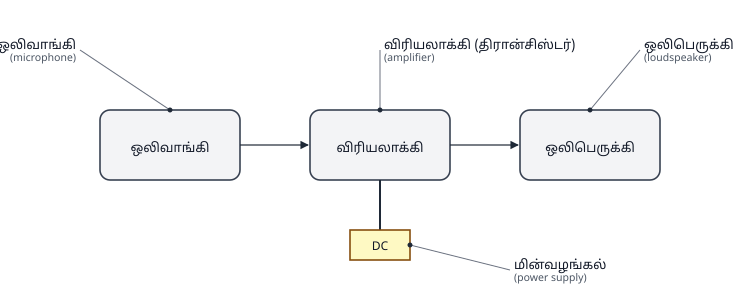

1. விரியலாக்கத்துக்கான சக்தி
2. சைகையின் வீச்சத்தைக் கூட்டல்
3. மின் → ஒலி
4. ஒலி → மின் சைகை

விடையும் விளக்கமும்

**விடை: (4) ஒலி → மின் சைகை**

ஒலிவாங்கி: ஒலி → மின் சைகை (கோப்பு 6: PHY-D08).

<!-- meta {"type":"mcq","id":"SCQ-11-11-012","grade":11,"chapter_id":"SC11-11","discipline":"PHY","difficulty":1,"qtype":"diagram","answer":1,"origin":"ORIGINAL","source_ref":"PHY-D08","image":"science_assets/physics/PHY-D08_labelled.svg"} -->
**SCQ-11-11-012** · அடிப்படை · வரிப்படம் · `ORIGINAL`

பொது அறிவிப்புத் தொகுதி (கட்டத் தொகுதி வரிப்படம்) வரிப்படத்தில் 'விரியலாக்கி (திரான்சிஸ்டர்)' (amplifier) இன் தொழில்?

1. சைகையின் வீச்சத்தைக் கூட்டல்
2. ஒலி → மின் சைகை
3. மின் → ஒலி
4. விரியலாக்கத்துக்கான சக்தி

விடையும் விளக்கமும்

**விடை: (1) சைகையின் வீச்சத்தைக் கூட்டல்**

விரியலாக்கி (திரான்சிஸ்டர்): சைகையின் வீச்சத்தைக் கூட்டல் (கோப்பு 6: PHY-D08).

<!-- meta {"type":"mcq","id":"SCQ-11-11-013","grade":11,"chapter_id":"SC11-11","discipline":"PHY","difficulty":1,"qtype":"diagram","answer":3,"origin":"ORIGINAL","source_ref":"PHY-D08","image":"science_assets/physics/PHY-D08_labelled.svg"} -->
**SCQ-11-11-013** · அடிப்படை · வரிப்படம் · `ORIGINAL`

பொது அறிவிப்புத் தொகுதி (கட்டத் தொகுதி வரிப்படம்) வரிப்படத்தில் 'ஒலிபெருக்கி' (loudspeaker) இன் தொழில்?

1. விரியலாக்கத்துக்கான சக்தி
2. ஒலி → மின் சைகை
3. மின் → ஒலி
4. சைகையின் வீச்சத்தைக் கூட்டல்

விடையும் விளக்கமும்

**விடை: (3) மின் → ஒலி**

ஒலிபெருக்கி: மின் → ஒலி (கோப்பு 6: PHY-D08).

<!-- meta {"type":"mcq","id":"SCQ-11-11-014","grade":11,"chapter_id":"SC11-11","discipline":"PHY","difficulty":1,"qtype":"recall","answer":2,"origin":"ORIGINAL","source_ref":"extra-SC11-11-1","image":null} -->
**SCQ-11-11-014** · அடிப்படை · நினைவு · `ORIGINAL`

சிலிக்கனின் வலுவளவு இலத்திரன்கள்?

1. 2
2. 4
3. 5
4. 3

விடையும் விளக்கமும்

**விடை: (2) 4**

கூட்டம் 14.

<!-- meta {"type":"mcq","id":"SCQ-11-11-015","grade":11,"chapter_id":"SC11-11","discipline":"PHY","difficulty":2,"qtype":"concept","answer":4,"origin":"ORIGINAL","source_ref":"extra-SC11-11-2","image":null} -->
**SCQ-11-11-015** · இடைநிலை · எண்ணக்கரு · `ORIGINAL`

தூய அரைக்கடத்தி?

1. p-வகை
2. காவலி
3. n-வகை
4. உள்ளார்ந்த (intrinsic) அரைக்கடத்தி

விடையும் விளக்கமும்

**விடை: (4) உள்ளார்ந்த (intrinsic) அரைக்கடத்தி**

மாசற்றது.

<!-- meta {"type":"mcq","id":"SCQ-11-11-016","grade":11,"chapter_id":"SC11-11","discipline":"PHY","difficulty":3,"qtype":"concept","answer":3,"origin":"ORIGINAL","source_ref":"extra-SC11-11-3","image":null} -->
**SCQ-11-11-016** · கடினம் · எண்ணக்கரு · `ORIGINAL`

p–n சந்தியில் உருவாகும் காவிகளற்ற பகுதி?

1. சேகரிப்பான்
2. மின்வாய்
3. வறள் பகுதி (depletion layer)
4. அடி

விடையும் விளக்கமும்

**விடை: (3) வறள் பகுதி (depletion layer)**

இலத்திரன்–துளை சேர்க்கை.

<!-- meta {"type":"mcq","id":"SCQ-11-11-017","grade":11,"chapter_id":"SC11-11","discipline":"PHY","difficulty":2,"qtype":"recall","answer":1,"origin":"ORIGINAL","source_ref":"extra-SC11-11-4","image":null} -->
**SCQ-11-11-017** · இடைநிலை · நினைவு · `ORIGINAL`

LED இன் நீண்ட கால் பொதுவாக?

1. அனோட்டு (+)
2. புவி
3. கதோட்டு (−)
4. அடி

விடையும் விளக்கமும்

**விடை: (1) அனோட்டு (+)**

முற்சார்புக்கு + இல் இணைக்க.

<!-- meta {"type":"mcq","id":"SCQ-11-11-018","grade":11,"chapter_id":"SC11-11","discipline":"PHY","difficulty":2,"qtype":"concept","answer":1,"origin":"ORIGINAL","source_ref":"extra-SC11-11-5","image":null} -->
**SCQ-11-11-018** · இடைநிலை · எண்ணக்கரு · `ORIGINAL`

ஒலிபெருக்கியின் கூம்பு அதிரும் மீடிறன் தீர்மானிப்பது?

1. ஒலியின் சுருதி
2. உரப்பு
3. வேகம்
4. நிறம்

விடையும் விளக்கமும்

**விடை: (1) ஒலியின் சுருதி**

மீடிறன் → சுருதி.

<!-- meta {"type":"mcq","id":"SCQ-11-11-019","grade":11,"chapter_id":"SC11-11","discipline":"PHY","difficulty":3,"qtype":"reasoning","answer":3,"origin":"ORIGINAL","source_ref":"extra-SC11-11-6","image":null} -->
**SCQ-11-11-019** · கடினம் · காரணம் காணல் · `ORIGINAL`

விரியலாக்கியின் வெளியீட்டு வலுவுக்கான சக்தி மூலம்?

1. ஒலிபெருக்கி
2. ஒலிவாங்கி
3. மின்வழங்கல் (DC)
4. திரான்சிஸ்டர் தானாக

விடையும் விளக்கமும்

**விடை: (3) மின்வழங்கல் (DC)**

திரான்சிஸ்டர் கட்டுப்படுத்தும் மட்டும்.

<!-- meta {"type":"mcq","id":"SCQ-11-11-020","grade":11,"chapter_id":"SC11-11","discipline":"PHY","difficulty":3,"qtype":"application","answer":2,"origin":"ORIGINAL","source_ref":"extra-SC11-11-7","image":null} -->
**SCQ-11-11-020** · கடினம் · பிரயோகம் · `ORIGINAL`

AC ஐ DC ஆக்கியபின் வெளியீட்டைச் சீராக்கப் பயன்படும் கூறு?

1. தடையி மட்டும்
2. கொள்ளளவி (capacitor)
3. ஆளி
4. LDR

விடையும் விளக்கமும்

**விடை: (2) கொள்ளளவி (capacitor)**

அலைவைக் குறைக்கும் (smoothing).

<!-- meta {"type":"mcq","id":"SCQ-11-11-021","grade":11,"chapter_id":"SC11-11","discipline":"PHY","difficulty":2,"qtype":"application","answer":4,"origin":"ORIGINAL","source_ref":"extra-SC11-11-8","image":null} -->
**SCQ-11-11-021** · இடைநிலை · பிரயோகம் · `ORIGINAL`

கைபேசி மின்னேற்றியின் உள்ளே காணப்படக்கூடியவை?

1. ஒலிபெருக்கி
2. ஏற்றும் நிலைமாற்றி மட்டும்
3. மோட்டர்
4. இறக்கும் நிலைமாற்றியும் திருத்தியும்

விடையும் விளக்கமும்

**விடை: (4) இறக்கும் நிலைமாற்றியும் திருத்தியும்**

230 V AC → குறைந்த DC.

<!-- meta {"type":"mcq","id":"SCQ-11-11-022","grade":11,"chapter_id":"SC11-11","discipline":"PHY","difficulty":1,"qtype":"application","answer":3,"origin":"ORIGINAL","source_ref":"extra-SC11-11-9","image":null} -->
**SCQ-11-11-022** · அடிப்படை · பிரயோகம் · `ORIGINAL`

இலத்திரனியல் கழிவுகளை (e-waste) முறையாக அகற்ற வேண்டியதற்கான காரணம்?

1. அவை கனமானவை
2. அவை எரியாது
3. ஈயம், பாதரசம் போன்ற நச்சுப் பொருட்கள்
4. அவை மணம் வீசும்

விடையும் விளக்கமும்

**விடை: (3) ஈயம், பாதரசம் போன்ற நச்சுப் பொருட்கள்**

மண், நீர் மாசு.

<!-- meta {"type":"mcq","id":"SCQ-11-11-023","grade":11,"chapter_id":"SC11-11","discipline":"PHY","difficulty":2,"qtype":"concept","answer":2,"origin":"ORIGINAL","source_ref":"extra-SC11-11-10","image":null} -->
**SCQ-11-11-023** · இடைநிலை · எண்ணக்கரு · `ORIGINAL`

திரான்சிஸ்டரின் கண்டுபிடிப்பு இலத்திரனியலில் ஏற்படுத்திய மாற்றம்?

1. பெரிய வெற்றிடக் குழாய்கள்
2. சிறிய, குறைந்த வலு உபகரணங்கள்
3. அதிக வெப்பம்
4. மின் தேவையில்லை

விடையும் விளக்கமும்

**விடை: (2) சிறிய, குறைந்த வலு உபகரணங்கள்**

வெற்றிடக் குழாய்களை மாற்றியது.

<!-- meta {"type":"mcq","id":"SCQ-11-11-024","grade":11,"chapter_id":"SC11-11","discipline":"PHY","difficulty":2,"qtype":"recall","answer":2,"origin":"ORIGINAL","source_ref":"extra-SC11-11-11","image":null} -->
**SCQ-11-11-024** · இடைநிலை · நினைவு · `ORIGINAL`

அரைக்கடத்தியில் வெப்பநிலை உணரியாகப் பயன்படும் கூறு?

1. உருகி
2. வெப்பத்தடையி (thermistor)
3. LED
4. ஆளி

விடையும் விளக்கமும்

**விடை: (2) வெப்பத்தடையி (thermistor)**

வெப்பநிலைக்கேற்பத் தடை மாறும்.

<!-- meta {"type":"mcq","id":"SCQ-11-11-025","grade":11,"chapter_id":"SC11-11","discipline":"PHY","difficulty":2,"qtype":"reasoning","answer":1,"origin":"ORIGINAL","source_ref":"extra-SC11-11-12","image":null} -->
**SCQ-11-11-025** · இடைநிலை · காரணம் காணல் · `ORIGINAL`

இருவாயிச் சுற்றில் குமிழ் எரியவில்லை; மின்கல முனைவை மாற்றியதும் எரிந்தது. ஆரம்பத்தில் இருவாயி?

1. பின்சார்பில்
2. பழுதானது
3. குறுஞ்சுற்றில்
4. முற்சார்பில்

விடையும் விளக்கமும்

**விடை: (1) பின்சார்பில்**

முனைவு மாற்ற முற்சார்பு.

## SC11-12: மின்னிரசாயனம் (Electrochemistry)

*தரம் 11 · அத்தியாயம் 12 · இரசாயனவியல் · 25 வினாக்கள்*

<!-- meta {"type":"mcq","id":"SCQ-11-12-001","grade":11,"chapter_id":"SC11-12","discipline":"CHE","difficulty":1,"qtype":"recall","answer":2,"origin":"ORIGINAL","source_ref":"chapter","image":null} -->
**SCQ-11-12-001** · அடிப்படை · நினைவு · `ORIGINAL`

உருகிய NaCl மின்பகுப்பில் கதோட்டில் உருவாவது?

1. Cl₂
2. Na
3. H₂
4. O₂

விடையும் விளக்கமும்

**விடை: (2) Na**

Na⁺ + e⁻ → Na.

<!-- meta {"type":"mcq","id":"SCQ-11-12-002","grade":11,"chapter_id":"SC11-12","discipline":"CHE","difficulty":1,"qtype":"application","answer":2,"origin":"ORIGINAL","source_ref":"chapter","image":null} -->
**SCQ-11-12-002** · அடிப்படை · பிரயோகம் · `ORIGINAL`

ஒரு கரண்டியை வெள்ளி முலாமிட அதை இணைக்க வேண்டியது?

1. அனோட்டாக
2. கதோட்டாக
3. மின்பகுபொருளில் மட்டும்
4. எதுவுமில்லை

விடையும் விளக்கமும்

**விடை: (2) கதோட்டாக**

Ag⁺ கதோட்டில் Ag ஆகப் படியும்.

<!-- meta {"type":"mcq","id":"SCQ-11-12-003","grade":11,"chapter_id":"SC11-12","discipline":"CHE","difficulty":3,"qtype":"reasoning","answer":2,"origin":"ORIGINAL","source_ref":"chapter","image":null} -->
**SCQ-11-12-003** · கடினம் · காரணம் காணல் · `ORIGINAL`

செறிவான நீர்க் NaCl மின்பகுப்பில் கதோட்டுக்கு அருகே பீனோல்ப்தலீன் இளஞ்சிவப்பாவதற்குக் காரணம்?

1. Cl₂ உருவாதல்
2. H₂ வெளியேறி OH⁻ செறிவு கூடல்
3. Na படிதல்
4. அமிலம் உருவாதல்

விடையும் விளக்கமும்

**விடை: (2) H₂ வெளியேறி OH⁻ செறிவு கூடல்**

2H₂O + 2e⁻ → H₂ + 2OH⁻.

<!-- meta {"type":"mcq","id":"SCQ-11-12-004","grade":11,"chapter_id":"SC11-12","discipline":"CHE","difficulty":2,"qtype":"concept","answer":2,"origin":"ORIGINAL","source_ref":"chapter","image":null} -->
**SCQ-11-12-004** · இடைநிலை · எண்ணக்கரு · `ORIGINAL`

Zn, Cu மின்வாய்களுடைய எளிய கலத்தில் இலத்திரன்கள் பாய்வது?

1. Cu இலிருந்து Zn க்கு
2. Zn இலிருந்து Cu க்கு வெளிச் சுற்றினூடு
3. கரைசலினூடு
4. பாய்வதில்லை

விடையும் விளக்கமும்

**விடை: (2) Zn இலிருந்து Cu க்கு வெளிச் சுற்றினூடு**

Zn தாக்கத்திறன் கூடியது — இலத்திரன்களை இழக்கும்.

<!-- meta {"type":"mcq","id":"SCQ-11-12-005","grade":11,"chapter_id":"SC11-12","discipline":"CHE","difficulty":2,"qtype":"experiment","answer":2,"origin":"ORIGINAL","source_ref":"chapter","image":null} -->
**SCQ-11-12-005** · இடைநிலை · பரிசோதனை · `ORIGINAL`

இரும்பு ஆணி துருப்பிடிக்காத நிலை?

1. ஈரக் காற்று
2. கொதித்து ஆறிய நீர் + எண்ணெய்ப் படை
3. கடல்நீர்
4. குழாய் நீர்

விடையும் விளக்கமும்

**விடை: (2) கொதித்து ஆறிய நீர் + எண்ணெய்ப் படை**

O₂ நீக்கப்பட்டது.

<!-- meta {"type":"mcq","id":"SCQ-11-12-006","grade":11,"chapter_id":"SC11-12","discipline":"CHE","difficulty":3,"qtype":"reasoning","answer":1,"origin":"ORIGINAL","source_ref":"chapter","image":null} -->
**SCQ-11-12-006** · கடினம் · காரணம் காணல் · `ORIGINAL`

நாகமுலாமிட்ட இரும்பில் கீறல் ஏற்பட்டாலும் துருப்பிடிக்காமைக்குக் காரணம்?

1. Zn தாக்கத்திறன் கூடியதால் முதலில் ஒட்சியேற்றமடையும்
2. Zn நீரைத் தடுக்கும்
3. Fe தாக்கமடையாது
4. Zn காந்தம்

விடையும் விளக்கமும்

**விடை: (1) Zn தாக்கத்திறன் கூடியதால் முதலில் ஒட்சியேற்றமடையும்**

தியாகப் பாதுகாப்பு.

<!-- meta {"type":"mcq","id":"SCQ-11-12-007","grade":11,"chapter_id":"SC11-12","discipline":"CHE","difficulty":2,"qtype":"concept","answer":2,"origin":"ORIGINAL","source_ref":"chapter","image":null} -->
**SCQ-11-12-007** · இடைநிலை · எண்ணக்கரு · `ORIGINAL`

அனோட்டில் 2Cl⁻ → Cl₂ + 2e⁻ — இது?

1. தாழ்த்தல்
2. ஒட்சியேற்றம்
3. நடுநிலையாக்கம்
4. வீழ்படிவு

விடையும் விளக்கமும்

**விடை: (2) ஒட்சியேற்றம்**

இலத்திரன் இழப்பு.

<!-- meta {"type":"mcq","id":"SCQ-11-12-008","grade":11,"chapter_id":"SC11-12","discipline":"CHE","difficulty":3,"qtype":"experiment","answer":2,"origin":"ORIGINAL","source_ref":"chapter","image":null} -->
**SCQ-11-12-008** · கடினம் · பரிசோதனை · `ORIGINAL`

Cu மின்வாய்களுடன் CuSO₄ மின்பகுப்பில் அனோட்டு?

1. திணிவு கூடும்
2. திணிவு குறையும்
3. மாறாது
4. O₂ வெளியேறும்

விடையும் விளக்கமும்

**விடை: (2) திணிவு குறையும்**

Cu → Cu²⁺ + 2e⁻ — அனோட்டு கரையும்.

<!-- meta {"type":"mcq","id":"SCQ-11-12-009","grade":11,"chapter_id":"SC11-12","discipline":"CHE","difficulty":1,"qtype":"concept","answer":2,"origin":"ORIGINAL","source_ref":"chapter","image":null} -->
**SCQ-11-12-009** · அடிப்படை · எண்ணக்கரு · `ORIGINAL`

மின்னிரசாயனக் கலம் செய்யும் சக்தி மாற்றம்?

1. மின் → இரசாயனம்
2. இரசாயனம் → மின்
3. வெப்பம் → மின்
4. ஒளி → இரசாயனம்

விடையும் விளக்கமும்

**விடை: (2) இரசாயனம் → மின்**

தன்னிச்சையான தாக்கம் மின் தரும்.

<!-- meta {"type":"mcq","id":"SCQ-11-12-010","grade":11,"chapter_id":"SC11-12","discipline":"CHE","difficulty":2,"qtype":"reasoning","answer":1,"origin":"ORIGINAL","source_ref":"chapter","image":null} -->
**SCQ-11-12-010** · இடைநிலை · காரணம் காணல் · `ORIGINAL`

திண்ம NaCl மின்பகுக்கப்பட முடியாததற்குக் காரணம்?

1. அயன்கள் அசைய முடியாது
2. அயன்கள் இல்லை
3. அது உலோகம்
4. நீர் இல்லை

விடையும் விளக்கமும்

**விடை: (1) அயன்கள் அசைய முடியாது**

உருகினால் அல்லது கரைந்தால் மட்டும்.

<!-- meta {"type":"mcq","id":"SCQ-11-12-011","grade":11,"chapter_id":"SC11-12","discipline":"CHE","difficulty":2,"qtype":"equation","answer":1,"origin":"ORIGINAL","source_ref":"EQ-046","image":null} -->
**SCQ-11-12-011** · இடைநிலை · சமன்பாடு · `ORIGINAL`

NaCl → Na + Cl₂ — இச்சமன்பாட்டை மிகச்சிறிய முழு எண் குணகங்களால் சமன்செய்யும்போது NaCl இன் குணகம்?

1. 2
2. 4
3. 7
4. 3

விடையும் விளக்கமும்

**விடை: (1) 2**

2NaCl → 2Na + Cl₂ (அணு எண்ணிக்கை சரிபார்க்கப்பட்டது; கோப்பு 7: EQ-046).

<!-- meta {"type":"mcq","id":"SCQ-11-12-012","grade":11,"chapter_id":"SC11-12","discipline":"CHE","difficulty":2,"qtype":"equation","answer":2,"origin":"ORIGINAL","source_ref":"EQ-047","image":null} -->
**SCQ-11-12-012** · இடைநிலை · சமன்பாடு · `ORIGINAL`

H₂O → H₂ + O₂ — இச்சமன்பாட்டை மிகச்சிறிய முழு எண் குணகங்களால் சமன்செய்யும்போது H₂O இன் குணகம்?

1. 3
2. 2
3. 4
4. 7

விடையும் விளக்கமும்

**விடை: (2) 2**

2H₂O → 2H₂ + O₂ (அணு எண்ணிக்கை சரிபார்க்கப்பட்டது; கோப்பு 7: EQ-047).

<!-- meta {"type":"mcq","id":"SCQ-11-12-013","grade":11,"chapter_id":"SC11-12","discipline":"CHE","difficulty":1,"qtype":"diagram","answer":4,"origin":"ORIGINAL","source_ref":"CHE-D02","image":"science_assets/chemistry/CHE-D02_labelled.svg"} -->
**SCQ-11-12-013** · அடிப்படை · வரிப்படம் · `ORIGINAL`

மின்பகுப்புக் கலம் வரிப்படத்தில் 'அனோட்டு (+)' (anode) இன் தொழில்?

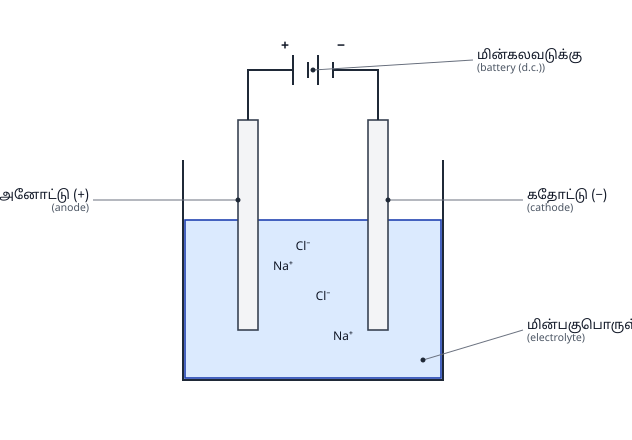

1. தாழ்த்தல் — கற்றயன்கள் இலத்திரன் பெறும்
2. நேரோட்ட மின்வழங்கல்
3. அயன்கள் அசைந்து மின் கடத்தும்
4. ஒட்சியேற்றம் — அனயன்கள் இலத்திரன் இழக்கும்

விடையும் விளக்கமும்

**விடை: (4) ஒட்சியேற்றம் — அனயன்கள் இலத்திரன் இழக்கும்**

அனோட்டு (+): ஒட்சியேற்றம் — அனயன்கள் இலத்திரன் இழக்கும் (கோப்பு 6: CHE-D02).

<!-- meta {"type":"mcq","id":"SCQ-11-12-014","grade":11,"chapter_id":"SC11-12","discipline":"CHE","difficulty":1,"qtype":"diagram","answer":2,"origin":"ORIGINAL","source_ref":"CHE-D02","image":"science_assets/chemistry/CHE-D02_labelled.svg"} -->
**SCQ-11-12-014** · அடிப்படை · வரிப்படம் · `ORIGINAL`

மின்பகுப்புக் கலம் வரிப்படத்தில் 'கதோட்டு (−)' (cathode) இன் தொழில்?

1. அயன்கள் அசைந்து மின் கடத்தும்
2. தாழ்த்தல் — கற்றயன்கள் இலத்திரன் பெறும்
3. நேரோட்ட மின்வழங்கல்
4. ஒட்சியேற்றம் — அனயன்கள் இலத்திரன் இழக்கும்

விடையும் விளக்கமும்

**விடை: (2) தாழ்த்தல் — கற்றயன்கள் இலத்திரன் பெறும்**

கதோட்டு (−): தாழ்த்தல் — கற்றயன்கள் இலத்திரன் பெறும் (கோப்பு 6: CHE-D02).

<!-- meta {"type":"mcq","id":"SCQ-11-12-015","grade":11,"chapter_id":"SC11-12","discipline":"CHE","difficulty":1,"qtype":"diagram","answer":4,"origin":"ORIGINAL","source_ref":"CHE-D02","image":"science_assets/chemistry/CHE-D02_labelled.svg"} -->
**SCQ-11-12-015** · அடிப்படை · வரிப்படம் · `ORIGINAL`

மின்பகுப்புக் கலம் வரிப்படத்தில் 'மின்பகுபொருள்' (electrolyte) இன் தொழில்?

1. நேரோட்ட மின்வழங்கல்
2. ஒட்சியேற்றம் — அனயன்கள் இலத்திரன் இழக்கும்
3. தாழ்த்தல் — கற்றயன்கள் இலத்திரன் பெறும்
4. அயன்கள் அசைந்து மின் கடத்தும்

விடையும் விளக்கமும்

**விடை: (4) அயன்கள் அசைந்து மின் கடத்தும்**

மின்பகுபொருள்: அயன்கள் அசைந்து மின் கடத்தும் (கோப்பு 6: CHE-D02).

<!-- meta {"type":"mcq","id":"SCQ-11-12-016","grade":11,"chapter_id":"SC11-12","discipline":"CHE","difficulty":1,"qtype":"diagram","answer":2,"origin":"ORIGINAL","source_ref":"CHE-D06","image":"science_assets/chemistry/CHE-D06_labelled.svg"} -->
**SCQ-11-12-016** · அடிப்படை · வரிப்படம் · `ORIGINAL`

எளிய மின்கலம் (Zn–Cu) வரிப்படத்தில் 'நாகத் தகடு (−)' (zinc plate (negative)) இன் தொழில்?

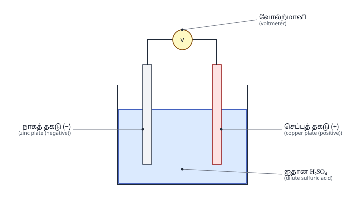

1. மின்பகுபொருள்
2. ஒட்சியேற்றம்: Zn → Zn²⁺ + 2e⁻
3. தாக்கத்திறன் குறைந்த உலோகம்
4. அழுத்த வேறுபாடு

விடையும் விளக்கமும்

**விடை: (2) ஒட்சியேற்றம்: Zn → Zn²⁺ + 2e⁻**

நாகத் தகடு (−): ஒட்சியேற்றம்: Zn → Zn²⁺ + 2e⁻ (கோப்பு 6: CHE-D06).

<!-- meta {"type":"mcq","id":"SCQ-11-12-017","grade":11,"chapter_id":"SC11-12","discipline":"CHE","difficulty":1,"qtype":"diagram","answer":1,"origin":"ORIGINAL","source_ref":"CHE-D06","image":"science_assets/chemistry/CHE-D06_labelled.svg"} -->
**SCQ-11-12-017** · அடிப்படை · வரிப்படம் · `ORIGINAL`

எளிய மின்கலம் (Zn–Cu) வரிப்படத்தில் 'செப்புத் தகடு (+)' (copper plate (positive)) இன் தொழில்?

1. தாக்கத்திறன் குறைந்த உலோகம்
2. மின்பகுபொருள்
3. அழுத்த வேறுபாடு
4. ஒட்சியேற்றம்: Zn → Zn²⁺ + 2e⁻

விடையும் விளக்கமும்

**விடை: (1) தாக்கத்திறன் குறைந்த உலோகம்**

செப்புத் தகடு (+): தாக்கத்திறன் குறைந்த உலோகம் (கோப்பு 6: CHE-D06).

<!-- meta {"type":"mcq","id":"SCQ-11-12-018","grade":11,"chapter_id":"SC11-12","discipline":"CHE","difficulty":1,"qtype":"diagram","answer":2,"origin":"ORIGINAL","source_ref":"CHE-D06","image":"science_assets/chemistry/CHE-D06_labelled.svg"} -->
**SCQ-11-12-018** · அடிப்படை · வரிப்படம் · `ORIGINAL`

எளிய மின்கலம் (Zn–Cu) வரிப்படத்தில் 'ஐதான H₂SO₄' (dilute sulfuric acid) இன் தொழில்?

1. அழுத்த வேறுபாடு
2. மின்பகுபொருள்
3. தாக்கத்திறன் குறைந்த உலோகம்
4. ஒட்சியேற்றம்: Zn → Zn²⁺ + 2e⁻

விடையும் விளக்கமும்

**விடை: (2) மின்பகுபொருள்**

ஐதான H₂SO₄: மின்பகுபொருள் (கோப்பு 6: CHE-D06).

<!-- meta {"type":"mcq","id":"SCQ-11-12-019","grade":11,"chapter_id":"SC11-12","discipline":"CHE","difficulty":1,"qtype":"concept","answer":1,"origin":"ORIGINAL","source_ref":"extra-SC11-12-1","image":null} -->
**SCQ-11-12-019** · அடிப்படை · எண்ணக்கரு · `ORIGINAL`

மின்பகுபொருள் என்றால்?

1. உருகிய/கரைந்த நிலையில் மின்னைக் கடத்தி இரசாயன மாற்றமடையும் பதார்த்தம்
2. உலோகக் கம்பி
3. வாயு மட்டும்
4. மின்னைக் கடத்தாத திண்மம்

விடையும் விளக்கமும்

**விடை: (1) உருகிய/கரைந்த நிலையில் மின்னைக் கடத்தி இரசாயன மாற்றமடையும் பதார்த்தம்**

அயன்கள் அசையும்.

<!-- meta {"type":"mcq","id":"SCQ-11-12-020","grade":11,"chapter_id":"SC11-12","discipline":"CHE","difficulty":1,"qtype":"concept","answer":2,"origin":"ORIGINAL","source_ref":"extra-SC11-12-2","image":null} -->
**SCQ-11-12-020** · அடிப்படை · எண்ணக்கரு · `ORIGINAL`

மின்பகுப்பில் அனோட்டில் நிகழ்வது?

1. வீழ்படிவாக்கல்
2. ஒட்சியேற்றம்
3. நடுநிலையாக்கல்
4. தாழ்த்தல்

விடையும் விளக்கமும்

**விடை: (2) ஒட்சியேற்றம்**

இலத்திரன் இழத்தல்.

<!-- meta {"type":"mcq","id":"SCQ-11-12-021","grade":11,"chapter_id":"SC11-12","discipline":"CHE","difficulty":2,"qtype":"reasoning","answer":2,"origin":"ORIGINAL","source_ref":"extra-SC11-12-3","image":null} -->
**SCQ-11-12-021** · இடைநிலை · காரணம் காணல் · `ORIGINAL`

அமிலமாக்கிய நீர் மின்பகுப்பில் கதோட்டு : அனோட்டு வாயுக் கனவளவு விகிதம்?

1. 3 : 1
2. 2 : 1 (H₂ : O₂)
3. 1 : 1
4. 1 : 2

விடையும் விளக்கமும்

**விடை: (2) 2 : 1 (H₂ : O₂)**

2H₂O → 2H₂ + O₂.

<!-- meta {"type":"mcq","id":"SCQ-11-12-022","grade":11,"chapter_id":"SC11-12","discipline":"CHE","difficulty":2,"qtype":"concept","answer":3,"origin":"ORIGINAL","source_ref":"extra-SC11-12-4","image":null} -->
**SCQ-11-12-022** · இடைநிலை · எண்ணக்கரு · `ORIGINAL`

உலோகங்களைச் சுத்திகரிக்கும் மின்பகுப்பில் தூய உலோகம் படிவது?

1. எங்குமில்லை
2. அனோட்டில்
3. கதோட்டில்
4. கரைசலின் மேல்

விடையும் விளக்கமும்

**விடை: (3) கதோட்டில்**

மாசுள்ள உலோகம் அனோட்டு.

<!-- meta {"type":"mcq","id":"SCQ-11-12-023","grade":11,"chapter_id":"SC11-12","discipline":"CHE","difficulty":2,"qtype":"reasoning","answer":1,"origin":"ORIGINAL","source_ref":"extra-SC11-12-5","image":null} -->
**SCQ-11-12-023** · இடைநிலை · காரணம் காணல் · `ORIGINAL`

எளிய கலத்தில் இலத்திரன்கள் வெளிச்சுற்றினூடு பாயும் திசை (Zn–Cu)?

1. Zn இலிருந்து Cu க்கு
2. Cu இலிருந்து Zn க்கு
3. பாயாது
4. இருதிசையும்

விடையும் விளக்கமும்

**விடை: (1) Zn இலிருந்து Cu க்கு**

Zn மறைமுனை.

<!-- meta {"type":"mcq","id":"SCQ-11-12-024","grade":11,"chapter_id":"SC11-12","discipline":"CHE","difficulty":3,"qtype":"reasoning","answer":1,"origin":"ORIGINAL","source_ref":"extra-SC11-12-6","image":null} -->
**SCQ-11-12-024** · கடினம் · காரணம் காணல் · `ORIGINAL`

எளிய கலத்தில் அழுத்த வேறுபாடு அதிகமாக இருக்க உலோகச் சோடி?

1. தாக்குதிறன் தொடரில் தூரமான உலோகங்கள் (உ-ம் Mg–Cu)
2. ஒரே உலோகம்
3. Cu–Ag
4. Fe–Fe

விடையும் விளக்கமும்

**விடை: (1) தாக்குதிறன் தொடரில் தூரமான உலோகங்கள் (உ-ம் Mg–Cu)**

தாக்குதிறன் வேறுபாடு.

<!-- meta {"type":"mcq","id":"SCQ-11-12-025","grade":11,"chapter_id":"SC11-12","discipline":"CHE","difficulty":3,"qtype":"reasoning","answer":3,"origin":"ORIGINAL","source_ref":"extra-SC11-12-7","image":null} -->
**SCQ-11-12-025** · கடினம் · காரணம் காணல் · `ORIGINAL`

நாகமுலாமிடப்பட்ட இரும்பில் கீறல் விழுந்தாலும் துருப்பிடிக்காததற்கான காரணம்?

1. நாகம் தாக்கமடையாது
2. இரும்பு தாக்குதிறன் கூடியது
3. நாகம் முதலில் ஒட்சியேறும் (தியாகப் பாதுகாப்பு)
4. நீர் இல்லை

விடையும் விளக்கமும்

**விடை: (3) நாகம் முதலில் ஒட்சியேறும் (தியாகப் பாதுகாப்பு)**

Zn > Fe.

## SC11-13: மின் காந்தவியலும் தூண்டலும் (Electromagnetism and electromagnetic induction)

*தரம் 11 · அத்தியாயம் 13 · பௌதிகவியல் · 25 வினாக்கள்*

<!-- meta {"type":"mcq","id":"SCQ-11-13-001","grade":11,"chapter_id":"SC11-13","discipline":"PHY","difficulty":1,"qtype":"calculation","answer":1,"origin":"ORIGINAL","source_ref":"chapter","image":null} -->
**SCQ-11-13-001** · அடிப்படை · கணிப்பு · `ORIGINAL`

நிலைமாற்றியில் Np = 1000, Ns = 50, Vp = 240 V. Vs?

1. 12 V
2. 4800 V
3. 24 V
4. 120 V

விடையும் விளக்கமும்

**விடை: (1) 12 V**

Vs = 240 × 50/1000.

<!-- meta {"type":"mcq","id":"SCQ-11-13-002","grade":11,"chapter_id":"SC11-13","discipline":"PHY","difficulty":2,"qtype":"reasoning","answer":1,"origin":"ORIGINAL","source_ref":"chapter","image":null} -->
**SCQ-11-13-002** · இடைநிலை · காரணம் காணல் · `ORIGINAL`

நிலைமாற்றி DC வழங்கலில் இயங்காததற்குக் காரணம்?

1. மாறும் காந்தப் பாயம் உருவாகாது
2. DC ஆபத்தானது
3. சுருள் உருகும்
4. அகணி இல்லை

விடையும் விளக்கமும்

**விடை: (1) மாறும் காந்தப் பாயம் உருவாகாது**

தூண்டலுக்குப் பாய மாற்றம் தேவை.

<!-- meta {"type":"mcq","id":"SCQ-11-13-003","grade":11,"chapter_id":"SC11-13","discipline":"PHY","difficulty":2,"qtype":"experiment","answer":2,"origin":"ORIGINAL","source_ref":"chapter","image":null} -->
**SCQ-11-13-003** · இடைநிலை · பரிசோதனை · `ORIGINAL`

காந்தத்தைச் சுருளினுள் விரைவாகச் செலுத்தினால் கல்வனோமானி திரும்பல்?

1. குறையும்
2. கூடும்
3. மாறாது
4. 0

விடையும் விளக்கமும்

**விடை: (2) கூடும்**

பாய மாற்ற வீதம் கூடும்.

<!-- meta {"type":"mcq","id":"SCQ-11-13-004","grade":11,"chapter_id":"SC11-13","discipline":"PHY","difficulty":1,"qtype":"concept","answer":1,"origin":"ORIGINAL","source_ref":"chapter","image":null} -->
**SCQ-11-13-004** · அடிப்படை · எண்ணக்கரு · `ORIGINAL`

DC மோட்டர் இயங்கும் கொள்கை?

1. காந்தப் புலத்திலுள்ள மின்னோட்டக் கடத்தியில் விசை
2. மின்காந்தத் தூண்டல் மட்டும்
3. வெப்ப விரிவு
4. முறிவு

விடையும் விளக்கமும்

**விடை: (1) காந்தப் புலத்திலுள்ள மின்னோட்டக் கடத்தியில் விசை**

இடக்கை விதி.

<!-- meta {"type":"mcq","id":"SCQ-11-13-005","grade":11,"chapter_id":"SC11-13","discipline":"PHY","difficulty":2,"qtype":"concept","answer":1,"origin":"ORIGINAL","source_ref":"chapter","image":null} -->
**SCQ-11-13-005** · இடைநிலை · எண்ணக்கரு · `ORIGINAL`

ஏற்றும் நிலைமாற்றியில்?

1. Vs > Vp, Is < Ip
2. Vs < Vp
3. Is > Ip
4. சக்தி கூடும்

விடையும் விளக்கமும்

**விடை: (1) Vs > Vp, Is < Ip**

சக்தி காக்கப்படும் (இலட்சியம்).

<!-- meta {"type":"mcq","id":"SCQ-11-13-006","grade":11,"chapter_id":"SC11-13","discipline":"PHY","difficulty":2,"qtype":"calculation","answer":1,"origin":"ORIGINAL","source_ref":"chapter","image":null} -->
**SCQ-11-13-006** · இடைநிலை · கணிப்பு · `ORIGINAL`

90% வினைத்திறனுடைய நிலைமாற்றியின் முதன்மை வலு 200 W. துணை வலு?

1. 180 W
2. 200 W
3. 222 W
4. 20 W

விடையும் விளக்கமும்

**விடை: (1) 180 W**

0.9 × 200.

<!-- meta {"type":"mcq","id":"SCQ-11-13-007","grade":11,"chapter_id":"SC11-13","discipline":"PHY","difficulty":2,"qtype":"reasoning","answer":1,"origin":"ORIGINAL","source_ref":"chapter","image":null} -->
**SCQ-11-13-007** · இடைநிலை · காரணம் காணல் · `ORIGINAL`

மின்காந்தத்தின் அகணியாக மென் இரும்பு பயன்படக் காரணம்?

1. எளிதில் காந்தமாகி மின்னோட்டம் நின்றதும் காந்தத்தை இழக்கும்
2. கனமானது
3. மலிவானது மட்டும்
4. மின்னைக் கடத்தாது

விடையும் விளக்கமும்

**விடை: (1) எளிதில் காந்தமாகி மின்னோட்டம் நின்றதும் காந்தத்தை இழக்கும்**

தற்காலிகக் காந்தம்.

<!-- meta {"type":"mcq","id":"SCQ-11-13-008","grade":11,"chapter_id":"SC11-13","discipline":"PHY","difficulty":3,"qtype":"reasoning","answer":1,"origin":"ORIGINAL","source_ref":"chapter","image":null} -->
**SCQ-11-13-008** · கடினம் · காரணம் காணல் · `ORIGINAL`

மின் விநியோகத்தில் உயர் அழுத்தத்தில் மின் பரிமாற்றப்படக் காரணம்?

1. மின்னோட்டம் குறைந்து I²R வெப்ப இழப்பு குறையும்
2. வேகம் கூடும்
3. பாதுகாப்பு
4. கம்பிகள் இலேசு

விடையும் விளக்கமும்

**விடை: (1) மின்னோட்டம் குறைந்து I²R வெப்ப இழப்பு குறையும்**

குறைந்த மின்னோட்டம் → குறைந்த இழப்பு.

<!-- meta {"type":"mcq","id":"SCQ-11-13-009","grade":11,"chapter_id":"SC11-13","discipline":"PHY","difficulty":2,"qtype":"concept","answer":1,"origin":"ORIGINAL","source_ref":"chapter","image":null} -->
**SCQ-11-13-009** · இடைநிலை · எண்ணக்கரு · `ORIGINAL`

வரிச்சுருளின் காந்தப் புலம் ஒத்திருப்பது?

1. சட்டக் காந்தம்
2. வட்டம்
3. புலம் இல்லை
4. U காந்தம் மட்டும்

விடையும் விளக்கமும்

**விடை: (1) சட்டக் காந்தம்**

முனைகள் N, S.

<!-- meta {"type":"mcq","id":"SCQ-11-13-010","grade":11,"chapter_id":"SC11-13","discipline":"PHY","difficulty":3,"qtype":"calculation","answer":1,"origin":"ORIGINAL","source_ref":"chapter","image":null} -->
**SCQ-11-13-010** · கடினம் · கணிப்பு · `ORIGINAL`

Vp = 230 V, Vs = 11.5 V, Ns = 100. Np?

1. 2000
2. 5
3. 1150
4. 200

விடையும் விளக்கமும்

**விடை: (1) 2000**

Np = 100 × 230/11.5.

<!-- meta {"type":"mcq","id":"SCQ-11-13-011","grade":11,"chapter_id":"SC11-13","discipline":"PHY","difficulty":1,"qtype":"diagram","answer":4,"origin":"ORIGINAL","source_ref":"PHY-D04","image":"science_assets/physics/PHY-D04_labelled.svg"} -->
**SCQ-11-13-011** · அடிப்படை · வரிப்படம் · `ORIGINAL`

சட்டக் காந்தத்தின் காந்தப் புலக் கோடுகள் வரிப்படத்தில் 'வடமுனை' (north pole) இன் தொழில்?

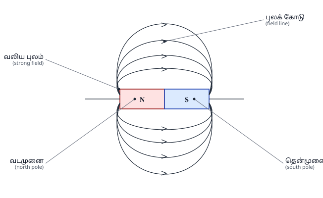

1. புலக் கோடுகள் உட்செல்லும்
2. கோடுகள் நெருக்கம் — முனைகளில்
3. N இலிருந்து S க்கு
4. புலக் கோடுகள் வெளியேறும்

விடையும் விளக்கமும்

**விடை: (4) புலக் கோடுகள் வெளியேறும்**

வடமுனை: புலக் கோடுகள் வெளியேறும் (கோப்பு 6: PHY-D04).

<!-- meta {"type":"mcq","id":"SCQ-11-13-012","grade":11,"chapter_id":"SC11-13","discipline":"PHY","difficulty":1,"qtype":"diagram","answer":4,"origin":"ORIGINAL","source_ref":"PHY-D04","image":"science_assets/physics/PHY-D04_labelled.svg"} -->
**SCQ-11-13-012** · அடிப்படை · வரிப்படம் · `ORIGINAL`

சட்டக் காந்தத்தின் காந்தப் புலக் கோடுகள் வரிப்படத்தில் 'தென்முனை' (south pole) இன் தொழில்?

1. கோடுகள் நெருக்கம் — முனைகளில்
2. N இலிருந்து S க்கு
3. புலக் கோடுகள் வெளியேறும்
4. புலக் கோடுகள் உட்செல்லும்

விடையும் விளக்கமும்

**விடை: (4) புலக் கோடுகள் உட்செல்லும்**

தென்முனை: புலக் கோடுகள் உட்செல்லும் (கோப்பு 6: PHY-D04).

<!-- meta {"type":"mcq","id":"SCQ-11-13-013","grade":11,"chapter_id":"SC11-13","discipline":"PHY","difficulty":1,"qtype":"diagram","answer":2,"origin":"ORIGINAL","source_ref":"PHY-D04","image":"science_assets/physics/PHY-D04_labelled.svg"} -->
**SCQ-11-13-013** · அடிப்படை · வரிப்படம் · `ORIGINAL`

சட்டக் காந்தத்தின் காந்தப் புலக் கோடுகள் வரிப்படத்தில் 'புலக் கோடு' (field line) இன் தொழில்?

1. கோடுகள் நெருக்கம் — முனைகளில்
2. N இலிருந்து S க்கு
3. புலக் கோடுகள் வெளியேறும்
4. புலக் கோடுகள் உட்செல்லும்

விடையும் விளக்கமும்

**விடை: (2) N இலிருந்து S க்கு**

புலக் கோடு: N இலிருந்து S க்கு (கோப்பு 6: PHY-D04).

<!-- meta {"type":"mcq","id":"SCQ-11-13-014","grade":11,"chapter_id":"SC11-13","discipline":"PHY","difficulty":2,"qtype":"calculation","answer":4,"origin":"ORIGINAL","source_ref":"param-SC11-13-1","image":null} -->
**SCQ-11-13-014** · இடைநிலை · கணிப்பு · `ORIGINAL`

நிலைமாற்றி: Vp = 240 V, Np = 1200, Ns = 60. Vs?

1. 240 V
2. 14400 V
3. 4800 V
4. 12 V

விடையும் விளக்கமும்

**விடை: (4) 12 V**

Vs = Vp × Ns/Np.

<!-- meta {"type":"mcq","id":"SCQ-11-13-015","grade":11,"chapter_id":"SC11-13","discipline":"PHY","difficulty":2,"qtype":"calculation","answer":4,"origin":"ORIGINAL","source_ref":"param-SC11-13-2","image":null} -->
**SCQ-11-13-015** · இடைநிலை · கணிப்பு · `ORIGINAL`

நிலைமாற்றி: Vp = 230 V, Np = 500, Ns = 2500. Vs?

1. 230 V
2. 46 V
3. 575000 V
4. 1150 V

விடையும் விளக்கமும்

**விடை: (4) 1150 V**

Vs = Vp × Ns/Np.

<!-- meta {"type":"mcq","id":"SCQ-11-13-016","grade":11,"chapter_id":"SC11-13","discipline":"PHY","difficulty":2,"qtype":"calculation","answer":2,"origin":"ORIGINAL","source_ref":"param-SC11-13-3","image":null} -->
**SCQ-11-13-016** · இடைநிலை · கணிப்பு · `ORIGINAL`

நிலைமாற்றி: Vp = 11000 V, Np = 5000, Ns = 100. Vs?

1. 550000 V
2. 220 V
3. 1.1 × 10⁶ V
4. 11000 V

விடையும் விளக்கமும்

**விடை: (2) 220 V**

Vs = Vp × Ns/Np.

<!-- meta {"type":"mcq","id":"SCQ-11-13-017","grade":11,"chapter_id":"SC11-13","discipline":"PHY","difficulty":2,"qtype":"calculation","answer":2,"origin":"ORIGINAL","source_ref":"param-SC11-13-4","image":null} -->
**SCQ-11-13-017** · இடைநிலை · கணிப்பு · `ORIGINAL`

நிலைமாற்றி: Vp = 120 V, Np = 300, Ns = 900. Vs?

1. 40 V
2. 360 V
3. 120 V
4. 108000 V

விடையும் விளக்கமும்

**விடை: (2) 360 V**

Vs = Vp × Ns/Np.

<!-- meta {"type":"mcq","id":"SCQ-11-13-018","grade":11,"chapter_id":"SC11-13","discipline":"PHY","difficulty":3,"qtype":"calculation","answer":1,"origin":"ORIGINAL","source_ref":"param-SC11-13-5","image":null} -->
**SCQ-11-13-018** · கடினம் · கணிப்பு · `ORIGINAL`

இலட்சிய நிலைமாற்றி: Vp = 230 V, Ip = 0.2 A, Vs = 23 V. Is?

1. 2 A
2. 10 A
3. 0.2 A
4. 0.02 A

விடையும் விளக்கமும்

**விடை: (1) 2 A**

VpIp = VsIs.

<!-- meta {"type":"mcq","id":"SCQ-11-13-019","grade":11,"chapter_id":"SC11-13","discipline":"PHY","difficulty":3,"qtype":"calculation","answer":4,"origin":"ORIGINAL","source_ref":"param-SC11-13-6","image":null} -->
**SCQ-11-13-019** · கடினம் · கணிப்பு · `ORIGINAL`

இலட்சிய நிலைமாற்றி: Vp = 120 V, Ip = 1 A, Vs = 12 V. Is?

1. 20 A
2. 0.1 A
3. 1 A
4. 10 A

விடையும் விளக்கமும்

**விடை: (4) 10 A**

VpIp = VsIs.

<!-- meta {"type":"mcq","id":"SCQ-11-13-020","grade":11,"chapter_id":"SC11-13","discipline":"PHY","difficulty":3,"qtype":"calculation","answer":4,"origin":"ORIGINAL","source_ref":"param-SC11-13-7","image":null} -->
**SCQ-11-13-020** · கடினம் · கணிப்பு · `ORIGINAL`

இலட்சிய நிலைமாற்றி: Vp = 240 V, Ip = 0.25 A, Vs = 6 V. Is?

1. 0.25 A
2. 40 A
3. 0.0063 A
4. 10 A

விடையும் விளக்கமும்

**விடை: (4) 10 A**

VpIp = VsIs.

<!-- meta {"type":"mcq","id":"SCQ-11-13-021","grade":11,"chapter_id":"SC11-13","discipline":"PHY","difficulty":2,"qtype":"calculation","answer":4,"origin":"ORIGINAL","source_ref":"param-SC11-13-8","image":null} -->
**SCQ-11-13-021** · இடைநிலை · கணிப்பு · `ORIGINAL`

நிலைமாற்றியின் முதன்மை வலு 400 W, வினைத்திறன் 85%. துணை வலு?

1. 680 W
2. 60 W
3. 470.5882 W
4. 340 W

விடையும் விளக்கமும்

**விடை: (4) 340 W**

Ps = η × Pp.

<!-- meta {"type":"mcq","id":"SCQ-11-13-022","grade":11,"chapter_id":"SC11-13","discipline":"PHY","difficulty":2,"qtype":"calculation","answer":1,"origin":"ORIGINAL","source_ref":"param-SC11-13-9","image":null} -->
**SCQ-11-13-022** · இடைநிலை · கணிப்பு · `ORIGINAL`

நிலைமாற்றியின் முதன்மை வலு 60 W, வினைத்திறன் 90%. துணை வலு?

1. 54 W
2. 108 W
3. 6 W
4. 66.6667 W

விடையும் விளக்கமும்

**விடை: (1) 54 W**

Ps = η × Pp.

<!-- meta {"type":"mcq","id":"SCQ-11-13-023","grade":11,"chapter_id":"SC11-13","discipline":"PHY","difficulty":2,"qtype":"calculation","answer":4,"origin":"ORIGINAL","source_ref":"param-SC11-13-10","image":null} -->
**SCQ-11-13-023** · இடைநிலை · கணிப்பு · `ORIGINAL`

நிலைமாற்றி: Vp = 240 V, Vs = 12 V, Np = 2000. Ns?

1. 24000
2. 2000
3. 40000
4. 100

விடையும் விளக்கமும்

**விடை: (4) 100**

Ns = Np × Vs/Vp.

<!-- meta {"type":"mcq","id":"SCQ-11-13-024","grade":11,"chapter_id":"SC11-13","discipline":"PHY","difficulty":2,"qtype":"calculation","answer":4,"origin":"ORIGINAL","source_ref":"param-SC11-13-11","image":null} -->
**SCQ-11-13-024** · இடைநிலை · கணிப்பு · `ORIGINAL`

நிலைமாற்றி: Vp = 230 V, Vs = 9 V, Np = 460. Ns?

1. 11755.5556
2. 460
3. 4140
4. 18

விடையும் விளக்கமும்

**விடை: (4) 18**

Ns = Np × Vs/Vp.

<!-- meta {"type":"mcq","id":"SCQ-11-13-025","grade":11,"chapter_id":"SC11-13","discipline":"PHY","difficulty":2,"qtype":"calculation","answer":1,"origin":"ORIGINAL","source_ref":"param-SC11-13-12","image":null} -->
**SCQ-11-13-025** · இடைநிலை · கணிப்பு · `ORIGINAL`

நிலைமாற்றி: Vp = 110 V, Vs = 220 V, Np = 400. Ns?

1. 800
2. 88000
3. 200
4. 400

விடையும் விளக்கமும்

**விடை: (1) 800**

Ns = Np × Vs/Vp.

## SC11-14: ஐதரோகாபன்களும் அவற்றின் பெறுதிகளும் (Hydrocarbons and their derivatives)

*தரம் 11 · அத்தியாயம் 14 · இரசாயனவியல் · 25 வினாக்கள்*

<!-- meta {"type":"mcq","id":"SCQ-11-14-001","grade":11,"chapter_id":"SC11-14","discipline":"CHE","difficulty":1,"qtype":"concept","answer":2,"origin":"ORIGINAL","source_ref":"chapter","image":null} -->
**SCQ-11-14-001** · அடிப்படை · எண்ணக்கரு · `ORIGINAL`

C₃H₆ எந்த ஓரினத்தொடர்?

1. அல்கேன்
2. அல்கீன்
3. அல்கைன்
4. அற்ககோல்

விடையும் விளக்கமும்

**விடை: (2) அல்கீன்**

CₙH₂ₙ (n = 3).

<!-- meta {"type":"mcq","id":"SCQ-11-14-002","grade":11,"chapter_id":"SC11-14","discipline":"CHE","difficulty":1,"qtype":"experiment","answer":3,"origin":"ORIGINAL","source_ref":"chapter","image":null} -->
**SCQ-11-14-002** · அடிப்படை · பரிசோதனை · `ORIGINAL`

புரோமீன் நீரை நிறமற்றதாக்குவது?

1. CH₄
2. C₂H₆
3. C₂H₄
4. C₃H₈

விடையும் விளக்கமும்

**விடை: (3) C₂H₄**

எதீன் நிரம்பாதது (C=C).

<!-- meta {"type":"mcq","id":"SCQ-11-14-003","grade":11,"chapter_id":"SC11-14","discipline":"CHE","difficulty":1,"qtype":"recall","answer":2,"origin":"ORIGINAL","source_ref":"chapter","image":null} -->
**SCQ-11-14-003** · அடிப்படை · நினைவு · `ORIGINAL`

பொலித்தீன் தயாரிக்கப் பயன்படும் ஒருபகுதியம்?

1. மெதேன்
2. எதீன்
3. எதனோல்
4. எதைன்

விடையும் விளக்கமும்

**விடை: (2) எதீன்**

எதீனின் கூட்டல் பல்பகுதியாக்கம்.

<!-- meta {"type":"mcq","id":"SCQ-11-14-004","grade":11,"chapter_id":"SC11-14","discipline":"CHE","difficulty":2,"qtype":"concept","answer":2,"origin":"ORIGINAL","source_ref":"chapter","image":null} -->
**SCQ-11-14-004** · இடைநிலை · எண்ணக்கரு · `ORIGINAL`

C, H மட்டும் கொண்ட பல்பகுதியம்?

1. PVC
2. பொலித்தீன்
3. நைலோன்
4. புரதம்

விடையும் விளக்கமும்

**விடை: (2) பொலித்தீன்**

PVC இல் Cl உண்டு (2019 வினாத்தாள் I வி27 வகை).

<!-- meta {"type":"mcq","id":"SCQ-11-14-005","grade":11,"chapter_id":"SC11-14","discipline":"CHE","difficulty":2,"qtype":"equation","answer":3,"origin":"ORIGINAL","source_ref":"chapter","image":null} -->
**SCQ-11-14-005** · இடைநிலை · சமன்பாடு · `ORIGINAL`

C₃H₈ + 5O₂ → 3CO₂ + 4H₂O. 1 mol புரொப்பேன் எரிய O₂?

1. 3 mol
2. 4 mol
3. 5 mol
4. 8 mol

விடையும் விளக்கமும்

**விடை: (3) 5 mol**

சமன்செய்த சமன்பாட்டிலிருந்து.

<!-- meta {"type":"mcq","id":"SCQ-11-14-006","grade":11,"chapter_id":"SC11-14","discipline":"CHE","difficulty":2,"qtype":"application","answer":1,"origin":"ORIGINAL","source_ref":"chapter","image":null} -->
**SCQ-11-14-006** · இடைநிலை · பிரயோகம் · `ORIGINAL`

மூடிய அறையில் எரிவாயு அடுப்பு — குறைத் தகனத்தின் ஆபத்து?

1. CO உருவாதல்
2. O₂ கூடல்
3. நீர் உருவாதல்
4. N₂ உருவாதல்

விடையும் விளக்கமும்

**விடை: (1) CO உருவாதல்**

CO நச்சு.

<!-- meta {"type":"mcq","id":"SCQ-11-14-007","grade":11,"chapter_id":"SC11-14","discipline":"CHE","difficulty":2,"qtype":"calculation","answer":2,"origin":"ORIGINAL","source_ref":"chapter","image":null} -->
**SCQ-11-14-007** · இடைநிலை · கணிப்பு · `ORIGINAL`

அல்கேன்களின் 4 ஆவது உறுப்பு?

1. C₄H₈
2. C₄H₁₀
3. C₄H₆
4. C₃H₈

விடையும் விளக்கமும்

**விடை: (2) C₄H₁₀**

n = 4: C₄H₁₀ (பியூற்றேன்).

<!-- meta {"type":"mcq","id":"SCQ-11-14-008","grade":11,"chapter_id":"SC11-14","discipline":"CHE","difficulty":1,"qtype":"recall","answer":2,"origin":"ORIGINAL","source_ref":"chapter","image":null} -->
**SCQ-11-14-008** · அடிப்படை · நினைவு · `ORIGINAL`

வினாகிரியிலுள்ள அமிலம்?

1. HCl
2. CH₃COOH
3. H₂SO₄
4. C₂H₅OH

விடையும் விளக்கமும்

**விடை: (2) CH₃COOH**

அசற்றிக்கமிலம்.

<!-- meta {"type":"mcq","id":"SCQ-11-14-009","grade":11,"chapter_id":"SC11-14","discipline":"CHE","difficulty":3,"qtype":"reasoning","answer":1,"origin":"ORIGINAL","source_ref":"chapter","image":null} -->
**SCQ-11-14-009** · கடினம் · காரணம் காணல் · `ORIGINAL`

பொலித்தீன் புரோமீன் நீரை நிறமற்றதாக்காமைக்குக் காரணம்?

1. C=C இல்லை — நிரம்பியது
2. நீரில் கரையாது
3. Br இல்லை
4. அது அல்கீன்

விடையும் விளக்கமும்

**விடை: (1) C=C இல்லை — நிரம்பியது**

பல்பகுதியாக்கத்தில் இரட்டைப் பிணைப்புத் திறக்கும்.

<!-- meta {"type":"mcq","id":"SCQ-11-14-010","grade":11,"chapter_id":"SC11-14","discipline":"CHE","difficulty":2,"qtype":"concept","answer":3,"origin":"ORIGINAL","source_ref":"chapter","image":null} -->
**SCQ-11-14-010** · இடைநிலை · எண்ணக்கரு · `ORIGINAL`

மசகெண்ணெய்ப் பகுதிபடக் காய்ச்சிவடித்தலில் மேலிருந்து பெறப்படுவது?

1. தார்
2. டீசல்
3. LP வாயு
4. உராய்வுநீக்கி

விடையும் விளக்கமும்

**விடை: (3) LP வாயு**

தாழ்ந்த கொதிநிலை — மேலே.

<!-- meta {"type":"mcq","id":"SCQ-11-14-011","grade":11,"chapter_id":"SC11-14","discipline":"CHE","difficulty":2,"qtype":"equation","answer":4,"origin":"ORIGINAL","source_ref":"EQ-034","image":null} -->
**SCQ-11-14-011** · இடைநிலை · சமன்பாடு · `ORIGINAL`

CH₄ + O₂ → CO₂ + H₂O — இச்சமன்பாட்டை மிகச்சிறிய முழு எண் குணகங்களால் சமன்செய்யும்போது O₂ இன் குணகம்?

1. 4
2. 3
3. 7
4. 2

விடையும் விளக்கமும்

**விடை: (4) 2**

CH₄ + 2O₂ → CO₂ + 2H₂O (அணு எண்ணிக்கை சரிபார்க்கப்பட்டது; கோப்பு 7: EQ-034).

<!-- meta {"type":"mcq","id":"SCQ-11-14-012","grade":11,"chapter_id":"SC11-14","discipline":"CHE","difficulty":2,"qtype":"equation","answer":1,"origin":"ORIGINAL","source_ref":"EQ-035","image":null} -->
**SCQ-11-14-012** · இடைநிலை · சமன்பாடு · `ORIGINAL`

C₂H₆ + O₂ → CO₂ + H₂O — இச்சமன்பாட்டை மிகச்சிறிய முழு எண் குணகங்களால் சமன்செய்யும்போது O₂ இன் குணகம்?

1. 7
2. 6
3. 8
4. 14

விடையும் விளக்கமும்

**விடை: (1) 7**

2C₂H₆ + 7O₂ → 4CO₂ + 6H₂O (அணு எண்ணிக்கை சரிபார்க்கப்பட்டது; கோப்பு 7: EQ-035).

<!-- meta {"type":"mcq","id":"SCQ-11-14-013","grade":11,"chapter_id":"SC11-14","discipline":"CHE","difficulty":2,"qtype":"equation","answer":1,"origin":"ORIGINAL","source_ref":"EQ-036","image":null} -->
**SCQ-11-14-013** · இடைநிலை · சமன்பாடு · `ORIGINAL`

C₃H₈ + O₂ → CO₂ + H₂O — இச்சமன்பாட்டை மிகச்சிறிய முழு எண் குணகங்களால் சமன்செய்யும்போது O₂ இன் குணகம்?

1. 5
2. 4
3. 6
4. 10

விடையும் விளக்கமும்

**விடை: (1) 5**

C₃H₈ + 5O₂ → 3CO₂ + 4H₂O (அணு எண்ணிக்கை சரிபார்க்கப்பட்டது; கோப்பு 7: EQ-036).

<!-- meta {"type":"mcq","id":"SCQ-11-14-014","grade":11,"chapter_id":"SC11-14","discipline":"CHE","difficulty":2,"qtype":"equation","answer":1,"origin":"ORIGINAL","source_ref":"EQ-037","image":null} -->
**SCQ-11-14-014** · இடைநிலை · சமன்பாடு · `ORIGINAL`

C₂H₅OH + O₂ → CO₂ + H₂O — இச்சமன்பாட்டை மிகச்சிறிய முழு எண் குணகங்களால் சமன்செய்யும்போது O₂ இன் குணகம்?

1. 3
2. 6
3. 4
4. 2

விடையும் விளக்கமும்

**விடை: (1) 3**

C₂H₅OH + 3O₂ → 2CO₂ + 3H₂O (அணு எண்ணிக்கை சரிபார்க்கப்பட்டது; கோப்பு 7: EQ-037).

<!-- meta {"type":"mcq","id":"SCQ-11-14-015","grade":11,"chapter_id":"SC11-14","discipline":"CHE","difficulty":2,"qtype":"equation","answer":3,"origin":"ORIGINAL","source_ref":"EQ-040","image":null} -->
**SCQ-11-14-015** · இடைநிலை · சமன்பாடு · `ORIGINAL`

C₆H₁₂O₆ → C₂H₅OH + CO₂ — இச்சமன்பாட்டை மிகச்சிறிய முழு எண் குணகங்களால் சமன்செய்யும்போது C₂H₅OH இன் குணகம்?

1. 3
2. 7
3. 2
4. 4

விடையும் விளக்கமும்

**விடை: (3) 2**

C₆H₁₂O₆ → 2C₂H₅OH + 2CO₂ (அணு எண்ணிக்கை சரிபார்க்கப்பட்டது; கோப்பு 7: EQ-040).

<!-- meta {"type":"mcq","id":"SCQ-11-14-016","grade":11,"chapter_id":"SC11-14","discipline":"CHE","difficulty":1,"qtype":"concept","answer":2,"origin":"ORIGINAL","source_ref":"param-SC11-14-1","image":null} -->
**SCQ-11-14-016** · அடிப்படை · எண்ணக்கரு · `ORIGINAL`

பியூற்றேன் இன் மூலக்கூற்றுச் சூத்திரம் (அல்கேன், CₙH₂ₙ₊₂)?

1. C₄H₈
2. C₄H₁₀
3. C₄H₆
4. C₄H₁₂

விடையும் விளக்கமும்

**விடை: (2) C₄H₁₀**

n = 4 → C₄H₁₀.

<!-- meta {"type":"mcq","id":"SCQ-11-14-017","grade":11,"chapter_id":"SC11-14","discipline":"CHE","difficulty":1,"qtype":"concept","answer":4,"origin":"ORIGINAL","source_ref":"param-SC11-14-2","image":null} -->
**SCQ-11-14-017** · அடிப்படை · எண்ணக்கரு · `ORIGINAL`

பென்ரேன் இன் மூலக்கூற்றுச் சூத்திரம் (அல்கேன், CₙH₂ₙ₊₂)?

1. C₅H₁₄
2. C₅H₈
3. C₅H₁₀
4. C₅H₁₂

விடையும் விளக்கமும்

**விடை: (4) C₅H₁₂**

n = 5 → C₅H₁₂.

<!-- meta {"type":"mcq","id":"SCQ-11-14-018","grade":11,"chapter_id":"SC11-14","discipline":"CHE","difficulty":1,"qtype":"concept","answer":4,"origin":"ORIGINAL","source_ref":"param-SC11-14-3","image":null} -->
**SCQ-11-14-018** · அடிப்படை · எண்ணக்கரு · `ORIGINAL`

எக்சேன் இன் மூலக்கூற்றுச் சூத்திரம் (அல்கேன், CₙH₂ₙ₊₂)?

1. C₆H₁₀
2. C₆H₁₂
3. C₆H₁₆
4. C₆H₁₄

விடையும் விளக்கமும்

**விடை: (4) C₆H₁₄**

n = 6 → C₆H₁₄.

<!-- meta {"type":"mcq","id":"SCQ-11-14-019","grade":11,"chapter_id":"SC11-14","discipline":"CHE","difficulty":1,"qtype":"concept","answer":3,"origin":"ORIGINAL","source_ref":"param-SC11-14-4","image":null} -->
**SCQ-11-14-019** · அடிப்படை · எண்ணக்கரு · `ORIGINAL`

எதேன் இன் மூலக்கூற்றுச் சூத்திரம் (அல்கேன், CₙH₂ₙ₊₂)?

1. C₂H₄
2. C₂H₂
3. C₂H₆
4. C₂H₈

விடையும் விளக்கமும்

**விடை: (3) C₂H₆**

n = 2 → C₂H₆.

<!-- meta {"type":"mcq","id":"SCQ-11-14-020","grade":11,"chapter_id":"SC11-14","discipline":"CHE","difficulty":2,"qtype":"calculation","answer":4,"origin":"ORIGINAL","source_ref":"param-SC11-14-5","image":null} -->
**SCQ-11-14-020** · இடைநிலை · கணிப்பு · `ORIGINAL`

3 காபன் அணுக்களுடைய அல்கேனின் சார் மூலக்கூற்றுத் திணிவு? (C 12, H 1)

1. 42
2. 39
3. 40
4. 44

விடையும் விளக்கமும்

**விடை: (4) 44**

C3H8.

<!-- meta {"type":"mcq","id":"SCQ-11-14-021","grade":11,"chapter_id":"SC11-14","discipline":"CHE","difficulty":2,"qtype":"calculation","answer":2,"origin":"ORIGINAL","source_ref":"param-SC11-14-6","image":null} -->
**SCQ-11-14-021** · இடைநிலை · கணிப்பு · `ORIGINAL`

4 காபன் அணுக்களுடைய அல்கேனின் சார் மூலக்கூற்றுத் திணிவு? (C 12, H 1)

1. 54
2. 58
3. 56
4. 52

விடையும் விளக்கமும்

**விடை: (2) 58**

C4H10.

<!-- meta {"type":"mcq","id":"SCQ-11-14-022","grade":11,"chapter_id":"SC11-14","discipline":"CHE","difficulty":2,"qtype":"calculation","answer":1,"origin":"ORIGINAL","source_ref":"param-SC11-14-7","image":null} -->
**SCQ-11-14-022** · இடைநிலை · கணிப்பு · `ORIGINAL`

5 காபன் அணுக்களுடைய அல்கேனின் சார் மூலக்கூற்றுத் திணிவு? (C 12, H 1)

1. 72
2. 68
3. 70
4. 65

விடையும் விளக்கமும்

**விடை: (1) 72**

C5H12.

<!-- meta {"type":"mcq","id":"SCQ-11-14-023","grade":11,"chapter_id":"SC11-14","discipline":"CHE","difficulty":2,"qtype":"calculation","answer":4,"origin":"ORIGINAL","source_ref":"param-SC11-14-8","image":null} -->
**SCQ-11-14-023** · இடைநிலை · கணிப்பு · `ORIGINAL`

1 mol C₂H₆ முற்றாக எரியும்போது உருவாகும் CO₂ மூல்?

1. 1 mol
2. 4 mol
3. 3 mol
4. 2 mol

விடையும் விளக்கமும்

**விடை: (4) 2 mol**

ஒவ்வொரு C உம் ஒரு CO₂.

<!-- meta {"type":"mcq","id":"SCQ-11-14-024","grade":11,"chapter_id":"SC11-14","discipline":"CHE","difficulty":2,"qtype":"calculation","answer":3,"origin":"ORIGINAL","source_ref":"param-SC11-14-9","image":null} -->
**SCQ-11-14-024** · இடைநிலை · கணிப்பு · `ORIGINAL`

1 mol C₃H₈ முற்றாக எரியும்போது உருவாகும் CO₂ மூல்?

1. 5 mol
2. 4 mol
3. 3 mol
4. 6 mol

விடையும் விளக்கமும்

**விடை: (3) 3 mol**

ஒவ்வொரு C உம் ஒரு CO₂.

<!-- meta {"type":"mcq","id":"SCQ-11-14-025","grade":11,"chapter_id":"SC11-14","discipline":"CHE","difficulty":1,"qtype":"calculation","answer":1,"origin":"ORIGINAL","source_ref":"param-SC11-14-10","image":null} -->
**SCQ-11-14-025** · அடிப்படை · கணிப்பு · `ORIGINAL`

எதீனின் (C₂H₄) சார் மூலக்கூற்றுத் திணிவு? (C 12, H 1)

1. 28
2. 30
3. 26
4. 24

விடையும் விளக்கமும்

**விடை: (1) 28**

2 × 12 + 4 = 28.

## SC11-15: உயிர்க் கோளம் (Biosphere (Grade 11))

*தரம் 11 · அத்தியாயம் 15 · உயிரியல் · 25 வினாக்கள்*

<!-- meta {"type":"mcq","id":"SCQ-11-15-001","grade":11,"chapter_id":"SC11-15","discipline":"BIO","difficulty":1,"qtype":"recall","answer":2,"origin":"ORIGINAL","source_ref":"chapter","image":null} -->
**SCQ-11-15-001** · அடிப்படை · நினைவு · `ORIGINAL`

அமில மழைக்குப் பிரதான காரணம்?

1. CO₂, O₂
2. SO₂, NO₂
3. N₂, O₂
4. CH₄, H₂

விடையும் விளக்கமும்

**விடை: (2) SO₂, NO₂**

SO₂ உம் NO₂ உம் நீருடன் அமிலங்களாகும்.

<!-- meta {"type":"mcq","id":"SCQ-11-15-002","grade":11,"chapter_id":"SC11-15","discipline":"BIO","difficulty":1,"qtype":"recall","answer":2,"origin":"ORIGINAL","source_ref":"chapter","image":null} -->
**SCQ-11-15-002** · அடிப்படை · நினைவு · `ORIGINAL`

ஓசோன் படையைச் சிதைக்கும் பதார்த்தம்?

1. CO₂
2. CFC
3. N₂
4. நீராவி

விடையும் விளக்கமும்

**விடை: (2) CFC**

CFC இலுள்ள Cl அணுக்கள் O₃ ஐச் சிதைக்கும்.

<!-- meta {"type":"mcq","id":"SCQ-11-15-003","grade":11,"chapter_id":"SC11-15","discipline":"BIO","difficulty":2,"qtype":"reasoning","answer":1,"origin":"ORIGINAL","source_ref":"chapter","image":null} -->
**SCQ-11-15-003** · இடைநிலை · காரணம் காணல் · `ORIGINAL`

பசளை கலந்த நீர் குளத்தில் சேர்ந்தபின் மீன்கள் இறப்பதற்கான சரியான ஒழுங்கு?

1. அல்காப் பெருக்கம் → பிரிகையாக்கிகள் O₂ ஐப் பயன்படுத்தல் → O₂ குறைவு
2. O₂ கூடல் → அல்கா இறப்பு
3. pH கூடல் → நீர் ஆவியாதல்
4. வெப்பம் குறைதல்

விடையும் விளக்கமும்

**விடை: (1) அல்காப் பெருக்கம் → பிரிகையாக்கிகள் O₂ ஐப் பயன்படுத்தல் → O₂ குறைவு**

போசணைச் செறிவாக்கத்தின் படிமுறை.

<!-- meta {"type":"mcq","id":"SCQ-11-15-004","grade":11,"chapter_id":"SC11-15","discipline":"BIO","difficulty":2,"qtype":"concept","answer":1,"origin":"ORIGINAL","source_ref":"chapter","image":null} -->
**SCQ-11-15-004** · இடைநிலை · எண்ணக்கரு · `ORIGINAL`

பாதரசம் உணவுச் சங்கிலியின் உச்ச நுகர்வோரில் அதிகம் காணப்படக் காரணம்?

1. உயிர்ப் பெருக்கம்
2. ஒளித்தொகுப்பு
3. பிரிகை
4. ஆவியாதல்

விடையும் விளக்கமும்

**விடை: (1) உயிர்ப் பெருக்கம்**

அழியாமல் ஒவ்வொரு மட்டத்திலும் செறிவு கூடும்.

<!-- meta {"type":"mcq","id":"SCQ-11-15-005","grade":11,"chapter_id":"SC11-15","discipline":"BIO","difficulty":2,"qtype":"application","answer":2,"origin":"ORIGINAL","source_ref":"chapter","image":null} -->
**SCQ-11-15-005** · இடைநிலை · பிரயோகம் · `ORIGINAL`

உணவு மைலைக் குறைப்பதன் நோக்கம்?

1. உணவு விலையைக் கூட்டல்
2. போக்குவரத்தால் வெளியாகும் CO₂ ஐக் குறைத்தல்
3. உணவின் சுவையைக் கூட்டல்
4. ஏற்றுமதியைக் கூட்டல்

விடையும் விளக்கமும்

**விடை: (2) போக்குவரத்தால் வெளியாகும் CO₂ ஐக் குறைத்தல்**

நீண்ட தூரப் போக்குவரத்து எரிபொருள் தகனம்.

<!-- meta {"type":"mcq","id":"SCQ-11-15-006","grade":11,"chapter_id":"SC11-15","discipline":"BIO","difficulty":2,"qtype":"concept","answer":3,"origin":"ORIGINAL","source_ref":"chapter","image":null} -->
**SCQ-11-15-006** · இடைநிலை · எண்ணக்கரு · `ORIGINAL`

பச்சை வீட்டு வாயு அல்லாதது?

1. CO₂
2. CH₄
3. N₂
4. N₂O

விடையும் விளக்கமும்

**விடை: (3) N₂**

N₂ வெப்பக் கதிர்ப்பை உறிஞ்சாது.

<!-- meta {"type":"mcq","id":"SCQ-11-15-007","grade":11,"chapter_id":"SC11-15","discipline":"BIO","difficulty":2,"qtype":"reasoning","answer":2,"origin":"ORIGINAL","source_ref":"chapter","image":null} -->
**SCQ-11-15-007** · இடைநிலை · காரணம் காணல் · `ORIGINAL`

காபன் மொனொட்சைட்டு நச்சாவதற்குக் காரணம்?

1. அமிலமாவதால்
2. ஈமோகுளோபினுடன் உறுதியாக இணைவதால்
3. ஓசோனைச் சிதைப்பதால்
4. நீரில் கரைவதால்

விடையும் விளக்கமும்

**விடை: (2) ஈமோகுளோபினுடன் உறுதியாக இணைவதால்**

O₂ கடத்தல் தடைப்படும்.

<!-- meta {"type":"mcq","id":"SCQ-11-15-008","grade":11,"chapter_id":"SC11-15","discipline":"BIO","difficulty":1,"qtype":"application","answer":2,"origin":"ORIGINAL","source_ref":"chapter","image":null} -->
**SCQ-11-15-008** · அடிப்படை · பிரயோகம் · `ORIGINAL`

நிலைபேறான அபிவிருத்திக்கு உதாரணம்?

1. காடழிப்பு
2. சூரியசக்திப் பாவனை
3. நிலக்கரி அதிகரிப்பு
4. பிளாத்திக்கு எரித்தல்

விடையும் விளக்கமும்

**விடை: (2) சூரியசக்திப் பாவனை**

புதுப்பிக்கக்கூடிய சக்தி.

<!-- meta {"type":"mcq","id":"SCQ-11-15-009","grade":11,"chapter_id":"SC11-15","discipline":"BIO","difficulty":2,"qtype":"concept","answer":2,"origin":"ORIGINAL","source_ref":"chapter","image":null} -->
**SCQ-11-15-009** · இடைநிலை · எண்ணக்கரு · `ORIGINAL`

உயிர்வாயுத் தொட்டியில் CH₄ உருவாக்கும் நிபந்தனை?

1. காற்றுள்ள சூழல்
2. காற்றின்றிய சூழலில் பக்ரீரியாப் பிரிகை
3. உயர் வெப்பம் 200 °C
4. ஒளி

விடையும் விளக்கமும்

**விடை: (2) காற்றின்றிய சூழலில் பக்ரீரியாப் பிரிகை**

காற்றின்றிய சமிபாடு (anaerobic digestion).

<!-- meta {"type":"mcq","id":"SCQ-11-15-010","grade":11,"chapter_id":"SC11-15","discipline":"BIO","difficulty":3,"qtype":"application","answer":2,"origin":"ORIGINAL","source_ref":"chapter","image":null} -->
**SCQ-11-15-010** · கடினம் · பிரயோகம் · `ORIGINAL`

ஒளி இரசாயனப் புகைப்பனி அதிகம் ஏற்படுவது?

1. இரவில் கிராமங்களில்
2. வெயில் நாட்களில் வாகன நெரிசல் நகரங்களில்
3. மழைநாட்களில்
4. கடலில்

விடையும் விளக்கமும்

**விடை: (2) வெயில் நாட்களில் வாகன நெரிசல் நகரங்களில்**

NOₓ + ஐதரோகாபன் + சூரிய ஒளி.

<!-- meta {"type":"mcq","id":"SCQ-11-15-011","grade":11,"chapter_id":"SC11-15","discipline":"BIO","difficulty":1,"qtype":"recall","answer":1,"origin":"ORIGINAL","source_ref":"extra-SC11-15-1","image":null} -->
**SCQ-11-15-011** · அடிப்படை · நினைவு · `ORIGINAL`

இலங்கையின் ஈரவலய மழைக்காடு — உலக மரபுரிமைத் தளம்?

1. சிங்கராஜ வனம்
2. யால
3. வில்பத்து
4. மின்னேரியா

விடையும் விளக்கமும்

**விடை: (1) சிங்கராஜ வனம்**

உயிர்ப் பல்வகைமை அதிகம்.

<!-- meta {"type":"mcq","id":"SCQ-11-15-012","grade":11,"chapter_id":"SC11-15","discipline":"BIO","difficulty":2,"qtype":"concept","answer":4,"origin":"ORIGINAL","source_ref":"extra-SC11-15-2","image":null} -->
**SCQ-11-15-012** · இடைநிலை · எண்ணக்கரு · `ORIGINAL`

பச்சைவீட்டு வாயு அல்லாதது?

1. நீராவி
2. மெதேன்
3. CO₂
4. நைதரசன் (N₂)

விடையும் விளக்கமும்

**விடை: (4) நைதரசன் (N₂)**

N₂ அகச்சிவப்பை உறிஞ்சாது.

<!-- meta {"type":"mcq","id":"SCQ-11-15-013","grade":11,"chapter_id":"SC11-15","discipline":"BIO","difficulty":1,"qtype":"recall","answer":4,"origin":"ORIGINAL","source_ref":"extra-SC11-15-3","image":null} -->
**SCQ-11-15-013** · அடிப்படை · நினைவு · `ORIGINAL`

அமில மழைக்கு முக்கிய காரணமான வாயுக்கள்?

1. O₂, N₂
2. He, Ne
3. H₂, CO
4. SO₂, NO₂

விடையும் விளக்கமும்

**விடை: (4) SO₂, NO₂**

நீருடன் அமிலங்களாகும்.

<!-- meta {"type":"mcq","id":"SCQ-11-15-014","grade":11,"chapter_id":"SC11-15","discipline":"BIO","difficulty":2,"qtype":"application","answer":3,"origin":"ORIGINAL","source_ref":"extra-SC11-15-4","image":null} -->
**SCQ-11-15-014** · இடைநிலை · பிரயோகம் · `ORIGINAL`

அமில மழையின் ஒரு விளைவு?

1. ஓசோன் கூடுதல்
2. மண் வளம் கூடுதல்
3. சுண்ணக்கல் கட்டடங்கள் அரிப்பு
4. ஒளித்தொகுப்பு கூடுதல்

விடையும் விளக்கமும்

**விடை: (3) சுண்ணக்கல் கட்டடங்கள் அரிப்பு**

CaCO₃ அமிலத்துடன் தாக்கமடையும்.

<!-- meta {"type":"mcq","id":"SCQ-11-15-015","grade":11,"chapter_id":"SC11-15","discipline":"BIO","difficulty":2,"qtype":"reasoning","answer":1,"origin":"ORIGINAL","source_ref":"extra-SC11-15-5","image":null} -->
**SCQ-11-15-015** · இடைநிலை · காரணம் காணல் · `ORIGINAL`

இடத்துக்குரிய இனங்கள் (endemic species) பாதுகாப்பு முக்கியமானதற்கான காரணம்?

1. உலகில் வேறெங்கும் இல்லை — அழிந்தால் நிரந்தர இழப்பு
2. எல்லா நாடுகளிலும் உண்டு
3. எண்ணிக்கை அதிகம்
4. பொருளாதாரம் மட்டும்

விடையும் விளக்கமும்

**விடை: (1) உலகில் வேறெங்கும் இல்லை — அழிந்தால் நிரந்தர இழப்பு**

இலங்கையில் பல இடத்துக்குரிய இனங்கள்.

<!-- meta {"type":"mcq","id":"SCQ-11-15-016","grade":11,"chapter_id":"SC11-15","discipline":"BIO","difficulty":2,"qtype":"application","answer":3,"origin":"ORIGINAL","source_ref":"extra-SC11-15-6","image":null} -->
**SCQ-11-15-016** · இடைநிலை · பிரயோகம் · `ORIGINAL`

சதுப்புநிலத் தாவரங்களின் (mangroves) ஒரு சூழல் சேவை?

1. அமில மழை
2. ஓசோன் சிதைவு
3. கரையோர அரிப்பையும் சுனாமி தாக்கத்தையும் குறைத்தல்
4. பாலைவனமாக்கல்

விடையும் விளக்கமும்

**விடை: (3) கரையோர அரிப்பையும் சுனாமி தாக்கத்தையும் குறைத்தல்**

மீன் இனப்பெருக்க இடமும்.

<!-- meta {"type":"mcq","id":"SCQ-11-15-017","grade":11,"chapter_id":"SC11-15","discipline":"BIO","difficulty":2,"qtype":"application","answer":2,"origin":"ORIGINAL","source_ref":"extra-SC11-15-7","image":null} -->
**SCQ-11-15-017** · இடைநிலை · பிரயோகம் · `ORIGINAL`

ஆக்கிரமிப்பு அன்னிய இனம் (invasive species) இலங்கையில் உதாரணம்?

1. தென்னை
2. ஆகாயத்தாமரை (Water hyacinth)
3. யானை
4. தாமரை

விடையும் விளக்கமும்

**விடை: (2) ஆகாயத்தாமரை (Water hyacinth)**

நீர்நிலைகளை மூடும்.

<!-- meta {"type":"mcq","id":"SCQ-11-15-018","grade":11,"chapter_id":"SC11-15","discipline":"BIO","difficulty":1,"qtype":"concept","answer":4,"origin":"ORIGINAL","source_ref":"extra-SC11-15-8","image":null} -->
**SCQ-11-15-018** · அடிப்படை · எண்ணக்கரு · `ORIGINAL`

புதைபடிவ எரிபொருள் தகனம் அதிகரிக்கச் செய்வது?

1. ஓசோன்
2. நைதரசன்
3. ஆர்கன்
4. வளிமண்டல CO₂

விடையும் விளக்கமும்

**விடை: (4) வளிமண்டல CO₂**

பூகோள வெப்பமடைதல்.

<!-- meta {"type":"mcq","id":"SCQ-11-15-019","grade":11,"chapter_id":"SC11-15","discipline":"BIO","difficulty":2,"qtype":"reasoning","answer":4,"origin":"ORIGINAL","source_ref":"extra-SC11-15-9","image":null} -->
**SCQ-11-15-019** · இடைநிலை · காரணம் காணல் · `ORIGINAL`

கடல் மட்ட உயர்வுக்கு நேரடிக் காரணம்?

1. மழை குறைவு
2. அமில மழை
3. ஓசோன்
4. பனிப்பாறை உருகலும் நீரின் வெப்ப விரிவும்

விடையும் விளக்கமும்

**விடை: (4) பனிப்பாறை உருகலும் நீரின் வெப்ப விரிவும்**

பூகோள வெப்பமடைதல் விளைவு.

<!-- meta {"type":"mcq","id":"SCQ-11-15-020","grade":11,"chapter_id":"SC11-15","discipline":"BIO","difficulty":1,"qtype":"recall","answer":3,"origin":"ORIGINAL","source_ref":"extra-SC11-15-10","image":null} -->
**SCQ-11-15-020** · அடிப்படை · நினைவு · `ORIGINAL`

3R கொள்கை?

1. வாங்குதல், விற்றல், வீசுதல்
2. எரித்தல், புதைத்தல், வீசுதல்
3. குறைத்தல், மீள்பயன்பாடு, மீள்சுழற்சி
4. நடுதல், வெட்டுதல், எரித்தல்

விடையும் விளக்கமும்

**விடை: (3) குறைத்தல், மீள்பயன்பாடு, மீள்சுழற்சி**

Reduce, Reuse, Recycle.

<!-- meta {"type":"mcq","id":"SCQ-11-15-021","grade":11,"chapter_id":"SC11-15","discipline":"BIO","difficulty":2,"qtype":"application","answer":3,"origin":"ORIGINAL","source_ref":"extra-SC11-15-11","image":null} -->
**SCQ-11-15-021** · இடைநிலை · பிரயோகம் · `ORIGINAL`

கரிம விவசாயத்தின் சூழல் நன்மை?

1. நீர் தேவையில்லை
2. விளைச்சல் எப்போதும் இருமடங்கு
3. இரசாயனப் பசளை, பீடைநாசினி மாசு குறைவு
4. மண் தேவையில்லை

விடையும் விளக்கமும்

**விடை: (3) இரசாயனப் பசளை, பீடைநாசினி மாசு குறைவு**

நிலைபேறான விவசாயம்.

<!-- meta {"type":"mcq","id":"SCQ-11-15-022","grade":11,"chapter_id":"SC11-15","discipline":"BIO","difficulty":1,"qtype":"application","answer":3,"origin":"ORIGINAL","source_ref":"extra-SC11-15-12","image":null} -->
**SCQ-11-15-022** · அடிப்படை · பிரயோகம் · `ORIGINAL`

ஒலி மாசடைதலின் ஒரு சுகாதார விளைவு?

1. தோல் புற்றுநோய்
2. கண்டக்கழலை
3. கேட்டல் குறைபாடு, மன அழுத்தம்
4. குருதிச் சோகை

விடையும் விளக்கமும்

**விடை: (3) கேட்டல் குறைபாடு, மன அழுத்தம்**

நீண்டகால உரத்த ஒலி.

<!-- meta {"type":"mcq","id":"SCQ-11-15-023","grade":11,"chapter_id":"SC11-15","discipline":"BIO","difficulty":2,"qtype":"concept","answer":3,"origin":"ORIGINAL","source_ref":"extra-SC11-15-13","image":null} -->
**SCQ-11-15-023** · இடைநிலை · எண்ணக்கரு · `ORIGINAL`

யூற்றோபிக்கேசனுக்குக் காரணமான மாசுபடுத்திகள்?

1. CO₂
2. வெப்பம்
3. நைத்திரேற்று, பொசுபேற்றுப் பசளைகள்
4. பிளாத்திக்கு

விடையும் விளக்கமும்

**விடை: (3) நைத்திரேற்று, பொசுபேற்றுப் பசளைகள்**

அல்கா மிகை வளர்ச்சி.

<!-- meta {"type":"mcq","id":"SCQ-11-15-024","grade":11,"chapter_id":"SC11-15","discipline":"BIO","difficulty":2,"qtype":"application","answer":2,"origin":"ORIGINAL","source_ref":"extra-SC11-15-14","image":null} -->
**SCQ-11-15-024** · இடைநிலை · பிரயோகம் · `ORIGINAL`

ஈரநிலங்களின் (wetlands) ஒரு பயன்?

1. அமில மழை உருவாக்கம்
2. வெள்ளநீரைத் தேக்கி வடிகட்டல்
3. பாலைவனம்
4. எரிமலை

விடையும் விளக்கமும்

**விடை: (2) வெள்ளநீரைத் தேக்கி வடிகட்டல்**

இயற்கை வடிகட்டி.

<!-- meta {"type":"mcq","id":"SCQ-11-15-025","grade":11,"chapter_id":"SC11-15","discipline":"BIO","difficulty":1,"qtype":"application","answer":4,"origin":"ORIGINAL","source_ref":"extra-SC11-15-15","image":null} -->
**SCQ-11-15-025** · அடிப்படை · பிரயோகம் · `ORIGINAL`

காபன் அடிச்சுவடு (carbon footprint) குறைக்கும் ஒரு வழி?

1. மின் விளக்குகளைத் தொடர்ந்து எரியவிடல்
2. விமானப் பயணம் கூட்டல்
3. அதிக இறைச்சி உணவு
4. பொதுப் போக்குவரத்து/சைக்கிள் பயன்பாடு

விடையும் விளக்கமும்

**விடை: (4) பொதுப் போக்குவரத்து/சைக்கிள் பயன்பாடு**

எரிபொருள் தகனம் குறைவு.

---

## வரையறைகள் (Limitations)

- இலக்கு 25–40 வினாக்கள்/அத்தியாயம்; உண்மை வீச்சு 25–30 (மொத்தம் 899).
- ஒவ்வொரு அத்தியாயத்திலும் மேலும் 4 அசல் வினாக்கள் மாதிரிப் பரீட்சைகளுக்காக ஒதுக்கப்பட்டுள்ளன (கோப்பு 9) — இரட்டிப்பு இல்லை.
- நேரக்கணிப்பு, புள்ளியிடல், சீரற்ற ஒழுங்கு போன்ற ஊடாடும் வசதிகள் இணையத்தளத்தில் உருவாக்கப்பட வேண்டும்.
